# Chuyên đề: Trích xuất Thực thể, Quan hệ & Sự kiện (Entity, Relation & Event Extraction)

## 1. Tổng quan Chuyên đề
Trích xuất Thông tin (Information Extraction - IE) là quá trình tự động cấu trúc hóa dữ liệu phi cấu trúc (Unstructured Text) thành các bộ dữ liệu có cấu trúc định lượng (Structured Data) như Đồ thị Tri thức (Knowledge Graphs), bảng quan hệ SQL hoặc khung sự kiện (Event Frames).

Các kỹ thuật nền tảng bao gồm việc nhận diện ranh giới thực thể và phân loại thuộc tính (Entity & Attribute Extraction), xác định mối liên kết ngữ nghĩa giữa các thực thể (Relation Extraction & Open IE), xâu chuỗi các sự kiện theo dòng thời gian (Event & Temporal Information Extraction), và điền các giá trị vào khuôn mẫu xác định (Slot & Template Filling). Quá trình này được tối ưu hóa toàn diện dưới khung lý thuyết Dự đoán Cấu trúc (Structured Prediction).

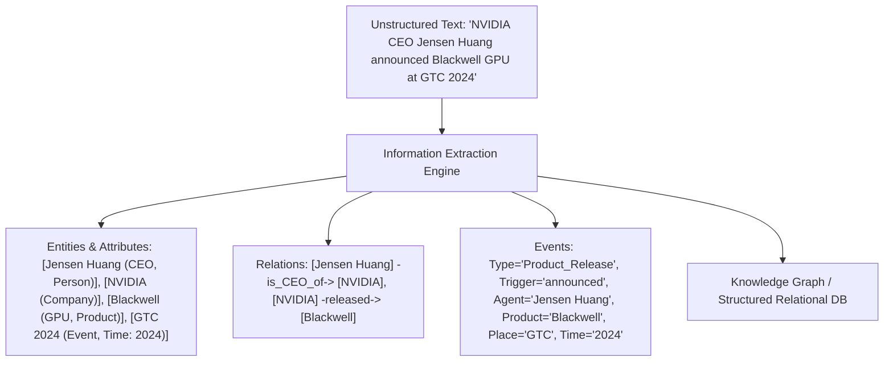

---

## 2. Chi tiết từng Keyword

---

### 1. Information Extraction - IE (Trích xuất Thông tin Tổng quát)

#### a. Định nghĩa Bản chất Toán học (Mathematical Formulation)
Trích xuất thông tin là hàm ánh xạ từ không gian văn bản phi cấu trúc $\mathcal{D}$ sang một lược đồ cơ sở dữ liệu quan hệ có cấu trúc $\mathcal{S} = (\mathcal{E}, \mathcal{R}, \mathcal{A})$:
$$\Phi_{\text{IE}}: \mathcal{D} \to \mathcal{T} = \{(e_i, r_{ij}, e_j) \mid e_i, e_j \in \mathcal{E}, r_{ij} \in \mathcal{R}\}$$
với $\mathcal{E}$ là tập các thực thể, $\mathcal{R}$ là tập quan hệ, và $\mathcal{T}$ là tập hợp các bộ ba tri thức (Knowledge Triplets). Hàm mục tiêu tối ưu hóa cực đại hóa độ chính xác và độ bao phủ thông tin:
$$\max_{\theta} F_1(\Phi_{\text{IE}}(\mathcal{D}; \theta), \mathcal{T}_{\text{ground\_truth}})$$

#### b. Cơ chế Tầng Sâu & Điện toán (Under The Hood / Hardware Internals)
- **Pipeline vs Joint Extraction**:
  - *Pipeline Architecture*: Tách thành 2 bước tuần tự: NER trước, sau đó đưa các thực thể tìm được vào Relation Classifier. Lỗi từ bước 1 bị khuếch đại sang bước 2 (Cascading Error).
  - *Joint Extraction Architecture*: Sử dụng chung một mạng Transformer trích xuất đồng thời thực thể và quan hệ thông qua biểu diễn đồ thị (Table-filling / Span-pair tagging). Giảm 50% tính toán FLOPs và loại bỏ hiện tượng lệch phân phối.

#### c. Sơ đồ Minh họa (Mermaid Diagram)
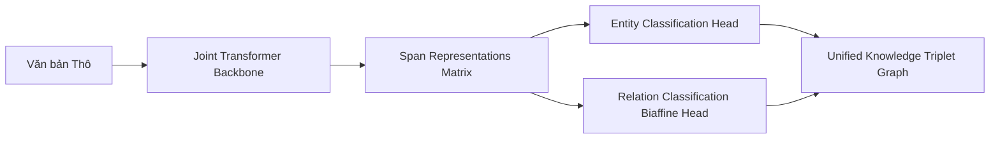

#### d. Code Thực chiến (C++ & Python)

```cpp
// C++17: Cấu trúc Triplet lưu trữ Bộ ba Tri thức trích xuất
#include <iostream>
#include <string>
#include <vector>

struct Triplet {
    std::string subject;
    std::string predicate;
    std::string object;

    void print() const {
        std::cout << "(" << subject << " --[" << predicate << "]--> " << object << ")\n";
    }
};

int main() {
    std::vector<Triplet> knowledge_base = {
        {"Yoshua_Bengio", "won_award", "Turing_Award"},
        {"DeepLearning", "is_field_of", "Artificial_Intelligence"}
    };
    for (const auto& t : knowledge_base) t.print();
    return 0;
}
```

```python
# Python / PyTorch: Joint Entity and Relation Extraction Output Struct
import torch
import torch.nn as nn

class JointNERAndRelationHead(nn.Module):
    def __init__(self, hidden_dim: int, num_entity_types: int, num_rel_types: int):
        super().__init__()
        self.entity_head = nn.Linear(hidden_dim, num_entity_types)
        # Ma trận bilinear cho quan hệ giữa 2 spans
        self.relation_matrix = nn.Parameter(torch.randn(num_rel_types, hidden_dim, hidden_dim))

    def forward(self, h_subj: torch.Tensor, h_obj: torch.Tensor):
        # h_subj, h_obj: [Batch, Hidden_Dim]
        subj_logits = self.entity_head(h_subj)
        obj_logits = self.entity_head(h_obj)
        # Tính điểm quan hệ: h_subj^T * W_r * h_obj
        rel_logits = torch.einsum('bd,rdk,bk->br', h_subj, self.relation_matrix, h_obj)
        return subj_logits, obj_logits, rel_logits

head = JointNERAndRelationHead(128, 5, 10)
h_s, h_o = torch.randn(2, 128), torch.randn(2, 128)
_, _, r_scores = head(h_s, h_o)
print("Relation Scores Shape:", r_scores.shape) # [2, 10]
```

#### e. Lỗi Thường gặp & Ổn định Số học
- **Overlapping Triplet Problem**: Khi một thực thể tham gia vào nhiều quan hệ khác nhau (ví dụ: *"A sinh ra tại B và qua đời tại B"*), các mô hình dựa trên Sequence Labeling truyền thống bị đứt gãy gán nhãn do xung đột chỉ mục.

#### f. Ứng dụng Thực chiến trong AI
Xây dựng đồ thị tri thức doanh nghiệp (Enterprise Knowledge Graphs), hệ sinh thái Semantic Search và hỗ trợ truy vấn trong GraphRAG.

---

### 2. Entity Extraction (Trích xuất Thực thể Chuyên sâu)

#### a. Định nghĩa Bản chất Toán học
Trích xuất thực thể xác định ranh giới span $s = (i, j)$ và gán nhãn loại thực thể $t \in \mathcal{E}_{\text{type}}$:
$$\hat{e} = (i, j, t) = \arg\max_{i, j, t} P(t, \text{span}(i, j) \mid \mathbf{x})$$
Khác với NER cơ bản, Entity Extraction trong IE còn bao gồm bài toán **Entity Linking / Disambiguation**: ánh xạ chuỗi ký tự bề mặt (Surface Mention) vào một định danh thực thể duy nhất trong cơ sở tri thức (Knowledge Base Entity ID - ví dụ Wikidata Q-ID):
$$e^* = \arg\max_{e \in \mathcal{K}} \text{Score}(m, e, \text{Context})$$

#### b. Cơ chế Tầng Sâu & Điện toán
- **Cross-Encoder Candidate Reranking**: Quá trình Entity Linking chia làm 2 pha:
  1. *Candidate Generation*: Dùng Fuzzy String Matching / Trigram Index trên CPU tìm top-100 thực thể tiềm năng trong KB.
  2. *Neural Reranking*: Chạy Cross-Encoder so khớp độ tương đồng ngữ cảnh của mention với định nghĩa trong KB.

#### c. Sơ đồ Minh họa (Mermaid Diagram)
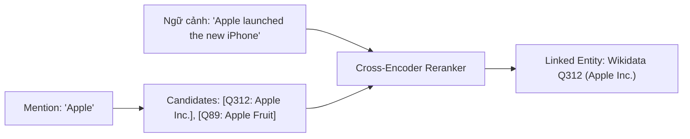

#### d. Code Thực chiến (C++ & Python)

```cpp
// C++17: Tra cứu Candidate Entity theo Bảng Băm nghịch đảo
#include <iostream>
#include <string>
#include <vector>
#include <unordered_map>

struct KBEntity {
    std::string qid;
    std::string canonical_name;
    std::string description;
};

class EntityLinkerCandidateGenerator {
private:
    std::unordered_map<std::string, std::vector<KBEntity>> alias_map_;
public:
    void add_alias(const std::string& alias, const KBEntity& entity) {
        alias_map_[alias].push_back(entity);
    }

    std::vector<KBEntity> get_candidates(const std::string& surface_form) {
        if (alias_map_.count(surface_form)) {
            return alias_map_[surface_form];
        }
        return {};
    }
};

int main() {
    EntityLinkerCandidateGenerator gen;
    gen.add_alias("Washington", {"Q61", "Washington D.C.", "Capital of US"});
    gen.add_alias("Washington", {"Q23", "George Washington", "First US President"});

    auto candidates = gen.get_candidates("Washington");
    std::cout << "Found " << candidates.size() << " candidates for 'Washington':\n";
    for (const auto& c : candidates) {
        std::cout << "  " << c.qid << ": " << c.canonical_name << " (" << c.description << ")\n";
    }
    return 0;
}
```

```python
# Python / PyTorch: Entity Disambiguation Scorer
import torch
import torch.nn.functional as F

def disambiguate_entity(mention_ctx_vector: torch.Tensor, candidate_entity_vectors: torch.Tensor) -> int:
    # mention_ctx_vector: [1, Dim], candidate_entity_vectors: [Num_Candidates, Dim]
    scores = F.cosine_similarity(mention_ctx_vector, candidate_entity_vectors)
    best_candidate_idx = torch.argmax(scores).item()
    return best_candidate_idx

m_vec = torch.tensor([[0.9, 0.1, 0.4]])
c_vecs = torch.tensor([[0.85, 0.15, 0.38], [-0.2, 0.9, 0.1]]) # 0: Tech company, 1: Fruit
chosen = disambiguate_entity(m_vec, c_vecs)
print("Selected Entity Candidate Index:", chosen)
```

#### e. Lỗi Thường gặp & Ổn định Số học
- **Zero-shot Entities / Out-of-KB Entities**: Thực thể hoàn toàn mới chưa từng xuất hiện trong Knowledge Base khiến hệ thống ép vào một thực thể cũ tương tự.

#### f. Ứng dụng Thực chiến trong AI
Tự động làm sạch dữ liệu hồ sơ bệnh án (Clinical Entity Linking với cơ sở dữ liệu UMLS) và xây dựng bộ bách khoa toàn thư tri thức tự động.

---

### 3. Attribute Extraction (Trích xuất Thuộc tính Thực thể)

#### a. Định nghĩa Bản chất Toán học
Trích xuất thuộc tính xác định các cặp Khóa - Giá trị (Key - Value / Attribute - Value) đặc trưng cho một thực thể mục tiêu $e$:
$$\mathcal{A}(e) = \{(a_k, v_k) \mid a_k \in \mathcal{A}_{\text{schema}}\}$$
Ví dụ với thực thể Sản phẩm (Product Entity):
$$\mathcal{A}(\text{"MacBook Pro"}) = \{(\text{RAM}, \text{"64GB"}), (\text{CPU}, \text{"M3 Max"}), (\text{Price}, \text{"\$3499"}), (\text{Color}, \text{"Space Black"})\ catch \}$$
Đây là bài toán ánh xạ từ câu miêu tả tự do sang từ điển thuộc tính chuẩn tắc (Canonical Attribute Normalization).

#### b. Cơ chế Tầng Sâu & Điện toán
- **Question-Conditioned Attribute Extraction**: Thay vì huấn luyện bộ phân loại nhãn cứng, mô hình hóa bài toán thành Extractive QA: Đặt câu hỏi *"RAM của thiết bị này là bao nhiêu?"* và để mạng trích xuất span `"64GB"`. Kỹ thuật này cho phép mở rộng linh hoạt thêm các thuộc tính mới mà không cần train lại toàn bộ mạng.

#### c. Sơ đồ Minh họa (Mermaid Diagram)
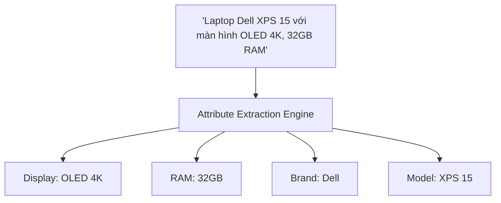

#### d. Code Thực chiến (C++ & Python)

```cpp
// C++17: Regex và Map trích xuất thuộc tính cấu hình phần cứng
#include <iostream>
#include <string>
#include <regex>
#include <unordered_map>

std::unordered_map<std::string, std::string> extract_hardware_attributes(const std::string& spec_text) {
    std::unordered_map<std::string, std::string> attributes;
    std::smatch match;

    // Pattern trích xuất RAM (e.g. 16GB, 32 GB)
    std::regex ram_regex(R"((\d+)\s*(GB|TB)\s*(RAM|DDR\d?))", std::regex::icase);
    if (std::regex_search(spec_text, match, ram_regex)) {
        attributes["RAM"] = match[1].str() + match[2].str();
    }

    // Pattern trích xuất VRAM GPU
    std::regex vram_regex(R"((\d+)\s*(GB)\s*(VRAM))", std::regex::icase);
    if (std::regex_search(spec_text, match, vram_regex)) {
        attributes["VRAM"] = match[1].str() + match[2].str();
    }

    return attributes;
}

int main() {
    std::string text = "Workstation equipped with 128GB RAM and 24GB VRAM GPU.";
    auto attrs = extract_hardware_attributes(text);
    for (const auto& [k, v] : attrs) {
        std::cout << k << " -> " << v << "\n";
    }
    return 0;
}
```

```python
# Python: Structured Attribute Extraction với Pydantic và LLM JSON Schema
from pydantic import BaseModel, Field

class LaptopSpecification(BaseModel):
    brand: str = Field(description="Hãng sản xuất")
    ram_gb: int = Field(description="Dung lượng RAM tính bằng GB")
    screen_resolution: str = Field(description="Độ phân giải màn hình")

# Mô phỏng quá trình validate dữ liệu trích xuất từ văn bản
raw_extracted_json = {"brand": "Dell", "ram_gb": 32, "screen_resolution": "4K OLED"}
spec = LaptopSpecification(**raw_extracted_json)
print("Validated Hardware Spec Object:", spec)
```

#### e. Lỗi Thường gặp & Ổn định Số học
- **Unit Inconsistency**: Dữ liệu trích xuất sử dụng nhiều đơn vị đo lường khác nhau (e.g. `16GB` vs `16384MB`, `1.5 kg` vs `3.3 lbs`), đòi hỏi tầng chuẩn hóa đơn vị (Unit Normalization Engine) trước khi lưu trữ vào DB.

#### f. Ứng dụng Thực chiến trong AI
Xây dựng cây thuộc tính sản phẩm trong các sàn thương mại điện tử lớn (Amazon, Shopee) để phục vụ bộ lọc tìm kiếm (Faceted Search).

---

### 4. Relation Extraction (Trích xuất Quan hệ Thực thể)

#### a. Định nghĩa Bản chất Toán học
Relation Extraction (RE) xác định quan hệ ngữ nghĩa $r \in \mathcal{R} \cup \{\text{None}\}$ giữa hai thực thể đã được định danh $e_1$ (Subject) và $e_2$ (Object) trong một câu $\mathbf{x}$:
$$\hat{r} = \arg\max_{r \in \mathcal{R}} P(r \mid \mathbf{x}, e_1, e_2)$$
Trong kiến trúc biểu diễn thực thể của Soares et al. (Matching the Blanks):
Chèn các token đặc biệt đánh dấu ranh giới thực thể vào văn bản:
$$\mathbf{x}^* = \dots \ [E1] \ e_1 \ [/E1] \ \dots \ [E2] \ e_2 \ [/E2] \ \dots$$
Vector đại diện quan hệ được ghép từ các vector đầu ra tại vị trí token đánh dấu:
$$\mathbf{h}_r = [\mathbf{h}_{[E1]}; \mathbf{h}_{[E2]}]$$

#### b. Cơ chế Tầng Sâu & Điện toán
- **Distant Supervision (Giám sát từ xa)**: Do dữ liệu gán nhãn thủ công cho quan hệ rất đắt đỏ, kỹ thuật Mintz et al. tự động tạo nhãn bằng cách gióng hàng một Knowledge Base có sẵn (như Freebase/Wikidata) với văn bản: Nếu $(e_1, r, e_2) \in \mathcal{KB}$, mọi câu văn chứa cả $e_1$ và $e_2$ đều được tạm coi là biểu đạt quan hệ $r$.
- **Noise Suppression with Multi-Instance Learning**: Distant supervision sinh ra nhiều nhãn sai. Mô hình hóa dưới dạng Multi-Instance Learning (MIL) với Attention qua các câu trong cùng một túi (Bag of Sentences) để giảm trọng số các câu nhiễu.

#### c. Sơ đồ Minh họa (Mermaid Diagram)
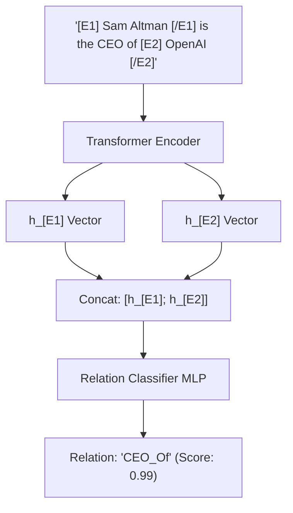

#### d. Code Thực chiến (C++ & Python)

```cpp
// C++17: Chèn Entity Markers vào Buffer chuỗi để chuẩn bị cho Relation Encoder
#include <iostream>
#include <string>
#include <vector>

std::string insert_entity_markers(const std::string& text, 
                                  size_t e1_s, size_t e1_e, 
                                  size_t e2_s, size_t e2_e) {
    // Giả sử e1 đứng trước e2
    std::string result = text.substr(0, e1_s);
    result += "[E1] " + text.substr(e1_s, e1_e - e1_s) + " [/E1]";
    result += text.substr(e1_e, e2_s - e1_e);
    result += "[E2] " + text.substr(e2_s, e2_e - e2_s) + " [/E2]";
    result += text.substr(e2_e);
    return result;
}

int main() {
    std::string sentence = "Geoffrey Hinton taught at Toronto.";
    // "Geoffrey Hinton" [0, 15], "Toronto" [26, 33]
    std::cout << insert_entity_markers(sentence, 0, 15, 26, 33) << "\n";
    return 0;
}
```

```python
# Python / PyTorch: Multi-Instance Learning Attention cho Distant Supervision
import torch
import torch.nn as nn
import torch.nn.functional as F

class BagAttentionRelationClassifier(nn.Module):
    def __init__(self, hidden_dim: int, num_relations: int):
        super().__init__()
        self.attn_query = nn.Parameter(torch.randn(hidden_dim, 1))
        self.classifier = nn.Linear(hidden_dim, num_relations)

    def forward(self, bag_sentence_vectors: torch.Tensor) -> torch.Tensor:
        # bag_sentence_vectors: [Num_Sentences_In_Bag, Hidden_Dim]
        attn_scores = torch.matmul(bag_sentence_vectors, self.attn_query) # [N, 1]
        attn_weights = F.softmax(attn_scores, dim=0) # [N, 1]
        bag_repr = torch.sum(attn_weights * bag_sentence_vectors, dim=0, keepdim=True) # [1, Dim]
        return self.classifier(bag_repr)

mil_model = BagAttentionRelationClassifier(hidden_dim=64, num_relations=5)
bag_embs = torch.randn(4, 64) # 4 câu cùng nhắc tới cặp thực thể (A, B)
logits = mil_model(bag_embs)
print("Bag Relation Prediction Logits:", logits.shape) # [1, 5]
```

#### e. Lỗi Thường gặp & Ổn định Số học
- **Directional Inversion**: Nhầm lẫn chiều quan hệ chủ ngữ - tân ngữ (ví dụ: dự đoán `"OpenAI là công ty mẹ của Microsoft"` thay vì `"Microsoft là nhà đầu tư của OpenAI"`).

#### f. Ứng dụng Thực chiến trong AI
Tự động điền đầy đồ thị tri thức (Knowledge Graph Completion), phân tích chuỗi cung ứng doanh nghiệp và khai phá tương tác protein-thuốc trong y sinh.

---

### 5. Event Extraction (Trích xuất Sự kiện)

#### a. Định nghĩa Bản chất Toán học
Trích xuất sự kiện cấu trúc hóa thông tin về một biến cố xảy ra trong thế giới thực theo chuẩn ACE (Automatic Content Extraction):
1. **Event Trigger Detection**: Định danh từ kích hoạt sự kiện $t$ (Event Trigger) và phân loại kiểu sự kiện $T \in \mathcal{E}_{\text{event}}$ (ví dụ từ `"bị bắt"` kích hoạt sự kiện `Justice:Arrest-Jail`).
2. **Event Argument Extraction**: Xác định các thực thể đóng vai trò tham gia (Argument Roles: Agent, Victim, Place, Instrument, Time) đối với từ kích hoạt:
   $$\mathcal{F}_{\text{event}} = \{(\text{Trigger}, T), (\text{Entity}_1, \text{Role}_1), \dots, (\text{Entity}_k, \text{Role}_k)\}$$

#### b. Cơ chế Tầng Sâu & Điện toán
- **Trigger-Argument Graph Matching**: Thay vì phân loại độc lập, các mô hình đồ thị nơ-ron (Graph Neural Networks - GNN) xây dựng cạnh liên kết giữa trigger và tất cả các thực thể tiềm năng dựa trên khoảng cách cây phụ thuộc cú pháp (Dependency Parse Tree). Khoảng cách ngắn trong cây cú pháp là bằng chứng vững chắc của vai trò đối số.

#### c. Sơ đồ Minh họa (Mermaid Diagram)
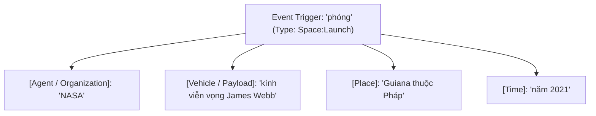

#### d. Code Thực chiến (C++ & Python)

```cpp
// C++17: Cấu trúc Sự kiện Cấu trúc hóa đầy đủ theo chuẩn ACE
#include <iostream>
#include <string>
#include <vector>

struct EventArgument {
    std::string role; // Agent, Victim, Time...
    std::string mention;
};

struct ExtractedEvent {
    std::string trigger_word;
    std::string event_type;
    std::vector<EventArgument> arguments;

    void print() const {
        std::cout << "EVENT [" << event_type << "] Triggered by: '" << trigger_word << "'\n";
        for (const auto& arg : arguments) {
            std::cout << "  - " << arg.role << ": " << arg.mention << "\n";
        }
    }
};

int main() {
    ExtractedEvent ev{"acquired", "Business:Merge-Acquisition", {
        {"Buyer", "Microsoft"},
        {"Artifact", "Activision Blizzard"},
        {"Price", "$69 Billion"}
    }};
    ev.print();
    return 0;
}
```

```python
# Python / PyTorch: Joint Trigger and Argument Scoring
import torch
import torch.nn as nn

class EventArgumentScorer(nn.Module):
    def __init__(self, hidden_dim: int, num_roles: int):
        super().__init__()
        self.role_classifier = nn.Sequential(
            nn.Linear(hidden_dim * 2, hidden_dim),
            nn.ReLU(),
            nn.Linear(hidden_dim, num_roles)
        )

    def forward(self, trigger_repr: torch.Tensor, entity_repr: torch.Tensor) -> torch.Tensor:
        # trigger_repr, entity_repr: [Batch, Hidden_Dim]
        pair_feature = torch.cat([trigger_repr, entity_repr], dim=-1)
        return self.role_classifier(pair_feature)

scorer = EventArgumentScorer(hidden_dim=128, num_roles=8)
t_vec, e_vec = torch.randn(2, 128), torch.randn(2, 128)
role_logits = scorer(t_vec, e_vec)
print("Event Role Logits Shape:", role_logits.shape) # [2, 8]
```

#### e. Lỗi Thường gặp & Ổn định Số học
- **Polysemous Triggers**: Một từ kích hoạt mang nhiều nghĩa tùy ngữ cảnh (ví dụ `"fire"` có thể là sa thải nhân viên `Personnel:End-Position` hoặc nổ súng quân sự `Conflict:Attack`).

#### f. Ứng dụng Thực chiến trong AI
Theo dõi khủng hoảng an ninh toàn cầu (Disaster Monitoring), phát hiện giao dịch thâu tóm sáp nhập tài chính và tổng hợp tin tức tự động.

---

### 6. Temporal Information Extraction (Trích xuất Thông tin Thời gian)

#### a. Định nghĩa Bản chất Toán học
Trích xuất thông tin thời gian xác định các biểu thức thời gian (TIMEX3 theo chuẩn TimeML) và neo chúng vào trục thời gian chuẩn tắc (ISO 8601 UTC timestamp):
$$\mathcal{T}: \text{TIMEX} \to \text{ISO\_Format} \ (\text{"hôm qua" } \xrightarrow{\text{Anchor: 2026-11-10}} \text{"2026-11-09"})$$
Đồng thời xác định quan hệ trật tự thời gian giữa các sự kiện qua hệ thống **13 Quan hệ Khoảng thời gian của Allen (Allen's Interval Algebra)**:
$$e_1 \ \mathbf{r}_{\text{Allen}} \ e_2 \quad (\text{Before, After, Meets, Overlaps, During, Equals, v.v.})$$

#### b. Cơ chế Tầng Sâu & Điện toán
- **Transitive Closure Constraint**: Quan hệ thời gian phải tuân thủ tiên đề bắc cầu hình thức (Transitivity):
  $$\text{Before}(e_1, e_2) \wedge \text{Before}(e_2, e_3) \implies \text{Before}(e_1, e_3)$$
  Để đảm bảo ma trận trật tự thời gian không bị mâu thuẫn chu trình, hệ thống áp dụng giải thuật quy hoạch tuyến tính nguyên (ILP) hoặc đóng bắc cầu đồ thị (Warshall's Algorithm).

#### c. Sơ đồ Minh họa (Mermaid Diagram)
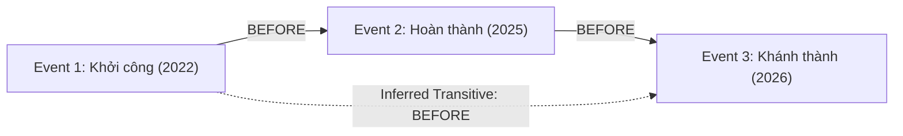

#### d. Code Thực chiến (C++ & Python)

```cpp
// C++17: Thuật toán Warshall tính Transitive Closure cho Quan hệ Thời gian "BEFORE"
#include <iostream>
#include <vector>

void compute_temporal_transitive_closure(std::vector<std::vector<bool>>& before_graph) {
    size_t n = before_graph.size();
    for (size_t k = 0; k < n; ++k) {
        for (size_t i = 0; i < n; ++i) {
            for (size_t j = 0; j < n; ++j) {
                if (before_graph[i][k] && before_graph[k][j]) {
                    before_graph[i][j] = true;
                }
            }
        }
    }
}

int main() {
    // 3 Events: 0: Phẫu thuật, 1: Hồi sức, 2: Xuất viện
    std::vector<std::vector<bool>> graph(3, std::vector<bool>(3, false));
    graph[0][1] = true; // 0 BEFORE 1
    graph[1][2] = true; // 1 BEFORE 2

    compute_temporal_transitive_closure(graph);
    std::cout << "Event 0 BEFORE Event 2 inferred? " << std::boolalpha << graph[0][2] << "\n";
    return 0;
}
```

```python
# Python: Chuẩn hóa Biểu thức Thời gian tương đối với Python-dateutil
from datetime import datetime
from dateutil.relativedelta import relativedelta

def normalize_relative_timex(timex_str: str, anchor_date: datetime) -> str:
    timex_str = timex_str.lower()
    if "yesterday" in timex_str or "hôm qua" in timex_str:
        return (anchor_date - relativedelta(days=1)).strftime("%Y-%m-%d")
    elif "last month" in timex_str or "tháng trước" in timex_str:
        return (anchor_date - relativedelta(months=1)).strftime("%Y-%m")
    elif "today" in timex_str or "hôm nay" in timex_str:
        return anchor_date.strftime("%Y-%m-%d")
    return "UNKNOWN"

anchor = datetime(2026, 11, 10)
print("Normalized 'Hôm qua':", normalize_relative_timex("hôm qua", anchor))
print("Normalized 'Tháng trước':", normalize_relative_timex("tháng trước", anchor))
```

#### e. Lỗi Thường gặp & Ổn định Số học
- **Vague Temporal Expressions**: Các biểu thức thời gian mơ hồ (như *"gần đây"*, *"trong tương lai gần"*, *"thời gian tới"*) không thể ánh xạ thành một mốc cụ thể trên dòng thời gian, dễ gây lỗi phân giải.

#### f. Ứng dụng Thực chiến trong AI
Xây dựng dòng thời gian lịch sử y tế của bệnh nhân (Electronic Health Record Timelines) và phân tích chuỗi sự kiện điều tra tội phạm.

---

### 7. Open Information Extraction - Open IE (Trích xuất Thông tin Mở)

#### a. Định nghĩa Bản chất Toán học
Khác với Relation Extraction truyền thống đòi hỏi ontology đóng định trước $\mathcal{R}$, Open IE không bị giới hạn bởi bất kỳ lược đồ schema nào. Hệ thống trích xuất trực tiếp các bộ ba quan hệ tự do (Open Triplets) từ văn bản:
$$\mathcal{T}_{\text{open}} = \{(s, p, o) \mid s, p, o \in \Sigma^*\}$$
trong đó $p$ là chuỗi từ diễn đạt vị từ quan hệ tự do (thường là cụm động từ).
Hệ thống tiên phong: **OpenIE 4/5/6, Stanford OpenIE, ClausIE**.

#### b. Cơ chế Tầng Sâu & Điện toán
- **Clause Decomposition & Sequence-to-Sequence Generation**: ClausIE phân rã câu phức thành các mệnh đề độc lập (propositions) dựa trên quy tắc cây phụ thuộc cú pháp. Trong khi đó, các mô hình SOTA hiện đại huấn luyện mạng nơ-ron Encoder-Decoder sinh trực tiếp chuỗi văn bản chứa các cặp ngoặc phân tách: `(Arg1; Rel; Arg2)`.

#### c. Sơ đồ Minh họa (Mermaid Diagram)
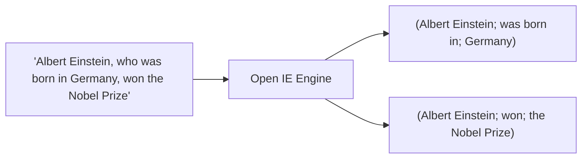

#### d. Code Thực chiến (C++ & Python)

```cpp
// C++17: Parser phân rã chuỗi OpenIE Triplet (Arg1; Rel; Arg2)
#include <iostream>
#include <string>
#include <vector>
#include <sstream>

struct OpenTriplet {
    std::string arg1;
    std::string relation;
    std::string arg2;
};

OpenTriplet parse_openie_triplet_string(const std::string& formatted) {
    // Định dạng mong đợi: "(Arg1; Rel; Arg2)"
    OpenTriplet t;
    if (formatted.front() != '(' || formatted.back() != ')') return t;
    std::string inner = formatted.substr(1, formatted.size() - 2);
    std::stringstream ss(inner);
    std::string item;
    std::vector<std::string> parts;
    while (std::getline(ss, item, ';')) {
        // Strip whitespace
        size_t start = item.find_first_not_of(' ');
        size_t end = item.find_last_not_of(' ');
        parts.push_back((start != std::string::npos) ? item.substr(start, end - start + 1) : "");
    }
    if (parts.size() >= 3) {
        t.arg1 = parts[0];
        t.relation = parts[1];
        t.arg2 = parts[2];
    }
    return t;
}

int main() {
    std::string s = "(Deep Learning; empowers; Modern AI)";
    auto res = parse_openie_triplet_string(s);
    std::cout << "Subject: '" << res.arg1 << "' | Predicate: '" << res.relation << "' | Object: '" << res.arg2 << "'\n";
    return 0;
}
```

```python
# Python: Prompting LLM cho Open IE Zero-shot Extraction
def open_ie_extract_mock(sentence: str) -> list[tuple[str, str, str]]:
    # Giả lập kết quả trích xuất mở
    return [
        ("Gemini", "is developed by", "Google DeepMind"),
        ("Google DeepMind", "conducts research in", "Artificial Intelligence")
    ]

triplets = open_ie_extract_mock("Gemini is developed by Google DeepMind, which conducts research in Artificial Intelligence.")
for subj, pred, obj in triplets:
    print(f"[{subj}] -> ({pred}) -> [{obj}]")
```

#### e. Lỗi Thường gặp & Ổn định Số học
- **Redundant & Uninformative Triplets**: Sinh ra các bộ ba vô nghĩa do cắt tỉa sai mệnh đề (ví dụ: `(He; said; that)` hoặc `(The model; is; fast)` mà mất đi điều kiện tiên quyết).

#### f. Ứng dụng Thực chiến trong AI
Khai phá tri thức quy mô web mở (Web-scale Knowledge Discovery) và nạp dữ liệu không giới hạn cho hệ thống Open-domain QA.

---

### 8. Slot Filling (Điền Khe Dữ liệu)

#### a. Định nghĩa Bản chất Toán học
Slot Filling là bài toán trích xuất các giá trị tham số cần thiết từ phát ngôn của người dùng để hoàn thiện khung tác vụ:
$$\mathbf{y}_{\text{slot}} = \arg\max_{\mathbf{y}} P(\mathbf{y} \mid \mathbf{x}), \quad y_i \in \text{BIO}(\mathcal{S})$$
với $\mathcal{S}$ là danh mục các khe dữ liệu được định nghĩa trước bởi Domain Ontology (e.g. `departure_time`, `origin_city`, `destination_city`, `seat_preference`).

#### b. Cơ chế Tầng Sâu & Điện toán
- Kết hợp với Intent Classification thành một kiến trúc **Joint Spoken Language Understanding (SLU)** chia sẻ biểu diễn ngữ nghĩa.
- **Span-based Pointer Network**: Khi giá trị của khe dài và phức tạp, cơ chế Pointer Network trực tiếp trỏ vào vị trí bắt đầu và kết thúc trong chuỗi token gốc thay vì gán nhãn từng từ, loại bỏ hoàn toàn hiện tượng phân mảnh nhãn BIO.

#### c. Sơ đồ Minh họa (Mermaid Diagram)
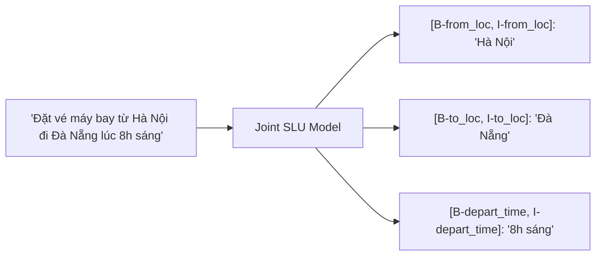

#### d. Code Thực chiến (C++ & Python)

```cpp
// C++17: Gán Slot Value vào Schema cấu trúc định sẵn
#include <iostream>
#include <string>
#include <unordered_map>

struct FlightBookingSlots {
    std::string origin;
    std::string destination;
    std::string time;

    bool is_complete() const {
        return !origin.empty() && !destination.empty() && !time.empty();
    }
};

void fill_slot(FlightBookingSlots& slots, const std::string& slot_name, const std::string& val) {
    if (slot_name == "origin") slots.origin = val;
    else if (slot_name == "destination") slots.destination = val;
    else if (slot_name == "time") slots.time = val;
}

int main() {
    FlightBookingSlots booking;
    fill_slot(booking, "origin", "HAN");
    fill_slot(booking, "destination", "DAD");
    fill_slot(booking, "time", "08:00 AM");

    std::cout << "All slots filled? " << std::boolalpha << booking.is_complete() << "\n";
    return 0;
}
```

```python
# Python / PyTorch: Token-Level Slot Classifier Loss
import torch
import torch.nn as nn
import torch.nn.functional as F

class SlotFillingLoss(nn.Module):
    def __init__(self, ignore_index: int = -100):
        super().__init__()
        self.ignore_index = ignore_index

    def forward(self, slot_logits: torch.Tensor, slot_labels: torch.Tensor) -> torch.Tensor:
        # slot_logits: [Batch, Seq_Len, Num_Slots], slot_labels: [Batch, Seq_Len]
        return F.cross_entropy(
            slot_logits.view(-1, slot_logits.size(-1)),
            slot_labels.view(-1),
            ignore_index=self.ignore_index
        )

criterion = SlotFillingLoss()
logits = torch.randn(2, 5, 10)
labels = torch.tensor([[1, 2, 0, -100, -100], [0, 1, 2, 3, 0]])
loss = criterion(logits, labels)
print("Slot Filling Loss:", loss.item())
```

#### e. Lỗi Thường gặp & Ổn định Số học
- **Slot Ambiguity**: Giá trị khe có thể bị nhầm lẫn giữa điểm đi và điểm đến nếu không chú ý giới từ (ví dụ trong *"Đi Hà Nội từ Sài Gòn"*, mô hình tiếng Anh dịch máy dễ bị lừa nhầm điểm đến thành Sài Gòn do trật tự từ).

#### f. Ứng dụng Thực chiến trong AI
Xương sống của trợ lý ảo giao dịch (Alexa Skills, Google Assistant Actions, hệ thống tổng đài tự động).

---

### 9. Template Filling (Điền Biểu mẫu Thông tin)

#### a. Định nghĩa Bản chất Toán học
Template Filling mở rộng Slot Filling từ cấp độ một câu phát ngôn ngắn lên cấp độ toàn bộ tài liệu phức tạp (Document-level Multi-slot Extraction). Một biểu mẫu $\mathcal{M}$ gồm nhiều trường thông tin phụ thuộc lẫn nhau:
$$\mathcal{M} = \{F_1, F_2, \dots, F_m\}, \quad F_k \in \mathcal{V}_k^*$$
Mục tiêu là trích xuất đồng thời toàn bộ các trường để đảm bảo tính nhất quán logic trên toàn văn bản (Global Document Coherence).

#### b. Cơ chế Tầng Sâu & Điện toán
- **Graph-based Constraint Satisfaction**: Sử dụng Mạng Đồ thị hoặc Mô hình Markov Logic (Markov Logic Networks - MLN) để ràng buộc các trường không được vi phạm logic nghiệp vụ (ví dụ: ngày giao hàng $F_{\text{delivery\_date}}$ phải diễn ra sau ngày đặt hàng $F_{\text{order\_date}}$).

#### c. Sơ đồ Minh họa (Mermaid Diagram)
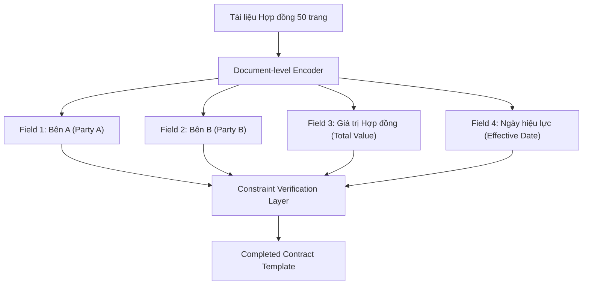

#### d. Code Thực chiến (C++ & Python)

```cpp
// C++17: Template Schema Validator kiểm tra logic giữa các trường
#include <iostream>
#include <string>

struct FinancialReportTemplate {
    double revenue = 0.0;
    double cost = 0.0;
    double net_income = 0.0;

    bool validate_accounting_logic() const {
        // Doanh thu - Chi phí phải xấp xỉ Lợi nhuận ròng
        double diff = (revenue - cost) - net_income;
        return (diff >= -1e-3 && diff <= 1e-3);
    }
};

int main() {
    FinancialReportTemplate report{1000.0, 700.0, 300.0};
    std::cout << "Report template valid? " << std::boolalpha << report.validate_accounting_logic() << "\n";
    return 0;
}
```

```python
# Python: Document-level Template Extraction Engine
class DocumentTemplateEngine:
    def __init__(self, template_fields: list[str]):
        self.fields = template_fields

    def fill_from_document(self, text: str) -> dict[str, str]:
        # Mô phỏng quá trình regex và heuristic filling
        extracted = {}
        for f in self.fields:
            if f == "Invoice_Number" and "INV-" in text:
                extracted[f] = "INV-2026-001"
            elif f == "Total_Amount" and "$" in text:
                extracted[f] = "$1,500.00"
            else:
                extracted[f] = "N/A"
        return extracted

engine = DocumentTemplateEngine(["Invoice_Number", "Total_Amount", "Tax_ID"])
doc_text = "Tax invoice INV-2026-001 with total payable $1,500.00"
print("Extracted Template:", engine.fill_from_document(doc_text))
```

#### e. Lỗi Thường gặp & Ổn định Số học
- **Information Fragmentation across Pages**: Dữ liệu của một trường bị tách làm hai phần nằm ở hai trang khác nhau của file PDF, khiến các mô hình chunking cục bộ làm mất thông tin.

#### f. Ứng dụng Thực chiến trong AI
Tự động hóa xử lý hợp đồng pháp lý, tờ khai hải quan và hồ sơ thẩm định tín dụng ngân hàng.

---

### 10. Structured Prediction (Dự đoán Cấu trúc)

#### a. Định nghĩa Bản chất Toán học
Structured Prediction là khung toán học tổng quát giải quyết bài toán mà không gian đầu ra $\mathcal{Y}$ không phải là nhãn đơn lẻ vô hướng mà là một đối tượng có cấu trúc phức tạp (chuỗi, cây, đồ thị, ma trận gán):
$$\hat{\mathbf{y}} = \arg\max_{\mathbf{y} \in \mathcal{Y}(\mathbf{x})} \mathbf{w}^T \mathbf{\Phi}(\mathbf{x}, \mathbf{y})$$
trong đó không gian cấu trúc $\mathcal{Y}$ có kích thước bùng nổ theo hàm mũ $|\mathcal{Y}| = \mathcal{O}(K^N)$.
Thuật toán giải mã tối ưu:
- Nếu đồ thị có cấu trúc dạng chuỗi (Chain): Thuật toán Viterbi ($O(N K^2)$).
- Nếu cấu trúc dạng cây (Tree): Thuật toán CKY hoặc Inside-Outside ($O(N^3)$).
- Nếu cấu trúc đồ thị tổng quát: Quy hoạch nguyên (Integer Linear Programming - ILP) hoặc Lan truyền niềm tin (Loopy Belief Propagation).

#### b. Cơ chế Tầng Sâu & Điện toán
- **Structured Loss Functions (Structured SVM / CRF Loss)**: Cực đại hóa khoảng cách lề (Margin) giữa cấu trúc ground truth $\mathbf{y}^*$ và cấu trúc dự đoán sai lệch nhiều nhất (Loss-augmented inference):
  $$\mathcal{L}(\mathbf{w}) = \max_{\mathbf{y} \in \mathcal{Y}} \left( \mathbf{w}^T \mathbf{\Phi}(\mathbf{x}, \mathbf{y}) + \Delta(\mathbf{y}^*, \mathbf{y}) \right) - \mathbf{w}^T \mathbf{\Phi}(\mathbf{x}, \mathbf{y}^*)$$
  với $\Delta$ là hàm phạt sai khác cấu trúc (Hamming distance).

#### c. Sơ đồ Minh họa (Mermaid Diagram)
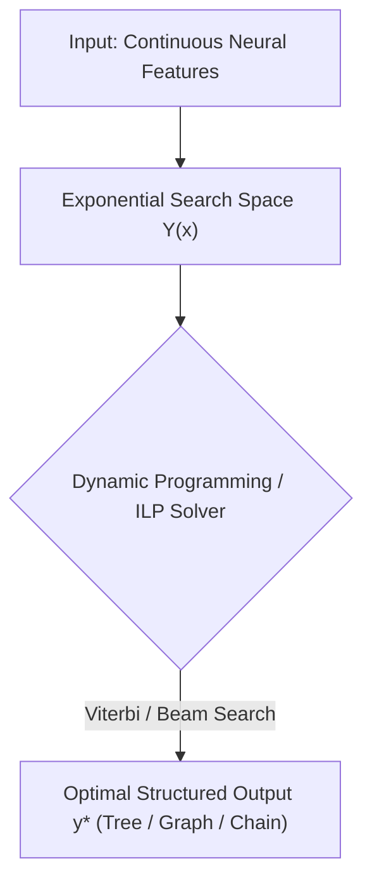

#### d. Code Thực chiến (C++ & Python)

```cpp
// C++17: Hamming Distance đo lường sai khác cấu trúc giữa hai chuỗi nhãn
#include <iostream>
#include <vector>

size_t compute_hamming_structure_loss(const std::vector<int>& y_gold, const std::vector<int>& y_pred) {
    size_t loss = 0;
    size_t n = std::min(y_gold.size(), y_pred.size());
    for (size_t i = 0; i < n; ++i) {
        if (y_gold[i] != y_pred[i]) {
            loss++;
        }
    }
    return loss;
}

int main() {
    std::vector<int> gold = {0, 1, 2, 2, 0};
    std::vector<int> pred = {0, 1, 1, 2, 0};
    std::cout << "Structure Hamming Loss: " << compute_hamming_structure_loss(gold, pred) << "\n";
    return 0;
}
```

```python
# Python / PyTorch: Structured Margin Loss (Structured Perceptron Update)
import torch

def structured_perceptron_update(weights: torch.Tensor, phi_gold: torch.Tensor, phi_pred: torch.Tensor, lr: float = 0.01) -> torch.Tensor:
    # Nếu cấu trúc dự đoán sai khác cấu trúc ground-truth
    # w <- w + lr * (phi(x, y_gold) - phi(x, y_pred))
    update_vector = phi_gold - phi_pred
    new_weights = weights + lr * update_vector
    return new_weights

w = torch.zeros(4)
phi_true = torch.tensor([1.0, 2.0, 0.5, 0.0])
phi_predicted = torch.tensor([0.5, 1.0, 1.5, 0.2])
updated_w = structured_perceptron_update(w, phi_true, phi_predicted)
print("Updated Structured Weights:", updated_w)
```

#### e. Lỗi Thường gặp & Ổn định Số học
- **Inference Bottleneck**: Khi cấu trúc không có tính chất Markov hoặc có chu trình lặp (Cyclic graphs), bài toán giải mã chính xác trở thành NP-hard, buộc phải sử dụng các thuật toán heuristic xấp xỉ (Gibbs Sampling, Beam Search).

#### f. Ứng dụng Thực chiến trong AI
Nền tảng lý thuyết cho toàn bộ các bài toán Sequence Labeling (POS, NER), Dependency Parsing, Scene Graph Generation trong Computer Vision và Protein Folding Structure Prediction (AlphaFold).
