# Chuyên đề: Trí tuệ Tài liệu & Xử lý Văn bản Ứng dụng (Document Intelligence & Applied IE)

## 1. Tổng quan Chuyên đề
Trong môi trường thực tế của doanh nghiệp, hơn 80% dữ liệu quan trọng nằm dưới dạng văn bản bán cấu trúc (Semi-structured Documents): tệp PDF biểu mẫu, hóa đơn quét (Scanned Invoices), chứng từ biên nhận (Receipts), báo cáo tài chính chứa bảng biểu phức tạp và hợp đồng pháp lý dài hàng chục trang (Legal Contracts). Xử lý dữ liệu này đòi hỏi sự giao thoa mật thiết giữa Xử lý Ngôn ngữ Tự nhiên (NLP) và Thị giác Máy tính (Computer Vision), khai sinh lĩnh vực **Document Intelligence (Trí tuệ Tài liệu)** và **Intelligent Document Processing (IDP)**.

Các kiến trúc đa phương thức (Multimodal Document Transformers như LayoutLMv1/v2/v3, Donut, Nougat) kết hợp đồng thời 3 luồng thông tin: Text (chuỗi ký tự OCR), Visual (hình ảnh trang tài liệu) và Layout (tọa độ không gian 2D Bounding Boxes), tạo nên bước nhảy vọt trong phân tích bố cục (Layout Analysis), trích xuất bảng biểu (Table Extraction) và trích xuất thông tin khóa (Key Information Extraction - KIE).

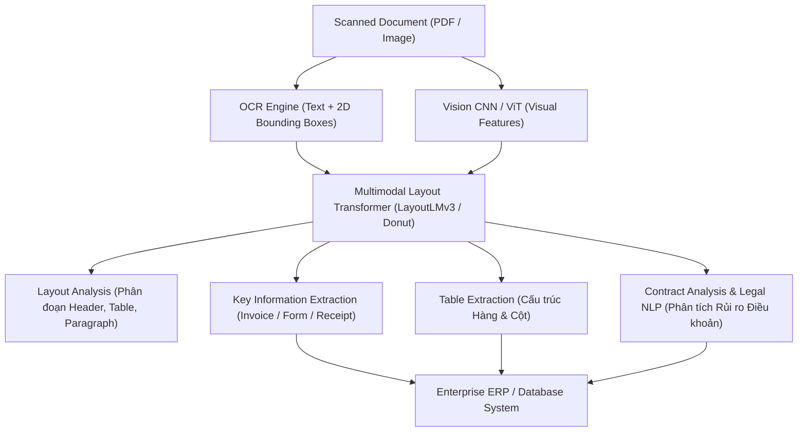

---

## 2. Chi tiết từng Keyword

---

### 1. Document Understanding (Thấu hiểu Tài liệu Đa phương thức)

#### a. Định nghĩa Bản chất Toán học (Mathematical Formulation)
Thấu hiểu tài liệu đa phương thức (Visually Rich Document Understanding - VRDU) là bài toán học biểu diễn kết hợp giữa 3 không gian tín hiệu: Ngôn ngữ ($\mathcal{T}$), Thị giác ($\mathcal{V}$) và Không gian Bố cục 2D ($\mathcal{B}$):
$$\mathbf{h}_i = \text{Encoder}\left( \mathbf{x}_i^{\text{text}}, \mathbf{x}_i^{\text{visual}}, \mathbf{b}_i \right)$$
trong đó tọa độ 2D Bounding Box của token $i$ được chuẩn hóa trên thang đo $[0, 1000]$:
$$\mathbf{b}_i = [x_0, y_0, x_1, y_1, w, h] \in [0, 1000]^6$$
Vector nhúng bố cục 2D được tính bằng tổng các embedding tọa độ:
$$\mathbf{e}_i^{\text{spatial}} = \text{Emb}_x(x_0) + \text{Emb}_y(y_0) + \text{Emb}_x(x_1) + \text{Emb}_y(y_1) + \text{Emb}_w(w) + \text{Emb}_h(h)$$

#### b. Cơ chế Tầng Sâu & Điện toán (Under The Hood / Hardware Internals)
- **2D Spatial Relative Attention**: Trong các kiến trúc như LayoutLMv2/v3, ma trận Attention được bổ sung thêm độ lệch không gian 2D (2D Relative Position Bias) giữa token $i$ và token $j$:
  $$\mathbf{A}_{i, j} = \frac{\mathbf{q}_i \mathbf{k}_j^T}{\sqrt{d}} + \mathbf{b}_{i - j}^{\text{1D}} + \mathbf{b}_{x_i - x_j}^{\text{2D-x}} + \mathbf{b}_{y_i - y_j}^{\text{2D-y}}$$
  Phép cộng tensor này tiêu tốn thêm bộ nhớ SRAM trên GPU nhưng cho phép mô hình hiểu được quan hệ từ trên xuống dưới, từ trái sang phải mà không phụ thuộc vào thứ tự đọc tự nhiên của chuỗi OCR.

#### c. Sơ đồ Minh họa (Mermaid Diagram)
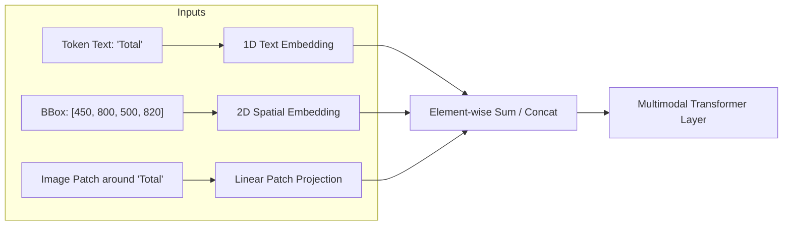

#### d. Code Thực chiến (C++ & Python)

```cpp
// C++17: Chuẩn hóa tọa độ Bounding Box về thang đo [0, 1000] của LayoutLM
#include <iostream>
#include <vector>
#include <algorithm>

struct BoundingBox2D {
    int x0, y0, x1, y1;
};

BoundingBox2D normalize_bbox(int x0, int y0, int x1, int y1, int img_width, int img_height) {
    auto clamp_val = [](int val) { return std::max(0, std::min(1000, val)); };
    return {
        clamp_val(static_cast<int>(1000.0f * x0 / img_width)),
        clamp_val(static_cast<int>(1000.0f * y0 / img_height)),
        clamp_val(static_cast<int>(1000.0f * x1 / img_width)),
        clamp_val(static_cast<int>(1000.0f * y1 / img_height))
    };
}

int main() {
    auto norm = normalize_bbox(100, 200, 300, 250, 1000, 2000);
    std::cout << "Normalized Box: [" << norm.x0 << ", " << norm.y0 
              << ", " << norm.x1 << ", " << norm.y1 << "]\n";
    return 0;
}
```

```python
# Python / PyTorch: 2D Spatial Position Embedding Layer
import torch
import torch.nn as nn

class SpatialPositionEmbedding2D(nn.Module):
    def __init__(self, hidden_dim: int, max_position: int = 1001):
        super().__init__()
        self.x_embed = nn.Embedding(max_position, hidden_dim)
        self.y_embed = nn.Embedding(max_position, hidden_dim)

    def forward(self, bbox: torch.Tensor) -> torch.Tensor:
        # bbox: [Batch, Seq_Len, 4] -> (x0, y0, x1, y1)
        x0_emb = self.x_embed(bbox[:, :, 0])
        y0_emb = self.y_embed(bbox[:, :, 1])
        x1_emb = self.x_embed(bbox[:, :, 2])
        y1_emb = self.y_embed(bbox[:, :, 3])
        # Tổng hợp đặc trưng tọa độ 4 góc
        return x0_emb + y0_emb + x1_emb + y1_emb

spatial_layer = SpatialPositionEmbedding2D(hidden_dim=128)
mock_bbox = torch.randint(0, 1000, (2, 10, 4))
out = spatial_layer(mock_bbox)
print("Spatial Embeddings Shape:", out.shape) # [2, 10, 128]
```

#### e. Lỗi Thường gặp & Ổn định Số học
- **Reading Order Corruption**: Các engine OCR truyền thống thường cố sắp xếp các từ thành một dòng đơn dựa trên khoảng cách heuristic. Trong tài liệu nhiều cột (Multi-column layout), việc đọc tràn từ cột trái sang cột phải làm đứt gãy hoàn toàn cấu trúc câu văn.

#### f. Ứng dụng Thực chiến trong AI
Xử lý tài liệu thông minh trong ngân hàng (KYC Onboarding), phân tích hồ sơ thầu và số hóa văn khơi lưu trữ quốc gia.

---

### 2. Table Extraction (Trích xuất Bảng biểu)

#### a. Định nghĩa Bản chất Toán học
Trích xuất bảng biểu bao gồm 2 bài toán liên kết chặt chẽ:
1. **Table Detection (TD)**: Định vị tọa độ hộp bao của toàn bộ vùng bảng biểu trên trang tài liệu: $B_{\text{table}} = [x_{\min}, y_{\min}, x_{\max}, y_{\max}]$.
2. **Table Structure Recognition (TSR)**: Khôi phục cấu trúc lưới quan hệ (Grid Topological Structure):
   $$\mathcal{G}_{\text{table}} = \{\text{Cell}_{i, j} \mid \text{row\_span}, \text{col\_span}, \text{bbox}, \text{content}\}$$
Mục tiêu là ánh xạ hình ảnh bảng thành chuỗi thẻ HTML (`<table>, <tr>, <td>, <td rowspan=2>`) hoặc ma trận JSON quan hệ.

#### b. Cơ chế Tầng Sâu & Điện toán
- **Graph Neural Network on Table Grid**: Biểu diễn các ô (cells) thành các nút trong đồ thị. Các cạnh kết nối các ô kề cận theo chiều ngang (Horizontal Neighbors) và chiều dọc (Vertical Neighbors). Mạng GNN phân loại xem cạnh đó có bị ngắt bởi đường kẻ bảng (Border) hay gộp ô (Merged Cell) hay không.
- **End-to-End Image-to-HTML (Nougat / TableMaster)**: Các mô hình thị giác sinh học (Vision-to-Sequence) nhận trực tiếp ảnh crop của bảng và sinh chuỗi Markdown/HTML theo cơ chế Autoregressive decoding.

#### c. Sơ đồ Minh họa (Mermaid Diagram)
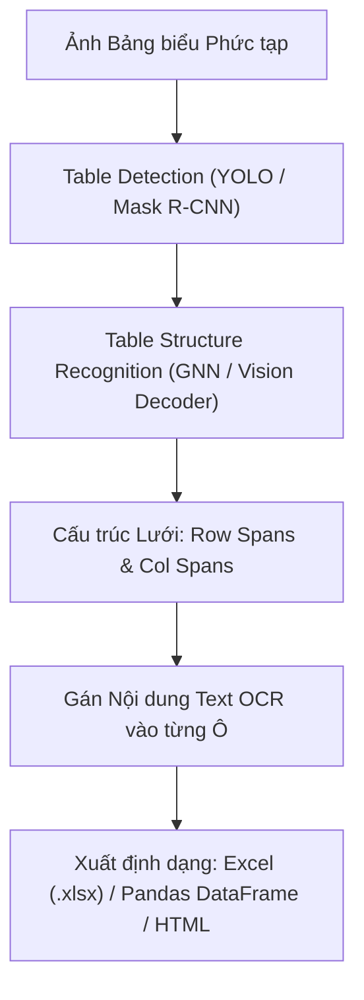

#### d. Code Thực chiến (C++ & Python)

```cpp
// C++17: Cấu trúc Dữ liệu Ô Bảng tính Table Cell
#include <iostream>
#include <string>
#include <vector>

struct TableCell {
    int row_index;
    int col_index;
    int row_span = 1;
    int col_span = 1;
    std::string text;
};

class TableStructure {
public:
    std::vector<TableCell> cells;

    void add_cell(int r, int c, int r_span, int c_span, const std::string& content) {
        cells.push_back({r, c, r_span, c_span, content});
    }

    void print_summary() const {
        std::cout << "Total extracted cells: " << cells.size() << "\n";
        for (const auto& cell : cells) {
            if (cell.row_span > 1 || cell.col_span > 1) {
                std::cout << "  Merged cell at (" << cell.row_index << ", " << cell.col_index 
                          << ") Span: [" << cell.row_span << "x" << cell.col_span << "]: " 
                          << cell.text << "\n";
            }
        }
    }
};

int main() {
    TableStructure table;
    table.add_cell(0, 0, 1, 2, "Merged Header");
    table.add_cell(1, 0, 1, 1, "Data A");
    table.add_cell(1, 1, 1, 1, "Data B");
    table.print_summary();
    return 0;
}
```

```python
# Python: Chuyển đổi Cấu trúc Ô thành Pandas DataFrame
import pandas as pd

def build_dataframe_from_cells(cell_list: list[dict], num_rows: int, num_cols: int) -> pd.DataFrame:
    grid = [["" for _ in range(num_cols)] for _ in range(num_rows)]
    for cell in cell_list:
        r, c = cell["row"], cell["col"]
        grid[r][c] = cell["text"]
    return pd.DataFrame(grid)

mock_cells = [
    {"row": 0, "col": 0, "text": "Item"}, {"row": 0, "col": 1, "text": "Price"},
    {"row": 1, "col": 0, "text": "GPU H100"}, {"row": 1, "col": 1, "text": "$30,000"}
]
df = build_dataframe_from_cells(mock_cells, 2, 2)
print("Extracted Table DataFrame:\n", df)
```

#### e. Lỗi Thường gặp & Ổn định Số học
- **Border-less Tables (Bảng không viền)**: Các bảng tài chính không có đường kẻ dọc/ngang mà chỉ phân tách bằng khoảng trắng rộng (Whitespace alignment) thường bị mô hình hiểu nhầm thành các đoạn văn bản rời rạc.

#### f. Ứng dụng Thực chiến trong AI
Trích xuất báo cáo tài chính thường niên (10-K Filings), biểu phí dịch vụ bảo hiểm và thông số kỹ thuật linh kiện từ datasheet.

---

### 3. Layout Analysis (Phân tích Bố cục Trang)

#### a. Định nghĩa Bản chất Toán học
Phân tích bố cục tài liệu (Document Layout Analysis - DLA) phân rã trang tài liệu thành các vùng chức năng không gian ngữ nghĩa:
$$\mathcal{P}_{\text{page}} \to \bigcup_{k=1}^K \mathcal{R}_k, \quad \mathcal{R}_k = (B_k, \text{Class}_k)$$
Các phân lớp bố cục chuẩn mực (như PubLayNet):
$$\text{Class} \in \{\text{Text, Title, List, Table, Figure}\}$$
Bài toán được thiết lập tương đương với Object Detection hoặc Instance Segmentation trên ảnh tài liệu độ phân giải cao.

#### b. Cơ chế Tầng Sâu & Điện toán
- **High-Resolution Feature Stride**: Tài liệu PDF khi rasterize sang hình ảnh ở 300 DPI có kích thước rất lớn ($2480 \times 3508$ pixels). Việc nạp toàn bộ ảnh vào CNN/ViT làm tràn bộ nhớ GPU VRAM. Kỹ thuật Feature Pyramid Networks (FPN) kết hợp Deformable Convolutions giúp nắm bắt các đối tượng có tỷ lệ khung hình cực đoan (Aspect ratio bất thường như dải phân cách trang cực mỏng).

#### c. Sơ đồ Minh họa (Mermaid Diagram)
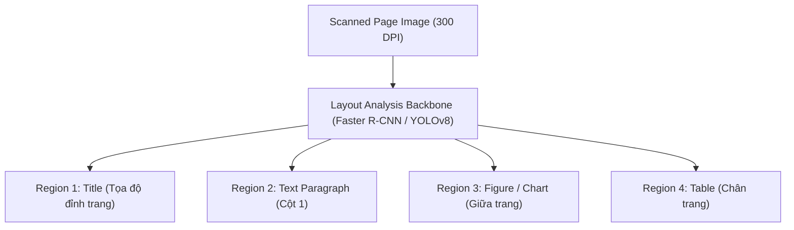

#### d. Code Thực chiến (C++ & Python)

```cpp
// C++17: Intersection over Union (IoU) kiểm tra chồng lấn vùng bố cục
#include <iostream>
#include <algorithm>

struct Rect {
    float x0, y0, x1, y1;
};

float compute_iou(const Rect& a, const Rect& b) {
    float inter_x0 = std::max(a.x0, b.x0);
    float inter_y0 = std::max(a.y0, b.y0);
    float inter_x1 = std::min(a.x1, b.x1);
    float inter_y1 = std::min(a.y1, b.y1);

    float inter_w = std::max(0.0f, inter_x1 - inter_x0);
    float inter_h = std::max(0.0f, inter_y1 - inter_y0);
    float inter_area = inter_w * inter_h;

    float area_a = (a.x1 - a.x0) * (a.y1 - a.y0);
    float area_b = (b.x1 - b.x0) * (b.y1 - b.y0);
    float union_area = area_a + area_b - inter_area;

    return (union_area <= 0.0f) ? 0.0f : (inter_area / union_area);
}

int main() {
    Rect title{50, 50, 500, 100};
    Rect paragraph{50, 90, 500, 300}; // Chồng lấn nhẹ ở y: [90, 100]
    std::cout << "Layout IoU: " << compute_iou(title, paragraph) << "\n";
    return 0;
}
```

```python
# Python: Non-Maximum Suppression (NMS) cho Layout Bounding Boxes
import torchvision.ops as ops
import torch

boxes = torch.tensor([
    [50.0, 50.0, 500.0, 100.0],
    [52.0, 51.0, 498.0, 99.0], # Hộp trùng lặp điểm số thấp
    [50.0, 120.0, 500.0, 300.0]
])
scores = torch.tensor([0.95, 0.75, 0.90])
keep_indices = ops.nms(boxes, scores, iou_threshold=0.5)
print("Kept Layout Box Indices after NMS:", keep_indices.tolist())
```

#### e. Lỗi Thường gặp & Ổn định Số học
- **Fragmented Column Segments**: Mô hình cắt nhầm một đoạn văn nhiều cột thành nhiều mẩu vụn rời rạc, làm đứt mạch văn bản khi đưa vào LLM RAG Pipeline.

#### f. Ứng dụng Thực chiến trong AI
Xây dựng Data Parsing Pipeline trong Unstructured.io, LangChain DocArray, số hóa sách báo tạp chí học thuật.

---

### 4. Document Classification (Phân loại Tài liệu)

#### a. Định nghĩa Bản chất Toán học
Phân loại tài liệu xác định danh mục nghiệp vụ $y \in \mathcal{Y}$ của một tài liệu nhiều trang $\mathcal{D} = (P_1, P_2, \dots, P_M)$:
$$y \in \{\text{Hóa đơn, Hợp đồng, Giấy phép lái xe, Báo cáo thuế, Sao kê ngân hàng, Đơn thuốc}\}$$
Mô hình hóa dưới dạng phân loại đa phương thức phân cấp (Hierarchical Multimodal Document Classifier):
$$\mathbf{h}_{\text{doc}} = \text{Aggregator}\left( \mathbf{h}_{\text{page}_1}, \dots, \mathbf{h}_{\text{page}_M} \right), \quad \hat{y} = \text{Softmax}(\mathbf{W} \mathbf{h}_{\text{doc}} + \mathbf{b})$$

#### b. Cơ chế Tầng Sâu & Điện toán
- **Multi-page Attention Aggregation**: Thay vì chỉ phân loại trang đầu tiên (thường gây nhầm lẫn nếu là trang bìa chung chung), kiến trúc sử dụng Transformer Encoder cấp độ trang (Page-level Transformer) hoặc Recurrent Aggregator để tổng hợp đặc trưng của toàn bộ các trang trong tài liệu.

#### c. Sơ đồ Minh họa (Mermaid Diagram)
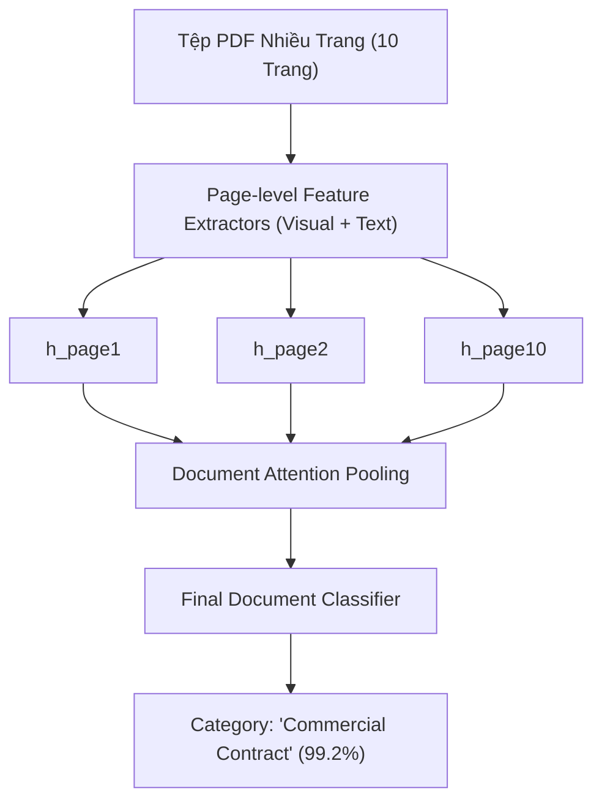

#### d. Code Thực chiến (C++ & Python)

```cpp
// C++17: Quyết định Phân loại Tài liệu dựa trên Tập Luật Trọng số Từ khóa
#include <iostream>
#include <string>
#include <unordered_map>

class KeywordDocumentClassifier {
private:
    std::unordered_map<std::string, std::string> primary_clues_ = {
        {"invoice", "INVOICE"}, {"tax invoice", "INVOICE"},
        {"agreement", "CONTRACT"}, {"contract", "CONTRACT"},
        {"receipt", "RECEIPT"}
    };
public:
    std::string classify(const std::string& first_page_text) {
        for (const auto& [keyword, label] : primary_clues_) {
            if (first_page_text.find(keyword) != std::string::npos) {
                return label;
            }
        }
        return "UNKNOWN_DOCUMENT";
    }
};

int main() {
    KeywordDocumentClassifier cls;
    std::string sample = "TAX INVOICE / BILL OF SUPPLY Date: 2026-11-10";
    std::cout << "Detected Doc Type: " << cls.classify(sample) << "\n";
    return 0;
}
```

```python
# Python / PyTorch: Page-level Attention Pooling cho Document Classification
import torch
import torch.nn as nn
import torch.nn.functional as F

class MultiPageDocumentClassifier(nn.Module):
    def __init__(self, page_dim: int, num_classes: int):
        super().__init__()
        self.attn_vector = nn.Linear(page_dim, 1)
        self.classifier = nn.Linear(page_dim, num_classes)

    def forward(self, page_representations: torch.Tensor) -> torch.Tensor:
        # page_representations: [Batch, Num_Pages, Page_Dim]
        attn_weights = F.softmax(self.attn_vector(page_representations), dim=1) # [B, Pages, 1]
        doc_rep = torch.sum(attn_weights * page_representations, dim=1) # [B, Dim]
        return self.classifier(doc_rep)

model = MultiPageDocumentClassifier(page_dim=128, num_classes=6)
pages = torch.randn(2, 5, 128) # 2 tài liệu, mỗi tài liệu 5 trang
logits = model(pages)
print("Document Logits Shape:", logits.shape) # [2, 6]
```

#### e. Lỗi Thường gặp & Ổn định Số học
- Nhầm lẫn giữa các biểu mẫu có cấu trúc gần giống nhau (ví dụ Purchase Order - Đơn đặt hàng và Invoice - Hóa đơn có 90% trường thông tin và layout giống hệt nhau).

#### f. Ứng dụng Thực chiến trong AI
Tự động định tuyến hồ sơ trong cổng hành chính công, phân loại email đính kèm trong các tập đoàn bảo hiểm.

---

### 5. Key Information Extraction - KIE (Trích xuất Thông tin Khóa)

#### a. Định nghĩa Bản chất Toán học
KIE định vị và trích xuất các thực thể nghiệp vụ quan trọng từ các biểu mẫu bán cấu trúc. Chuẩn đánh giá kinh điển: **SROIE (Receipt Information Extraction)** và **FUNSD (Form Understanding)**:
- SROIE: Trích xuất 4 trường khóa: Company, Address, Date, Total.
- FUNSD: Gán nhãn từng cụm text thành: Header, Question, Answer.
Mục tiêu toán học: Sequence Labeling trên các token 2D hoặc đồ thị liên kết Khóa - Giá trị (Key-Value Entity Linking):
$$\mathcal{G}_{\text{KIE}} = \{(k_i, v_j) \mid k_i \in \text{Question}, v_j \in \text{Answer}\}$$

#### b. Cơ chế Tầng Sâu & Điện toán
- **Spatial Bipartite Graph Matching**: Xây dựng đồ thị hai phía giữa tập các ô "Key" (như nhãn in sẵn *"Tổng tiền:"*) và tập các ô "Value" (như số tiền in *"1,500,000 VND"*). Trọng số cạnh là hàm số của khoảng cách tọa độ không gian Euclidean 2D và độ tương đồng ngữ nghĩa.

#### c. Sơ đồ Minh họa (Mermaid Diagram)
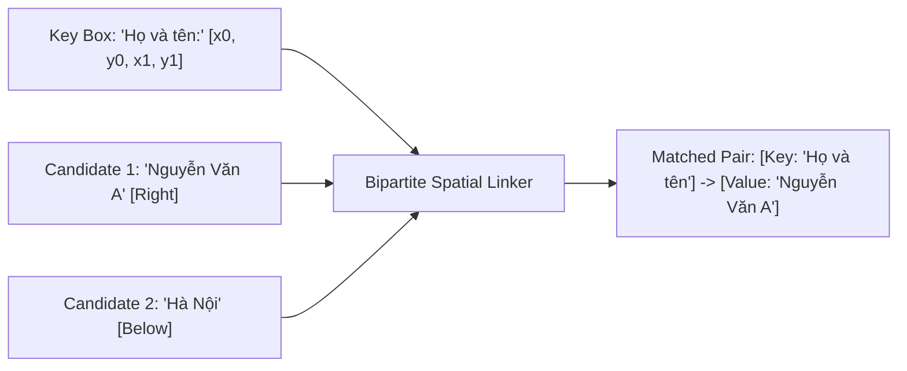

#### d. Code Thực chiến (C++ & Python)

```cpp
// C++17: Heuristic gán Key-Value dựa trên Tọa độ Không gian 2D (Right / Below)
#include <iostream>
#include <string>
#include <vector>
#include <cmath>

struct TextBlock {
    std::string text;
    int x0, y0, x1, y1;
};

std::string find_value_for_key(const TextBlock& key_block, const std::vector<TextBlock>& candidates) {
    std::string best_val = "";
    int min_dist = 1e9;

    for (const auto& cand : candidates) {
        // Kiểm tra xem cand có nằm ngang phía bên phải của key không
        bool is_right = (cand.x0 >= key_block.x1) && (std::abs(cand.y0 - key_block.y0) < 20);
        if (is_right) {
            int dist = cand.x0 - key_block.x1;
            if (dist < min_dist) {
                min_dist = dist;
                best_val = cand.text;
            }
        }
    }
    return best_val;
}

int main() {
    TextBlock key{"Invoice No:", 100, 200, 250, 230};
    std::vector<TextBlock> words = {
        {"INV-9982", 260, 202, 380, 230}, // Đúng: Nằm bên phải
        {"Date:", 100, 250, 180, 280}
    };
    std::cout << "Extracted Value for 'Invoice No:': '" << find_value_for_key(key, words) << "'\n";
    return 0;
}
```

```python
# Python / PyTorch: Spatial Key-Value Linker Biaffine Layer
import torch
import torch.nn as nn

class SpatialKeyValueLinker(nn.Module):
    def __init__(self, hidden_dim: int):
        super().__init__()
        self.link_matrix = nn.Parameter(torch.randn(hidden_dim, hidden_dim))

    def forward(self, key_representations: torch.Tensor, val_representations: torch.Tensor) -> torch.Tensor:
        # key_repr: [Batch, Num_Keys, Dim], val_repr: [Batch, Num_Vals, Dim]
        # Tính ma trận điểm liên kết: Key * W * Val^T
        intermediate = torch.matmul(key_representations, self.link_matrix)
        link_scores = torch.matmul(intermediate, val_representations.transpose(-1, -2))
        return torch.sigmoid(link_scores)

linker = SpatialKeyValueLinker(64)
k_emb = torch.randn(1, 3, 64) # 3 keys
v_emb = torch.randn(1, 5, 64) # 5 candidate values
scores = linker(k_emb, v_emb)
print("Key-Value Link Probability Matrix:", scores.shape) # [1, 3, 5]
```

#### e. Lỗi Thường gặp & Ổn định Số học
- **Multi-line Values**: Giá trị trải dài trên nhiều dòng (như địa chỉ công ty) bị hệ thống ngắt đoạn sớm, chỉ lấy dòng đầu tiên và bỏ sót các dòng tiếp theo.

#### f. Ứng dụng Thực chiến trong AI
Xử lý hồ sơ tài chính, số hóa căn cước công dân và kiểm toán chi phí doanh nghiệp tự động.

---

### 6. Optical Character Recognition - OCR (Nhận dạng Ký tự Quang học)

#### a. Định nghĩa Bản chất Toán học
OCR là bài toán chuyển đổi hình ảnh chữ viết (in hoặc viết tay) thành ký tự văn bản kỹ thuật số:
$$I(x, y) \to \mathbf{s} \in \Sigma^*$$
Hai giai đoạn tiêu chuẩn:
1. **Text Detection**: Định vị hộp bao từ/dòng bằng các giải thuật phân đoạn điểm ảnh (như DBNet - Differentiable Binarization):
   $$B = \text{Binarize}(P, T), \quad \hat{B}_{i, j} = \frac{1}{1 + \exp\left( -k (P_{i, j} - T_{i, j}) \right)}$$
2. **Text Recognition**: Nhận dạng chuỗi ký tự từ vùng ảnh cắt (Image Crop) bằng CRNN (CNN + BiLSTM + CTC Loss) hoặc Vision Transformer:
   $$\mathcal{L}_{\text{CTC}} = - \ln P(\mathbf{l} \mid \mathbf{x}) = - \ln \sum_{\pi \in \mathcal{B}^{-1}(\mathbf{l})} P(\pi \mid \mathbf{x})$$

#### b. Cơ chế Tầng Sâu & Điện toán
- **CTC (Connectionist Temporal Classification) Alignment**: CTC đưa vào ký tự trống (Blank token $\epsilon$) để giải quyết việc không biết trước vị trí gióng hàng giữa các frame thị giác dọc và ký tự văn bản. Thuật toán quy hoạch động Forward-Backward tính gradient CTC loss trực tiếp trên GPU với CUDA kernel tối ưu hóa cực đại.

#### c. Sơ đồ Minh họa (Mermaid Diagram)
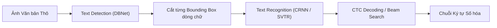

#### d. Code Thực chiến (C++ & Python)

```cpp
// C++17: CTC Greedy Decoder (Nén ký tự lặp và loại bỏ Blank Token)
#include <iostream>
#include <vector>
#include <string>

std::string ctc_greedy_decode(const std::vector<int>& raw_indices, const std::string& vocab, int blank_id = 0) {
    std::string decoded = "";
    int prev_idx = -1;

    for (int idx : raw_indices) {
        if (idx != prev_idx) {
            if (idx != blank_id && idx < static_cast<int>(vocab.size())) {
                decoded += vocab[idx];
            }
            prev_idx = idx;
        }
    }
    return decoded;
}

int main() {
    // 0: Blank, 1: 'H', 2: 'E', 3: 'L', 4: 'O'
    std::string vocab = "_HELO";
    std::vector<int> ctc_stream = {0, 1, 1, 0, 2, 0, 3, 3, 0, 3, 4, 4, 0};
    std::cout << "Decoded CTC text: " << ctc_greedy_decode(ctc_stream, vocab, 0) << "\n";
    return 0;
}
```

```python
# Python / PyTorch: CTC Loss Computation
import torch
import torch.nn as nn

T = 50      # Input sequence length (Feature frames)
C = 20      # Number of classes (Vocab size including blank)
N = 2       # Batch size
S = 10      # Target sequence length

ctc_loss = nn.CTCLoss(blank=0)
log_probs = torch.randn(T, N, C).log_softmax(2).detach().requires_grad_()
targets = torch.randint(1, C, (N, S), dtype=torch.long)
input_lengths = torch.full((N,), T, dtype=torch.long)
target_lengths = torch.full((N,), S, dtype=torch.long)

loss = ctc_loss(log_probs, targets, input_lengths, target_lengths)
print("CTC Loss Value:", loss.item())
```

#### e. Lỗi Thường gặp & Ổn định Số học
- **Perspective Distortion & Blurriness**: Tài liệu chụp bằng camera điện thoại bị nghiêng, mờ nhòe (motion blur) hoặc bóng gương khiến OCR sinh ra chuỗi ký tự rác (Mojibake).

#### f. Ứng dụng Thực chiến trong AI
Tesseract, PaddleOCR, EasyOCR, Google Cloud Vision OCR, trích xuất biển số xe tự động (ALPR).

---

### 7. Intelligent Document Processing - IDP (Xử lý Tài liệu Thông minh)

#### a. Định nghĩa Bản chất Toán học
IDP là một giải pháp tự động hóa quy trình nghiệp vụ tổng thể (End-to-End Business Automation Pipeline), tích hợp toàn bộ chuỗi công nghệ:
$$\text{IDP} = \text{Preprocess} \circ \text{OCR} \circ \text{Layout Analysis} \circ \text{KIE} \circ \text{Validation Rules} \circ \text{Human-in-the-Loop (HITL)}$$
Được đo lường bằng tỷ lệ tự động hóa không cần con người can thiệp (Straight-Through Processing - STP Rate):
$$\text{STP Rate} = \frac{N_{\text{perfect\_confidence}}}{N_{\text{total}}} \times 100\%$$

#### b. Cơ chế Tầng Sâu & Điện toán
- **Confidence Calibration for HITL Routing**: Mô hình tính toán điểm tin cậy tổng thể (Confidence Score) cho từng trường thông tin. Nếu độ tin cậy của bất kỳ trường nào thấp hơn ngưỡng an toàn $\tau_{\text{safe}}$ (e.g. 0.85), tài liệu tự động được định tuyến vào hàng đợi xác thực của con người (Human Validation Queue) thay vì ghi trực tiếp vào cơ sở dữ liệu kế toán.

#### c. Sơ đồ Minh họa (Mermaid Diagram)
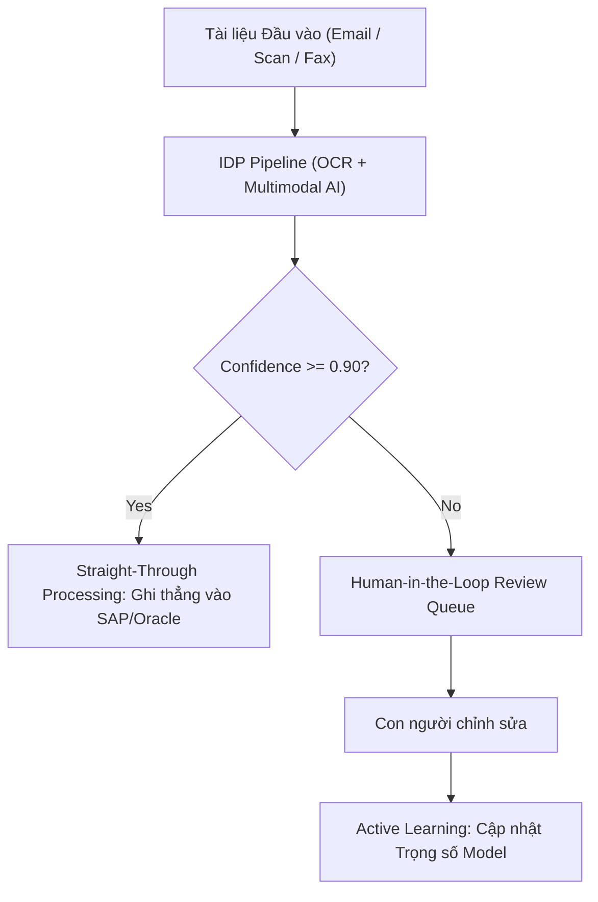

#### d. Code Thực chiến (C++ & Python)

```cpp
// C++17: Bộ Điều hướng Tự động hóa IDP (HITL Router)
#include <iostream>
#include <vector>
#include <string>

struct ExtractedField {
    std::string field_name;
    std::string value;
    float confidence;
};

bool should_route_to_human(const std::vector<ExtractedField>& fields, float threshold = 0.85f) {
    for (const auto& f : fields) {
        if (f.confidence < threshold) {
            return true; // Chuyển sang con người kiểm tra
        }
    }
    return false; // STP thành công
}

int main() {
    std::vector<ExtractedField> invoice = {
        {"vendor", "Google LLC", 0.98f},
        {"total_amount", "$12,450.00", 0.72f} // Điểm tin cậy thấp
    };
    std::cout << "Route to Human Reviewer? " 
              << std::boolalpha << should_route_to_human(invoice) << "\n";
    return 0;
}
```

```python
# Python: Mô phỏng Pipeline IDP hoàn chỉnh với Logic Validation
class IDPInvoicePipeline:
    def process_invoice(self, data: dict) -> dict:
        # Step 1: Validate VAT Calculation
        subtotal = data.get("subtotal", 0.0)
        tax = data.get("tax", 0.0)
        total = data.get("total", 0.0)

        is_math_valid = abs((subtotal + tax) - total) < 0.01
        status = "APPROVED_STP" if is_math_valid else "FLAGGED_FOR_HUMAN_REVIEW"
        return {"status": status, "math_check": is_math_valid, "data": data}

pipeline = IDPInvoicePipeline()
print(pipeline.process_invoice({"subtotal": 100.0, "tax": 10.0, "total": 110.0}))
print(pipeline.process_invoice({"subtotal": 100.0, "tax": 10.0, "total": 150.0}))
```

#### e. Lỗi Thường gặp & Ổn định Số học
- **Silent Failures**: Điểm tin cậy của mô hình bị hiệu chỉnh sai (Overconfident Misclassification), mô hình tin 99% vào một số liệu OCR đọc sai (e.g. đọc nhầm số `8` thành `3`), dẫn đến thất thoát tài chính mà không kích hoạt hàng đợi cảnh báo.

#### f. Ứng dụng Thực chiến trong AI
Các nền tảng phần mềm doanh nghiệp hàng đầu: ABBYY FlexiCapture, AWS Textract, Google Document AI, Kofax, UiPath Document Understanding.

---

### 8. Form Understanding (Thấu hiểu Biểu mẫu)

#### a. Định nghĩa Bản chất Toán học
Form Understanding phân tích các tài liệu có cấu trúc biểu mẫu tĩnh hoặc động (Đơn xin visa, phiếu đăng ký mở tài khoản, đơn yêu cầu bồi thường bảo hiểm).
Mục tiêu là xây dựng đồ thị phân cấp:
$$\mathcal{G}_{\text{form}} = (\mathcal{V}_{\text{elements}}, \mathcal{E}_{\text{relations}})$$
trong đó các cạnh $\mathcal{E}$ kết nối các nhãn (Labels), giá trị nhập (Input Values), các hộp kiểm (Checkboxes: Checked / Unchecked), và chữ ký (Signature Present / Absent).

#### b. Cơ chế Tầng Sâu & Điện toán
- **Checkbox & Radio Button Classification**: Nhận diện trạng thái hộp kiểm đòi hỏi một nhánh mạng nơ-ron thị giác con (Visual Patch Classifier) phân loại vùng ảnh nhỏ $32 \times 32$ pixels thành nhãn nhị phân: $\text{Box}_{\text{state}} \in \{\text{Checked: 1}, \text{Empty: 0}\}$.

#### c. Sơ đồ Minh họa (Mermaid Diagram)
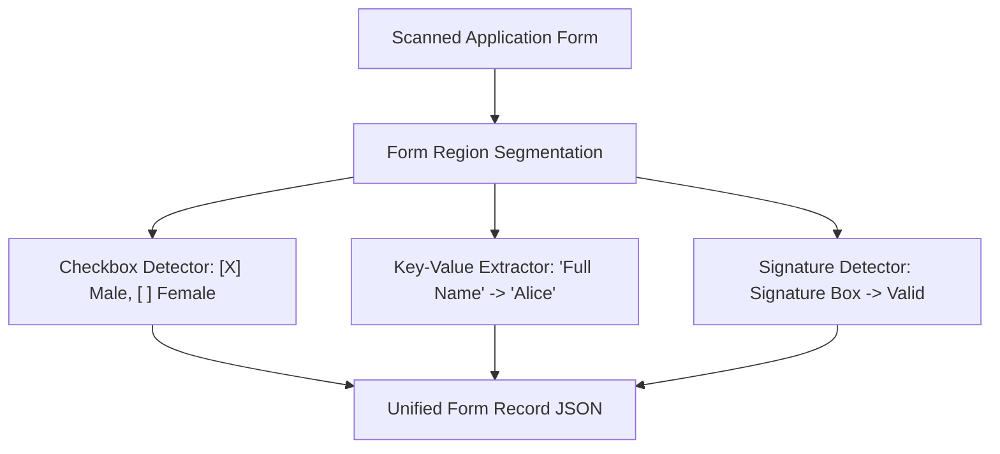

#### d. Code Thực chiến (C++ & Python)

```cpp
// C++17: Kiểm tra tỷ lệ pixel đen phát hiện Checkbox Checked hay Empty
#include <iostream>
#include <vector>

bool is_checkbox_checked(const std::vector<unsigned char>& patch_gray, int width, int height, float threshold = 0.25f) {
    int dark_pixels = 0;
    int total = width * height;
    for (unsigned char p : patch_gray) {
        if (p < 128) { // Pixel tối màu (mực viết)
            dark_pixels++;
        }
    }
    float ratio = static_cast<float>(dark_pixels) / total;
    return ratio >= threshold;
}

int main() {
    // Giả lập patch 4x4: 6 pixel đen trên tổng số 16 pixels (37.5%)
    std::vector<unsigned char> patch = {
        255, 0, 0, 255,
        0, 0, 255, 255,
        255, 0, 0, 255,
        255, 255, 255, 255
    };
    std::cout << "Checkbox is marked? " << std::boolalpha << is_checkbox_checked(patch, 4, 4) << "\n";
    return 0;
}
```

```python
# Python: FUNSD Dataset Entity Relationship Mapping
def parse_funsd_annotations(annotations: dict) -> list[dict]:
    # Ghép nối quan hệ giữa Question và Answer trong FUNSD
    id_to_box = {item["id"]: item for item in annotations["form"]}
    relations = []
    for item in annotations["form"]:
        if item["label"] == "question":
            for link in item.get("linking", []):
                target_id = link[1] if link[0] == item["id"] else link[0]
                if target_id in id_to_box and id_to_box[target_id]["label"] == "answer":
                    relations.append({
                        "question": item["text"],
                        "answer": id_to_box[target_id]["text"]
                    })
    return relations

mock_form = {
    "form": [
        {"id": 1, "text": "Date of Birth:", "label": "question", "linking": [[1, 2]]},
        {"id": 2, "text": "1995-05-12", "label": "answer", "linking": [[1, 2]]}
    ]
}
print("Extracted Form Links:", parse_funsd_annotations(mock_form))
```

#### e. Lỗi Thường gặp & Ổn định Số học
- Người điền viết tràn chữ ra ngoài ô quy định (Bleeding text over borders) khiến hộp nhận diện ký tự bị cắt đứt.

#### f. Ứng dụng Thực chiến trong AI
Số hóa hồ sơ xin cấp thị thực nhập cảnh, hồ sơ yêu cầu chi trả bảo hiểm y tế.

---

### 9. Receipt Understanding (Thấu hiểu Biên nhận)

#### a. Định nghĩa Bản chất Toán học
Receipt Understanding trích xuất thông tin giao dịch bán lẻ từ các cuộn giấy in nhiệt (Thermal Paper Receipts). Thách thức toán học nằm ở tính biến dạng vật lý:
- Giấy bị nhàu nát, gấp nếp (Creases / Wrinkles).
- Mực in nhiệt bị mờ theo thời gian (Faded Ink).
- Góc chụp cong vênh phi tuyến tính (Non-linear Perspective Warp):
  $$I_{\text{rectified}}(x', y') = \mathcal{W}_{\theta}(I_{\text{distorted}}(x, y))$$

#### b. Cơ chế Tầng Sâu & Điện toán
- **Thin-Plate Spline (TPS) Transformation**: Trước khi đưa vào mạng nhận diện, một mạng nơ-ron Spatial Transformer Network (STN) ước lượng lưới biến dạng và áp dụng phép biến đổi TPS để làm phẳng nếp nhăn hình ảnh trong thời gian thực trên GPU.

#### c. Sơ đồ Minh họa (Mermaid Diagram)
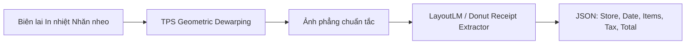

#### d. Code Thực chiến (C++ & Python)

```cpp
// C++17: Bộ Lọc Heuristic tìm kiếm Tổng tiền trên Biên nhận (Receipt Total Extractor)
#include <iostream>
#include <string>
#include <vector>
#include <regex>

std::string extract_receipt_total(const std::vector<std::string>& receipt_lines) {
    std::regex total_regex(R"((total|amount due|balance due)\s*[:\$]?\s*([0-9]+[.,][0-9]{2}))", std::regex::icase);
    std::smatch match;

    // Duyệt từ cuối biên nhận lên đầu (thường tổng tiền nằm ở đáy)
    for (auto it = receipt_lines.rbegin(); it != receipt_lines.rend(); ++it) {
        if (std::regex_search(*it, match, total_regex)) {
            return match[2].str();
        }
    }
    return "NOT_FOUND";
}

int main() {
    std::vector<std::string> lines = {
        "WALMART STORE #1234",
        "APPLE JUICE   $3.50",
        "BREAD         $2.20",
        "SUBTOTAL      $5.70",
        "TOTAL         $5.70",
        "THANK YOU!"
    };
    std::cout << "Receipt Total Amount: " << extract_receipt_total(lines) << "\n";
    return 0;
}
```

```python
# Python: SROIE Line Item Parser
import re

def parse_receipt_line_items(lines: list[str]) -> list[dict]:
    # Match item name và giá tiền ở cuối dòng
    item_pattern = re.compile(r'^(.*?)\s+([0-9]+\.[0-9]{2})$')
    items = []
    for line in lines:
        match = item_pattern.match(line.strip())
        if match:
            items.append({"name": match.group(1).strip(), "price": float(match.group(2))})
    return items

raw_lines = ["COFFEE LATTE 4.50", "CROISSANT 3.25", "TOTAL 7.75"]
print("Parsed Items:", parse_receipt_line_items(raw_lines[:2]))
```

#### e. Lỗi Thường gặp & Ổn định Số học
- Nhầm lẫn giữa Số tiền tạm tính (Subtotal), Thuế GTGT (Tax) và Tổng tiền thực trả (Grand Total/Total).

#### f. Ứng dụng Thực chiến trong AI
Ứng dụng quản lý tài chính cá nhân (Expensify, Ramp), quyết toán chi phí công tác nhân viên tự động.

---

### 10. Invoice Processing (Xử lý Hóa đơn Tài chính)

#### a. Định nghĩa Bản chất Toán học
Invoice Processing là tác vụ trích xuất cấp độ tài chính khắt khe nhất, kết hợp trích xuất trường đơn (Header/Footer: Invoice Number, Vendor Name, Tax ID, Issue Date, Due Date, Total) và trích xuất bảng danh mục hàng hóa chi tiết (Line Items Table: Description, Quantity, Unit Price, Line Total).
Ràng buộc toán học cân bằng sổ sách:
$$\text{Total} = \sum_{k=1}^M (\text{Quantity}_k \times \text{Unit\_Price}_k) + \text{Tax} - \text{Discount}$$

#### b. Cơ chế Tầng Sâu & Điện toán
- **Cross-page Line Items Stitching**: Hóa đơn mua sắm vật tư công nghiệp có thể dài hàng chục trang với bảng danh mục nối tiếp nhau. Mô hình phải duy trì trạng thái ngữ cảnh bảng xuyên trang để không bị mất liên kết tiêu đề cột.

#### c. Sơ đồ Minh họa (Mermaid Diagram)
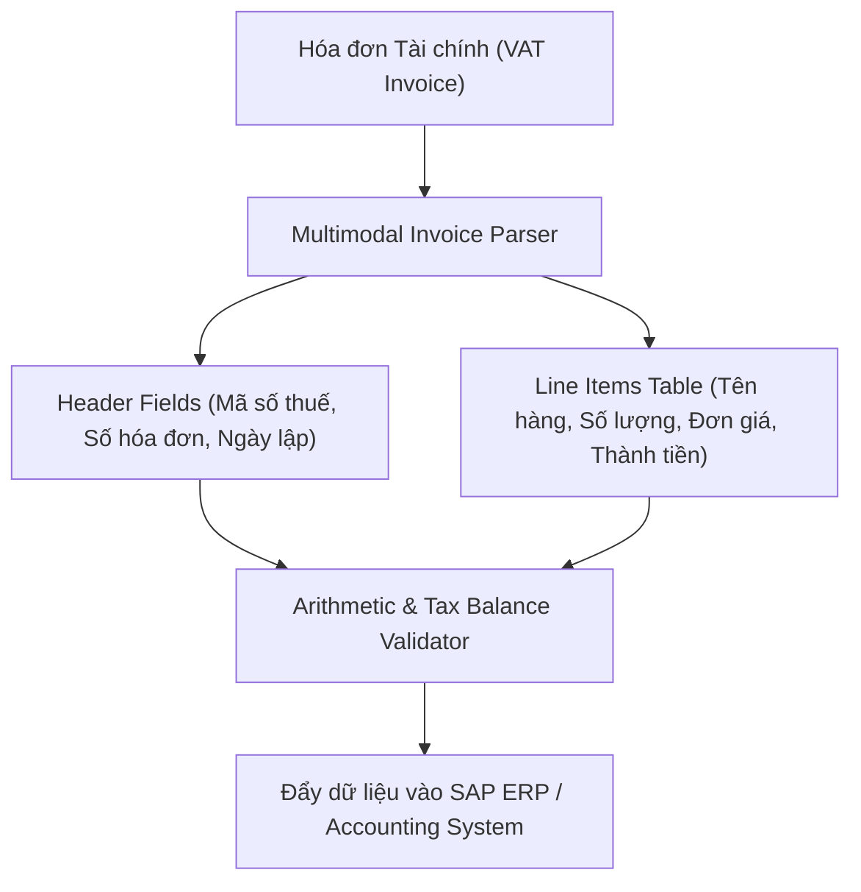

#### d. Code Thực chiến (C++ & Python)

```cpp
// C++17: Kiểm tra Tính Hợp lệ Số học của Hóa đơn Tài chính
#include <iostream>
#include <vector>
#include <cmath>

struct InvoiceLineItem {
    std::string desc;
    double quantity;
    double unit_price;
    double line_total;
};

bool validate_invoice_math(const std::vector<InvoiceLineItem>& items, double tax, double grand_total) {
    double computed_subtotal = 0.0;
    for (const auto& item : items) {
        double expected_line = item.quantity * item.unit_price;
        if (std::abs(expected_line - item.line_total) > 0.02) {
            return false; // Sai lệch dòng hàng
        }
        computed_subtotal += item.line_total;
    }
    double expected_grand = computed_subtotal + tax;
    return std::abs(expected_grand - grand_total) <= 0.02;
}

int main() {
    std::vector<InvoiceLineItem> items = {
        {"NVIDIA A100 GPU", 2.0, 10000.0, 20000.0},
        {"Server Chassis", 1.0, 5000.0, 5000.0}
    };
    double tax = 2500.0;
    double total = 27500.0;
    std::cout << "Invoice Math Valid: " << std::boolalpha << validate_invoice_math(items, tax, total) << "\n";
    return 0;
}
```

```python
# Python: Structured Invoice Model với Pydantic Validation
from pydantic import BaseModel, model_validator

class LineItem(BaseModel):
    description: str
    quantity: float
    unit_price: float
    line_total: float

class InvoiceData(BaseModel):
    invoice_number: str
    items: list[LineItem]
    tax: float
    grand_total: float

    @model_validator(mode='after')
    def check_totals(self):
        computed = sum(i.line_total for i in self.items) + self.tax
        if abs(computed - self.grand_total) > 0.05:
            raise ValueError(f"Khớp toán học thất bại: Tính toán {computed} != Tổng khai báo {self.grand_total}")
        return self

valid_inv = InvoiceData(
    invoice_number="INV-2026-X",
    items=[LineItem(description="Cloud GPU", quantity=10, unit_price=2.5, line_total=25.0)],
    tax=2.5,
    grand_total=27.5
)
print("Validated Invoice Pydantic Model:", valid_inv.invoice_number)
```

#### e. Lỗi Thường gặp & Ổn định Số học
- Làm tròn số lẻ phần thập phân (Floating point precision errors) khi tính thuế suất (ví dụ 8% hay 10%) khiến chênh lệch 1-2 xu, làm hệ thống tự động từ chối hóa đơn hợp lệ.

#### f. Ứng dụng Thực chiến trong AI
Tự động hóa hoàn toàn quy trình Phải trả Người bán (Accounts Payable - AP Automation) trong các doanh nghiệp Fortune 500.

---

### 11. Contract Analysis (Phân tích Hợp đồng)

#### a. Định nghĩa Bản chất Toán học
Contract Analysis là bài toán hiểu tài liệu pháp lý phức tạp dài hàng chục trang (Non-Disclosure Agreement - NDA, Master Service Agreement - MSA). Các tác vụ chính:
1. **Clause Classification**: Phân loại từng điều khoản vào các danh mục pháp lý chuẩn (Confidentiality, Indemnification, Governing Law, Termination).
2. **Red-flag Detection (Phát hiện Rủi ro)**: Xác định các điều khoản bất lợi vượt ra ngoài tiêu chuẩn thị trường (e.g. thời hạn bồi thường không giới hạn).
3. **Contract Deviation Scoring**: Đo lường khoảng cách sai lệch giữa hợp đồng đối tác và mẫu hợp đồng chuẩn của công ty:
   $$\text{Risk}(\mathcal{C}) = \sum_{c \in \mathcal{C}} w_c \cdot \text{Deviation}(c, c_{\text{standard}})$$

#### b. Cơ chế Tầng Sâu & Điện toán
- **Hierarchical Document Chunking with Context Preservation**: Do hợp đồng dài từ 20,000 - 100,000 từ, việc chia nhỏ văn bản (chunking) thông thường làm đứt gãy mối liên kết giữa phần định nghĩa (Definitions Section ở đầu hợp đồng) và các điều khoản thi hành ở cuối hợp đồng. Cần kỹ thuật **Global-Local Retrieval**: Mỗi chunk được gắn kèm danh mục định nghĩa cốt lõi.

#### c. Sơ đồ Minh họa (Mermaid Diagram)
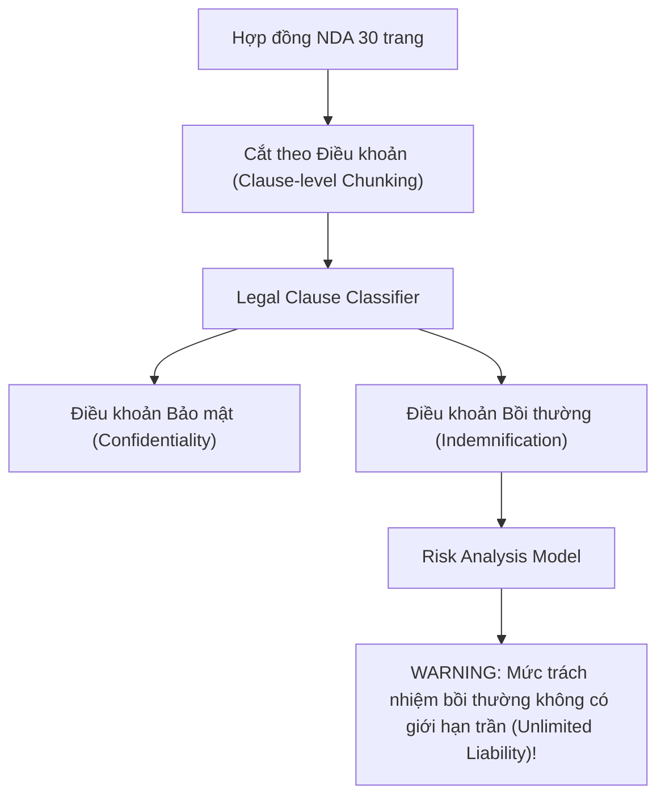

#### d. Code Thực chiến (C++ & Python)

```cpp
// C++17: Bộ Lọc Phát hiện Từ khóa Rủi ro Cao trong Điều khoản Bồi thường
#include <iostream>
#include <string>
#include <vector>

bool has_unlimited_liability_risk(const std::string& clause_text) {
    if (clause_text.find("indemnify") != std::string::npos || 
        clause_text.find("hold harmless") != std::string::npos) {
        // Kiểm tra xem có từ giới hạn trần không
        if (clause_text.find("unlimited") != std::string::npos || 
            clause_text.find("no limitation") != std::string::npos) {
            return true; // Rủi ro cao
        }
    }
    return false;
}

int main() {
    std::string safe = "The liability shall be limited to the total fees paid under this agreement.";
    std::string risky = "Vendor agrees to indemnify and hold harmless client with unlimited liability.";
    std::cout << "Safe clause risky? " << std::boolalpha << has_unlimited_liability_risk(safe) << "\n";
    std::cout << "Risky clause risky? " << std::boolalpha << has_unlimited_liability_risk(risky) << "\n";
    return 0;
}
```

```python
# Python: Semantic Difference Scoring giữa Điều khoản Chuẩn và Điều khoản Đối tác
import torch
import torch.nn.functional as F

def compute_clause_deviation(standard_vec: torch.Tensor, vendor_vec: torch.Tensor) -> float:
    # Khoảng cách Cosine đo lường mức độ lệch so với hợp đồng mẫu
    sim = F.cosine_similarity(standard_vec.unsqueeze(0), vendor_vec.unsqueeze(0)).item()
    deviation_score = 1.0 - sim
    return deviation_score

v_std = torch.tensor([0.9, 0.2, -0.1])
v_mod = torch.tensor([0.88, 0.25, -0.05])
print(f"Clause Deviation Risk Score: {compute_clause_deviation(v_std, v_mod):.4f}")
```

#### e. Lỗi Thường gặp & Ổn định Số học
- **Cross-Reference Failure**: Điều khoản 14 quy định *"Ngoại trừ các trường hợp được nêu tại Điều 8.2 và 19.4"*. Nếu mô hình phân tích độc lập Điều khoản 14 mà không giải mã nội dung của Điều 8.2 sẽ đưa ra kết luận pháp lý sai hoàn toàn.

#### f. Ứng dụng Thực chiến trong AI
Các giải pháp LegalTech hàng đầu (Harvey AI, Ironclad, Robin AI, Luminance).

---

### 12. Legal NLP (Xử lý Ngôn ngữ Tự nhiên Pháp lý)

#### a. Định nghĩa Bản chất Toán học
Legal NLP là chuyên ngành nghiên cứu và phát triển các mô hình AI đặc thù cho ngôn ngữ luật học (Legalese) - một phong cách ngôn ngữ có tính cấu trúc cực cao, câu dài phức hợp, thuật ngữ Latinh và logic tam đoạn luận (Syllogistic Reasoning):
$$\text{Major Premise (Tiên đề Luật: } \forall x (P(x) \implies Q(x))) \wedge \text{Minor Premise (Sự kiện Vụ án: } P(a)) \vdash \text{Conclusion (Phán quyết: } Q(a))$$
Các bài toán cốt lõi:
1. **Legal Judgment Prediction (LJP)**: Dự đoán kết quả phán quyết của tòa án và điều luật áp dụng dựa trên tình tiết vụ án.
2. **Prior Case Retrieval (PCR)**: Tìm kiếm tiền lệ tư pháp (Case Law / Precedent).
3. **Statutory Reasoning**: Suy luận logic dựa trên các bộ luật thành văn.

#### b. Cơ chế Tầng Sâu & Điện toán
- **Domain-Specific Pre-training (Legal-BERT)**: Do phong cách ngôn ngữ pháp lý khác biệt hoàn toàn với văn bản web thông thường, các mô hình nền tảng phải được tiền huấn luyện từ đầu trên hàng trăm Gigabyte văn bản án lệ, hiến pháp, hợp đồng với tập từ vựng chuyên ngành được tối ưu hóa riêng.

#### c. Sơ đồ Minh họa (Mermaid Diagram)
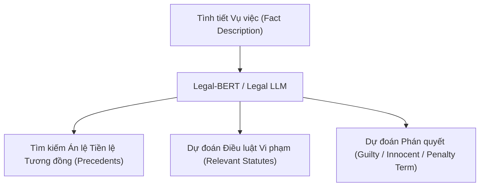

#### d. Code Thực chiến (C++ & Python)

```cpp
// C++17: Tra cứu Mã Định danh Văn bản Luật (Legal Citation Pattern Matcher)
#include <iostream>
#include <string>
#include <regex>
#include <vector>

std::vector<std::string> extract_legal_citations(const std::string& text) {
    // Regex bắt các trích dẫn luật Mỹ phổ biến dạng: 42 U.S.C. § 1983
    std::regex cite_regex(R"(\d+\s+[A-Za-z.\s]+\s+[§\d]+(\s*\(.*?\))?)");
    std::vector<std::string> citations;
    std::sregex_iterator next(text.begin(), text.end(), cite_regex);
    std::sregex_iterator end;
    while (next != end) {
        citations.push_back(next->str());
        next++;
    }
    return citations;
}

int main() {
    std::string text = "Plaintiff filed an action under 42 U.S.C. § 1983 alleging civil rights violations.";
    auto cites = extract_legal_citations(text);
    std::cout << "Extracted Legal Citations:\n";
    for (const auto& c : cites) std::cout << "  - " << c << "\n";
    return 0;
}
```

```python
# Python: Mô phỏng Syllogism Legal Deductive Reasoning
def verify_legal_syllogism(rule: dict, facts: dict) -> bool:
    # Rule: Điều kiện tiên quyết -> Kết luận
    # facts: Các sự kiện đã chứng minh
    for condition, required_val in rule["conditions"].items():
        if facts.get(condition) != required_val:
            return False # Không thỏa mãn điều kiện tiên quyết
    return True

statute = {
    "article": "Article 102 - Breach of Contract",
    "conditions": {"valid_agreement_exists": True, "obligation_failed": True, "force_majeure": False}
}
case_facts = {
    "valid_agreement_exists": True,
    "obligation_failed": True,
    "force_majeure": False
}
print("Is defendant liable under statute?", verify_legal_syllogism(statute, case_facts))
```

#### e. Lỗi Thường gặp & Ổn định Số học
- **Hallucinated Legal Precedents**: LLMs có xu hướng nguy hiểm là tự bịa đặt ra tên thẩm phán, số hiệu án lệ và trích dẫn các vụ kiện không có thật trong lịch sử (đã từng có luật sư bị phạt vì nộp tài liệu do ChatGPT bịa án lệ lên tòa án).

#### f. Ứng dụng Thực chiến trong AI
Hỗ trợ nghiên cứu pháp lý (Legal Research Automation), thẩm định chuyên sâu sáp nhập doanh nghiệp (M&A Due Diligence) và soạn thảo văn bản tố tụng.
