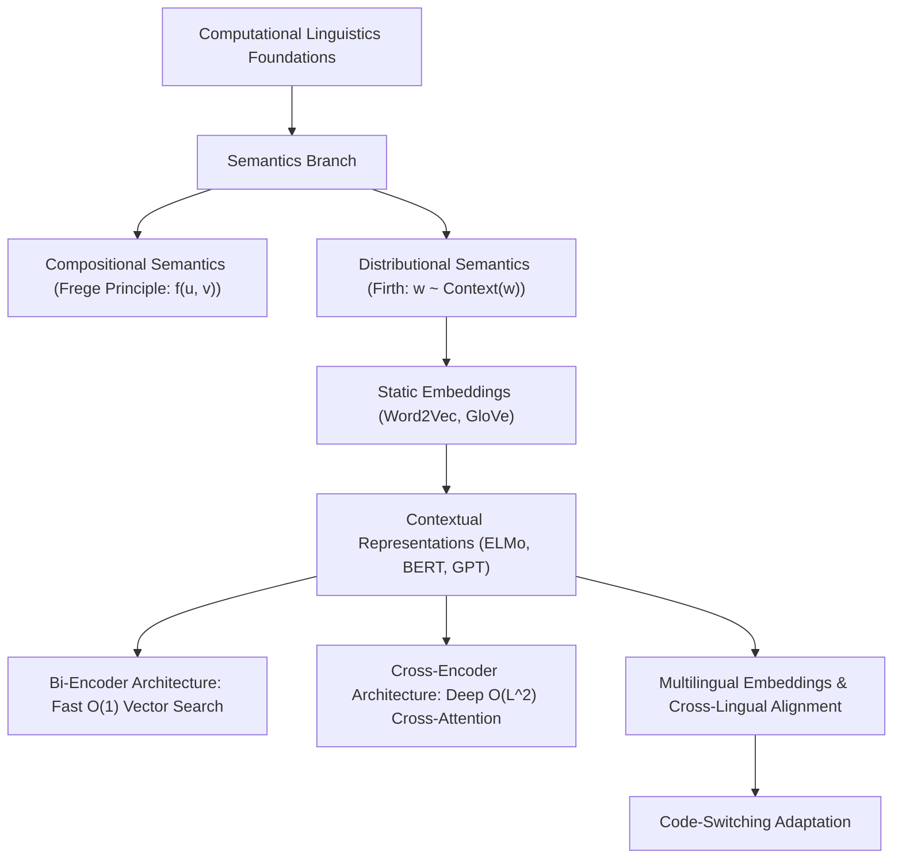
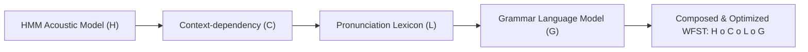
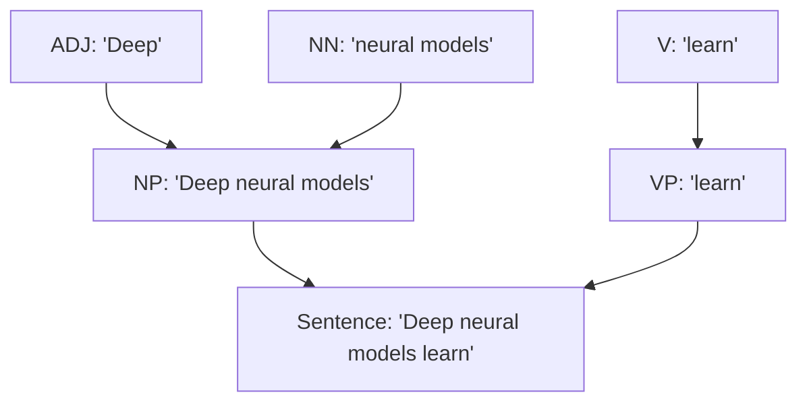
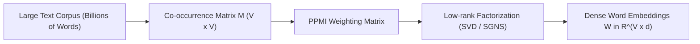
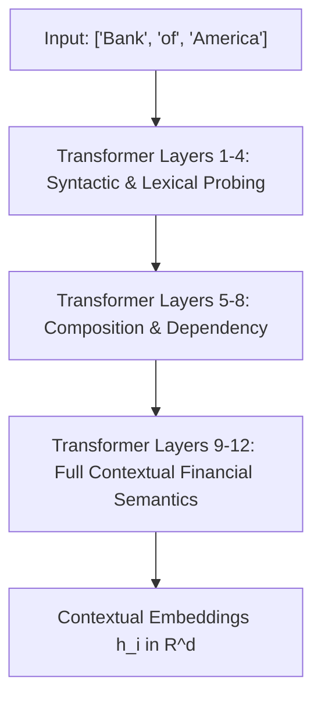
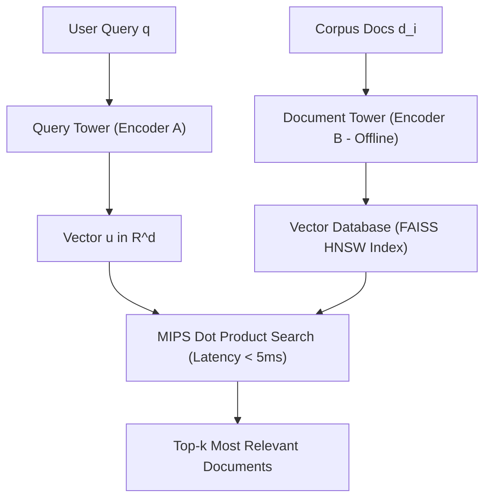
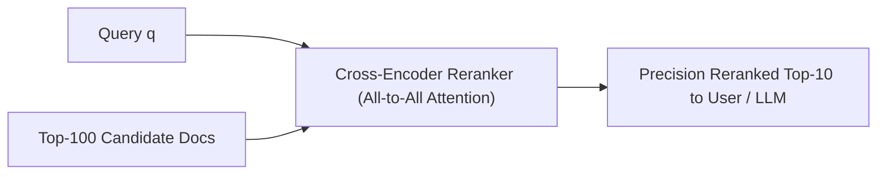
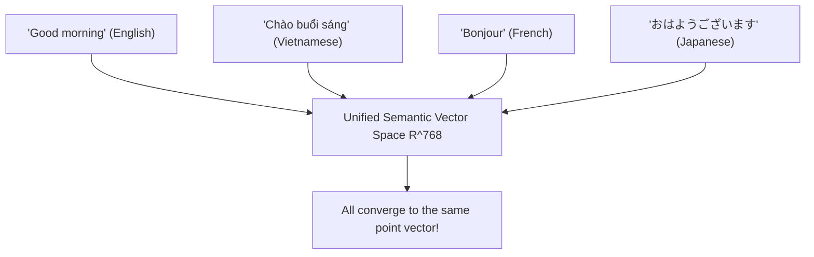
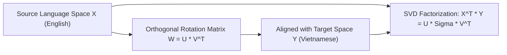

# Chuyên đề: Ngữ nghĩa Học thuật & Kiến trúc Biểu diễn Nâng cao (Semantics & Representation Architectures)

## 1. Tổng quan Chuyên đề
Sự trỗi dậy của kỷ nguyên Học sâu và Mô hình Ngôn ngữ Lớn (LLMs) được xây dựng trên sự chuyển dịch mang tính cách mạng trong lý thuyết biểu diễn ngôn ngữ. Từ việc nghiên cứu ngôn ngữ học tính toán hình thức (Computational Linguistics) và ngữ nghĩa học hợp thành (Compositional Semantics), AI đã chuyển mình mạnh mẽ sang ngữ nghĩa học phân bố (Distributional Semantics) và biểu diễn ngôn ngữ theo ngữ cảnh sâu (Contextual Language Representations).

Sự phân hóa kiến trúc giữa Bi-Encoder (tối ưu hóa tốc độ tìm kiếm vector) và Cross-Encoder (tối ưu hóa độ chính xác tương tác chéo), kết hợp với các kỹ thuật căn chỉnh không gian nhúng đa ngôn ngữ (Multilingual Embeddings & Cross-Lingual Alignment) và xử lý trộn mã ngôn ngữ (Code-Switching) là những trụ cột kỹ thuật đưa NLP từ các mô hình đơn lẻ sang hệ sinh thái tri thức toàn cầu.



---

## 2. Chi tiết từng Keyword

---

### 1. Computational Linguistics (Ngôn ngữ học Tính toán)

#### a. Định nghĩa Bản chất Toán học (Mathematical Formulation)
Ngôn ngữ học tính toán là ngành khoa học liên ngành nghiên cứu các mô hình tính toán hình thức cho các hiện tượng ngôn ngữ tự nhiên. Về bản chất, nó thiết lập sự tương đương giữa ngữ pháp ngôn ngữ tự nhiên và lý thuyết ngôn ngữ hình thức (Formal Language Theory):
$$\mathcal{L} = \{w \in \Sigma^* \mid S \xRightarrow{*} w \text{ theo văn phạm } G = (V_N, V_T, S, R)\}$$
Mô hình hóa các hiện tượng ngữ âm (Phonology), hình thái (Morphology), cú pháp (Syntax) và ngữ nghĩa (Semantics) bằng các cấu trúc toán học xác định như Otomata Hữu hạn Trọng số (Weighted Finite-State Transducers - WFST):
$$T = (\Sigma, \Delta, Q, I, F, E, \lambda, \rho)$$
với $\Sigma$ là bảng chữ cái vào, $\Delta$ là bảng chữ cái ra, $Q$ là tập trạng thái, và $E \subseteq Q \times (\Sigma \cup \{\epsilon\}) \times (\Delta \cup \{\epsilon\}) \times \mathbb{K} \times Q$ là tập các bước chuyển có trọng số trong một nửa vành (Semiring $\mathbb{K}$).

#### b. Cơ chế Tầng Sâu & Điện toán (Under The Hood / Hardware Internals)
- **WFST Composition & Determinization**: Trong các engine nhận dạng tiếng nói và dịch máy cổ điển (như Kaldi hay OpenFst), việc hợp thành các tầng $H \circ C \circ L \circ G$ (HMM $\circ$ Context $\circ$ Lexicon $\circ$ Grammar) tạo ra đồ thị trạng thái khổng lồ hàng triệu đỉnh. Thuật toán Determinization và Weight Pushing tối ưu hóa đồ thị thành một máy trạng thái cực tiểu (Minimal Transducer) lưu trong mảng phẳng tuyến tính, cho phép tra cứu trạng thái trong CPU L1 Cache.

#### c. Sơ đồ Minh họa (Mermaid Diagram)


#### d. Code Thực chiến (C++ & Python)

```cpp
// C++17: Mô phỏng Finite State Transducer (FST) chuyển đổi hình thái học đơn giản
#include <iostream>
#include <string>
#include <unordered_map>

class MorphologicalFST {
private:
    std::unordered_map<std::string, std::string> transitions_ = {
        {"swim+PAST", "swam"},
        {"run+PAST", "ran"},
        {"go+PAST", "went"}
    };
public:
    std::string transduce(const std::string& input_symbol) {
        if (transitions_.count(input_symbol)) {
            return transitions_[input_symbol];
        }
        return input_symbol + "+ed"; // Luật mặc định
    }
};

int main() {
    MorphologicalFST fst;
    std::cout << "swim+PAST -> " << fst.transduce("swim+PAST") << "\n";
    std::cout << "walk+PAST -> " << fst.transduce("walk+PAST") << "\n";
    return 0;
}
```

```python
# Python: Semiring Dynamic Programming (Viterbi Semiring)
import math

class ViterbiSemiring:
    @staticmethod
    def plus(a: float, b: float) -> float:
        # Trong Viterbi semiring, phép cộng là cực đại hóa: max(a, b)
        return max(a, b)

    @staticmethod
    def times(a: float, b: float) -> float:
        # Phép nhân là cộng log-probabilities: a + b
        return a + b

sr = ViterbiSemiring()
prob1 = math.log(0.4)
prob2 = math.log(0.6)
print("Best Path Metric:", sr.plus(prob1, prob2))
```

#### e. Lỗi Thường gặp & Ổn định Số học
- Bỏ qua các hiện tượng ngôn ngữ ngoại lệ (Irregular linguistic phenomena) khi thiết kế luật hình thức, dẫn đến sự bùng nổ luật thủ công không thể bảo trì.

#### f. Ứng dụng Thực chiến trong AI
Xây dựng bộ phát âm (Grapheme-to-Phoneme - G2P) trong Text-to-Speech và kiểm định hình thức tính đúng đắn ngữ pháp trong trình biên dịch ngôn ngữ.

---

### 2. Compositional Semantics (Ngữ nghĩa học Hợp thành)

#### a. Định nghĩa Bản chất Toán học
Ngữ nghĩa học hợp thành dựa trên luận điểm của Frege: Ý nghĩa của toàn thể được xác định bằng ý nghĩa của các bộ phận thành phần kết hợp với cấu trúc ngữ pháp liên kết chúng:
$$\llbracket \alpha \beta \rrbracket = \llbracket \alpha \rrbracket (\llbracket \beta \rrbracket) \quad (\text{Functional Application in } \lambda\text{-Calculus})$$
Ví dụ với vị từ và đối số:
$$\llbracket \text{"sleeps"} \rrbracket = \lambda x . \text{Sleep}(x), \quad \llbracket \text{"Alice"} \rrbracket = \text{Alice} \implies \llbracket \text{"Alice sleeps"} \rrbracket = \text{Sleep}(\text{Alice})$$
Trong không gian vector hình học (Vector Compositionality):
$$\mathbf{v}_{\text{sentence}} = f(\mathbf{v}_1, \dots, \mathbf{v}_n; \mathcal{T})$$
với $f$ có thể là phép cộng vector đơn giản, phép nhân Kronecker tensor, hoặc mạng nơ-ron đệ quy (Recursive Neural Network - Tree-LSTM).

#### b. Cơ chế Tầng Sâu & Điện toán
- **Tensor Product vs Neural Composition**: Phép nhân tích ngoài tensor $\mathbf{u} \otimes \mathbf{v}$ bảo toàn trọn vẹn thứ tự và vị trí của các từ nhưng khiến số chiều bùng nổ theo cấp số nhân $\mathcal{O}(d^n)$. Mạng Transformer giải quyết điều này bằng cách sử dụng phép chiếu ma trận tuyến tính $\mathbf{W}_Q, \mathbf{W}_K, \mathbf{W}_V$ và các hàm kích hoạt phi tuyến tính (GELU, SwiGLU) giữ nguyên kích thước ẩn $d$ cố định.

#### c. Sơ đồ Minh họa (Mermaid Diagram)


#### d. Code Thực chiến (C++ & Python)

```cpp
// C++17: Phép Hợp thành Ngữ nghĩa Tuyến tính (Linear Compositional Layer)
#include <iostream>
#include <vector>
#include <cmath>

std::vector<float> compose_vectors(const std::vector<float>& u, const std::vector<float>& v) {
    size_t dim = u.size();
    std::vector<float> result(dim);
    for (size_t i = 0; i < dim; ++i) {
        // Hàm hợp phi tuyến tính đơn giản: tanh(u + v)
        result[i] = std::tanh(u[i] + v[i]);
    }
    return result;
}

int main() {
    std::vector<float> word_deep = {0.5f, -0.2f};
    std::vector<float> word_learning = {0.3f, 0.8f};
    auto phrase_vec = compose_vectors(word_deep, word_learning);
    std::cout << "Composed Phrase Vector: [" << phrase_vec[0] << ", " << phrase_vec[1] << "]\n";
    return 0;
}
```

```python
# Python / PyTorch: Composition qua Multi-Head Attention Head
import torch
import torch.nn as nn

class CompositionalAttentionBlock(nn.Module):
    def __init__(self, hidden_dim: int):
        super().__init__()
        self.attn = nn.MultiheadAttention(embed_dim=hidden_dim, num_heads=2, batch_first=True)
        self.ffn = nn.Sequential(
            nn.Linear(hidden_dim, hidden_dim),
            nn.GELU(),
            nn.Linear(hidden_dim, hidden_dim)
        )

    def forward(self, token_embeddings: torch.Tensor) -> torch.Tensor:
        # token_embeddings: [Batch, Seq_Len, Hidden_Dim]
        attn_out, _ = self.attn(token_embeddings, token_embeddings, token_embeddings)
        composed = self.ffn(attn_out + token_embeddings)
        return composed

block = CompositionalAttentionBlock(hidden_dim=64)
x = torch.randn(1, 4, 64)
print("Composed Representation Shape:", block(x).shape)
```

#### e. Lỗi Thường gặp & Ổn định Số học
- **Idiomatic Non-compositionality (Tính bất khả hợp của thành ngữ)**: Các cụm từ thành ngữ (ví dụ *"kick the bucket"* có nghĩa là chết) hoàn toàn không thể phân rã thành nghĩa của *"kick"* và *"bucket"*. Mô hình hợp thành thuần túy sẽ hiểu sai nghĩa đen.

#### f. Ứng dụng Thực chiến trong AI
Xây dựng Semantic Parsers chuyển đổi ngôn ngữ tự nhiên thành câu truy vấn SQL (Text-to-SQL) và suy luận logic toán học trong Formal Theorem Proving.

---

### 3. Distributional Semantics (Ngữ nghĩa học Phân bố)

#### a. Định nghĩa Bản chất Toán học
Ngữ nghĩa học phân bố dựa trên châm ngôn nổi tiếng của J.R. Firth (1957): *"You shall know a word by the company it keeps"*. Ý nghĩa của một từ được đặc trưng bởi phân phối xác suất đồng xuất hiện của nó với các từ ngữ cảnh khác trong kho ngữ liệu:
$$\mathbf{w} \equiv P(\text{Context} \mid w)$$
Trong mô hình ma trận Từ - Ngữ cảnh (Term-Context Matrix) $\mathbf{M} \in \mathbb{R}^{V \times V}$, độ tương quan được chuẩn hóa bằng **Pointwise Mutual Information (PPMI)**:
$$\text{PMI}(w, c) = \log_2 \frac{P(w, c)}{P(w) P(c)}, \quad \text{PPMI}(w, c) = \max(\text{PMI}(w, c), 0)$$
Theo định lý Levy & Goldberg (2014): Thuật toán Word2Vec Skip-Gram với Negative Sampling (SGNS) tương đương ngầm với việc phân rã ma trận PPMI bị dịch chuyển (Shifted PPMI Matrix Factorization):
$$\mathbf{W} \mathbf{C}^T \approx \mathbf{M}_{\text{PPMI}} - \log k$$
với $k$ là số lượng mẫu âm (Negative samples).

#### b. Cơ chế Tầng Sâu & Điện toán
- **Negative Sampling Computation Optimization**: Thay vì tính toán hàm phân hoạch Softmax trên toàn bộ tập từ vựng $\mathcal{V}$ ($|\mathcal{V}| > 10^6$) với chi phí $\mathcal{O}(|\mathcal{V}|)$, hàm mục tiêu Negative Sampling xấp xỉ phân phối bằng tổng các hàm mất mát nhị phân Logistic Regression:
  $$\mathcal{L}_{\text{SGNS}} = \log \sigma(\mathbf{v}_c^T \mathbf{v}_w) + \sum_{i=1}^k \mathbb{E}_{w_i \sim P_n(w)} \left[ \log \sigma(-\mathbf{v}_{w_i}^T \mathbf{v}_w) \right]$$
  Phân phối mẫu âm unigram được làm mịn bằng số mũ $3/4$: $P_n(w) \propto U(w)^{3/4}$ để tăng tần suất lấy mẫu của các từ hiếm.

#### c. Sơ đồ Minh họa (Mermaid Diagram)


#### d. Code Thực chiến (C++ & Python)

```cpp
// C++17: Bảng Lấy Mẫu Âm (Alias Table for Negative Sampling Unigram^0.75)
#include <iostream>
#include <vector>
#include <cmath>
#include <random>

class NegativeSampler {
private:
    std::vector<int> sampling_table_;
    std::mt19937 rng_{42};
public:
    void init_table(const std::vector<float>& unigram_counts, size_t table_size = 100000) {
        sampling_table_.resize(table_size);
        double total_pow = 0.0;
        for (float count : unigram_counts) {
            total_pow += std::pow(count, 0.75);
        }

        size_t word_idx = 0;
        double cumulative = std::pow(unigram_counts[0], 0.75) / total_pow;
        for (size_t i = 0; i < table_size; ++i) {
            sampling_table_[i] = word_idx;
            if (static_cast<double>(i) / table_size > cumulative && word_idx < unigram_counts.size() - 1) {
                word_idx++;
                cumulative += std::pow(unigram_counts[word_idx], 0.75) / total_pow;
            }
        }
    }

    int sample() {
        return sampling_table_[rng_() % sampling_table_.size()];
    }
};

int main() {
    NegativeSampler sampler;
    sampler.init_table({1000.0f, 50.0f, 5.0f});
    std::cout << "Sampled Word ID: " << sampler.sample() << "\n";
    return 0;
}
```

```python
# Python / PyTorch: Skip-Gram Negative Sampling Loss
import torch
import torch.nn as nn
import torch.nn.functional as F

class SkipGramNegativeSamplingLoss(nn.Module):
    def forward(self, target_vecs: torch.Tensor, pos_ctx_vecs: torch.Tensor, neg_ctx_vecs: torch.Tensor) -> torch.Tensor:
        # target_vecs: [Batch, Dim], pos_ctx_vecs: [Batch, Dim], neg_ctx_vecs: [Batch, K_neg, Dim]
        pos_scores = torch.sum(target_vecs * pos_ctx_vecs, dim=-1) # [Batch]
        pos_loss = F.binary_cross_entropy_with_logits(pos_scores, torch.ones_like(pos_scores))

        # neg_scores: [Batch, K_neg]
        neg_scores = torch.bmm(neg_ctx_vecs, target_vecs.unsqueeze(-1)).squeeze(-1)
        neg_loss = F.binary_cross_entropy_with_logits(neg_scores, torch.zeros_like(neg_scores))

        return pos_loss + neg_loss

loss_fn = SkipGramNegativeSamplingLoss()
t = torch.randn(4, 64)
p = torch.randn(4, 64)
n = torch.randn(4, 5, 64) # 5 negative samples
print("SGNS Loss:", loss_fn(t, p, n).item())
```

#### e. Lỗi Thường gặp & Ổn định Số học
- **Negative Sample Collision**: Mẫu âm lấy ngẫu nhiên lại chính là một từ ngữ cảnh thực tế của từ mục tiêu (False Negative), làm suy giảm chất lượng biểu diễn không gian.

#### f. Ứng dụng Thực chiến trong AI
Khởi tạo trọng số cho các hệ thống gợi ý (Item2Vec trong Recommendation Systems), phân tích tương đồng từ vựng học thuật.

---

### 4. Contextual Language Representations (Biểu diễn Ngôn ngữ theo Ngữ cảnh)

#### a. Định nghĩa Bản chất Toán học
Khác với các vector nhúng tĩnh (Static Embeddings: Word2Vec, GloVe gán cho mỗi từ một vector cố định duy nhất bất kể ngữ cảnh), biểu diễn theo ngữ cảnh là hàm số của toàn bộ chuỗi xung quanh:
$$\mathbf{h}_i = f(\mathbf{x}, i) = \text{Encoder}(x_1, x_2, \dots, x_N)_i$$
Cùng một từ `"apple"` sẽ có hai vector hoàn toàn khác nhau:
$$\mathbf{h}_{\text{apple}}^{(\text{tech})} = f(\text{"Apple released iPhone"}, 1) \neq \mathbf{h}_{\text{apple}}^{(\text{fruit})} = f(\text{"I ate a red apple"}, 5)$$
Sự chuyển dịch qua các thế hệ:
1. **ELMo (2018)**: Ghép nối hai mạng LSTM hai chiều độc lập: $\mathbf{h}_i^{\text{ELMo}} = [\overrightarrow{\mathbf{h}}_i; \overleftarrow{\mathbf{h}}_i]$.
2. **BERT (2018)**: Hai chiều thực sự thông qua Masked Language Model (MLM) trong Transformer.
3. **GPT (2018-Nay)**: Mô hình tự hồi quy một chiều có điều kiện (Causal Autoregressive).

#### b. Cơ chế Tầng Sâu & Điện toán
- **Contextual Layer Probing**: Các nghiên cứu phân tích cơ chế nội tại (Probing tasks) chỉ ra rằng thông tin ngôn ngữ được tổ chức theo hình thức phân cấp qua các tầng Transformer:
  - Tầng thấp (Layers 1-4): Mã hóa ngữ âm, hình thái và từ tính (POS).
  - Tầng giữa (Layers 5-8): Mã hóa cú pháp và ranh giới cụm (Parsing).
  - Tầng cao (Layers 9-12/24): Mã hóa ngữ nghĩa toàn cục, vai trò ngữ nghĩa (SRL) và tri thức sự kiện thực tế (Fact retrieval).

#### c. Sơ đồ Minh họa (Mermaid Diagram)


#### d. Code Thực chiến (C++ & Python)

```cpp
// C++17: Trích xuất Layer Pooling có Trọng số (ELMo-style Learned Layer Mixing)
#include <iostream>
#include <vector>

std::vector<float> compute_weighted_layer_mix(
    const std::vector<std::vector<float>>& layer_outputs, // [Num_Layers, Dim]
    const std::vector<float>& softmax_weights) {

    size_t num_layers = layer_outputs.size();
    size_t dim = layer_outputs[0].size();
    std::vector<float> mixed(dim, 0.0f);

    for (size_t l = 0; l < num_layers; ++l) {
        float w = softmax_weights[l];
        for (size_t d = 0; d < dim; ++d) {
            mixed[d] += w * layer_outputs[l][d];
        }
    }
    return mixed;
}

int main() {
    std::vector<std::vector<float>> layers = {{1.0f, 2.0f}, {3.0f, 4.0f}};
    std::vector<float> weights = {0.2f, 0.8f}; // Ưu tiên layer sâu hơn
    auto mix = compute_weighted_layer_mix(layers, weights);
    std::cout << "Mixed Contextual Vector: [" << mix[0] << ", " << mix[1] << "]\n";
    return 0;
}
```

```python
# Python / PyTorch: Trích xuất Contextual Embeddings từ các tầng của HuggingFace Transformer
import torch
import torch.nn as nn

class TransformerLayerExtractor(nn.Module):
    def __init__(self, hidden_dim: int, num_layers: int = 12):
        super().__init__()
        # Giả lập 12 Transformer Encoder Layers
        encoder_layer = nn.TransformerEncoderLayer(d_model=hidden_dim, nhead=4, batch_first=True)
        self.layers = nn.ModuleList([encoder_layer for _ in range(num_layers)])

    def forward(self, x: torch.Tensor) -> list[torch.Tensor]:
        all_hidden_states = []
        h = x
        for layer in self.layers:
            h = layer(h)
            all_hidden_states.append(h)
        return all_hidden_states

extractor = TransformerLayerExtractor(hidden_dim=64, num_layers=4)
tokens = torch.randn(1, 6, 64)
hidden_states = extractor(tokens)
print(f"Extracted {len(hidden_states)} intermediate contextual representation tensors.")
```

#### e. Lỗi Thường gặp & Ổn định Số học
- **Context Pollution**: Các từ rác hoặc token đệm (Padding tokens) trong câu dài nếu không được che chắn cẩn thận bằng `attention_mask` sẽ làm ô nhiễm vector biểu diễn của các từ chính.

#### f. Ứng dụng Thực chiến trong AI
Trụ cột của toàn bộ các mô hình Transformer hiện đại (BERT, RoBERTa, DeBERTa, GPT-4, LLaMA).

---

### 5. Bi-Encoder Models (Kiến trúc Mô hình Bi-Encoder)

#### a. Định nghĩa Bản chất Toán học
Kiến trúc Bi-Encoder (Dual Encoder / Two-Tower Model) mã hóa hai đoạn văn bản $\mathbf{x}$ và $\mathbf{y}$ một cách độc lập thông qua hai nhánh mạng (hoặc một mạng chia sẻ tham số):
$$\mathbf{u} = \text{Encoder}_A(\mathbf{x}), \quad \mathbf{v} = \text{Encoder}_B(\mathbf{y})$$
Độ tương đồng ngữ nghĩa được đo trực tiếp bằng tích vô hướng hoặc Cosine Similarity trong không gian vector đa chiều:
$$S(\mathbf{x}, \mathbf{y}) = \langle \mathbf{u}, \mathbf{v} \rangle$$
Đặc tính vượt trội: **Khả năng Đánh chỉ mục Độc lập (Asynchronous Pre-indexing)**. Mọi tài liệu trong kho dữ liệu hàng trăm triệu văn bản $\mathcal{D}$ đều có thể được tính toán vector $\mathbf{v}_d$ trước ngoại tuyến (Offline) và lưu trữ trong cấu trúc chỉ mục tìm kiếm xấp xỉ (HNSW / ScaNN / IVF-PQ). Tại thời điểm suy luận (Inference), chỉ cần tính vector truy vấn $\mathbf{u}_q$ một lần duy nhất với độ phức tạp $\mathcal{O}(1)$.

#### b. Cơ chế Tầng Sâu & Điện toán
- **Memory Bandwidth & Search Complexity**: Thay vì chạy forward pass qua toàn bộ Transformer nặng nề với chi phí $\mathcal{O}(N \cdot L^2 \cdot d)$, tìm kiếm trên Bi-Encoder chuyển thành bài toán Maximum Inner Product Search (MIPS) trên RAM/VRAM với độ phức tạp tìm kiếm $\mathcal{O}(\log N)$ hoặc $\mathcal{O}(\sqrt{N})$ nhờ các giải thuật đồ thị tiệm cận.

#### c. Sơ đồ Minh họa (Mermaid Diagram)


#### d. Code Thực chiến (C++ & Python)

```cpp
// C++17: Top-k Nearest Neighbor Search bằng Dot Product
#include <iostream>
#include <vector>
#include <queue>

struct SearchResult {
    int doc_id;
    float score;
    bool operator>(const SearchResult& other) const { return score > other.score; }
};

std::vector<SearchResult> top_k_search(const std::vector<float>& query_vec, 
                                       const std::vector<std::vector<float>>& doc_vectors, 
                                       size_t k) {
    std::priority_queue<SearchResult, std::vector<SearchResult>, std::greater<SearchResult>> min_heap;

    for (size_t id = 0; id < doc_vectors.size(); ++id) {
        float dot = 0.0f;
        for (size_t d = 0; d < query_vec.size(); ++d) {
            dot += query_vec[d] * doc_vectors[id][d];
        }
        if (min_heap.size() < k) {
            min_heap.push({static_cast<int>(id), dot});
        } else if (dot > min_heap.top().score) {
            min_heap.pop();
            min_heap.push({static_cast<int>(id), dot});
        }
    }

    std::vector<SearchResult> results;
    while (!min_heap.empty()) {
        results.push_back(min_heap.top());
        min_heap.pop();
    }
    return results;
}

int main() {
    std::vector<float> q = {1.0f, 0.5f};
    std::vector<std::vector<float>> docs = {{0.9f, 0.4f}, {0.1f, 0.8f}, {0.8f, 0.6f}};
    auto top = top_k_search(q, docs, 2);
    for (const auto& r : top) std::cout << "Doc " << r.doc_id << " Score: " << r.score << "\n";
    return 0;
}
```

```python
# Python / PyTorch: Dual Tower Bi-Encoder Model
import torch
import torch.nn as nn
import torch.nn.functional as F

class TwoTowerBiEncoder(nn.Module):
    def __init__(self, hidden_dim: int):
        super().__init__()
        self.query_encoder = nn.Linear(hidden_dim, hidden_dim)
        self.doc_encoder = nn.Linear(hidden_dim, hidden_dim)

    def forward(self, query_inputs: torch.Tensor, doc_inputs: torch.Tensor):
        # query_inputs: [Batch, Dim], doc_inputs: [Batch, Dim]
        u = F.normalize(self.query_encoder(query_inputs), p=2, dim=-1)
        v = F.normalize(self.doc_encoder(doc_inputs), p=2, dim=-1)
        similarity = torch.sum(u * v, dim=-1)
        return similarity

bi_model = TwoTowerBiEncoder(hidden_dim=128)
q = torch.randn(4, 128)
d = torch.randn(4, 128)
print("Pairwise Similarities:", bi_model(q, d))
```

#### e. Lỗi Thường gặp & Ổn định Số học
- **Information Bottleneck (Nghẽn cổ chai thông tin)**: Việc ép toàn bộ ngữ nghĩa phong phú của một tài liệu dài 500 từ vào duy nhất một vector cố định 768 chiều dẫn đến mất mát thông tin chi tiết (Fine-grained interaction loss).

#### f. Ứng dụng Thực chiến trong AI
Xương sống của mọi hệ thống Dense Retrieval, Sentence-Transformers, Google Search, Vector Databases (Milvus, Pinecone, Qdrant).

---

### 6. Cross-Encoder Models (Kiến trúc Mô hình Cross-Encoder)

#### a. Định nghĩa Bản chất Toán học
Khác với Bi-Encoder mã hóa tách biệt, Cross-Encoder đưa đồng thời cả câu hỏi $\mathbf{x}$ và câu tài liệu $\mathbf{y}$ vào chung một mạng Transformer duy nhất bằng cách nối chuỗi có ký hiệu phân cách:
$$\text{Input} = [\text{[CLS]}, x_1, \dots, x_M, \text{[SEP]}, y_1, \dots, y_N, \text{[SEP]}]$$
Điểm tương đồng được tính thông qua phân loại trên vector đầu ra của token `[CLS]`:
$$S(\mathbf{x}, \mathbf{y}) = \sigma(\mathbf{w}^T \mathbf{h}_{\text{[CLS]}} + b)$$
Ở mọi tầng Transformer, từng token của câu $\mathbf{x}$ đều được tương tác trực tiếp (Full Cross-Attention) với mọi token của câu $\mathbf{y}$. Do đó, Cross-Encoder đạt độ chính xác ngữ nghĩa cao hơn vượt bậc so với Bi-Encoder.

#### b. Cơ chế Tầng Sâu & Điện toán
- **The Quadratic Compute Wall**: Độ phức tạp tính toán là $\mathcal{O}((M + N)^2 \cdot d)$. Nếu kho tài liệu có $10^6$ văn bản, việc chạy Cross-Encoder cho mỗi truy vấn đòi hỏi hàng triệu lượt forward pass qua Transformer, làm hệ thống sụp đổ vì độ trễ (hàng chục giây).
- **Two-Stage Retrieval Architecture**: Giải pháp chuẩn công nghiệp là kết hợp:
  1. *Stage 1 (Retrieval)*: Dùng Bi-Encoder / BM25 lọc siêu tốc từ $10^6$ tài liệu xuống top-100 tài liệu tiềm năng.
  2. *Stage 2 (Reranking)*: Dùng Cross-Encoder xếp hạng chính xác lại 100 tài liệu đó (Latency < 30ms).

#### c. Sơ đồ Minh họa (Mermaid Diagram)


#### d. Code Thực chiến (C++ & Python)

```cpp
// C++17: Two-Stage Search Orchestrator (Bi-Encoder Fast Filter -> Cross-Encoder Rerank)
#include <iostream>
#include <vector>
#include <algorithm>

struct CandidateDoc {
    int id;
    float bi_encoder_score;
    float cross_encoder_score;
};

std::vector<CandidateDoc> two_stage_pipeline(std::vector<CandidateDoc> candidates) {
    // Giai đoạn 1: Lấy top-3 bằng Bi-Encoder score
    std::sort(candidates.begin(), candidates.end(), [](const auto& a, const auto& b) {
        return a.bi_encoder_score > b.bi_encoder_score;
    });
    if (candidates.size() > 3) candidates.resize(3);

    // Giai đoạn 2: Giả lập tính Cross-Encoder score và sắp xếp lại
    for (auto& c : candidates) {
        c.cross_encoder_score = c.bi_encoder_score * 0.9f + (c.id == 2 ? 0.5f : 0.0f);
    }
    std::sort(candidates.begin(), candidates.end(), [](const auto& a, const auto& b) {
        return a.cross_encoder_score > b.cross_encoder_score;
    });
    return candidates;
}

int main() {
    std::vector<CandidateDoc> pool = {{0, 0.8f, 0.0f}, {1, 0.7f, 0.0f}, {2, 0.65f, 0.0f}, {3, 0.3f, 0.0f}};
    auto reranked = two_stage_pipeline(pool);
    std::cout << "Top 1 Doc ID after Cross-Encoder: " << reranked[0].id << "\n";
    return 0;
}
```

```python
# Python / PyTorch: Cross-Encoder Forward Scoring Loop
import torch
import torch.nn as nn

class CrossEncoderReranker(nn.Module):
    def __init__(self, hidden_dim: int):
        super().__init__()
        self.score_head = nn.Linear(hidden_dim, 1)

    def forward(self, concatenated_cls_reps: torch.Tensor) -> torch.Tensor:
        # concatenated_cls_reps: [Num_Candidates, Hidden_Dim]
        scores = self.score_head(concatenated_cls_reps).squeeze(-1)
        return torch.sigmoid(scores)

reranker = CrossEncoderReranker(hidden_dim=768)
cls_tokens = torch.randn(10, 768) # 10 candidate documents paired with query
rank_scores = reranker(cls_tokens)
ranked_indices = torch.argsort(rank_scores, descending=True)
print("Cross-Encoder Reranked Order:", ranked_indices.tolist())
```

#### e. Lỗi Thường gặp & Ổn định Số học
- **Length Truncation**: Khi ghép $M + N$ vượt quá độ dài tối đa (e.g. 512 tokens của BERT), đoạn văn bản tài liệu bị cắt cụt (truncation), dẫn đến việc mô hình chỉ đánh giá được phần mở đầu mà bỏ sót bằng chứng quan trọng ở cuối.

#### f. Ứng dụng Thực chiến trong AI
Tầng xếp hạng lại (Reranking Layer) trong các hệ thống RAG SOTA (Cohere Rerank, BGE-Reranker) và công cụ tìm kiếm thương mại.

---

### 7. Multilingual Embeddings (Không gian Nhúng Đa ngôn ngữ)

#### a. Định nghĩa Bản chất Toán học
Không gian nhúng đa ngôn ngữ ánh xạ từ vựng và câu từ nhiều ngôn ngữ khác nhau $\mathcal{L}_1, \dots, \mathcal{L}_M$ vào chung một không gian hình học đa chiều thống nhất $\mathbb{R}^d$:
$$\phi_k: \mathcal{L}_k \to \mathbb{R}^d \quad \text{sao cho} \quad \text{sim}(\phi_1(x), \phi_2(y)) \approx 1 \quad (\text{khi } x \text{ và } y \text{ là cặp dịch tương đương})$$
Trong mô hình Laser / LaBSE (Language-Agnostic BERT Sentence Embedding):
Mục tiêu là cực đại hóa hàm mất mát Contrastive Loss có điều kiện biên dịch (Additive Margin Softmax):
$$\mathcal{L} = - \sum_{i=1}^B \log \frac{e^{\cos(\mathbf{u}_i, \mathbf{v}_i) - m}}{e^{\cos(\mathbf{u}_i, \mathbf{v}_i) - m} + \sum_{j \neq i} e^{\cos(\mathbf{u}_i, \mathbf{v}_j)}}$$
với $m > 0$ là lề khoảng cách (margin) nhằm đẩy xa các câu không tương đương.

#### b. Cơ chế Tầng Sâu & Điện toán
- **Language-Agnostic Geometry**: Trong một không gian nhúng đa ngữ được tối ưu hoàn hảo, các cụm điểm dữ liệu (clusters) được nhóm theo chủ đề ngữ nghĩa (e.g. thể thao, y tế) thay vì bị phân tách theo ngôn ngữ (Language Clustering Separation).

#### c. Sơ đồ Minh họa (Mermaid Diagram)


#### d. Code Thực chiến (C++ & Python)

```cpp
// C++17: Additive Margin Cosine Similarity Calculation
#include <iostream>
#include <cmath>

float compute_additive_margin_score(float dot_prod, float norm_u, float norm_v, float margin = 0.3f) {
    float cosine = dot_prod / (norm_u * norm_v + 1e-9f);
    // Áp dụng margin phạt cặp dương
    return std::max(-1.0f, cosine - margin);
}

int main() {
    float dot = 0.95f;
    float n_u = 1.0f, n_v = 1.0f;
    std::cout << "Margin Penalized Cosine: " << compute_additive_margin_score(dot, n_u, n_v, 0.2f) << "\n";
    return 0;
}
```

```python
# Python / PyTorch: Additive Margin Softmax Loss cho Multilingual Embeddings
import torch
import torch.nn as nn
import torch.nn.functional as F

class AdditiveMarginSoftmaxLoss(nn.Module):
    def __init__(self, margin: float = 0.3, scale: float = 30.0):
        super().__init__()
        self.margin = margin
        self.scale = scale

    def forward(self, u: torch.Tensor, v: torch.Tensor) -> torch.Tensor:
        # u, v: [Batch, Dim] - L2 Normalized
        u = F.normalize(u, p=2, dim=-1)
        v = F.normalize(v, p=2, dim=-1)
        cos_sim = torch.matmul(u, v.T) # [Batch, Batch]
        
        # Trừ margin trên đường chéo chính (positive pairs)
        batch_size = u.size(0)
        eye = torch.eye(batch_size, device=u.device)
        margin_sim = self.scale * (cos_sim - eye * self.margin)
        labels = torch.arange(batch_size, device=u.device)
        return F.cross_entropy(margin_sim, labels)

criterion = AdditiveMarginSoftmaxLoss()
u_en = torch.randn(4, 128)
v_vi = u_en + 0.05 * torch.randn(4, 128) # Cặp dịch tương đồng
print("Multilingual AM-Softmax Loss:", criterion(u_en, v_vi).item())
```

#### e. Lỗi Thường gặp & Ổn định Số học
- **Hubness Problem in Cross-lingual Space**: Một số từ tiếng Anh xuất hiện làm hàng xóm gần nhất của hàng loạt từ khác ngôn ngữ dù nghĩa không ăn nhập gì (khắc phục bằng chuẩn hóa Cross-domain Similarity Local Scaling - CSLS).

#### f. Ứng dụng Thực chiến trong AI
Truy vấn tìm kiếm chéo ngôn ngữ (Cross-lingual Information Retrieval - tìm tài liệu tiếng Nhật bằng câu hỏi tiếng Việt).

---

### 8. Cross-Lingual Alignment (Căn chỉnh Liên ngôn ngữ)

#### a. Định nghĩa Bản chất Toán học
Cross-Lingual Alignment là bài toán tìm một phép biến đổi tuyến tính trực giao $\mathbf{W} \in \mathbb{R}^{d \times d}$ nhằm ánh xạ không gian nhúng của ngôn ngữ nguồn $\mathcal{X}$ sang không gian nhúng của ngôn ngữ đích $\mathcal{Y}$:
$$\min_{\mathbf{W}} \|\mathbf{X}\mathbf{W} - \mathbf{Y}\|_F^2 \quad \text{thỏa mãn } \mathbf{W}^T \mathbf{W} = \mathbf{I}$$
Đây chính là **Bài toán Procrustes Trực giao (Orthogonal Procrustes Problem)**.
Nghiệm giải tích tối ưu duy nhất được tìm thông qua Phân tích Giá trị Kỳ dị (SVD):
$$\mathbf{X}^T \mathbf{Y} = \mathbf{U} \mathbf{\Sigma} \mathbf{V}^T \implies \mathbf{W}^* = \mathbf{U} \mathbf{V}^T$$
Ràng buộc trực giao $\mathbf{W}^T \mathbf{W} = \mathbf{I}$ bảo đảm khoảng cách và góc giữa các vector nội tại trong cùng một ngôn ngữ được bảo toàn nguyên vẹn sau khi xoay (Isometry).

#### b. Cơ chế Tầng Sâu & Điện toán
- **Unsupervised Alignment with Adversarial Training & Sinkhorn Distance (MUSE)**: Khi không có bất kỳ cặp từ điển song ngữ nào, mạng phân biệt (Discriminator) học cách phân biệt vector $\mathbf{W}\mathbf{x}$ với vector $\mathbf{y}$. Đồng thời ma trận $\mathbf{W}$ học cách đánh lừa Discriminator qua bài toán tối ưu khoảng cách Wasserstein.

#### c. Sơ đồ Minh họa (Mermaid Diagram)


#### d. Code Thực chiến (C++ & Python)

```cpp
// C++17: Kiểm tra Tính Trực giao của Ma trận Biến đổi (W^T * W == I)
#include <iostream>
#include <vector>
#include <cmath>

bool check_orthogonality(const std::vector<std::vector<float>>& W, float eps = 1e-4f) {
    size_t d = W.size();
    for (size_t i = 0; i < d; ++i) {
        for (size_t j = 0; j < d; ++j) {
            float dot = 0.0f;
            for (size_t k = 0; k < d; ++k) dot += W[k][i] * W[k][j];
            float expected = (i == j) ? 1.0f : 0.0f;
            if (std::abs(dot - expected) > eps) return false;
        }
    }
    return true;
}

int main() {
    // Ma trận xoay 2D 90 độ: [[0, -1], [1, 0]]
    std::vector<std::vector<float>> W_rot = {{0.0f, -1.0f}, {1.0f, 0.0f}};
    std::cout << "Matrix is strictly orthogonal? " << std::boolalpha << check_orthogonality(W_rot) << "\n";
    return 0;
}
```

```python
# Python / PyTorch: Giải bài toán Orthogonal Procrustes bằng SVD
import torch

def solve_orthogonal_procrustes(X: torch.Tensor, Y: torch.Tensor) -> torch.Tensor:
    # X, Y: [N_words, Dim]
    M = torch.matmul(X.T, Y)
    U, _, Vh = torch.linalg.svd(M)
    W = torch.matmul(U, Vh)
    return W

# Giả lập 10 từ song ngữ với chiều không gian 4
X_src = torch.randn(10, 4)
# Tạo Y bằng phép xoay trực giao ngẫu nhiên
Q, _ = torch.linalg.qr(torch.randn(4, 4))
Y_tgt = torch.matmul(X_src, Q)

W_opt = solve_orthogonal_procrustes(X_src, Y_tgt)
diff = torch.norm(torch.matmul(X_src, W_opt) - Y_tgt).item()
print(f"Alignment Reconstruction Error: {diff:.6f}")
```

#### e. Lỗi Thường gặp & Ổn định Số học
- **Non-isomorphic Geometry**: Giả định không gian ngữ nghĩa giữa hai ngôn ngữ là đẳng cấu hoàn toàn (Isomorphic) thường bị vi phạm giữa các ngôn ngữ thuộc hai ngữ hệ khác xa nhau (e.g. tiếng Anh và tiếng Trung), khiến ma trận xoay tuyến tính không thể căn chỉnh chính xác.

#### f. Ứng dụng Thực chiến trong AI
Xây dựng từ điển song ngữ tự động không cần người dịch (Unsupervised Bilingual Lexicon Induction) và chuyển giao mô hình phân loại cảm xúc xuyên biên giới.

---

### 9. Code-Switching (Trộn mã Ngôn ngữ)

#### a. Định nghĩa Bản chất Toán học
Code-Switching (hay Code-Mixing) là hiện tượng người nói chuyển đổi linh hoạt giữa hai hay nhiều ngôn ngữ trong cùng một câu hoặc cùng một đoạn hội thoại:
$$\mathbf{s} = (w_1^{\mathcal{L}_1}, w_2^{\mathcal{L}_1}, w_3^{\mathcal{L}_2}, w_4^{\mathcal{L}_2}, w_5^{\mathcal{L}_1})$$
Ví dụ tiếng Việt chèn tiếng Anh phổ biến trong giới công nghệ:
*"Model này vừa được fine-tune xong thì gặp issue OOM trên GPU."*
Thách thức: Điểm chuyển mã (Switch Points) phá vỡ các quy tắc ngữ pháp của cả hai ngôn ngữ, khiến các tokenizer đơn ngữ xé nhỏ từ vựng thành các subword vô nghĩa.

#### b. Cơ chế Tầng Sâu & Điện toán
- **Switch-Point Constraint & Data Augmentation**: Kỹ thuật tạo dữ liệu nhân tạo áp dụng các lý thuyết ngôn ngữ học như Ràng buộc Hình thái Tương đương (Equivalence Constraint Theory): Việc chuyển mã chỉ diễn ra tại các vị trí mà cấu trúc cú pháp của hai ngôn ngữ trùng khớp.

#### c. Sơ đồ Minh họa (Mermaid Diagram)


#### d. Code Thực chiến (C++ & Python)

```cpp
// C++17: Đếm số lượng điểm chuyển mã (Switch Points) trong câu
#include <iostream>
#include <vector>
#include <string>

int count_switch_points(const std::vector<std::string>& token_langs) {
    if (token_langs.empty()) return 0;
    int switch_count = 0;
    for (size_t i = 1; i < token_langs.size(); ++i) {
        if (token_langs[i] != token_langs[i - 1] && token_langs[i] != "OTHER" && token_langs[i - 1] != "OTHER") {
            switch_count++;
        }
    }
    return switch_count;
}

int main() {
    std::vector<std::string> tags = {"VI", "VI", "EN", "EN", "VI"};
    std::cout << "Total Code-Switching Points: " << count_switch_points(tags) << "\n";
    return 0;
}
```

```python
# Python: Code-Switching Data Augmentation qua Dictionary Replacement
import random

def synthesize_code_switching(vietnamese_sentence: str, vi_to_en_dict: dict[str, str], prob: float = 0.3) -> str:
    words = vietnamese_sentence.split()
    new_words = []
    for w in words:
        if w.lower() in vi_to_en_dict and random.random() < prob:
            new_words.append(vi_to_en_dict[w.lower()])
        else:
            new_words.append(w)
    return " ".join(new_words)

lexicon = {"mô hình": "model", "lỗi": "bug", "dữ liệu": "data", "nhanh": "fast"}
text = "Mô hình này xử lý dữ liệu rất nhanh nhưng có lỗi"
print("Synthesized Code-Switched Text:\n->", synthesize_code_switching(text, lexicon, prob=0.8))
```

#### e. Lỗi Thường gặp & Ổn định Số học
- Hệ thống Language Identification nhầm lẫn câu trộn mã thành một ngôn ngữ thứ ba hoàn toàn xa lạ do sự đan xen ký tự.

#### f. Ứng dụng Thực chiến trong AI
Xử lý ngôn ngữ tự nhiên trên mạng xã hội tại các quốc gia đa ngôn ngữ (Ấn Độ: Hinglish, Singapore: Singlish, Việt Nam: Việt-Anh lai).
