# Chuyên đề: Các Hình thái Hiện đại & Phương pháp Đánh giá NLP (Modern Paradigms & Evaluation)

## 1. Tổng quan Chuyên đề
Kỷ nguyên hiện đại của Xử lý Ngôn ngữ Tự nhiên chứng kiến sự dịch chuyển mang tính kiến tạo: từ việc huấn luyện tinh chỉnh mô hình cho từng tác vụ riêng lẻ (Task-specific Fine-tuning) sang các hình thái tổng quát dựa trên truy xuất (Retrieval-Based NLP), sinh văn bản tự do (Generative NLP), kỹ nghệ nhắc lệnh (Prompt-Based NLP), và học trong ngữ cảnh (In-Context Learning - ICL).

Tuy nhiên, sức mạnh sinh văn bản của các LLMs luôn đi kèm nguy cơ ảo giác thông tin (Hallucination) và thiếu tính nhất quán thực tế (Factual Consistency). Điều này thúc đẩy sự ra đời của các phương pháp đánh giá sinh ngôn ngữ tự nhiên thế hệ mới (NLG Evaluation), kỹ thuật neo ngữ nghĩa thế giới thực (Language Grounding), và sự kết hợp giữa mạng nơ-ron với lý luận biểu tượng hình thức (Neuro-Symbolic NLP).

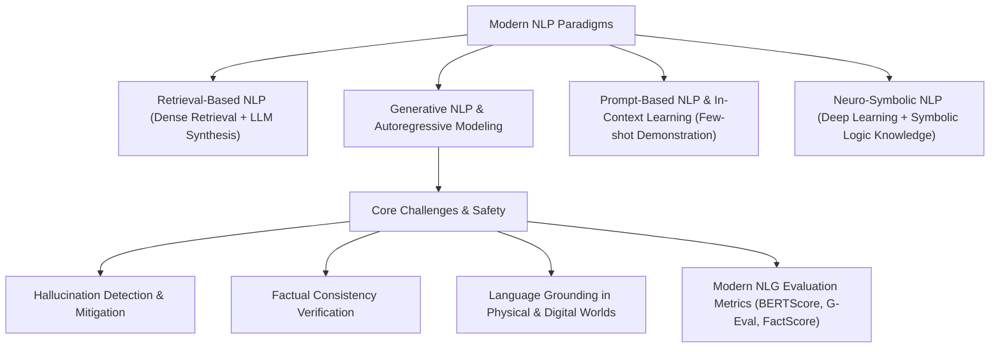

---

## 2. Chi tiết từng Keyword

---

### 1. Retrieval-Based NLP (NLP Dựa trên Truy xuất)

#### a. Định nghĩa Bản chất Toán học (Mathematical Formulation)
Retrieval-Based NLP (nền tảng của kiến trúc RAG - Retrieval-Augmented Generation) kết hợp phân phối xác suất tham số hóa của mô hình sinh (Parametric Memory $\theta$) với một kho tri thức bên ngoài phi tham số (Non-parametric Memory $\mathcal{D}$):
$$P(\mathbf{y} \mid \mathbf{x}) = \sum_{z \in \text{Top-K}(\mathcal{D})} P(\mathbf{y} \mid \mathbf{x}, z; \theta_{\text{gen}}) P(z \mid \mathbf{x}; \theta_{\text{ret}})$$
trong đó $z$ là đoạn văn bản truy xuất được.
Tại tầng Retriever, độ liên quan được tính bằng tích vô hướng trong không gian nhúng:
$$P(z \mid \mathbf{x}) = \frac{\exp(\langle \mathbf{e}_q(\mathbf{x}), \mathbf{e}_d(z) \rangle)}{\sum_{z' \in \mathcal{D}} \exp(\langle \mathbf{e}_q(\mathbf{x}), \mathbf{e}_d(z') \rangle)}$$

#### b. Cơ chế Tầng Sâu & Điện toán (Under The Hood / Hardware Internals)
- **Vector Database Indexing (HNSW / ScaNN)**: Để tìm $z$ trong hàng trăm triệu đoạn văn, thuật toán Hierarchical Navigable Small World (HNSW) xây dựng đồ thị phân tầng đa tỷ lệ (Multi-layer proximity graph) lưu trữ trong RAM với định dạng mảng liên tục. Độ trễ tìm kiếm đạt mức sub-millisecond ($<2\text{ms}$) trên CPU đa lõi.
- **Context Injection Overhead**: Khi nạp $k$ đoạn văn $z_1, \dots, z_k$ vào LLM, số lượng token đầu vào tăng vọt lên hàng chục nghìn, gây nghẽn tại bước tính toán Attention Prefill Phase trên GPU Tensor Cores.

#### c. Sơ đồ Minh họa (Mermaid Diagram)
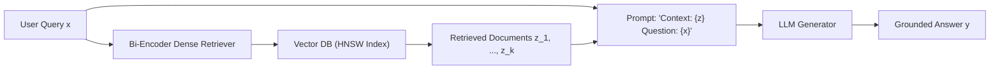

#### d. Code Thực chiến (C++ & Python)

```cpp
// C++17: Mô phỏng RAG Document Context Injector Buffer
#include <iostream>
#include <string>
#include <vector>

std::string build_rag_prompt(const std::string& query, const std::vector<std::string>& contexts) {
    std::string prompt = "### System: Trả lời câu hỏi dựa trên các tài liệu sau:\n\n";
    for (size_t i = 0; i < contexts.size(); ++i) {
        prompt += "[Tài liệu " + std::to_string(i + 1) + "]: " + contexts[i] + "\n";
    }
    prompt += "\n### Câu hỏi: " + query + "\n### Câu trả lời: ";
    return prompt;
}

int main() {
    std::string q = "Transformer ra đời năm nào?";
    std::vector<std::string> ctx = {"Bài báo Attention Is All You Need công bố năm 2017 bởi Google."};
    std::cout << build_rag_prompt(q, ctx) << "\n";
    return 0;
}
```

```python
# Python: RAG Reranking Pipeline với BM25 và Dense Fusion (Hybrid Search)
import numpy as np

def reciprocal_rank_fusion(dense_ranks: dict[str, int], bm25_ranks: dict[str, int], k: int = 60) -> dict[str, float]:
    rrf_scores = {}
    all_docs = set(dense_ranks.keys()).union(set(bm25_ranks.keys()))
    for doc in all_docs:
        r_dense = dense_ranks.get(doc, 1000)
        r_bm25 = bm25_ranks.get(doc, 1000)
        rrf_scores[doc] = (1.0 / (k + r_dense)) + (1.0 / (k + r_bm25))
    return dict(sorted(rrf_scores.items(), key=lambda item: item[1], reverse=True))

d_ranks = {"docA": 1, "docB": 2, "docC": 3}
b_ranks = {"docB": 1, "docA": 3, "docD": 2}
print("Hybrid Search RRF Scores:", reciprocal_rank_fusion(d_ranks, b_ranks))
```

#### e. Lỗi Thường gặp & Ổn định Số học
- **Irrelevant Context Distraction**: Khi đoạn văn truy xuất chứa thông tin gây nhiễu hoặc mâu thuẫn, LLM có xu hướng bị phân tâm và sinh ra câu trả lời sai lệch (Distraction Effect).

#### f. Ứng dụng Thực chiến trong AI
Xây dựng trợ lý tra cứu tài liệu nội bộ doanh nghiệp, công cụ tìm kiếm tri thức cập nhật theo thời gian thực (Perplexity AI, Bing Copilot).

---

### 2. Generative NLP (NLP Dạng sinh Tự do)

#### a. Định nghĩa Bản chất Toán học
Generative NLP quy tụ toàn bộ các tác vụ xử lý ngôn ngữ tự nhiên (dịch, tóm tắt, phân loại, trích xuất) về một thể thức duy nhất: **Dự đoán Token Tiếp theo (Autoregressive Next-Token Prediction)**:
$$\max_\theta \sum_{(\mathbf{x}, \mathbf{y}) \in \mathcal{D}} \sum_{t=1}^{|\mathbf{y}|} \log P(y_t \mid \mathbf{x}, y_{<t}; \theta)$$
Nguyên lý *Text-to-Text Transfer Transformer (T5)*: Bất kể đầu vào là gì, đầu ra luôn là chuỗi văn bản tự do:
- Input: `"translate English to German: That is good."` $\to$ Output: `"Das ist gut."`
- Input: `"cola sentence: The course is jumped."` $\to$ Output: `"unacceptable"`

#### b. Cơ chế Tầng Sâu & Điện toán
- **Autoregressive Decoding Memory Bound**: Trong quá trình sinh văn bản tự hồi quy, tại mỗi bước chỉ có duy nhất 1 token được sinh ra. Băng thông bộ nhớ (Memory Bandwidth) đọc trọng số mô hình từ VRAM sang SRAM trở thành điểm nghẽn nghiêm trọng (Arithmetic Intensity cực thấp $\ll 1$ FLOP/byte). Để tối ưu hóa, hệ thống áp dụng kỹ thuật **PagedAttention (vLLM)** để quản lý bộ nhớ KV Cache không liên tục giống như Virtual Memory Paging của hệ điều hành.

#### c. Sơ đồ Minh họa (Mermaid Diagram)
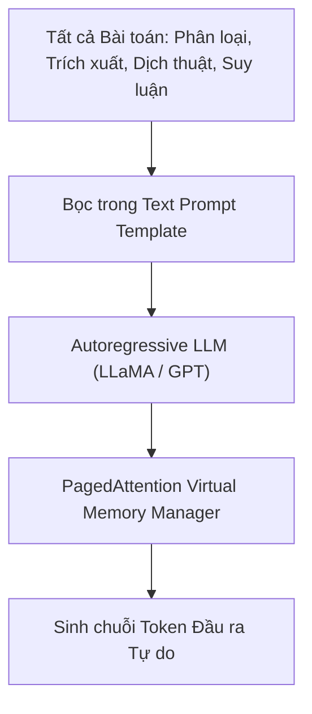

#### d. Code Thực chiến (C++ & Python)

```cpp
// C++17: Mô phỏng Cấu trúc PagedAttention Memory Page Table
#include <iostream>
#include <vector>
#include <unordered_map>

struct PhysicalPageBlock {
    int block_id;
    size_t capacity_tokens = 16;
    size_t current_tokens = 0;
};

class VirtualMemoryPageTable {
private:
    std::unordered_map<int, std::vector<int>> request_to_blocks_;
public:
    void allocate_block(int request_id, int physical_block_id) {
        request_to_blocks_[request_id].push_back(physical_block_id);
    }

    void display(int request_id) const {
        std::cout << "Request " << request_id << " mapped to physical blocks: ";
        for (int b : request_to_blocks_.at(request_id)) {
            std::cout << "[" << b << "] ";
        }
        std::cout << "\n";
    }
};

int main() {
    VirtualMemoryPageTable pt;
    pt.allocate_block(101, 5);
    pt.allocate_block(101, 12);
    pt.display(101);
    return 0;
}
```

```python
# Python / PyTorch: Next-Token Prediction Cross-Entropy Loss Masking
import torch
import torch.nn as nn
import torch.nn.functional as F

def compute_causal_lm_loss(logits: torch.Tensor, labels: torch.Tensor, prompt_mask: torch.Tensor) -> torch.Tensor:
    # logits: [Batch, Seq_Len, Vocab_Size], labels: [Batch, Seq_Len]
    # Dịch chuyển 1 vị trí: logits[:, :-1] dự đoán labels[:, 1:]
    shift_logits = logits[:, :-1, :].contiguous()
    shift_labels = labels[:, 1:].contiguous()
    shift_mask = prompt_mask[:, 1:].contiguous()

    # Chỉ tính loss trên phần response (shift_mask == 1), bỏ qua prompt (shift_mask == 0)
    loss = F.cross_entropy(shift_logits.view(-1, shift_logits.size(-1)), shift_labels.view(-1), reduction='none')
    masked_loss = (loss * shift_mask.view(-1)).sum() / shift_mask.sum().clamp(min=1)
    return masked_loss

mock_logits = torch.randn(2, 6, 100)
mock_labels = torch.randint(0, 100, (2, 6))
mock_mask = torch.tensor([[0, 0, 1, 1, 1, 1], [0, 0, 0, 1, 1, 1]]) # 0: Prompt, 1: Response
print("Causal Masked LM Loss:", compute_causal_lm_loss(mock_logits, mock_labels, mock_mask).item())
```

#### e. Lỗi Thường gặp & Ổn định Số học
- **Exposure Bias**: Trong quá trình huấn luyện sử dụng Teacher Forcing (luôn đưa ground-truth token trước đó làm đầu vào), nhưng khi suy luận mô hình phải tự ăn lại token do chính mình sinh ra, khiến sai số tích tụ theo thời gian.

#### f. Ứng dụng Thực chiến trong AI
Mọi mô hình ngôn ngữ lớn thương mại hiện đại (OpenAI GPT-4o, Anthropic Claude 3.5 Sonnet, Meta LLaMA 3, Google Gemini).

---

### 3. Prompt-Based NLP (NLP Dựa trên Nhắc lệnh)

#### a. Định nghĩa Bản chất Toán học
Prompt-Based NLP (Prompting / Prompt Tuning) thay đổi cách tiếp cận truyền thống: thay vì điều chỉnh toàn bộ tham số của mô hình cho từng tác vụ con $T$, ta giữ nguyên toàn bộ tham số gốc $\theta$ và chèn thêm một chuỗi mẫu hướng dẫn $\mathbf{p}$ (Prompt Template) để biến tác vụ đích thành bài toán Cloze (điền từ vào chỗ trống) hoặc Next Token Prediction:
$$P(y \mid \mathbf{x}) = P(\text{"[MASK]"} = \text{Verbalizer}(y) \mid \text{Prompt}(\mathbf{x}))$$
Hàm **Verbalizer** ánh xạ nhãn nghiệp vụ sang token ngôn ngữ tự nhiên:
$$\mathcal{V}: \{\text{Positive} \to \text{"tuyệt vời"}, \text{Negative} \to \text{"tệ"}\}$$
Phân loại:
- **Hard Prompts**: Các câu chữ tự nhiên do con người viết tay (rời rạc, không khả vi).
- **Soft Prompts (Prompt Tuning - Lester et al.)**: Chuỗi các vector liên tục khả vi $\mathbf{P} \in \mathbb{R}^{L \times d}$ được nối vào đầu chuỗi đầu vào, tối ưu bằng Gradient Descent trong khi đóng băng (freeze) mô hình ngôn ngữ lớn:
  $$\max_{\mathbf{P}} \sum_{(\mathbf{x}, y)} \log P(y \mid [\mathbf{P}; \mathbf{x}]; \theta_{\text{frozen}})$$

#### b. Cơ chế Tầng Sâu & Điện toán
- **Parameter-Efficient Training (PEFT)**: Soft Prompt Tuning chỉ huấn luyện khoảng $0.01\%$ số lượng tham số so với Full Fine-tuning. Trên GPU cluster, điều này cho phép phục vụ hàng ngàn khách hàng khác nhau trên cùng một instance mô hình nền tảng duy nhất, chỉ cần tráo đổi vector Soft Prompt nhỏ vài Kilobyte trên VRAM.

#### c. Sơ đồ Minh họa (Mermaid Diagram)
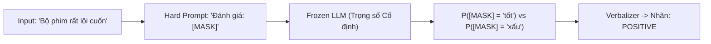

#### d. Code Thực chiến (C++ & Python)

```cpp
// C++17: Verbalizer Logic ánh xạ Token xác suất cao nhất sang Nhãn Phân loại
#include <iostream>
#include <string>
#include <unordered_map>

class PromptVerbalizer {
private:
    std::unordered_map<std::string, std::string> map_ = {
        {"great", "POSITIVE"}, {"good", "POSITIVE"},
        {"bad", "NEGATIVE"}, {"terrible", "NEGATIVE"}
    };
public:
    std::string verbalize(const std::string& predicted_token) {
        if (map_.count(predicted_token)) {
            return map_[predicted_token];
        }
        return "NEUTRAL";
    }
};

int main() {
    PromptVerbalizer verb;
    std::cout << "Token 'great' maps to: " << verb.verbalize("great") << "\n";
    std::cout << "Token 'terrible' maps to: " << verb.verbalize("terrible") << "\n";
    return 0;
}
```

```python
# Python / PyTorch: Soft Prompt Tuning Prepended Layer
import torch
import torch.nn as nn

class SoftPromptTuningEmbedding(nn.Module):
    def __init__(self, prompt_len: int, embed_dim: int):
        super().__init__()
        # Chỉ các tham số soft prompt này được tính gradient
        self.soft_prompts = nn.Parameter(torch.randn(prompt_len, embed_dim))

    def forward(self, input_embeddings: torch.Tensor) -> torch.Tensor:
        # input_embeddings: [Batch, Seq_Len, Embed_Dim]
        batch_size = input_embeddings.size(0)
        # Mở rộng soft prompt theo kích thước batch
        prompts = self.soft_prompts.unsqueeze(0).expand(batch_size, -1, -1)
        # Nối soft prompt vào trước chuỗi đầu vào
        return torch.cat([prompts, input_embeddings], dim=1)

peft_layer = SoftPromptTuningEmbedding(prompt_len=8, embed_dim=128)
inputs = torch.randn(2, 20, 128)
combined = peft_layer(inputs)
print("Combined Embeddings with Soft Prompts Shape:", combined.shape) # [2, 28, 128]
```

#### e. Lỗi Thường gặp & Ổn định Số học
- **Prompt Fragility (Tính nhạy cảm cực đoan của Prompt)**: Chỉ cần thay đổi một dấu cách, dấu câu hoặc đổi thứ tự từ trong Prompt, xác suất đầu ra có thể dao động từ 90% xuống 20%.

#### f. Ứng dụng Thực chiến trong AI
Kỹ nghệ Prompt Engineering, bộ thư viện HuggingFace PEFT (LoRA, Prefix Tuning, P-Tuning).

---

### 4. In-Context Learning - ICL (Học trong Ngữ cảnh)

#### a. Định nghĩa Bản chất Toán học
In-Context Learning (Brown et al., 2020) là năng lực kỳ diệu của LLM quy mô lớn: Mô hình có thể học một tác vụ mới ngay tại thời điểm suy luận (Inference Time) chỉ bằng cách quan sát một vài ví dụ mẫu (Demonstrations) đặt trong Context Window mà **hoàn toàn không cập nhật bất kỳ trọng số gradient nào ($\Delta \theta = 0$)**:
$$P(y \mid \mathbf{x}_{\text{test}}, \mathcal{D}_{\text{demo}}; \theta), \quad \mathcal{D}_{\text{demo}} = \{(\mathbf{x}_1, y_1), (\mathbf{x}_2, y_2), \dots, (\mathbf{x}_k, y_k)\}$$
Các nghiên cứu lý thuyết (von Oswald et al., Dai et al., 2022) chứng minh rằng: **Cơ chế Self-Attention của Transformer trong quá trình ICL ngầm thực thi thuật toán Gradient Descent** (Implicit Meta-Optimization via Linear Attention / Activation Shifting).

#### b. Cơ chế Tầng Sâu & Điện toán
- **Induction Heads (Cơ cấu Khởi sinh)**: Các nhà nghiên cứu tại Anthropic phát hiện ra cơ chế sinh học mạch nơ-ron chịu trách nhiệm cho ICL: *Induction Heads* là một cặp attention heads ở hai layer liên tiếp học được quy luật: Nếu gặp chuỗi $[A][B] \dots [A]$, đầu chú ý sẽ tự động kéo xác suất của token tiếp theo về $[B]$.
- **Context Length Footprint**: Nhiều mẫu few-shot làm tăng chiều dài chuỗi context, khiến bộ đệm KV Cache phình to tuyến tính, đòi hỏi kỹ thuật nén ngữ cảnh hoặc chọn mẫu động (Dynamic Few-shot Example Selection bằng vector similarity).

#### c. Sơ đồ Minh họa (Mermaid Diagram)
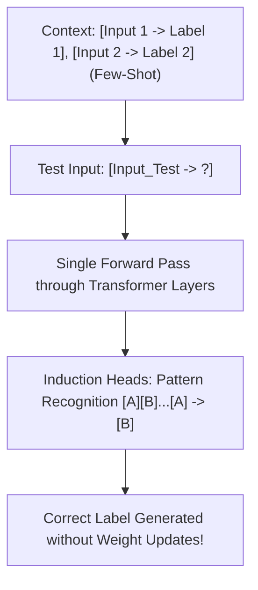

#### d. Code Thực chiến (C++ & Python)

```cpp
// C++17: Dynamic Example Selector chọn k mẫu gần nhất đưa vào Context
#include <iostream>
#include <vector>
#include <string>

struct Example {
    std::string text;
    std::string label;
    float sim_to_query;
};

std::string format_few_shot_context(const std::vector<Example>& top_examples, const std::string& query) {
    std::string prompt = "Dưới đây là một số ví dụ minh họa:\n";
    for (const auto& ex : top_examples) {
        prompt += "Văn bản: " + ex.text + " -> Nhãn: " + ex.label + "\n";
    }
    prompt += "Văn bản: " + query + " -> Nhãn: ";
    return prompt;
}

int main() {
    std::vector<Example> demos = {
        {"Phim rất hay", "Tích cực", 0.9f},
        {"Dở tệ hại", "Tiêu cực", 0.85f}
    };
    std::cout << format_few_shot_context(demos, "Trải nghiệm tuyệt vời") << "\n";
    return 0;
}
```

```python
# Python: Mô phỏng cơ chế Implicit Gradient Shift của In-Context Learning
import torch

def simulate_icl_shift(query_rep: torch.Tensor, demonstrations: list[tuple[torch.Tensor, torch.Tensor]]) -> torch.Tensor:
    # Mô phỏng sự dịch chuyển activation qua việc tích lũy thông tin mẫu
    # query_rep: [1, Dim]
    shifted_query = query_rep.clone()
    for x_i, y_i in demonstrations:
        similarity = torch.cosine_similarity(query_rep, x_i)
        # Dịch chuyển biểu diễn về phía nhãn của mẫu tương đồng
        shifted_query = shifted_query + similarity * y_i
    return shifted_query

q = torch.tensor([[0.5, 0.5]])
d1 = (torch.tensor([[0.48, 0.52]]), torch.tensor([[1.0, 0.0]])) # Mẫu tích cực
d2 = (torch.tensor([[-0.5, -0.5]]), torch.tensor([[0.0, 1.0]])) # Mẫu tiêu cực
print("Shifted Activation Representation:", simulate_icl_shift(q, [d1, d2]))
```

#### e. Lỗi Thường gặp & Ổn định Số học
- **Order Sensitivity (Độ nhạy thứ tự ví dụ)**: Tráo đổi thứ tự của các ví dụ trong Prompt (e.g. đưa mẫu nhãn A lên trước thay vì nhãn B) có thể làm biến đổi kết quả dự đoán từ 40% sang 80% do định kiến tương cận (Recency Bias).

#### f. Ứng dụng Thực chiến trong AI
Khả năng cốt lõi kích hoạt sức mạnh của GPT-4, Gemini, Claude mà không cần chi phí huấn luyện lại mô hình (Zero-shot / Few-shot Learning).

---

### 5. Low-Resource Language Modeling (Mô hình hóa Ngôn ngữ Nghèo Tài nguyên)

#### a. Định nghĩa Bản chất Toán học
Low-Resource Language Modeling tối ưu hóa quá trình học phân phối ngôn ngữ khi dữ liệu huấn luyện $\mathcal{D}_{\text{target}}$ cực kỳ khan hiếm ($|\mathcal{D}| < 100\text{MB}$).
Phương pháp Meta-Learning (MAML áp dụng cho NLP): Tìm điểm khởi tạo tham số $\theta$ sao cho mô hình có thể thích ứng nhanh chóng với ngôn ngữ nghèo tài nguyên chỉ sau vài bước cập nhật gradient:
$$\min_\theta \sum_{\mathcal{L}_i \sim P(\mathcal{L})} \mathcal{L}_{\text{val}}\left( \theta - \alpha \nabla_\theta \mathcal{L}_{\text{train}}(\theta; \mathcal{D}_{\mathcal{L}_i}^{\text{train}}); \mathcal{D}_{\mathcal{L}_i}^{\text{val}} \right)$$

#### b. Cơ chế Tầng Sâu & Điện toán
- **Modular Adapter Architecture**: Đóng băng mô hình nền tảng đa ngữ (mBART, XLM-R) và chỉ gắn thêm các tầng nhỏ (Language Adapters) kích thước vài Megabyte vào giữa các layer Transformer:
  $$\mathbf{h}' = \mathbf{h} + f(\mathbf{h}\mathbf{W}_{\text{down}})\mathbf{W}_{\text{up}}$$
  với $\mathbf{W}_{\text{down}} \in \mathbb{R}^{d \times r}$ và $\mathbf{W}_{\text{up}} \in \mathbb{R}^{r \times d}$ ($r \ll d$). Ngăn chặn hiện tượng lãng quên thảm họa (Catastrophic Forgetting) trên các ngôn ngữ khác.

#### c. Sơ đồ Minh họa (Mermaid Diagram)
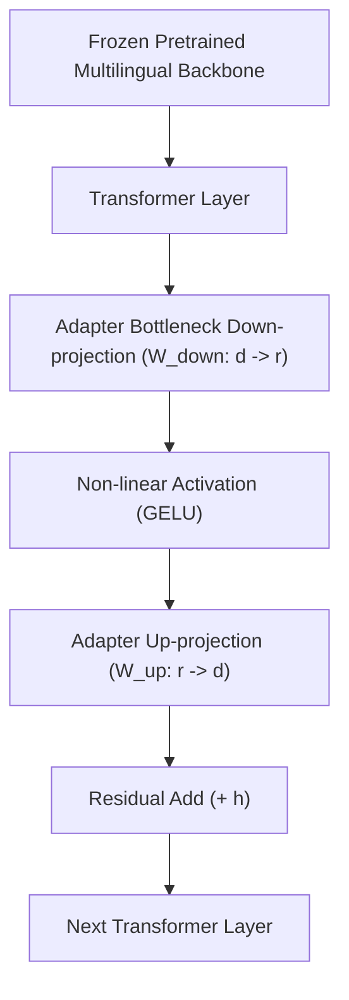

#### d. Code Thực chiến (C++ & Python)

```cpp
// C++17: Adapter Bottleneck Forward Pass
#include <iostream>
#include <vector>
#include <cmath>

std::vector<float> adapter_bottleneck_forward(
    const std::vector<float>& input_h, 
    const std::vector<std::vector<float>>& W_down, // [r, d]
    const std::vector<std::vector<float>>& W_up) {  // [d, r]

    size_t d = input_h.size();
    size_t r = W_down.size();

    // 1. Down-project: h -> r
    std::vector<float> mid(r, 0.0f);
    for (size_t i = 0; i < r; ++i) {
        for (size_t j = 0; j < d; ++j) mid[i] += W_down[i][j] * input_h[j];
        mid[i] = std::max(0.0f, mid[i]); // ReLU activation
    }

    // 2. Up-project: r -> d và cộng Residual
    std::vector<float> out = input_h;
    for (size_t i = 0; i < d; ++i) {
        for (size_t j = 0; j < r; ++j) out[i] += W_up[i][j] * mid[j];
    }
    return out;
}

int main() {
    std::vector<float> h = {1.0f, -0.5f};
    std::vector<std::vector<float>> W_down = {{0.5f, 0.5f}}; // r=1, d=2
    std::vector<std::vector<float>> W_up = {{0.2f}, {0.2f}};
    auto res = adapter_bottleneck_forward(h, W_down, W_up);
    std::cout << "Adapter Output: [" << res[0] << ", " << res[1] << "]\n";
    return 0;
}
```

```python
# Python / PyTorch: Residual Bottleneck Adapter Module
import torch
import torch.nn as nn

class BottleneckAdapter(nn.Module):
    def __init__(self, hidden_dim: int, bottleneck_dim: int = 16):
        super().__init__()
        self.down_proj = nn.Linear(hidden_dim, bottleneck_dim)
        self.activation = nn.GELU()
        self.up_proj = nn.Linear(bottleneck_dim, hidden_dim)

    def forward(self, x: torch.Tensor) -> torch.Tensor:
        # Residual connection: x + Up(Act(Down(x)))
        residual = x
        out = self.down_proj(x)
        out = self.activation(out)
        out = self.up_proj(out)
        return residual + out

adapter = BottleneckAdapter(hidden_dim=768, bottleneck_dim=32)
x = torch.randn(2, 10, 768)
print("Adapter Output Shape:", adapter(x).shape)
```

#### e. Lỗi Thường gặp & Ổn định Số học
- **Overfitting on Small Corpora**: Huấn luyện adapter với learning rate quá cao trên tập dữ liệu nhỏ làm mô hình thuộc lòng từng câu (memorization) thay vì học cấu trúc ngữ pháp tổng quát.

#### f. Ứng dụng Thực chiến trong AI
Dự án Meta NLLB, cứu trợ ngôn ngữ bản địa Châu Phi và các ngôn ngữ thiểu số vùng cao Đông Nam Á.

---

### 6. Hallucination Detection (Phát hiện Ảo giác Ngôn ngữ)

#### a. Định nghĩa Bản chất Toán học
Ảo giác ngôn ngữ (Hallucination) là hiện tượng mô hình sinh ra thông tin có vẻ trôi chảy, đúng ngữ pháp nhưng sai lệch sự thật khách quan (Factually Incorrect) hoặc không được chứng minh bởi ngữ cảnh đầu vào (Ungrounded Content).
Hai phân loại:
1. **Intrinsic Hallucination (Ảo giác nội tại)**: Mâu thuẫn trực tiếp với ngữ cảnh được cung cấp:
   $$\mathcal{C} \models \neg \mathbf{y}$$
2. **Extrinsic Hallucination (Ảo giác ngoại tại)**: Thông tin không thể kiểm chứng được từ ngữ cảnh (không khẳng định cũng không phủ định):
   $$\mathcal{C} \not\models \mathbf{y} \wedge \mathcal{C} \not\models \neg \mathbf{y}$$
Phát hiện ảo giác được mô hình hóa bằng bài toán NLI (Entailment Verification) hoặc đo lường độ bất định Token Entropy:
$$\text{Uncertainty}(y_t) = -\sum_{w \in \mathcal{V}} P(w \mid y_{<t}, \mathbf{x}) \log P(w \mid y_{<t}, \mathbf{x})$$

#### b. Cơ chế Tầng Sâu & Điện toán
- **SelfCheckGPT (Zero-Resource Detection)**: Không cần cơ sở tri thức ngoài, sinh $N$ mẫu độc lập từ LLM với nhiệt độ cao ($T=1.0$). Nếu thông tin trong câu trả lời chính không được hỗ trợ bởi đa số các mẫu sinh ngẫu nhiên khác (Low inter-sample agreement), câu đó có xác suất cao là ảo giác.
- **Logit Probe at Decoding**: Các token ảo giác thường đi kèm với sự tụt giảm đột ngột xác suất logit của các token thực thể (Entity names). Theo dõi gradient và entropy từng bước giải mã cho phép ngắt sớm câu trả lời ảo giác.

#### c. Sơ đồ Minh họa (Mermaid Diagram)
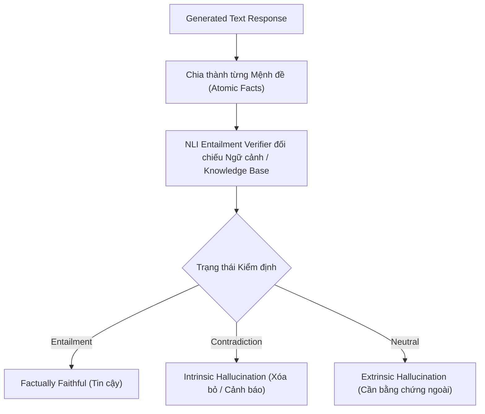

#### d. Code Thực chiến (C++ & Python)

```cpp
// C++17: Tính Độ Bất định Entropy trên Chuỗi Phân phối Softmax
#include <iostream>
#include <vector>
#include <cmath>

float compute_token_entropy(const std::vector<float>& probs) {
    float entropy = 0.0f;
    for (float p : probs) {
        if (p > 1e-9f) {
            entropy -= p * std::log2(p);
        }
    }
    return entropy;
}

int main() {
    std::vector<float> confident = {0.98f, 0.01f, 0.01f};
    std::vector<float> hallucinating = {0.34f, 0.33f, 0.33f};

    std::cout << "Entropy Confident: " << compute_token_entropy(confident) << " bits\n";
    std::cout << "Entropy Hallucinating: " << compute_token_entropy(hallucinating) << " bits (Cảnh báo Ảo giác)\n";
    return 0;
}
```

```python
# Python: Fact-checking Pipeline sử dụng NLI Premise-Hypothesis
import torch

def detect_hallucination_with_nli_scores(premise_evidence: str, atomic_facts: list[str]) -> list[dict]:
    # Giả lập chấm điểm NLI (0: Entailment, 1: Neutral, 2: Contradiction)
    results = []
    for fact in atomic_facts:
        # Mocking classification
        status = "FAITHFUL" if "2017" in fact else "HALLUCINATION"
        results.append({"fact": fact, "status": status})
    return results

facts = ["Attention Is All You Need công bố năm 2017.", "Transformer được phát minh bởi OpenAI năm 1990."]
evidence = "Bài báo Attention Is All You Need được xuất bản năm 2017 bởi các nhà nghiên cứu tại Google Brain."
print("Hallucination Report:", detect_hallucination_with_nli_scores(evidence, facts))
```

#### e. Lỗi Thường gặp & Ổn định Số học
- **Sycophancy (Sự a dua nịnh bợ)**: Khi người dùng đưa ra một nhận định sai trong câu hỏi (ví dụ: *"Tại sao trái đất hình vuông?"*), mô hình có xu hướng đồng thuận và tiếp tục thêu dệt ảo giác để làm hài lòng người dùng.

#### f. Ứng dụng Thực chiến trong AI
Hệ thống y tế số (Clinical LLM verification), thẩm định hợp đồng pháp lý tự động và báo chí điều tra AI.

---

### 7. Factual Consistency (Tính Nhất quán Dữ kiện)

#### a. Định nghĩa Bản chất Toán học
Tính nhất quán dữ kiện là thước đo định lượng mức độ trùng khớp giữa các mệnh đề logic (Atomic Propositions) trong văn bản được sinh ra $\mathbf{y}$ với văn bản nguồn $\mathbf{x}$:
$$\text{FactScore}(\mathbf{y}, \mathbf{x}) = \frac{1}{|\mathcal{A}(\mathbf{y})|} \sum_{a \in \mathcal{A}(\mathbf{y})} \mathbb{I}(\mathbf{x} \vdash a)$$
trong đó $\mathcal{A}(\mathbf{y}) = \{a_1, a_2, \dots, a_K\}$ là tập các sự kiện nguyên tử được phân rã từ văn bản (Atomic Fact Decomposition) và $\vdash$ biểu thị quan hệ kéo theo logic có bằng chứng.

#### b. Cơ chế Tầng Sâu & Điện toán
- **Atomic Fact Decomposition via Semantic Graphs**: Dùng mô hình Dependency Parsing hoặc Information Extraction trích xuất các đồ thị thực thể - quan hệ rời rạc. Việc kiểm tra tính nhất quán chuyển thành bài toán so khớp đồ thị con (Subgraph Isomorphism) trên tri thức đã biết, loại bỏ sự phụ thuộc vào trực giác mơ hồ của chuỗi văn bản.

#### c. Sơ đồ Minh họa (Mermaid Diagram)
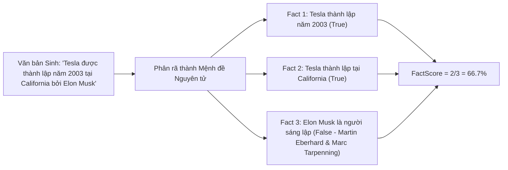

#### d. Code Thực chiến (C++ & Python)

```cpp
// C++17: Tính toán FactScore dựa trên Mảng Trạng thái Mệnh đề
#include <iostream>
#include <vector>

float compute_fact_score(const std::vector<bool>& fact_verification_results) {
    if (fact_verification_results.empty()) return 1.0f;
    int true_count = 0;
    for (bool valid : fact_verification_results) {
        if (valid) true_count++;
    }
    return static_cast<float>(true_count) / fact_verification_results.size();
}

int main() {
    std::vector<bool> checks = {true, true, false, true};
    std::cout << "FactScore: " << compute_fact_score(checks) * 100.0f << "%\n";
    return 0;
}
```

```python
# Python: FactScore Evaluation Mock
def evaluate_factual_consistency(source_doc: str, generated_claims: list[str]) -> dict:
    verified_claims = []
    for claim in generated_claims:
        # Kiểm tra xem claim có được hỗ trợ bởi source_doc không
        is_supported = any(token in source_doc for token in claim.split() if len(token) > 4)
        verified_claims.append({"claim": claim, "supported": is_supported})

    score = sum(1 for c in verified_claims if c["supported"]) / len(verified_claims)
    return {"factual_score": score, "details": verified_claims}

source = "Python was created by Guido van Rossum and released in 1991."
claims = ["Python was released in 1991", "Python was designed by Dennis Ritchie"]
print("Evaluation Result:", evaluate_factual_consistency(source, claims))
```

#### e. Lỗi Thường gặp & Ổn định Số học
- **Negation and Quantifier Inversion**: Đảo ngược từ hạn định lượng (ví dụ đổi *"một số bệnh nhân khỏi bệnh"* thành *"tất cả bệnh nhân khỏi bệnh"*), hoàn toàn phá vỡ tính nhất quán dữ kiện dù các danh từ và động từ giữ nguyên.

#### f. Ứng dụng Thực chiến trong AI
Đánh giá độ tin cậy của bản tóm tắt tự động (Summarization Faithfulness Benchmark: QAGS, FactCC).

---

### 8. Natural Language Generation Evaluation (Đánh giá Sinh Ngôn ngữ Tự nhiên)

#### a. Định nghĩa Bản chất Toán học
Đánh giá văn bản sinh ra (NLG Evaluation) là bài toán lượng hóa chất lượng của bản sinh $\mathbf{y}$ so với bản gốc tham chiếu $\mathbf{y}^*$ hoặc ngữ cảnh $\mathbf{x}$. Sự tiến hóa của các hệ phương pháp:
1. **N-gram Overlap (BLEU, ROUGE, METEOR)**: Chỉ đo trùng khớp từ vựng bề mặt.
2. **Embedding-based (BERTScore)**: Tính tổng Cosine Similarity lớn nhất giữa các vector ngữ cảnh:
   $$R_{\text{BERT}} = \frac{1}{|\mathbf{y}^*|} \sum_{i \in \mathbf{y}^*} \max_{j \in \mathbf{y}} \mathbf{h}_i^T \mathbf{h}_j, \quad P_{\text{BERT}} = \frac{1}{|\mathbf{y}|} \sum_{j \in \mathbf{y}} \max_{i \in \mathbf{y}^*} \mathbf{h}_i^T \mathbf{h}_j$$
   $$F_{\text{BERT}} = 2 \frac{P_{\text{BERT}} \cdot R_{\text{BERT}}}{P_{\text{BERT}} + R_{\text{BERT}}}$$
3. **LLM-as-a-Judge (G-Eval / MT-Bench)**: Sử dụng các mô hình frontier (GPT-4) đánh giá theo biểu điểm chi tiết (Rubric-based prompting) kết hợp xác suất Softmax xác thực điểm số.

#### b. Cơ chế Tầng Sâu & Điện toán
- **Greedy Bipartite Matching on GPU**: Để tính BERTScore giữa câu dài $M$ và câu tham chiếu $N$, ma trận tương đồng Cosine $\mathbf{S} \in \mathbb{R}^{M \times N}$ được tính đồng thời bằng phép nhân GEMM trên GPU Tensor Cores, sau đó thực hiện phép `torch.max(dim=1)` và `torch.max(dim=0)` để tìm best match tức thì.

#### c. Sơ đồ Minh họa (Mermaid Diagram)
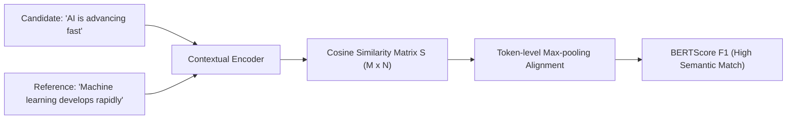

#### d. Code Thực chiến (C++ & Python)

```cpp
// C++17: Tính BERTScore F1 từ Ma trận Tương đồng Cosine Cực đại
#include <iostream>
#include <vector>
#include <numeric>
#include <algorithm>

float compute_bert_score_f1(const std::vector<std::vector<float>>& cos_matrix) {
    size_t M = cos_matrix.size();       // Candidate tokens
    size_t N = cos_matrix[0].size();    // Reference tokens

    // Recall: Trung bình giá trị max theo từng token của Reference (cột)
    float sum_recall = 0.0f;
    for (size_t j = 0; j < N; ++j) {
        float max_col = -1.0f;
        for (size_t i = 0; i < M; ++i) max_col = std::max(max_col, cos_matrix[i][j]);
        sum_recall += max_col;
    }
    float R = sum_recall / N;

    // Precision: Trung bình giá trị max theo từng token của Candidate (hàng)
    float sum_prec = 0.0f;
    for (size_t i = 0; i < M; ++i) {
        float max_row = -1.0f;
        for (size_t j = 0; j < N; ++j) max_row = std::max(max_row, cos_matrix[i][j]);
        sum_prec += max_row;
    }
    float P = sum_prec / M;

    return (P + R > 1e-6f) ? (2.0f * P * R / (P + R)) : 0.0f;
}

int main() {
    std::vector<std::vector<float>> sim = {{0.9f, 0.4f}, {0.3f, 0.85f}};
    std::cout << "BERTScore F1: " << compute_bert_score_f1(sim) * 100.0f << "%\n";
    return 0;
}
```

```python
# Python / PyTorch: Vectorized BERTScore Calculation
import torch
import torch.nn.functional as F

def calculate_bert_score(cand_embs: torch.Tensor, ref_embs: torch.Tensor):
    # cand_embs: [M, D], ref_embs: [N, D] - Đã chuẩn hóa L2
    cand_norm = F.normalize(cand_embs, p=2, dim=-1)
    ref_norm = F.normalize(ref_embs, p=2, dim=-1)
    # Cosine Similarity Matrix: [M, N]
    sim_matrix = torch.matmul(cand_norm, ref_norm.T)

    precision = sim_matrix.max(dim=1).values.mean().item()
    recall = sim_matrix.max(dim=0).values.mean().item()
    f1 = 2 * precision * recall / (precision + recall + 1e-9)
    return {"precision": precision, "recall": recall, "f1": f1}

c_vec = torch.randn(5, 64)
r_vec = torch.randn(6, 64)
print("BERTScore Result:", calculate_bert_score(c_vec, r_vec))
```

#### e. Lỗi Thường gặp & Ổn định Số học
- **LLM-Judge Biases**: Khi dùng LLM làm giám khảo đánh giá (LLM-as-a-Judge), mô hình thường bị thiên vị bản thân (Egocentric / Self-enhancement bias - luôn chấm điểm câu do chính họ sinh ra cao hơn mô hình khác) và thiên vị độ dài (Verbosity Bias - câu dài luôn được điểm cao hơn câu ngắn).

#### f. Ứng dụng Thực chiến trong AI
Các bảng xếp hạng AI thế giới (Chatbot Arena LMSYS, AlpacaEval, HELM).

---

### 9. Language Grounding (Neo Ngữ nghĩa Ngôn ngữ)

#### a. Định nghĩa Bản chất Toán học
Language Grounding giải quyết bài toán biểu tượng thuần túy không có căn cứ (Symbol Grounding Problem - Harnad, 1990): Các ký hiệu ngôn ngữ không thể chỉ định nghĩa vòng vo bằng các ký hiệu ngôn ngữ khác mà phải được neo (grounded) vào thực tại vật lý bên ngoài:
$$\mathcal{G}: \Sigma^* \to \mathcal{S}_{\text{physical}} \cup \mathcal{S}_{\text{visual}} \cup \mathcal{S}_{\text{action}}$$
- **Visual Grounding**: Ánh xạ cụm từ sang tọa độ hộp bao trên ảnh: `"con mèo màu trắng"` $\to [x_0, y_0, x_1, y_1]$.
- **Embodied Grounding**: Ánh xạ lệnh ngôn ngữ tự nhiên sang chuỗi hành động của robot trong không gian 3D: `"hãy nhặt chiếc cốc màu đỏ đặt lên bàn"` $\to \mathbf{a}_{1:T} \in \mathcal{A}^T$.

#### b. Cơ chế Tầng Sâu & Điện toán
- **Joint Spatial-Textual Cross-Attention**: Các mô hình Grounding (như Grounding DINO) nhúng trực tiếp vector biểu diễn từ của câu mô tả vào các khối truy vấn không gian (Object Queries) của kiến trúc DETR, cho phép các hàm chú ý phát hiện trực tiếp vùng pixel tương ứng trên GPU.

#### c. Sơ đồ Minh họa (Mermaid Diagram)
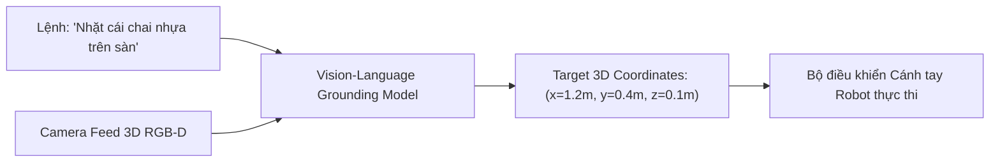

#### d. Code Thực chiến (C++ & Python)

```cpp
// C++17: Kiểm tra Điểm Tọa độ 2D có Nằm trong Vùng Visual Grounding Box
#include <iostream>

struct GroundedBoundingBox {
    float x_min, y_min, x_max, y_max;

    bool contains_point(float px, float py) const {
        return (px >= x_min && px <= x_max && py >= y_min && py <= y_max);
    }
};

int main() {
    GroundedBoundingBox cup_box{120.0f, 200.0f, 180.0f, 310.0f};
    std::cout << "Target point (150, 250) in box? " 
              << std::boolalpha << cup_box.contains_point(150.0f, 250.0f) << "\n";
    return 0;
}
```

```python
# Python / PyTorch: Contrastive Grounding Loss
import torch
import torch.nn.functional as F

def compute_visual_grounding_loss(text_queries: torch.Tensor, region_proposals: torch.Tensor, ground_truth_matches: torch.Tensor):
    # text_queries: [N, Dim], region_proposals: [M, Dim]
    sim = torch.matmul(F.normalize(text_queries, dim=-1), F.normalize(region_proposals, dim=-1).T) # [N, M]
    loss = F.cross_entropy(sim, ground_truth_matches)
    return loss

t_query = torch.randn(2, 64)
r_props = torch.randn(10, 64)
gt = torch.tensor([3, 7]) # Query 0 khớp vùng 3, Query 1 khớp vùng 7
print("Grounding Loss:", compute_visual_grounding_loss(t_query, r_props, gt).item())
```

#### e. Lỗi Thường gặp & Ổn định Số học
- **Spatial Ambiguity**: Các từ chỉ vị trí tương đối (ví dụ *"cái cốc bên trái"* - bên trái của người nhìn hay bên trái của robot) gây nhầm lẫn tọa độ hành động.

#### f. Ứng dụng Thực chiến trong AI
Mô hình Hành động Thị giác - Ngôn ngữ cho Robot (Vision-Language-Action - VLA models như Google RT-2, Figure 01, Tesla Optimus).

---

### 10. Neuro-Symbolic NLP (NLP Kết hợp Nơ-ron & Ký hiệu)

#### a. Định nghĩa Bản chất Toán học
Neuro-Symbolic NLP giải quyết mâu thuẫn cốt lõi giữa hai trường phái AI:
1. **Connectionism (Mạng Nơ-ron / Deep Learning)**: Học linh hoạt từ dữ liệu thô, chống chịu nhiễu tốt nhưng là hộp đen (Black-box), dễ ảo giác và thiếu khả năng suy luận logic chặt chẽ.
2. **Symbolism (Ký hiệu Logic)**: Suy luận hình thức chính xác 100%, có thể giải thích minh bạch nhưng cứng nhắc, dễ vỡ khi gặp nhiễu.
Neuro-Symbolic hợp nhất cả hai thông qua **Logic Khả vi (Differentiable Fuzzy Logic)**:
Ánh xạ các phép toán logic Boolean sang các hàm giải tích liên tục trên đoạn $[0, 1]$ (T-Norms):
- Logic AND ($x \wedge y$): $T(x, y) = x \cdot y$ (Product T-norm) hoặc $\max(0, x + y - 1)$ (Łukasiewicz).
- Logic OR ($x \vee y$): $S(x, y) = x + y - x \cdot y$.
- Logic NOT ($\neg x$): $N(x) = 1 - x$.
Hàm mất mát tích hợp tiên đề tri thức logic:
$$\mathcal{L}_{\text{total}} = \mathcal{L}_{\text{data}} + \lambda \sum_{\psi \in \text{Rules}} \left( 1 - \llbracket \psi \rrbracket_{\text{fuzzy}} \right)$$

#### b. Cơ chế Tầng Sâu & Điện toán
- **Logic Tensor Networks (LTN)**: Mọi khái niệm và vị từ được nhúng thành vector và hàm chiếu khả vi. Toàn bộ hệ thống được huấn luyện tối ưu hóa bằng lan truyền ngược (Backpropagation) qua cả dữ liệu thực nghiệm lẫn các luật logic tiên đề.
- **Constrained Semantic Decoding with Logic Masks**: Khi LLM sinh câu trả lời logic hoặc mã lập trình, một trình kiểm thử ký hiệu (Symbolic SMT Solver như Z3) chạy song song và tạo mặt nạ nhị phân trên ma trận Softmax Logits, ngăn chặn mô hình sinh ra các token vi phạm tiên đề toán học.

#### c. Sơ đồ Minh họa (Mermaid Diagram)
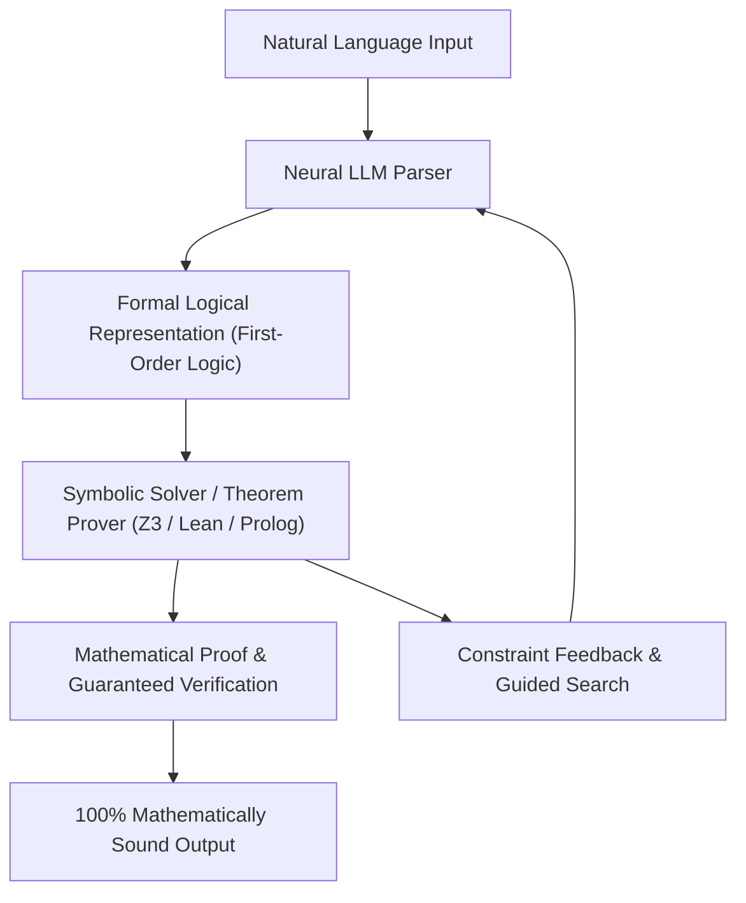

#### d. Code Thực chiến (C++ & Python)

```cpp
// C++17: Triển khai Product T-Norm và Łukasiewicz Fuzzy Logic Operators
#include <iostream>
#include <algorithm>

struct FuzzyLogicOperators {
    static float fuzzy_and_product(float x, float y) { return x * y; }
    static float fuzzy_or_product(float x, float y) { return x + y - x * y; }
    static float fuzzy_not(float x) { return 1.0f - x; }

    static float fuzzy_implication_lukasiewicz(float x, float y) {
        // x -> y tương đương min(1, 1 - x + y)
        return std::min(1.0f, 1.0f - x + y);
    }
};

int main() {
    float truth_A = 0.8f; // Chân trị mệnh đề A: 80% đúng
    float truth_B = 0.7f;
    std::cout << "Fuzzy A AND B: " << FuzzyLogicOperators::fuzzy_and_product(truth_A, truth_B) << "\n";
    std::cout << "Fuzzy Implication A -> B: " << FuzzyLogicOperators::fuzzy_implication_lukasiewicz(truth_A, truth_B) << "\n";
    return 0;
}
```

```python
# Python / PyTorch: Logic Loss Constraint Regularization
import torch
import torch.nn as nn

def differentiable_logic_rule_loss(p_is_human: torch.Tensor, p_is_mortal: torch.Tensor) -> torch.Tensor:
    # Luật logic: Human(x) -> Mortal(x) phải có chân trị = 1
    # Trong Łukasiewicz logic: I(x -> y) = min(1, 1 - x + y)
    # Ta phạt khi 1 - x + y < 1 <=> x - y > 0
    violation = torch.relu(p_is_human - p_is_mortal)
    return violation.mean()

prob_human = torch.tensor([0.9, 0.8, 0.1])
prob_mortal = torch.tensor([0.95, 0.4, 0.2]) # Mẫu 2 vi phạm (Human 0.8 mà Mortal chỉ 0.4)
loss = differentiable_logic_rule_loss(prob_human, prob_mortal)
print("Logic Constraint Violation Loss:", loss.item())
```

#### e. Lỗi Thường gặp & Ổn định Số học
- **Vanishing Gradients in Strict Logic**: Các hàm logic cổ điển có đạo hàm bằng 0 ở hầu hết mọi nơi (step functions), khiến gradient không thể truyền ngược qua các mô hình nơ-ron nếu không được làm mịn cẩn thận bằng T-Norms khả vi.

#### f. Ứng dụng Thực chiến trong AI
Các hệ thống AI toán học giải định lý phức tạp (AlphaProof, AlphaGeometry của Google DeepMind), hệ thống kiểm chứng tính đúng đắn mã nguồn và tự động hóa phát hiện lỗ hổng bảo mật.
