# Chuyên đề: Nền tảng Ảnh số & Các Phép Lọc Tín hiệu (Digital Image Fundamentals & Filtering)

## 1. Tổng quan Chuyên đề
Thị giác máy tính (Computer Vision) bắt đầu từ việc thấu hiểu bản chất vật lý của ánh sáng và cơ chế chuyển đổi quang-điện thành mảng số rời rạc trong bộ nhớ máy tính. Một bức ảnh số về bản chất toán học là một hàm liên tục hai chiều được lượng tử hóa và lấy mẫu trên một lưới tọa độ không gian rời rạc $\mathbf{I}: \mathbb{Z}^2 \to \mathbb{R}^C$.

Các phép biến đổi không gian màu (Color Spaces: RGB, HSV, Grayscale), các toán tử lọc không gian hai chiều thông qua phép tích chập (2D Convolution & Image Filtering), phát hiện biên cạnh (Edge Detection), phân ngưỡng nhị phân (Thresholding), các toán tử hình thái học toán học (Morphological Operations) và căn chỉnh hình học (Image Registration) là những viên gạch nền tảng trước khi xây dựng các mạng nơ-ron tích chập (CNN) và Vision Transformers.

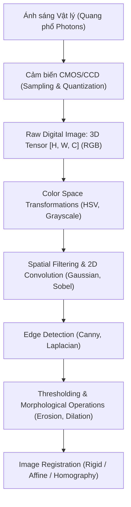

---

## 2. Chi tiết từng Keyword

---

### 1. Computer Vision (Thị giác Máy tính Tổng quát)

#### a. Định nghĩa Bản chất Toán học (Mathematical Formulation)
Thị giác máy tính là bài toán nghịch đảo (Inverse Problem): Khôi phục các thuộc tính vật lý của thế giới 3 chiều (hình học, màu sắc, ánh sáng, chuyển động, ngữ nghĩa) từ các phép chiếu quang học 2 chiều bị mất chiều sâu:
$$\mathbf{I}(x, y) = \mathcal{P}_{3D \to 2D}\left( \mathcal{S}_{\text{geometry}}, \mathcal{R}_{\text{reflectance}}, \mathcal{L}_{\text{illumination}}, \mathcal{C}_{\text{camera}} \right)$$
Bài toán nghịch đảo là bài toán không chỉnh (Ill-posed inverse problem) theo định nghĩa Hadamard vì một ảnh 2D có thể được sinh ra bởi vô số cấu hình thế giới 3D khác nhau. Cần áp dụng các tiên đề điều chuẩn (Regularization Priors) để tìm nghiệm tối ưu:
$$\min_{\mathcal{S}} \|\mathcal{P}(\mathcal{S}) - \mathbf{I}\|_2^2 + \lambda \mathcal{R}(\mathcal{S})$$

#### b. Cơ chế Tầng Sâu & Điện toán (Under The Hood / Hardware Internals)
- **High Bandwidth Memory (HBM) Streaming**: Xử lý luồng video thời gian thực 4K 60FPS đòi hỏi thông lượng bộ nhớ khổng lồ: $3840 \times 2160 \times 3 \times 60 \approx 1.5\text{ GB/giây}$ cho dữ liệu thô. Tại tầng phần cứng, việc truyền dữ liệu từ cảm biến camera qua PCIe Bus vào VRAM của GPU phải sử dụng cơ chế Direct Memory Access (DMA) để không làm nghẽn CPU.

#### c. Sơ đồ Minh họa (Mermaid Diagram)
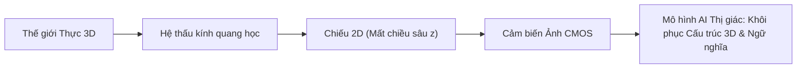

#### d. Code Thực chiến (C++ & Python)

```cpp
// C++17: Kiểm tra và in kích thước bộ đệm ảnh phẳng
#include <iostream>

void inspect_image_buffer(int width, int height, int channels, int bytes_per_channel) {
    size_t total_bytes = static_cast<size_t>(width) * height * channels * bytes_per_channel;
    std::cout << "Image Dimension: " << width << "x" << height << "x" << channels 
              << " | Memory Buffer: " << (total_bytes / (1024.0 * 1024.0)) << " MB\n";
}

int main() {
    inspect_image_buffer(3840, 2160, 3, 1); // 4K RGB 8-bit
    return 0;
}
```

```python
# Python / PyTorch: Biểu diễn Ảnh số dưới dạng Tensor N-D
import torch

# Chuẩn PyTorch: [Batch, Channels, Height, Width] (BCHW)
batch_images = torch.zeros(4, 3, 1080, 1920, dtype=torch.uint8)
print("PyTorch Image Tensor Shape:", batch_images.shape)
print("Memory Footprint (MB):", batch_images.element_size() * batch_images.nelement() / (1024**2))
```

#### e. Lỗi Thường gặp & Ổn định Số học
- Giả định điều kiện chiếu sáng cố định (Lambertian assumption) bị sụp đổ khi gặp bề mặt phản xạ gương, bóng đổ mạnh hoặc kim loại lấp lánh.

#### f. Ứng dụng Thực chiến trong AI
Xe tự hành (Tesla FSD, Waymo), phẫu thuật robot nội soi, kiểm tra chất lượng sản phẩm công nghiệp (Defect Inspection).

---

### 2. Image Processing (Xử lý Ảnh)

#### a. Định nghĩa Bản chất Toán học
Xử lý ảnh là một tập hợp các phép biến đổi toán học tác động lên hàm ảnh đầu vào $\mathbf{I}_1$ để tạo ra một ảnh mới $\mathbf{I}_2$ với các thuộc tính được tối ưu hóa:
$$\mathbf{I}_2(x, y) = \mathcal{T}(\mathbf{I}_1(x, y))$$
Phân cấp toán học:
1. **Toán tử điểm (Point Operators)**: Phụ thuộc duy nhất vào giá trị điểm ảnh tại tọa độ $(x, y)$: $I_2(x, y) = f(I_1(x, y))$.
2. **Toán tử cục bộ (Local / Neighborhood Operators)**: Phụ thuộc vào vùng lân cận $\mathcal{N}(x, y)$ kích thước $k \times k$ (Convolution, Median filter).
3. **Toán tử toàn cục (Global Operators)**: Phụ thuộc vào toàn bộ các điểm ảnh trên trang (Fourier Transform, Histogram Equalization).

#### b. Cơ chế Tầng Sâu & Điện toán
- **Memory Coalescing trong CUDA**: Khi thực thi toán tử điểm trên GPU, mỗi luồng (CUDA Thread) xử lý một điểm ảnh. Nếu các luồng trong cùng một Warp truy cập các ô nhớ liền kề liên tục, GPU sẽ gộp thành 1 giao dịch bộ nhớ duy nhất (Coalesced Memory Access), đạt băng thông tối đa.

#### c. Sơ đồ Minh họa (Mermaid Diagram)
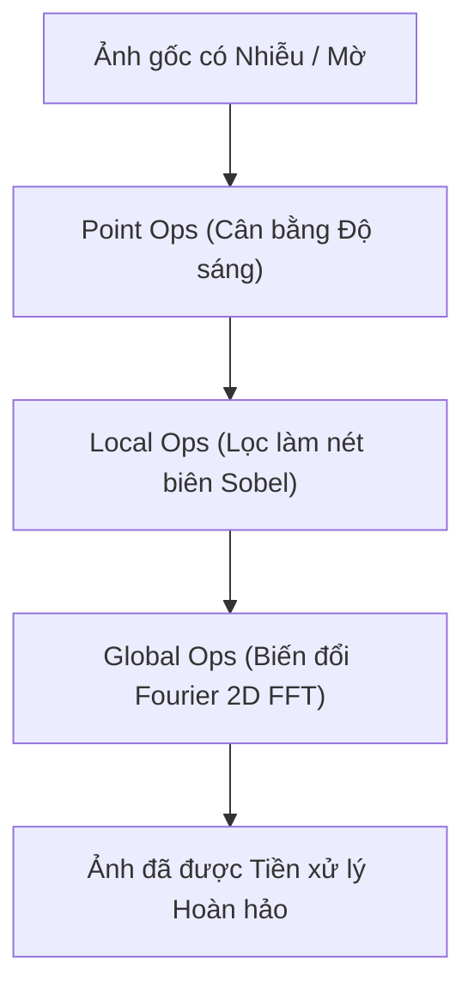

#### d. Code Thực chiến (C++ & Python)

```cpp
// C++17: Toán tử Điểm đảo ngược màu (Invert Image) tối ưu hóa con trỏ
#include <iostream>
#include <vector>

void invert_grayscale_image(unsigned char* data, size_t num_pixels) {
    for (size_t i = 0; i < num_pixels; ++i) {
        data[i] = 255 - data[i]; // Bitwise invert: ~data[i]
    }
}

int main() {
    std::vector<unsigned char> img = {0, 100, 200, 255};
    invert_grayscale_image(img.data(), img.size());
    std::cout << "Inverted pixel 0: " << static_cast<int>(img[0]) << "\n";
    return 0;
}
```

```python
# Python: Histogram Equalization cân bằng độ sáng
import numpy as np

def manual_histogram_equalization(img_gray: np.ndarray) -> np.ndarray:
    # img_gray: uint8 [H, W]
    hist, _ = np.histogram(img_gray.flatten(), 256, [0, 256])
    cdf = hist.cumsum()
    cdf_normalized = cdf * float(hist.max()) / cdf.max()
    # Masking out 0 values
    cdf_m = np.ma.masked_equal(cdf, 0)
    cdf_m = (cdf_m - cdf_m.min()) * 255 / (cdf_m.max() - cdf_m.min())
    cdf_final = np.ma.filled(cdf_m, 0).astype('uint8')
    return cdf_final[img_gray]

dummy = np.random.randint(50, 100, (4, 4), dtype=np.uint8)
print("Equalized Image Min/Max:", manual_histogram_equalization(dummy).min(), manual_histogram_equalization(dummy).max())
```

#### e. Lỗi Thường gặp & Ổn định Số học
- **Clipping / Saturation Overflow**: Cộng độ sáng khiến giá trị vượt quá 255 trong kiểu dữ liệu `uint8` dẫn đến hiện tượng tràn số nguyên (ví dụ $250 + 10 = 4$), gây đổi màu trắng thành đen. Bắt buộc phải dùng hàm bão hòa (`std::clamp` hoặc `cv::saturate_cast`).

#### f. Ứng dụng Thực chiến trong AI
Tiền xử lý ảnh y tế (X-quang, MRI), cân bằng độ tương phản cho camera hành trình ban đêm.

---

### 3. Digital Images (Bản chất Ảnh số)

#### a. Định nghĩa Bản chất Toán học
Ảnh số là sự rời rạc hóa của tín hiệu tương tự liên tục $f(x, y)$ theo 2 bước:
1. **Lấy mẫu không gian (Sampling)**: Rời rạc hóa tọa độ $(x, y) \to (i, j)$ với khoảng cách bước nhảy $\Delta x, \Delta y$. Theo định lý Nyquist-Shannon: Tần số lấy mẫu phải lớn hơn ít nhất 2 lần tần số không gian cao nhất của ảnh để tránh hiện tượng răng cưa (Aliasing):
   $$f_s \ge 2 f_{\max}$$
2. **Lượng tử hóa biên độ (Quantization)**: Rời rạc hóa cường độ sáng liên tục sang tập mức xám rời rạc $L = 2^b$ (với $b$ là độ sâu bit, thường $b=8$ bit $\to 256$ mức $[0, 255]$).

#### b. Cơ chế Tầng Sâu & Điện toán
- **Bayer Filter Demosaicing**: Cảm biến máy ảnh không ghi nhận trực tiếp cả 3 kênh RGB trên cùng một điểm ảnh mà sử dụng mảng lọc màu Bayer (Bayer Filter Pattern: 50% Green, 25% Red, 25% Blue vì mắt người nhạy cảm nhất với màu xanh lá). Chip xử lý ảnh (ISP - Image Signal Processor) phải chạy giải thuật nội suy (Demosaicing) để tái tạo đủ 3 kênh cho mỗi pixel.

#### c. Sơ đồ Minh họa (Mermaid Diagram)
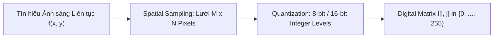

#### d. Code Thực chiến (C++ & Python)

```cpp
// C++17: Mô phỏng Lượng tử hóa từ Floating-Point [0.0, 1.0] sang uint8 [0, 255]
#include <iostream>
#include <vector>
#include <algorithm>

std::vector<unsigned char> quantize_float_image(const std::vector<float>& float_pixels) {
    std::vector<unsigned char> quantized(float_pixels.size());
    for (size_t i = 0; i < float_pixels.size(); ++i) {
        float scaled = float_pixels[i] * 255.0f;
        quantized[i] = static_cast<unsigned char>(std::max(0.0f, std::min(255.0f, scaled)));
    }
    return quantized;
}

int main() {
    std::vector<float> norm_img = {0.0f, 0.5f, 1.0f};
    auto q = quantize_float_image(norm_img);
    std::cout << "Quantized values: ";
    for (auto val : q) std::cout << static_cast<int>(val) << " ";
    std::cout << "\n";
    return 0;
}
```

```python
# Python / PyTorch: Downsampling và Aliasing Effect Demonstration
import torch
import torch.nn.functional as F

img = torch.randn(1, 1, 64, 64)
# Downsample không qua bộ lọc chống răng cưa (Anti-aliasing)
downsampled_aliased = F.interpolate(img, size=(16, 16), mode='nearest')
# Downsample chuẩn với song tuyến tính (Bilinear)
downsampled_smooth = F.interpolate(img, size=(16, 16), mode='bilinear', align_corners=False)
print("Aliased shape:", downsampled_aliased.shape, "| Smooth shape:", downsampled_smooth.shape)
```

#### e. Lỗi Thường gặp & Ổn định Số học
- **Moiré Patterns**: Hiện tượng vân sóng giao thoa giả tạo xuất hiện khi chụp màn hình máy tính hoặc áo sọc kẻ có tần số không gian vượt quá tần số lấy mẫu Nyquist của camera.

#### f. Ứng dụng Thực chiến trong AI
Xử lý dữ liệu đầu vào cho toàn bộ hệ thống Vision, nén ảnh JPEG/WebP.

---

### 4. Image Representation (Biểu diễn Ảnh trong Bộ nhớ)

#### a. Định nghĩa Bản chất Toán học
Một bức ảnh số màu đa kênh là một Ten-xơ bậc 3 (Rank-3 Tensor):
$$\mathbf{I} \in \mathbb{R}^{H \times W \times C} \quad \text{hoặc} \quad \mathbf{I} \in \mathbb{R}^{C \times H \times W}$$
Hai quy ước bố cục bộ nhớ (Memory Layout Formats) chính:
1. **HWC / NHWC (Interleaved / Channels Last)**: Pixel format truyền thống của OpenCV và GPU Tensor Cores hiện đại: Các kênh màu của cùng một pixel nằm kề sát nhau: $(R_0, G_0, B_0, R_1, G_1, B_1, \dots)$.
2. **CHW / NCHW (Planar / Channels First)**: Format chuẩn mực của PyTorch: Toàn bộ mặt phẳng kênh Red được lưu trước, tiếp đến toàn bộ kênh Green, rồi đến Blue.

#### b. Cơ chế Tầng Sâu & Điện toán
- **Stride Arithmetic trong Bộ nhớ**:
  - Với layout **HWC**: $\text{Offset}(y, x, c) = y \cdot (W \cdot C) + x \cdot C + c$.
  - Với layout **CHW**: $\text{Offset}(c, y, x) = c \cdot (H \cdot W) + y \cdot W + x$.
- **Tensor Core Speedup với NHWC**: Trên kiến trúc NVIDIA Ampere/Hopper, toán tử tích chập trên layout NHWC được thực thi trực tiếp bằng nhân Tensor Core FP16/BF16 với tốc độ nhanh gấp $2\times - 3\times$ so với NCHW truyền thống nhờ căn chỉnh vector 8-byte/16-byte liên tục.

#### c. Sơ đồ Minh họa (Mermaid Diagram)
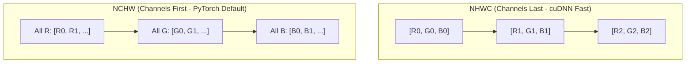

#### d. Code Thực chiến (C++ & Python)

```cpp
// C++17: Chuyển đổi Bố cục Bộ nhớ từ HWC sang CHW
#include <iostream>
#include <vector>

void hwc_to_chw(const unsigned char* hwc, unsigned char* chw, int H, int W, int C) {
    int spatial_size = H * W;
    for (int y = 0; y < H; ++y) {
        for (int x = 0; x < W; ++x) {
            for (int c = 0; c < C; ++c) {
                int hwc_idx = (y * W + x) * C + c;
                int chw_idx = c * spatial_size + (y * W + x);
                chw[chw_idx] = hwc[hwc_idx];
            }
        }
    }
}

int main() {
    // 1x2 ảnh với 3 kênh (H=1, W=2, C=3)
    std::vector<unsigned char> hwc = {255, 0, 0, 0, 255, 0}; // Pixel 1 đỏ, Pixel 2 lục
    std::vector<unsigned char> chw(6);
    hwc_to_chw(hwc.data(), chw.data(), 1, 2, 3);
    std::cout << "CHW R-plane: [" << static_cast<int>(chw[0]) << ", " << static_cast<int>(chw[1]) << "]\n";
    return 0;
}
```

```python
# Python / PyTorch: Chuyển đổi giữa NCHW và Channels Last (NHWC)
import torch

tensor_nchw = torch.randn(2, 3, 224, 224) # [Batch, C, H, W]
# Chuyển đổi sang channels_last để tối ưu hóa Tensor Cores trên GPU
tensor_nhwc = tensor_nchw.to(memory_format=torch.channels_last)

print("Is Contiguous (Normal):", tensor_nhwc.is_contiguous())
print("Is Contiguous (Channels Last):", tensor_nhwc.is_contiguous(memory_format=torch.channels_last))
print("Strides:", tensor_nhwc.stride()) # (150528, 1, 672, 3)
```

#### e. Lỗi Thường gặp & Ổn định Số học
- **Stride Mismatch Crash**: Truyền một con trỏ tensor không liên tục (Non-contiguous) vào một hàm thư viện C++/CUDA (như TensorRT kernel) sẽ đọc sai toàn bộ vị trí pixel, sinh ra ảnh bị xé hình (Tearing effect).

#### f. Ứng dụng Thực chiến trong AI
Tối ưu hóa pipeline nạp dữ liệu TorchVision, NVIDIA DALI, tối ưu hóa suy luận TensorRT.

---

### 5. Color Spaces (Không gian Màu sắc)

#### a. Định nghĩa Bản chất Toán học
Không gian màu là một mô hình toán học trừu tượng biểu diễn màu sắc dưới dạng các bộ tọa độ số thực:
$$\mathbf{c} = (c_1, c_2, c_3) \in \mathcal{S}_{\text{color}} \subset \mathbb{R}^3$$
Các hệ màu cơ bản:
- **RGB**: Cộng màu (Additive), gắn liền với phần cứng hiển thị.
- **CMYK**: Trừ màu (Subtractive), gắn liền với công nghệ in ấn mực.
- **HSV / HSL**: Phỏng sinh học thị giác con người (Sắc độ, Độ bão hòa, Độ sáng).
- **CIE Lab**: Cân bằng cảm nhận (Perceptually Uniform - Khoảng cách Euclidean trong Lab tương đương trực giác mắt người).

#### b. Cơ chế Tầng Sâu & Điện toán
- Sự chuyển đổi giữa các không gian màu là các phép biến đổi affine hoặc phi tuyến tính:
  - RGB sang CIE XYZ thông qua nhân ma trận $3 \times 3$: $\mathbf{c}_{XYZ} = \mathbf{M} \mathbf{c}_{RGB}$.
  - XYZ sang Lab thông qua hàm căn bậc ba phi tuyến $f(t) = t^{1/3}$ để mô phỏng đáp ứng phi tuyến tính của võng mạc mắt người.

#### c. Sơ đồ Minh họa (Mermaid Diagram)
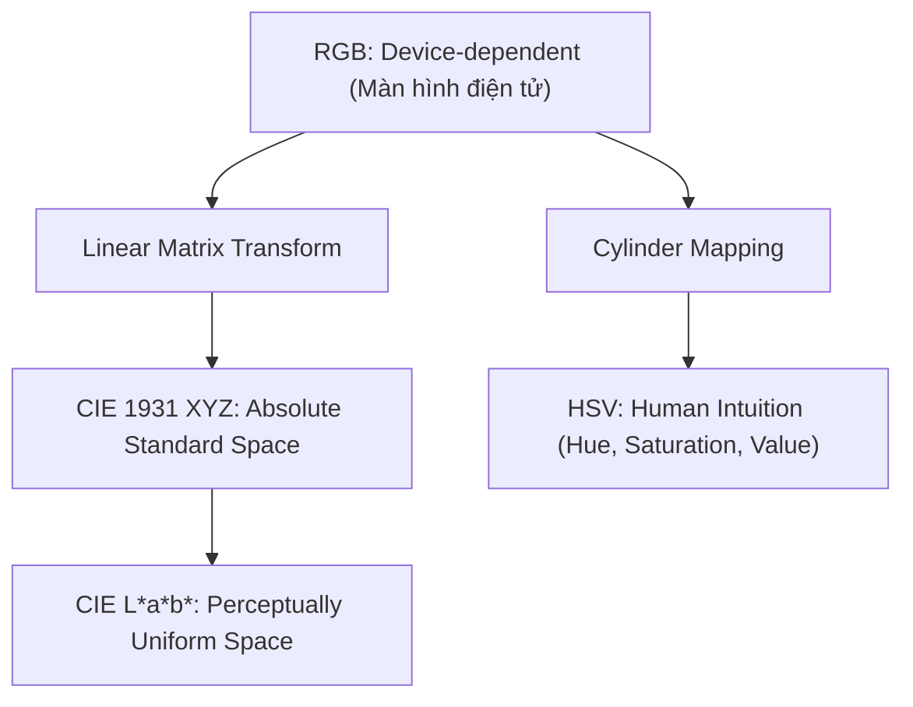

#### d. Code Thực chiến (C++ & Python)

```cpp
// C++17: Chuyển đổi RGB sang CIE XYZ bằng phép nhân ma trận
#include <iostream>
#include <vector>

void rgb_to_xyz(float r, float g, float b, float& x, float& y, float& z) {
    // Ma trận sRGB D65 tiêu chuẩn
    x = 0.4124564f * r + 0.3575761f * g + 0.1804375f * b;
    y = 0.2126729f * r + 0.7151522f * g + 0.0721750f * b;
    z = 0.0193339f * r + 0.1191920f * g + 0.9503041f * b;
}

int main() {
    float x, y, z;
    rgb_to_xyz(1.0f, 1.0f, 1.0f, x, y, z); // Màu trắng
    std::cout << "White Point D65 XYZ: [" << x << ", " << y << ", " << z << "]\n";
    return 0;
}
```

```python
# Python: Delta E Color Difference trong không gian CIE Lab
import numpy as np

def delta_e_cie76(lab1: np.ndarray, lab2: np.ndarray) -> float:
    # Khoảng cách Euclidean trong không gian Lab đo sai biệt màu mắt người nhận biết
    return float(np.linalg.norm(lab1 - lab2))

color_a = np.array([50.0, 12.0, -40.0]) # Lab
color_b = np.array([51.0, 13.0, -38.0])
print(f"Delta E Color Difference: {delta_e_cie76(color_a, color_b):.2f}")
```

#### e. Lỗi Thường gặp & Ổn định Số học
- **Gamma Correction Neglect**: Áp dụng các phép biến đổi toán học tuyến tính trực tiếp trên không gian sRGB chưa qua giải mã Gamma ($\gamma = 2.2$) dẫn đến tính toán sai lệch cường độ sáng vật lý.

#### f. Ứng dụng Thực chiến trong AI
Đo lường sai lệch màu sắc trong các mô hình sinh ảnh (Diffusion Models, GANs) và trích xuất đặc trưng thị giác chuẩn xác.

---

### 6. RGB (Không gian Màu Red-Green-Blue)

#### a. Định nghĩa Bản chất Toán học
Không gian màu RGB là không gian véc-tơ cộng màu ba chiều:
$$\mathbf{c} = R \cdot \hat{\mathbf{r}} + G \cdot \hat{\mathbf{g}} + B \cdot \hat{\mathbf{b}}, \quad R, G, B \in [0, 255] \text{ hoặc } [0.0, 1.0]$$
Mỗi màu sắc là một điểm nằm trong một khối lập phương đơn vị $[0, 1]^3$:
- $(0, 0, 0)$: Màu đen tuyệt đối.
- $(1, 1, 1)$: Màu trắng cực đại.
- Đường chéo chính nối từ $(0,0,0)$ đến $(1,1,1)$ chính là trục mức xám (Achromatic Gray Axis).

#### b. Cơ chế Tầng Sâu & Điện toán
- **RGB vs BGR Memory Ordering Trap**: Thư viện OpenCV sử dụng chuẩn ngầm định là **BGR** (Blue-Green-Red) do lý do lịch sử tương thích với các chip xử lý đồ họa cũ, trong khi PyTorch, TensorFlow, PIL, Matplotlib sử dụng chuẩn **RGB**.
- Nếu nạp ảnh từ OpenCV trực tiếp vào mô hình PyTorch đã tiền huấn luyện mà quên chuyển `cv::cvtColor(img, COLOR_BGR2RGB)`, kênh Red và Blue bị tráo đổi, làm độ chính xác phân loại của mạng nơ-ron sụt giảm nghiêm trọng.

#### c. Sơ đồ Minh họa (Mermaid Diagram)
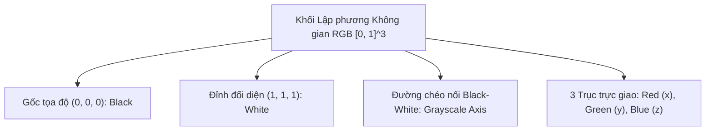

#### d. Code Thực chiến (C++ & Python)

```cpp
// C++17: Chuyển đổi In-place BGR sang RGB
#include <iostream>
#include <vector>
#include <utility>

void bgr_to_rgb_inplace(unsigned char* data, size_t num_pixels) {
    for (size_t i = 0; i < num_pixels; ++i) {
        // Tráo đổi kênh 0 (B) và kênh 2 (R)
        std::swap(data[i * 3 + 0], data[i * 3 + 2]);
    }
}

int main() {
    std::vector<unsigned char> bgr = {255, 0, 0}; // Xanh lam trong BGR
    bgr_to_rgb_inplace(bgr.data(), 1);
    std::cout << "After swap, Red channel is: " << static_cast<int>(bgr[0]) << "\n";
    return 0;
}
```

```python
# Python / PyTorch: Hoán đổi kênh RGB <-> BGR bằng Tensor Slicing
import torch

img_bgr = torch.tensor([[[[255], [0], [0]]]], dtype=torch.uint8) # [B, C, H, W]
# Tráo đổi kênh 0 và 2 bằng index permutation: channel list [2, 1, 0]
img_rgb = img_bgr[:, [2, 1, 0], :, :]
print("Converted RGB Channel 0 Value:", img_rgb[0, 0, 0, 0].item()) # 0
print("Converted RGB Channel 2 Value:", img_rgb[0, 2, 0, 0].item()) # 255
```

#### e. Lỗi Thường gặp & Ổn định Số học
- **High Correlation between Channels**: Các kênh R, G, B có độ tương quan rất cao với nhau (khi một vật thể được chiếu sáng mạnh, cả 3 kênh đều tăng đồng thời). Do đó RGB không phù hợp cho các bài toán phân đoạn vật thể dựa trên màu sắc dưới điều kiện ánh sáng biến đổi.

#### f. Ứng dụng Thực chiến trong AI
Không gian màu mặc định nạp vào các mạng thị giác máy tính hiện đại (ResNet, EfficientNet, ViT).

---

### 7. HSV (Không gian Màu Hue-Saturation-Value)

#### a. Định nghĩa Bản chất Toán học
Không gian HSV tách biệt độc lập thông tin màu sắc (Sắc độ) khỏi thông tin cường độ ánh sáng:
- **Hue ($H \in [0^\circ, 360^\circ)$)**: Sắc thái màu sắc thuần túy trên vòng tròn màu (Đỏ $\approx 0^\circ$, Lục $\approx 120^\circ$, Lam $\approx 240^\circ$).
- **Saturation ($S \in [0, 1]$)**: Độ bão hòa màu (độ đậm nhạt/độ tinh khiết).
- **Value ($V \in [0, 1]$)**: Cường độ sáng.
Công thức chuyển đổi từ RGB:
$$V = \max(R, G, B), \quad \Delta = V - \min(R, G, B), \quad S = \begin{cases} 0 & \text{nếu } V = 0 \\ \frac{\Delta}{V} & \text{ngược lại} \end{cases}$$
$$H = 60^\circ \times \begin{cases} \frac{G - B}{\Delta} \pmod 6 & \text{nếu } V = R \\ \frac{B - R}{\Delta} + 2 & \text{nếu } V = G \\ \frac{R - G}{\Delta} + 4 & \text{nếu } V = B \end{cases}$$

#### b. Cơ chế Tầng Sâu & Điện toán
- **Illumination Invariance (Bất biến với ánh sáng)**: Trong thị giác máy tính truyền thống, việc phát hiện màu sắc (ví dụ nhận diện vạch kẻ đường, phát hiện quả bóng màu vàng) được thực hiện bằng cách chỉ lọc ngưỡng trên kênh $H$ và $S$, bỏ qua kênh $V$. Điều này giúp thuật toán hoạt động ổn định kể cả khi trời nắng gắt hay bóng râm.

#### c. Sơ đồ Minh họa (Mermaid Diagram)
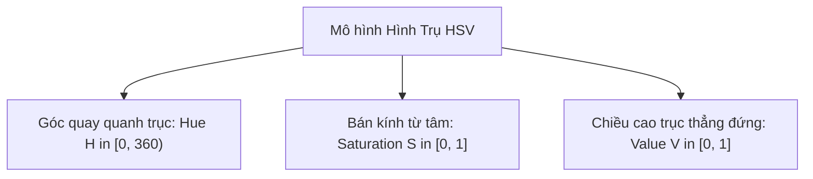

#### d. Code Thực chiến (C++ & Python)

```cpp
// C++17: Chuyển đổi RGB sang HSV Chuẩn xác
#include <iostream>
#include <algorithm>
#include <cmath>

void rgb_to_hsv(float r, float g, float b, float& h, float& s, float& v) {
    float c_max = std::max({r, g, b});
    float c_min = std::min({r, g, b});
    float delta = c_max - c_min;

    v = c_max;
    s = (c_max > 1e-6f) ? (delta / c_max) : 0.0f;

    if (delta < 1e-6f) {
        h = 0.0f;
    } else {
        if (c_max == r) {
            h = 60.0f * std::fmod(((g - b) / delta), 6.0f);
        } else if (c_max == g) {
            h = 60.0f * (((b - r) / delta) + 2.0f);
        } else {
            h = 60.0f * (((r - g) / delta) + 4.0f);
        }
        if (h < 0.0f) h += 360.0f;
    }
}

int main() {
    float h, s, v;
    rgb_to_hsv(1.0f, 0.0f, 0.0f, h, s, v); // Pure Red
    std::cout << "Red in HSV -> H: " << h << " deg, S: " << s << ", V: " << v << "\n";
    return 0;
}
```

```python
# Python: Lọc dải màu (Color Masking) bằng OpenCV HSV
import numpy as np

def create_color_mask(hsv_img: np.ndarray, lower_bound: np.ndarray, upper_bound: np.ndarray) -> np.ndarray:
    # Lọc các điểm ảnh nằm trong dải [lower, upper]
    mask = (hsv_img >= lower_bound) & (hsv_img <= upper_bound)
    return np.all(mask, axis=-1).astype(np.uint8) * 255

mock_hsv = np.array([[[10, 200, 200], [120, 150, 150]]], dtype=np.uint8)
lower_red = np.array([0, 100, 100])
upper_red = np.array([20, 255, 255])
print("Mask Output (Red Detected):", create_color_mask(mock_hsv, lower_red, upper_red))
```

#### e. Lỗi Thường gặp & Ổn định Số học
- **Hue Singularity at Black & White**: Khi $S = 0$ (màu xám) hoặc $V = 0$ (màu đen), góc $H$ không xác định về mặt toán học ($0/0$). Các phép tính toán vector trên kênh $H$ tại vùng này sẽ sinh ra số vô nghĩa (NaN) nếu không có điều kiện rẽ nhánh.

#### f. Ứng dụng Thực chiến trong AI
Theo dõi vật thể dựa trên màu sắc trong thời gian thực (CamShift / MeanShift Object Tracking), phát hiện vùng da người (Skin Detection).

---

### 8. Grayscale (Ảnh Mức Xám)

#### a. Định nghĩa Bản chất Toán học
Ảnh mức xám là hàm suy giảm số chiều từ tensor 3 kênh RGB sang ma trận vô hướng đơn kênh $Y \in [0, 255]^{H \times W}$:
$$Y = w_R R + w_G G + w_B B$$
Theo tiêu chuẩn truyền hình quốc tế **ITU-R BT.601** (mô phỏng độ nhạy sáng quang học của mắt người):
$$Y = 0.299 R + 0.587 G + 0.114 B$$
Kênh Green chiếm trọng số cao nhất ($58.7\%$) vì mắt người nhạy cảm nhất với bước sóng xanh lục, trong khi kênh Blue chỉ chiếm $11.4\%$.

#### b. Cơ chế Tầng Sâu & Điện toán
- **Memory Footprint Reduction**: Chuyển ảnh màu RGB sang Grayscale giúp giảm trực tiếp $66.7\%$ kích thước bộ nhớ và số phép tính FLOPs trong các giải thuật phát hiện biên cạnh, quang thông hoặc xử lý OCR.

#### c. Sơ đồ Minh họa (Mermaid Diagram)
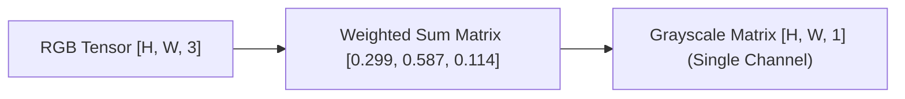

#### d. Code Thực chiến (C++ & Python)

```cpp
// C++17: Chuyển đổi RGB sang Grayscale sử dụng Số học Số nguyên (Fixed-Point Integer Math)
#include <iostream>
#include <vector>

void rgb_to_gray_fast(const unsigned char* rgb, unsigned char* gray, size_t num_pixels) {
    // 0.299 * 1024 ~ 306, 0.587 * 1024 ~ 601, 0.114 * 1024 ~ 117
    for (size_t i = 0; i < num_pixels; ++i) {
        int r = rgb[i * 3 + 0];
        int g = rgb[i * 3 + 1];
        int b = rgb[i * 3 + 2];
        // Dịch bit >> 10 tương đương chia 1024, không dùng phép nhân float trên CPU
        gray[i] = static_cast<unsigned char>((r * 306 + g * 601 + b * 117) >> 10);
    }
}

int main() {
    std::vector<unsigned char> rgb = {255, 255, 255}; // Trắng
    unsigned char gray = 0;
    rgb_to_gray_fast(rgb.data(), &gray, 1);
    std::cout << "Calculated Gray Intensity: " << static_cast<int>(gray) << "\n";
    return 0;
}
```

```python
# Python / PyTorch: Phép biến đổi Grayscale qua Conv2d 1x1
import torch
import torch.nn as nn

class RGBToGrayscaleConv(nn.Module):
    def __init__(self):
        super().__init__()
        # Conv2d 1x1 cố định trọng số ITU-R BT.601
        self.conv = nn.Conv2d(3, 1, kernel_size=1, bias=False)
        with torch.no_grad():
            self.conv.weight = nn.Parameter(torch.tensor([[[[0.299]], [[0.587]], [[0.114]]]]))

    def forward(self, rgb_tensor: torch.Tensor) -> torch.Tensor:
        return self.conv(rgb_tensor)

converter = RGBToGrayscaleConv()
x = torch.ones(1, 3, 4, 4)
print("Grayscale Output Shape:", converter(x).shape) # [1, 1, 4, 4]
```

#### e. Lỗi Thường gặp & Ổn định Số học
- Lấy trung bình cộng đơn giản $(R + G + B)/3$ thay vì trọng số cảm nhận sẽ làm sai lệch độ tương phản thị giác của bức ảnh.

#### f. Ứng dụng Thực chiến trong AI
Xử lý tài liệu OCR, tiền xử lý trong bài toán căn chỉnh ảnh khuôn mặt (Face Alignment).

---

### 9. Image Filtering (Lọc Ảnh Không gian)

#### a. Định nghĩa Bản chất Toán học
Lọc ảnh trong miền không gian là phép toán thay thế giá trị của mỗi điểm ảnh bằng hàm số của các điểm lân cận trong cửa sổ kernel $\mathcal{K}$:
$$\mathbf{I}_{\text{filtered}}(x, y) = \sum_{u=-k}^k \sum_{v=-k}^k \mathcal{K}(u, v) \cdot \mathbf{I}(x + u, y + v)$$
Các bộ lọc tiêu chuẩn:
1. **Box Filter (Lọc Trung bình)**: $\mathcal{K}_{u, v} = \frac{1}{k^2}$ (Gây mờ đều, làm nhòe cạnh).
2. **Gaussian Filter**: Lọc mượt bảo toàn cấu trúc dựa trên phân phối chuẩn 2D:
   $$\mathcal{G}(u, v) = \frac{1}{2\pi \sigma^2} \exp\left( -\frac{u^2 + v^2}{2\sigma^2} \right)$$
3. **Median Filter (Lọc Trung vị)**: Bộ lọc phi tuyến tính thay pixel bằng trung vị của vùng lân cận, loại bỏ hoàn toàn nhiễu muối tiêu (Salt-and-Pepper Noise) mà không làm mờ biên.

#### b. Cơ chế Tầng Sâu & Điện toán
- **Separable 2D Filter (Tính khả tách của Bộ lọc Gaussian)**: Ma trận Gaussian 2D có thể phân tách thành tích ngoài của 2 vector 1D: $\mathbf{G}_{2D} = \mathbf{g}_{1D} \cdot \mathbf{g}_{1D}^T$.
  Việc chạy 2 phép lọc 1D liên tiếp giảm số phép nhân từ $\mathcal{O}(K^2)$ xuống $\mathcal{O}(2K)$ cho mỗi pixel. Với kernel $15 \times 15$, tốc độ tính toán tăng hơn $7\times$ trên CPU/GPU.

#### c. Sơ đồ Minh họa (Mermaid Diagram)
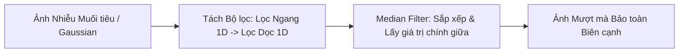

#### d. Code Thực chiến (C++ & Python)

```cpp
// C++17: Bộ Lọc Gaussian 1D Khả tách
#include <iostream>
#include <vector>
#include <cmath>

std::vector<float> generate_gaussian_kernel_1d(int radius, float sigma) {
    int size = 2 * radius + 1;
    std::vector<float> kernel(size);
    float sum = 0.0f;
    for (int i = -radius; i <= radius; ++i) {
        float val = std::exp(-(i * i) / (2.0f * sigma * sigma));
        kernel[i + radius] = val;
        sum += val;
    }
    for (float& w : kernel) w /= sum; // Chuẩn hóa tổng bằng 1
    return kernel;
}

int main() {
    auto k = generate_gaussian_kernel_1d(1, 1.0f); // Size 3
    std::cout << "Gaussian 1D Kernel: [" << k[0] << ", " << k[1] << ", " << k[2] << "]\n";
    return 0;
}
```

```python
# Python / PyTorch: Gaussian Blur qua Separable Depthwise Convolutions
import torch
import torch.nn as nn

class SeparableGaussianBlur(nn.Module):
    def __init__(self, channels: int = 3):
        super().__init__()
        # Kernel 1D Gaussian [1, 2, 1] / 4
        k1d = torch.tensor([0.25, 0.5, 0.25]).view(1, 1, 1, 3)
        self.conv_h = nn.Conv2d(channels, channels, kernel_size=(1, 3), padding=(0, 1), groups=channels, bias=False)
        self.conv_v = nn.Conv2d(channels, channels, kernel_size=(3, 1), padding=(1, 0), groups=channels, bias=False)
        with torch.no_grad():
            self.conv_h.weight = nn.Parameter(k1d.expand(channels, 1, 1, 3))
            self.conv_v.weight = nn.Parameter(k1d.transpose(2, 3).expand(channels, 1, 3, 1))

    def forward(self, x: torch.Tensor) -> torch.Tensor:
        return self.conv_v(self.conv_h(x))

blur = SeparableGaussianBlur(channels=1)
img = torch.randn(1, 1, 16, 16)
print("Blurred Output Shape:", blur(img).shape)
```

#### e. Lỗi Thường gặp & Ổn định Số học
- **Border Padding Artifacts**: Khi áp dụng kernel tại mép ảnh, nếu chọn padding bằng 0 (Zero Padding) sẽ tạo ra viền tối xung quanh bức ảnh. Cần dùng Replicate Padding (`BORDER_REPLICATE`) hoặc Reflect Padding.

#### f. Ứng dụng Thực chiến trong AI
Xóa nhiễu cảm biến camera trước khi đưa vào mạng Object Detection, tạo tháp ảnh đa tỷ lệ (Image Pyramids).

---

### 10. Convolution (Phép Tích chập 2D)

#### a. Định nghĩa Bản chất Toán học
Trong toán học giải tích, phép tích chập liên tục giữa hai hàm số $f$ và $g$ được định nghĩa:
$$(f * g)(t) = \int_{-\infty}^{\infty} f(\tau) g(t - \tau) d\tau$$
Trong xử lý ảnh và Học sâu, phép tích chập rời rạc hai chiều thực chất là phép **Tương quan Chéo (Cross-Correlation)** (do không lật ngược kernel qua hai trục):
$$\mathbf{S}(i, j) = (\mathbf{I} * \mathbf{K})(i, j) = \sum_{m} \sum_{n} \mathbf{I}(i + m, j + n) \mathbf{K}(m, n)$$
Hai đặc tính nền tảng của phép tích chập:
1. **Bất biến với phép dịch chuyển (Translation Equivariance)**: $f(\mathcal{T}_x(\mathbf{I})) = \mathcal{T}_x(f(\mathbf{I}))$.
2. **Chia sẻ trọng số (Weight Sharing)**: Cùng một kernel nhỏ được quét trên toàn bộ ảnh, giảm mạnh số tham số từ $\mathcal{O}(H^2 W^2)$ của Fully Connected xuống $\mathcal{O}(K^2)$.

#### b. Cơ chế Tầng Sâu & Điện toán
- **GEMM via im2col**: Phép tích chập 2D lồng nhiều vòng lặp duyệt pixel được tăng tốc trên GPU bằng cách chuyển đổi thành phép Nhân Ma trận Tổng quát (GEMM):
  Thuật toán **`im2col`** trải phẳng các vùng trượt kích thước $K \times K \times C$ của ảnh thành các cột của ma trận lớn $\mathbf{A} \in \mathbb{R}^{(K^2 C) \times (H_{\text{out}} W_{\text{out}})}$. Trọng số kernel được trải phẳng thành ma trận $\mathbf{B} \in \mathbb{R}^{C_{\text{out}} \times (K^2 C)}$. Phép tích chập hoàn thành bằng đúng 1 lệnh gọi thư viện cuBLAS GEMM: $\mathbf{C} = \mathbf{B} \times \mathbf{A}$.
- **Winograd Minimal Filtering Algorithm**: Với các kernel nhỏ $3 \times 3$, thuật toán Winograd giảm số phép nhân cần thiết từ $36$ xuống $16$, tăng tốc độ tính toán CNN tới $2.25\times$.

#### c. Sơ đồ Minh họa (Mermaid Diagram)
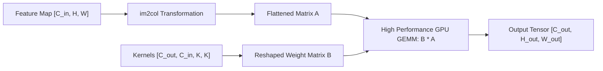

#### d. Code Thực chiến (C++ & Python)

```cpp
// C++17: Thuật toán 2D Convolution cơ bản với kiểm tra biên độ
#include <iostream>
#include <vector>

std::vector<float> conv2d_naive(const std::vector<float>& img, int H, int W,
                                const std::vector<float>& kernel, int K) {
    int pad = K / 2;
    std::vector<float> out(H * W, 0.0f);

    for (int y = 0; y < H; ++y) {
        for (int x = 0; x < W; ++x) {
            float sum = 0.0f;
            for (int ky = -pad; ky <= pad; ++ky) {
                for (int kx = -pad; kx <= pad; ++kx) {
                    int iy = y + ky;
                    int ix = x + kx;
                    if (iy >= 0 && iy < H && ix >= 0 && ix < W) {
                        float pixel = img[iy * W + ix];
                        float weight = kernel[(ky + pad) * K + (kx + pad)];
                        sum += pixel * weight;
                    }
                }
            }
            out[y * W + x] = sum;
        }
    }
    return out;
}

int main() {
    std::vector<float> img(9, 1.0f); // 3x3 ảnh toàn số 1
    std::vector<float> kernel = {0, 0, 0, 0, 1, 0, 0, 0, 0}; // Identity kernel 3x3
    auto res = conv2d_naive(img, 3, 3, kernel, 3);
    std::cout << "Center pixel after Identity Conv: " << res[4] << "\n";
    return 0;
}
```

```python
# Python / PyTorch: Mô phỏng im2col và GEMM Convolution
import torch
import torch.nn.functional as F

x = torch.randn(1, 1, 4, 4) # Input [B, C, H, W]
w = torch.randn(1, 1, 3, 3) # Weight [C_out, C_in, K, K]

# 1. Tích chập chính thống bằng Conv2d
out_conv = F.conv2d(x, w, padding=0)

# 2. Tích chập qua im2col (Unfold) + Matrix Multiplication
x_unfold = F.unfold(x, kernel_size=3) # [1, K*K*C, L]
w_flat = w.view(1, -1) # [C_out, K*K*C]
out_gemm = torch.matmul(w_flat, x_unfold).view_as(out_conv)

print("Difference between Conv2d and im2col GEMM:", torch.norm(out_conv - out_gemm).item())
```

#### e. Lỗi Thường gặp & Ổn định Số học
- **Receptive Field Miscalculation**: Tính sai trường tiếp nhận (Receptive Field) qua các tầng Conv có stride $> 1$ và dilation khiến kích thước đối tượng mục tiêu vượt ra ngoài vùng nhìn của nơ-ron.

#### f. Ứng dụng Thực chiến trong AI
Xương sống của toàn bộ họ mạng CNN (LeNet, AlexNet, VGG, ResNet, ConvNeXt).

---

### 11. Edge Detection (Phát hiện Biên cạnh)

#### a. Định nghĩa Bản chất Toán học
Biên cạnh là vị trí có sự biến thiên cường độ sáng đột ngột. Về mặt giải tích, biên cạnh tương ứng với điểm cực trị của đạo hàm bậc nhất hoặc điểm uốn (Zero-crossing) của đạo hàm bậc hai:
1. **Toán tử Gradient bậc nhất (Sobel, Prewitt, Scharr)**:
   $$\nabla \mathbf{I} = \begin{bmatrix} G_x \\ G_y \end{bmatrix} = \begin{bmatrix} \frac{\partial \mathbf{I}}{\partial x} \\ \frac{\partial \mathbf{I}}{\partial y} \end{bmatrix}, \quad \|\nabla \mathbf{I}\| = \sqrt{G_x^2 + G_y^2}, \quad \theta = \arctan\left( \frac{G_y}{G_x} \right)$$
2. **Toán tử Laplace bậc hai**:
   $$\nabla^2 \mathbf{I} = \frac{\partial^2 \mathbf{I}}{\partial x^2} + \frac{\partial^2 \mathbf{I}}{\partial y^2}$$
3. **Giải thuật Canny SOTA (1986)**:
   - Bước 1: Khử nhiễu bằng lọc Gaussian.
   - Bước 2: Tính độ lớn và hướng gradient bằng toán tử Sobel.
   - Bước 3: Triệt tiêu không cực đại (Non-Maximum Suppression - NMS) để làm mỏng đường biên thành 1 pixel.
   - Bước 4: Phân ngưỡng trễ (Hysteresis Thresholding với ngưỡng cao $T_{\text{high}}$ và ngưỡng thấp $T_{\text{low}}$) kết nối các đường biên liên tục.

#### b. Cơ chế Tầng Sâu & Điện toán
- **Non-Maximum Suppression (NMS) Direction Quantization**: Trong thuật toán Canny, hướng gradient $\theta$ được lượng tử hóa thành 4 góc chính: $0^\circ, 45^\circ, 90^\circ, 135^\circ$. Pixel chỉ được giữ lại nếu độ lớn gradient của nó lớn hơn cả hai pixel láng giềng nằm dọc theo hướng gradient.

#### c. Sơ đồ Minh họa (Mermaid Diagram)
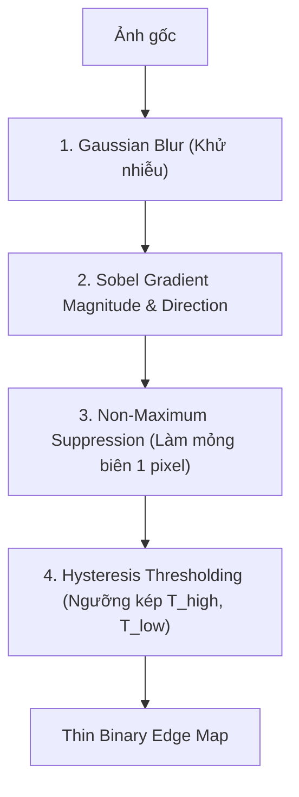

#### d. Code Thực chiến (C++ & Python)

```cpp
// C++17: Tính Độ lớn Gradient Sobel trên CPU
#include <iostream>
#include <vector>
#include <cmath>

void sobel_gradient_magnitude(const std::vector<float>& img, std::vector<float>& mag, int H, int W) {
    mag.assign(H * W, 0.0f);
    for (int y = 1; y < H - 1; ++y) {
        for (int x = 1; x < W - 1; ++x) {
            // Kernel Sobel X: [[-1, 0, 1], [-2, 0, 2], [-1, 0, 1]]
            float gx = -img[(y - 1) * W + (x - 1)] + img[(y - 1) * W + (x + 1)]
                       -2.0f * img[y * W + (x - 1)] + 2.0f * img[y * W + (x + 1)]
                       -img[(y + 1) * W + (x - 1)] + img[(y + 1) * W + (x + 1)];

            // Kernel Sobel Y: [[-1, -2, -1], [0, 0, 0], [1, 2, 1]]
            float gy = -img[(y - 1) * W + (x - 1)] - 2.0f * img[(y - 1) * W + x] - img[(y - 1) * W + (x + 1)]
                       +img[(y + 1) * W + (x - 1)] + 2.0f * img[(y + 1) * W + x] + img[(y + 1) * W + (x + 1)];

            mag[y * W + x] = std::sqrt(gx * gx + gy * gy);
        }
    }
}

int main() {
    std::vector<float> dummy(25, 0.0f);
    // Tạo cạnh thẳng đứng: nửa trái bằng 0, nửa phải bằng 100
    for (int y = 0; y < 5; ++y) for (int x = 2; x < 5; ++x) dummy[y * 5 + x] = 100.0f;

    std::vector<float> edges;
    sobel_gradient_magnitude(dummy, edges, 5, 5);
    std::cout << "Detected Edge Magnitude at center: " << edges[12] << "\n";
    return 0;
}
```

```python
# Python: Canny Edge Detection với OpenCV
import numpy as np

def mock_hysteresis_thresholding(edge_candidates: np.ndarray, low_th: float, high_th: float) -> np.ndarray:
    # 2: Strong edge, 1: Weak edge, 0: Non-edge
    strong = edge_candidates >= high_th
    weak = (edge_candidates >= low_th) & (edge_candidates < high_th)
    return strong.astype(np.uint8) * 255

dummy_edges = np.array([[10, 50, 120], [20, 80, 200]], dtype=np.float32)
print("Binary Edges:\n", mock_hysteresis_thresholding(dummy_edges, low_th=60, high_th=100))
```

#### e. Lỗi Thường gặp & Ổn định Số học
- Nhạy cảm cao với nhiễu ngẫu nhiên: Đạo hàm hoạt động như một bộ lọc thông cao (High-pass filter), làm khuếch đại nhiễu trắng nếu không làm mượt kỹ lưỡng trước đó.

#### f. Ứng dụng Thực chiến trong AI
Nhận dạng đường viền vật thể, trích xuất cấu trúc hình học cho thuật toán SLAM, tiền xử lý trong bài toán phân tích ảnh X-quang y tế.

---

### 12. Thresholding (Phân ngưỡng Nhị phân)

#### a. Định nghĩa Bản chất Toán học
Phân ngưỡng nhị phân chuyển đổi ảnh mức xám $I(x, y)$ thành ảnh nhị phân $B(x, y) \in \{0, 255\}$ dựa trên giá trị ngưỡng $T$:
$$B(x, y) = \begin{cases} 255 & \text{nếu } I(x, y) \ge T \\ 0 & \text{nếu } I(x, y) < T \end{cases}$$
Thuật toán phân ngưỡng toàn cục kinh điển: **Thuật toán Otsu (1979)**.
Otsu tìm ngưỡng tối ưu $T^*$ bằng cách cực đại hóa phương sai giữa các lớp (Between-Class Variance $\sigma_B^2$):
$$T^* = \arg\max_{T} \sigma_B^2(T) = \arg\max_{T} \omega_0(T) \omega_1(T) \left( \mu_0(T) - \mu_1(T) \right)^2$$
với $\omega_0, \omega_1$ là xác suất của hai lớp nền và tiền cảnh, $\mu_0, \mu_1$ là giá trị trung bình mức xám của từng lớp.

#### b. Cơ chế Tầng Sâu & Điện toán
- **Adaptive / Local Thresholding (Phân ngưỡng Thích nghi)**: Khi ảnh bị chiếu sáng không đều (e.g. tài liệu bị bóng râm che một góc), ngưỡng đơn $T$ toàn cục sẽ làm mất chữ. Phân ngưỡng thích nghi tính ngưỡng cục bộ $T(x, y)$ riêng cho từng pixel bằng giá trị trung bình có trọng số Gaussian của vùng lân cận $k \times k$ trừ đi hằng số $C$:
  $$T(x, y) = \text{Mean}_{\mathcal{N}(x, y)} - C$$

#### c. Sơ đồ Minh họa (Mermaid Diagram)
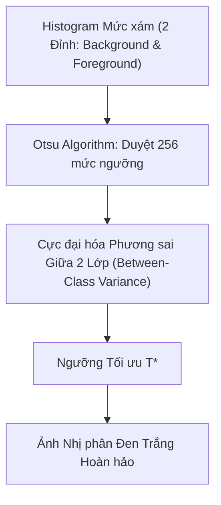

#### d. Code Thực chiến (C++ & Python)

```cpp
// C++17: Thuật toán Otsu Thresholding tìm ngưỡng phân tách tối ưu
#include <iostream>
#include <vector>
#include <numeric>

int compute_otsu_threshold(const std::vector<unsigned char>& img) {
    std::vector<int> hist(256, 0);
    for (unsigned char p : img) hist[p]++;

    int total = img.size();
    float sum_all = 0.0f;
    for (int t = 0; t < 256; ++t) sum_all += t * hist[t];

    float sum_b = 0.0f;
    int w_b = 0;
    float max_var = 0.0f;
    int best_th = 0;

    for (int t = 0; t < 256; ++t) {
        w_b += hist[t];
        if (w_b == 0) continue;
        int w_f = total - w_b;
        if (w_f == 0) break;

        sum_b += t * hist[t];
        float m_b = sum_b / w_b;
        float m_f = (sum_all - sum_b) / w_f;

        float var_between = static_cast<float>(w_b) * w_f * (m_b - m_f) * (m_b - m_f);
        if (var_between > max_var) {
            max_var = var_between;
            best_th = t;
        }
    }
    return best_th;
}

int main() {
    std::vector<unsigned char> test_img = {10, 15, 20, 200, 210, 220};
    std::cout << "Optimal Otsu Threshold: " << compute_otsu_threshold(test_img) << "\n";
    return 0;
}
```

```python
# Python: Adaptive Mean Thresholding
import numpy as np

def adaptive_mean_threshold(img_gray: np.ndarray, block_size: int = 3, C: int = 5) -> np.ndarray:
    pad = block_size // 2
    padded = np.pad(img_gray, pad, mode='reflect')
    out = np.zeros_like(img_gray)
    H, W = img_gray.shape

    for y in range(H):
        for x in range(W):
            local_region = padded[y:y+block_size, x:x+block_size]
            local_threshold = np.mean(local_region) - C
            out[y, x] = 255 if img_gray[y, x] >= local_threshold else 0
    return out

dummy = np.array([[10, 20, 30], [40, 50, 60], [70, 80, 90]], dtype=np.uint8)
print("Adaptive Thresholding Result:\n", adaptive_mean_threshold(dummy, block_size=3, C=2))
```

#### e. Lỗi Thường gặp & Ổn định Số học
- Biểu đồ tần suất không có hai đỉnh rõ ràng (Unimodal distribution) khiến thuật toán Otsu chọn sai điểm chia cắt ở giữa phân phối.

#### f. Ứng dụng Thực chiến trong AI
Tách nền trong hệ thống quét mã vạch / QR Code, số hóa văn bản cổ và phân đoạn tế bào trong ảnh kính hiển vi sinh học.

---

### 13. Morphological Operations (Các Toán tử Hình thái học)

#### a. Định nghĩa Bản chất Toán học
Hình thái học toán học (Mathematical Morphology) là lý thuyết xử lý cấu trúc hình học dựa trên đại số tập hợp và lý thuyết giàn (Lattice Theory). Hai phép toán cơ sở với phần tử cấu trúc (Structuring Element - $\mathbf{B}$):
1. **Phép Co (Erosion $\ominus$)**: Thu nhỏ kích thước đối tượng, bào mòn các chi tiết nhỏ:
   $$(\mathbf{A} \ominus \mathbf{B})(x, y) = \min_{(u, v) \in \mathbf{B}} \mathbf{A}(x + u, y + v)$$
2. **Phép Giãn (Dilation $\oplus$)**: Phóng to kích thước đối tượng, lấp đầy các khoảng trống:
   $$(\mathbf{A} \oplus \mathbf{B})(x, y) = \max_{(u, v) \in \mathbf{B}} \mathbf{A}(x - u, y - v)$$
Các toán tử phái sinh:
- **Opening ($\circ$)**: Co trước, giãn sau $\mathbf{A} \circ \mathbf{B} = (\mathbf{A} \ominus \mathbf{B}) \oplus \mathbf{B}$ (Loại bỏ nhiễu trắng nhỏ ngoài nền mà không đổi kích thước đối tượng).
- **Closing ($\bullet$)**: Giãn trước, co sau $\mathbf{A} \bullet \mathbf{B} = (\mathbf{A} \oplus \mathbf{B}) \ominus \mathbf{B}$ (Lấp đầy các lỗ thủng đen bên trong đối tượng).

#### b. Cơ chế Tầng Sâu & Điện toán
- **Min/Max Reduction across Sliding Windows**: Trong xử lý ảnh mức xám (Grayscale Morphology), Erosion và Dilation tương đương với phép toán Max-Pooling và Min-Pooling trong mạng nơ-ron sâu. Trên GPU, các thao tác này được thực thi bằng tập lệnh so sánh phần cứng nhanh (Intrinsic min/max instructions `__vmin_s32`, `__vmax_s32`).

#### c. Sơ đồ Minh họa (Mermaid Diagram)
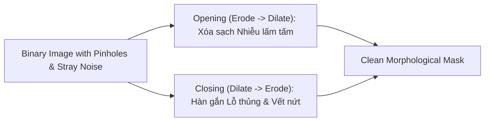

#### d. Code Thực chiến (C++ & Python)

```cpp
// C++17: Phép Co Erosion Nhị phân với Kernel Chữ thập 3x3
#include <iostream>
#include <vector>

void binary_erosion_cross3x3(const std::vector<unsigned char>& src, std::vector<unsigned char>& dst, int H, int W) {
    dst.assign(H * W, 0);
    for (int y = 1; y < H - 1; ++y) {
        for (int x = 1; x < W - 1; ++x) {
            // Phần tử cấu trúc chữ thập: tâm và 4 hướng lân cận đều phải bằng 255
            bool all_match = (src[y * W + x] == 255) &&
                             (src[(y - 1) * W + x] == 255) &&
                             (src[(y + 1) * W + x] == 255) &&
                             (src[y * W + (x - 1)] == 255) &&
                             (src[y * W + (x + 1)] == 255);
            dst[y * W + x] = all_match ? 255 : 0;
        }
    }
}

int main() {
    std::vector<unsigned char> img(9, 255); // 3x3 trắng
    img[0] = 0; // Một góc bị đen
    std::vector<unsigned char> eroded;
    binary_erosion_cross3x3(img, eroded, 3, 3);
    std::cout << "Center pixel after erosion: " << static_cast<int>(eroded[4]) << "\n";
    return 0;
}
```

```python
# Python / PyTorch: Morphological Dilation qua MaxPool2d
import torch
import torch.nn as nn

class MorphologicalDilation2D(nn.Module):
    def __init__(self, kernel_size: int = 3):
        super().__init__()
        # Phép giãn hình thái học trên ảnh nhị phân tương đương MaxPool2d
        self.max_pool = nn.MaxPool2d(kernel_size=kernel_size, stride=1, padding=kernel_size // 2)

    def forward(self, binary_tensor: torch.Tensor) -> torch.Tensor:
        return self.max_pool(binary_tensor)

dilation = MorphologicalDilation2D(kernel_size=3)
mask = torch.zeros(1, 1, 5, 5)
mask[0, 0, 2, 2] = 1.0 # 1 điểm trắng ở tâm
dilated_mask = dilation(mask)
print("Dilated Nonzero Count (from 1 to 9 pixels):", torch.count_nonzero(dilated_mask).item())
```

#### e. Lỗi Thường gặp & Ổn định Số học
- Lựa chọn kích thước Structuring Element quá lớn khiến các ký tự văn bản dính chùm vào nhau (trong bài toán OCR) hoặc làm đứt gãy các đường mảnh.

#### f. Ứng dụng Thực chiến trong AI
Xóa vết ố tài liệu (Document Despeckling), trích xuất khung xương đối tượng (Skeletonization), làm mịn mặt nạ phân đoạn (Segmentation Mask Post-processing).

---

### 14. Image Registration (Căn chỉnh Hình học Ảnh)

#### a. Định nghĩa Bản chất Toán học
Căn chỉnh ảnh là quá trình biến đổi hình học đưa hai bức ảnh chụp ở các thời điểm, góc nhìn hoặc thiết bị cảm biến khác nhau (Source $\mathbf{I}_S$ và Target $\mathbf{I}_T$) về cùng một hệ quy chiếu tọa độ chung:
$$\mathbf{p}' = \mathcal{T}(\mathbf{p}; \theta) = \mathbf{H} \begin{bmatrix} x \\ y \\ 1 \end{bmatrix}$$
Các lớp biến đổi hình học phân cấp:
1. **Rigid Transformation (Biến đổi rắn - 3 DoF)**: Quay và tịnh tiến (Euclidean Distance bảo toàn).
2. **Affine Transformation (Biến đổi Affine - 6 DoF)**: Giữ tính song song của các đường thẳng (Quay, tỉ lệ, trượt, tịnh tiến).
3. **Homography / Projective Transformation (Biến đổi Xạ ảnh - 8 DoF)**: Ma trận $\mathbf{H} \in \mathbb{R}^{3 \times 3}$ mô tả phép chiếu phối cảnh giữa hai mặt phẳng bất kỳ.

#### b. Cơ chế Tầng Sâu & Điện toán
- **Direct Linear Transformation (DLT) Algorithm**: Với tối thiểu 4 cặp điểm tương ứng không đồng tuyến $(x_i, y_i) \leftrightarrow (x'_i, y'_i)$, thuật toán DLT thiết lập hệ phương trình $\mathbf{A} \mathbf{h} = 0$. Nghiệm ma trận $\mathbf{H}$ được giải thông qua vector kỳ dị tương ứng với giá trị kỳ dị nhỏ nhất của $\mathbf{A}$ bằng phân rã SVD trên CPU/GPU.

#### c. Sơ đồ Minh họa (Mermaid Diagram)
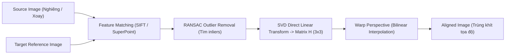

#### d. Code Thực chiến (C++ & Python)

```cpp
// C++17: Áp dụng Ma trận Homography 3x3 lên Tọa độ Điểm 2D
#include <iostream>
#include <vector>

struct Point2D { float x, y; };

Point2D apply_homography(const Point2D& p, const std::vector<float>& H) {
    // H là ma trận 3x3 mảng phẳng: H[0...8]
    float x_prime = H[0] * p.x + H[1] * p.y + H[2];
    float y_prime = H[3] * p.x + H[4] * p.y + H[5];
    float z_prime = H[6] * p.x + H[7] * p.y + H[8];

    // Chuẩn hóa tọa độ thuần nhất (Homogeneous normalization)
    return { x_prime / (z_prime + 1e-9f), y_prime / (z_prime + 1e-9f) };
}

int main() {
    // Ma trận tịnh tiến dx=10, dy=20
    std::vector<float> H_trans = {1, 0, 10, 0, 1, 20, 0, 0, 1};
    Point2D p{5.0f, 5.0f};
    auto p_out = apply_homography(p, H_trans);
    std::cout << "Transformed Point: (" << p_out.x << ", " << p_out.y << ")\n";
    return 0;
}
```

```python
# Python: Tính ma trận Homography và Warp bằng OpenCV logic
import numpy as np

def compute_affine_transform_2d(src_pts: np.ndarray, dst_pts: np.ndarray) -> np.ndarray:
    # src_pts, dst_pts: [3, 2] -> Tối thiểu 3 cặp điểm cho Affine 6 DoF
    # Thiết lập hệ phương trình Ax = b
    A = []
    b = []
    for i in range(3):
        x, y = src_pts[i]
        u, v = dst_pts[i]
        A.append([x, y, 1, 0, 0, 0])
        A.append([0, 0, 0, x, y, 1])
        b.extend([u, v])
    affine_params = np.linalg.solve(A, b)
    return affine_params.reshape(2, 3)

pts1 = np.array([[0, 0], [1, 0], [0, 1]], dtype=np.float32)
pts2 = np.array([[10, 20], [11, 20], [10, 21]], dtype=np.float32)
M = compute_affine_transform_2d(pts1, pts2)
print("Computed Affine Matrix (Translation dx=10, dy=20):\n", M)
```

#### e. Lỗi Thường gặp & Ổn định Số học
- **Perspective Vanishing Singularity**: Khi mẫu số $z' = H_{20} x + H_{21} y + H_{22} \to 0$, điểm tọa độ bị bắn ra vô cực (Infinity), gây tràn số và ném ra ngoại lệ chia cho 0 nếu không kiểm tra ngưỡng an toàn.

#### f. Ứng dụng Thực chiến trong AI
Ghép ảnh toàn cảnh Panorama (Image Stitching), căn chỉnh ảnh vệ tinh đa thời gian và chụp ảnh HDR phơi sáng kép.
