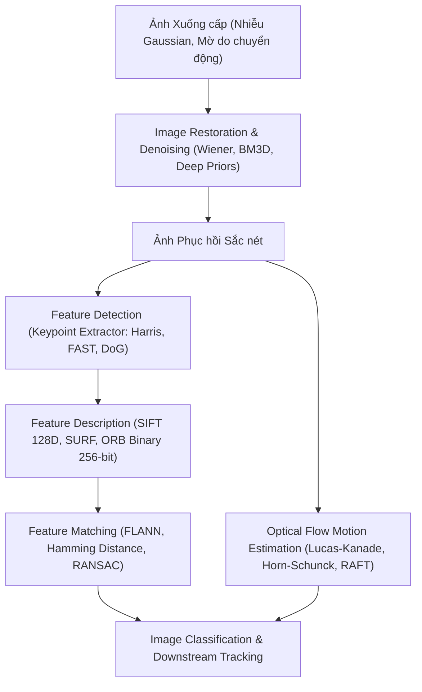
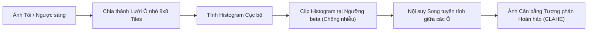
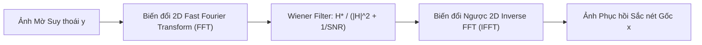
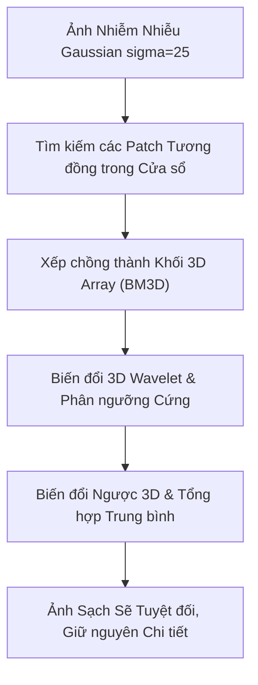
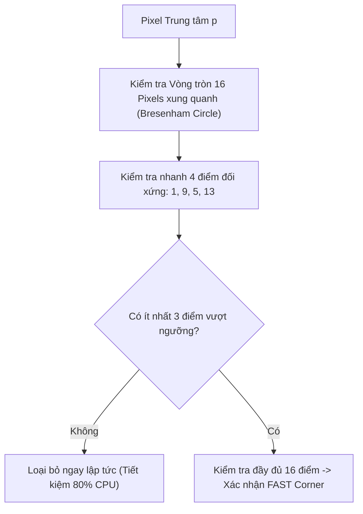
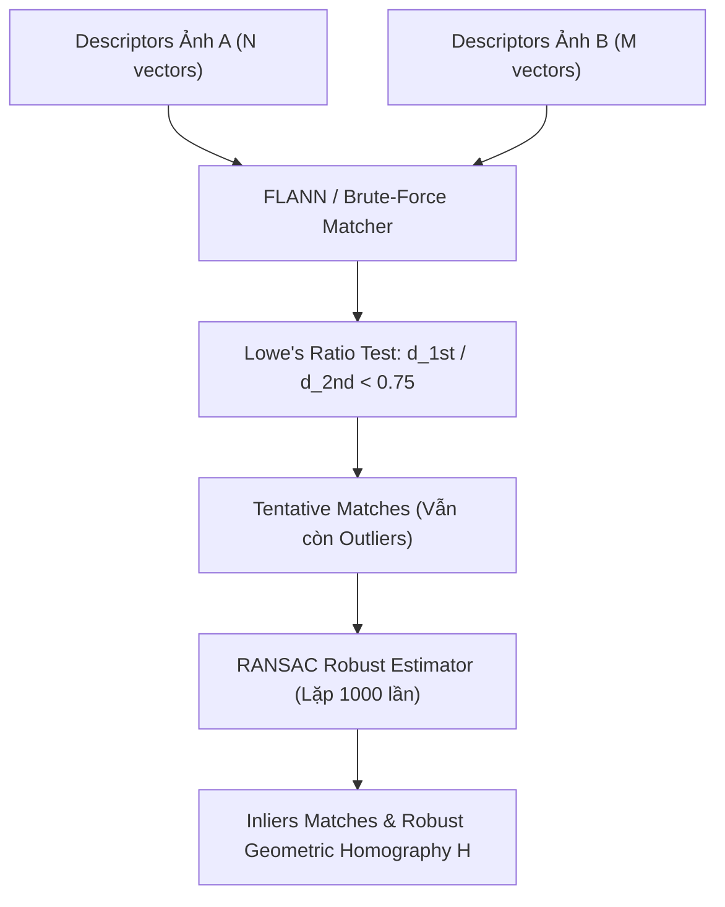
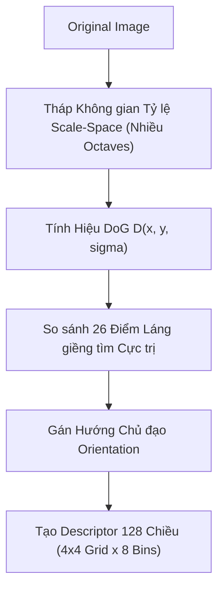
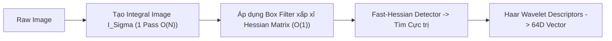
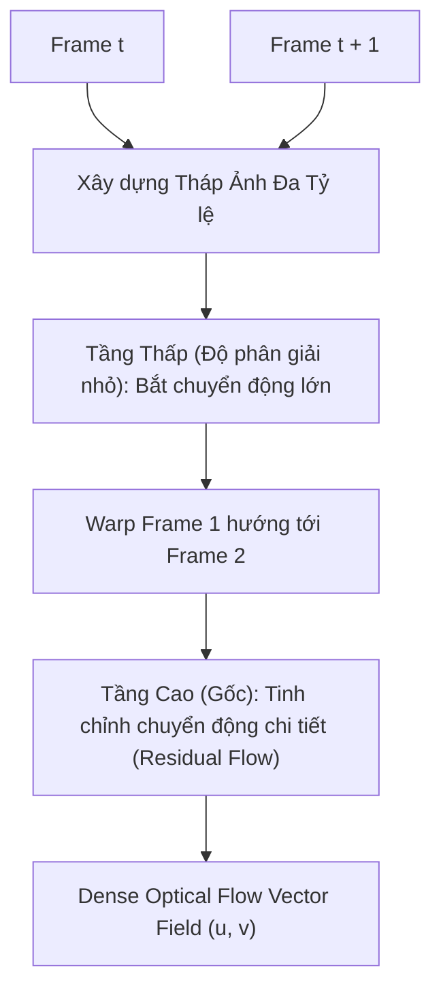

# Chuyên đề: Phục hồi Ảnh, Điểm đặc trưng & Quang thông (Restoration, Features & Optical Flow)

## 1. Tổng quan Chuyên đề
Để hệ thống AI thị giác có thể hoạt động bền bỉ trong môi trường thực tế với điều kiện ánh sáng khắc nghiệt, sương mù, mờ nhòe quang học hoặc nhiễu cảm biến, pipeline thị giác phải thực hiện các tác vụ tăng cường chất lượng (Image Enhancement) và phục hồi tín hiệu nguyên bản (Image Restoration & Denoising).

Tiếp nối sau bước phục hồi là nhiệm vụ trích xuất các điểm đặc trưng hình học bất biến (Feature Detection & Matching). Trước kỷ nguyên Deep Learning, các giải thuật toán học kinh điển như SIFT (Scale-Invariant Feature Transform), SURF (Speeded-Up Robust Features) và ORB (Oriented FAST and Rotated BRIEF) là tiêu chuẩn vàng định hình việc theo dõi chuyển động (Optical Flow) và phân loại hình ảnh (Image Classification).



---

## 2. Chi tiết từng Keyword

---

### 1. Image Enhancement (Tăng cường Chất lượng Ảnh)

#### a. Định nghĩa Bản chất Toán học (Mathematical Formulation)
Tăng cường ảnh cải thiện chất lượng cảm nhận thị giác của con người hoặc làm nổi bật các đặc trưng phục vụ thuật toán nhận dạng mà không nhất thiết phải khôi phục chính xác tín hiệu vật lý ban đầu:
$$\mathbf{I}_{\text{enhanced}} = \mathcal{E}(\mathbf{I}_{\text{input}})$$
Các phép biến đổi phi tuyến tính tiêu chuẩn:
1. **Phép hiệu chỉnh Gamma (Power-Law / Gamma Correction)**:
   $$s = c \cdot r^\gamma \quad (\gamma < 1: \text{ Làm sáng vùng tối; } \gamma > 1: \text{ Kéo tối vùng sáng})$$
2. **Cân bằng Histogram Thích nghi Giới hạn Độ tương phản (CLAHE - Contrast Limited Adaptive Histogram Equalization)**: Chia ảnh thành các ô lưới nhỏ (tiles), cân bằng histogram cục bộ và cắt tỉa (clipping) tại ngưỡng $\beta$ để ngăn chặn việc khuếch đại nhiễu ở các vùng đồng nhất.

#### b. Cơ chế Tầng Sâu & Điện toán (Under The Hood / Hardware Internals)
- **Bilinear Tile Interpolation trong CLAHE**: Để loại bỏ ranh giới đường vân nhân tạo giữa các ô lưới lân cận, giá trị pixel được tính toán bằng phép nội suy song tuyến tính giữa 4 hàm phân phối tích lũy (CDF) của 4 ô lưới xung quanh. Phép toán này tận dụng tối đa các đơn vị Texture Mapping Units (TMUs) trên GPU.

#### c. Sơ đồ Minh họa (Mermaid Diagram)


#### d. Code Thực chiến (C++ & Python)

```cpp
// C++17: Hiệu chỉnh Gamma nhanh bằng Bảng Tra cứu Cố định (256-entry Lookup Table)
#include <iostream>
#include <vector>
#include <cmath>

class FastGammaCorrection {
private:
    unsigned char lut_[256];
public:
    explicit FastGammaCorrection(float gamma) {
        for (int i = 0; i < 256; ++i) {
            float norm = i / 255.0f;
            float corrected = std::pow(norm, gamma) * 255.0f;
            lut_[i] = static_cast<unsigned char>(std::round(corrected));
        }
    }

    void apply(unsigned char* data, size_t size) {
        // Tra cứu O(1) nằm trọn trong L1 Data Cache
        for (size_t i = 0; i < size; ++i) {
            data[i] = lut_[data[i]];
        }
    }
};

int main() {
    FastGammaCorrection gamma_bright(0.5f); // Làm sáng ảnh
    std::vector<unsigned char> pixels = {0, 64, 128, 255};
    gamma_bright.apply(pixels.data(), pixels.size());
    std::cout << "Original 64 enhanced to: " << static_cast<int>(pixels[1]) << "\n";
    return 0;
}
```

```python
# Python: CLAHE Enhancement với OpenCV Logic
import numpy as np

def apply_gamma_correction(img: np.ndarray, gamma: float = 0.5) -> np.ndarray:
    inv_gamma = 1.0 / gamma
    table = np.array([((i / 255.0) ** inv_gamma) * 255 for i in np.arange(0, 256)]).astype("uint8")
    return table[img]

dummy_dark = np.array([[10, 20], [30, 40]], dtype=np.uint8)
print("Enhanced Brightened Pixels:\n", apply_gamma_correction(dummy_dark, gamma=2.0))
```

#### e. Lỗi Thường gặp & Ổn định Số học
- **Over-enhancement & Halo Effects**: Tăng độ tương phản quá đà sinh ra hiện tượng quầng sáng (Halo artifacts) xung quanh các đường viền sắc nhọn.

#### f. Ứng dụng Thực chiến trong AI
Tăng cường chất lượng camera an ninh ban đêm, tiền xử lý ảnh vệ tinh viễn thám dưới mây mù.

---

### 2. Image Restoration (Phục hồi Ảnh)

#### a. Định nghĩa Bản chất Toán học
Khác với Enhancement mang tính chủ quan, Image Restoration mô hình hóa chính xác quá trình suy thoái vật lý (Degradation Process) và tìm cách đảo ngược nó về ảnh gốc lý tưởng $\mathbf{x}$:
$$\mathbf{y} = (\mathbf{x} * \mathbf{h}) + \mathbf{n}$$
trong đó $\mathbf{h}$ là Hàm lan truyền điểm (Point Spread Function - PSF biểu thị mờ do chuyển động hoặc sai tiêu cự), $*$ là phép tích chập, và $\mathbf{n}$ là nhiễu cộng độc lập.
Trong miền tần số (Fourier Domain):
$$Y(u, v) = X(u, v) \cdot H(u, v) + N(u, v)$$
**Bộ lọc Wiener (Wiener Deconvolution)**: Tìm nghiệm tối ưu cực tiểu hóa sai số bình phương trung bình (MMSE):
$$\hat{X}(u, v) = \left[ \frac{H^*(u, v)}{|H(u, v)|^2 + \frac{S_n(u, v)}{S_x(u, v)}} \right] Y(u, v)$$
với $\frac{S_n}{S_x}$ là nghịch đảo tỷ số tín hiệu trên nhiễu (Inverse Signal-to-Noise Ratio - SNR).

#### b. Cơ chế Tầng Sâu & Điện toán
- **Inverse Filter Singularity**: Phép chia trực tiếp cho $H(u, v)$ trong miền tần số (Inverse Filtering) sẽ sụp đổ khi $|H(u, v)| \to 0$ ở các tần số cao, khiến nhiễu $N(u, v)$ bị khuếch đại hàng triệu lần. Bộ lọc Wiener khắc phục bằng hệ số giảm chấn $\frac{S_n}{S_x}$ ở mẫu số, đảm bảo tính ổn định số học.

#### c. Sơ đồ Minh họa (Mermaid Diagram)


#### d. Code Thực chiến (C++ & Python)

```cpp
// C++17: Công thức Tính Hệ số Bộ lọc Wiener trong Miền Tần số
#include <iostream>
#include <complex>

std::complex<float> compute_wiener_factor(std::complex<float> H, float snr) {
    float k = (snr > 1e-6f) ? (1.0f / snr) : 0.01f;
    float norm_sq = std::norm(H); // |H|^2
    return std::conj(H) / (norm_sq + k);
}

int main() {
    std::complex<float> H_psf(0.1f, 0.2f);
    float snr = 100.0f; // SNR cao (40 dB)
    auto W = compute_wiener_factor(H_psf, snr);
    std::cout << "Wiener Restoration Weight: " << W << "\n";
    return 0;
}
```

```python
# Python: Chuyển đổi Miền Tần số phục hồi ảnh với NumPy FFT
import numpy as np

def wiener_deconvolution_1d(signal: np.ndarray, psf: np.ndarray, snr: float = 100.0) -> np.ndarray:
    S = np.fft.fft(signal)
    H = np.fft.fft(psf, n=len(signal))
    H_conj = np.conj(H)
    K = 1.0 / snr
    W = H_conj / (np.abs(H)**2 + K)
    restored = np.fft.ifft(S * W)
    return np.real(restored)

dummy_sig = np.array([1.0, 2.0, 3.0, 2.0, 1.0])
psf = np.array([0.25, 0.5, 0.25])
print("Wiener Restored Signal:", wiener_deconvolution_1d(dummy_sig, psf))
```

#### e. Lỗi Thường gặp & Ổn định Số học
- **Ringing Artifacts (Hiệu ứng Gợn sóng Gibbs)**: Sự biến thiên đột ngột ở biên ảnh trong miền tần số tạo ra các đường vân sóng song song bao quanh mép ảnh phục hồi nếu không áp dụng cửa sổ làm mịn (Tukey/Hann Window) trước khi FFT.

#### f. Ứng dụng Thực chiến trong AI
Phục hồi ảnh thiên văn vũ trụ (Kính viễn vọng Hubble/James Webb), làm rõ biển số xe bị nhòe chuyển động trong camera giao thông.

---

### 3. Image Denoising (Khử nhiễu Ảnh)

#### a. Định nghĩa Bản chất Toán học
Khử nhiễu ảnh ước lượng ảnh sạch $\mathbf{x}$ từ ảnh quan sát bị nhiễm nhiễu trắng Gaussian (AWGN - Additive White Gaussian Noise):
$$\mathbf{y} = \mathbf{x} + \mathbf{n}, \quad \mathbf{n} \sim \mathcal{N}(0, \sigma^2 \mathbf{I})$$
Các phương pháp tiêu chuẩn:
1. **Total Variation (TV) Regularization (Rudin-Osher-Fatemi - ROF Model)**:
   $$\min_{\mathbf{x}} \frac{1}{2} \|\mathbf{y} - \mathbf{x}\|_2^2 + \lambda \int \|\nabla \mathbf{x}\|_1 dx dy$$
   Khác với chuẩn $L_2$ làm mờ biên, chuẩn $L_1$ trên gradient cho phép đạo hàm bằng 0 ở vùng phẳng nhưng duy trì bước nhảy đột ngột tại biên cạnh.
2. **Non-Local Means (NL-Means)**: Tận dụng tính tự tương đồng (Self-Similarity):
   $$\hat{x}(i) = \frac{\sum_j w(i, j) y(j)}{\sum_j w(i, j)}, \quad w(i, j) = \exp\left( -\frac{\|\mathcal{N}_i - \mathcal{N}_j\|_2^2}{h^2} \right)$$
3. **BM3D (Block-Matching 3D)**: Gom nhóm các patch tương đồng thành mảng 3D và lọc cộng tác trong miền biến đổi (Wavelet/DCT).

#### b. Cơ chế Tầng Sâu & Điện toán
- **Patch-based Search Parallelization**: Trong thuật toán NL-Means, việc tìm kiếm các patch tương đồng đòi hỏi tính toán khoảng cách giữa hàng triệu cặp patch trong cửa sổ tìm kiếm $21 \times 21$. Trên GPU, mỗi thread block xử lý một pixel đích và tính toán khoảng cách patch song song thông qua bộ nhớ chia sẻ Shared Memory.

#### c. Sơ đồ Minh họa (Mermaid Diagram)


#### d. Code Thực chiến (C++ & Python)

```cpp
// C++17: Tính Trọng số Tương đồng Non-Local Means giữa 2 Patch
#include <iostream>
#include <vector>
#include <cmath>

float compute_nlm_weight(const std::vector<float>& patch_a, const std::vector<float>& patch_b, float h_squared) {
    float dist_sq = 0.0f;
    for (size_t i = 0; i < patch_a.size(); ++i) {
        float diff = patch_a[i] - patch_b[i];
        dist_sq += diff * diff;
    }
    return std::exp(-dist_sq / (h_squared + 1e-9f));
}

int main() {
    std::vector<float> p1 = {10.0f, 12.0f, 15.0f};
    std::vector<float> p2 = {11.0f, 12.0f, 14.0f}; // Rất giống nhau
    float weight = compute_nlm_weight(p1, p2, 50.0f);
    std::cout << "NL-Means Similarity Weight: " << weight << "\n";
    return 0;
}
```

```python
# Python / PyTorch: Total Variation Denoising Loss
import torch
import torch.nn as nn

def total_variation_loss(img: torch.Tensor) -> torch.Tensor:
    # img: [Batch, Channel, Height, Width]
    # Tính sai phân bậc nhất theo chiều ngang và dọc
    diff_h = torch.abs(img[:, :, 1:, :] - img[:, :, :-1, :])
    diff_w = torch.abs(img[:, :, :, 1:] - img[:, :, :, :-1])
    return diff_h.sum() + diff_w.sum()

noisy_tensor = torch.randn(1, 1, 64, 64, requires_grad=True)
tv_loss = total_variation_loss(noisy_tensor)
print("Total Variation Loss:", tv_loss.item())
```

#### e. Lỗi Thường gặp & Ổn định Số học
- **Cartooning Effect (Hiệu ứng Tranh hoạt hình)**: Khi tham số điều chuẩn $\lambda$ trong TV Denoising quá lớn, các vùng có vân kết cấu mịn (texture như da người, thảm cỏ) bị san phẳng thành các khối màu đồng nhất giả tạo.

#### f. Ứng dụng Thực chiến trong AI
Xử lý ảnh chụp siêu âm y học, khử hạt trong cảm biến ảnh điện thoại thông minh ở chế độ chụp đêm (Night Mode).

---

### 4. Feature Detection (Phát hiện Điểm Đặc trưng)

#### a. Định nghĩa Bản chất Toán học
Điểm đặc trưng (Keypoint / Interest Point) là những vị trí trên ảnh có sự biến thiên cường độ sáng nổi bật theo **cả hai hướng không gian**.
Toán tử kinh điển: **Harris Corner Detector (1988)**.
Xét sự thay đổi cường độ sáng $E(u, v)$ khi dịch chuyển cửa sổ một khoảng $(u, v)$:
$$E(u, v) \approx \begin{bmatrix} u & v \end{bmatrix} \mathbf{M} \begin{bmatrix} u \\ v \end{bmatrix}, \quad \mathbf{M} = \sum_{(x, y) \in W} w(x, y) \begin{bmatrix} I_x^2 & I_x I_y \\ I_x I_y & I_y^2 \end{bmatrix}$$
với $\mathbf{M}$ là ma trận tự tương quan bậc hai (Structure Tensor).
Phân tích trị riêng của ma trận $\mathbf{M}$ ($\lambda_1, \lambda_2$):
- Nếu $\lambda_1 \approx 0, \lambda_2 \approx 0$: Vùng phẳng (Flat region).
- Nếu $\lambda_1 \gg \lambda_2$ hoặc ngược lại: Cạnh biên (Edge).
- Nếu $\lambda_1, \lambda_2$ đều lớn: Điểm góc (Corner).
Thước đo điểm góc Harris không cần tính trực tiếp trị riêng:
$$R = \det(\mathbf{M}) - k \cdot (\text{trace}(\mathbf{M}))^2 = \lambda_1 \lambda_2 - k (\lambda_1 + \lambda_2)^2 \quad (k \approx 0.04 - 0.06)$$

#### b. Cơ chế Tầng Sâu & Điện toán
- **FAST (Features from Accelerated Segment Test)**: Thuật toán nhận diện điểm góc siêu tốc cho các thiết bị nhúng và robot: Xét vòng tròn gồm 16 pixel xung quanh pixel trung tâm $p$. Điểm $p$ là góc nếu tồn tại ít nhất $N$ pixel liên tiếp (thường $N=9$ hoặc $12$) có cường độ sáng vượt quá $I_p + t$ hoặc thấp hơn $I_p - t$. Cây quyết định ID3 tối ưu hóa việc loại trừ các pixel không phải là góc chỉ sau 2-4 lần kiểm tra.

#### c. Sơ đồ Minh họa (Mermaid Diagram)


#### d. Code Thực chiến (C++ & Python)

```cpp
// C++17: Tính Thước đo Điểm góc Harris Corner Response R
#include <iostream>

float compute_harris_response(float Ixx, float Iyy, float Ixy, float k = 0.04f) {
    float det_M = Ixx * Iyy - Ixy * Ixy;
    float trace_M = Ixx + Iyy;
    return det_M - k * trace_M * trace_M;
}

int main() {
    // Trường hợp điểm góc: Biến thiên mạnh ở cả hai trục
    float R_corner = compute_harris_response(500.0f, 500.0f, 10.0f);
    // Trường hợp cạnh thẳng: Chỉ biến thiên ở một trục
    float R_edge = compute_harris_response(1000.0f, 10.0f, 0.0f);

    std::cout << "Harris Corner Response (Corner): " << R_corner << " (R > 0)\n";
    std::cout << "Harris Corner Response (Edge): " << R_edge << " (R < 0)\n";
    return 0;
}
```

```python
# Python: FAST Corner Detection với OpenCV
import numpy as np

def simple_fast_9_check(circle_pixels: list[int], center_val: int, threshold: int = 20) -> bool:
    # circle_pixels: 16 pixels
    is_brighter = [p > center_val + threshold for p in circle_pixels]
    is_darker = [p < center_val - threshold for p in circle_pixels]

    # Kiểm tra có 9 pixel liên tiếp cùng True không
    doubled_b = is_brighter + is_brighter
    doubled_d = is_darker + is_darker
    for i in range(16):
        if all(doubled_b[i:i+9]) or all(doubled_d[i:i+9]):
            return True
    return False

dummy_circle = [100]*16
dummy_circle[0:9] = [200]*9 # 9 pixels sáng liên tiếp
print("FAST Corner Detected:", simple_fast_9_check(dummy_circle, center_val=100))
```

#### e. Lỗi Thường gặp & Ổn định Số học
- **Scale Instability**: Điểm góc Harris chỉ bất biến với phép quay và phép tịnh tiến, hoàn toàn không bất biến với phép phóng to thu nhỏ (Scale Variant). Cần dùng Scale-Space DoG của SIFT.

#### f. Ứng dụng Thực chiến trong AI
Khởi tạo bản đồ môi trường trong Visual Odometry, định vị camera cho thực tế tăng cường (AR).

---

### 5. Feature Matching (Khớp Điểm Đặc trưng)

#### a. Định nghĩa Bản chất Toán học
Khớp điểm đặc trưng tìm kiếm các cặp điểm tương ứng $\mathbf{p}_A \leftrightarrow \mathbf{p}_B$ giữa hai bức ảnh dựa trên khoảng cách giữa các vector mô tả (Feature Descriptors $\mathbf{d}_A, \mathbf{d}_B \in \mathbb{R}^D$):
1. **L2 Distance (cho SIFT, SURF)**: $\|\mathbf{d}_A - \mathbf{d}_B\|_2$.
2. **Hamming Distance (cho ORB, BRIEF)**: $\sum_{i} \mathbf{d}_A[i] \oplus \mathbf{d}_B[i]$ (Đếm số bit sai khác qua phép XOR).
3. **Lowe's Ratio Test (Quy tắc Tỷ số Lowe)**: Loại bỏ các cặp điểm khớp nhầm nhập nhằng:
   $$\frac{\|\mathbf{d}_A - \mathbf{d}_{B, \text{1st}}\|_2}{\|\mathbf{d}_A - \mathbf{d}_{B, \text{2nd}}\|_2} < \tau \quad (\text{thường chọn } \tau \approx 0.7 - 0.8)$$
4. **RANSAC (Random Sample Consensus)**: Lọc sạch các cặp khớp ngoại lai (Outliers) để ước lượng ma trận hình học Homography hoặc Fundamental Matrix.

#### b. Cơ chế Tầng Sâu & Điện toán
- **FLANN (Fast Library for Approximate Nearest Neighbors)**: Thay vì so khớp vét cạn Brute-Force $\mathcal{O}(M \cdot N \cdot D)$ khiến hệ thống bị đơ, FLANN tổ chức các vector vào nhiều cây k-d ngẫu nhiên (Randomized k-d Trees) hoặc Cụm phân cấp (Hierarchical K-means Tree), giảm độ phức tạp tìm kiếm xuống $\mathcal{O}(M \log N)$.
- **POPCOUNT Instruction**: Trên CPU hiện đại, khoảng cách Hamming giữa hai vector nhị phân 256-bit được tính toán chỉ trong 1 chu kỳ máy nhờ tập lệnh phần cứng `__builtin_popcountll` trên thanh ghi 64-bit.

#### c. Sơ đồ Minh họa (Mermaid Diagram)


#### d. Code Thực chiến (C++ & Python)

```cpp
// C++17: Tính Khoảng cách Hamming 256-bit sử dụng Hardware POPCOUNT
#include <iostream>
#include <vector>
#include <cstdint>

int compute_hamming_distance_256bit(const uint64_t a[4], const uint64_t b[4]) {
    int distance = 0;
    for (int i = 0; i < 4; ++i) {
        // __builtin_popcountll đếm số bit 1 trong thanh ghi 64-bit
        distance += __builtin_popcountll(a[i] ^ b[i]);
    }
    return distance;
}

int main() {
    uint64_t desc1[4] = {0xFFFFFFFFFFFFFFFFULL, 0, 0, 0};
    uint64_t desc2[4] = {0xFFFFFFFFFFFFFFFEULL, 0, 0, 0}; // Sai khác đúng 1 bit cuối
    std::cout << "Hamming Distance: " << compute_hamming_distance_256bit(desc1, desc2) << " bits\n";
    return 0;
}
```

```python
# Python: Lowe's Ratio Test Filtering
def filter_matches_lowe_ratio(matches_knn: list, ratio_threshold: float = 0.75) -> list:
    # matches_knn: list các cặp [best_match, second_best_match]
    good_matches = []
    for m, n in matches_knn:
        if m.distance < ratio_threshold * n.distance:
            good_matches.append(m)
    return good_matches

class MockMatch:
    def __init__(self, dist): self.distance = dist

sample_matches = [[MockMatch(20.0), MockMatch(100.0)], [MockMatch(80.0), MockMatch(90.0)]]
filtered = filter_matches_lowe_ratio(sample_matches)
print(f"Filtered {len(filtered)} confident matches out of {len(sample_matches)}.")
```

#### e. Lỗi Thường gặp & Ổn định Số học
- **Repetitive Texture Ambiguity**: Khi ảnh chụp các bề mặt lặp lại (như gạch lát sàn, hàng rào mắt cáo, cửa sổ tòa nhà chọc trời), tỷ số khoảng cách giữa hàng xóm thứ 1 và thứ 2 luôn xấp xỉ 1.0, khiến Lowe's Ratio Test loại bỏ sạch toàn bộ các điểm đặc trưng.

#### f. Ứng dụng Thực chiến trong AI
Xây dựng mô hình 3D từ nhiều góc chụp (Structure from Motion - SfM), ghép ảnh Panorama, tìm kiếm ảnh tương đồng (Image Retrieval).

---

### 6. SIFT (Scale-Invariant Feature Transform)

#### a. Định nghĩa Bản chất Toán học
SIFT (David Lowe, 1999/2004) là một trong những thuật toán kinh điển vĩ đại nhất của Computer Vision, đạt khả năng **bất biến hoàn toàn với phép vị tự (Scale), phép quay (Rotation) và độ sáng Affine**:
1. **Scale-Space Extrema Detection (Dò Cực trị Không gian Tỷ lệ)**:
   Xây dựng tháp ảnh làm mượt bằng hàm Gaussian $L(x, y, \sigma) = G(x, y, \sigma) * I(x, y)$.
   Tính hiệu hai ảnh Gaussian kế tiếp (Difference-of-Gaussians - DoG):
   $$D(x, y, \sigma) = L(x, y, k\sigma) - L(x, y, \sigma)$$
   Một điểm được chọn là cực trị nếu nó lớn hơn hoặc nhỏ hơn toàn bộ 26 điểm láng giềng xung quanh (8 điểm cùng tầng, 9 điểm tầng trên, 9 điểm tầng dưới).
2. **Accurate Keypoint Localization**: Khai triển Taylor bậc 2 loại bỏ các điểm có độ tương phản thấp hoặc nằm trên cạnh.
3. **Orientation Assignment**: Gán hướng chủ đạo $\theta$ dựa trên biểu đồ hướng gradient trong vùng lân cận.
4. **Keypoint Descriptor**: Chia vùng $16 \times 16$ xung quanh keypoint thành $4 \times 4$ ô lưới nhỏ. Mỗi ô tính biểu đồ gradient 8 hướng $\to 4 \times 4 \times 8 = \mathbf{128\text{ chiều}}$, chuẩn hóa vector $L_2$ để bất biến với chiếu sáng.

#### b. Cơ chế Tầng Sâu & Điện toán
- DoG xấp xỉ toán tử Laplacian of Gaussian (LoG): $\nabla^2 G \approx \frac{\partial G}{\partial \sigma} \approx \frac{G(x, y, k\sigma) - G(x, y, \sigma)}{(k - 1)\sigma}$. Phép trừ ma trận DoG nhanh hơn hàng chục lần so với việc tính toán trực tiếp đạo hàm bậc hai Laplacian.

#### c. Sơ đồ Minh họa (Mermaid Diagram)


#### d. Code Thực chiến (C++ & Python)

```cpp
// C++17: Kiểm tra Cực trị DoG 3D (26 Láng giềng)
#include <iostream>
#include <vector>

bool is_dog_extrema(float val, const std::vector<float>& prev_layer,
                               const std::vector<float>& curr_layer,
                               const std::vector<float>& next_layer, int idx) {
    // val phải lớn hơn tất cả hoặc nhỏ hơn tất cả 26 láng giềng xung quanh
    bool is_max = true;
    bool is_min = true;

    auto check_neighbors = [&](const std::vector<float>& layer, bool check_center) {
        // Trong thực tế duyệt vùng 3x3 quanh idx
        for (int offset : {-1, 0, 1}) {
            if (!check_center && offset == 0) continue;
            float neighbor = layer[idx + offset];
            if (val <= neighbor) is_max = false;
            if (val >= neighbor) is_min = false;
        }
    };

    check_neighbors(curr_layer, false);
    check_neighbors(prev_layer, true);
    check_neighbors(next_layer, true);

    return is_max || is_min;
}

int main() {
    std::vector<float> prev = {1, 2, 1};
    std::vector<float> curr = {2, 10, 2}; // val = 10 ở giữa
    std::vector<float> next = {1, 2, 1};
    std::cout << "Center pixel is DoG Extrema? " 
              << std::boolalpha << is_dog_extrema(10.0f, prev, curr, next, 1) << "\n";
    return 0;
}
```

```python
# Python: SIFT Feature Extraction với OpenCV
import numpy as np

def mock_sift_descriptor_normalization(raw_desc_128d: np.ndarray) -> np.ndarray:
    # Chuẩn hóa L2
    norm = np.linalg.norm(raw_desc_128d)
    desc = raw_desc_128d / (norm + 1e-9)
    # Cắt ngưỡng 0.2 để giảm ảnh hưởng của độ sáng phi tuyến
    desc = np.clip(desc, 0.0, 0.2)
    # Chuẩn hóa L2 lần 2
    return desc / (np.linalg.norm(desc) + 1e-9)

dummy_desc = np.random.rand(128).astype(np.float32)
norm_desc = mock_sift_descriptor_normalization(dummy_desc)
print("SIFT Descriptor Norm:", np.linalg.norm(norm_desc)) # ~1.0
```

#### e. Lỗi Thường gặp & Ổn định Số học
- **Computation Bottleneck**: Tính toán tháp DoG và trích xuất vector 128 chiều tiêu tốn rất nhiều tài nguyên CPU, không đạt tốc độ thời gian thực (Real-time 30FPS) trên các thiết bị di động có cấu hình yếu.

#### f. Ứng dụng Thực chiến trong AI
Xây dựng bản đồ định vị robot (SLAM), nhận dạng vật thể trong hệ thống công nghiệp và ghép ảnh vệ tinh.

---

### 7. SURF (Speeded-Up Robust Features)

#### a. Định nghĩa Bản chất Toán học
SURF (Bay et al., 2006) được thiết kế nhằm tăng tốc độ tính toán của SIFT lên gấp vài lần mà vẫn duy trì độ chính xác tương đương. Hai cải tiến toán học đột phá:
1. **Ảnh Tích phân (Integral Image / Summed-Area Table)**: Cho phép tính tổng cường độ sáng của một vùng chữ nhật bất kỳ chỉ bằng 4 phép truy xuất mảng $O(1)$:
   $$I_{\Sigma}(x, y) = \sum_{i=0}^x \sum_{j=0}^y I(i, j)$$
   $$\text{Sum}(D) = I_{\Sigma}(A) + I_{\Sigma}(D) - I_{\Sigma}(B) - I_{\Sigma}(C)$$
2. **Xấp xỉ Hessian bằng Bộ lọc Hộp (Box Filter Approximation)**: Thay thế đạo hàm bậc hai Gaussian liên tục bằng các khối hình chữ nhật đơn giản $D_{xx}, D_{yy}, D_{xy}$, tính toán trực tiếp qua Integral Image:
   $$\det(\mathcal{H}_{\text{approx}}) = D_{xx} D_{yy} - (0.9 D_{xy})^2$$
Vector mô tả của SURF chỉ gồm **64 chiều** (dựa trên đáp ứng sóng Haar Wavelets), giảm một nửa so với 128 chiều của SIFT.

#### b. Cơ chế Tầng Sâu & Điện toán
- Nhờ Integral Image, kích thước bộ lọc trong không gian tỷ lệ có thể tăng lên tùy ý ($9 \times 9, 15 \times 15, 21 \times 21$) mà **thời gian tính toán không hề tăng lên** ($\mathcal{O}(1)$ time complexity), loại bỏ hoàn toàn việc phải nén ảnh (Downsampling) qua các octave như SIFT.

#### c. Sơ đồ Minh họa (Mermaid Diagram)


#### d. Code Thực chiến (C++ & Python)

```cpp
// C++17: Xây dựng và Truy vấn Ảnh Tích phân (Integral Image) trong O(1)
#include <iostream>
#include <vector>

class IntegralImage {
private:
    int H_, W_;
    std::vector<int> sat_; // Summed Area Table
public:
    IntegralImage(const std::vector<unsigned char>& img, int H, int W) : H_(H), W_(W), sat_((H + 1) * (W + 1), 0) {
        for (int y = 0; y < H; ++y) {
            int row_sum = 0;
            for (int x = 0; x < W; ++x) {
                row_sum += img[y * W + x];
                sat_[(y + 1) * (W + 1) + (x + 1)] = sat_[y * (W + 1) + (x + 1)] + row_sum;
            }
        }
    }

    int query_box_sum(int x0, int y0, int x1, int y1) const {
        // [x0, x1] và [y0, y1] inclusive
        return sat_[(y1 + 1) * (W_ + 1) + (x1 + 1)] - sat_[y0 * (W_ + 1) + (x1 + 1)]
             - sat_[(y1 + 1) * (W_ + 1) + x0]       + sat_[y0 * (W_ + 1) + x0];
    }
};

int main() {
    // Ảnh 2x2: [[1, 2], [3, 4]]
    std::vector<unsigned char> img = {1, 2, 3, 4};
    IntegralImage sat(img, 2, 2);
    std::cout << "Sum of entire 2x2 image: " << sat.query_box_sum(0, 0, 1, 1) << " (Expected: 10)\n";
    return 0;
}
```

```python
# Python: Fast Haar Wavelet 64D Descriptor Concept
import numpy as np

def compute_haar_subgrid_features(dx_responses: np.ndarray, dy_responses: np.ndarray) -> list[float]:
    # 4 giá trị đặc trưng cho mỗi sub-region 4x4: sum(dx), sum(dy), sum(|dx|), sum(|dy|)
    return [
        float(np.sum(dx_responses)),
        float(np.sum(dy_responses)),
        float(np.sum(np.abs(dx_responses))),
        float(np.sum(np.abs(dy_responses)))
    ]

# 16 sub-regions * 4 features = 64D Descriptor
mock_dx = np.random.randn(4, 4)
mock_dy = np.random.randn(4, 4)
print("Sub-region 4D Feature:", compute_haar_subgrid_features(mock_dx, mock_dy))
```

#### e. Lỗi Thường gặp & Ổn định Số học
- **Integer Overflow in Integral Images**: Với ảnh độ phân giải cao ($4000 \times 3000$ pixels), tổng tích lũy pixel có thể vượt quá giới hạn $2^{31} - 1$ của số nguyên 32-bit có dấu (`int32_t`), gây tràn số âm. Bắt buộc phải dùng `uint64_t` hoặc `double`.

#### f. Ứng dụng Thực chiến trong AI
Theo dõi vật thể tốc độ cao, điều khiển tương tác cử chỉ người máy.

---

### 8. ORB (Oriented FAST and Rotated BRIEF)

#### a. Định nghĩa Bản chất Toán học
ORB (Rublee et al., 2011) được phát triển bởi OpenCV Labs như một giải pháp thay thế hoàn hảo miễn phí bản quyền (Open-Source Alternative) cho SIFT/SURF với tốc độ tính toán nhanh hơn **hàng trăm lần**:
1. **Oriented FAST (oFAST)**:
   - Phát hiện điểm góc bằng giải thuật FAST.
   - Gán hướng bằng **Trọng tâm Cường độ sáng (Intensity Centroid)**:
     $$m_{pq} = \sum_{x, y} x^p y^q I(x, y), \quad C = \left( \frac{m_{10}}{m_{00}}, \frac{m_{01}}{m_{00}} \right), \quad \theta = \text{atan2}(m_{01}, m_{10})$$
2. **Rotated BRIEF (rBRIEF)**:
   - BRIEF tạo descriptor nhị phân 256-bit bằng cách so sánh 256 cặp pixel ngẫu nhiên $(p, q)$:
     $$\tau(p, q) = \begin{cases} 1 & \text{nếu } I(p) < I(q) \\ 0 & \text{ngược lại} \end{cases}$$
   - rBRIEF xoay các tọa độ thử nghiệm theo góc chủ đạo $\theta$ thông qua ma trận quay $\mathbf{R}_\theta$:
     $$\mathbf{S}_\theta = \mathbf{R}_\theta \mathbf{S}$$
   - Chọn ra 256 cặp thử nghiệm có phương sai cao nhất và độ tương quan thấp nhất bằng thuật toán Greedy Search.

#### b. Cơ chế Tầng Sâu & Điện toán
- **Zero Floating-Point Operations**: Vector mô tả của ORB hoàn toàn là chuỗi nhị phân 32 bytes (256 bits). Phép so khớp giữa hai điểm đặc trưng không sử dụng bất kỳ phép toán dấu phẩy động (FLOP) nào mà chỉ dùng phép toán logic XOR và lệnh đếm bit POPCOUNT, cho phép chạy thời gian thực trên vi điều khiển ARM Cortex-M hoặc Raspberry Pi.

#### c. Sơ đồ Minh họa (Mermaid Diagram)


#### d. Code Thực chiến (C++ & Python)

```cpp
// C++17: Tính Góc Hướng Chủ đạo Intensity Centroid của ORB
#include <iostream>
#include <vector>
#include <cmath>

float compute_intensity_centroid_angle(const std::vector<unsigned char>& patch, int radius) {
    int m10 = 0, m01 = 0;
    int size = 2 * radius + 1;

    for (int y = -radius; y <= radius; ++y) {
        for (int x = -radius; x <= radius; ++x) {
            if (x * x + y * y <= radius * radius) {
                int val = patch[(y + radius) * size + (x + radius)];
                m10 += x * val;
                m01 += y * val;
            }
        }
    }
    return std::atan2(static_cast<float>(m01), static_cast<float>(m10));
}

int main() {
    int r = 2;
    // Giả lập patch 5x5: Nửa trên tối màu, nửa dưới sáng màu (m01 > 0)
    std::vector<unsigned char> patch(25, 10);
    for (int y = 3; y < 5; ++y) for (int x = 0; x < 5; ++x) patch[y * 5 + x] = 200;

    float angle_rad = compute_intensity_centroid_angle(patch, r);
    std::cout << "Centroid Angle: " << (angle_rad * 180.0f / 3.14159f) << " degrees\n";
    return 0;
}
```

```python
# Python: So khớp ORB Descriptors bằng Brute-Force Hamming Distance
import numpy as np

def hamming_distance(desc1: np.ndarray, desc2: np.ndarray) -> int:
    # desc1, desc2: uint8 mảng 32 bytes (256 bits)
    xor_result = np.bitwise_xor(desc1, desc2)
    # Đếm số bit 1
    return int(np.unpackbits(xor_result).sum())

d1 = np.zeros(32, dtype=np.uint8)
d2 = np.zeros(32, dtype=np.uint8)
d2[0] = 0b00000111 # Sai khác 3 bits
print("Hamming Distance:", hamming_distance(d1, d2))
```

#### e. Lỗi Thường gặp & Ổn định Số học
- **Scale Invariance Limitations**: Dù sử dụng tháp ảnh đa tỷ lệ (Image Pyramids), khả năng chống chịu phóng to/thu nhỏ của ORB vẫn kém hơn SIFT khi hệ số tỷ lệ vượt quá $2.0\times$.

#### f. Ứng dụng Thực chiến trong AI
Thuật toán nền tảng trong hệ thống ORB-SLAM3 (Visual SLAM số 1 thế giới cho Drone và kính thực tế ảo Meta Quest).

---

### 9. Optical Flow (Quang thông / Dòng Thị giác)

#### a. Định nghĩa Bản chất Toán học
Quang thông là trường vận tốc hai chiều biểu diễn chuyển động biểu kiến của các điểm ảnh giữa hai khung hình liên tiếp $I(x, y, t)$ và $I(x + u, y + v, t + \Delta t)$:
$$\mathbf{V}(x, y) = \begin{bmatrix} u(x, y) \\ v(x, y) \end{bmatrix} = \begin{bmatrix} \frac{dx}{dt} \\ \frac{dy}{dt} \end{bmatrix}$$
Dựa trên **Giả định Độ sáng Không đổi (Brightness Constancy Assumption)**:
$$I(x, y, t) = I(x + \Delta x, y + \Delta y, t + \Delta t)$$
Khai triển Taylor bậc 1 dẫn đến **Phương trình Ràng buộc Quang thông (Optical Flow Constraint Equation)**:
$$I_x u + I_y v + I_t = 0 \quad \text{hoặc} \quad \nabla I \cdot \mathbf{V} + I_t = 0$$
Đây là một phương trình với 2 ẩn số $(u, v)$ (Aperture Problem - Vấn đề Khẩu độ). Hai giải thuật kinh điển:
1. **Lucas-Kanade (Cục bộ)**: Giả định các pixel trong cửa sổ lân cận $W$ kích thước $3 \times 3$ có cùng vận tốc. Giải hệ phương trình thừa số bằng bình phương tối thiểu:
   $$\begin{bmatrix} u \\ v \end{bmatrix} = \left( \mathbf{A}^T \mathbf{A} \right)^{-1} \mathbf{A}^T \mathbf{b}, \quad \mathbf{A} = \begin{bmatrix} I_x & I_y \end{bmatrix}, \ \mathbf{b} = -I_t$$
2. **Horn-Schunck (Toàn cục)**: Thêm điều kiện làm mượt toàn cục (Global Smoothness Regularizer):
   $$\min_{u, v} \iint \left( (I_x u + I_y v + I_t)^2 + \alpha^2 (\|\nabla u\|^2 + \|\nabla v\|^2) \right) dx dy$$

#### b. Cơ chế Tầng Sâu & Điện toán
- **Coarse-to-Fine Pyramidal Lucas-Kanade**: Khi chuyển động quá nhanh ($\Delta x > 1$ pixel), khai triển Taylor bậc 1 bị sai lệch hoàn toàn. Hệ thống xây dựng tháp ảnh Gaussian (Image Pyramids). Vận tốc chuyển động được ước lượng ở tầng có độ phân giải thấp nhất trước, sau đó dùng làm điểm bắt đầu (Warp initialization) cho tầng chi tiết hơn.
- **Deep Learning Optical Flow (RAFT - ECCV 2020 Best Paper)**: Trích xuất đặc trưng đa quy mô và tính toán Ma trận Tương quan 4D (All-Pairs 4D Correlation Volume) trên GPU, sau đó cập nhật dòng chảy quang thông bằng mạng hồi quy GRU.

#### c. Sơ đồ Minh họa (Mermaid Diagram)


#### d. Code Thực chiến (C++ & Python)

```cpp
// C++17: Nghiệm Giải tích Lucas-Kanade 2x2 Cục bộ
#include <iostream>

bool solve_lucas_kanade_2x2(float sum_Ix2, float sum_Iy2, float sum_IxIy, 
                            float sum_IxIt, float sum_IyIt, float& u, float& v) {
    // Ma trận A^T * A = [[sum_Ix2, sum_IxIy], [sum_IxIy, sum_Iy2]]
    float det = sum_Ix2 * sum_Iy2 - sum_IxIy * sum_IxIy;
    if (std::abs(det) < 1e-6f) return false; // Ma trận suy biến (Aperture problem)

    // Nghịch đảo 2x2: (A^T * A)^-1 * (-A^T * b)
    u = (-sum_Iy2 * sum_IxIt + sum_IxIy * sum_IyIt) / det;
    v = (sum_IxIy * sum_IxIt - sum_Ix2 * sum_IyIt) / det;
    return true;
}

int main() {
    float u = 0.0f, v = 0.0f;
    bool success = solve_lucas_kanade_2x2(100.0f, 100.0f, 0.0f, -50.0f, -20.0f, u, v);
    std::cout << "Computed Optical Flow: u=" << u << ", v=" << v << "\n";
    return 0;
}
```

```python
# Python / PyTorch: Endpoint Error (EPE) Metric cho Optical Flow
import torch

def compute_endpoint_error(flow_pred: torch.Tensor, flow_gt: torch.Tensor) -> float:
    # flow_pred, flow_gt: [Batch, 2, H, W] -> kênh 0 là u, kênh 1 là v
    diff = flow_pred - flow_gt
    epe_per_pixel = torch.sqrt(torch.sum(diff ** 2, dim=1)) # Euclidean distance
    return epe_per_pixel.mean().item()

pred = torch.tensor([[[[1.0]], [[2.0]]]]) # u=1, v=2
gt = torch.tensor([[[[1.0]], [[1.0]]]])   # u=1, v=1 (Lệch v 1 đơn vị)
print("Optical Flow Average EPE:", compute_endpoint_error(pred, gt))
```

#### e. Lỗi Thường gặp & Ổn định Số học
- **Occlusion Boundaries**: Khi một vật thể di chuyển che khuất nền phía sau, giả định độ sáng không đổi bị phá vỡ hoàn toàn, tạo ra các vector quang thông rác dọc theo đường viền che khuất.

#### f. Ứng dụng Thực chiến trong AI
Ổn định video chống rung quang học (Video Stabilization), ước lượng chuyển động xe tự hành (Ego-motion estimation), nén video chuẩn H.264 / AV1.

---

### 10. Image Classification (Phân loại Hình ảnh)

#### a. Định nghĩa Bản chất Toán học
Phân loại ảnh là bài toán gán toàn bộ bức ảnh đầu vào $\mathbf{x} \in \mathbb{R}^{H \times W \times C}$ vào một nhãn duy nhất $y \in \{1, \dots, K\}$:
$$\hat{y} = \arg\max_{k \in \{1, \dots, K\}} P(y = k \mid \mathbf{x}; \theta) = \arg\max_k \frac{e^{z_k}}{\sum_{j=1}^K e^{z_j}}$$
với $z = f(\mathbf{x}; \theta)$ là đầu ra logits từ mạng học sâu (CNN hoặc ViT).
Bộ dữ liệu chuẩn mực lịch sử: **ImageNet (1.2 triệu ảnh, 1000 lớp)**.
Hàm mất mát huấn luyện: Categorical Cross-Entropy:
$$\mathcal{L}(\theta) = - \sum_{k=1}^K y_k \log \hat{y}_k$$

#### b. Cơ chế Tầng Sâu & Điện toán
- **Global Average Pooling (GAP) vs Flatten FC**: Các mạng nơ-ron cũ (VGG-16) sử dụng các tầng Fully Connected ở cuối với $7 \times 7 \times 512 \times 4096 \approx 100$ triệu tham số (chiếm $80\%$ dung lượng mô hình). Mạng hiện đại (ResNet) thay thế bằng **Global Average Pooling (GAP)** tính trung bình không gian $H \times W \to 1 \times 1$ cho mỗi kênh, giảm hàng trăm triệu tham số và chống overfitting cực mạnh.

#### c. Sơ đồ Minh họa (Mermaid Diagram)


#### d. Code Thực chiến (C++ & Python)

```cpp
// C++17: Global Average Pooling (GAP) trên Tensor phẳng CHW
#include <iostream>
#include <vector>

std::vector<float> global_average_pooling(const std::vector<float>& feature_map, int C, int H, int W) {
    std::vector<float> pooled(C, 0.0f);
    int spatial_size = H * W;

    for (int c = 0; c < C; ++c) {
        float sum = 0.0f;
        int offset = c * spatial_size;
        for (int i = 0; i < spatial_size; ++i) {
            sum += feature_map[offset + i];
        }
        pooled[c] = sum / spatial_size;
    }
    return pooled;
}

int main() {
    // 2 channels, 2x2 spatial
    std::vector<float> feat = {1, 2, 3, 4,  10, 20, 30, 40};
    auto out = global_average_pooling(feat, 2, 2, 2);
    std::cout << "GAP Channel 0: " << out[0] << " | Channel 1: " << out[1] << "\n";
    return 0;
}
```

```python
# Python / PyTorch: Complete Image Classification Head with Label Smoothing
import torch
import torch.nn as nn

class ResNetClassificationHead(nn.Module):
    def __init__(self, in_features: int, num_classes: int):
        super().__init__()
        self.gap = nn.AdaptiveAvgPool2d((1, 1))
        self.fc = nn.Linear(in_features, num_classes)

    def forward(self, x: torch.Tensor) -> torch.Tensor:
        # x: [Batch, Channels, H, W]
        x = self.gap(x)
        x = torch.flatten(x, 1) # [Batch, Channels]
        return self.fc(x)

head = ResNetClassificationHead(in_features=2048, num_classes=1000)
feat_map = torch.randn(2, 2048, 7, 7)
logits = head(feat_map)
print("Classification Logits Shape:", logits.shape) # [2, 1000]
```

#### e. Lỗi Thường gặp & Ổn định Số học
- **Texture Bias of CNNs (Thiên vị Kết cấu)**: Các mạng CNN có xu hướng phân loại dựa trên hoa văn bề mặt (Texture) hơn là hình dáng đối tượng (Shape), ví dụ đưa hoa văn da voi lên thân con mèo thì mạng sẽ đoán là con voi.

#### f. Ứng dụng Thực chiến trong AI
Chẩn đoán bệnh học qua ảnh tế bào ung thư, phân loại rác thải tự động, nhận diện loài sinh vật trong bảo tồn thiên nhiên.
