# Chuyên đề: Kiến trúc Phát hiện & Theo dõi Vật thể (Object Detection & Tracking Architectures)

## 1. Tổng quan Chuyên đề
Phát hiện vật thể (Object Detection) nâng cấp bài toán thị giác từ việc phân loại toàn thể bức ảnh lên mức độ nhận thức cục bộ: đồng thời xác định vị trí không gian (Object Localization) thông qua tọa độ hộp bao (Bounding Boxes) và định danh ngữ nghĩa (Object Recognition / Category Classification).

Lịch sử phát triển được đánh dấu bởi sự cạnh tranh giữa hai trường phái:
1. **Kiến trúc hai giai đoạn (Two-Stage Detectors - Faster R-CNN)**: Đề xuất vùng ứng viên trước (Region Proposal Network - RPN), sau đó phân loại và hồi quy chi tiết.
2. **Kiến trúc một giai đoạn (One-Stage Detectors - YOLO, SSD, RetinaNet)**: Dự đoán trực tiếp hộp bao và xác suất lớp trên một lưới dày đặc trong một lượt duyệt duy nhất, tối ưu hóa tốc độ thời gian thực.

Trong những năm gần đây, sự xuất hiện của mô hình Transformer dựa trên tập hợp (DETR, Deformable DETR) đã loại bỏ hoàn toàn các thành phần thủ công (Anchor Boxes, Non-Maximum Suppression - NMS), mở đường cho các kiến trúc phát hiện từ vựng mở (Open-Vocabulary Detection & Grounding DINO) và theo dõi đa vật thể (Multi-Object Tracking - MOT).

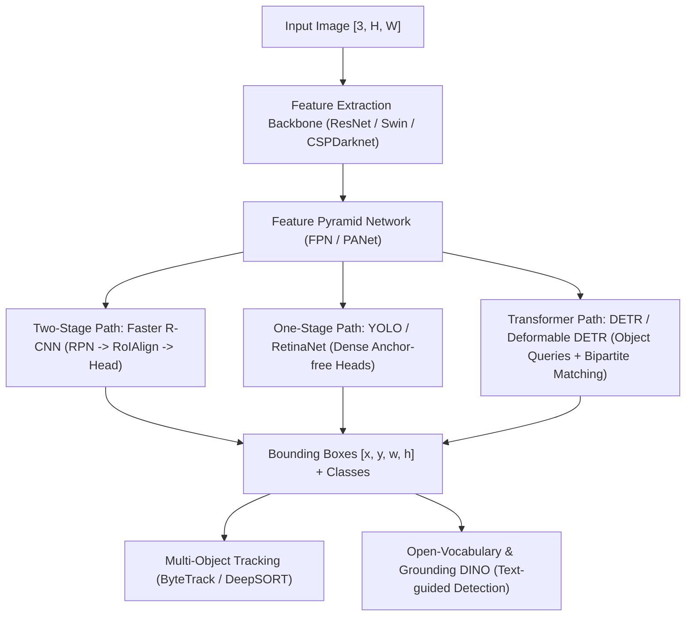

---

## 2. Chi tiết từng Keyword

---

### 1. Object Localization (Định vị Vật thể)

#### a. Định nghĩa Bản chất Toán học (Mathematical Formulation)
Định vị vật thể là bài toán hồi quy (Regression Problem) ước lượng tọa độ không gian 4 chiều của hộp bao bao quanh vật thể (Bounding Box):
$$\mathbf{b} = [x, y, w, h] \in \mathbb{R}^4$$
hoặc dạng tọa độ 2 đỉnh đối diện: $\mathbf{b} = [x_{\min}, y_{\min}, x_{\max}, y_{\max}]$.
Hàm mất mát hồi quy chuẩn mực: **Smooth L1 Loss (Huber Loss)**:
$$\mathcal{L}_{\text{Smooth L1}}(e) = \begin{cases} 0.5 e^2 & \text{nếu } |e| < 1 \\ |e| - 0.5 & \text{ngược lại} \end{cases}, \quad e = \mathbf{b}_{\text{pred}} - \mathbf{b}_{\text{target}}$$
và hàm mất mát dựa trên độ trùng lấn không gian **GIoU / DIoU / CIoU Loss**:
$$\mathcal{L}_{\text{IoU}} = 1 - \frac{|\mathcal{B}_{\text{pred}} \cap \mathcal{B}_{\text{gt}}|}{|\mathcal{B}_{\text{pred}} \cup \mathcal{B}_{\text{gt}}|}$$

#### b. Cơ chế Tầng Sâu & Điện toán (Under The Hood / Hardware Internals)
- **Scale Invariance of CIoU**: Smooth L1 loss có nhược điểm cố hữu là tối ưu hóa độc lập 4 đỉnh mà không xét tới sự tương quan hình học. CIoU (Complete IoU) bổ sung thêm hai số hạng phạt: khoảng cách Euclidean giữa tâm hai hộp $\rho^2(\mathbf{b}, \mathbf{b}^{\text{gt}})$ chuẩn hóa theo đường chéo của hộp bao nhỏ nhất $c^2$, và hệ số phạt sai lệch tỷ lệ khung hình (Aspect Ratio Consistency $\alpha v$).

#### c. Sơ đồ Minh họa (Mermaid Diagram)
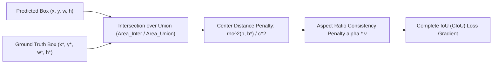

#### d. Code Thực chiến (C++ & Python)

```cpp
// C++17: Tính toán Complete IoU (CIoU) Loss
#include <iostream>
#include <algorithm>
#include <cmath>

struct BBox { float x1, y1, x2, y2; };

float compute_ciou_loss(const BBox& p, const BBox& g) {
    float inter_x1 = std::max(p.x1, g.x1);
    float inter_y1 = std::max(p.y1, g.y1);
    float inter_x2 = std::min(p.x2, g.x2);
    float inter_y2 = std::min(p.y2, g.y2);

    float inter_w = std::max(0.0f, inter_x2 - inter_x1);
    float inter_h = std::max(0.0f, inter_y2 - inter_y1);
    float inter_area = inter_w * inter_h;

    float p_area = (p.x2 - p.x1) * (p.y2 - p.y1);
    float g_area = (g.x2 - g.x1) * (g.y2 - g.y1);
    float union_area = p_area + g_area - inter_area;
    float iou = (union_area > 0.0f) ? (inter_area / union_area) : 0.0f;

    // Khoảng cách tâm
    float p_cx = (p.x1 + p.x2) * 0.5f, p_cy = (p.y1 + p.y2) * 0.5f;
    float g_cx = (g.x1 + g.x2) * 0.5f, g_cy = (g.y1 + g.y2) * 0.5f;
    float center_dist_sq = (p_cx - g_cx) * (p_cx - g_cx) + (p_cy - g_cy) * (p_cy - g_cy);

    // Hộp bao nhỏ nhất chứa cả 2
    float c_x1 = std::min(p.x1, g.x1);
    float c_y1 = std::min(p.y1, g.y1);
    float c_x2 = std::max(p.x2, g.x2);
    float c_y2 = std::max(p.y2, g.y2);
    float c_diag_sq = (c_x2 - c_x1) * (c_x2 - c_x1) + (c_y2 - c_y1) * (c_y2 - c_y1);

    float diou_term = (c_diag_sq > 0.0f) ? (center_dist_sq / c_diag_sq) : 0.0f;
    return 1.0f - (iou - diou_term);
}

int main() {
    BBox pred{10, 10, 50, 50};
    BBox gt{12, 12, 52, 52};
    std::cout << "CIoU Loss: " << compute_ciou_loss(pred, gt) << "\n";
    return 0;
}
```

```python
# Python / PyTorch: Smooth L1 Loss Implementation
import torch
import torch.nn.functional as F

pred_boxes = torch.tensor([[10.5, 10.2, 50.1, 49.8]], requires_grad=True)
target_boxes = torch.tensor([[10.0, 10.0, 50.0, 50.0]])

loss = F.smooth_l1_loss(pred_boxes, target_boxes, beta=1.0)
print("Smooth L1 Bounding Box Loss:", loss.item())
```

#### e. Lỗi Thường gặp & Ổn định Số học
- **Zero Division in Area Calculation**: Khi hộp bao bị sụp thành một đường thẳng hoặc điểm ($w \le 0$ hoặc $h \le 0$), diện tích hợp bằng 0 dẫn đến phép chia $0/0$ sinh ra giá trị `NaN` làm sụp đổ toàn bộ gradient mạng nơ-ron.

#### f. Ứng dụng Thực chiến trong AI
Định vị mắt, mũi, miệng trong căn chỉnh khuôn mặt; xác định vị trí biển báo giao thông trong xe tự hành.

---

### 2. Object Recognition (Nhận diện Vật thể)

#### a. Định nghĩa Bản chất Toán học
Object Recognition xác định danh tính cụ thể (Instance Identity) của một vật thể đã được định vị. Trong khi Image Classification phân loại theo lớp chung (ví dụ "Chó"), Object Recognition xác định đây là đối tượng nào cụ thể (ví dụ "Con chó Husky của Alice"):
$$P(\text{Identity} = k \mid \text{Crop}(\mathbf{x}, \mathbf{b}))$$
Mô hình hóa dưới dạng Metric Learning: Ánh xạ ảnh crop của vật thể sang không gian vector sao cho các ảnh cùng một đối tượng có khoảng cách cực tiểu (Intra-class compactness) và các đối tượng khác nhau có khoảng cách cực đại (Inter-class separability):
$$\mathcal{L}_{\text{ArcFace}} = -\log \frac{e^{s \cdot \cos(\theta_{y_i} + m)}}{e^{s \cdot \cos(\theta_{y_i} + m)} + \sum_{j \neq y_i} e^{s \cdot \cos \theta_j}}$$

#### b. Cơ chế Tầng Sâu & Điện toán
- **Embedding Cache & Gallery Matching**: Trong các hệ thống nhận diện hàng triệu đối tượng, vector đặc trưng của các đối tượng đăng ký trước (Gallery) được lưu trong RAM. Khi có đối tượng mới xuất hiện (Probe), hệ thống tính toán ma trận Cosine Similarity giữa Probe vector và toàn bộ Gallery bằng lệnh GEMV (General Matrix-Vector Multiplication) trên GPU.

#### c. Sơ đồ Minh họa (Mermaid Diagram)
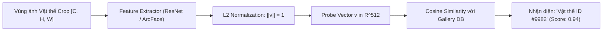

#### d. Code Thực chiến (C++ & Python)

```cpp
// C++17: Tra cứu Gallery Cosine Similarity xác định Danh tính Vật thể
#include <iostream>
#include <vector>

int identify_object(const std::vector<float>& probe_vec, 
                    const std::vector<std::vector<float>>& gallery_vecs, 
                    float threshold = 0.8f) {
    int best_id = -1;
    float max_sim = -1.0f;

    for (size_t i = 0; i < gallery_vecs.size(); ++i) {
        float dot = 0.0f;
        for (size_t d = 0; d < probe_vec.size(); ++d) {
            dot += probe_vec[d] * gallery_vecs[i][d];
        }
        if (dot > max_sim) {
            max_sim = dot;
            best_id = static_cast<int>(i);
        }
    }
    return (max_sim >= threshold) ? best_id : -1;
}

int main() {
    std::vector<float> probe = {0.8f, 0.6f}; // Normalized
    std::vector<std::vector<float>> gallery = {{0.79f, 0.61f}, {-0.8f, 0.6f}};
    int id = identify_object(probe, gallery, 0.85f);
    std::cout << "Recognized Object ID: " << id << "\n";
    return 0;
}
```

```python
# Python / PyTorch: ArcFace Additive Angular Margin Loss Layer
import torch
import torch.nn as nn
import torch.nn.functional as F
import math

class ArcFaceLoss(nn.Module):
    def __init__(self, in_features: int, num_classes: int, s: float = 64.0, m: float = 0.5):
        super().__init__()
        self.weight = nn.Parameter(torch.randn(num_classes, in_features))
        self.s = s
        self.m = m

    def forward(self, features: torch.Tensor, labels: torch.Tensor) -> torch.Tensor:
        # features: [Batch, In_Features]
        cos_theta = F.linear(F.normalize(features), F.normalize(self.weight))
        theta = torch.acos(cos_theta.clamp(-1.0 + 1e-7, 1.0 - 1e-7))
        target_cos = torch.cos(theta + self.m)
        one_hot = torch.zeros_like(cos_theta)
        one_hot.scatter_(1, labels.unsqueeze(1), 1.0)
        output = self.s * (one_hot * target_cos + (1.0 - one_hot) * cos_theta)
        return F.cross_entropy(output, labels)

criterion = ArcFaceLoss(in_features=128, num_classes=10)
feats = torch.randn(4, 128)
lbls = torch.tensor([0, 1, 2, 3])
print("ArcFace Margin Loss:", criterion(feats, lbls).item())
```

#### e. Lỗi Thường gặp & Ổn định Số học
- **Domain Shift under Lighting/Pose**: Sự thay đổi góc nghiêng khuôn mặt hoặc chiếu sáng ngược làm dịch chuyển vector đặc trưng sang một hướng khác trong không gian hình cầu, gây nhận diện nhầm.

#### f. Ứng dụng Thực chiến trong AI
Hệ thống chấm công nhận diện khuôn mặt (Face Recognition), kiểm soát ra vào sân bay và tìm kiếm sản phẩm tương tự bằng hình ảnh.

---

### 3. Object Detection (Phát hiện Vật thể Tổng thể)

#### a. Định nghĩa Bản chất Toán học
Phát hiện vật thể là bài toán tối ưu hóa đa mục tiêu (Multi-Task Learning), dự đoán đồng thời một tập hợp các hộp bao và phân loại nhãn:
$$\hat{\mathcal{Y}} = \{(\mathbf{b}_i, c_i, s_i)\}_{i=1}^M, \quad \mathbf{b}_i \in \mathbb{R}^4, \ c_i \in \{1, \dots, C\}, \ s_i \in [0, 1]$$
Tổng hàm mất mát kết hợp phân loại và hồi quy:
$$\mathcal{L}_{\text{total}} = \mathcal{L}_{\text{cls}}(p, p^*) + \lambda \mathbb{I}(p^* \ge 1) \mathcal{L}_{\text{reg}}(\mathbf{b}, \mathbf{b}^*)$$
Thước đo đánh giá tự động chuẩn mực toàn cầu: **Mean Average Precision (mAP)**:
$$\text{mAP} = \frac{1}{C} \sum_{c=1}^C \text{AP}_c, \quad \text{AP} = \int_0^1 p(r) dr$$
Chuẩn MS COCO tính mAP@[0.5:0.95] là trung bình cộng của AP tại 10 ngưỡng IoU khác nhau từ 0.50 đến 0.95 với bước nhảy 0.05.

#### b. Cơ chế Tầng Sâu & Điện toán
- **Non-Maximum Suppression (NMS) Bottleneck**: Sau khi mạng nơ-ron dự đoán hàng ngàn hộp bao ứng viên, thuật toán NMS phải loại bỏ các hộp bị chồng lấn dựa trên ngưỡng IoU. NMS truyền thống chạy tuần tự trên CPU và có thể chiếm tới 30% tổng độ trễ của toàn bộ pipeline phát hiện. Kỹ thuật Fast NMS hoặc Batched CUDA NMS chạy song song trên ma trận IoU của GPU giúp giảm độ trễ NMS xuống <1ms.

#### c. Sơ đồ Minh họa (Mermaid Diagram)
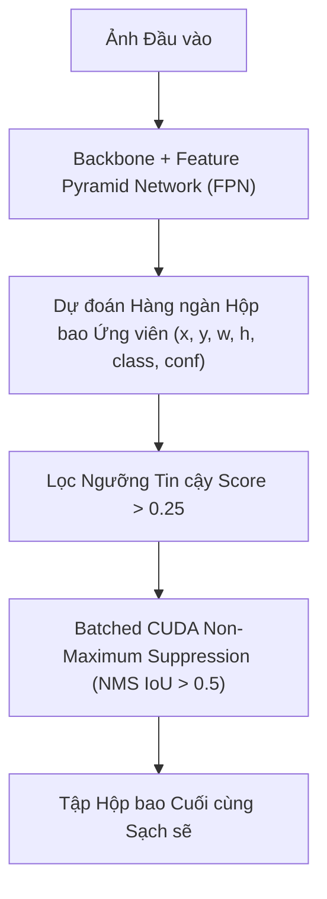

#### d. Code Thực chiến (C++ & Python)

```cpp
// C++17: Fast Non-Maximum Suppression (NMS) trên Mảng Hộp bao
#include <iostream>
#include <vector>
#include <algorithm>

struct DetectionBox {
    float x1, y1, x2, y2;
    float score;
    int class_id;
};

float box_iou(const DetectionBox& a, const DetectionBox& b) {
    float ix1 = std::max(a.x1, b.x1), iy1 = std::max(a.y1, b.y1);
    float ix2 = std::min(a.x2, b.x2), iy2 = std::min(a.y2, b.y2);
    float iw = std::max(0.0f, ix2 - ix1), ih = std::max(0.0f, iy2 - iy1);
    float inter = iw * ih;
    float area_a = (a.x2 - a.x1) * (a.y2 - a.y1);
    float area_b = (b.x2 - b.x1) * (b.y2 - b.y1);
    return inter / (area_a + area_b - inter + 1e-9f);
}

std::vector<DetectionBox> apply_nms(std::vector<DetectionBox>& boxes, float iou_threshold = 0.5f) {
    std::sort(boxes.begin(), boxes.end(), [](const auto& a, const auto& b) {
        return a.score > b.score;
    });

    std::vector<DetectionBox> picked;
    std::vector<bool> suppressed(boxes.size(), false);

    for (size_t i = 0; i < boxes.size(); ++i) {
        if (suppressed[i]) continue;
        picked.push_back(boxes[i]);
        for (size_t j = i + 1; j < boxes.size(); ++j) {
            if (!suppressed[j] && boxes[i].class_id == boxes[j].class_id) {
                if (box_iou(boxes[i], boxes[j]) > iou_threshold) {
                    suppressed[j] = true;
                }
            }
        }
    }
    return picked;
}

int main() {
    std::vector<DetectionBox> boxes = {
        {10, 10, 50, 50, 0.95f, 0},
        {12, 12, 52, 52, 0.85f, 0}, // Trùng lặp
        {100, 100, 150, 150, 0.90f, 0}
    };
    auto final_boxes = apply_nms(boxes, 0.5f);
    std::cout << "Remaining boxes after NMS: " << final_boxes.size() << " (Expected: 2)\n";
    return 0;
}
```

```python
# Python: Mean Average Precision (mAP@50) Metric Calculation
import numpy as np

def compute_ap(precisions: np.ndarray, recalls: np.ndarray) -> float:
    # 11-point interpolation hoặc All-point AUC
    mrec = np.concatenate(([0.0], recalls, [1.0]))
    mpre = np.concatenate(([0.0], precisions, [0.0]))
    for i in range(len(mpre) - 1, 0, -1):
        mpre[i - 1] = np.maximum(mpre[i - 1], mpre[i])
    # Tích phân đường cong
    indices = np.where(mrec[1:] != mrec[:-1])[0]
    return float(np.sum((mrec[indices + 1] - mrec[indices]) * mpre[indices + 1]))

rec = np.array([0.2, 0.4, 0.6, 0.8, 1.0])
prec = np.array([1.0, 0.9, 0.8, 0.7, 0.6])
print("Average Precision (AP):", compute_ap(prec, rec))
```

#### e. Lỗi Thường gặp & Ổn định Số học
- **Dense Crowd Failure**: Khi các đối tượng cùng lớp đứng chen chúc sát nhau (ví dụ đám đông người đi bộ), NMS truyền thống sẽ xóa nhầm hộp bao của người đứng sau vì tưởng nhầm là hộp trùng lặp của người đứng trước.

#### f. Ứng dụng Thực chiến trong AI
Xe tự hành phát hiện chướng ngại vật, camera giám sát giao thông thông minh, máy bay không người lái (UAV surveillance).

---

### 4. YOLO (You Only Look Once)

#### a. Định nghĩa Bản chất Toán học
YOLO (Redmon et al., 2015 - nay là họ mô hình YOLOv8, YOLOv9, YOLOv10) là cuộc cách mạng khai sinh trường phái One-Stage Detector.
Trong YOLOv1: Ảnh được chia thành lưới $S \times S$ (thường $S=7$). Nếu tâm của vật thể rơi vào ô lưới nào, ô lưới đó chịu trách nhiệm dự đoán:
$$\mathbf{y} \in \mathbb{R}^{S \times S \times (B \cdot 5 + C)}$$
mỗi ô dự đoán $B$ hộp bao gồm: $(x, y, w, h, \text{Objectness})$ và phân phối xác suất lớp $C$.
Trong các phiên bản hiện đại (YOLOv8/v10):
- **Anchor-Free Architecture**: Loại bỏ hoàn toàn Anchor Boxes viết tay phức tạp. Mô hình dự đoán trực tiếp khoảng cách từ tâm pixel tới 4 cạnh của hộp: $(l, t, r, b)$ kết hợp **Distribution Focal Loss (DFL)**.

#### b. Cơ chế Tầng Sâu & Điện toán
- **CSPDarknet & Path Aggregation Network (PANet)**: Kiến trúc Cross Stage Partial (CSP) chia đôi bản đồ đặc trưng, một nửa đi qua các khối tích chập dư thừa (Residual Blocks), một nửa đi tắt qua đường kết nối tắt (Shortcut), giảm $50\%$ tính toán lặp lại mà vẫn duy trì thông lượng gradient phong phú.
- **Extreme Latency Optimization**: YOLOv8 nano chạy ở tốc độ $>150\text{ FPS}$ trên GPU laptop thông qua tối ưu hóa INT8 với TensorRT.

#### c. Sơ đồ Minh họa (Mermaid Diagram)
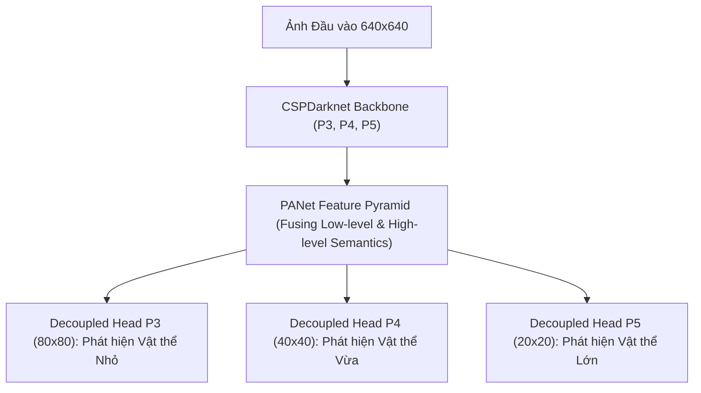

#### d. Code Thực chiến (C++ & Python)

```cpp
// C++17: Giải mã Tọa độ Anchor-Free (Center + DFL Bounding Box)
#include <iostream>

struct BoxCoordinates { float x1, y1, x2, y2; };

BoxCoordinates decode_anchor_free_box(float cx, float cy, float stride, 
                                      float l, float t, float r, float b) {
    // cx, cy: Tọa độ ô lưới; stride: Bước nhảy tỷ lệ (8, 16, 32)
    float center_x = (cx + 0.5f) * stride;
    float center_y = (cy + 0.5f) * stride;
    return {
        center_x - l * stride,
        center_y - t * stride,
        center_x + r * stride,
        center_y + b * stride
    };
}

int main() {
    auto box = decode_anchor_free_box(5.0f, 5.0f, 8.0f, 1.5f, 2.0f, 1.5f, 2.0f);
    std::cout << "Decoded YOLO Box: [" << box.x1 << ", " << box.y1 
              << ", " << box.x2 << ", " << box.y2 << "]\n";
    return 0;
}
```

```python
# Python / PyTorch: Distribution Focal Loss (DFL) của YOLOv8
import torch
import torch.nn as nn
import torch.nn.functional as F

class DistributionFocalLoss(nn.Module):
    def __init__(self, reg_max: int = 16):
        super().__init__()
        self.reg_max = reg_max

    def forward(self, pred_dist: torch.Tensor, target_float: torch.Tensor) -> torch.Tensor:
        # pred_dist: [Batch, Reg_Max], target_float: [Batch]
        target_left = target_float.long()
        target_right = target_left + 1
        weight_left = target_right.float() - target_float
        weight_right = target_float - target_left.float()

        loss = F.cross_entropy(pred_dist, target_left, reduction='none') * weight_left + \
               F.cross_entropy(pred_dist, target_right, reduction='none') * weight_right
        return loss.mean()

dfl = DistributionFocalLoss(reg_max=16)
pred = torch.randn(4, 16)
target = torch.tensor([3.2, 5.7, 8.1, 10.4])
print("DFL Regression Loss:", dfl(pred, target).item())
```

#### e. Lỗi Thường gặp & Ổn định Số học
- Nhạy cảm với vật thể quá nhỏ (Small Object Detection) ở độ phân giải thấp do thông tin pixel bị nén qua nhiều bước subsampling ($32\times$).

#### f. Ứng dụng Thực chiến trong AI
Mô hình phát hiện vật thể thời gian thực phổ biến nhất trên thế giới (YOLOv5/v8/v10 trong Ultralytics, camera giao thông, robot công nghiệp).

---

### 5. SSD (Single Shot MultiBox Detector)

#### a. Định nghĩa Bản chất Toán học
SSD (Liu et al., 2016) là mô hình tiên phong đưa ra giải pháp phát hiện đa quy mô (Multi-scale Feature Maps): Thay vì chỉ dự đoán ở tầng đặc trưng cuối cùng, SSD gắn các đầu phát hiện (Detection Heads) vào **nhiều tầng đặc trưng có độ phân giải giảm dần**:
$$\mathbf{X}_{\text{conv4\_3}} (38 \times 38) \to \mathbf{X}_{\text{fc7}} (19 \times 19) \to \mathbf{X}_{\text{conv8\_2}} (10 \times 10) \to \dots \to \mathbf{X}_{\text{conv11\_2}} (1 \times 1)$$
Các tầng có độ phân giải lớn (ở đầu mạng) chịu trách nhiệm phát hiện vật thể nhỏ, các tầng có độ phân giải nhỏ (ở cuối mạng) chịu trách nhiệm phát hiện vật thể lớn.
Tại mỗi vị trí ô lưới, SSD thiết lập $k$ hộp mỏ neo mặc định (Default Anchor Boxes) với các tỷ lệ co giãn (Aspect Ratios $a_r \in \{1, 2, 3, \frac{1}{2}, \frac{1}{3}\}$).

#### b. Cơ chế Tầng Sâu & Điện toán
- **Hard Negative Mining**: Do số lượng hộp mỏ neo âm tính (nền - background) áp đảo hoàn toàn số lượng vật thể dương tính ($> 100:1$), SSD áp dụng kỹ thuật đào mẫu âm khó (Hard Negative Mining): Sắp xếp các mẫu âm theo hàm mất mát phân loại giảm dần và chỉ giữ lại các mẫu có loss cao nhất sao cho tỷ lệ Âm / Dương đạt tối đa $3:1$, giúp ổn định gradient huấn luyện.

#### c. Sơ đồ Minh họa (Mermaid Diagram)
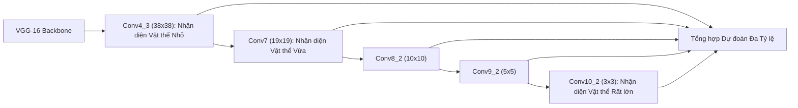

#### d. Code Thực chiến (C++ & Python)

```cpp
// C++17: Tính Tọa độ Default Anchor Box của SSD theo Tỷ lệ Co giãn
#include <iostream>
#include <vector>
#include <cmath>

struct DefaultAnchor { float cx, cy, w, h; };

std::vector<DefaultAnchor> generate_ssd_anchors_for_cell(int i, int j, int grid_size, float s_k, const std::vector<float>& aspect_ratios) {
    std::vector<DefaultAnchor> anchors;
    float cx = (j + 0.5f) / grid_size;
    float cy = (i + 0.5f) / grid_size;

    for (float ar : aspect_ratios) {
        float w = s_k * std::sqrt(ar);
        float h = s_k / std::sqrt(ar);
        anchors.push_back({cx, cy, w, h});
    }
    return anchors;
}

int main() {
    auto anchors = generate_ssd_anchors_for_cell(2, 2, 10, 0.2f, {1.0f, 2.0f, 0.5f});
    std::cout << "Generated " << anchors.size() << " SSD anchors for cell (2, 2).\n";
    return 0;
}
```

```python
# Python / PyTorch: Hard Negative Mining Loss
import torch
import torch.nn.functional as F

def hard_negative_mining_loss(conf_logits: torch.Tensor, targets: torch.Tensor, neg_pos_ratio: int = 3):
    # conf_logits: [Batch, Num_Anchors, Num_Classes], targets: [Batch, Num_Anchors]
    pos_mask = targets > 0
    num_pos = pos_mask.long().sum(dim=1, keepdim=True)
    num_neg = torch.clamp(num_pos * neg_pos_ratio, min=1)

    loss_c = F.cross_entropy(conf_logits.view(-1, conf_logits.size(-1)), targets.view(-1), reduction='none')
    loss_c = loss_c.view_as(targets)

    loss_c[pos_mask] = 0.0 # Bỏ qua mẫu dương để tìm mẫu âm khó nhất
    _, loss_idx = loss_c.sort(dim=1, descending=True)
    _, idx_rank = loss_idx.sort(dim=1)

    neg_mask = idx_rank < num_neg
    total_mask = pos_mask | neg_mask
    return total_mask

logits = torch.randn(2, 100, 21)
tg = torch.zeros(2, 100, dtype=torch.long)
tg[:, :5] = 1 # 5 mẫu dương
mask = hard_negative_mining_loss(logits, tg)
print("Total Anchors selected for Loss Calculation:", mask.sum().item()) # 5 pos + 15 neg = 20
```

#### e. Lỗi Thường gặp & Ổn định Số học
- Thiếu tầng Feature Pyramid kết nối ngược (Top-down pathway) khiến các tầng đặc trưng nông (Conv4_3) thiếu thông tin ngữ nghĩa cấp cao, làm giảm độ chính xác nhận diện các vật thể nhỏ.

#### f. Ứng dụng Thực chiến trong AI
Mô hình nhẹ triển khai trên trình duyệt và thiết bị di động (MobileNet-SSD trong TensorFlow Lite).

---

### 6. Faster R-CNN (Kiến trúc R-CNN Hai Giai đoạn Tiên tiến)

#### a. Định nghĩa Bản chất Toán học
Faster R-CNN (Ren et al., 2015) là kiến trúc hai giai đoạn chuẩn mực, hợp nhất toàn bộ pipeline vào một mạng duy nhất bằng cách giới thiệu **Mạng Đề xuất Vùng (Region Proposal Network - RPN)**:
1. **Giai đoạn 1 (RPN)**: Quét một cửa sổ nhỏ trượt trên feature map cuối cùng. Tại mỗi vị trí mỏ neo (Anchor), dự đoán điểm số nhị phân Objectness ($p^* \in [0, 1]$) và hồi quy tọa độ sơ bộ.
2. **RoI Pooling / RoIAlign**: Trích xuất feature map có kích thước cố định ($7 \times 7$) cho mỗi vùng đề xuất có kích thước tùy ý:
   $$\mathbf{f}_{\text{RoI}} = \text{RoIAlign}(\mathbf{F}, \text{BBox})$$
   Khác với RoI Pooling làm tròn tọa độ gây lỗi lượng tử hóa (Quantization Error), **RoIAlign** sử dụng phép nội suy song tuyến tính tại 4 điểm lấy mẫu liên tục trong mỗi bin, bảo toàn độ chính xác cấp độ pixel.
3. **Giai đoạn 2 (Fast R-CNN Head)**: Dự đoán phân phối lớp chi tiết và tinh chỉnh hộp bao lần cuối.

#### b. Cơ chế Tầng Sâu & Điện toán
- **GPU Implementation of RoIAlign**: Trong thư viện TorchVision/Detectron2, RoIAlign được viết bằng custom CUDA kernel với cơ chế lan truyền ngược gradient chính xác: Gradient tại mỗi điểm lấy mẫu được phân phối ngược về 4 điểm lân cận trên feature map thông qua trọng số nội suy song tuyến tính.

#### c. Sơ đồ Minh họa (Mermaid Diagram)
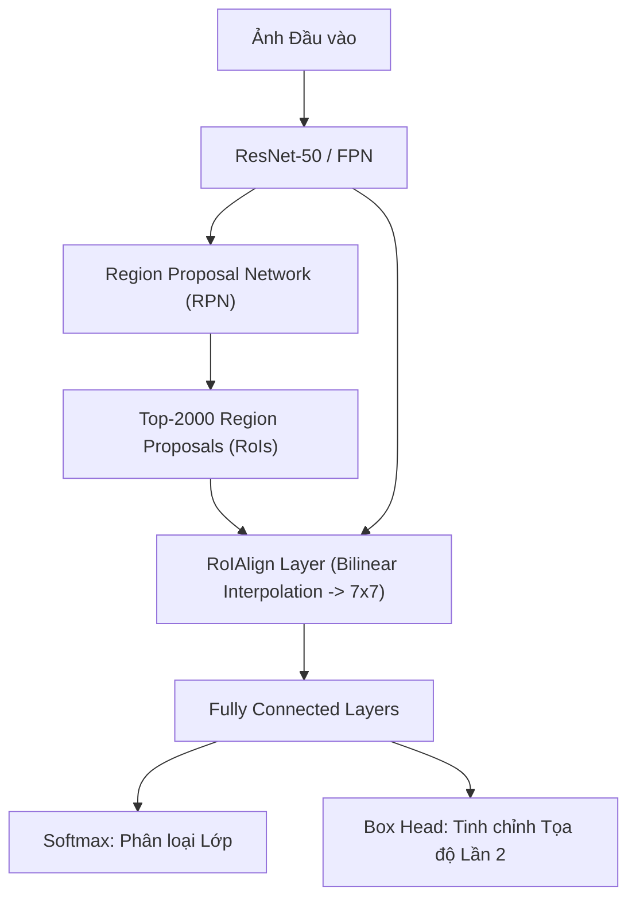

#### d. Code Thực chiến (C++ & Python)

```cpp
// C++17: Phép Nội suy Song tuyến tính RoIAlign tại 1 Điểm Lấy mẫu
#include <iostream>
#include <algorithm>
#include <cmath>

float bilinear_interpolate_sample(const float* feature_map, int H, int W, float y, float x) {
    if (y < -1.0f || y > H || x < -1.0f || x > W) return 0.0f;
    x = std::max(0.0f, std::min(x, W - 1.0f));
    y = std::max(0.0f, std::min(y, H - 1.0f));

    int x_low = static_cast<int>(x), y_low = static_cast<int>(y);
    int x_high = std::min(x_low + 1, W - 1);
    int y_high = std::min(y_low + 1, H - 1);

    float ly = y - y_low, lx = x - x_low;
    float hy = 1.0f - ly, hx = 1.0f - lx;

    float v1 = feature_map[y_low * W + x_low];
    float v2 = feature_map[y_low * W + x_high];
    float v3 = feature_map[y_high * W + x_low];
    float v4 = feature_map[y_high * W + x_high];

    return hy * hx * v1 + hy * lx * v2 + ly * hx * v3 + ly * lx * v4;
}

int main() {
    float map[4] = {10.0f, 20.0f, 30.0f, 40.0f}; // 2x2 feature map
    float val = bilinear_interpolate_sample(map, 2, 2, 0.5f, 0.5f);
    std::cout << "RoIAlign interpolated value at center: " << val << " (Expected: 25)\n";
    return 0;
}
```

```python
# Python / PyTorch: Torchvision RoIAlign Integration
import torch
import torchvision.ops as ops

features = torch.randn(1, 256, 32, 32) # Feature map từ backbone
rois = torch.tensor([
    [0.0, 10.0, 10.0, 50.0, 50.0], # Format: [batch_index, x1, y1, x2, y2]
    [0.0, 20.0, 30.0, 80.0, 90.0]
])

aligned_features = ops.roi_align(features, rois, output_size=(7, 7), spatial_scale=1.0/8.0, sampling_ratio=2)
print("RoIAligned Feature Shape:", aligned_features.shape) # [2, 256, 7, 7]
```

#### e. Lỗi Thường gặp & Ổn định Số học
- **RoI Pooling Misalignment**: Sử dụng `floor(x / spatial_scale)` trong RoI Pooling cổ điển gây lệch tọa độ tích lũy, đặc biệt nghiêm trọng khi mở rộng sang bài toán phân đoạn cá thể (Mask R-CNN).

#### f. Ứng dụng Thực chiến trong AI
Tiêu chuẩn vàng trong các hệ thống đòi hỏi độ chính xác cao tuyệt đối (chẩn đoán hình ảnh y tế, phát hiện vết nứt vi mạch bán dẫn).

---

### 7. RetinaNet (Kiến trúc RetinaNet & Focal Loss)

#### a. Định nghĩa Bản chất Toán học
RetinaNet (Lin et al., 2017) giải quyết triệt để bí ẩn: *"Tại sao các mô hình One-Stage luôn có độ chính xác kém hơn Two-Stage?"*. Câu trả lời là do **Sự mất cân bằng cực đoan giữa Tiền cảnh và Hậu cảnh (Extreme Foreground-Background Class Imbalance)**: Trong một ảnh có tới $\approx 100,000$ anchor boxes nhưng chỉ có vài hộp chứa vật thể thật.
Mô hình hóa hàm mất mát cách mạng: **Focal Loss**:
$$\text{FL}(p_t) = -\alpha_t (1 - p_t)^\gamma \log(p_t)$$
với $p_t$ là xác suất mô hình dự đoán nhãn đúng:
- Khi một mẫu bị phân loại dễ dàng ($p_t \to 1$), hệ số điều biến $(1 - p_t)^\gamma \to 0$, triệt tiêu gần như toàn bộ gradient của hàng trăm nghìn mẫu nền dễ.
- Khi một mẫu khó bị đoán sai ($p_t \to 0$), hệ số $(1 - p_t)^\gamma \approx 1$, giữ nguyên gradient để mô hình tập trung học.
- Tham số chuẩn: $\gamma = 2.0, \alpha = 0.25$.

#### b. Cơ chế Tầng Sâu & Điện toán
- **Feature Pyramid Network (FPN) Backbone**: RetinaNet kết hợp đường dẫn từ dưới lên (Bottom-up), đường dẫn từ trên xuống (Top-down) và các kết nối ngang (Lateral Connections) để xây dựng kim tự tháp đặc trưng giàu ngữ nghĩa ở mọi độ phân giải tỷ lệ ($P_3, P_4, P_5, P_6, P_7$).

#### c. Sơ đồ Minh họa (Mermaid Diagram)
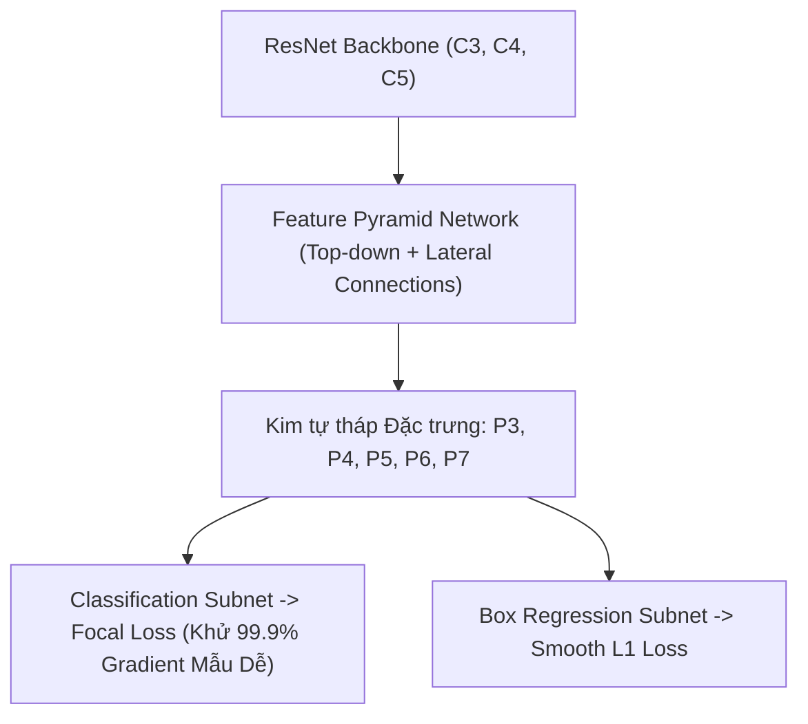

#### d. Code Thực chiến (C++ & Python)

```cpp
// C++17: Tính toán Giá trị Focal Loss cho 1 Mẫu
#include <iostream>
#include <cmath>
#include <algorithm>

float compute_focal_loss(float prob_correct, float alpha = 0.25f, float gamma = 2.0f) {
    float pt = std::max(1e-7f, std::min(1.0f - 1e-7f, prob_correct));
    float modulating_factor = std::pow(1.0f - pt, gamma);
    float ce_loss = -std::log(pt);
    return alpha * modulating_factor * ce_loss;
}

int main() {
    float loss_easy = compute_focal_loss(0.99f); // Mẫu nền cực dễ
    float loss_hard = compute_focal_loss(0.10f); // Mẫu khó
    std::cout << "Focal Loss for Easy Sample (Suppressed): " << loss_easy << "\n";
    std::cout << "Focal Loss for Hard Sample: " << loss_hard << " (~" << (loss_hard / loss_easy) << "x higher!)\n";
    return 0;
}
```

```python
# Python / PyTorch: Sigmoid Focal Loss Vectorized Function
import torch
import torch.nn.functional as F

def sigmoid_focal_loss(logits: torch.Tensor, targets: torch.Tensor, alpha: float = 0.25, gamma: float = 2.0) -> torch.Tensor:
    # logits: [N, C], targets: [N, C] binary labels
    p = torch.sigmoid(logits)
    ce_loss = F.binary_cross_entropy_with_logits(logits, targets, reduction="none")
    p_t = p * targets + (1.0 - p) * (1.0 - targets)
    loss = ce_loss * ((1.0 - p_t) ** gamma)

    if alpha >= 0:
        alpha_t = alpha * targets + (1.0 - alpha) * (1.0 - targets)
        loss = alpha_t * loss

    return loss.mean()

pred_logits = torch.randn(10, 5)
true_labels = torch.zeros(10, 5)
true_labels[0, 2] = 1.0 # 1 mẫu dương duy nhất
print("RetinaNet Focal Loss:", sigmoid_focal_loss(pred_logits, true_labels).item())
```

#### e. Lỗi Thường gặp & Ổn định Số học
- **Network Initialization Instability**: Trong bước khởi tạo ban đầu, nếu bias của tầng phân loại cuối cùng được đặt bằng 0, mô hình sẽ nảy sinh gradient cực lớn do lượng mẫu nền khổng lồ. Cần khởi tạo thiên vị nền: $b = -\log((1 - \pi) / \pi)$ với $\pi = 0.01$.

#### f. Ứng dụng Thực chiến trong AI
Kiểm soát dây chuyền sản xuất bo mạch điện tử, phát hiện khuyết tật trên dải thép công nghiệp.

---

### 8. DETR (DEtection TRansformer)

#### a. Định nghĩa Bản chất Toán học
DETR (Carion et al., Meta AI, 2020) tái định nghĩa toàn bộ bài toán phát hiện vật thể dưới dạng **Dự đoán Tập hợp Trực tiếp (Direct Set Prediction)** thông qua kiến trúc Transformer Encoder-Decoder:
$$\hat{\mathbf{Y}} = \{\hat{y}_i\}_{i=1}^N, \quad N = \text{Số lượng cố định Object Queries (thường } 100 \text{ hoặc } 300)$$
Hai trụ cột toán học đột phá:
1. **Thuật toán So khớp Hai phía (Bipartite Matching via Hungarian Algorithm)**: Tìm phép hoán vị $\hat{\sigma} \in \mathfrak{S}_N$ gán 1-1 tối ưu giữa tập dự đoán và tập nhãn ground-truth (có bù thêm các token rỗng $\emptyset$):
   $$\hat{\sigma} = \arg\min_{\sigma \in \mathfrak{S}_N} \sum_{i=1}^N \mathcal{L}_{\text{match}}\left( y_i, \hat{y}_{\sigma(i)} \right)$$
   với $\mathcal{L}_{\text{match}} = - \mathbb{I}(c_i \neq \emptyset) \hat{p}_{\sigma(i)}(c_i) + \mathcal{L}_{\text{box}}(b_i, \hat{b}_{\sigma(i)})$.
2. **Loại bỏ NMS và Anchors**: Nhờ tính chất gán 1-1, DETR không bao giờ sinh ra các hộp bao trùng lặp, **loại bỏ hoàn toàn thuật toán NMS**.

#### b. Cơ chế Tầng Sâu & Điện toán
- **Object Queries in Decoder**: Trong DETR Decoder, các Object Queries là các vector embedding học được (Learned Positional Embeddings). Chúng hoạt động như các "thám tử" độc lập, sử dụng Cross-Attention để truy vấn toàn bộ feature map của ảnh để tìm vật thể.

#### c. Sơ đồ Minh họa (Mermaid Diagram)
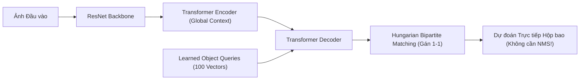

#### d. Code Thực chiến (C++ & Python)

```cpp
// C++17: Ma trận Chi phí So khớp Gán 1-1 Hungarian Matching Cost
#include <iostream>
#include <vector>
#include <cmath>

float compute_pairwise_matching_cost(float pred_cls_prob, float pred_box_x, float gt_box_x) {
    // Chi phí kết hợp: -Logit phân loại + Khoảng cách L1 hộp bao
    float cost_class = -pred_cls_prob;
    float cost_bbox = std::abs(pred_box_x - gt_box_x);
    return cost_class + 5.0f * cost_bbox;
}

int main() {
    float cost = compute_pairwise_matching_cost(0.9f, 0.5f, 0.52f);
    std::cout << "Hungarian Matching Cost: " << cost << "\n";
    return 0;
}
```

```python
# Python: Scipy Linear Sum Assignment (Hungarian Algorithm) cho DETR
import numpy as np
from scipy.optimize import linear_sum_assignment

# Ma trận chi phí 3 Queries x 2 Ground Truth Objects
cost_matrix = np.array([
    [0.1, 0.8], # Query 0 rất hợp Object 0
    [0.9, 0.2], # Query 1 rất hợp Object 1
    [0.7, 0.6]  # Query 2 không hợp cái nào (Gán vào nhãn trống No-Object)
])

row_ind, col_ind = linear_sum_assignment(cost_matrix)
print("Optimal 1-to-1 Query-to-GT Assignments:")
for q, gt in zip(row_ind, col_ind):
    print(f"  Query #{q} -> Ground Truth Object #{gt} (Cost: {cost_matrix[q, gt]})")
```

#### e. Lỗi Thường gặp & Ổn định Số học
- **Slow Convergence (Hội tụ cực kỳ chậm)**: DETR gốc đòi hỏi tới 500 epochs huấn luyện trên cụm 16 GPU V100 mới hội tụ (gấp $10\times - 20\times$ so với Faster R-CNN) do Attention toàn cục cần rất nhiều thời gian để học cách tập trung vào các vùng hình học nhỏ.

#### f. Ứng dụng Thực chiến trong AI
Mở ra kỷ nguyên End-to-End Object Detection không cần hậu xử lý thủ công.

---

### 9. Deformable DETR (DETR Biến dạng Đa quy mô)

#### a. Định nghĩa Bản chất Toán học
Deformable DETR (Zhu et al., ICLR 2021) giải quyết triệt để 2 điểm yếu chí mạng của DETR: hội tụ chậm và chi phí tính toán $\mathcal{O}(H^2 W^2)$ quá cao trên feature maps độ phân giải lớn.
Cốt lõi toán học: **Deformable Attention Module**:
Thay vì tính Attention lên toàn bộ $H \times W$ điểm ảnh, mỗi truy vấn chỉ chú ý tới một số lượng cố định $K$ điểm lấy mẫu biến dạng (Deformable Sampling Points, thường $K=4$) xung quanh một điểm tham chiếu 2D (Reference Point $\mathbf{p}_q$):
$$\text{DeformAttn}(\mathbf{z}_q, \mathbf{p}_q, \mathbf{x}) = \sum_{m=1}^M \mathbf{W}_m \sum_{l=1}^L \sum_{k=1}^K A_{m, l, q, k} \cdot \mathbf{W}_m' \mathbf{x}_l\left( \phi_l(\mathbf{p}_q) + \Delta \mathbf{p}_{m, l, q, k} \right)$$
trong đó $\Delta \mathbf{p}$ là độ lệch tọa độ liên tục (Sampling Offset) được dự đoán trực tiếp bằng tầng tuyến tính, và giá trị tại điểm lệch được tính bằng phép nội suy song tuyến tính.

#### b. Cơ chế Tầng Sâu & Điện toán
- **Linear Complexity $\mathcal{O}(N_q \cdot C)$**: Độ phức tạp tính toán giảm từ toàn phương $\mathcal{O}(L^2)$ xuống tuyến tính theo số lượng queries $N_q$ và số điểm mẫu $K \ll L$, cho phép tích hợp trực tiếp tháp đặc trưng đa tỷ lệ đa quy mô (Multi-Scale Feature Maps $P_3 - P_6$) vào Transformer mà không bị tràn VRAM.
- Tốc độ huấn luyện hội tụ nhanh gấp **$10\times$** so với DETR gốc (chỉ cần 50 epochs).

#### c. Sơ đồ Minh họa (Mermaid Diagram)
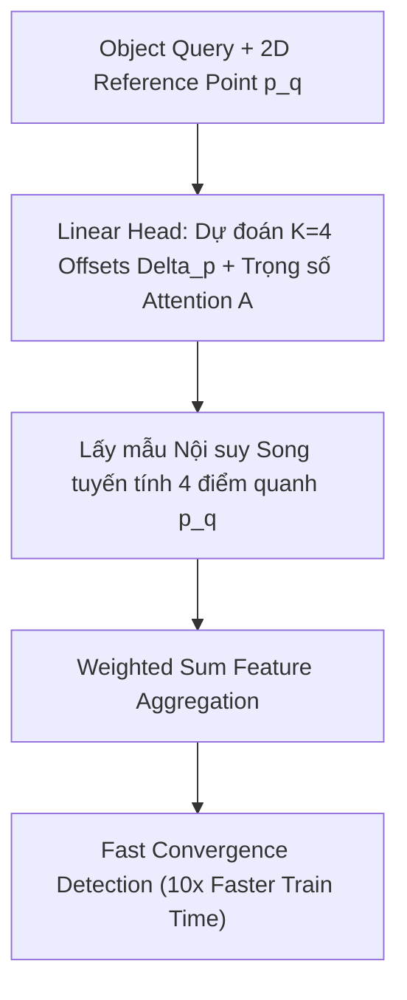

#### d. Code Thực chiến (C++ & Python)

```cpp
// C++17: Tính Tọa độ Điểm Lấy mẫu Biến dạng (Deformable Sampling Coordinates)
#include <iostream>

struct SamplePoint { float x, y; };

SamplePoint get_deformable_sample_location(float ref_x, float ref_y, float offset_x, float offset_y) {
    // Tọa độ lấy mẫu = Tọa độ tham chiếu + Độ lệch biến dạng
    return { ref_x + offset_x, ref_y + offset_y };
}

int main() {
    auto pt = get_deformable_sample_location(100.0f, 150.0f, 2.3f, -4.1f);
    std::cout << "Sample Point: (" << pt.x << ", " << pt.y << ")\n";
    return 0;
}
```

```python
# Python / PyTorch: Mô phỏng Deformable Attention Sampling Loop
import torch
import torch.nn.functional as F

def mock_deformable_attention_step(value_maps: torch.Tensor, sampling_locations: torch.Tensor, attention_weights: torch.Tensor):
    # value_maps: [Batch, Channels, H, W]
    # sampling_locations: [Batch, Num_Queries, Num_Points, 2] chuẩn hóa [-1, 1] cho grid_sample
    # attention_weights: [Batch, Num_Queries, Num_Points]
    B, Q, P, _ = sampling_locations.shape
    sampled_vals = F.grid_sample(value_maps, sampling_locations.view(B, Q * P, 1, 2), align_corners=False) # [B, C, QP, 1]
    sampled_vals = sampled_vals.squeeze(-1).view(B, -1, Q, P).permute(0, 2, 3, 1) # [B, Q, P, C]
    
    # Tổng có trọng số qua P sampling points
    out = (sampled_vals * attention_weights.unsqueeze(-1)).sum(dim=2) # [B, Q, C]
    return out

feat = torch.randn(1, 64, 32, 32)
locs = torch.zeros(1, 10, 4, 2) # 10 queries, 4 points
weights = torch.softmax(torch.randn(1, 10, 4), dim=-1)
print("Deformable Attention Output Shape:", mock_deformable_attention_step(feat, locs, weights).shape) # [1, 10, 64]
```

#### e. Lỗi Thường gặp & Ổn định Số học
- Khi điểm offset $\phi_l(\mathbf{p}_q) + \Delta \mathbf{p}$ bay ra ngoài biên kích thước ảnh, hàm `grid_sample` trả về giá trị 0 nếu không áp dụng padding biên thích hợp.

#### f. Ứng dụng Thực chiến trong AI
Xương sống của các mô hình phát hiện 3D cho xe tự hành (BEVFormer, PETR) và phát hiện từ vựng mở (Grounding DINO).

---

### 10. Object Tracking (Theo dõi Vật thể Đơn)

#### a. Định nghĩa Bản chất Toán học
Theo dõi vật thể đơn (Single Object Tracking - SOT / Visual Object Tracking) theo dõi quỹ đạo của một đối tượng mục tiêu duy nhất trong chuỗi video, với hộp bao ban đầu $\mathbf{b}_0$ được người dùng chỉ định ở khung hình đầu tiên:
$$\mathbf{b}_t = f(\mathbf{I}_t, \mathbf{b}_0, \mathbf{I}_0)$$
Hai trường phái toán học:
1. **Correlation Filters (KCF - Kernelized Correlation Filters)**: Chuyển đổi bài toán ma trận sang miền tần số bằng biến đổi Fourier 2D (FFT), tận dụng tính chất ma trận tuần hoàn (Circulant Matrix) để giải nghiệm sấp xỉ trong thời gian thực:
   $$\hat{\mathbf{w}} = \frac{\hat{\mathbf{y}} \odot \hat{\mathbf{x}}^*}{\hat{\mathbf{x}} \odot \hat{\mathbf{x}}^* + \lambda}$$
2. **Siamese Trackers (SiamFC, SiamRPN, TransT)**: Mạng hai nhánh chia sẻ trọng số, so khớp Cross-Correlation chéo giữa ảnh mẫu (Template $Z$) và vùng tìm kiếm (Search Region $X$).

#### b. Cơ chế Tầng Sâu & Điện toán
- **O(N log N) Frequency Domain Speedup**: Nhờ định lý tích chập Fourier $\mathcal{F}(f * g) = \mathcal{F}(f) \cdot \mathcal{F}(g)$, thuật toán KCF thực hiện theo dõi vật thể với tốc độ phi thường: $>500\text{ FPS}$ trên duy nhất một lõi CPU đơn, cực kỳ phù hợp cho các thiết bị bay Drone có vi xử lý yếu.

#### c. Sơ đồ Minh họa (Mermaid Diagram)


#### d. Code Thực chiến (C++ & Python)

```cpp
// C++17: Tìm Tọa độ Điểm Cực đại trên Response Map của Tracker
#include <iostream>
#include <vector>

struct PeakLocation { int x, y; float score; };

PeakLocation find_tracking_peak(const std::vector<float>& response_map, int H, int W) {
    PeakLocation peak{-1, -1, -1e9f};
    for (int y = 0; y < H; ++y) {
        for (int x = 0; x < W; ++x) {
            float val = response_map[y * W + x];
            if (val > peak.score) {
                peak = {x, y, val};
            }
        }
    }
    return peak;
}

int main() {
    std::vector<float> map(9, 0.1f);
    map[4] = 0.98f; // Peak ở tâm (1, 1)
    auto peak = find_tracking_peak(map, 3, 3);
    std::cout << "Tracked Object Location: (" << peak.x << ", " << peak.y << ") Score: " << peak.score << "\n";
    return 0;
}
```

```python
# Python / PyTorch: Siamese Cross-Correlation Layer
import torch
import torch.nn.functional as F

def depthwise_cross_correlation(template_feat: torch.Tensor, search_feat: torch.Tensor) -> torch.Tensor:
    # template_feat: [1, Channels, H_z, W_z], search_feat: [1, Channels, H_x, W_x]
    # Depthwise convolution dùng template làm trọng số quét trên search
    channels = template_feat.size(1)
    score_map = F.conv2d(search_feat, template_feat, groups=channels)
    return score_map

z = torch.randn(1, 32, 7, 7)
x = torch.randn(1, 32, 15, 15)
response = depthwise_cross_correlation(z, x)
print("Siamese Tracking Score Map Shape:", response.shape) # [1, 32, 9, 9]
```

#### e. Lỗi Thường gặp & Ổn định Số học
- **Drifting Problem**: Khi vật thể bị biến dạng hoặc che khuất tạm thời (Occlusion), tracker cập nhật nhầm đặc trưng nền vào template, khiến nó "trôi dạt" theo nền và mất dấu vật thể vĩnh viễn.

#### f. Ứng dụng Thực chiến trong AI
Theo dõi mục tiêu trên camera PTZ (Pan-Tilt-Zoom), hệ thống bám bắt vật thể của flycam tự động ghi hình thể thao.

---

### 11. Multi-Object Tracking - MOT (Theo dõi Đa Vật thể)

#### a. Định nghĩa Bản chất Toán học
Theo dõi đa vật thể (MOT) đồng thời duy trì định danh duy nhất (Unique IDs) cho nhiều vật thể di chuyển độc lập trong cảnh quay video:
$$\mathcal{T}_t = \{(\text{ID}_k, \mathbf{b}_k, \mathbf{v}_k)\}$$
Khung phương pháp tiêu chuẩn: **Tracking-by-Detection**:
1. Phát hiện tất cả các hộp bao ở khung hình $t$: $\mathcal{D}_t$.
2. Dự đoán vị trí của các track cũ từ khung hình $t-1$ sang $t$ bằng **Bộ lọc Kalman (Kalman Filter)**:
   $$\mathbf{x}_{t|t-1} = \mathbf{F} \mathbf{x}_{t-1}, \quad \mathbf{P}_{t|t-1} = \mathbf{F} \mathbf{P}_{t-1} \mathbf{F}^T + \mathbf{Q}$$
3. Xây dựng ma trận chi phí liên kết (Association Cost Matrix) dựa trên khoảng cách IoU và khoảng cách đặc trưng Re-ID (Cosine):
   $$\mathbf{C}_{i, j} = \lambda \text{IoU}(\mathbf{b}_i, \hat{\mathbf{b}}_j) + (1 - \lambda) \cos(\mathbf{e}_i, \mathbf{e}_j)$$
4. Gán liên kết tối ưu bằng **Thuật toán Hungary (Hungarian Algorithm)**.
Các giải thuật SOTA: **DeepSORT, ByteTrack** (ByteTrack tận dụng cả các hộp có điểm số phát hiện thấp để khôi phục vật thể bị che khuất).

#### b. Cơ chế Tầng Sâu & Điện toán
- **ByteTrack Hierarchical Matching**: ByteTrack chứng minh rằng việc vứt bỏ các hộp có score thấp ($0.1 < \text{score} < 0.6$) là sai lầm vì đó thường là các vật thể bị che khuất một phần. ByteTrack gán liên kết 2 giai đoạn:
  - Giai đoạn 1: Khớp các hộp score cao với các tracklets hiện có.
  - Giai đoạn 2: Khớp các hộp score thấp với các tracklets chưa được gán, loại bỏ gần như toàn bộ hiện tượng nhảy ID (ID Switches).

#### c. Sơ đồ Minh họa (Mermaid Diagram)
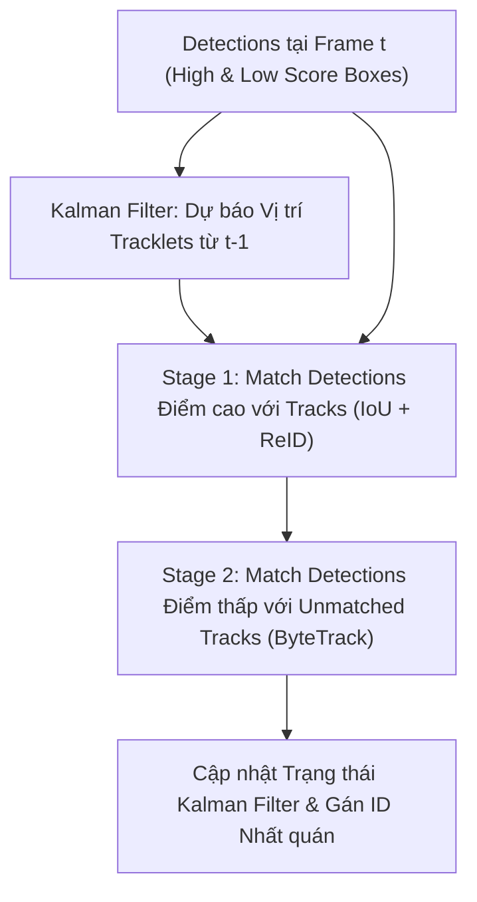

#### d. Code Thực chiến (C++ & Python)

```cpp
// C++17: Bộ Lọc Kalman 1D Dự báo Vị trí và Vận tốc Vật thể
#include <iostream>

struct KalmanFilter1D {
    float x = 0.0f; // Vị trí
    float v = 0.0f; // Vận tốc
    float p_xx = 1.0f, p_xv = 0.0f, p_vv = 1.0f; // Hiệp phương sai sai số
    float q = 0.05f; // Nhiễu quá trình
    float r = 0.5f;  // Nhiễu đo đạc

    void predict(float dt) {
        x += v * dt;
        p_xx += 2 * dt * p_xv + dt * dt * p_vv + q;
        p_xv += dt * p_vv;
        p_vv += q;
    }

    void update(float measurement) {
        float k = p_xx / (p_xx + r); // Kalman Gain
        x += k * (measurement - x);
        p_xx *= (1.0f - k);
        p_xv *= (1.0f - k);
    }
};

int main() {
    KalmanFilter1D kf;
    kf.predict(1.0f); // Dự báo bước 1
    kf.update(10.2f); // Đo được vị trí 10.2
    std::cout << "Kalman Filter Updated Position: " << kf.x << "\n";
    return 0;
}
```

```python
# Python: ByteTrack Dual-Stage Association Logic
def byte_track_association(high_score_dets: list, low_score_dets: list, tracks: list) -> tuple:
    # Giai đoạn 1: Khớp high score
    matched_tracks_1 = []
    unmatched_tracks = []
    for t in tracks:
        if high_score_dets:
            matched_tracks_1.append((t, high_score_dets.pop(0)))
        else:
            unmatched_tracks.append(t)

    # Giai đoạn 2: Khớp low score cho các track còn sót
    matched_tracks_2 = []
    for t in unmatched_tracks:
        if low_score_dets:
            matched_tracks_2.append((t, low_score_dets.pop(0)))

    return matched_tracks_1 + matched_tracks_2

print("ByteTrack Simulated Assignments:", byte_track_association(["Box_High"], ["Box_Low"], ["Track_1", "Track_2"]))
```

#### e. Lỗi Thường gặp & Ổn định Số học
- **ID Switch (Nhảy ID)**: Khi hai người đi ngang qua nhau và che khuất nhau, ma trận liên kết gán chéo ID của người A sang người B và ngược lại.

#### f. Ứng dụng Thực chiến trong AI
Đếm lưu lượng phương tiện giao thông thông minh, phân tích chiến thuật di chuyển của cầu thủ trong thể thao chuyên nghiệp.

---

### 12. Grounding DINO (Mô hình Dò tìm Vật thể dựa trên Văn bản)

#### a. Định nghĩa Bản chất Toán học
Grounding DINO (Liu et al., 2023) là mô hình phát hiện vật thể mở đỉnh cao, kết hợp giữa kiến trúc Deformable DETR và mô hình ngôn ngữ BERT để thực hiện bài toán **Closed/Open-set Visual Grounding**:
$$\mathbf{I}_{\text{image}}, \mathbf{T}_{\text{text prompt}} \to \{(\mathbf{b}_i, \text{phrase}_i)\}$$
Cơ chế hợp nhất đa phương thức sâu sắc (Deep Cross-Modality Fusion):
1. **Feature Enhancer**: Chạy Cross-Attention hai chiều liên tục giữa Image Tokens $\mathbf{V}$ và Text Tokens $\mathbf{L}$:
   $$\mathbf{V}' = \text{CrossAttn}(\mathbf{V}, \mathbf{L}), \quad \mathbf{L}' = \text{CrossAttn}(\mathbf{L}, \mathbf{V})$$
2. **Language-Guided Query Selection**: Khởi tạo các Object Queries cho Decoder dựa trên điểm tương quan cao nhất giữa các vị trí ảnh và từ khóa văn bản.
3. **Contrastive Loss for Box-Text Binding**: Tối ưu hóa sự tương thích giữa hộp bao dự đoán và các cụm từ trong câu lệnh thông qua hàm Softmax Cross-Entropy.

#### b. Cơ chế Tầng Sâu & Điện toán
- **Sub-sentence Level Alignment**: Khác với CLIP chỉ gióng hàng toàn thể bức ảnh với toàn thể câu văn, Grounding DINO gióng hàng ở cấp độ **Từng vùng ảnh (Region) với Từng cụm từ (Sub-phrase)** trong thời gian thực, cho phép phát hiện chính xác các mô tả phức tạp như: *"chiếc ghế sofa màu xanh lá cây nằm cạnh bàn tròn bằng gỗ"*.

#### c. Sơ đồ Minh họa (Mermaid Diagram)
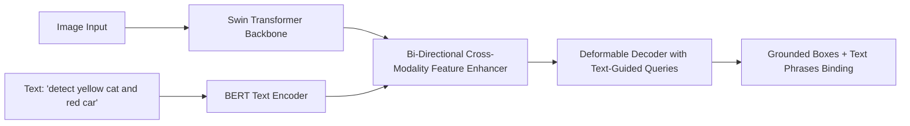

#### d. Code Thực chiến (C++ & Python)

```cpp
// C++17: Gióng hàng Tương quan giữa Vùng Ảnh và Token Văn bản
#include <iostream>
#include <vector>
#include <cmath>

float compute_region_text_dot_product(const std::vector<float>& region_feat, const std::vector<float>& word_feat) {
    float dot = 0.0f;
    for (size_t i = 0; i < region_feat.size(); ++i) {
        dot += region_feat[i] * word_feat[i];
    }
    return dot;
}

int main() {
    std::vector<float> r = {0.8f, 0.2f, -0.1f};
    std::vector<float> w = {0.85f, 0.15f, -0.05f}; // Khớp cao
    std::cout << "Region-Text Binding Affinity: " << compute_region_text_dot_product(r, w) << "\n";
    return 0;
}
```

```python
# Python / PyTorch: Cross-Modality Attention Step
import torch
import torch.nn as nn

class BiDirectionalCrossModalityFusion(nn.Module):
    def __init__(self, hidden_dim: int):
        super().__init__()
        self.v_to_l = nn.MultiheadAttention(hidden_dim, num_heads=4, batch_first=True)
        self.l_to_v = nn.MultiheadAttention(hidden_dim, num_heads=4, batch_first=True)

    def forward(self, v_tokens: torch.Tensor, l_tokens: torch.Tensor):
        # v_tokens: [Batch, N_img, Dim], l_tokens: [Batch, N_text, Dim]
        v_enhanced, _ = self.v_to_l(query=v_tokens, key=l_tokens, value=l_tokens)
        l_enhanced, _ = self.l_to_v(query=l_tokens, key=v_tokens, value=v_tokens)
        return v_enhanced, l_enhanced

fusion = BiDirectionalCrossModalityFusion(hidden_dim=64)
img_t = torch.randn(1, 100, 64)
txt_t = torch.randn(1, 10, 64)
v_out, l_out = fusion(img_t, txt_t)
print("Enhanced Visual Tokens Shape:", v_out.shape)
print("Enhanced Text Tokens Shape:", l_out.shape)
```

#### e. Lỗi Thường gặp & Ổn định Số học
- **Prompt Token Leakage**: Sử dụng dấu chấm hoặc dấu phẩy không đúng quy cách trong prompt văn bản làm xáo trộn ranh giới token của BERT, khiến mô hình gán nhãn nhầm các thuộc tính (e.g. gán màu đỏ của chiếc xe sang con mèo).

#### f. Ứng dụng Thực chiến trong AI
Tự động gán nhãn dữ liệu hình ảnh (Auto-labeling Pipeline), tìm kiếm vật thể theo lệnh giọng nói tự do trong Robot gia đình.

---

### 13. Open-Vocabulary Detection (Phát hiện Từ vựng Mở)

#### a. Định nghĩa Bản chất Toán học
Khác với mô hình phát hiện truyền thống bị giới hạn trong tập danh mục đóng (như COCO 80 lớp), Open-Vocabulary Detection (OVD) có khả năng phát hiện và định danh **bất kỳ khái niệm vật thể mới nào** trong thế giới thực mà chưa từng xuất hiện trong tập dữ liệu huấn luyện:
$$\mathcal{C}_{\text{test}} \cap \mathcal{C}_{\text{train}} = \emptyset, \quad |\mathcal{C}_{\text{test}}| \to \infty$$
Toán tử phân loại dựa trên phép chiếu vào không gian nhúng văn bản của CLIP (Language-Aligned Vision Embeddings):
$$\hat{c} = \arg\max_{c \in \mathcal{C}_{\text{open}}} \frac{\mathbf{e}_{\text{region}}(\mathbf{x}, \mathbf{b})^T \mathbf{e}_{\text{text}}(\text{"a photo of a " } + c)}{\|\mathbf{e}_{\text{region}}\| \|\mathbf{e}_{\text{text}}\|}$$
Thay vì học ma trận phân loại tham số hóa cố định $\mathbf{W} \in \mathbb{R}^{C \times d}$, trọng số phân loại được tạo động (Dynamic Classifier Weights) bằng cách đưa danh sách nhãn văn bản qua Text Encoder của CLIP.

#### b. Cơ chế Tầng Sâu & Điện toán
- **Region-Text Alignment Distillation (ViLD)**: Để đưa tri thức phong phú của CLIP vào mô hình phát hiện hai giai đoạn, kỹ thuật ViLD chưng cất tri thức (Knowledge Distillation) bằng cách ép vector biểu diễn RoI sau khi chiếu phải trùng khớp với vector nhúng toàn ảnh của CLIP crop:
  $$\mathcal{L}_{\text{distill}} = \|\mathbf{f}_{\text{RoI}}(\mathbf{x}, \mathbf{b}) - \mathbf{f}_{\text{CLIP\_Visual}}(\text{Crop}(\mathbf{x}, \mathbf{b}))\|_1$$

#### c. Sơ đồ Minh họa (Mermaid Diagram)
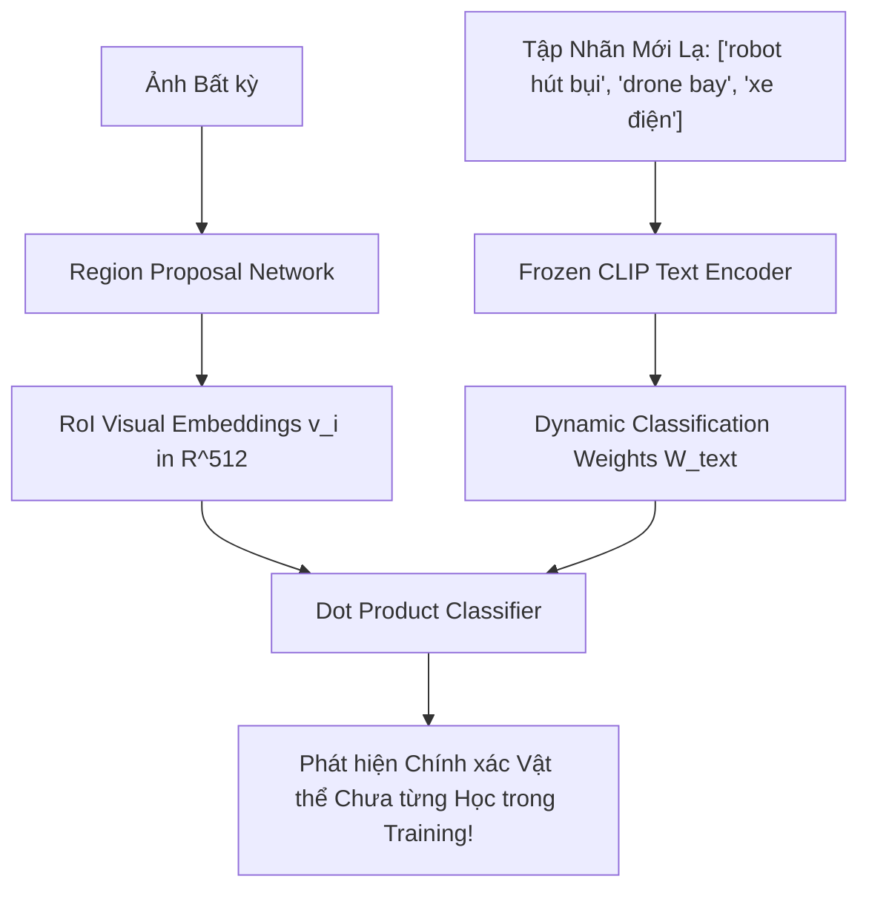

#### d. Code Thực chiến (C++ & Python)

```cpp
// C++17: Phân loại Hộp bao dựa trên Ma trận Trọng số Động (Dynamic Text Embeddings)
#include <iostream>
#include <vector>
#include <string>

int classify_open_vocabulary_roi(const std::vector<float>& roi_vector,
                                 const std::vector<std::vector<float>>& text_embeddings) {
    int best_class = -1;
    float max_dot = -1e9f;

    for (size_t c = 0; c < text_embeddings.size(); ++c) {
        float dot = 0.0f;
        for (size_t d = 0; d < roi_vector.size(); ++d) {
            dot += roi_vector[d] * text_embeddings[c][d];
        }
        if (dot > max_dot) {
            max_dot = dot;
            best_class = static_cast<int>(c);
        }
    }
    return best_class;
}

int main() {
    std::vector<float> roi = {0.8f, 0.6f};
    std::vector<std::vector<float>> texts = {
        {0.82f, 0.58f}, // Class 0: "Drone" (Gần nhất)
        {-0.1f, 0.99f}  # Class 1: "Elephant"
    };
    std::cout << "Open-Vocabulary Detected Class: " << classify_open_vocabulary_roi(roi, texts) << "\n";
    return 0;
}
```

```python
# Python / PyTorch: Dynamic Zero-shot Detection Classifier Head
import torch
import torch.nn.functional as F

def open_vocabulary_classify(roi_features: torch.Tensor, text_classifier_weights: torch.Tensor, temperature: float = 0.01):
    # roi_features: [Num_RoIs, Dim], text_classifier_weights: [Num_Novel_Classes, Dim]
    roi_norm = F.normalize(roi_features, dim=-1)
    text_norm = F.normalize(text_classifier_weights, dim=-1)
    # Cosine Similarity Logits
    logits = torch.matmul(roi_norm, text_norm.T) / temperature
    return F.softmax(logits, dim=-1)

rois = torch.randn(5, 512)
text_weights = torch.randn(10, 512) # 10 novel classes
probs = open_vocabulary_classify(rois, text_weights)
print("Open-Vocabulary Prediction Probabilities Shape:", probs.shape) # [5, 10]
```

#### e. Lỗi Thường gặp & Ổn định Số học
- **Background Over-confidence**: Các vùng nền phức tạp có thể vô tình có độ tương đồng cao với một số từ khóa hiếm trong từ điển mở, sinh ra nhiều phát hiện dương tính giả (False Positives).

#### f. Ứng dụng Thực chiến trong AI
Hệ thống thị giác mở cho Robot thám hiểm môi trường lạ, tìm kiếm video thông minh theo truy vấn ngôn ngữ tự nhiên không giới hạn (Zero-shot Video Object Search).
