# Chuyên đề: Phân đoạn Ảnh & Thị giác Tập trung vào Con người (Segmentation & Human-Centric Vision)

## 1. Tổng quan Chuyên đề
Phân đoạn ảnh (Image Segmentation) là cấp độ nhận thức không gian chi tiết nhất trong thị giác máy tính: gán nhãn ngữ nghĩa cho **từng điểm ảnh đơn lẻ (Pixel-level Classification)**. Lĩnh vực này được phân tầng thành ba bài toán lớn:
1. **Semantic Segmentation**: Phân loại từng pixel vào các lớp danh mục (Stuff & Things) mà không phân biệt các cá thể độc lập.
2. **Instance Segmentation**: Định vị và tách biệt mặt nạ pixel của từng cá thể rời rạc thuộc các lớp đếm được (Things).
3. **Panoptic Segmentation**: Hợp nhất toàn diện cả Semantic và Instance Segmentation vào một bản đồ duy nhất.

Từ các kiến trúc kinh điển như **U-Net** (nền tảng y tế và khuếch tán Diffusion), **DeepLab** (với Atrous Spatial Pyramid Pooling - ASPP) và **Mask R-CNN**, công nghệ đã đạt bước nhảy vọt với mô hình nền tảng **Segment Anything Model (SAM)** của Meta AI. Song song đó, nhánh Thị giác Tập trung vào Con người (Human-Centric Vision) giải quyết việc phát hiện điểm then chốt (Keypoint & Landmark Detection), ước lượng tư thế người (Human Pose Estimation) và nhận diện khuôn mặt (Face Detection & Recognition).

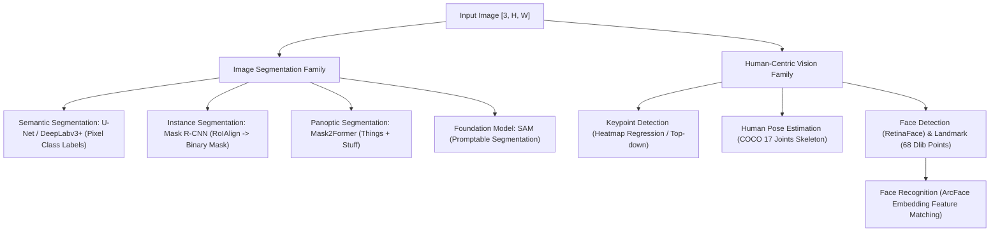

---

## 2. Chi tiết từng Keyword

---

### 1. Image Segmentation (Phân đoạn Hình ảnh Tổng quan)

#### a. Định nghĩa Bản chất Toán học (Mathematical Formulation)
Phân đoạn ảnh là bài toán phân hoạch không gian ảnh $\Omega \subset \mathbb{Z}^2$ thành $K$ vùng con rời rạc, không rỗng và bao phủ toàn bộ bức ảnh:
$$\bigcup_{k=1}^K \Omega_k = \Omega, \quad \Omega_i \cap \Omega_j = \emptyset \ (\forall i \neq j)$$
thỏa mãn điều kiện thuần nhất ngữ nghĩa: Mọi pixel trong cùng một vùng $\Omega_k$ đều đồng nhất theo một vị từ logic $P(\Omega_k) = \text{TRUE}$, và hai vùng kề nhau thì không đồng nhất $P(\Omega_i \cup \Omega_j) = \text{FALSE}$.
Thước đo đánh giá chất lượng phân đoạn chuẩn mực: **Intersection over Union (IoU / Jaccard Index)** và **Dice Coefficient (F1-score)**:
$$\text{IoU}(A, B) = \frac{|A \cap B|}{|A \cup B|}, \quad \text{Dice}(A, B) = \frac{2 |A \cap B|}{|A| + |B|}$$

#### b. Cơ chế Tầng Sâu & Điện toán (Under The Hood / Hardware Internals)
- **Pixel-level High Resolution Memory**: Đầu ra của mạng phân đoạn có cùng kích thước không gian với ảnh đầu vào $[C, H, W]$. Việc lưu trữ các bản đồ kích hoạt (Activation Maps) ở độ phân giải gốc tiêu tốn lượng VRAM khổng lồ khi tính toán lan truyền ngược. Các kỹ thuật như Gradient Checkpointing và Mixed Precision (FP16/BF16) là bắt buộc để huấn luyện batch size lớn.

#### c. Sơ đồ Minh họa (Mermaid Diagram)


#### d. Code Thực chiến (C++ & Python)

```cpp
// C++17: Tính toán Mean IoU (mIoU) trên Ma trận Nhầm lẫn Confusion Matrix
#include <iostream>
#include <vector>

float compute_mean_iou(const std::vector<std::vector<int>>& confusion_matrix) {
    size_t num_classes = confusion_matrix.size();
    float sum_iou = 0.0f;
    int valid_classes = 0;

    for (size_t c = 0; c < num_classes; ++c) {
        int tp = confusion_matrix[c][c];
        int fn = 0, fp = 0;
        for (size_t j = 0; j < num_classes; ++j) {
            if (j != c) {
                fn += confusion_matrix[c][j]; // Actual c but predicted j
                fp += confusion_matrix[j][c]; // Actual j but predicted c
            }
        }
        int denom = tp + fp + fn;
        if (denom > 0) {
            sum_iou += static_cast<float>(tp) / denom;
            valid_classes++;
        }
    }
    return (valid_classes > 0) ? (sum_iou / valid_classes) : 0.0f;
}

int main() {
    // 2 classes: 0: Background, 1: Road
    std::vector<std::vector<int>> cm = {
        {900, 100}, // Class 0
        {50,  450}  // Class 1
    };
    std::cout << "Mean IoU: " << compute_mean_iou(cm) * 100.0f << "%\n";
    return 0;
}
```

```python
# Python / PyTorch: Soft Dice Loss khả vi cho Phân đoạn Ảnh
import torch
import torch.nn as nn

class SoftDiceLoss(nn.Module):
    def __init__(self, smooth: float = 1e-6):
        super().__init__()
        self.smooth = smooth

    def forward(self, pred_probs: torch.Tensor, target_masks: torch.Tensor) -> torch.Tensor:
        # pred_probs, target_masks: [Batch, Channels, H, W]
        intersection = (pred_probs * target_masks).sum(dim=(-2, -1))
        union = pred_probs.sum(dim=(-2, -1)) + target_masks.sum(dim=(-2, -1))
        dice = (2.0 * intersection + self.smooth) / (union + self.smooth)
        return 1.0 - dice.mean()

criterion = SoftDiceLoss()
preds = torch.sigmoid(torch.randn(2, 1, 64, 64))
targets = torch.randint(0, 2, (2, 1, 64, 64)).float()
print("Soft Dice Loss:", criterion(preds, targets).item())
```

#### e. Lỗi Thường gặp & Ổn định Số học
- **Boundary Jaggedness**: Sự suy giảm độ phân giải trong quá trình Downsampling của Encoder làm mất các chi tiết biên mảnh (sợi tóc, cành cây), khiến mặt nạ dự đoán bị răng cưa méo mó.

#### f. Ứng dụng Thực chiến trong AI
Tách nền video trực tuyến (Virtual Green Screen trong Zoom/Teams), phân đoạn ảnh vệ tinh quy hoạch đô thị.

---

### 2. Semantic Segmentation (Phân đoạn Ngữ nghĩa)

#### a. Định nghĩa Bản chất Toán học
Semantic Segmentation gán mỗi pixel $\mathbf{p} = (x, y)$ vào một nhãn ngữ nghĩa duy nhất $c \in \{1, \dots, C\}$:
$$\hat{c}(x, y) = \arg\max_{c \in \{1, \dots, C\}} P(c \mid \mathbf{I}(x, y); \theta)$$
Đặc trưng cốt lõi: **Không phân biệt cá thể**. Nếu trong ảnh có 3 người đứng cạnh nhau, toàn bộ các pixel thuộc 3 người này đều được gán chung một nhãn duy nhất là `Person` (tạo thành một mảng mặt nạ đồng màu gộp chung).
Hàm mất mát tối ưu: Pixel-wise Cross-Entropy Loss:
$$\mathcal{L}_{\text{CE}} = - \frac{1}{H \cdot W} \sum_{i=1}^H \sum_{j=1}^W \sum_{c=1}^C y_{i, j, c} \log \hat{y}_{i, j, c}$$

#### b. Cơ chế Tầng Sâu & Điện toán
- **Fully Convolutional Networks (FCN - Long et al., 2015)**: Thay thế toàn bộ các tầng Fully Connected cuối cùng bằng các lớp tích chập $1 \times 1$. Điều này cho phép mạng tiếp nhận ảnh đầu vào có **kích thước tùy ý** mà không bị gò bó bởi kích thước cố định như mạng phân loại.

#### c. Sơ đồ Minh họa (Mermaid Diagram)
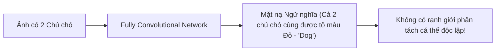

#### d. Code Thực chiến (C++ & Python)

```cpp
// C++17: Tìm Nhãn Lớp Chiếm Ưu thế cho Từng Pixel (Argmax across Channels)
#include <iostream>
#include <vector>

std::vector<int> argmax_channels_to_label_map(const std::vector<float>& logits, int C, int H, int W) {
    std::vector<int> label_map(H * W, 0);
    int spatial = H * W;

    for (int i = 0; i < spatial; ++i) {
        float max_logit = -1e9f;
        int best_c = 0;
        for (int c = 0; c < C; ++c) {
            float val = logits[c * spatial + i];
            if (val > max_logit) {
                max_logit = val;
                best_c = c;
            }
        }
        label_map[i] = best_c;
    }
    return label_map;
}

int main() {
    // 2 channels, 1x2 pixels
    std::vector<float> logits = {0.1f, 0.9f,  0.8f, 0.2f};
    auto labels = argmax_channels_to_label_map(logits, 2, 1, 2);
    std::cout << "Pixel 0 label: " << labels[0] << " | Pixel 1 label: " << labels[1] << "\n";
    return 0;
}
```

```python
# Python / PyTorch: FCN 1x1 Conv Head Output
import torch
import torch.nn as nn

class SimpleFCNHead(nn.Module):
    def __init__(self, in_channels: int, num_classes: int):
        super().__init__()
        self.conv = nn.Conv2d(in_channels, num_classes, kernel_size=1)

    def forward(self, feature_map: torch.Tensor, original_size: tuple[int, int]) -> torch.Tensor:
        logits = self.conv(feature_map)
        # Upsample về độ phân giải gốc
        return nn.functional.interpolate(logits, size=original_size, mode='bilinear', align_corners=False)

head = SimpleFCNHead(in_channels=512, num_classes=19) # 19 lớp của Cityscapes
features = torch.randn(2, 512, 16, 16)
seg_map = head(features, original_size=(128, 128))
print("Semantic Output Map Shape:", seg_map.shape) # [2, 19, 128, 128]
```

#### e. Lỗi Thường gặp & Ổn định Số học
- **Class Imbalance between Background and Small Objects**: Các lớp có diện tích nhỏ (như cột đèn giao thông chỉ chiếm 0.1% số pixel) bị lấn át hoàn toàn bởi lớp đường đi (chiếm 60%), khiến mạng bỏ qua lớp nhỏ nếu không có trọng số Focal/Dice loss.

#### f. Ứng dụng Thực chiến trong AI
Hệ thống xe tự hành phân đoạn làn đường và vỉa hè (Cityscapes Benchmark), phân tích ảnh nội soi phát hiện polyp đại tràng.

---

### 3. Instance Segmentation (Phân đoạn Cá thể)

#### a. Định nghĩa Bản chất Toán học
Instance Segmentation kết hợp đồng thời Object Detection và Semantic Segmentation: Vừa định vị hộp bao, vừa phân loại lớp, vừa tách biệt **mặt nạ nhị phân độc lập** cho từng cá thể riêng biệt thuộc lớp đếm được (Things):
$$\mathcal{Y}_{\text{instance}} = \{(\mathbf{b}_i, c_i, \mathbf{M}_i)\}_{i=1}^K, \quad \mathbf{M}_i \in \{0, 1\}^{H \times W}$$
Nếu trong ảnh có 3 người, mô hình sẽ sinh ra 3 mặt nạ khác nhau: `Person_1`, `Person_2`, `Person_3`.
Mô hình chuẩn mực: **Mask R-CNN (He et al., 2017)** mở rộng Faster R-CNN bằng cách gắn thêm một nhánh FCN nhỏ (Mask Head) song song với nhánh phân loại và hộp bao:
$$\mathcal{L} = \mathcal{L}_{\text{cls}} + \mathcal{L}_{\text{box}} + \mathcal{L}_{\text{mask}}$$
với $\mathcal{L}_{\text{mask}}$ là hàm mất mát Binary Cross-Entropy trung bình tính trên mặt nạ nhị phân kích thước $28 \times 28$ của lớp đúng.

#### b. Cơ chế Tầng Sâu & Điện toán
- **Decoupled Mask and Class Prediction**: Thay vì dùng Softmax cạnh tranh giữa các lớp trên mặt nạ pixel, Mask R-CNN sử dụng hàm Sigmoid độc lập cho từng lớp và chỉ tính loss trên kênh tương ứng với ground-truth class. Điều này cho phép tách biệt hoàn toàn bài toán phân loại danh tính khỏi bài toán trích xuất hình dáng hình học.

#### c. Sơ đồ Minh họa (Mermaid Diagram)
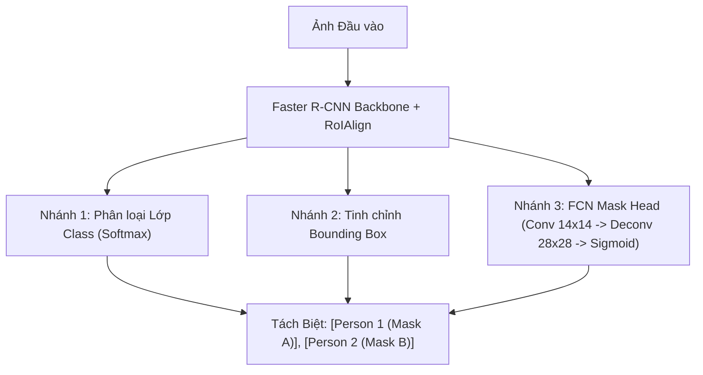

#### d. Code Thực chiến (C++ & Python)

```cpp
// C++17: Gán Mặt nạ Nhị phân 28x28 của RoI về Tọa độ Toàn Ảnh
#include <iostream>
#include <vector>

void paste_mask_in_image(const std::vector<float>& mask_28x28, std::vector<unsigned char>& full_mask,
                         int img_h, int img_w, int x1, int y1, int x2, int y2) {
    int box_w = x2 - x1;
    int box_h = y2 - y1;

    for (int y = 0; y < box_h; ++y) {
        for (int x = 0; x < box_w; ++x) {
            // Ánh xạ tọa độ về 28x28
            int src_x = (x * 28) / box_w;
            int src_y = (y * 28) / box_h;
            float prob = mask_28x28[src_y * 28 + src_x];

            if (prob > 0.5f) {
                int img_y = y1 + y;
                int img_x = x1 + x;
                if (img_y < img_h && img_x < img_w) {
                    full_mask[img_y * img_w + img_x] = 255;
                }
            }
        }
    }
}

int main() {
    std::vector<float> roi_mask(28 * 28, 0.9f); // Mask toàn 1
    std::vector<unsigned char> full_img(100 * 100, 0);
    paste_mask_in_image(roi_mask, full_img, 100, 100, 10, 10, 38, 38);
    std::cout << "Pasted mask pixel at (15, 15): " << static_cast<int>(full_img[15 * 100 + 15]) << "\n";
    return 0;
}
```

```python
# Python / PyTorch: Mask R-CNN Binary Mask Loss
import torch
import torch.nn.functional as F

def mask_rcnn_loss(mask_logits: torch.Tensor, target_masks: torch.Tensor, class_labels: torch.Tensor) -> torch.Tensor:
    # mask_logits: [N, Num_Classes, 28, 28], target_masks: [N, 28, 28], class_labels: [N]
    num_rois = mask_logits.size(0)
    # Chỉ trích xuất kênh logit của đúng lớp target
    selected_logits = mask_logits[torch.arange(num_rois), class_labels] # [N, 28, 28]
    return F.binary_cross_entropy_with_logits(selected_logits, target_masks)

logits = torch.randn(4, 80, 28, 28) # 4 RoIs, 80 COCO classes
targets = torch.randint(0, 2, (4, 28, 28)).float()
labels = torch.tensor([1, 5, 0, 12])
print("Mask R-CNN Loss:", mask_rcnn_loss(logits, targets, labels).item())
```

#### e. Lỗi Thường gặp & Ổn định Số học
- **Overlapping Instances Disambiguation**: Khi hai đối tượng cùng lớp dính chặt vào nhau và có bounding box gần như trùng khít, việc tách biệt ranh giới pixel tiếp xúc rất dễ bị sai lệch nếu không dùng kỹ thuật PointRend (lấy mẫu điểm lân cận biên).

#### f. Ứng dụng Thực chiến trong AI
Đếm số lượng quả trên cây nông nghiệp thông minh, cánh tay robot gắp từng linh kiện rời rạc trong dây chuyền lắp ráp.

---

### 4. Panoptic Segmentation (Phân đoạn Toàn cảnh)

#### a. Định nghĩa Bản chất Toán học
Panoptic Segmentation (Kirillov et al., 2019) là đỉnh cao hợp nhất, giải quyết toàn bộ bức ảnh không chừa một pixel nào:
$$\mathbf{p} = (x, y) \mapsto (\text{Semantic Class } c, \text{ Instance ID } id)$$
Phân biệt hai phạm trù thực thể:
1. **Things**: Các đối tượng đếm được, có hình dạng xác định (Người, Xe hơi, Động vật) $\to$ có Instance ID riêng biệt ($id > 0$).
2. **Stuff**: Các vùng vật chất vô định hình, trải dài liên tục (Bầu trời, Mặt đường, Bãi cỏ, Mặt nước) $\to$ không phân chia cá thể ($id = \text{None}$).
Thước đo đánh giá tự động: **Panoptic Quality (PQ)**:
$$\text{PQ} = \underbrace{\frac{\sum_{(p, g) \in \text{TP}} \text{IoU}(p, g)}{|\text{TP}|}}_{\text{Segmentation Quality (SQ)}} \times \underbrace{\frac{|\text{TP}|}{|\text{TP}| + \frac{1}{2}|\text{FP}| + \frac{1}{2}|\text{FN}|}}_{\text{Recognition Quality (RQ)}}$$

#### b. Cơ chế Tầng Sâu & Điện toán
- **Mask2Former Architecture**: Kiến trúc SOTA hiện nay sử dụng Universal Mask Classification: Cả Things và Stuff đều được mô hình hóa thống nhất dưới dạng dự đoán $N$ mặt nạ nhị phân kết hợp phân loại lớp thông qua thuật toán Hungarian Matching, loại bỏ việc phải ghép nối hai mạng FCN và Mask R-CNN cồng kềnh.

#### c. Sơ đồ Minh họa (Mermaid Diagram)
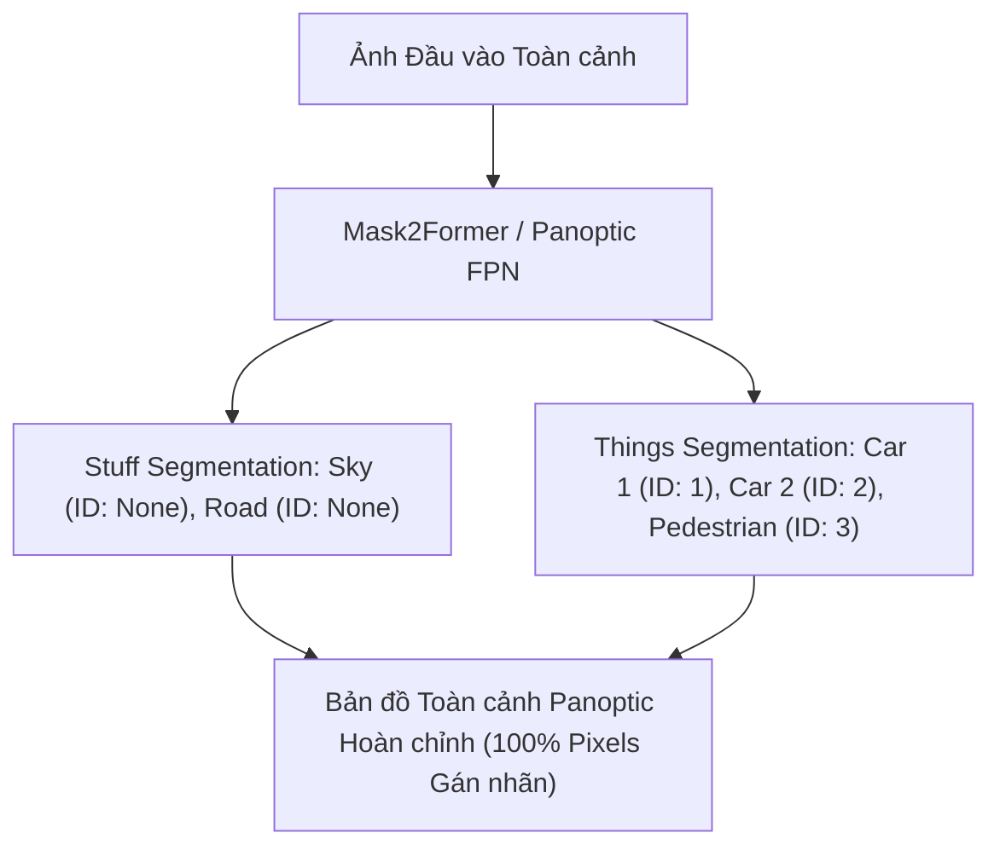

#### d. Code Thực chiến (C++ & Python)

```cpp
// C++17: Tính Panoptic Quality (PQ) từ TP, FP, FN và Tổng IoU
#include <iostream>

float compute_panoptic_quality(float sum_iou_tp, int num_tp, int num_fp, int num_fn) {
    if (num_tp == 0) return 0.0f;
    float sq = sum_iou_tp / num_tp; // Segmentation Quality
    float rq = static_cast<float>(num_tp) / (num_tp + 0.5f * num_fp + 0.5f * num_fn); // Recognition Quality
    return sq * rq;
}

int main() {
    float pq = compute_panoptic_quality(8.5f, 10, 2, 1);
    std::cout << "Panoptic Quality (PQ): " << pq * 100.0f << "%\n";
    return 0;
}
```

```python
# Python: Panoptic Prediction ID Encoding Format (Cityscapes RGB encoding)
import numpy as np

def encode_panoptic_id_to_rgb(category_id: int, instance_id: int) -> tuple[int, int, int]:
    # Mã hóa panoptic ID vào 3 kênh R, G, B: ID = R + G * 256 + B * 256^2
    panoptic_id = category_id * 1000 + instance_id
    r = panoptic_id % 256
    g = (panoptic_id // 256) % 256
    b = (panoptic_id // (256 * 256)) % 256
    return (r, g, b)

print("Encoded RGB for Car #2 (Category 26):", encode_panoptic_id_to_rgb(category_id=26, instance_id=2))
```

#### e. Lỗi Thường gặp & Ổn định Số học
- **Overlap Conflicts**: Khi kết hợp thủ công hai luồng riêng biệt, một pixel có thể bị dự đoán vừa là `Road` (Stuff) vừa nằm trong mặt nạ `Car` (Things), đòi hỏi tầng phân giải xung đột theo thứ tự ưu tiên (Things đè lên Stuff).

#### f. Ứng dụng Thực chiến trong AI
Hệ thống nhận thức không gian toàn diện cho xe tự hành (Tesla Vision, Waymo Driver) và thị giác tái tạo thế giới cho Metaverse.

---

### 5. U-Net (Kiến trúc Mạng U-Net)

#### a. Định nghĩa Bản chất Toán học
U-Net (Ronneberger et al., 2015) là kiến trúc mạng nơ-ron tích chập Encoder-Decoder đối xứng hình chữ U, được thiết kế đặc thù cho bài toán phân đoạn ảnh y tế với lượng dữ liệu huấn luyện rất nhỏ.
Đột phá toán học cốt lõi: **Đường tắt Bỏ qua Tầng (Skip Connections)**:
$$\mathbf{X}_{\text{dec}}^l = \text{Conv}\left( [\mathbf{X}_{\text{dec}}^{l+1} \uparrow_{2\times} \ ; \ \mathbf{X}_{\text{enc}}^l] \right)$$
Các Skip Connections sao chép trực tiếp bản đồ đặc trưng có độ phân giải cao từ Encoder sang Decoder trước mỗi bước tích chập. Điều này cho phép:
1. Giữ nguyên thông tin không gian chi tiết ở các tầng nông (định vị ranh giới tế bào chính xác).
2. Kết hợp với thông tin ngữ nghĩa trừu tượng cao ở các tầng sâu (nhận dạng loại bệnh học).

#### b. Cơ chế Tầng Sâu & Điện toán
- **Memory Overhead of Skip Buffers**: Các bản đồ đặc trưng từ Encoder phải được giữ lại trong bộ nhớ GPU VRAM cho đến tận khi Decoder giải mã tới tầng tương ứng (lưu trữ lâu hơn nhiều so với mạng tuần tự thông thường), làm tăng bộ nhớ đỉnh (Peak Memory).

#### c. Sơ đồ Minh họa (Mermaid Diagram)
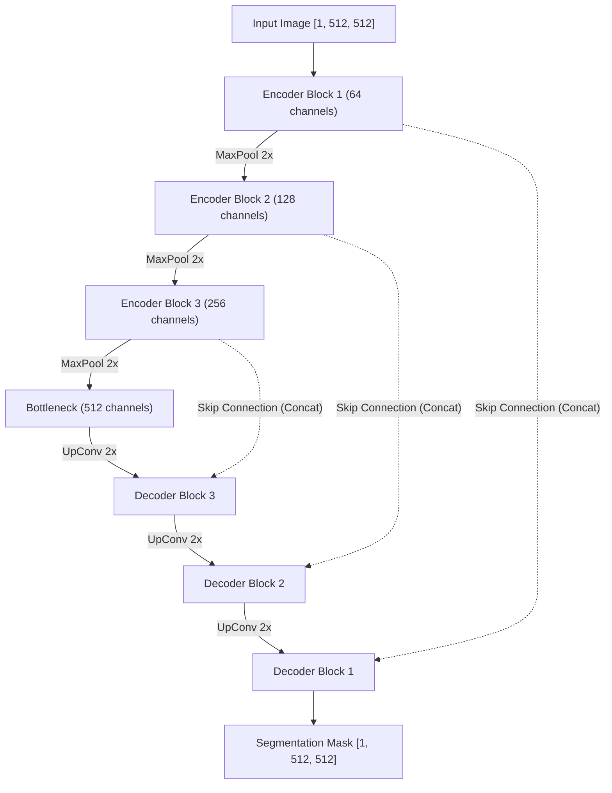

#### d. Code Thực chiến (C++ & Python)

```cpp
// C++17: Ghép Nối Kênh Ten-xơ Skip Connection (Concatenate Channels)
#include <iostream>
#include <vector>

void concat_skip_connection(const float* enc_feat, const float* dec_feat, float* out_feat,
                            int C_enc, int C_dec, int spatial_size) {
    // Nối kênh: out có (C_enc + C_dec) kênh
    for (int c = 0; c < C_enc; ++c) {
        for (int i = 0; i < spatial_size; ++i) {
            out_feat[c * spatial_size + i] = enc_feat[c * spatial_size + i];
        }
    }
    for (int c = 0; c < C_dec; ++c) {
        for (int i = 0; i < spatial_size; ++i) {
            out_feat[(C_enc + c) * spatial_size + i] = dec_feat[c * spatial_size + i];
        }
    }
}

int main() {
    std::vector<float> enc(4, 1.0f); // 1 channel, 2x2
    std::vector<float> dec(4, 2.0f); // 1 channel, 2x2
    std::vector<float> out(8);
    concat_skip_connection(enc.data(), dec.data(), out.data(), 1, 1, 4);
    std::cout << "Concatenated Channels Total Elements: " << out.size() << "\n";
    return 0;
}
```

```python
# Python / PyTorch: Complete U-Net Architecture Block
import torch
import torch.nn as nn

class UNetDoubleConv(nn.Module):
    def __init__(self, in_ch: int, out_ch: int):
        super().__init__()
        self.conv = nn.Sequential(
            nn.Conv2d(in_ch, out_ch, 3, padding=1),
            nn.BatchNorm2d(out_ch),
            nn.ReLU(inplace=True),
            nn.Conv2d(out_ch, out_ch, 3, padding=1),
            nn.BatchNorm2d(out_ch),
            nn.ReLU(inplace=True)
        )
    def forward(self, x): return self.conv(x)

class UNetTiny(nn.Module):
    def __init__(self):
        super().__init__()
        self.enc1 = UNetDoubleConv(1, 32)
        self.pool = nn.MaxPool2d(2)
        self.bottleneck = UNetDoubleConv(32, 64)
        self.up = nn.ConvTranspose2d(64, 32, 2, stride=2)
        self.dec1 = UNetDoubleConv(64, 32)
        self.out = nn.Conv2d(32, 1, 1)

    def forward(self, x):
        e1 = self.enc1(x)
        b = self.bottleneck(self.pool(e1))
        d1 = self.up(b)
        cat = torch.cat([d1, e1], dim=1) # Skip connection
        return self.out(self.dec1(cat))

model = UNetTiny()
x = torch.randn(1, 1, 64, 64)
print("U-Net Output Shape:", model(x).shape) # [1, 1, 64, 64]
```

#### e. Lỗi Thường gặp & Ổn định Số học
- **Padding Mismatch**: U-Net gốc năm 2015 sử dụng tích chập không đệm (`padding=0`), khiến kích thước ảnh sau mỗi tầng bị co nhỏ lại và đòi hỏi phép cắt xén (Center Crop) khi nối Skip Connection. Phiên bản hiện đại luôn dùng `padding=1` để bảo toàn kích thước không gian.

#### f. Ứng dụng Thực chiến trong AI
Xương sống của các mô hình khuếch tán hình ảnh (Stable Diffusion Denoising U-Net), phân đoạn khối u trong ảnh CT/MRI y học.

---

### 6. DeepLab (Họ Mô hình DeepLab & Tích chập Lỗ hổng)

#### a. Định nghĩa Bản chất Toán học
Họ mô hình DeepLab (v1, v2, v3, v3+ của Chen et al., Google) giải quyết sự đánh đổi muôn thuở trong CNN: Các tầng Pooling liên tiếp làm tăng Receptive Field nhưng lại phá hủy độ phân giải không gian.
Hai phát minh toán học đột phá:
1. **Tích chập Lỗ hổng (Atrous / Dilated Convolution)**: Chèn thêm $r - 1$ số 0 vào giữa các trọng số của kernel (với $r$ là Dilation Rate):
   $$\mathbf{y}[i] = \sum_k \mathbf{x}[i + r \cdot k] \mathbf{w}[k]$$
   Tăng trường tiếp nhận (Receptive Field) theo cấp số mũ mà **hoàn toàn không tăng số lượng tham số và không làm giảm độ phân giải của Feature Map**.
2. **Atrous Spatial Pyramid Pooling (ASPP)**: Áp dụng song song nhiều bộ lọc Dilated Conv với các tỷ lệ khác nhau ($r \in \{6, 12, 18\}$) kết hợp với Global Image Pooling để thu nhận ngữ cảnh đa quy mô.

#### b. Cơ chế Tầng Sâu & Điện toán
- **Gridding Artifacts**: Khi xếp chồng liên tiếp các lớp có cùng dilation rate cao (e.g. $r=4, 4, 4$), kernel chỉ lấy mẫu trên một lưới thưa thớt, bỏ sót tới $75\%$ số điểm ảnh lân cận. DeepLab khắc phục bằng cấu trúc Hybrid Dilated Convolution (HDC) thay đổi tỷ lệ nối tiếp: $r = [1, 2, 3]$.

#### c. Sơ đồ Minh họa (Mermaid Diagram)
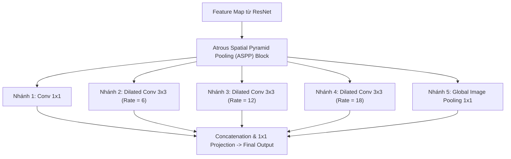

#### d. Code Thực chiến (C++ & Python)

```cpp
// C++17: Tính Trường Tiếp nhận Hiệu dụng (Effective Kernel Size) của Dilated Conv
#include <iostream>

int compute_dilated_kernel_size(int base_k, int dilation_rate) {
    // K_eff = K + (K - 1) * (rate - 1)
    return base_k + (base_k - 1) * (dilation_rate - 1);
}

int main() {
    int k_3x3_r6 = compute_dilated_kernel_size(3, 6);
    std::cout << "Effective Receptive Field of 3x3 kernel with rate=6: " 
              << k_3x3_r6 << "x" << k_3x3_r6 << " pixels (Chỉ dùng 9 tham số!)\n";
    return 0;
}
```

```python
# Python / PyTorch: Atrous Spatial Pyramid Pooling (ASPP) Layer
import torch
import torch.nn as nn

class ASPPBlock(nn.Module):
    def __init__(self, in_ch: int, out_ch: int, rates: list[int] = [6, 12, 18]):
        super().__init__()
        self.conv1x1 = nn.Conv2d(in_ch, out_ch, 1, bias=False)
        self.conv_rates = nn.ModuleList([
            nn.Conv2d(in_ch, out_ch, 3, padding=r, dilation=r, bias=False) for r in rates
        ])
        self.global_pool = nn.Sequential(
            nn.AdaptiveAvgPool2d(1),
            nn.Conv2d(in_ch, out_ch, 1, bias=False)
        )
        self.out_proj = nn.Conv2d(out_ch * (len(rates) + 2), out_ch, 1, bias=False)

    def forward(self, x: torch.Tensor) -> torch.Tensor:
        h, w = x.shape[-2:]
        res = [self.conv1x1(x)]
        for conv in self.conv_rates: res.append(conv(x))
        gp = nn.functional.interpolate(self.global_pool(x), size=(h, w), mode='bilinear', align_corners=False)
        res.append(gp)
        return self.out_proj(torch.cat(res, dim=1))

aspp = ASPPBlock(in_ch=512, out_ch=256)
feat = torch.randn(2, 512, 32, 32)
print("ASPP Output Shape:", aspp(feat).shape) # [2, 256, 32, 32]
```

#### e. Lỗi Thường gặp & Ổn định Số học
- **Dilation Rate Too Large**: Khi kích thước feature map nhỏ hơn dilation rate ($H < r$), phép lấy mẫu lỗ hổng trượt ra ngoài rìa, tương đương với tích chập $1 \times 1$ thông thường và mất khả năng nắm bắt ngữ cảnh.

#### f. Ứng dụng Thực chiến trong AI
DeepLabv3+ là mô hình chuẩn mực thống trị các cuộc thi phân đoạn ngữ nghĩa tự lái (Pascal VOC, Cityscapes).

---

### 7. Mask R-CNN (Kiến trúc Mask R-CNN)

#### a. Định nghĩa Bản chất Toán học
Mask R-CNN (Kaiming He et al., ICCV 2017 Best Paper) là mô hình kinh điển giải quyết toàn diện bài toán Instance Segmentation và Keypoint Estimation.
Mô hình kế thừa toàn bộ cấu trúc của Faster R-CNN và bổ sung thêm:
$$\mathcal{L} = \mathcal{L}_{\text{cls}} + \mathcal{L}_{\text{box}} + \mathcal{L}_{\text{mask}}$$
Cơ chế **RoIAlign** thay thế RoI Pooling, bảo toàn độ chính xác không gian tuyệt đối.
Tầng Mask Head là một chuỗi 4 lớp tích chập $3 \times 3$ liên tiếp (giữ nguyên độ phân giải $14 \times 14$), kết thúc bằng một lớp tích chập chuyển vị (Deconvolution / Transposed Conv $2 \times 2$) phóng đại không gian lên $28 \times 28$, sau đó áp dụng phép chiếu $1 \times 1$ ra $K$ kênh mặt nạ nhị phân.

#### b. Cơ chế Tầng Sâu & Điện toán
- **Memory Footprint of Mask Proposals**: Khi huấn luyện, mỗi ảnh có tới 512 RoIs được đưa vào Mask Head. Việc lưu trữ activation tensor $[512, 256, 28, 28]$ ngốn hàng Gigabyte VRAM trên mỗi GPU, đòi hỏi kỹ thuật đồng bộ hóa theo lô (Synchronized BatchNorm across GPUs).

#### c. Sơ đồ Minh họa (Mermaid Diagram)
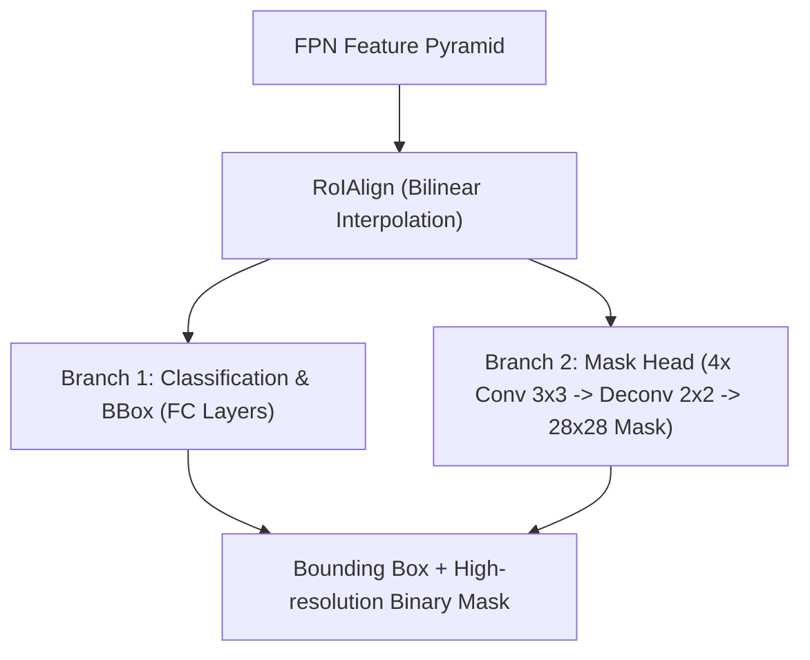

#### d. Code Thực chiến (C++ & Python)

```cpp
// C++17: Tính Diện tích Mặt nạ Nhị phân (Pixel Count Mask Area)
#include <iostream>
#include <vector>

int compute_mask_pixel_area(const std::vector<unsigned char>& binary_mask) {
    int area = 0;
    for (unsigned char p : binary_mask) {
        if (p > 128) area++;
    }
    return area;
}

int main() {
    std::vector<unsigned char> mask = {0, 255, 255, 0};
    std::cout << "Mask Area: " << compute_mask_pixel_area(mask) << " pixels\n";
    return 0;
}
```

```python
# Python / PyTorch: Mask R-CNN FCN Mask Head Definition
import torch
import torch.nn as nn

class MaskRCNNMaskHead(nn.Module):
    def __init__(self, in_channels: int = 256, num_classes: int = 80):
        super().__init__()
        # 4 lớp tích chập 3x3 giữ nguyên kích thước
        self.convs = nn.Sequential(
            nn.Conv2d(in_channels, 256, 3, padding=1), nn.ReLU(),
            nn.Conv2d(256, 256, 3, padding=1), nn.ReLU(),
            nn.Conv2d(256, 256, 3, padding=1), nn.ReLU(),
            nn.Conv2d(256, 256, 3, padding=1), nn.ReLU(),
        )
        # Deconvolution 2x2 tăng kích thước 14x14 -> 28x28
        self.deconv = nn.ConvTranspose2d(256, 256, 2, stride=2)
        self.out_mask = nn.Conv2d(256, num_classes, 1)

    def forward(self, roi_features: torch.Tensor) -> torch.Tensor:
        # roi_features: [Num_RoIs, 256, 14, 14]
        x = self.convs(roi_features)
        x = nn.functional.relu(self.deconv(x)) # [Num_RoIs, 256, 28, 28]
        return self.out_mask(x)

head = MaskRCNNMaskHead()
rois = torch.randn(4, 256, 14, 14)
print("Mask Head Output Shape:", head(rois).shape) # [4, 80, 28, 28]
```

#### e. Lỗi Thường gặp & Ổn định Số học
- **Quantization Artifacts in Post-processing**: Phóng to mặt nạ $28 \times 28$ lên kích thước bounding box gốc bằng phép nội suy Nearest-Neighbor sẽ tạo ra viền răng cưa thô; bắt buộc phải dùng Bilinear Interpolation và phân ngưỡng $0.5$.

#### f. Ứng dụng Thực chiến trong AI
Detectron2, MMDetection, phân tích tế bào tự động trong sinh học và hiệu ứng điện ảnh VFX.

---

### 8. Segment Anything Model - SAM (Mô hình Nền tảng SAM)

#### a. Định nghĩa Bản chất Toán học
SAM (Kirillov et al., Meta AI, 2023) là mô hình nền tảng đầu tiên trong lịch sử Computer Vision có khả năng **Phân đoạn Mọi thứ theo Nhắc lệnh (Promptable Segmentation Task)** với tính khái quát hóa Zero-Shot phi thường trên tập dữ liệu khổng lồ SA-1B (11 triệu ảnh, 1.1 tỷ mặt nạ).
Kiến trúc 3 thành phần:
1. **Image Encoder (Nặng - ViT Backbone)**: Chạy một lần duy nhất cho mỗi bức ảnh, tạo ra embedding không gian đa chiều $\mathbf{F} \in \mathbb{R}^{256 \times 64 \times 64}$.
2. **Prompt Encoder (Siêu nhẹ)**:
   - Nhắc lệnh dạng điểm (Points) và hộp (Boxes): Mã hóa qua Positional Embeddings.
   - Nhắc lệnh dạng mặt nạ (Dense Masks): Mã hóa qua mạng tích chập.
3. **Mask Decoder (Siêu nhẹ - Two-way Transformer)**: So khớp tương tác Cross-Attention hai chiều giữa Image Embedding và Prompt Tokens, sinh ra mặt nạ trong **<50ms trên trình duyệt web**.

#### b. Cơ chế Tầng Sâu & Điện toán
- **Ambiguity-Aware Multimask Output**: Khi lời nhắc không rõ ràng (ví dụ người dùng click chuột vào áo của một người, có thể hiểu là muốn phân đoạn: *Chiếc cúc áo*, *Chiếc áo*, hay *Cả người đó*), SAM giải quyết sự nhập nhằng toán học bằng cách **đồng thời sinh ra 3 mặt nạ hợp lệ ở 3 cấp độ phân cấp (Subpart, Part, Whole)** cùng với điểm số tự đánh giá chất lượng (IoU Score Prediction).

#### c. Sơ đồ Minh họa (Mermaid Diagram)
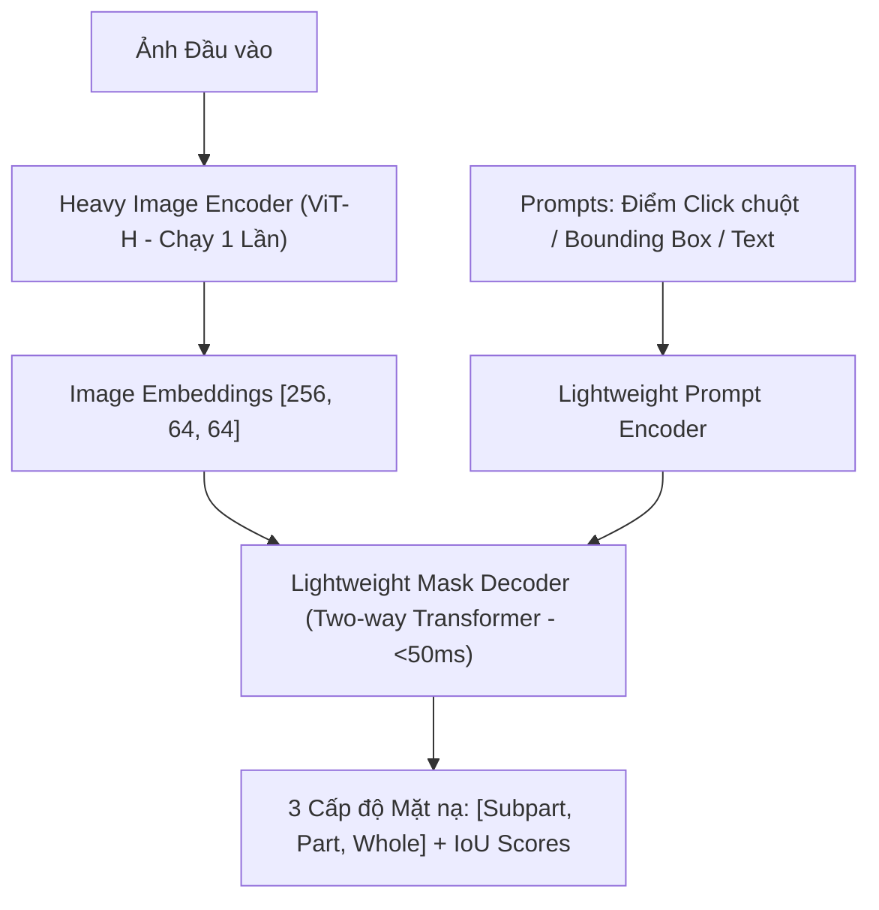

#### d. Code Thực chiến (C++ & Python)

```cpp
// C++17: Chọn Mặt nạ có Điểm Tin cậy Cao nhất từ 3 Cấp độ SAM Masks
#include <iostream>
#include <vector>
#include <algorithm>

struct SAMMaskCandidate {
    int level; // 0: Subpart, 1: Part, 2: Whole
    float predicted_iou;
};

int select_best_sam_mask(const std::vector<SAMMaskCandidate>& candidates) {
    auto best = std::max_element(candidates.begin(), candidates.end(), [](const auto& a, const auto& b) {
        return a.predicted_iou < b.predicted_iou;
    });
    return best->level;
}

int main() {
    std::vector<SAMMaskCandidate> masks = {{0, 0.72f}, {1, 0.95f}, {2, 0.88f}};
    std::cout << "Selected SAM Mask Level: " << select_best_sam_mask(masks) << "\n";
    return 0;
}
```

```python
# Python: SAM Mask Decoder Cross-Attention Concept
import torch
import torch.nn as nn

class TwoWayAttentionBlock(nn.Module):
    def __init__(self, dim: int = 256):
        super().__init__()
        self.prompt_self_attn = nn.MultiheadAttention(dim, num_heads=8, batch_first=True)
        self.prompt_to_img = nn.MultiheadAttention(dim, num_heads=8, batch_first=True)
        self.img_to_prompt = nn.MultiheadAttention(dim, num_heads=8, batch_first=True)

    def forward(self, queries: torch.Tensor, img_feats: torch.Tensor):
        # queries: [Batch, N_prompts, Dim], img_feats: [Batch, H*W, Dim]
        q, _ = self.prompt_self_attn(queries, queries, queries)
        q, _ = self.prompt_to_img(query=q, key=img_feats, value=img_feats)
        img, _ = self.img_to_prompt(query=img_feats, key=q, value=q)
        return q, img

block = TwoWayAttentionBlock(256)
prompt_tokens = torch.randn(1, 5, 256)
image_tokens = torch.randn(1, 4096, 256)
q_out, img_out = block(prompt_tokens, image_tokens)
print("Updated Prompt Tokens Shape:", q_out.shape)
```

#### e. Lỗi Thường gặp & Ổn định Số học
- **Heavy Encoder Latency**: ViT-H Image Encoder quá nặng ($\approx 636$ triệu tham số), không thể chạy trên các thiết bị edge nếu không áp dụng phiên bản chưng cất MobileSAM / FastSAM.

#### f. Ứng dụng Thực chiến trong AI
Tự động hóa hoàn toàn việc dán nhãn dữ liệu AI (Data Engine), chỉnh sửa ảnh thông minh trong Photoshop (Generative Fill), phân đoạn đối tượng trong y học và vũ trụ.

---

### 9. Keypoint Detection (Phát hiện Điểm Then chốt)

#### a. Định nghĩa Bản chất Toán học
Keypoint Detection định vị các tọa độ điểm mốc giải phẫu hoặc hình học trên đối tượng:
$$\mathcal{K} = \{(x_k, y_k, v_k)\}_{k=1}^K, \quad v_k \in \{0: \text{Không xuất hiện}, 1: \text{Bị che khuất}, 2: \text{Nhìn thấy rõ}\}$$
Phương pháp tiếp cận toán học hiện đại: **Heatmap Regression**:
Thay vì hồi quy trực tiếp tọa độ $(x, y)$ (rất khó tối ưu và phi tuyến tính), mô hình dự đoán một bản đồ nhiệt xác suất 2D cho mỗi điểm then chốt:
$$\mathbf{H}_k(x, y) = \exp\left( -\frac{(x - x_k^*)^2 + (y - y_k^*)^2}{2\sigma^2} \right)$$
Hàm mất mát huấn luyện: Mean Squared Error (MSE) giữa heatmap dự đoán và Gaussian heatmap mục tiêu:
$$\mathcal{L}_{\text{heatmap}} = \frac{1}{K} \sum_{k=1}^K \|\mathbf{H}_k - \mathbf{H}_k^*\|_2^2$$

#### b. Cơ chế Tầng Sâu & Điện toán
- **Sub-pixel Maximum Refinement (DARK - Distribution-Aware Coordinate Representation)**: Khi đưa tọa độ cực đại từ Heatmap trở lại ảnh gốc, bước nhảy stride (e.g. $4\times$) gây ra sai số làm tròn số nguyên. DARK sử dụng khai triển Taylor bậc hai trên Heatmap để nội suy tọa độ cực đại dưới mức pixel (Sub-pixel accuracy):
  $$\mathbf{p}^* = \mathbf{p}_{\max} - \left( \nabla^2 \mathbf{H}(\mathbf{p}_{\max}) \right)^{-1} \nabla \mathbf{H}(\mathbf{p}_{\max})$$

#### c. Sơ đồ Minh họa (Mermaid Diagram)
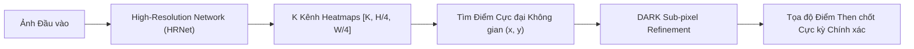

#### d. Code Thực chiến (C++ & Python)

```cpp
// C++17: Tạo Gaussian Heatmap Ground Truth cho 1 Keypoint
#include <iostream>
#include <vector>
#include <cmath>

void generate_gaussian_heatmap(std::vector<float>& heatmap, int H, int W, float cx, float cy, float sigma = 2.0f) {
    heatmap.assign(H * W, 0.0f);
    float two_sigma_sq = 2.0f * sigma * sigma;

    for (int y = 0; y < H; ++y) {
        for (int x = 0; x < W; ++x) {
            float dist_sq = (x - cx) * (x - cx) + (y - cy) * (y - cy);
            heatmap[y * W + x] = std::exp(-dist_sq / two_sigma_sq);
        }
    }
}

int main() {
    std::vector<float> hm;
    generate_gaussian_heatmap(hm, 5, 5, 2.0f, 2.0f, 1.0f);
    std::cout << "Center Heatmap Value (Peak): " << hm[2 * 5 + 2] << "\n";
    return 0;
}
```

```python
# Python / PyTorch: Trích xuất Tọa độ Keypoint từ Heatmap bằng Argmax
import torch

def get_keypoints_from_heatmaps(heatmaps: torch.Tensor) -> torch.Tensor:
    # heatmaps: [Batch, K, H, W]
    B, K, H, W = heatmaps.shape
    flat_heatmaps = heatmaps.view(B, K, -1)
    max_vals, max_indices = torch.max(flat_heatmaps, dim=-1)

    preds_x = (max_indices % W).float()
    preds_y = (max_indices // W).float()
    return torch.stack([preds_x, preds_y, max_vals], dim=-1)

mock_hm = torch.zeros(1, 1, 10, 10)
mock_hm[0, 0, 4, 7] = 1.0 # Peak tại (x=7, y=4)
kpts = get_keypoints_from_heatmaps(mock_hm)
print("Extracted Keypoint (x, y, conf):", kpts[0, 0].tolist())
```

#### e. Lỗi Thường gặp & Ổn định Số học
- **Quantization Shift**: Bỏ qua bước giải mã sub-pixel khiến kết quả đánh giá mAP theo thước đo Object Keypoint Similarity (OKS) bị tụt từ $2\% - 5\%$.

#### f. Ứng dụng Thực chiến trong AI
Theo dõi chuyển động vận động viên, nhận diện cử chỉ bàn tay (MediaPipe Hands), chẩn đoán thoái hóa khớp y khoa.

---

### 10. Pose Estimation & Human Pose Estimation (Ước lượng Tư thế Người)

#### a. Định nghĩa Bản chất Toán học
Ước lượng tư thế người (HPE) dựng lại khung xương giải phẫu học cơ thể con người (Skeleton) trong không gian 2D hoặc 3D. Bộ chuẩn COCO định nghĩa **17 khớp then chốt**:
$$\mathcal{V}_{\text{COCO}} = \{\text{Mũi, 2 Mắt, 2 Tai, 2 Vai, 2 Khuỷu, 2 Cổ tay, 2 Hông, 2 Đầu gối, 2 Cổ chân}\}$$
Hai trường phái kiến trúc:
1. **Top-Down Paradigm**: Chạy bộ phát hiện người (Person Detector) trước, sau đó crop từng người nạp vào mạng ước lượng tư thế đơn lẻ (HRNet, ViTPose). Độ chính xác cực cao nhưng độ trễ tăng tuyến tính theo số lượng người trong ảnh.
2. **Bottom-Up Paradigm (OpenPose)**: Phát hiện toàn bộ các khớp của mọi người trong ảnh cùng một lúc, sau đó dùng trường vector liên kết bộ phận (**Part Affinity Fields - PAFs**) để ghép nối các khớp thành từng bộ khung xương hoàn chỉnh:
   $$\mathbf{L}_c(\mathbf{p}) = \begin{cases} \mathbf{v} & \text{nếu } \mathbf{p} \text{ nằm trên chi } c \\ \mathbf{0} & \text{ngược lại} \end{cases}$$
Thước đo đánh giá: **Object Keypoint Similarity (OKS)**.

#### b. Cơ chế Tầng Sâu & Điện toán
- **Bipartite Graph Matching on PAFs**: Thuật toán OpenPose tính tích phân đường dọc theo đoạn thẳng nối hai khớp để tính độ tương thích, sau đó dùng giải thuật Hungarian gán tối ưu giữa tập các cổ tay và khuỷu tay.

#### c. Sơ đồ Minh họa (Mermaid Diagram)
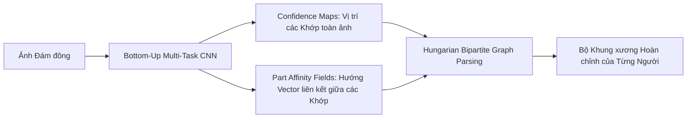

#### d. Code Thực chiến (C++ & Python)

```cpp
// C++17: Tính Object Keypoint Similarity (OKS) giữa 2 Khung xương COCO
#include <iostream>
#include <vector>
#include <cmath>

struct Keypoint { float x, y; int v; };

float compute_coco_oks(const std::vector<Keypoint>& pred, const std::vector<Keypoint>& gt, float box_scale) {
    // Trọng số chuẩn sigma của COCO cho 17 khớp
    static const float sigmas[17] = {
        0.026f, 0.025f, 0.025f, 0.035f, 0.035f, 0.079f, 0.079f, 0.072f, 0.072f,
        0.062f, 0.062f, 0.107f, 0.107f, 0.087f, 0.087f, 0.089f, 0.089f
    };

    float sum_e = 0.0f;
    int count = 0;
    float s_sq = box_scale * box_scale;

    for (size_t i = 0; i < pred.size(); ++i) {
        if (gt[i].v > 0) { // Khớp tồn tại trong ground truth
            float dx = pred[i].x - gt[i].x;
            float dy = pred[i].y - gt[i].y;
            float d_sq = dx * dx + dy * dy;
            float e = std::exp(-d_sq / (2.0f * s_sq * sigmas[i] * sigmas[i] * 2.0f + 1e-9f));
            sum_e += e;
            count++;
        }
    }
    return (count > 0) ? (sum_e / count) : 0.0f;
}

int main() {
    std::vector<Keypoint> p = {{100, 100, 2}};
    std::vector<Keypoint> g = {{102, 101, 2}};
    std::cout << "OKS Metric: " << compute_coco_oks(p, g, 50.0f) << "\n";
    return 0;
}
```

```python
# Python: Part Affinity Field (PAF) Line Integral Association Concept
import numpy as np

def compute_paf_score(paf_field: np.ndarray, pt_a: np.ndarray, pt_b: np.ndarray, num_samples: int = 10) -> float:
    # Vector chỉ phương từ khớp A sang khớp B
    vec = pt_b - pt_a
    norm = np.linalg.norm(vec)
    if norm < 1e-6: return 0.0
    u_vec = vec / norm

    # Lấy mẫu dọc đường thẳng nối A và B
    total_score = 0.0
    for t in np.linspace(0, 1, num_samples):
        p = (pt_a + t * vec).astype(int)
        paf_val = paf_field[p[1], p[0]] # [dx, dy]
        total_score += np.dot(paf_val, u_vec)

    return total_score / num_samples

mock_paf = np.zeros((100, 100, 2))
mock_paf[:, :, 0] = 1.0 # Dòng chảy hướng ngang sang phải
a, b = np.array([10, 10]), np.array([50, 10])
print("PAF Association Affinity Score:", compute_paf_score(mock_paf, a, b))
```

#### e. Lỗi Thường gặp & Ổn định Số học
- **Left-Right Keypoint Swapping**: Khi người quay lưng lại hoặc đan chéo tay chân, mô hình dễ nhầm lẫn giữa tay trái và tay phải do tính chất đối xứng hình thái học.

#### f. Ứng dụng Thực chiến trong AI
Tập thể dục thông minh với huấn luyện viên ảo (Peloton, Apple Fitness+), diễn hoạt hoạt hình 3D (Motion Capture - MoCap không cần cảm biến mặc trên người).

---

### 11. Face Detection & Recognition (Phát hiện & Nhận diện Khuôn mặt)

#### a. Định nghĩa Bản chất Toán học
Hệ thống nhận diện khuôn mặt hoàn chỉnh bao gồm 3 phân hệ liên hoàn:
1. **Face Detection (RetinaFace, MTCNN)**: Định vị bounding box khuôn mặt và 5 điểm mốc then chốt (2 mắt, đỉnh mũi, 2 khóe miệng).
2. **Face Alignment (Căn chỉnh Khuôn mặt)**: Áp dụng phép biến đổi tương đồng 2D (Similarity Transform) để xoay hai mắt về nằm ngang và chuẩn hóa kích thước khuôn mặt về $112 \times 112$ pixels.
3. **Face Feature Extraction (ArcFace, CosFace)**: Chiếu khuôn mặt đã căn chỉnh sang vector nhúng chuẩn hóa $\mathbf{x} \in \mathbb{S}^{d-1} \subset \mathbb{R}^{512}$ trên mặt cầu siêu đơn vị:
   $$\text{Threshold Verification}: \cos(\mathbf{x}_1, \mathbf{x}_2) \ge \tau_{\text{verify}}$$

#### b. Cơ chế Tầng Sâu & Điện toán
- **False Accept Rate (FAR) vs False Reject Rate (FRR)**: Trong các hệ thống kiểm soát biên giới quốc gia, ngưỡng $\tau$ được cố định tại mức cực đoan $\text{FAR} = 10^{-6}$ (một triệu lần thử chỉ được phép nhận nhầm tối đa 1 người).

#### c. Sơ đồ Minh họa (Mermaid Diagram)


#### d. Code Thực chiến (C++ & Python)

```cpp
// C++17: Xác thực Khuôn mặt Hai Mẫu (1:1 Face Verification)
#include <iostream>
#include <vector>

bool verify_face_pair(const std::vector<float>& emb1, const std::vector<float>& emb2, float threshold = 0.65f) {
    float dot = 0.0f;
    for (size_t i = 0; i < emb1.size(); ++i) {
        dot += emb1[i] * emb2[i]; // Đã chuẩn hóa L2
    }
    return dot >= threshold;
}

int main() {
    std::vector<float> face1 = {0.8f, 0.6f};
    std::vector<float> face2 = {0.82f, 0.57f}; // Cùng 1 người
    std::cout << "Same person? " << std::boolalpha << verify_face_pair(face1, face2) << "\n";
    return 0;
}
```

```python
# Python / PyTorch: Similarity Transform Matrix cho Face Alignment
import numpy as np

def estimate_similarity_transform_2d(src_pts: np.ndarray, dst_pts: np.ndarray) -> np.ndarray:
    # Ước lượng ma trận xoay, tỷ lệ, tịnh tiến giữa 5 điểm mốc
    num = src_pts.shape[0]
    dim = src_pts.shape[1]

    src_mean = src_pts.mean(axis=0)
    dst_mean = dst_pts.mean(axis=0)

    src_centered = src_pts - src_mean
    dst_centered = dst_pts - dst_mean

    sigma_src = np.mean(np.sum(src_centered**2, axis=1))
    A = np.dot(dst_centered.T, src_centered) / num
    U, D, Vh = np.linalg.svd(A)

    d = np.ones(dim)
    if np.linalg.det(U) * np.linalg.det(Vh) < 0:
        d[-1] = -1

    R = np.dot(U, np.dot(np.diag(d), Vh))
    scale = 1.0 / sigma_src * np.sum(D * d)
    translation = dst_mean - scale * np.dot(R, src_mean)

    T = np.zeros((2, 3))
    T[:2, :2] = scale * R
    T[:2, 2] = translation
    return T

src_landmarks = np.array([[30, 40], [70, 40], [50, 60], [35, 80], [65, 80]], dtype=np.float32)
dst_standard = np.array([[38, 51], [73, 51], [56, 71], [41, 92], [70, 92]], dtype=np.float32)
print("Computed Face Alignment Matrix:\n", estimate_similarity_transform_2d(src_landmarks, dst_standard))
```

#### e. Lỗi Thường gặp & Ổn định Số học
- **Presentation Attack (Giả mạo Khuôn mặt)**: Dùng ảnh in màu, video trên điện thoại hoặc mặt nạ silicon 3D đánh lừa camera nếu không có module chống giả mạo kiểm tra sự sống (Liveness Detection).

#### f. Ứng dụng Thực chiến trong AI
Mở khóa FaceID trên smartphone, kiểm soát xuất nhập cảnh tại sân bay quốc tế.

---

### 12. Landmark Detection (Phát hiện Điểm Mốc Chi tiết)

#### a. Định nghĩa Bản chất Toán học
Landmark Detection mở rộng phát hiện điểm then chốt sang việc định vị một tập hợp dày đặc các điểm mốc hình học (Dense Landmarks):
- **Facial Landmarks**: Chuẩn 68 điểm mốc Dlib / 3DMM mô tả chi tiết từng đường cong của lông mày, mí mắt, sống mũi, bờ môi và đường viền cằm.
- **Biến dạng Hình học 3D**: Ước lượng mô hình 3D Morphable Model (3DMM):
  $$\mathbf{S} = \bar{\mathbf{S}} + \mathbf{A}_{\text{id}} \mathbf{\alpha} + \mathbf{A}_{\text{exp}} \mathbf{\beta}$$
  với $\mathbf{\alpha}$ là tham số hình dạng danh tính và $\mathbf{\beta}$ là tham số biểu cảm khuôn mặt.

#### b. Cơ chế Tầng Sâu & Điện toán
- **Wing Loss**: Hàm mất mát chuyên biệt cho Landmark Regression:
  $$\text{Wing}(x) = \begin{cases} w \ln\left(1 + \frac{|x|}{\epsilon}\right) & \text{nếu } |x| < w \\ |x| - C & \text{ngược lại} \end{cases}$$
  Wing loss có độ dốc cực lớn khi sai số tiến gần về 0, buộc mạng nơ-ron phải tối ưu hóa chính xác đến từng phần mười pixel cho các điểm mốc tinh vi như góc mắt.

#### c. Sơ đồ Minh họa (Mermaid Diagram)
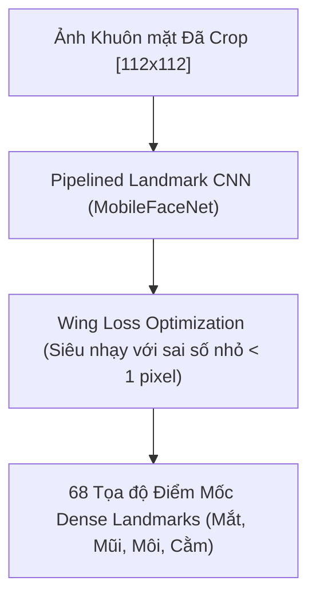

#### d. Code Thực chiến (C++ & Python)

```cpp
// C++17: Tính Wing Loss cho Hồi quy Điểm mốc Tinh vi
#include <iostream>
#include <cmath>

float compute_wing_loss(float error, float w = 10.0f, float eps = 2.0f) {
    float abs_e = std::abs(error);
    float C = w - w * std::log(1.0f + w / eps);
    if (abs_e < w) {
        return w * std::log(1.0f + abs_e / eps);
    }
    return abs_e - C;
}

int main() {
    float small_err = 0.5f;
    std::cout << "Wing Loss for sub-pixel error 0.5: " << compute_wing_loss(small_err) << "\n";
    return 0;
}
```

```python
# Python / PyTorch: Wing Loss Implementation cho Facial Landmark
import torch
import torch.nn as nn
import math

class WingLoss(nn.Module):
    def __init__(self, w: float = 10.0, eps: float = 2.0):
        super().__init__()
        self.w = w
        self.eps = eps
        self.c = w - w * math.log(1.0 + w / eps)

    def forward(self, pred: torch.Tensor, target: torch.Tensor) -> torch.Tensor:
        delta = torch.abs(pred - target)
        small_mask = delta < self.w
        loss = torch.where(small_mask, self.w * torch.log(1.0 + delta / self.eps), delta - self.c)
        return loss.mean()

wing = WingLoss()
p = torch.tensor([10.2, 50.1])
t = torch.tensor([10.0, 50.0])
print("Wing Loss Value:", wing(p, t).item())
```

#### e. Lỗi Thường gặp & Ổn định Số học
- **Profile Face Occlusion**: Khi khuôn mặt quay ngang $90^\circ$, một nửa số điểm mốc bị che khuất hoàn toàn; nếu mạng ép dự đoán cả 68 điểm sẽ sinh ra tọa độ kỳ dị trôi dạt ra ngoài không gian.

#### f. Ứng dụng Thực chiến trong AI
Các filter làm đẹp AR trên TikTok/Instagram, theo dõi biểu cảm khuôn mặt thời gian thực cho nhân vật ảo (VTuber / Meta Avatars).
