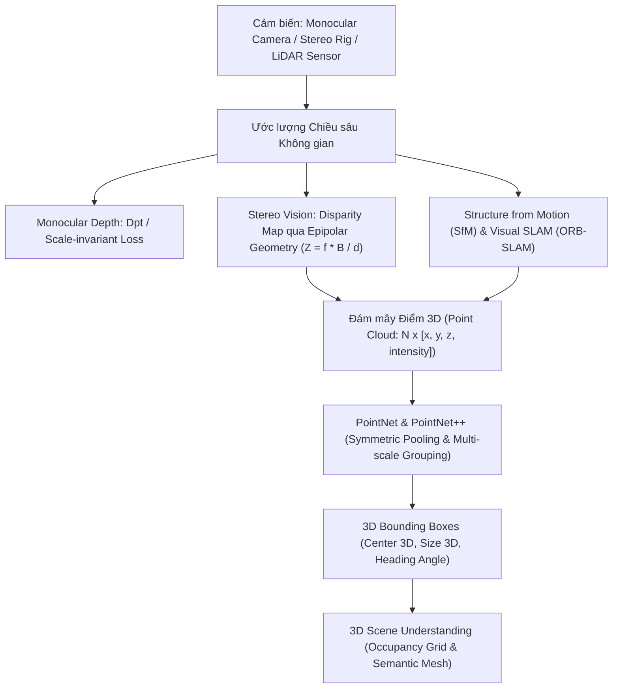
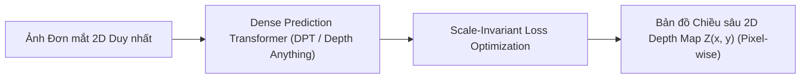
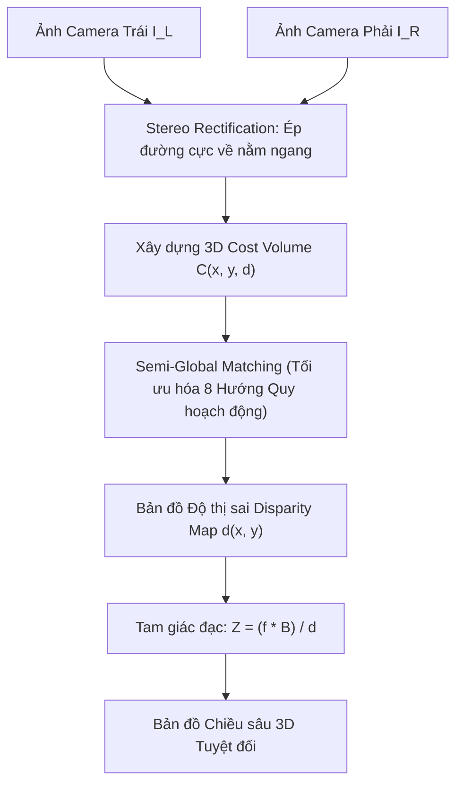
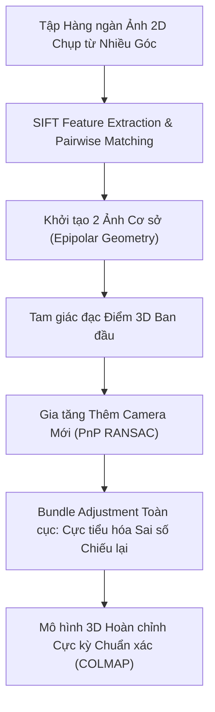
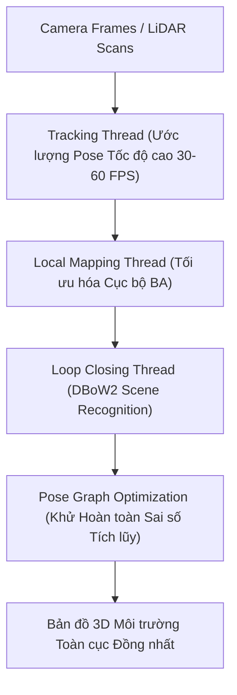
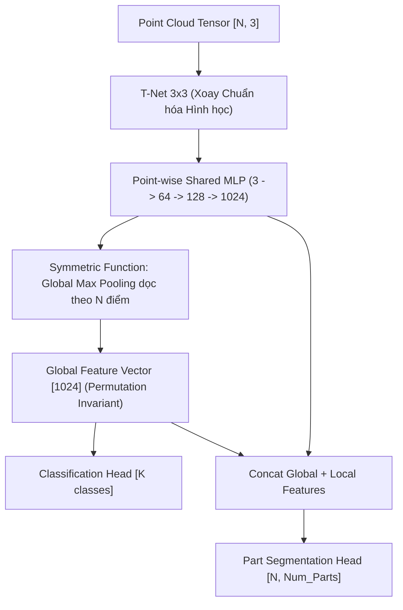
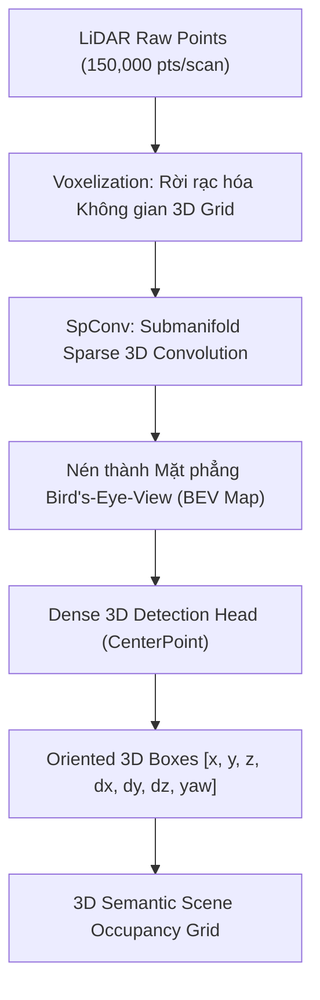

# Chuyên đề: Thị giác 3D, Hình học & Đám mây Điểm (3D Vision, Geometry & Point Clouds)

## 1. Tổng quan Chuyên đề
Thế giới vật lý xung quanh chúng ta là không gian 3 chiều liên tục. Để các tác tử AI (Robots, Xe tự hành, Kính thực tế ảo AR/VR) có thể điều hướng an toàn và tương tác vật lý với môi trường, hệ thống thị giác máy tính phải vượt qua giới hạn của mặt phẳng ảnh 2D để khôi phục và thấu hiểu chiều sâu không gian (Depth Estimation & 3D Reconstruction).

Lĩnh vực Thị giác 3D kết hợp giữa Hình học Đa góc nhìn (Epipolar Geometry trong Stereo Vision và Structure from Motion - SfM), bài toán Định vị và Lập bản đồ Đồng thời (SLAM), cùng các mạng nơ-ron học sâu chuyên biệt trực tiếp trên cấu trúc hình học phi cấu trúc như Đám mây điểm (Point Clouds: PointNet, PointNet++), hướng tới phát hiện vật thể 3D (3D Object Detection) và thấu hiểu ngữ cảnh không gian 3D hoàn chỉnh (3D Scene Understanding).



---

## 2. Chi tiết từng Keyword

---

### 1. Depth Estimation & Monocular Depth Estimation (Ước lượng Chiều sâu Đơn mắt)

#### a. Định nghĩa Bản chất Toán học (Mathematical Formulation)
Ước lượng chiều sâu đơn mắt (MDE) là bài toán dự đoán giá trị khoảng cách vật lý $Z(x, y) \in \mathbb{R}^+$ từ tâm cảm biến máy ảnh đến bề mặt vật thể cho từng điểm ảnh của một bức ảnh 2D duy nhất:
$$Z(x, y) = f_{\text{MDE}}(\mathbf{I}(x, y); \theta)$$
Do mất mát thông tin chiều sâu trong phép chiếu phối cảnh 2D, bài toán có độ nhập nhằng vô hạn về tỷ lệ (Scale Ambiguity: một vật thể nhỏ ở gần tạo ra hình ảnh 2D giống hệt một vật thể khổng lồ ở xa).
Eigen et al. (2014) đề xuất **Hàm Mất mát Bất biến Tỷ lệ (Scale-Invariant Logarithmic Loss)**:
$$\mathcal{L}_{\text{SI}}(d, d^*) = \frac{1}{N} \sum_{i} e_i^2 - \frac{\lambda}{N^2} \left( \sum_{i} e_i \right)^2, \quad e_i = \ln d_i - \ln d_i^*$$
với $\lambda = 0.5$ (hoặc 1.0). Số hạng thứ hai phạt độ lệch phương sai toàn cục, cho phép mô hình học cấu trúc hình học tương đối mà không bị phạt nặng bởi sai số tỷ lệ độ lớn tuyệt đối.

#### b. Cơ chế Tầng Sâu & Điện toán (Under The Hood / Hardware Internals)
- **Vision Transformers for Dense Depth (DPT / Depth Anything)**: Khác với CNN bị giới hạn bởi receptive field cục bộ, Vision Transformers (ViT) duy trì biểu diễn toàn cục ở mọi tầng, cho phép nắm bắt các dấu hiệu chiều sâu thị giác con người (Visual Monocular Depth Cues: kích thước tương đối, luật phối cảnh đường chân trời, độ che khuất, bóng đổ).

#### c. Sơ đồ Minh họa (Mermaid Diagram)


#### d. Code Thực chiến (C++ & Python)

```cpp
// C++17: Scale-Invariant Depth Loss Calculation
#include <iostream>
#include <vector>
#include <cmath>

float compute_scale_invariant_loss(const std::vector<float>& pred_depth, 
                                   const std::vector<float>& gt_depth, 
                                   float lambda = 0.5f) {
    size_t N = pred_depth.size();
    float sum_e = 0.0f;
    float sum_e_sq = 0.0f;

    for (size_t i = 0; i < N; ++i) {
        float log_diff = std::log(pred_depth[i] + 1e-4f) - std::log(gt_depth[i] + 1e-4f);
        sum_e += log_diff;
        sum_e_sq += log_diff * log_diff;
    }

    float term1 = sum_e_sq / N;
    float term2 = lambda * (sum_e / N) * (sum_e / N);
    return term1 - term2;
}

int main() {
    std::vector<float> p = {2.0f, 4.0f, 8.0f};
    std::vector<float> g = {1.0f, 2.0f, 4.0f}; // Gấp đôi tỷ lệ nhưng quan hệ tương đối hoàn hảo
    std::cout << "Scale-Invariant Loss: " << compute_scale_invariant_loss(p, g, 1.0f) << " (Zero error!)\n";
    return 0;
}
```

```python
# Python / PyTorch: Inverse Depth (Disparity) Transformation
import torch

def depth_to_disparity(depth_map: torch.Tensor, min_depth: float = 0.1, max_depth: float = 100.0) -> torch.Tensor:
    # Dự đoán nghịch đảo chiều sâu (Inv-Depth) giúp mô hình tối ưu ổn định ở khoảng cách xa vô cực
    depth_clamped = torch.clamp(depth_map, min=min_depth, max=max_depth)
    return 1.0 / depth_clamped

depth = torch.tensor([[0.5, 2.0], [10.0, 50.0]])
print("Normalized Disparity Values:\n", depth_to_disparity(depth))
```

#### e. Lỗi Thường gặp & Ổn định Số học
- **Infinite Distance Singularity**: Khi dự đoán điểm ảnh bầu trời ở khoảng cách xa vô cực ($Z \to \infty$), phép tính mất mát khoảng cách tuyến tính sẽ bị bùng nổ gradient. Cần chuyển đổi bài toán sang dự đoán độ nghịch đảo chiều sâu (Inverse Depth / Disparity $d = 1/Z$).

#### f. Ứng dụng Thực chiến trong AI
Tạo hiệu ứng xóa phông chân dung ảo (Portrait Mode Bokeh) trên điện thoại chỉ có 1 camera, biến đổi ảnh 2D thành video 3D không gian cho Apple Vision Pro.

---

### 2. Stereo Vision (Thị giác Lưỡng nhãn)

#### a. Định nghĩa Bản chất Toán học
Thị giác lưỡng nhãn sử dụng hai camera đặt cách nhau một khoảng cách đường cơ sở đã biết trước (Baseline $B$), mô phỏng thị giác hai mắt của con người.
Dựa trên **Hình học Hai góc nhìn (Epipolar Geometry)** và điều kiện gióng thẳng hàng (Stereo Rectification):
Mối quan hệ tam giác đồng dạng giữa độ thị sai (Disparity $d$) và chiều sâu vật lý $Z$:
$$Z = \frac{f \cdot B}{d}, \quad d = x_{\text{left}} - x_{\text{right}}$$
trong đó $f$ là tiêu cự camera (Focal Length tính bằng pixels).
Quy trình tính toán:
1. So khớp chi phí từng pixel (Cost Volume Construction): $\mathcal{C}(x, y, d)$.
2. Tổng hợp chi phí (Cost Aggregation qua Semi-Global Matching - SGM).
3. Tinh chỉnh độ thị sai dưới mức pixel (Sub-pixel Refinement).

#### b. Cơ chế Tầng Sâu & Điện toán
- **Semi-Global Matching (SGM - Hirschmuller, 2008)**: Thay vì tối ưu hóa đồ thị 2D toàn cục (NP-hard qua Graph Cuts), SGM xấp xỉ bài toán bằng cách tổng hợp chi phí quy hoạch động 1D dọc theo 8 hoặc 16 hướng phân kỳ:
  $$L_{\mathbf{r}}(p, d) = C(p, d) + \min\left( L_{\mathbf{r}}(p-\mathbf{r}, d), \ L_{\mathbf{r}}(p-\mathbf{r}, d\pm 1) + P_1, \ \min_{i} L_{\mathbf{r}}(p-\mathbf{r}, i) + P_2 \right)$$
  Thuật toán SGM được tối ưu hóa bằng tập lệnh SIMD AVX2 trên CPU hoặc các khối phần cứng chuyên dụng trên chip lái tự động (FPGA / ASICs).

#### c. Sơ đồ Minh họa (Mermaid Diagram)


#### d. Code Thực chiến (C++ & Python)

```cpp
// C++17: Tam giác đạc Tính Chiều sâu từ Độ thị sai Stereo
#include <iostream>

float disparity_to_depth(float disparity, float focal_length_px, float baseline_meters) {
    if (disparity <= 1e-4f) return -1.0f; // Điểm ở vô cực hoặc lỗi
    return (focal_length_px * baseline_meters) / disparity;
}

int main() {
    float f = 700.0f;     // Tiêu cự 700 pixels
    float B = 0.12f;      // Đường cơ sở 12 cm
    float disp = 28.0f;   // Lệch 28 pixels
    std::cout << "Computed Depth Z: " << disparity_to_depth(disp, f, B) << " meters (Expected: 3.0m)\n";
    return 0;
}
```

```python
# Python / PyTorch: 3D Cost Volume Construction cho Deep Stereo
import torch

def build_stereo_cost_volume(feat_left: torch.Tensor, feat_right: torch.Tensor, max_disparity: int = 64) -> torch.Tensor:
    # feat_left, feat_right: [Batch, Channels, H, W]
    B, C, H, W = feat_left.shape
    cost_volume = torch.zeros(B, 2 * C, max_disparity, H, W, device=feat_left.device)

    for d in range(max_disparity):
        if d == 0:
            cost_volume[:, :C, d, :, :] = feat_left
            cost_volume[:, C:, d, :, :] = feat_right
        else:
            cost_volume[:, :C, d, :, d:] = feat_left[:, :, :, d:]
            cost_volume[:, C:, d, :, d:] = feat_right[:, :, :, :-d]
    return cost_volume

fl = torch.randn(1, 16, 32, 32)
fr = torch.randn(1, 16, 32, 32)
print("Stereo Cost Volume Shape:", build_stereo_cost_volume(fl, fr, max_disparity=8).shape)
```

#### e. Lỗi Thường gặp & Ổn định Số học
- **Texture-less Region Failure**: Tại các bề mặt phẳng trơn đồng màu (như tường trắng, mặt kính), không có chi tiết để so khớp giữa hai ảnh, khiến thuật toán tạo ra các lỗ thủng đo đạc (Holes in Disparity Map).

#### f. Ứng dụng Thực chiến trong AI
Cảm biến chiều sâu trên xe tự hành Subaru EyeSight, camera trinh sát trên trực thăng không người lái Ingenuity của NASA trên Sao Hỏa.

---

### 3. 3D Reconstruction & Structure from Motion - SfM (Tái tạo 3D & Cấu trúc từ Chuyển động)

#### a. Định nghĩa Bản chất Toán học
Structure from Motion (SfM) là quá trình đồng thời khôi phục cấu trúc hình học 3D của cảnh vật (Point Cloud $\mathbf{X}_j \in \mathbb{R}^3$) và tư thế camera (Camera Poses $\mathbf{R}_i, \mathbf{t}_i$) từ một tập hợp các ảnh 2D không có thứ tự chụp từ nhiều góc nhìn:
$$\min_{\{\mathbf{R}_i, \mathbf{t}_i\}, \{\mathbf{X}_j\}} \sum_{i} \sum_{j} \rho\left( \|\mathbf{x}_{ij} - \mathcal{P}(\mathbf{K}, \mathbf{R}_i, \mathbf{t}_i, \mathbf{X}_j)\|_2^2 \right)$$
trong đó $\mathbf{x}_{ij}$ là tọa độ điểm ảnh quan sát được, và $\mathcal{P}$ là hàm chiếu phối cảnh camera pinhole:
$$\mathbf{x} \sim \mathbf{K} [\mathbf{R} \mid \mathbf{t}] \mathbf{X}$$
Giai đoạn tối ưu hóa cuối cùng: **Điều chỉnh Chùm tia (Bundle Adjustment - BA)** sử dụng giải thuật Levenberg-Marquardt phi tuyến tính trên đồ thị nhân tử (Factor Graph).

#### b. Cơ chế Tầng Sâu & Điện toán
- **Schur Complement Trick in Bundle Adjustment**: Ma trận Hessian trong bài toán BA có cấu trúc thưa hình mũi tên (Arrowhead Sparse Structure) do các điểm 3D độc lập với nhau khi biết camera poses. Áp dụng bổ đề phần bù Schur (Schur Complement) cho phép khử hàng triệu tham số điểm 3D, chỉ cần giải hệ phương trình trên các tham số camera poses trên CPU/GPU với tốc độ nhanh gấp hàng ngàn lần.

#### c. Sơ đồ Minh họa (Mermaid Diagram)


#### d. Code Thực chiến (C++ & Python)

```cpp
// C++17: Phép Chiếu Điểm 3D sang Tọa độ Điểm ảnh 2D (Pin-hole Projection)
#include <iostream>
#include <vector>

struct CameraIntrinsics { float fx, fy, cx, cy; };
struct Point3D { float X, Y, Z; };
struct Point2D { float u, v; };

Point2D project_3d_to_pixel(const Point3D& pt_cam, const CameraIntrinsics& K) {
    // Giả sử điểm đã nằm trong hệ tọa độ camera (Z > 0)
    float u = K.fx * (pt_cam.X / pt_cam.Z) + K.cx;
    float v = K.fy * (pt_cam.Y / pt_cam.Z) + K.cy;
    return {u, v};
}

int main() {
    CameraIntrinsics K{800.0f, 800.0f, 320.0f, 240.0f};
    Point3D pt{1.0f, 0.5f, 4.0f}; // Điểm 3D cách 4m
    auto pixel = project_3d_to_pixel(pt, K);
    std::cout << "Projected Pixel Coordinates: (" << pixel.u << ", " << pixel.v << ")\n";
    return 0;
}
```

```python
# Python: Reprojection Error Calculation cho Bundle Adjustment
import numpy as np

def compute_reprojection_error(observed_pixels: np.ndarray, projected_pixels: np.ndarray) -> float:
    # L2 Euclidean Distance giữa điểm quan sát và điểm chiếu lại
    errors = np.linalg.norm(observed_pixels - projected_pixels, axis=-1)
    return float(np.mean(errors))

obs = np.array([[100.0, 150.0], [200.0, 250.0]])
proj = np.array([[101.2, 149.5], [199.8, 250.3]])
print(f"Mean Reprojection Error: {compute_reprojection_error(obs, proj):.3f} pixels")
```

#### e. Lỗi Thường gặp & Ổn định Số học
- **Gauge Ambiguity**: Toàn bộ hệ tọa độ tái tạo 3D có thể bị xoay, tịnh tiến và co giãn tự do mà không làm thay đổi sai số chiếu lại (7 bậc tự do không thể xác định nếu không có định vị GPS hoặc điểm đo chuẩn ngoài).

#### f. Ứng dụng Thực chiến trong AI
Phần mềm quét 3D di sản văn hóa COLMAP, xây dựng dữ liệu huấn luyện cho Neural Radiance Fields (NeRF) và 3D Gaussian Splatting (3DGS).

---

### 4. Simultaneous Localization and Mapping - SLAM (Định vị & Lập bản đồ Đồng thời)

#### a. Định nghĩa Bản chất Toán học
SLAM giải quyết bài toán cốt lõi của Robot học tự chủ: Một robot đặt trong môi trường hoàn toàn xa lạ phải đồng thời:
1. Xác định vị trí và tư thế của chính nó trong không gian: $\mathbf{x}_t = [x, y, z, \text{roll}, \text{pitch}, \text{yaw}]$.
2. Xây dựng bản đồ của môi trường xung quanh: $\mathbf{m} = \{l_1, \dots, l_M\}$.
Dưới góc nhìn Xác suất Bayes (Probabilistic SLAM):
$$P(\mathbf{x}_{1:t}, \mathbf{m} \mid \mathbf{z}_{1:t}, \mathbf{u}_{1:t})$$
với $\mathbf{z}_{1:t}$ là chuỗi quan sát cảm biến (Camera / LiDAR) và $\mathbf{u}_{1:t}$ là chuỗi lệnh điều khiển chuyển động (Odometry).
Khung phương pháp hiện đại: **Graph-based SLAM / Pose Graph Optimization**:
$$\min_{\mathbf{x}} \sum_{i, j} \|\mathbf{x}_i \ominus \mathbf{x}_j - \mathbf{z}_{ij}\|_{\mathbf{\Omega}_{ij}}^2$$

#### b. Cơ chế Tầng Sâu & Điện toán
- **Loop Closure Detection (Đóng vòng Lặp)**: Khi robot quay trở lại một địa điểm đã đi qua trong quá khứ, thuật toán Bag-of-Visual-Words (DBoW2) nhận diện khung hình quen thuộc và thiết lập một cạnh liên kết vòng lặp (Loop Closure Constraint). Phép tối ưu hóa Pose Graph (qua solver g2o hoặc Ceres) sẽ lập tức bẻ thẳng toàn bộ quỹ đạo bị tích tụ trôi dạt (Drift) trước đó.

#### c. Sơ đồ Minh họa (Mermaid Diagram)


#### d. Code Thực chiến (C++ & Python)

```cpp
// C++17: Tính Sai số Dư vị Trôi dạt (Pose Graph Residual Error) giữa 2 Trạng thái
#include <iostream>
#include <cmath>

struct Pose2D { float x, y, theta; };

float compute_pose_error(const Pose2D& p1, const Pose2D& p2, const Pose2D& measurement) {
    // Đo lường độ lệch giữa biến đổi dự đoán và biến đổi đo đạc
    float dx = p2.x - p1.x;
    float dy = p2.y - p1.y;
    float dtheta = p2.theta - p1.theta;

    float err_x = dx - measurement.x;
    float err_y = dy - measurement.y;
    float err_th = dtheta - measurement.theta;

    return std::sqrt(err_x * err_x + err_y * err_y + err_th * err_th);
}

int main() {
    Pose2D p1{0, 0, 0}, p2{10.2f, 0.1f, 0.05f};
    Pose2D odom{10.0f, 0.0f, 0.0f};
    std::cout << "Pose Graph Edge Residual: " << compute_pose_error(p1, p2, odom) << "\n";
    return 0;
}
```

```python
# Python: 2D Robot Pose Graph Optimization Concept
import numpy as np

def update_pose_with_kalman_gain(prior_x: float, measurement_z: float, p_cov: float, r_noise: float) -> tuple[float, float]:
    k_gain = p_cov / (p_cov + r_noise)
    posterior_x = prior_x + k_gain * (measurement_z - prior_x)
    posterior_p = (1.0 - k_gain) * p_cov
    return posterior_x, posterior_p

print("Updated Robot 1D Pose:", update_pose_with_kalman_gain(5.0, 5.2, 0.8, 0.2))
```

#### e. Lỗi Thường gặp & Ổn định Số học
- **False Loop Closure**: Nhận diện nhầm hai hành lang giống hệt nhau trong tòa nhà thành một địa điểm duy nhất, khiến thuật toán bẻ cong toàn bộ bản đồ và phá hủy cấu trúc hình học thực tế.

#### f. Ứng dụng Thực chiến trong AI
Robot hút bụi thông minh (Ecovacs, Roborock), kính thực tế hỗn hợp Apple Vision Pro, hệ thống định vị GPS-denied cho tàu ngầm và hầm mỏ.

---

### 5. Point Clouds & PointNet / PointNet++ (Đám mây Điểm & Mạng PointNet)

#### a. Định nghĩa Bản chất Toán học
Đám mây điểm (Point Cloud) là tập hợp rời rạc các tọa độ không gian 3 chiều thu nhận từ cảm biến LiDAR hoặc Stereo/SfM:
$$\mathcal{P} = \{\mathbf{p}_i\}_{i=1}^N, \quad \mathbf{p}_i = [x, y, z] \in \mathbb{R}^3 \quad (\text{hoặc bổ sung } [R, G, B, \text{Intensity}])$$
Ba đặc tính toán học khắt khe của Đám mây điểm:
1. **Tính Bất biến với Phép Hoán vị (Permutation Invariance)**: Đám mây điểm là một tập hợp toán học không có thứ tự. Việc xáo trộn thứ tự dòng của $N$ điểm không được làm thay đổi kết quả dự đoán:
   $$f(\mathbf{p}_1, \dots, \mathbf{p}_N) = f(\mathbf{p}_{\pi(1)}, \dots, \mathbf{p}_{\pi(N)})$$
2. **Tính Bất biến với Phép Biến đổi Rắn (Transformation Invariance)**: Quay hoặc tịnh tiến toàn bộ đám mây điểm không làm thay đổi loại đối tượng.
3. **Mật độ Không đồng nhất (Varying Density)**: Càng ở xa cảm biến, các điểm càng thưa thớt.

**Kiến trúc PointNet (Qi et al., CVPR 2017)**:
Sử dụng toán tử đối xứng (Symmetric Function) là **Max-Pooling** để triệt tiêu sự phụ thuộc thứ tự:
$$f(\mathcal{P}) = \gamma \left( \max_{i=1,\dots,N} \{ h(\mathbf{p}_i) \} \right)$$
trong đó $h$ là mạng MLP nhiều tầng ánh xạ độc lập từng điểm lên không gian 1024 chiều, và $\gamma$ là mạng phân loại/phân đoạn.
Mạng **T-Net (Spatial Transformer)** học ma trận trực giao $3 \times 3$ để tự động xoay chuẩn hóa đám mây điểm.

**PointNet++ (Qi et al., NeurIPS 2017)**: Bổ sung khả năng học đặc trưng cục bộ theo cụm phân cấp (Hierarchical Feature Learning):
1. **Sampling Layer**: Dùng thuật toán lấy mẫu điểm xa nhất (Farthest Point Sampling - FPS) để chọn các điểm trung tâm đồng đều.
2. **Grouping Layer**: Dùng Ball Query tìm các điểm lân cận trong bán kính $R$.
3. **PointNet Layer**: Áp dụng PointNet nhỏ lên từng cụm cục bộ.

#### b. Cơ chế Tầng Sâu & Điện toán
- **GPU Parallelization of Point Operations**: Phép toán Max-Pooling dọc theo $N$ điểm trên 1024 kênh được thực thi bằng reduction CUDA kernel cực nhanh. Với $N = 100,000$ điểm, PointNet có thể chạy với tốc độ $>100\text{ FPS}$ trên GPU máy trạm.

#### c. Sơ đồ Minh họa (Mermaid Diagram)


#### d. Code Thực chiến (C++ & Python)

```cpp
// C++17: Phép Toán Tử Đối xứng Symmetric Max-Pooling cho Point Cloud
#include <iostream>
#include <vector>
#include <algorithm>

std::vector<float> point_cloud_global_max_pool(const std::vector<std::vector<float>>& point_features) {
    // point_features: N points x D dimensions
    size_t N = point_features.size();
    size_t D = point_features[0].size();
    std::vector<float> global_feature(D, -1e9f);

    for (size_t i = 0; i < N; ++i) {
        for (size_t d = 0; d < D; ++d) {
            global_feature[d] = std::max(global_feature[d], point_features[i][d]);
        }
    }
    return global_feature;
}

int main() {
    std::vector<std::vector<float>> pts = {
        {1.0f, 5.0f, 2.0f},
        {4.0f, 1.0f, 8.0f}, // Point 1 có D=2 lớn nhất
        {2.0f, 3.0f, 0.0f}
    };
    auto g = point_cloud_global_max_pool(pts);
    std::cout << "Permutation-Invariant Vector: [" << g[0] << ", " << g[1] << ", " << g[2] << "]\n";
    return 0;
}
```

```python
# Python / PyTorch: PointNet Core Symmetric Layer
import torch
import torch.nn as nn

class PointNetCore(nn.Module):
    def __init__(self, in_dim: int = 3, global_dim: int = 1024):
        super().__init__()
        # Shared MLP mô hình hóa qua Conv1d với kernel size 1
        self.mlp = nn.Sequential(
            nn.Conv1d(in_dim, 64, 1),
            nn.BatchNorm1d(64),
            nn.ReLU(),
            nn.Conv1d(64, 128, 1),
            nn.BatchNorm1d(128),
            nn.ReLU(),
            nn.Conv1d(128, global_dim, 1),
            nn.BatchNorm1d(global_dim)
        )

    def forward(self, x: torch.Tensor) -> torch.Tensor:
        # x: [Batch, In_Dim, Num_Points]
        feats = self.mlp(x) # [B, Global_Dim, Num_Points]
        # Symmetric Max Pooling dọc theo trục points
        global_feature, _ = torch.max(feats, dim=-1) # [B, Global_Dim]
        return global_feature

net = PointNetCore()
pts = torch.randn(2, 3, 1024) # 2 đám mây điểm, mỗi đám có 1024 điểm 3D
out = net(pts)
print("PointNet Global Representation Shape:", out.shape) # [2, 1024]
```

#### e. Lỗi Thường gặp & Ổn định Số học
- **Local Context Blindness trong PointNet gốc**: Do chỉ thực hiện Max-Pooling toàn cục từ từng điểm độc lập, PointNet v1 không thể nắm bắt cấu trúc hình học chi tiết ở cấp độ lân cận cục bộ (khắc phục bằng PointNet++ hoặc Dynamic Graph CNN - DGCNN).

#### f. Ứng dụng Thực chiến trong AI
Phân loại đối tượng từ dữ liệu quét LiDAR xe tự hành (Waymo Open Dataset, nuScenes), kiểm tra khuyết tật mô hình in 3D công nghiệp.

---

### 6. 3D Object Detection & Scene Understanding (Phát hiện Vật thể & Thấu hiểu Ngữ cảnh 3D)

#### a. Định nghĩa Bản chất Toán học
Phát hiện vật thể 3D định vị hộp bao hướng không gian 3 chiều (Oriented 3D Bounding Box - 7 Bậc tự do):
$$\mathbf{b}_{\text{3D}} = [x, y, z, w, l, h, \theta_{\text{yaw}}] \in \mathbb{R}^7$$
trong đó $(x, y, z)$ là tọa độ tâm 3D, $(w, l, h)$ là kích thước chiều rộng/dài/cao, và $\theta_{\text{yaw}}$ là góc xoay hướng di chuyển quanh trục thẳng đứng.
Ba hướng tiếp cận biểu diễn dữ liệu:
1. **Point-based**: Xử lý trực tiếp điểm thô (PointRCNN).
2. **Voxel-based (VoxelNet, SECOND)**: Lượng tử hóa không gian 3D thành lưới voxel rời rạc kích thước nhỏ (e.g. $5\text{cm} \times 5\text{cm} \times 10\text{cm}$) và dùng **Tích chập Thưa 3D (Submanifold Sparse Convolution)**.
3. **Camera-based BEV (Bird's-Eye-View - BEVFormer, Lift-Splat-Shoot)**: Chiếu ảnh từ nhiều camera xung quanh xe sang mặt phẳng nhìn từ trên xuống (BEV Plane).

#### b. Cơ chế Tầng Sâu & Điện toán
- **Submanifold Sparse Convolution (SpConv)**: Một lưới voxel kích thước $1000 \times 1000 \times 40$ chứa tới 40 triệu ô, nhưng hơn $97\%$ số ô là không khí trống rỗng. Tích chập 3D thông thường sẽ gây tràn sạch bộ nhớ VRAM ngay lập tức. SpConv chỉ lưu trữ tọa độ các voxel có chứa điểm và thực thi phép tích chập bằng bảng băm (Hash Map Lookup) trực tiếp trên GPU, giảm $95\%$ bộ nhớ và tăng tốc độ xử lý lên $>30\text{ FPS}$.

#### c. Sơ đồ Minh họa (Mermaid Diagram)


#### d. Code Thực chiến (C++ & Python)

```cpp
// C++17: Voxelization Hashing (Chuyển đổi Tọa độ Điểm 3D sang Voxel Index 1D)
#include <iostream>
#include <unordered_map>
#include <cmath>

struct Point3D { float x, y, z; };

uint64_t compute_voxel_index(const Point3D& p, float voxel_size, int grid_x, int grid_y) {
    int vx = static_cast<int>(std::floor(p.x / voxel_size));
    int vy = static_cast<int>(std::floor(p.y / voxel_size));
    int vz = static_cast<int>(std::floor(p.z / voxel_size));

    // Băm tọa độ 3D thành khóa số nguyên 64-bit
    return (static_cast<uint64_t>(vz) * grid_x * grid_y) + (static_cast<uint64_t>(vy) * grid_x) + vx;
}

int main() {
    Point3D p{10.2f, 5.8f, 1.2f};
    auto v_idx = compute_voxel_index(p, 0.2f, 500, 500); // Voxel size 20cm
    std::cout << "Hashed Voxel ID: " << v_idx << "\n";
    return 0;
}
```

```python
# Python / PyTorch: 3D Bounding Box Center-Distance Loss
import torch
import torch.nn.functional as F

def compute_3d_box_regression_loss(pred_3d_boxes: torch.Tensor, gt_3d_boxes: torch.Tensor):
    # pred, gt: [Batch, 7] -> [x, y, z, w, l, h, yaw]
    center_loss = F.smooth_l1_loss(pred_3d_boxes[:, :3], gt_3d_boxes[:, :3])
    size_loss = F.smooth_l1_loss(pred_3d_boxes[:, 3:6], gt_3d_boxes[:, 3:6])
    # Sin-Cos angle difference for yaw
    yaw_loss = F.smooth_l1_loss(torch.sin(pred_3d_boxes[:, 6]), torch.sin(gt_3d_boxes[:, 6]))
    return center_loss + size_loss + yaw_loss

p_box = torch.randn(2, 7)
g_box = torch.randn(2, 7)
print("3D Box Detection Regression Loss:", compute_3d_box_regression_loss(p_box, g_box).item())
```

#### e. Lỗi Thường gặp & Ổn định Số học
- **Yaw Angle Discontinuity (Nhập nhằng góc quay $\pm \pi$)**: Góc yaw lệch $180^\circ$ ($\pi$) dẫn đến hàm hồi quy góc trực tiếp bị sai số cực lớn dù hướng vật thể hoàn toàn tương đương. Cần hồi quy hàm $(\sin \theta, \cos \theta)$ thay vì giá trị góc trực tiếp.

#### f. Ứng dụng Thực chiến trong AI
Trái tim của hệ thống nhận thức xe tự hành (Tesla Autopilot Occupancy Network, Waymo, Cruise, Baidu Apollo).
