# Chuyên đề: Vision Transformers, Mô hình Nền tảng & VQA (Vision Transformers, Foundation Models & VQA)

## 1. Tổng quan Chuyên đề
Sự xuất hiện của **Vision Transformer (ViT)** (Dosovitskiy et al., 2020) đã tạo nên một cơn địa chấn làm lung lay sự thống trị kéo dài hàng thập kỷ của Mạng Nơ-ron Tích chập (CNN) trong thị giác máy tính. Bằng cách xử lý hình ảnh như một chuỗi các mảnh ghép 2D (Image Patches) tương tự như các token từ ngữ trong NLP, ViT đã mở đường cho các mô hình thị giác phân cấp tiên tiến như **Swin Transformer** và thiết lập kỷ nguyên của các Mô hình Nền tảng Thị giác (Vision Foundation Models).

Không dừng lại ở học có giám sát, các phương pháp tự giám sát đột phá (Self-Supervised Learning) như **DINO / DINOv2** (tự chưng cất tri thức không cần nhãn) và **CLIP** (học biểu diễn liên kết đa phương thức tương phản Hình ảnh - Văn bản) đã đem lại năng lực phân loại không cần mẫu (Zero-Shot Classification), neo ngữ nghĩa thị giác (Visual Grounding), tự động sinh chú thích ảnh (Image Captioning), trả lời câu hỏi thị giác (Visual Question Answering - VQA) và thấu hiểu ngữ cảnh toàn cảnh (Scene Understanding).

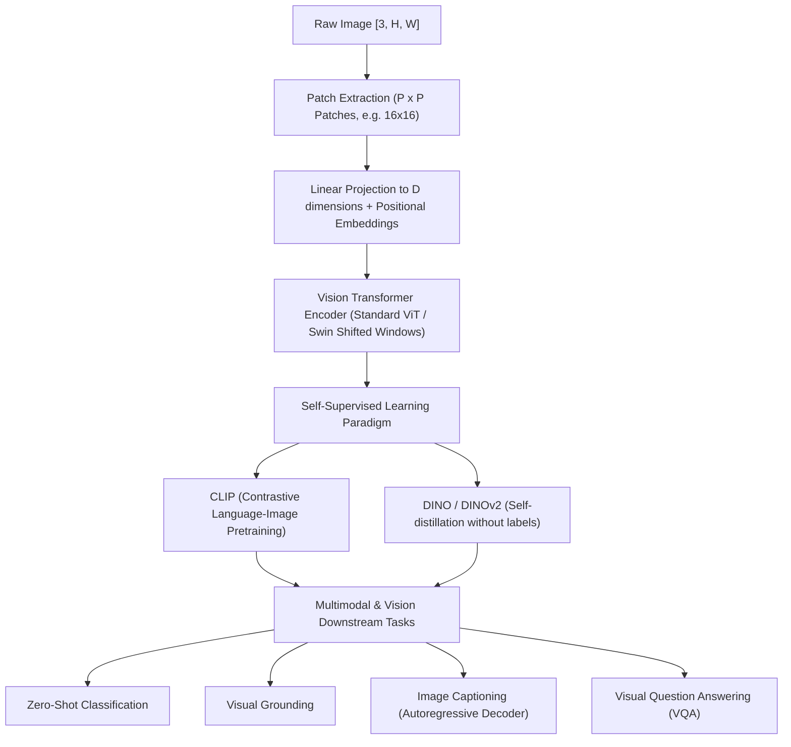

---

## 2. Chi tiết từng Keyword

---

### 1. Vision Transformers - ViT (Transformer cho Thị giác)

#### a. Định nghĩa Bản chất Toán học (Mathematical Formulation)
ViT (Dosovitskiy et al., ICLR 2021) áp dụng kiến trúc Transformer Encoder tiêu chuẩn trực tiếp lên hình ảnh với sự can thiệp tối thiểu:
1. **Patch Extraction & Flattening**: Ảnh $\mathbf{x} \in \mathbb{R}^{H \times W \times C}$ được chia thành $N$ mảnh vuông không chồng lấn kích thước $P \times P$:
   $$N = \frac{H \cdot W}{P^2}, \quad \mathbf{x}_p \in \mathbb{R}^{N \times (P^2 \cdot C)}$$
2. **Patch Embedding & Class Token**: Trải phẳng và chiếu tuyến tính sang không gian ẩn $D$, chèn thêm token đặc biệt có thể học được $\mathbf{x}_{\text{class}}$ (tương tự `[CLS]` của BERT) và cộng thêm mã hóa vị trí 1D $\mathbf{E}_{\text{pos}}$:
   $$\mathbf{z}_0 = [\mathbf{x}_{\text{class}}; \mathbf{x}_p^1 \mathbf{E}; \mathbf{x}_p^2 \mathbf{E}; \dots; \mathbf{x}_p^N \mathbf{E}] + \mathbf{E}_{\text{pos}}, \quad \mathbf{E} \in \mathbb{R}^{(P^2 C) \times D}, \ \mathbf{E}_{\text{pos}} \in \mathbb{R}^{(N + 1) \times D}$$
3. **Multi-Head Self-Attention (MSA)**:
   $$\mathbf{z}'_\ell = \text{MSA}(\text{LN}(\mathbf{z}_{\ell-1})) + \mathbf{z}_{\ell-1}, \quad \mathbf{z}_\ell = \text{MLP}(\text{LN}(\mathbf{z}'_\ell)) + \mathbf{z}'_\ell$$
4. **Classification Head**: Lớp phân loại áp dụng trên vector đầu ra của token lớp $\mathbf{y} = \text{LN}(\mathbf{z}_L^0)$.

#### b. Cơ chế Tầng Sâu & Điện toán (Under The Hood / Hardware Internals)
- **Weak Inductive Bias vs Data Hunger**: CNN sở hữu hai thiên kiến quy nạp hình học cực mạnh: Tính cục bộ (Locality) và Tính bất biến dịch chuyển (Translation Equivariance). Ngược lại, ViT không có bất kỳ giả định không gian nào; nó phải tự học mối quan hệ giữa các patch từ đầu.
- Khi huấn luyện trên tập dữ liệu nhỏ (ImageNet 1M ảnh), ViT kém hơn ResNet. Nhưng khi huấn luyện trên tập dữ liệu khổng lồ (JFT-300M hoặc LAION-5B), **ViT phá vỡ trần bão hòa của CNN**, đạt khả năng mở rộng (Scaling Laws) vượt trội.

#### c. Sơ đồ Minh họa (Mermaid Diagram)
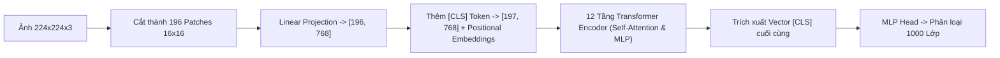

#### d. Code Thực chiến (C++ & Python)

```cpp
// C++17: Phân rã Ảnh 2D thành Image Patches tuần tự
#include <iostream>
#include <vector>

void extract_image_patches_1d(const float* img, float* patches, int H, int W, int C, int P) {
    int num_patches_y = H / P;
    int num_patches_x = W / P;
    int patch_dim = P * P * C;
    int patch_idx = 0;

    for (int py = 0; py < num_patches_y; ++py) {
        for (int px = 0; px < num_patches_x; ++px) {
            int out_offset = patch_idx * patch_dim;
            int p_elem = 0;
            for (int y = 0; y < P; ++y) {
                for (int x = 0; x < P; ++x) {
                    for (int c = 0; c < C; ++c) {
                        int in_idx = ((py * P + y) * W + (px * P + x)) * C + c;
                        patches[out_offset + p_elem++] = img[in_idx];
                    }
                }
            }
            patch_idx++;
        }
    }
}

int main() {
    int H = 4, W = 4, C = 1, P = 2; // 4x4 ảnh, patch 2x2 -> 4 patches
    std::vector<float> img(16, 1.0f);
    std::vector<float> patches(4 * 4, 0.0f);
    extract_image_patches_1d(img.data(), patches.data(), H, W, C, P);
    std::cout << "Extracted patches total elements: " << patches.size() << "\n";
    return 0;
}
```

```python
# Python / PyTorch: Triển khai Patch Embedding Layer của ViT bằng Conv2d
import torch
import torch.nn as nn

class PatchEmbedding(nn.Module):
    def __init__(self, img_size: int = 224, patch_size: int = 16, in_channels: int = 3, embed_dim: int = 768):
        super().__init__()
        self.num_patches = (img_size // patch_size) ** 2
        # Tích chập với kernel=patch_size và stride=patch_size tương đương phép chiếu phẳng từng patch
        self.proj = nn.Conv2d(in_channels, embed_dim, kernel_size=patch_size, stride=patch_size)
        self.cls_token = nn.Parameter(torch.randn(1, 1, embed_dim))
        self.pos_embed = nn.Parameter(torch.randn(1, self.num_patches + 1, embed_dim))

    def forward(self, x: torch.Tensor) -> torch.Tensor:
        B = x.shape[0]
        x = self.proj(x).flatten(2).transpose(1, 2) # [B, Num_Patches, Embed_Dim]
        cls_tokens = self.cls_token.expand(B, -1, -1)
        x = torch.cat((cls_tokens, x), dim=1) # [B, Num_Patches + 1, Embed_Dim]
        x = x + self.pos_embed
        return x

patch_emb = PatchEmbedding()
mock_img = torch.randn(2, 3, 224, 224)
tokens = patch_emb(mock_img)
print("ViT Embedded Tokens Tensor Shape:", tokens.shape) # [2, 197, 768]
```

#### e. Lỗi Thường gặp & Ổn định Số học
- **Quadratic Complexity of Global Attention**: Chi phí tính toán là $\mathcal{O}(N^2) = \mathcal{O}((H \cdot W / P^2)^2)$. Khi tăng độ phân giải ảnh lên $1024 \times 1024$ (phục vụ Segmentation hoặc Detection), số lượng patch bùng nổ lên $4096$, khiến ma trận Self-Attention ngốn sạch VRAM GPU nếu không có cơ chế Window Attention.

#### f. Ứng dụng Thực chiến trong AI
Mô hình chuẩn mực trong phân loại ảnh quy mô lớn, backbone trong CLIP, DINOv2, SAM.

---

### 2. Swin Transformer (Transformer Cửa sổ Dịch chuyển)

#### a. Định nghĩa Bản chất Toán học
Swin Transformer (Liu et al., ICCV 2021 Best Paper) mang lại cấu trúc phân cấp (Hierarchical Representation) và độ phức tạp tính toán **tuyến tính $\mathcal{O}(N)$** theo kích thước ảnh, cho phép ViT trở thành một backbone đa năng cho cả Detection và Segmentation:
1. **Window-based Multi-Head Self-Attention (W-MSA)**: Chia ảnh thành các cửa sổ không chồng lấn kích thước cố định $M \times M$ (thường $M=7$). Chỉ tính Self-Attention bên trong từng cửa sổ:
   $$\text{Complexity: } \mathcal{O}(4 H W C^2 + 2 M^2 H W C) \quad (\text{Tuyến tính theo } H \cdot W)$$
2. **Shifted Window Partitioning (SW-MSA)**: Ở tầng tiếp theo, dịch chuyển lưới cửa sổ đi một khoảng $(\lfloor \frac{M}{2} \rfloor, \lfloor \frac{M}{2} \rfloor)$ pixels. Sự dịch chuyển này cho phép trao đổi thông tin chéo giữa các cửa sổ liền kề mà vẫn duy trì tính cục bộ.
3. **Patch Merging**: Giảm độ phân giải không gian đi một nửa ($2\times$ downsampling) và tăng gấp đôi số kênh ($2\times$ channels), tái tạo cấu trúc kim tự tháp đặc trưng tương tự CNN.

#### b. Cơ chế Tầng Sâu & Điện toán
- **Cyclic Shift & Efficient Batched Masking**: Dịch chuyển cửa sổ làm số lượng cửa sổ tăng từ 4 lên 9 với kích thước không đồng đều. Swin Transformer giải quyết bằng phép dịch vòng tròn (Cyclic Shift) đưa ảnh về lại 4 cửa sổ chuẩn, sau đó áp dụng **Mặt nạ Chú ý (Attention Mask)** để chặn các pixel không kề cận trong ảnh gốc tính toán tương tác với nhau.

#### c. Sơ đồ Minh họa (Mermaid Diagram)
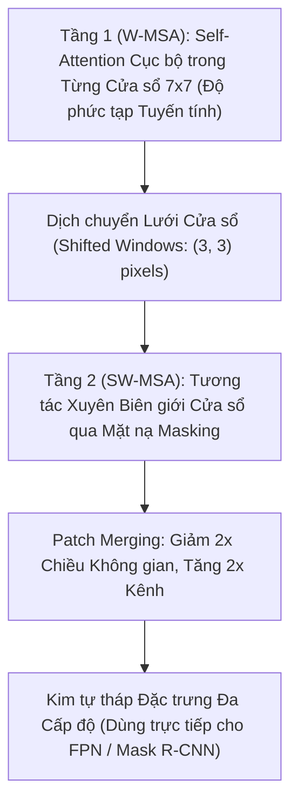

#### d. Code Thực chiến (C++ & Python)

```cpp
// C++17: Mô phỏng Phép Dịch Vòng tròn (Cyclic Roll 2D) của Swin Transformer
#include <iostream>
#include <vector>

void cyclic_shift_2d(const std::vector<float>& src, std::vector<float>& dst, int H, int W, int shift_y, int shift_x) {
    dst.resize(H * W);
    for (int y = 0; y < H; ++y) {
        for (int x = 0; x < W; ++x) {
            int new_y = (y + shift_y) % H;
            int new_x = (x + shift_x) % W;
            if (new_y < 0) new_y += H;
            if (new_x < 0) new_x += W;
            dst[new_y * W + new_x] = src[y * W + x];
        }
    }
}

int main() {
    std::vector<float> grid = {1, 2, 3, 4}; // 2x2 grid
    std::vector<float> rolled;
    cyclic_shift_2d(grid, rolled, 2, 2, 1, 1);
    std::cout << "Top-left pixel after Cyclic Shift (1, 1): " << rolled[0] << " (Expected: 4)\n";
    return 0;
}
```

```python
# Python / PyTorch: Window Partitioning và Window Reverse trong Swin
import torch

def window_partition(x: torch.Tensor, window_size: int = 7) -> torch.Tensor:
    # x: [Batch, Height, Width, Channels]
    B, H, W, C = x.shape
    x = x.view(B, H // window_size, window_size, W // window_size, window_size, C)
    windows = x.permute(0, 1, 3, 2, 4, 5).contiguous().view(-1, window_size, window_size, C)
    return windows # [Num_Windows * B, Window_Size, Window_Size, C]

dummy_feat = torch.randn(2, 14, 14, 64)
windows_out = window_partition(dummy_feat, window_size=7)
print("Partitioned Windows Shape (4 windows of 7x7 per image):", windows_out.shape) # [8, 7, 7, 64]
```

#### e. Lỗi Thường gặp & Ổn định Số học
- Quên khôi phục trạng thái (Reverse Cyclic Shift) sau khi tính SW-MSA khiến thứ tự pixel bị xáo trộn vĩnh viễn ở các tầng tiếp theo.

#### f. Ứng dụng Thực chiến trong AI
Backbone thống trị trong các mô hình thị giác phân cấp (Swin-L trong DINO, Mask2Former, U-Swin trong y tế).

---

### 3. Vision Foundation Models (Mô hình Nền tảng Thị giác)

#### a. Định nghĩa Bản chất Toán học
Mô hình nền tảng thị giác là các mô hình quy mô tham số khổng lồ (từ hàng trăm triệu đến hàng chục tỷ tham số) được tiền huấn luyện trên dữ liệu thị giác khổng lồ bằng các mục tiêu không giám sát hoặc tự giám sát, sở hữu khả năng thích ứng (Adaptability) và chuyển giao tổng quát sang hàng loạt bài toán hạ nguồn thông qua Zero-Shot, Few-Shot hoặc Linear Probing:
$$\theta^* = \arg\min_\theta \mathbb{E}_{\mathbf{x} \sim \mathcal{D}_{\text{massive}}} [\mathcal{L}_{\text{pretrain}}(\mathbf{x}; \theta)]$$
Hai hướng tiếp cận chính:
1. **Contrastive Language-Image Pretraining (CLIP, ALIGN)**: Gióng hàng đa phương thức hình ảnh và ngôn ngữ.
2. **Masked Image Modeling & Self-Distillation (MAE, DINO, DINOv2)**: Tái tạo vùng ảnh bị che hoặc tự chưng cất đặc trưng hình học.

#### b. Cơ chế Tầng Sâu & Điện toán
- **Foundation Model Linear Probing Evaluation**: Đóng băng toàn bộ trọng số của backbone $\theta^*$, chỉ gắn một tầng phân loại tuyến tính duy nhất $\mathbf{W}_{\text{linear}}$ ở đầu ra và huấn luyện trên tập dữ liệu mới. Nếu mô hình nền tảng học biểu diễn tốt, tầng tuyến tính đơn giản này có thể đạt độ chính xác tương đương hoặc vượt trội so với các mô hình CNN được huấn luyện chuyên biệt từ đầu.

#### c. Sơ đồ Minh họa (Mermaid Diagram)
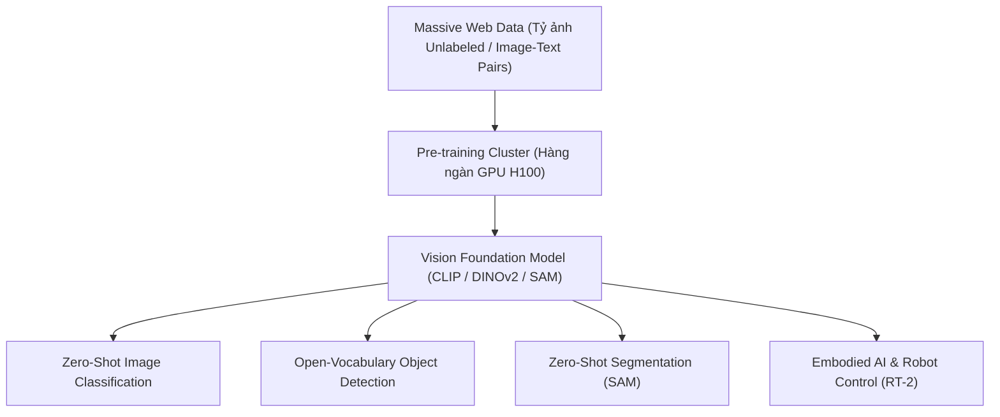

#### d. Code Thực chiến (C++ & Python)

```cpp
// C++17: Linear Probing Classifier Forward Pass
#include <iostream>
#include <vector>

std::vector<float> linear_probe_forward(const std::vector<float>& frozen_features,
                                        const std::vector<std::vector<float>>& W_linear,
                                        const std::vector<float>& bias) {
    size_t num_classes = W_linear.size();
    size_t dim = frozen_features.size();
    std::vector<float> logits(num_classes, 0.0f);

    for (size_t c = 0; c < num_classes; ++c) {
        float dot = bias[c];
        for (size_t d = 0; d < dim; ++d) {
            dot += W_linear[c][d] * frozen_features[d];
        }
        logits[c] = dot;
    }
    return logits;
}

int main() {
    std::vector<float> feat = {0.5f, -0.2f, 0.8f};
    std::vector<std::vector<float>> W = {{1, 0, 0}, {0, 1, 0}}; // 2 classes, 3 dims
    std::vector<float> b = {0.1f, -0.1f};
    auto out = linear_probe_forward(feat, W, b);
    std::cout << "Class 0 Logit: " << out[0] << " | Class 1 Logit: " << out[1] << "\n";
    return 0;
}
```

```python
# Python / PyTorch: Linear Probing Training Loop Setup
import torch
import torch.nn as nn

class LinearProbeEvaluator(nn.Module):
    def __init__(self, frozen_backbone: nn.Module, feature_dim: int, num_classes: int):
        super().__init__()
        self.backbone = frozen_backbone
        # Đóng băng toàn bộ tham số của backbone
        for param in self.backbone.parameters():
            param.requires_grad = False
        # Chỉ tối ưu hóa lớp tuyến tính phân loại
        self.classifier = nn.Linear(feature_dim, num_classes)

    def forward(self, x: torch.Tensor) -> torch.Tensor:
        with torch.no_grad():
            features = self.backbone(x)
        return self.classifier(features)

mock_backbone = nn.Sequential(nn.Conv2d(3, 64, 3), nn.AdaptiveAvgPool2d(1), nn.Flatten())
probe = LinearProbeEvaluator(mock_backbone, feature_dim=64, num_classes=10)
x = torch.randn(2, 3, 32, 32)
print("Linear Probe Logits:", probe(x).shape) # [2, 10]
```

#### e. Lỗi Thường gặp & Ổn định Số học
- **Representation Collapse**: Trong huấn luyện tự giám sát không có nhãn, nếu không có cơ chế ngăn chặn thoái hóa (như Centering và Sharpening trong DINO), toàn bộ vector đầu ra của mọi bức ảnh sẽ sụp đổ về một hằng số vô nghĩa duy nhất.

#### f. Ứng dụng Thực chiến trong AI
Xương sống nhận thức đa phương thức trong GPT-4V, Google Gemini, robot hình người Figure 01.

---

### 4. CLIP (Contrastive Language-Image Pretraining)

#### a. Định nghĩa Bản chất Toán học
CLIP (Radford et al., OpenAI, 2021) là một bước ngoặt vĩ đại liên kết thị giác và ngôn ngữ thông qua học tương phản trên 400 triệu cặp (Ảnh, Văn bản) thu thập từ Internet.
Kiến trúc gồm hai nhánh: Image Encoder $f_I$ (ViT hoặc ResNet) và Text Encoder $f_T$ (Transformer).
Trong một lô (Batch) gồm $N$ cặp $(\mathbf{I}_i, \mathbf{T}_i)$:
1. Chiếu các vector đặc trưng về không gian nhúng chung kích thước $d$ và chuẩn hóa $L_2$:
   $$\mathbf{u}_i = \frac{f_I(\mathbf{I}_i)}{\|f_I(\mathbf{I}_i)\|_2}, \quad \mathbf{v}_j = \frac{f_T(\mathbf{T}_j)}{\|f_T(\mathbf{T}_j)\|_2}$$
2. Ma trận tương đồng Cosine: $\mathbf{S}_{i, j} = \mathbf{u}_i \cdot \mathbf{v}_j$.
3. Hàm mất mát đối xứng **Symmetric Cross-Entropy InfoNCE Loss**:
   $$\mathcal{L}_{\text{image}} = -\frac{1}{N} \sum_{i=1}^N \log \frac{e^{\mathbf{S}_{i, i} / \tau}}{\sum_{j=1}^N e^{\mathbf{S}_{i, j} / \tau}}, \quad \mathcal{L}_{\text{text}} = -\frac{1}{N} \sum_{j=1}^N \log \frac{e^{\mathbf{S}_{j, j} / \tau}}{\sum_{i=1}^N e^{\mathbf{S}_{i, j} / \tau}}$$
   $$\mathcal{L}_{\text{CLIP}} = \frac{1}{2} (\mathcal{L}_{\text{image}} + \mathcal{L}_{\text{text}})$$
   với $\tau$ là siêu tham số nhiệt độ học được (Learnable Temperature).

#### b. Cơ chế Tầng Sâu & Điện toán
- **Massive Batch Size Necessity**: Để học tương phản đạt hiệu quả cao, kích thước lô huấn luyện phải cực lớn (trong CLIP $N = 32,768$). Ma trận tương đồng có kích thước $32768 \times 32768$ (hơn 1 tỷ phần tử). Trên GPU cluster, ma trận này được tính toán phân tán (Distributed All-Gather) kết hợp Sharded Data Parallelism.

#### c. Sơ đồ Minh họa (Mermaid Diagram)
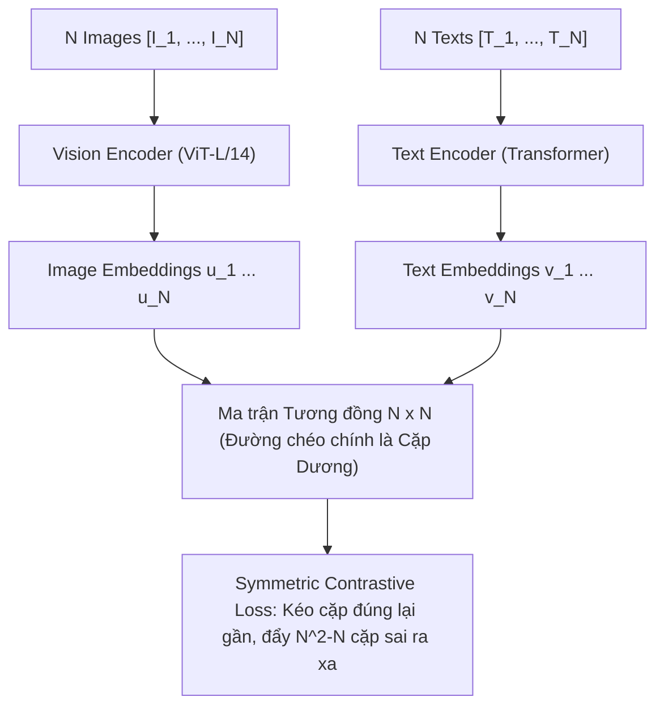

#### d. Code Thực chiến (C++ & Python)

```cpp
// C++17: Tính Ma trận Tương quan Tương phản Đối xứng (Symmetric InfoNCE Logits)
#include <iostream>
#include <vector>

std::vector<std::vector<float>> compute_clip_similarity_matrix(
    const std::vector<std::vector<float>>& img_embs,
    const std::vector<std::vector<float>>& txt_embs,
    float logit_scale) {

    size_t N = img_embs.size();
    size_t D = img_embs[0].size();
    std::vector<std::vector<float>> logits(N, std::vector<float>(N, 0.0f));

    for (size_t i = 0; i < N; ++i) {
        for (size_t j = 0; j < N; ++j) {
            float dot = 0.0f;
            for (size_t d = 0; d < D; ++d) {
                dot += img_embs[i][d] * txt_embs[j][d];
            }
            logits[i][j] = dot * logit_scale;
        }
    }
    return logits;
}

int main() {
    std::vector<std::vector<float>> img = {{1.0f, 0.0f}, {0.0f, 1.0f}};
    std::vector<std::vector<float>> txt = {{1.0f, 0.0f}, {0.0f, 1.0f}};
    auto sim = compute_clip_similarity_matrix(img, txt, 10.0f);
    std::cout << "Diagonal Positive Logit (i=j): " << sim[0][0] << " | Off-diagonal: " << sim[0][1] << "\n";
    return 0;
}
```

```python
# Python / PyTorch: Complete CLIP Contrastive Loss Implementation
import torch
import torch.nn as nn
import torch.nn.functional as F

class CLIPLoss(nn.Module):
    def __init__(self):
        super().__init__()
        self.logit_scale = nn.Parameter(torch.ones([]) * np.log(1 / 0.07))

    def forward(self, image_features: torch.Tensor, text_features: torch.Tensor) -> torch.Tensor:
        # Chuẩn hóa L2
        img_norm = F.normalize(image_features, dim=-1)
        txt_norm = F.normalize(text_features, dim=-1)

        scale = self.logit_scale.exp().clamp(max=100.0)
        logits_per_image = scale * torch.matmul(img_norm, txt_norm.T)
        logits_per_text = logits_per_image.T

        labels = torch.arange(image_features.size(0), device=image_features.device)
        loss_i = F.cross_entropy(logits_per_image, labels)
        loss_t = F.cross_entropy(logits_per_text, labels)
        return (loss_i + loss_t) / 2.0

clip_criterion = CLIPLoss()
img_f = torch.randn(4, 512)
txt_f = torch.randn(4, 512)
print("CLIP Contrastive Loss:", clip_criterion(img_f, txt_f).item())
```

#### e. Lỗi Thường gặp & Ổn định Số học
- **Temperature Underflow/Overflow**: Nếu giá trị `logit_scale` ($1/\tau$) không được kẹp trần (`clamp(max=100)`), lũy thừa trong Softmax sẽ bị tràn số thực (Overflow sinh NaN).

#### f. Ứng dụng Thực chiến trong AI
Xương sống hướng dẫn tạo ảnh trong Stable Diffusion, tìm kiếm ảnh theo văn bản ngữ nghĩa (Image Search).

---

### 5. DINO & DINOv2 (Tự Chưng cất Tri thức Thị giác Không Nhãn)

#### a. Định nghĩa Bản chất Toán học
DINO (Caron et al., Meta AI, 2021) và DINOv2 (Oquab et al., 2023) là các mô hình học tự giám sát (Self-Supervised Learning) thuần túy trên ảnh không nhãn dựa trên cơ chế **Tự Chưng cất Không Nhãn (Self-Distillation with No Labels)**.
Kiến trúc gồm hai mạng nơ-ron giống hệt nhau:
1. **Student Network ($g_{\theta_s}$)**: Nhận đầu vào là các mảnh ảnh cục bộ và toàn cầu (Local and Global Crops). Cập nhật trọng số bằng Gradient Descent qua hàm mất mát Cross-Entropy đối chiếu với Teacher.
2. **Teacher Network ($g_{\theta_t}$)**: Chỉ nhận các mảnh ảnh toàn cầu. Trọng số của Teacher **không cập nhật bằng Gradient** mà cập nhật bằng Trung bình Động Lũy thừa (Exponential Moving Average - EMA) của Student:
   $$\theta_t \leftarrow \lambda \theta_t + (1 - \lambda) \theta_s \quad (\lambda \approx 0.996 - 0.999)$$
3. **Chống sụp đổ biểu diễn (Anti-Collapse Mechanism)**:
   - **Centering (Tâm hóa)**: Trừ đi vector tâm động $c$ để tránh một chiều bị áp đảo: $g_t(x) \leftarrow g_t(x) - c$.
   - **Sharpening (Làm sắc nét)**: Sử dụng nhiệt độ thấp $\tau_t < \tau_s$ trên phân phối Softmax của Teacher.

#### b. Cơ chế Tầng Sâu & Điện toán
- **Emergent Semantic Segmentation Properties**: Một khám phá gây kinh ngạc: Mặc dù hoàn toàn không được huấn luyện trên nhãn phân đoạn hay bounding box nào, các Attention Maps ở các tầng sâu của DINO/DINOv2 **tự động phân đoạn rõ mồn một các đối tượng tiền cảnh** khỏi hậu cảnh với độ nét phi thường.

#### c. Sơ đồ Minh họa (Mermaid Diagram)
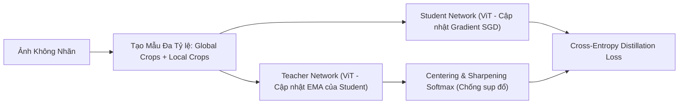

#### d. Code Thực chiến (C++ & Python)

```cpp
// C++17: Cập nhật Trọng số Teacher bằng Exponential Moving Average (EMA)
#include <iostream>
#include <vector>

void update_teacher_ema(std::vector<float>& teacher_weights, const std::vector<float>& student_weights, float momentum = 0.999f) {
    for (size_t i = 0; i < teacher_weights.size(); ++i) {
        teacher_weights[i] = momentum * teacher_weights[i] + (1.0f - momentum) * student_weights[i];
    }
}

int main() {
    std::vector<float> teacher = {1.0f, 2.0f};
    std::vector<float> student = {1.5f, 2.5f};
    update_teacher_ema(teacher, student, 0.9f);
    std::cout << "Updated Teacher Weight: [" << teacher[0] << ", " << teacher[1] << "]\n";
    return 0;
}
```

```python
# Python / PyTorch: DINO Cross-Entropy Loss với Centering và Sharpening
import torch
import torch.nn as nn
import torch.nn.functional as F

class DINOLoss(nn.Module):
    def __init__(self, out_dim: int, temp_student: float = 0.1, temp_teacher: float = 0.04, center_momentum: float = 0.9):
        super().__init__()
        self.temp_s = temp_student
        self.temp_t = temp_teacher
        self.momentum = center_momentum
        self.register_buffer("center", torch.zeros(1, out_dim))

    def forward(self, student_output: torch.Tensor, teacher_output: torch.Tensor) -> torch.Tensor:
        # student_output, teacher_output: [Batch, Out_Dim]
        s_prob = F.log_softmax(student_output / self.temp_s, dim=-1)
        # Teacher: Trừ center và làm sắc nét (Sharpening)
        t_prob = F.softmax((teacher_output - self.center) / self.temp_t, dim=-1).detach()
        loss = -(t_prob * s_prob).sum(dim=-1).mean()

        # Cập nhật center
        new_center = torch.mean(teacher_output, dim=0, keepdim=True)
        self.center = self.center * self.momentum + new_center * (1.0 - self.momentum)
        return loss

dino_loss_fn = DINOLoss(out_dim=100)
s_out = torch.randn(4, 100)
t_out = torch.randn(4, 100)
print("DINO Self-Distillation Loss:", dino_loss_fn(s_out, t_out).item())
```

#### e. Lỗi Thường gặp & Ổn định Số học
- Nếu không có tham số `center` hoặc cập nhật `center` sai cách, mô hình sẽ bị thoái hóa (Model Collapse) chỉ sau vài chục bước lặp đầu tiên.

#### f. Ứng dụng Thực chiến trong AI
Mô hình trích xuất đặc trưng hình ảnh mạnh nhất thế giới cho các bài toán Dense Prediction (DINOv2 làm backbone cho Depth Estimation, Semantic Segmentation, Nearest Neighbor Retrieval).

---

### 6. Self-Supervised Vision (Thị giác Tự Giám sát)

#### a. Định nghĩa Bản chất Toán học
Học tự giám sát (SSL) giải phóng thị giác máy tính khỏi sự phụ thuộc tốn kém và thiên kiến của việc dán nhãn thủ công bằng con người. Mô hình tự sinh ra tín hiệu giám sát (Pretext Tasks) từ chính cấu trúc tự thân của dữ liệu:
1. **Phương pháp Tương phản (Contrastive Learning - SimCLR, MoCo)**: Tối đa hóa sự tương đồng giữa hai góc nhìn biến đổi dữ liệu (Augmented Views) của cùng một bức ảnh và đẩy xa các ảnh khác:
   $$\mathcal{L}_{\text{InfoNCE}} = -\log \frac{\exp(\text{sim}(\mathbf{z}_i, \mathbf{z}_j)/\tau)}{\sum_k \exp(\text{sim}(\mathbf{z}_i, \mathbf{z}_k)/\tau)}$$
2. **Phương pháp Che phủ Ảnh (Masked Image Modeling - MAE - He et al., 2022)**: Ngẫu nhiên che giấu tới **$75\%$** số patch ảnh và huấn luyện Transformer Decoder tái tạo lại các giá trị pixel thô bị thiếu:
   $$\min_\theta \frac{1}{|\mathcal{M}|} \sum_{i \in \mathcal{M}} \|\mathbf{x}_i - \hat{\mathbf{x}}_i\|_2^2$$

#### b. Cơ chế Tầng Sâu & Điện toán
- **Asymmetric Encoder-Decoder trong MAE**: Việc che giấu 75% patches giúp Encoder chỉ cần xử lý 25% số patches còn lại. Do độ phức tạp Transformer là toàn phương $\mathcal{O}(N^2)$, giảm $4\times$ số token giúp tốc độ tính toán và bộ nhớ tăng gấp **$16\times$**, cho phép huấn luyện các mạng khổng lồ (ViT-Huge, ViT-Giant) nhanh chóng trên cụm GPU.

#### c. Sơ đồ Minh họa (Mermaid Diagram)


#### d. Code Thực chiến (C++ & Python)

```cpp
// C++17: Bộ Tạo Mặt nạ Ngẫu nhiên 75% Masking cho MAE Patches
#include <iostream>
#include <vector>
#include <numeric>
#include <algorithm>
#include <random>

std::vector<int> generate_mae_unmasked_indices(int total_patches, float mask_ratio = 0.75f) {
    int num_keep = static_cast<int>(total_patches * (1.0f - mask_ratio));
    std::vector<int> indices(total_patches);
    std::iota(indices.begin(), indices.end(), 0);

    std::mt19937 g(42);
    std::shuffle(indices.begin(), indices.end(), g);

    indices.resize(num_keep); // Giữ lại 25%
    return indices;
}

int main() {
    auto kept = generate_mae_unmasked_indices(196, 0.75f);
    std::cout << "MAE Kept Patches Count: " << kept.size() << " out of 196 (25%)\n";
    return 0;
}
```

```python
# Python / PyTorch: SimCLR Contrastive Loss
import torch
import torch.nn.functional as F

def simclr_contrastive_loss(z_i: torch.Tensor, z_j: torch.Tensor, temperature: float = 0.5) -> torch.Tensor:
    # z_i, z_j: [Batch, Dim] - 2 góc nhìn tăng cường của cùng 1 ảnh
    batch_size = z_i.size(0)
    representations = torch.cat([z_i, z_j], dim=0)
    representations = F.normalize(representations, dim=-1)

    similarity_matrix = torch.matmul(representations, representations.T) / temperature
    # Loại bỏ đường chéo chính (tự tương quan)
    mask = torch.eye(2 * batch_size, device=z_i.device).bool()
    similarity_matrix.masked_fill_(mask, -float('inf'))

    # Cặp dương của z_i[k] là z_j[k] (tại vị trí k + batch_size)
    labels = torch.cat([torch.arange(batch_size) + batch_size, torch.arange(batch_size)]).to(z_i.device)
    return F.cross_entropy(similarity_matrix, labels)

z1 = torch.randn(4, 64)
z2 = z1 + 0.1 * torch.randn(4, 64)
print("SimCLR Loss:", simclr_contrastive_loss(z1, z2).item())
```

#### e. Lỗi Thường gặp & Ổn định Số học
- **High-frequency Pixel Noise in MAE**: Việc tối ưu hóa mất mát MSE trên từng pixel khiến MAE dễ lãng phí dung lượng mô hình để học tái tạo các chi tiết nhiễu hạt tần số cao không quan trọng thay vì học cấu trúc ngữ nghĩa trừu tượng.

#### f. Ứng dụng Thực chiến trong AI
Tiền huấn luyện nền tảng cho mọi mô hình thị giác trước khi tinh chỉnh chuyên ngành.

---

### 7. Zero-Shot Classification (Phân loại Không cần Mẫu)

#### a. Định nghĩa Bản chất Toán học
Zero-Shot Classification phân loại ảnh vào các danh mục chưa từng xuất hiện trong tập huấn luyện mà không cần bất kỳ bước cập nhật trọng số nào:
$$\hat{y} = \arg\max_{c \in \mathcal{C}} \frac{\mathbf{f}_I(\mathbf{I})^T \mathbf{f}_T(\mathbf{t}_c)}{\|\mathbf{f}_I(\mathbf{I})\| \|\mathbf{f}_T(\mathbf{t}_c)\|}$$
trong đó $\mathbf{t}_c$ là câu nhắc lệnh văn bản (Prompt Template):
$$\mathbf{t}_c = \text{"a photo of a " } + \text{class\_name}_c$$
**Prompt Ensembling**: Để tăng cường độ chính xác thêm $3\% - 5\%$, vector văn bản của mỗi lớp được tính bằng trung bình cộng của hàng chục mẫu câu nhắc lệnh khác nhau:
$$\mathbf{w}_c = \frac{1}{K} \sum_{k=1}^K \mathbf{f}_T(\text{Prompt}_k(c))$$
Ví dụ: *"a photo of a small {c}"*, *"a centered photo of a {c}"*, *"a close-up photo of the {c}"*.

#### b. Cơ chế Tầng Sâu & Điện toán
- **Zero Latency Text Encoding**: Các vector văn bản $\mathbf{w}_c$ của tất cả các lớp mục tiêu được mã hóa trước ngoại tuyến (Pre-computed) và lưu dưới dạng một ma trận trọng số tuyến tính $\mathbf{W} \in \mathbb{R}^{C \times d}$. Tại thời điểm suy luận trên camera thời gian thực, chỉ cần chạy qua Image Encoder và thực hiện 1 phép nhân ma trận duy nhất $\mathbf{W} \times \mathbf{v}$.

#### c. Sơ đồ Minh họa (Mermaid Diagram)
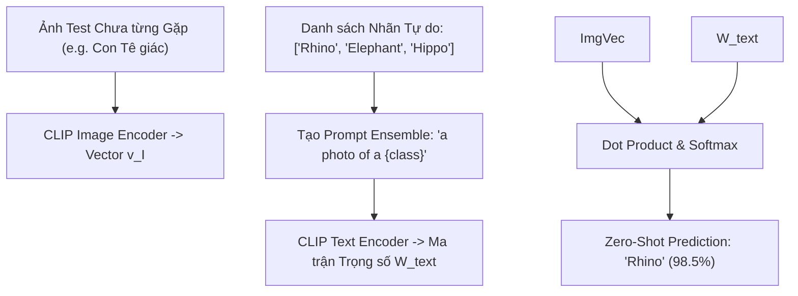

#### d. Code Thực chiến (C++ & Python)

```cpp
// C++17: Phân loại Zero-Shot bằng Ma trận Trọng số Đã Mã hóa trước
#include <iostream>
#include <vector>
#include <string>
#include <algorithm>

int zero_shot_predict(const std::vector<float>& img_feature, 
                      const std::vector<std::vector<float>>& precomputed_text_weights) {
    int best_class = -1;
    float max_score = -1e9f;

    for (size_t c = 0; c < precomputed_text_weights.size(); ++c) {
        float score = 0.0f;
        for (size_t d = 0; d < img_feature.size(); ++d) {
            score += img_feature[d] * precomputed_text_weights[c][d];
        }
        if (score > max_score) {
            max_score = score;
            best_class = static_cast<int>(c);
        }
    }
    return best_class;
}

int main() {
    std::vector<float> img_vec = {0.1f, 0.9f}; // Normalized
    std::vector<std::vector<float>> text_weights = {
        {0.9f, 0.1f}, // Class 0: Dog
        {0.15f, 0.88f} // Class 1: Cat (Highest match)
    };
    std::cout << "Zero-Shot Predicted Class ID: " << zero_shot_predict(img_vec, text_weights) << "\n";
    return 0;
}
```

```python
# Python: Prompt Ensembling cho CLIP Zero-Shot Classification
import numpy as np

PROMPT_TEMPLATES = [
    "a photo of a {}.",
    "a bad photo of a {}.",
    "a photo of many {}.",
    "a close-up photo of the {}."
]

def generate_ensemble_prompts(class_name: str) -> list[str]:
    return [template.format(class_name) for template in PROMPT_TEMPLATES]

print("Ensemble Prompts for 'panda':\n", generate_ensemble_prompts("panda"))
```

#### e. Lỗi Thường gặp & Ổn định Số học
- **Polysemy Ambiguity in Prompts**: Tên lớp có nhiều nghĩa (ví dụ lớp `"crane"` có thể là con chim sếu hoặc chiếc cần cẩu công trình). Nếu không bổ sung ngữ cảnh (e.g. *"a photo of a crane, a type of bird"*), mô hình sẽ phân loại sai.

#### f. Ứng dụng Thực chiến trong AI
Xây dựng bộ phân loại hình ảnh tức thì cho ứng dụng di động mà không cần thu thập dữ liệu huấn luyện.

---

### 8. Visual Grounding (Neo Ngữ nghĩa Thị giác Chi tiết)

#### a. Định nghĩa Bản chất Toán học
Visual Grounding (hay Phrase Grounding / Referring Expression Comprehension - REC) xác định vị trí chính xác của đối tượng được mô tả bằng một biểu thức ngôn ngữ tự nhiên tự do $\mathcal{T}$:
$$\hat{\mathbf{b}} = \arg\max_{\mathbf{b}} P(\mathbf{b} \mid \mathbf{I}, \mathcal{T})$$
Khác với phát hiện từ khóa đơn lẻ, biểu thức ngôn ngữ trong REC thường chứa các mối quan hệ không gian và thuộc tính phức hợp:
$$\mathcal{T} = \text{"người phụ nữ mặc áo khoác đỏ đứng cạnh chiếc xe đạp màu xanh"}$$
Mô hình hóa dưới dạng so khớp vùng tương quan đa phương thức (Cross-modal Region-Text Scoring):
$$S(\mathbf{r}_i, \mathcal{T}) = \mathbf{w}^T \left( \mathbf{f}_{\text{visual}}(\mathbf{r}_i) \odot \mathbf{f}_{\text{text}}(\mathcal{T}) \right)$$

#### b. Cơ chế Tầng Sâu & Điện toán
- **Spatial Coordinates Injection**: Vector đặc trưng của vùng ảnh $\mathbf{r}_i$ được ghép kèm với tọa độ không gian 5 chiều chuẩn hóa: $\left[\frac{x_1}{W}, \frac{y_1}{H}, \frac{x_2}{W}, \frac{y_2}{H}, \frac{\text{Area}_{\text{box}}}{\text{Area}_{\text{img}}}\right]$, giúp mạng nơ-ron hiểu được các mệnh đề chỉ vị trí như *"ở góc trên bên phải"* hay *"ở trung tâm"*.

#### c. Sơ đồ Minh họa (Mermaid Diagram)
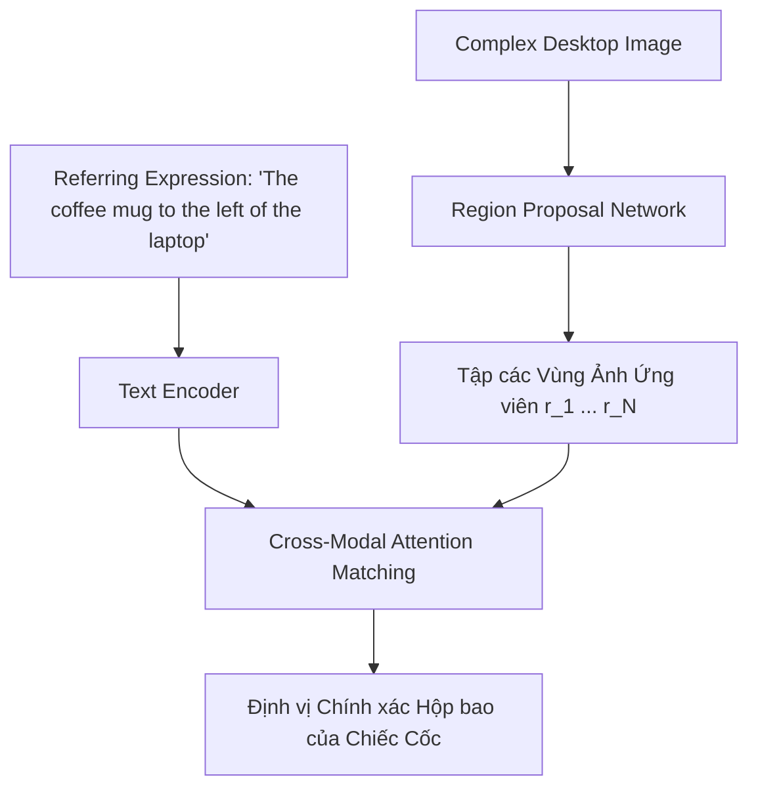

#### d. Code Thực chiến (C++ & Python)

```cpp
// C++17: Gióng hàng Vùng ảnh với Biểu thức Không gian
#include <iostream>
#include <string>

struct NormalizedBox { float x1, y1, x2, y2; };

bool matches_spatial_predicate(const NormalizedBox& b, const std::string& predicate) {
    if (predicate == "left") {
        return (b.x2 <= 0.5f); // Nằm hoàn toàn ở nửa bên trái
    } else if (predicate == "right") {
        return (b.x1 >= 0.5f); // Nằm ở nửa bên phải
    }
    return true;
}

int main() {
    NormalizedBox mug{0.1f, 0.2f, 0.4f, 0.5f};
    std::cout << "Mug is on the left? " << std::boolalpha << matches_spatial_predicate(mug, "left") << "\n";
    return 0;
}
```

```python
# Python / PyTorch: Referring Expression Matching Scorer
import torch
import torch.nn as nn

class VisualGroundingMatcher(nn.Module):
    def __init__(self, visual_dim: int, text_dim: int, joint_dim: int = 256):
        super().__init__()
        self.v_proj = nn.Linear(visual_dim + 5, joint_dim) # 5 spatial coordinates
        self.t_proj = nn.Linear(text_dim, joint_dim)
        self.score_head = nn.Linear(joint_dim, 1)

    def forward(self, region_feats: torch.Tensor, spatial_coords: torch.Tensor, text_feat: torch.Tensor):
        # region_feats: [N, Visual_Dim], spatial_coords: [N, 5], text_feat: [1, Text_Dim]
        v_full = torch.cat([region_feats, spatial_coords], dim=-1)
        v_emb = self.v_proj(v_full)
        t_emb = self.t_proj(text_feat) # [1, Joint_Dim]
        joint = torch.tanh(v_emb * t_emb)
        return self.score_head(joint).squeeze(-1) # [N]

matcher = VisualGroundingMatcher(512, 768)
r_f = torch.randn(10, 512)
s_c = torch.rand(10, 5)
t_f = torch.randn(1, 768)
scores = matcher(r_f, s_c, t_f)
print("Best Grounded Box Index:", torch.argmax(scores).item())
```

#### e. Lỗi Thường gặp & Ổn định Số học
- **Complex Relation Parsing Breakdown**: Khi câu miêu tả có cấu trúc ngữ pháp lồng ghép nhiều tầng (ví dụ *"cô gái cầm túi xách màu đen đứng sau người đàn ông mặc áo xanh"*), mô hình dễ nhầm lẫn và đóng khung người đàn ông thay vì cô gái.

#### f. Ứng dụng Thực chiến trong AI
Tương tác giọng nói tự nhiên với robot hỗ trợ người già, điều khiển camera thông minh theo dõi đối tượng theo mô tả chi tiết.

---

### 9. Image Captioning (Sinh Chú thích Ảnh Tự động)

#### a. Định nghĩa Bản chất Toán học
Image Captioning là bài toán đa phương thức Sequence-to-Sequence: Ánh xạ một bức ảnh đầu vào $\mathbf{I}$ thành chuỗi câu miêu tả bằng ngôn ngữ tự nhiên $\mathbf{y} = (y_1, y_2, \dots, y_T)$:
$$\mathbf{y}^* = \arg\max_{\mathbf{y}} \prod_{t=1}^T P(y_t \mid y_{<t}, \mathbf{I}; \theta)$$
Kiến trúc tiêu chuẩn: **Show, Attend and Tell (Xu et al., 2015 - nay dùng Transformer)**:
Mô hình sinh tự hồi quy từng từ, sử dụng cơ chế **Spatial Cross-Attention** để tập trung vào các vùng ảnh liên quan tại mỗi bước sinh:
$$\mathbf{c}_t = \sum_{i=1}^L \alpha_{t, i} \mathbf{v}_i, \quad \alpha_{t, i} = \frac{\exp(e_{t, i})}{\sum_{k=1}^L \exp(e_{t, k})}$$
Thước đo đánh giá chuyên biệt: **CIDEr (Consensus-based Image Description Evaluation)** và **SPICE** (dựa trên biểu đồ đồ thị ngữ nghĩa Scene Graph).

#### b. Cơ chế Tầng Sâu & Điện toán
- **CIDEr Optimization via Reinforcement Learning (SCST - Self-Critical Sequence Training)**: Huấn luyện bằng Cross-Entropy đơn thuần dẫn đến hiện tượng trôi dạt phân phối (Exposure Bias). Kỹ thuật SCST sử dụng thuật toán Policy Gradient (REINFORCE) lấy điểm số CIDEr làm phần thưởng (Reward) để trực tiếp tối ưu hóa chất lượng câu miêu tả.

#### c. Sơ đồ Minh họa (Mermaid Diagram)
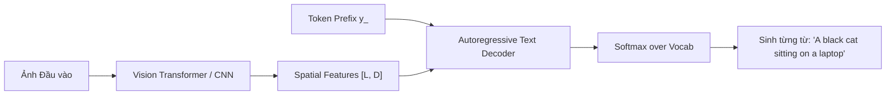

#### d. Code Thực chiến (C++ & Python)

```cpp
// C++17: Spatial Attention Weight Normalization cho Captioning Step
#include <iostream>
#include <vector>
#include <cmath>

std::vector<float> compute_spatial_attention_step(const std::vector<float>& spatial_energies) {
    std::vector<float> alpha(spatial_energies.size());
    float sum_exp = 0.0f;
    for (size_t i = 0; i < spatial_energies.size(); ++i) {
        alpha[i] = std::exp(spatial_energies[i]);
        sum_exp += alpha[i];
    }
    for (float& a : alpha) a /= sum_exp;
    return alpha;
}

int main() {
    std::vector<float> energy = {1.0f, 3.0f, 0.5f};
    auto alpha = compute_spatial_attention_step(energy);
    std::cout << "Attention weight on Region 1: " << alpha[1] << "\n";
    return 0;
}
```

```python
# Python / PyTorch: Cross-Attention Captioning Decoder Block
import torch
import torch.nn as nn

class CaptionDecoderBlock(nn.Module):
    def __init__(self, embed_dim: int, num_heads: int):
        super().__init__()
        self.self_attn = nn.MultiheadAttention(embed_dim, num_heads, batch_first=True)
        self.cross_attn = nn.MultiheadAttention(embed_dim, num_heads, batch_first=True)
        self.ffn = nn.Sequential(nn.Linear(embed_dim, embed_dim * 4), nn.GELU(), nn.Linear(embed_dim * 4, embed_dim))

    def forward(self, tgt_tokens: torch.Tensor, visual_features: torch.Tensor) -> torch.Tensor:
        # tgt_tokens: [Batch, Seq_Len, Dim], visual_features: [Batch, Num_Patches, Dim]
        # Masked Causal Self-Attention
        seq_len = tgt_tokens.size(1)
        causal_mask = torch.triu(torch.full((seq_len, seq_len), float('-inf'), device=tgt_tokens.device), diagonal=1)
        s_out, _ = self.self_attn(tgt_tokens, tgt_tokens, tgt_tokens, attn_mask=causal_mask)
        
        # Cross-Attention over visual features
        c_out, _ = self.cross_attn(query=s_out, key=visual_features, value=visual_features)
        return self.ffn(c_out)

dec = CaptionDecoderBlock(embed_dim=256, num_heads=4)
words = torch.randn(2, 8, 256)
visuals = torch.randn(2, 49, 256)
print("Decoded Caption Representation:", dec(words, visuals).shape) # [2, 8, 256]
```

#### e. Lỗi Thường gặp & Ổn định Số học
- **Hallucinated Objects in Captions**: Mô hình tự bổ sung các vật thể thường xuyên đồng xuất hiện trong tập huấn luyện nhưng hoàn toàn không có trong ảnh thực tế (ví dụ thấy bãi biển thì tự động thêm từ *"và chiếc ô che nắng"*).

#### f. Ứng dụng Thực chiến trong AI
Hỗ trợ người khiếm thị đọc nội dung ảnh trên màn hình, tự động tạo thẻ miêu tả `alt` phục vụ SEO website và hỗ trợ tiếp cận (Accessibility).

---

### 10. Visual Question Answering - VQA (Hỏi đáp Thị giác)

#### a. Định nghĩa Bản chất Toán học
VQA là bài toán kiểm tra năng lực hiểu biết thị giác và suy luận đa phương thức ở mức độ cao nhất: Cho một bức ảnh $\mathbf{I}$ và một câu hỏi ngôn ngữ tự nhiên $\mathbf{Q}$, mô hình phải suy luận và đưa ra câu trả lời chính xác $\mathbf{A}$:
$$\hat{\mathbf{a}} = \arg\max_{\mathbf{a}} P(\mathbf{a} \mid \mathbf{I}, \mathbf{Q}; \theta)$$
Hai phân loại bài toán:
1. **Classification-based VQA**: Coi câu trả lời là một nhãn phân loại trong từ điển top-$K$ câu trả lời phổ biến nhất (thường $K=3129$ trong tập VQA 2.0).
2. **Generative VQA**: Mô hình đa phương thức sinh câu trả lời tự do bằng Autoregressive Decoder (BLIP-2, LLaVA).

#### b. Cơ chế Tầng Sâu & Điện toán
- **Multimodal Fusion Architecture (Bilinear Fusion / MCB)**: Để tương tác giữa vector ảnh $\mathbf{v} \in \mathbb{R}^M$ và vector câu hỏi $\mathbf{q} \in \mathbb{R}^N$ đạt độ sâu tối đa, các mô hình kinh điển sử dụng phép nhân tích ngoài đầy đủ $\mathbf{v} \otimes \mathbf{q}$, sau đó nén lại bằng thuật toán đếm phác thảo (Count Sketch / Multimodal Compact Bilinear Pooling). Trong các mô hình hiện đại, điều này được thay thế bằng Cross-Attention Transformer.

#### c. Sơ đồ Minh họa (Mermaid Diagram)
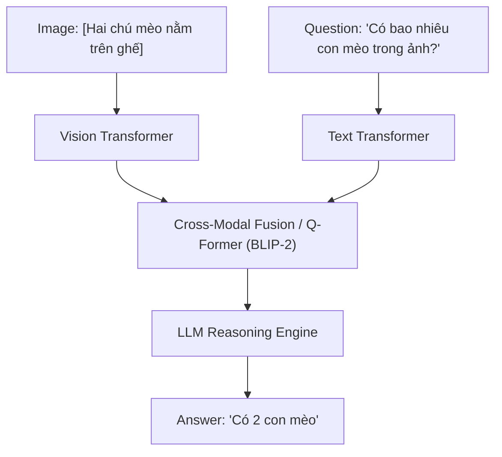

#### d. Code Thực chiến (C++ & Python)

```cpp
// C++17: Hadamard Product Multimodal Fusion cơ bản
#include <iostream>
#include <vector>

std::vector<float> hadamard_multimodal_fusion(const std::vector<float>& visual_feat,
                                              const std::vector<float>& text_feat) {
    size_t dim = visual_feat.size();
    std::vector<float> fused(dim);
    for (size_t i = 0; i < dim; ++i) {
        fused[i] = visual_feat[i] * text_feat[i]; // Phép nhân từng phần tử
    }
    return fused;
}

int main() {
    std::vector<float> v = {0.8f, -0.5f};
    std::vector<float> t = {0.5f, 0.2f};
    auto f = hadamard_multimodal_fusion(v, t);
    std::cout << "Fused Vector: [" << f[0] << ", " << f[1] << "]\n";
    return 0;
}
```

```python
# Python / PyTorch: VQA 3129-Class Multi-Choice Classification Head
import torch
import torch.nn as nn

class VQAClassificationHead(nn.Module):
    def __init__(self, joint_dim: int, num_answers: int = 3129):
        super().__init__()
        self.classifier = nn.Sequential(
            nn.Linear(joint_dim, joint_dim),
            nn.ReLU(),
            nn.Dropout(0.2),
            nn.Linear(joint_dim, num_answers)
        )

    def forward(self, fused_multimodal_representation: torch.Tensor) -> torch.Tensor:
        return self.classifier(fused_multimodal_representation)

vqa_head = VQAClassificationHead(joint_dim=512)
fused_vec = torch.randn(2, 512)
logits = vqa_head(fused_vec)
print("VQA Answer Logits Shape:", logits.shape) # [2, 3129]
```

#### e. Lỗi Thường gặp & Ổn định Số học
- **Language Prior Blindness**: Mô hình bỏ qua việc nhìn vào bức ảnh mà chỉ dựa vào định kiến thống kê của ngôn ngữ trong tập câu hỏi để trả lời (ví dụ khi gặp câu hỏi *"Màu của quả chuối là gì?"*, mô hình luôn trả lời là *"màu vàng"* dù trong ảnh quả chuối thực tế có màu xanh lá).

#### f. Ứng dụng Thực chiến trong AI
Trợ lý AI đa phương thức (GPT-4V, Gemini Pro Vision, Claude 3.5 Sonnet), hỗ trợ chẩn đoán ảnh chụp y khoa qua hỏi đáp chuyên gia.

---

### 11. Scene Understanding (Thấu hiểu Ngữ cảnh Toàn cảnh)

#### a. Định nghĩa Bản chất Toán học
Thấu hiểu ngữ cảnh toàn cảnh là cấp độ nhận thức tối thượng của Computer Vision: Không chỉ phát hiện rời rạc các hộp bao hay mặt nạ, mô hình xây dựng một Đồ thị Ngữ cảnh Hoàn chỉnh (**Scene Graph**):
$$\mathcal{G}_{\text{scene}} = (\mathcal{V}_{\text{objects}}, \mathcal{E}_{\text{predicates}})$$
trong đó mỗi nút $v_i \in \mathcal{V}$ là một thực thể vật thể kèm thuộc tính, và mỗi cạnh có hướng $e_{ij} = (v_i, r, v_j) \in \mathcal{E}$ là quan hệ không gian, so sánh hoặc hành động giữa hai thực thể:
$$\text{"(người đàn ông) --[đang lái]--> (xe máy)"}, \quad \text{"(xe máy) --[ở trên]--> (con đường)"}$$

#### b. Cơ chế Tầng Sâu & Điện toán
- **Graph Convolutional Networks (GCN) on Scene Graphs**: Sau khi trích xuất các thực thể và quan hệ sơ bộ, mạng GCN truyền thông điệp (Message Passing) qua lại giữa các nút và cạnh để tinh chỉnh biểu diễn ngữ cảnh toàn cục, đảm bảo tính nhất quán logic của toàn bộ khung cảnh.

#### c. Sơ đồ Minh họa (Mermaid Diagram)
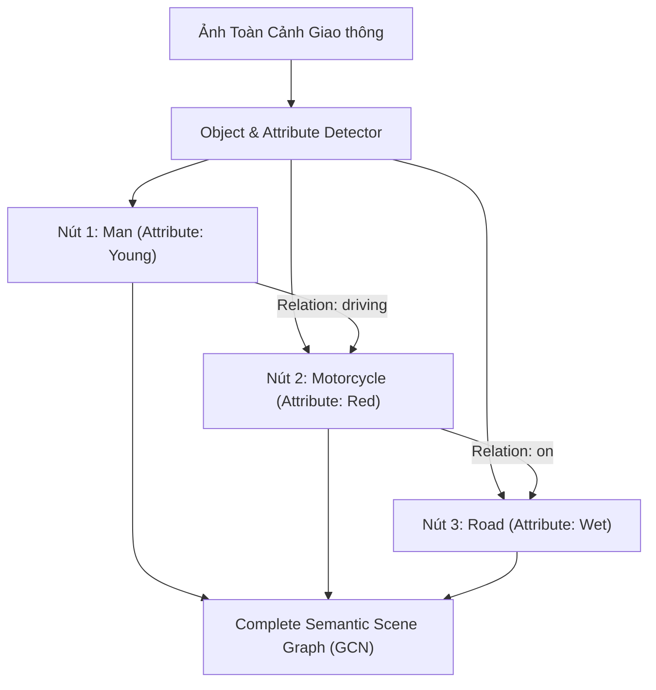

#### d. Code Thực chiến (C++ & Python)

```cpp
// C++17: Cấu trúc Đồ thị Ngữ cảnh Scene Graph
#include <iostream>
#include <string>
#include <vector>

struct SceneObjectNode {
    int id;
    std::string name;
    std::vector<std::string> attributes;
};

struct SceneEdge {
    int sub_id;
    int obj_id;
    std::string relation_predicate;
};

class SceneGraph {
public:
    std::vector<SceneObjectNode> nodes;
    std::vector<SceneEdge> edges;

    void print() const {
        std::cout << "Scene Graph Entities:\n";
        for (const auto& n : nodes) {
            std::cout << "  #" << n.id << ": " << n.name << "\n";
        }
        std::cout << "Scene Graph Relations:\n";
        for (const auto& e : edges) {
            std::cout << "  (#" << e.sub_id << ") --[" << e.relation_predicate << "]--> (#" << e.obj_id << ")\n";
        }
    }
};

int main() {
    SceneGraph sg;
    sg.nodes.push_back({1, "Person", {"Standing"}});
    sg.nodes.push_back({2, "Desk", {"Wooden"}});
    sg.edges.push_back({1, 2, "leaning_on"});
    sg.print();
    return 0;
}
```

```python
# Python / PyTorch: Message Passing Step trên Scene Graph
import torch

def simple_scene_graph_message_passing(node_embeddings: torch.Tensor, adjacency_matrix: torch.Tensor) -> torch.Tensor:
    # node_embeddings: [Num_Nodes, Dim], adjacency_matrix: [Num_Nodes, Num_Nodes]
    # Message: A * H * W
    degree = adjacency_matrix.sum(dim=-1, keepdim=True).clamp(min=1)
    norm_adj = adjacency_matrix / degree
    messages = torch.matmul(norm_adj, node_embeddings)
    return messages

nodes = torch.randn(3, 64)
adj = torch.tensor([[0.0, 1.0, 0.0], [1.0, 0.0, 1.0], [0.0, 1.0, 0.0]])
updated_nodes = simple_scene_graph_message_passing(nodes, adj)
print("Updated Node Representations Shape:", updated_nodes.shape)
```

#### e. Lỗi Thường gặp & Ổn định Số học
- **Predicate Distribution Bias**: Dữ liệu thực tế bị chi phối bởi các quan hệ quá chung chung (như `"on"` chiếm $>50\%$), khiến mô hình lười học các quan hệ tương tác cụ thể (như `"holding"`, `"eating"`, `"carrying"`).

#### f. Ứng dụng Thực chiến trong AI
Khung nhận thức cao cấp cho Robot tự hành thám hiểm không gian, hệ thống tìm kiếm video thông minh qua đồ thị tri thức ngữ nghĩa.
