# Chuyên đề: Xử lý Tín hiệu Số & Trích xuất Đặc trưng Âm thanh (DSP & Acoustic Features)

## 1. Tổng quan Chuyên đề
Âm thanh về bản chất vật lý là sóng áp suất cơ học lan truyền qua môi trường đàn hồi (như không khí), tạo ra dao động nén và giãn của các phân tử. Trong thời đại Trí tuệ Nhân tạo, việc chuyển đổi sóng liên tục này thành biểu diễn số rời rạc để máy học xử lý đòi hỏi lý thuyết Xử lý Tín hiệu Số (Digital Signal Processing - DSP).

Từ định lý lấy mẫu Nyquist-Shannon, biến đổi Fourier rời rạc (DFT/FFT) đến biến đổi Fourier thời gian ngắn (STFT), phổ tần số (Spectrogram), thang đo cảm thụ âm học Log-Mel (Mel Spectrogram) và các hệ số Cepstrum (MFCC), chuỗi biến đổi toán học này chính là cầu nối giữa dao động cơ học thuần túy và các mô hình Deep Learning âm thanh hiện đại.

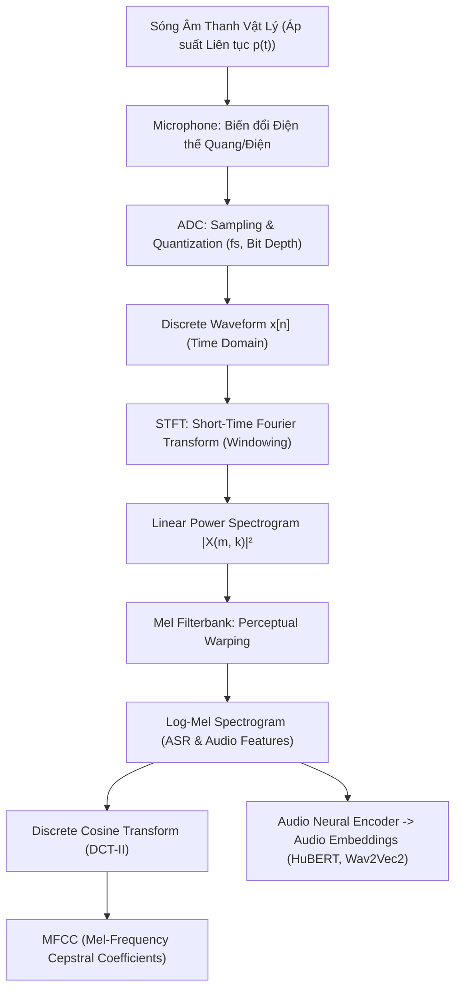

---

## 2. Chi tiết từng Keyword

---

### 1. Digital Signal Processing (DSP - Xử lý Tín hiệu Số)

#### a. Định nghĩa Bản chất Toán học (Mathematical Formulation)
DSP là quá trình xử lý toán học trên chuỗi tín hiệu rời rạc theo thời gian $x[n] \in \mathbb{R}$ hoặc $\mathbb{C}$, qua hệ thống tuyến tính bất biến theo thời gian (Linear Time-Invariant - LTI system) được đặc trưng bởi hàm đáp ứng xung $h[n]$:
$$y[n] = (x * h)[n] = \sum_{k=-\infty}^{\infty} x[k] h[n - k]$$
Trong miền biến đổi $Z$, tích chập biến thành tích đại số của biến đổi $Z$:
$$Y(z) = X(z) \cdot H(z) \quad \text{với } H(z) = \sum_{n=-\infty}^\infty h[n] z^{-n}$$

#### b. Cơ chế Tầng Sâu & Điện toán (Under The Hood / Hardware Internals)
- **Fused Multiply-Accumulate (FMA) Units**: Thao tác cốt lõi của DSP là phép tích vô hướng và tích chập rời rạc: $a \leftarrow a + (b \times c)$. Trên DSP chips chuyên dụng hoặc CPU hiện đại (AVX2/AVX-512) và GPU CUDA Tensor Cores, phép toán FMA được thực thi trong một chu kỳ máy duy nhất với độ trễ cực thấp và không bị làm tròn trung gian.
- **Circular Buffer (Ring Buffer)**: Xử lý DSP thời gian thực lưu trữ mẫu âm thanh trong một bộ đệm vòng kích thước $2^K$. Con trỏ đọc/ghi dịch chuyển tuần hoàn thông qua phép toán bitwise `index = (index + 1) & (N - 1)`, hoàn toàn loại bỏ chi phí rẽ nhánh `if` hoặc dịch chuyển bộ nhớ.

#### c. Sơ đồ Minh họa (Mermaid Diagram)
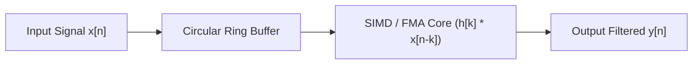

#### d. Code Thực chiến (C++ & Python)

```cpp
// C++17: Bộ đệm vòng Circular Buffer và tích chập FIR cơ bản bằng FMA
#include <iostream>
#include <vector>

class CircularBufferFIR {
private:
    std::vector<float> buffer;
    std::vector<float> coeffs;
    size_t head = 0;
    size_t size;

public:
    CircularBufferFIR(const std::vector<float>& h) : coeffs(h), size(h.size()), buffer(h.size(), 0.0f) {}

    float process_sample(float x) {
        buffer[head] = x;
        float y = 0.0f;
        size_t idx = head;
        for (size_t i = 0; i < size; ++i) {
            y += coeffs[i] * buffer[idx];
            idx = (idx == 0) ? (size - 1) : (idx - 1);
        }
        head = (head + 1) % size;
        return y;
    }
};

int main() {
    std::vector<float> fir_lpf = {0.1f, 0.2f, 0.4f, 0.2f, 0.1f};
    CircularBufferFIR filter(fir_lpf);
    std::cout << "Filtered Output: " << filter.process_sample(1.0f) << "\n";
    return 0;
}
```

```python
# Python / PyTorch: Lọc FIR 1D sử dụng conv1d
import torch
import torch.nn.functional as F

x = torch.randn(1, 1, 16000) # 1 giây âm thanh 16kHz
fir_kernel = torch.tensor([0.1, 0.2, 0.4, 0.2, 0.1]).view(1, 1, -1)
filtered_x = F.conv1d(x, fir_kernel, padding=2)
print("Input shape:", x.shape, "| Filtered shape:", filtered_x.shape)
```

#### e. Lỗi Thường gặp & Ổn định Số học
- **Tràn số cố định (Fixed-Point Overflow)**: Trong chip DSP phần cứng dùng số nguyên 16-bit (`int16`), tích chập liên tục các tín hiệu biên độ lớn gây tràn số số nguyên (Integer Wrap-around), dẫn đến tiếng nổ rè (click/pop) cực lớn. Luôn cần chuẩn hóa thang đo hoặc dùng Q-format bão hòa (Saturated Arithmetic).

#### f. Ứng dụng Thực chiến trong AI
Tiền xử lý âm thanh trong pipeline ASR/TTS, khử dội âm học (Acoustic Echo Cancellation - AEC), và các lớp tích chập không gian tín hiệu 1D.

---

### 2. Audio Signals (Tín hiệu Âm thanh)

#### a. Định nghĩa Bản chất Toán học (Mathematical Formulation)
Tín hiệu âm thanh liên tục là hàm áp suất không khí biến thiên theo thời gian: $s(t): \mathbb{R} \to \mathbb{R}$. Năng lượng tức thời của tín hiệu được định nghĩa:
$$E(t) = |s(t)|^2$$
Công suất trung bình trong khoảng thời gian $[0, T]$ là:
$$P = \frac{1}{T} \int_0^T s^2(t) dt$$
Mức cường độ âm thanh tính theo thang Decibel (dB SPL):
$$L_p = 20 \log_{10} \left( \frac{p_{\text{rms}}}{p_0} \right) \quad \text{với } p_0 = 2 \times 10^{-5} \text{ Pa (ngưỡng nghe con người)}$$

#### b. Cơ chế Tầng Sâu & Điện toán (Under The Hood / Hardware Internals)
- **PCM (Pulse Code Modulation) Interleaved vs. Deinterleaved**: Âm thanh đa kênh (Stereo 2.0 hoặc 5.1) khi đọc từ file WAV thường ở dạng xen kẽ: `[L0, R0, L1, R1, L2, R2...]`. Trong GPU Tensor Cores, dữ liệu cần được de-interleave thành cấu trúc kênh riêng biệt: `[Batch, Channels, Time]` để các luồng warp SIMD nạp dữ liệu tuần tự đạt hiệu quả bộ nhớ cache L1/L2 cao nhất (Coalesced Memory Access).

#### c. Sơ đồ Minh họa (Mermaid Diagram)
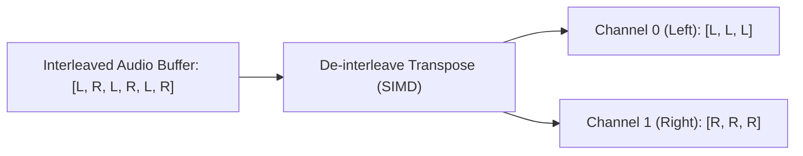

#### d. Code Thực chiến (C++ & Python)

```cpp
// C++17: Chuyển đổi De-interleaving mảng Stereo 2 kênh
#include <iostream>
#include <vector>

void deinterleave_stereo(const float* interleaved, float* left, float* right, size_t num_samples) {
    for (size_t i = 0; i < num_samples; ++i) {
        left[i] = interleaved[2 * i];
        right[i] = interleaved[2 * i + 1];
    }
}

int main() {
    std::vector<float> stereo = {0.1f, -0.1f, 0.2f, -0.2f};
    std::vector<float> left(2), right(2);
    deinterleave_stereo(stereo.data(), left.data(), right.data(), 2);
    std::cout << "Left[0]: " << left[0] << ", Right[0]: " << right[0] << "\n";
    return 0;
}
```

```python
# Python / PyTorch: Đo mức công suất Decibel (dB)
import torch

def signal_power_db(waveform: torch.Tensor, eps: float = 1e-10) -> torch.Tensor:
    rms = torch.sqrt(torch.mean(waveform ** 2, dim=-1) + eps)
    return 20.0 * torch.log10(rms)

audio = torch.randn(1, 16000) * 0.05
print("Power Level (dB):", signal_power_db(audio).item())
```

#### e. Lỗi Thường gặp & Ổn định Số học
- Khi tín hiệu hoàn toàn là khoảng lặng (silence: toàn số 0), phép tính `log10(rms)` sẽ trả về $-\infty$ hoặc `NaN`. Bắt buộc cộng thêm hằng số $\epsilon = 10^{-10}$ trước khi lấy hàm log.

#### f. Ứng dụng Thực chiến trong AI
Kiểm soát mức âm lượng đầu vào trong VAD (Voice Activity Detection), chuẩn hóa Loudness (LUFS) cho pipeline phát âm TTS.

---

### 3. Sampling Rate (Tần số Lấy mẫu)

#### a. Định nghĩa Bản chất Toán học (Mathematical Formulation)
Tần số lấy mẫu $f_s = \frac{1}{T_s}$ (đơn vị Hertz - Hz) xác định số lần đo tín hiệu liên tục trong một giây:
$$x[n] = s(n T_s) = s\left( \frac{n}{f_s} \right), \quad n \in \mathbb{Z}$$
Biến đổi lấy mẫu trong miền thời gian tương đương với việc nhân tín hiệu liên tục với lược Dirac (Dirac comb):
$$s_{\delta}(t) = s(t) \cdot \sum_{n=-\infty}^\infty \delta(t - n T_s)$$
Trong miền tần số, phổ của tín hiệu bị lặp tuần hoàn theo chu kỳ $f_s$:
$$S_{\delta}(f) = f_s \sum_{k=-\infty}^\infty S(f - k f_s)$$

#### b. Cơ chế Tầng Sâu & Điện toán (Under The Hood / Hardware Internals)
- **Polyphase Resampling Filterbank**: Khi chuyển đổi tần số lấy mẫu (Resampling) từ 44.1kHz (CD Audio) sang 16kHz (chuẩn đầu vào của Whisper/ASR), phương pháp ngây thơ (Up-sample bằng cách chèn 0 rồi LPF rồi Down-sample) cực kỳ tốn chi phí. GPU và thư viện `libsoxr` sử dụng bộ lọc đa pha (Polyphase filter) chỉ tính toán tại các mẫu thực sự cần trích xuất, giảm tới $90\%$ số phép nhân vô hướng.

#### c. Sơ đồ Minh họa (Mermaid Diagram)


#### d. Code Thực chiến (C++ & Python)

```cpp
// C++17: Resample tuyến tính đơn giản (Linear Interpolation)
#include <iostream>
#include <vector>

std::vector<float> resample_linear(const std::vector<float>& input, float in_rate, float out_rate) {
    float ratio = in_rate / out_rate;
    size_t out_len = static_cast<size_t>(input.size() / ratio);
    std::vector<float> output(out_len);
    for (size_t i = 0; i < out_len; ++i) {
        float in_idx = i * ratio;
        size_t idx0 = static_cast<size_t>(in_idx);
        size_t idx1 = std::min(idx0 + 1, input.size() - 1);
        float frac = in_idx - idx0;
        output[i] = (1.0f - frac) * input[idx0] + frac * input[idx1];
    }
    return output;
}

int main() {
    std::vector<float> in_sig = {0.0f, 0.5f, 1.0f, 0.5f, 0.0f};
    auto out_sig = resample_linear(in_sig, 44100, 16000);
    std::cout << "Original len: " << in_sig.size() << " -> Resampled len: " << out_sig.size() << "\n";
    return 0;
}
```

```python
# Python / Torchaudio: Resample chuẩn Sinc chất lượng cao
import torch
import torchaudio.transforms as T

waveform = torch.randn(1, 44100) # 1s 44.1kHz
resampler = T.Resample(orig_freq=44100, new_freq=16000)
resampled_waveform = resampler(waveform)
print("Resampled shape:", resampled_waveform.shape) # [1, 16000]
```

#### e. Lỗi Thường gặp & Ổn định Số học
- Nạp trực tiếp file âm thanh 48kHz vào mô hình Whisper được huấn luyện ở 16kHz mà quên resample sẽ khiến đặc trưng phổ bị co cụm về mặt thời gian gấp 3 lần, làm mô hình sinh văn bản vô nghĩa (gibberish).

#### f. Ứng dụng Thực chiến trong AI
Chuẩn hóa mẫu âm thanh trước khi đưa vào các mô hình nhận dạng tiếng nói (16kHz), tổng hợp âm thanh giọng nói (22.05kHz, 24kHz), hoặc âm nhạc độ phân giải cao (48kHz).

---

### 4. Quantization (Lượng tử hóa Tín hiệu)

#### a. Định nghĩa Bản chất Toán học (Mathematical Formulation)
Lượng tử hóa là ánh xạ biên độ liên tục của tín hiệu $x \in [-A_{\max}, A_{\max}]$ thành một tập hữu hạn gồm $2^B$ mức rời rạc (với $B$ là số bit lượng tử hóa, hay Bit Depth):
$$x_q = Q(x) = \Delta \cdot \left\lfloor \frac{x}{\Delta} + \frac{1}{2} \right\rfloor \quad \text{với bước lượng tử } \Delta = \frac{2 A_{\max}}{2^B}$$
Sai số lượng tử hóa (Quantization Noise): $e[n] = x_q[n] - x[n]$ có kỳ vọng bằng 0 và phương sai giả định phân phối đều trên $[-\frac{\Delta}{2}, \frac{\Delta}{2}]$:
$$\sigma_e^2 = \frac{\Delta^2}{12}$$
Tỷ số tín hiệu trên nhiễu lượng tử (SQNR):
$$\text{SQNR (dB)} \approx 6.02 \cdot B + 1.76 \text{ dB}$$

#### b. Cơ chế Tầng Sâu & Điện toán (Under The Hood / Hardware Internals)
- **PCM 16-bit Signed Integer Packing**: Âm thanh chuẩn WAV thường được lưu dưới dạng `int16_t` (phạm vi từ $-32768$ đến $+32767$). Khi nạp vào GPU để huấn luyện nơ-ron, cần thực hiện phép biến đổi mở rộng float và chuẩn hóa về phạm vi $[-1.0, 1.0]$: `x_float = (float)x_int / 32768.0f`. Thao tác này được tăng tốc bằng tập lệnh AVX2 `_mm256_cvtepi32_ps`.

#### c. Sơ đồ Minh họa (Mermaid Diagram)


#### d. Code Thực chiến (C++ & Python)

```cpp
// C++17: Chuyển đổi float [-1.0, 1.0] sang int16 với cơ chế chống tràn (Clamping)
#include <iostream>
#include <algorithm>
#include <cstdint>

int16_t float_to_int16(float sample) {
    float clamped = std::max(-1.0f, std::min(1.0f, sample));
    return static_cast<int16_t>(clamped * 32767.0f);
}

int main() {
    float s1 = 0.75f;
    float s2 = 1.5f; // Tràn biên
    std::cout << "Sample 1 quantized: " << float_to_int16(s1) << "\n";
    std::cout << "Sample 2 clamped: " << float_to_int16(s2) << "\n";
    return 0;
}
```

```python
# Python / PyTorch: Đo SQNR mô phỏng
import torch

def quantize_audio(x: torch.Tensor, bits: int = 8) -> torch.Tensor:
    q_levels = 2 ** (bits - 1) - 1
    return torch.round(x * q_levels) / q_levels

audio = torch.sin(torch.linspace(0, 100, 16000))
audio_q8 = quantize_audio(audio, bits=8)
noise = audio - audio_q8
sqnr = 10 * torch.log10(torch.mean(audio ** 2) / torch.mean(noise ** 2))
print(f"Measured SQNR for 8-bit: {sqnr.item():.2f} dB (Theory ~ 49.92 dB)")
```

#### e. Lỗi Thường gặp & Ổn định Số học
- **Hard Clipping Distortion**: Khi biên độ sóng âm vượt quá giá trị cực đại cho phép (ví dụ $> 1.0$ đối với float hoặc $> 32767$ đối với `int16`), tín hiệu bị cắt phẳng đỉnh, tạo ra vô số hài âm bậc cao gây méo âm thanh cực kỳ chói tai.

#### f. Ứng dụng Thực chiến trong AI
Nén trọng số mô hình âm thanh (INT8 quantization cho ASR on-device) và chuẩn hóa đầu vào microphone.

---

### 5. Nyquist-Shannon Sampling Theorem (Định lý Lấy mẫu Nyquist-Shannon)

#### a. Định nghĩa Bản chất Toán học (Mathematical Formulation)
Định lý phát biểu rằng một tín hiệu liên tục băng thông giới hạn (bandlimited) $s(t)$, không chứa thành phần tần số nào lớn hơn hoặc bằng $B$ ($S(f) = 0, \forall |f| \ge B$), có thể được khôi phục hoàn toàn chính xác từ chuỗi mẫu rời rạc $x[n] = s(n T_s)$ nếu tần số lấy mẫu thỏa mãn:
$$f_s > 2B$$
Tần số $f_N = \frac{f_s}{2}$ được gọi là tần số Nyquist (Nyquist Frequency). Công thức khôi phục nội suy Whittaker-Shannon:
$$s(t) = \sum_{n=-\infty}^\infty x[n] \, \text{sinc}\left( \frac{t - n T_s}{T_s} \right) \quad \text{với } \text{sinc}(u) = \frac{\sin(\pi u)}{\pi u}$$

#### b. Cơ chế Tầng Sâu & Điện toán (Under The Hood / Hardware Internals)
- **Anti-Aliasing Analog Filter**: Nếu tín hiệu trước khi lấy mẫu chứa thành phần $f > f_s/2$, hiện tượng chồng phổ (Aliasing) sẽ xảy ra: tần số cao bị phản xạ gập ngược lại miền tần số thấp $f_{\text{alias}} = |f - k f_s|$. Tại tầng phần cứng bo mạch âm thanh (Sound Card / DAC), trước chip ADC luôn có một bộ lọc thông thấp tương tự (Analog Low-Pass Filter) để triệt tiêu toàn bộ tần số vượt quá $f_s/2$.

#### c. Sơ đồ Minh họa (Mermaid Diagram)
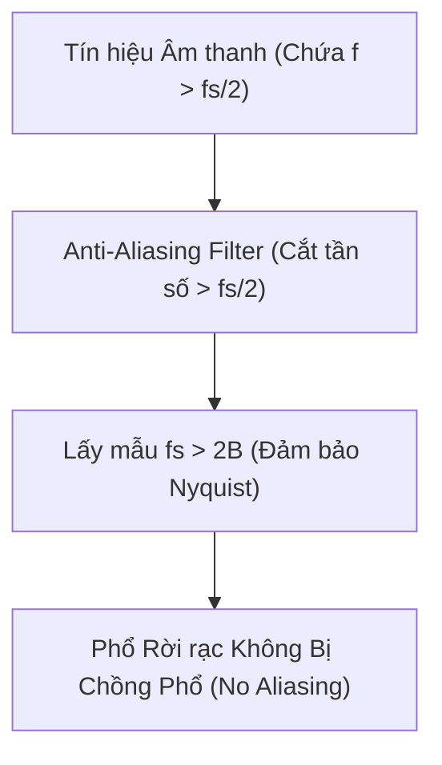

#### d. Code Thực chiến (C++ & Python)

```cpp
// C++17: Kiểm tra điều kiện Nyquist cho tần số âm thanh
#include <iostream>

bool check_nyquist(double signal_max_freq, double sampling_rate) {
    double nyquist_limit = sampling_rate / 2.0;
    return signal_max_freq < nyquist_limit;
}

int main() {
    double human_hearing_limit = 20000.0; // 20 kHz
    double cd_rate = 44100.0;             // 44.1 kHz
    double speech_rate = 16000.0;         // 16 kHz
    std::cout << "CD Rate Nyquist Valid: " << check_nyquist(human_hearing_limit, cd_rate) << "\n";
    std::cout << "Speech Rate Nyquist Valid for 20kHz: " << check_nyquist(human_hearing_limit, speech_rate) << "\n";
    return 0;
}
```

```python
# Python / Scipy: Minh họa hiện tượng Aliasing khi vi phạm định lý Nyquist
import numpy as np

fs = 100 # fs = 100 Hz -> Nyquist = 50 Hz
t = np.linspace(0, 1, fs, endpoint=False)
f_high = 80 # 80 Hz > 50 Hz -> Bị alias thành 20 Hz (|80 - 100| = 20)
signal = np.sin(2 * np.pi * f_high * t)
apparent_f = 20
reconstructed_equiv = np.sin(2 * np.pi * apparent_f * t)
print("Aliasing error (L2 norm):", np.linalg.norm(signal - (-reconstructed_equiv))) # Hoàn toàn trùng khớp dạng sóng ngược pha
```

#### e. Lỗi Thường gặp & Ổn định Số học
- Giảm tần số lấy mẫu (Decimation) bằng cách cắt bỏ trực tiếp các phần tử mà không áp dụng bộ lọc thông thấp kỹ thuật số (Digital Anti-Aliasing Filter) sẽ tạo ra tiếng rè chồng phổ méo mó không thể khôi phục.

#### f. Ứng dụng Thực chiến trong AI
Xác định tần số lấy mẫu tối thiểu cho hệ thống ASR (16kHz đủ bao phủ tiếng nói người dưới 8kHz) và phân tích âm nhạc (44.1kHz / 48kHz bao phủ toàn bộ thính giác người 20kHz).

---

### 6. Fourier Transform (Biến đổi Fourier Liên tục)

#### a. Định nghĩa Bản chất Toán học (Mathematical Formulation)
Biến đổi Fourier biểu diễn tín hiệu liên tục theo thời gian $x(t)$ thành tổng tích phân của các dao động hàm mũ phức ở mọi tần số liên tục $\omega = 2\pi f$:
$$X(\omega) = \mathcal{F}\{x(t)\} = \int_{-\infty}^{\infty} x(t) e^{-j\omega t} dt$$
Công thức biến đổi Fourier ngược (Inverse Fourier Transform):
$$x(t) = \mathcal{F}^{-1}\{X(\omega)\} = \frac{1}{2\pi} \int_{-\infty}^{\infty} X(\omega) e^{j\omega t} d\omega$$
Theo định lý Parseval, tổng năng lượng được bảo toàn giữa hai miền:
$$\int_{-\infty}^{\infty} |x(t)|^2 dt = \frac{1}{2\pi} \int_{-\infty}^{\infty} |X(\omega)|^2 d\omega$$

#### b. Cơ chế Tầng Sâu & Điện toán (Under The Hood / Hardware Internals)
- Biến đổi Fourier liên tục mang tính giải tích lý thuyết. Trong máy tính số, tín hiệu luôn hữu hạn và rời rạc, do đó máy tính xấp xỉ tích phân thông qua các thuật toán rời rạc hóa (Riemann Sum / DFT).

#### c. Sơ đồ Minh họa (Mermaid Diagram)
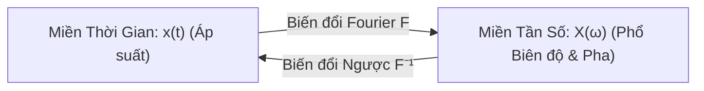

#### d. Code Thực chiến (C++ & Python)

```cpp
// C++17: Tích phân số xấp xỉ Biến đổi Fourier tại một tần số omega
#include <iostream>
#include <complex>
#include <cmath>
#include <functional>

std::complex<double> continuous_ft_approx(std::function<double(double)> signal, double omega, double t_start, double t_end, double dt) {
    std::complex<double> integral(0.0, 0.0);
    for (double t = t_start; t < t_end; t += dt) {
        std::complex<double> kernel = std::exp(std::complex<double>(0, -omega * t));
        integral += signal(t) * kernel * dt;
    }
    return integral;
}

int main() {
    auto sig = [](double t) { return std::sin(2.0 * M_PI * 5.0 * t); }; // 5 Hz
    auto res = continuous_ft_approx(sig, 2.0 * M_PI * 5.0, 0.0, 1.0, 0.001);
    std::cout << "Magnitude at 5Hz: " << std::abs(res) << "\n";
    return 0;
}
```

```python
# Python / SymPy: Tính giải tích Biến đổi Fourier bằng đại số biểu tượng
import sympy as sp

t, w = sp.symbols('t w', real=True)
a = sp.symbols('a', positive=True)
x = sp.exp(-a * sp.Abs(t))
X = sp.fourier_transform(x, t, w)
print("Analytical Fourier Transform of exp(-a|t|):", X)
```

#### e. Lỗi Thường gặp & Ổn định Số học
- Giả định tín hiệu tồn tại đến vô hạn thời gian ($-\infty \to +\infty$). Trong thực tế khi tín hiệu bị cắt ngắn đột ngột, hiện tượng rò rỉ phổ (Spectral Leakage) xuất hiện do phép nhân với cửa sổ chữ nhật.

#### f. Ứng dụng Thực chiến trong AI
Xây dựng nền tảng lý thuyết cho các mạng nơ-ron học trong miền tần số (Fourier Neural Operators - FNO).

---

### 7. Discrete Fourier Transform (DFT - Biến đổi Fourier Rời rạc)

#### a. Định nghĩa Bản chất Toán học (Mathematical Formulation)
Cho chuỗi tín hiệu hữu hạn gồm $N$ mẫu $x[n], n=0, \dots, N-1$. DFT ánh xạ chuỗi này thành $N$ hệ số tần số phức $X[k]$:
$$X[k] = \sum_{n=0}^{N-1} x[n] W_N^{k n} = \sum_{n=0}^{N-1} x[n] e^{-j \frac{2\pi}{N} k n}, \quad k = 0, \dots, N-1$$
Dưới dạng ma trận toán học:
$$\mathbf{X} = \mathbf{W}_N \mathbf{x} \quad \text{với ma trận DFT } \mathbf{W}_N[k, n] = e^{-j \frac{2\pi}{N} k n}$$
Ma trận $\mathbf{W}_N$ là ma trận trực giao đối xứng (Symmetric Orthogonal Matrix) nhân với hệ số $\frac{1}{\sqrt{N}}$.

#### b. Cơ chế Tầng Sâu & Điện toán (Under The Hood / Hardware Internals)
- **Độ phức tạp tính toán**: Thực thi trực tiếp phép nhân ma trận $\mathbf{W}_N \mathbf{x}$ đòi hỏi $N^2$ phép nhân và cộng số phức. Với một frame âm thanh kích thước $N = 2048$, cần tới $2048^2 \approx 4.19 \times 10^6$ phép tính phức, gây tắc nghẽn bộ nhớ và ALU trên CPU/GPU.

#### c. Sơ đồ Minh họa (Mermaid Diagram)
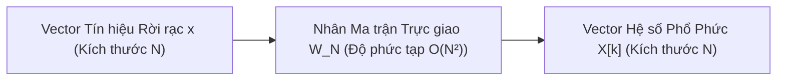

#### d. Code Thực chiến (C++ & Python)

```cpp
// C++17: Thuật toán DFT trực tiếp O(N^2)
#include <iostream>
#include <vector>
#include <complex>
#include <cmath>

std::vector<std::complex<double>> compute_dft(const std::vector<double>& x) {
    size_t N = x.size();
    std::vector<std::complex<double>> X(N);
    for (size_t k = 0; k < N; ++k) {
        std::complex<double> sum(0.0, 0.0);
        for (size_t n = 0; n < N; ++n) {
            double angle = -2.0 * M_PI * k * n / N;
            sum += x[n] * std::polar(1.0, angle);
        }
        X[k] = sum;
    }
    return X;
}

int main() {
    std::vector<double> signal = {1.0, 0.0, -1.0, 0.0};
    auto X = compute_dft(signal);
    std::cout << "X[1] Magnitude: " << std::abs(X[1]) << "\n";
    return 0;
}
```

```python
# Python: Ma trận DFT thuần NumPy
import numpy as np

def dft_matrix(N: int) -> np.ndarray:
    n = np.arange(N)
    k = n.reshape((N, 1))
    W = np.exp(-2j * np.pi * k * n / N)
    return W

x = np.array([1.0, 0.0, -1.0, 0.0])
W4 = dft_matrix(4)
X = W4 @ x
print("DFT Output:", X)
```

#### e. Lỗi Thường gặp & Ổn định Số học
- Sự tích lũy sai số dấu phẩy động (Accumulated Floating Point Roundoff) khi $N$ lớn trong vòng lặp tính tổng $N^2$.

#### f. Ứng dụng Thực chiến trong AI
Xác định đáp ứng xung và phân tích tần số cho các đoạn âm thanh cực ngắn mà FFT không tối ưu.

---

### 8. Fast Fourier Transform (FFT - Biến đổi Fourier Nhanh)

#### a. Định nghĩa Bản chất Toán học (Mathematical Formulation)
Thuật toán Cooley-Tukey Radix-2 chia bài toán DFT kích thước $N$ (với $N$ là lũy thừa của 2) thành hai bài toán DFT con kích thước $N/2$: một cho các chỉ số chẵn $x[2m]$ và một cho các chỉ số lẻ $x[2m+1]$:
$$X[k] = \sum_{m=0}^{N/2-1} x[2m] e^{-j \frac{2\pi}{N} k (2m)} + e^{-j \frac{2\pi}{N} k} \sum_{m=0}^{N/2-1} x[2m+1] e^{-j \frac{2\pi}{N} k (2m)}$$
$$X[k] = E[k] + W_N^k O[k]$$
$$X\left[k + \frac{N}{2}\right] = E[k] - W_N^k O[k]$$
Thao tác này được gọi là phép tính Cánh bướm (Butterfly Operation). Nhờ tính đối xứng $W_N^{k + N/2} = -W_N^k$, độ phức tạp tính toán giảm từ $\mathcal{O}(N^2)$ xuống $\mathcal{O}(N \log_2 N)$.

#### b. Cơ chế Tầng Sâu & Điện toán (Under The Hood / Hardware Internals)
- **Bit-Reversal Permutation**: Để thực thi FFT tại chỗ (In-place FFT) mà không cần cấp phát thêm bộ nhớ, các phần tử mảng đầu vào phải được tráo đổi vị trí theo thuật toán đảo ngược bit của chỉ số nhị phân (Bit-reversal). Trên vi xử lý hiện đại, lệnh phần cứng `__builtin_bitreverse32` hoặc bảng tra LUT được sử dụng để tối ưu hóa triệt để.
- **Cache Locality**: Thư viện FFTW và NVIDIA cuFFT phân mảnh thuật toán thành các khối Radix-4, Radix-8 hoặc Radix-16 để toàn bộ hệ số Twiddle Factors $W_N^k$ nằm trọn trong L1 Data Cache hoặc Shared Memory của GPU.

#### c. Sơ đồ Minh họa (Mermaid Diagram)
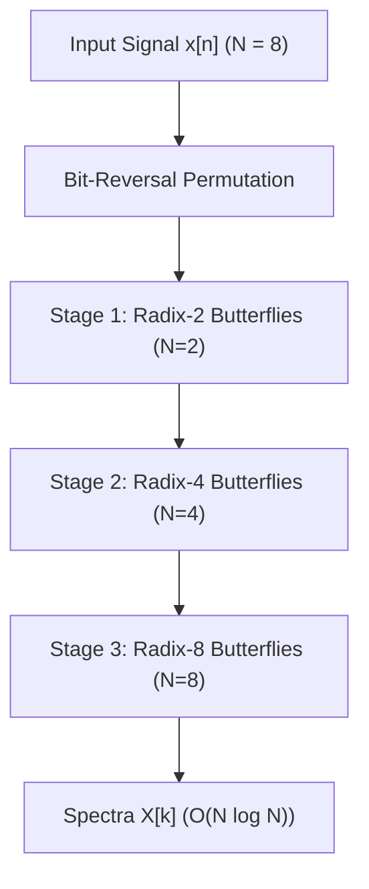

#### d. Code Thực chiến (C++ & Python)

```cpp
// C++17: Thuật toán Cooley-Tukey Radix-2 Đệ quy
#include <iostream>
#include <vector>
#include <complex>
#include <cmath>

using Complex = std::complex<double>;

void fft_radix2(std::vector<Complex>& a) {
    size_t n = a.size();
    if (n <= 1) return;

    std::vector<Complex> a0(n / 2), a1(n / 2);
    for (size_t i = 0; 2 * i < n; ++i) {
        a0[i] = a[2 * i];
        a1[i] = a[2 * i + 1];
    }
    fft_radix2(a0);
    fft_radix2(a1);

    for (size_t i = 0; 2 * i < n; ++i) {
        Complex w = std::polar(1.0, -2.0 * M_PI * i / n) * a1[i];
        a[i] = a0[i] + w;
        a[i + n / 2] = a0[i] - w;
    }
}

int main() {
    std::vector<Complex> data = {1.0, 1.0, 1.0, 1.0, 0.0, 0.0, 0.0, 0.0};
    fft_radix2(data);
    std::cout << "FFT[0]: " << data[0] << ", FFT[1]: " << data[1] << "\n";
    return 0;
}
```

```python
# Python / PyTorch: cuFFT tích hợp trên GPU
import torch

x = torch.randn(32, 1024, device='cpu')
X_fft = torch.fft.fft(x, dim=-1)
print("FFT output shape:", X_fft.shape, "| Dtype:", X_fft.dtype)
```

#### e. Lỗi Thường gặp & Ổn định Số học
- Kích thước tín hiệu $N$ không phải là lũy thừa của 2 (Non-power-of-two) làm cho thuật toán Radix-2 sụp đổ. Cần đệm 0 (Zero-padding) lên lũy thừa 2 gần nhất hoặc sử dụng thuật toán Bluestein / Chirp-Z.

#### f. Ứng dụng Thực chiến trong AI
Nhân chập siêu nhanh trong miền tần số (Fast Convolution via FFT), tính toán phổ âm thanh tức thời trong Whisper và Wav2Vec2.

---

### 9. Short-Time Fourier Transform (STFT - Biến đổi Fourier Thời gian Ngắn)

#### a. Định nghĩa Bản chất Toán học (Mathematical Formulation)
Tín hiệu âm thanh là tín hiệu phi dừng (Non-stationary signal) với các tần số thay đổi liên tục theo thời gian. STFT chia nhỏ tín hiệu thành các khung thời gian ngắn bằng cách trượt một hàm cửa sổ $w[n]$ (như Hanning, Hamming) với bước trượt (Hop Length) $H$:
$$X[m, k] = \text{STFT}\{x\}[m, k] = \sum_{n=0}^{N-1} x[m H + n] \, w[n] \, e^{-j \frac{2\pi}{N} k n}$$
Trong đó $m$ là chỉ số khung thời gian (Frame Index), $k$ là chỉ số tần số (Frequency Bin), $N$ là kích thước khung (Window Length / FFT Size).
Độ phân giải thời gian $\Delta t$ và tần số $\Delta f$ bị ràng buộc bởi Nguyên lý Bất định Heisenberg-Gabor:
$$\Delta t \cdot \Delta f \ge \frac{1}{4\pi}$$

#### b. Cơ chế Tầng Sâu & Điện toán (Under The Hood / Hardware Internals)
- **Strided Tensor Unfolding**: Để thực thi STFT song song trên GPU, PyTorch không chạy vòng lặp tuần tự từng frame mà sử dụng phép chiếu Tensor: `unfold(dimension, size=N, step=H)`. Bước này tạo ra một view trên bộ nhớ với các bước nhảy stride phù hợp mà không sao chép dữ liệu (Zero-copy), sau đó áp dụng một phép nhân Batched FFT duy nhất (`torch.fft.rfft`).

#### c. Sơ đồ Minh họa (Mermaid Diagram)
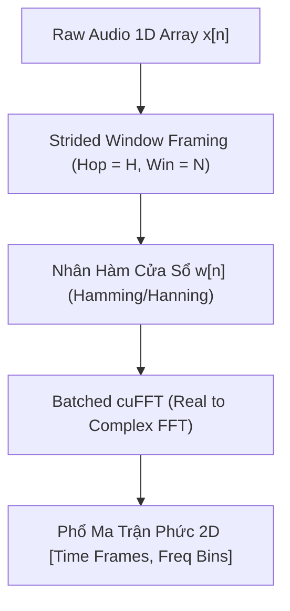

#### d. Code Thực chiến (C++ & Python)

```cpp
// C++17: Áp dụng Cửa sổ Hanning lên một Frame âm thanh
#include <iostream>
#include <vector>
#include <cmath>

void apply_hanning_window(std::vector<float>& frame) {
    size_t N = frame.size();
    for (size_t n = 0; n < N; ++n) {
        float w = 0.5f * (1.0f - std::cos(2.0f * M_PI * n / (N - 1)));
        frame[n] *= w;
    }
}

int main() {
    std::vector<float> frame(512, 1.0f);
    apply_hanning_window(frame);
    std::cout << "Windowed center sample: " << frame[256] << "\n";
    return 0;
}
```

```python
# Python / PyTorch: STFT song song tốc độ cao
import torch

waveform = torch.randn(1, 16000) # 1s 16kHz
window = torch.hann_window(400)
# N_fft = 512, win_length = 400, hop_length = 160
stft_complex = torch.stft(waveform, n_fft=512, hop_length=160, win_length=400, window=window, return_complex=True)
print("STFT Complex Tensor Shape [Batch, Freq, Time]:", stft_complex.shape)
```

#### e. Lỗi Thường gặp & Ổn định Số học
- **Cắt xén biên (Boundary Artifacts)**: Hai đầu mút của chuỗi âm thanh nếu không được đệm đối xứng (Reflection Padding) sẽ bị suy giảm biên độ nghiêm trọng do hàm cửa sổ triệt tiêu tín hiệu về 0 ở biên.

#### f. Ứng dụng Thực chiến trong AI
Đầu vào chuẩn của các mô hình phân tách giọng nói (Source Separation), vocoder phục hồi pha Griffin-Lim, và khử ồn quang phổ (Spectral Denoising).

---

### 10. Spectrogram (Phổ Biên độ & Công suất)

#### a. Định nghĩa Bản chất Toán học (Mathematical Formulation)
Spectrogram là biểu diễn 2D trực quan hóa cường độ năng lượng của tín hiệu âm thanh theo cả hai trục thời gian và tần số. Nó được tính bằng bình phương độ lớn của STFT:
$$S[m, k] = |X[m, k]|^2 = \text{Re}(X[m, k])^2 + \text{Im}(X[m, k])^2$$
Để khớp với độ nhạy logarit của thính giác con người đối với độ lớn âm thanh (Loudness), người ta chuyển đổi sang thang đo Decibel (Log-Power Spectrogram):
$$S_{\text{dB}}[m, k] = 10 \log_{10} \left( \frac{S[m, k]}{\max(S) + \epsilon} \right)$$

#### b. Cơ chế Tầng Sâu & Điện toán (Under The Hood / Hardware Internals)
- **Phase Erasure**: Phép toán tính Module $|X[m, k]|$ đã loại bỏ hoàn toàn thông tin góc pha $\angle X[m, k] = \arctan\left(\frac{\text{Im}}{\text{Re}}\right)$. Mất pha là bài toán một chiều (irreversible loss) - không thể tái tạo lại sóng âm thanh một cách trực tiếp từ Spectrogram nếu không sử dụng thuật toán xấp xỉ lặp (Griffin-Lim) hoặc Neural Vocoders (như HiFi-GAN, WaveGlow).

#### c. Sơ đồ Minh họa (Mermaid Diagram)


#### d. Code Thực chiến (C++ & Python)

```cpp
// C++17: Chuyển đổi mảng số phức STFT thành Power Spectrogram
#include <iostream>
#include <vector>
#include <complex>
#include <cmath>

std::vector<float> compute_power_spectrogram(const std::vector<std::complex<float>>& stft_frame, float eps = 1e-10f) {
    std::vector<float> power_spec(stft_frame.size());
    for (size_t i = 0; i < stft_frame.size(); ++i) {
        float re = stft_frame[i].real();
        float im = stft_frame[i].imag();
        power_spec[i] = re * re + im * im; // Module bình phương
    }
    return power_spec;
}

int main() {
    std::vector<std::complex<float>> frame = {{3.0f, 4.0f}, {1.0f, -1.0f}};
    auto p = compute_power_spectrogram(frame);
    std::cout << "Power[0]: " << p[0] << " (3^2 + 4^2 = 25)\n";
    return 0;
}
```

```python
# Python / Torchaudio: Trích xuất Spectrogram dạng Tensor
import torch
import torchaudio.transforms as T

waveform = torch.randn(1, 16000)
spectrogram_transform = T.Spectrogram(n_fft=512, win_length=400, hop_length=160, power=2.0)
power_spec = spectrogram_transform(waveform)
print("Spectrogram Shape [Channel, Freq, Time]:", power_spec.shape)
```

#### e. Lỗi Thường gặp & Ổn định Số học
- Dải động (Dynamic Range) của Power Spectrogram có thể vượt quá $100\text{ dB}$. Nếu không cắt ngưỡng (Clamping) giá trị cực tiểu trước khi tính log, các giá trị tiệm cận 0 sẽ tạo ra các điểm âm cực lớn ($-\infty$), gây nổ gradient khi huấn luyện mạng nơ-ron.

#### f. Ứng dụng Thực chiến trong AI
Phân loại âm thanh môi trường bằng các mạng thị giác 2D (ResNet, EfficientNet huấn luyện trên Spectrogram như thể là ảnh).

---

### 11. Mel Spectrogram (Phổ Thang đo Mel)

#### a. Định nghĩa Bản chất Toán học (Mathematical Formulation)
Thính giác con người không cảm nhận tần số theo thang tuyến tính: ta phân biệt rất rõ sự thay đổi giữa 200Hz và 300Hz, nhưng gần như không thể phân biệt giữa 10.200Hz và 10.300Hz. Thang đo Mel (Mel Scale) ánh xạ tần số vật lý $f$ (Hz) sang tần số cảm thụ $m$ (Mel):
$$m = 2595 \log_{10}\left( 1 + \frac{f}{700} \right) \iff f = 700 \left( 10^{\frac{m}{2595}} - 1 \right)$$
Mel Spectrogram được tạo ra bằng cách nhân Power Spectrogram $\mathbf{S} \in \mathbb{R}^{K \times T}$ với một ngân hàng bộ lọc hình tam giác (Mel Filterbank Matrix) $\mathbf{M} \in \mathbb{R}^{M \times K}$ gồm $M$ bộ lọc (thường $M=80$ hoặc $128$):
$$\mathbf{S}_{\text{Mel}} = \mathbf{M} \cdot \mathbf{S}$$
Log-Mel Spectrogram sau đó được tính bằng phép nén log:
$$\mathbf{S}_{\text{LogMel}} = \log(\mathbf{S}_{\text{Mel}} + \epsilon)$$

#### b. Cơ chế Tầng Sâu & Điện toán (Under The Hood / Hardware Internals)
- **Sparse Matrix Multiplication (GEMM)**: Ma trận Mel Filterbank $\mathbf{M}$ là ma trận thưa vì mỗi bộ lọc tam giác chỉ có giá trị khác 0 tại một dải tần hẹp. Tuy nhiên, do số bộ lọc $M$ nhỏ ($80 \times 257$), trong PyTorch thao tác này được thực hiện dưới dạng phép nhân ma trận dày (Dense GEMM) tận dụng Tensor Cores GPU thay vì định dạng thưa (Sparse CSR) nhằm tránh chi phí quản lý chỉ số gián tiếp.

#### c. Sơ đồ Minh họa (Mermaid Diagram)
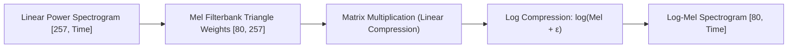

#### d. Code Thực chiến (C++ & Python)

```cpp
// C++17: Chuyển đổi Hertz sang Mel và ngược lại
#include <iostream>
#include <cmath>

inline float hz_to_mel(float hz) {
    return 2595.0f * std::log10(1.0f + hz / 700.0f);
}

inline float mel_to_hz(float mel) {
    return 700.0f * (std::pow(10.0f, mel / 2595.0f) - 1.0f);
}

int main() {
    float f = 1000.0f; // 1kHz
    float m = hz_to_mel(f);
    std::cout << "1000 Hz in Mel: " << m << "\n";
    std::cout << "Back to Hz: " << mel_to_hz(m) << "\n";
    return 0;
}
```

```python
# Python / Torchaudio: Trích xuất Log-Mel Spectrogram chuẩn 80-bin
import torch
import torchaudio.transforms as T

waveform = torch.randn(1, 16000) # 1s 16kHz
mel_transform = T.MelSpectrogram(
    sample_rate=16000,
    n_fft=400,
    win_length=400,
    hop_length=160,
    n_mels=80,
    power=2.0
)
mel_spec = mel_transform(waveform)
log_mel_spec = torch.log(torch.clamp(mel_spec, min=1e-5))
print("Log-Mel Spectrogram Tensor Shape [Batch, Mels, Time]:", log_mel_spec.shape)
```

#### e. Lỗi Thường gặp & Ổn định Số học
- Sự không đồng nhất về công thức Mel (HTK Formula vs. Slaney/Auditory Toolbox Formula trong Librosa). Trích xuất Mel bằng cấu hình khác với lúc tiền huấn luyện sẽ làm suy giảm nghiêm trọng độ chính xác của mô hình ASR.

#### f. Ứng dụng Thực chiến trong AI
Đầu vào chuẩn của mô hình nhận dạng tiếng nói tự động OpenAI Whisper, FastSpeech 2, VITS, và Conformer-CTC.

---

### 12. Mel-Frequency Cepstral Coefficients (MFCC)

#### a. Định nghĩa Bản chất Toán học (Mathematical Formulation)
MFCC là biểu diễn nén không gian đặc trưng âm thanh bằng cách áp dụng Biến đổi Cosine Rời rạc loại 2 (DCT-II) lên Log-Mel Spectrogram:
$$c_n[m] = \sum_{k=0}^{M-1} \log(S_{\text{Mel}}[m, k]) \cos\left( \frac{\pi n}{M} \left( k + \frac{1}{2} \right) \right), \quad n = 0, \dots, C-1$$
Trong đó $M$ là số kênh Mel, $C$ là số hệ số Cepstral giữ lại (thường lấy từ 12 đến 20 hệ số đầu tiên).
Bản chất của phép toán này là tách rời nguồn âm (đặc trưng dây thanh quản, tần số cơ bản F0) và bộ lọc truyền âm (hình dạng vòm họng, khoang miệng) dựa trên mô hình Source-Filter Model:
$$s[n] = e[n] * h[n] \xrightarrow{\mathcal{F}} S(\omega) = E(\omega) \cdot H(\omega) \xrightarrow{\log} \log|S| = \log|E| + \log|H|$$
Phép biến đổi DCT sau cùng chuyển tích chập thành tổng cộng trong miền Quefrency (Cepstrum domain).

#### b. Cơ chế Tầng Sâu & Điện toán (Under The Hood / Hardware Internals)
- **Decoupling & Decorrelation**: Phép biến đổi DCT hoạt động tương tự như PCA (Principal Component Analysis): nó loại bỏ tính tương quan (decorrelates) giữa các kênh Mel kế cận. Điều này cho phép các mô hình cổ điển như Gaussian Mixture Models (GMM-HMM) sử dụng ma trận hiệp phương sai đường chéo (Diagonal Covariance Matrix), giảm kích thước tham số từ $\mathcal{O}(M^2)$ xuống $\mathcal{O}(M)$.

#### c. Sơ đồ Minh họa (Mermaid Diagram)


#### d. Code Thực chiến (C++ & Python)

```cpp
// C++17: Thực thi DCT-II trực tiếp từ log-mel spectrum
#include <iostream>
#include <vector>
#include <cmath>

std::vector<float> compute_dct2(const std::vector<float>& log_mel, size_t num_ceps) {
    size_t M = log_mel.size();
    std::vector<float> ceps(num_ceps, 0.0f);
    for (size_t n = 0; n < num_ceps; ++n) {
        float sum = 0.0f;
        for (size_t k = 0; k < M; ++k) {
            sum += log_mel[k] * std::cos(M_PI * n * (k + 0.5f) / M);
        }
        ceps[n] = sum;
    }
    return ceps;
}

int main() {
    std::vector<float> fake_log_mel(80, 1.5f);
    auto mfcc = compute_dct2(fake_log_mel, 13);
    std::cout << "c0 (Energy): " << mfcc[0] << ", c1: " << mfcc[1] << "\n";
    return 0;
}
```

```python
# Python / Torchaudio: Trích xuất MFCC kèm Delta Features
import torch
import torchaudio.transforms as T

waveform = torch.randn(1, 16000)
mfcc_transform = T.MFCC(
    sample_rate=16000,
    n_mfcc=13,
    melkwargs={"n_fft": 400, "hop_length": 160, "n_mels": 40}
)
mfcc = mfcc_transform(waveform)
deltas = torchaudio.functional.compute_deltas(mfcc)
print("MFCC Shape:", mfcc.shape, "| Deltas Shape:", deltas.shape)
```

#### e. Lỗi Thường gặp & Ổn định Số học
- Hệ số đầu tiên $c_0$ đại diện cho năng lượng trung bình của toàn frame. Nếu biên độ âm thanh quá nhỏ, $c_0$ biến thiên cực mạnh gây nhiễu loạn cho bộ phân loại nhận dạng người nói.

#### f. Ứng dụng Thực chiến trong AI
Nhận dạng sinh trắc học người nói (Speaker Identification), phát hiện từ khóa kích hoạt (Keyword Spotting) trên vi điều khiển nhúng dung lượng thấp.

---

### 13. Audio Feature Extraction (Trích xuất Đặc trưng Âm thanh Tổng hợp)

#### a. Định nghĩa Bản chất Toán học (Mathematical Formulation)
Trích xuất đặc trưng âm thanh bao gồm việc tính toán các thống kê miền thời gian và miền tần số:
- **Zero-Crossing Rate (ZCR)**: Tần suất đổi dấu của tín hiệu:
$$\text{ZCR} = \frac{1}{2(N-1)} \sum_{n=1}^{N-1} |\text{sgn}(x[n]) - \text{sgn}(x[n-1])|$$
- **Spectral Centroid (Trọng tâm Quang phổ)**: Đại diện cho độ "sáng" (Brightness) của âm thanh:
$$\mu_{\text{spec}} = \frac{\sum_{k=0}^{K-1} f_k |X[k]|}{\sum_{k=0}^{K-1} |X[k]|}$$
- **Spectral Flatness (Độ phẳng Quang phổ)**: Tỷ số giữa trung bình nhân và trung bình cộng của phổ:
$$\text{SF} = \frac{\exp\left( \frac{1}{K} \sum_{k=0}^{K-1} \ln |X[k]|^2 \right)}{\frac{1}{K} \sum_{k=0}^{K-1} |X[k]|^2}$$

#### b. Cơ chế Tầng Sâu & Điện toán (Under The Hood / Hardware Internals)
- **Vectorized SIMD Reduction**: Tính toán ZCR và Spectral Centroid yêu cầu các phép toán rút gọn (Reduction) trên vector. Trên CPU, lệnh AVX `_mm256_xor_ps` kết hợp kiểm tra bit dấu (`signbit`) giúp tính toán hàng triệu mẫu ZCR trong vài micro-giây.

#### c. Sơ đồ Minh họa (Mermaid Diagram)
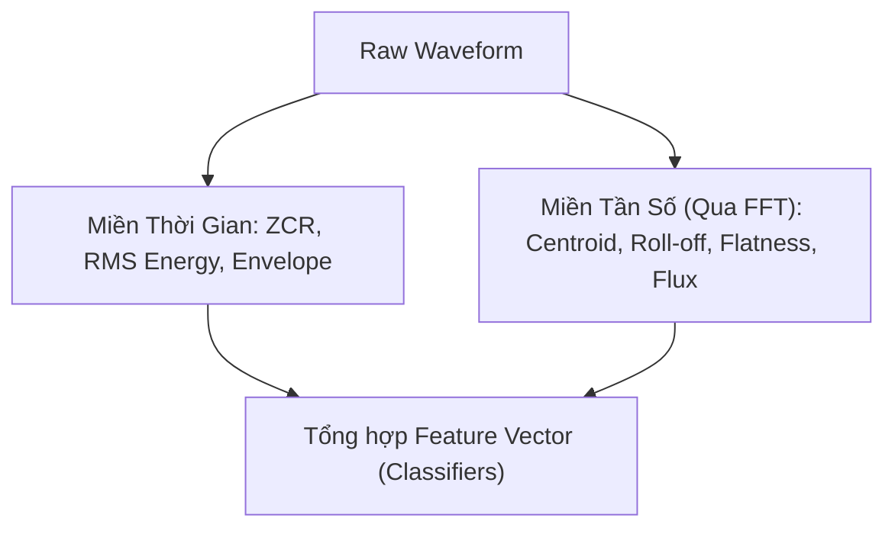

#### d. Code Thực chiến (C++ & Python)

```cpp
// C++17: Tính Zero Crossing Rate tối ưu SIMD cơ bản
#include <iostream>
#include <vector>
#include <cmath>

float compute_zcr(const std::vector<float>& signal) {
    if (signal.size() < 2) return 0.0f;
    size_t crossings = 0;
    for (size_t i = 1; i < signal.size(); ++i) {
        if ((signal[i] >= 0.0f && signal[i - 1] < 0.0f) || 
            (signal[i] < 0.0f && signal[i - 1] >= 0.0f)) {
            crossings++;
        }
    }
    return static_cast<float>(crossings) / (signal.size() - 1);
}

int main() {
    std::vector<float> wave = {0.1f, -0.2f, 0.3f, -0.4f, 0.5f};
    std::cout << "ZCR: " << compute_zcr(wave) << "\n";
    return 0;
}
```

```python
# Python / Librosa: Trích xuất Spectral Centroid và Flatness
import numpy as np
import librosa

y = np.random.randn(16000)
spec_cent = librosa.feature.spectral_centroid(y=y, sr=16000)
spec_flat = librosa.feature.spectral_flatness(y=y)
print("Mean Spectral Centroid (Hz):", np.mean(spec_cent))
print("Mean Spectral Flatness:", np.mean(spec_flat))
```

#### e. Lỗi Thường gặp & Ổn định Số học
- Khi tín hiệu là khoảng lặng hoàn toàn ($|X[k]| = 0$), mẫu số trong công thức tính Spectral Centroid bằng 0 dẫn đến lỗi `ZeroDivisionError`.

#### f. Ứng dụng Thực chiến trong AI
Phân biệt nguyên âm có thanh (Voiced - ZCR thấp) và phụ âm không thanh (Unvoiced - ZCR cao), nhận dạng thể loại nhạc (Music Genre Classification).

---

### 14. Waveforms (Dạng sóng Biên độ Thời gian)

#### a. Định nghĩa Bản chất Toán học (Mathematical Formulation)
Dạng sóng là biểu diễn mảng 1D trực tiếp của áp suất âm thanh rời rạc $x = [x_0, x_1, \dots, x_{L-1}]^T \in \mathbb{R}^L$.
Năng lượng căn bậc hai trung bình (Root Mean Square - RMS):
$$x_{\text{RMS}} = \sqrt{\frac{1}{L} \sum_{n=0}^{L-1} x_n^2}$$
Chuẩn hóa độ lớn đỉnh (Peak Normalization):
$$\tilde{x}_n = \frac{x_n}{\max_{k} |x_k| + \epsilon}$$

#### b. Cơ chế Tầng Sâu & Điện toán (Under The Hood / Hardware Internals)
- **Extreme Sequence Length**: So với văn bản ($512$ tokens) hay hình ảnh ($224 \times 224 \approx 50.000$ pixels), một đoạn âm thanh 10 giây ở 16kHz tương đương một vector có chiều dài $160.000$ mẫu. Việc đưa trực tiếp Waveform vào mạng nơ-ron Transformer mà không qua nén giảm chiều sẽ dẫn đến bùng nổ ma trận chú ý Self-Attention với độ phức tạp bộ nhớ $\mathcal{O}(L^2) \approx 2.56 \times 10^{10}$ phần tử (tràn VRAM GPU).

#### c. Sơ đồ Minh họa (Mermaid Diagram)
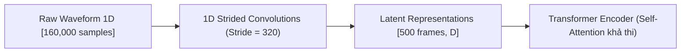

#### d. Code Thực chiến (C++ & Python)

```cpp
// C++17: Chuẩn hóa Peak Normalization cho Waveform
#include <iostream>
#include <vector>
#include <algorithm>
#include <cmath>

void peak_normalize(std::vector<float>& wave, float target_peak = 0.99f) {
    float max_val = 0.0f;
    for (float v : wave) {
        max_val = std::max(max_val, std::abs(v));
    }
    if (max_val > 1e-6f) {
        float factor = target_peak / max_val;
        for (float& v : wave) {
            v *= factor;
        }
    }
}

int main() {
    std::vector<float> wave = {0.1f, -0.5f, 0.3f};
    peak_normalize(wave);
    std::cout << "Normalized peak: " << wave[1] << "\n";
    return 0;
}
```

```python
# Python / PyTorch: Khối Tích chập nén Waveform thời gian thực
import torch
import torch.nn as nn

class WaveformEncoder(nn.Module):
    def __init__(self, in_channels=1, hidden_dim=512):
        super().__init__()
        # Giảm chiều mẫu: 160,000 -> 500 bằng 5 lớp tích chập bước nhảy
        self.conv = nn.Sequential(
            nn.Conv1d(in_channels, 64, kernel_size=10, stride=5, padding=2),
            nn.GELU(),
            nn.Conv1d(64, hidden_dim, kernel_size=8, stride=4, padding=2),
            nn.GELU()
        )
    def forward(self, x):
        return self.conv(x)

encoder = WaveformEncoder()
x = torch.randn(2, 1, 16000)
print("Latent Feature Shape:", encoder(x).shape)
```

#### e. Lỗi Thường gặp & Ổn định Số học
- Sự trôi dạt mức một chiều (DC Offset / Bias): Tín hiệu có giá trị trung bình $\mathbb{E}[x] \neq 0$. Cần áp dụng bộ lọc High-Pass (cắt tần số dưới 20Hz) để khử thành phần một chiều này trước khi chuẩn hóa.

#### f. Ứng dụng Thực chiến trong AI
Đầu vào thô cho các kiến trúc tự giám sát hiện đại như Wav2Vec 2.0, w2v-BERT, SoundStream, và EnCodec.

---

### 15. Audio Embeddings (Biểu diễn Nhúng Âm thanh Học sâu)

#### a. Định nghĩa Bản chất Toán học (Mathematical Formulation)
Audio Embedding là ánh xạ phi tuyến từ chuỗi sóng âm hoặc phổ tần vào không gian vector ngữ nghĩa $d$-chiều cố định:
$$f_{\theta}: \mathbb{R}^L \to \mathbb{R}^d$$
Được tối ưu hóa bằng hàm mất mát tương phản nhiều mẫu (Contrastive Loss / InfoNCE) trong không gian siêu cầu $\mathbb{S}^{d-1}$:
$$\mathcal{L}_{\text{InfoNCE}} = -\log \frac{\exp(\text{sim}(\mathbf{z}, \mathbf{z}^+) / \tau)}{\exp(\text{sim}(\mathbf{z}, \mathbf{z}^+) / \tau) + \sum_{j=1}^K \exp(\text{sim}(\mathbf{z}, \mathbf{z}_j^-) / \tau)}$$
Trong đó $\text{sim}(\mathbf{u}, \mathbf{v}) = \frac{\mathbf{u}^T \mathbf{v}}{\|\mathbf{u}\|_2 \|\mathbf{v}\|_2}$ là độ tương đồng Cosine, và $\tau$ là siêu tham số nhiệt độ.

#### b. Cơ chế Tầng Sâu & Điện toán (Under The Hood / Hardware Internals)
- **Masked Acoustic Modeling & Quantization Codebook**: Các mô hình như HuBERT và Wav2Vec 2.0 sử dụng bộ lượng tử hóa vector Gumbel-Softmax Codebook để ánh xạ các frame đặc trưng liên tục thành các mã rời rạc (Discrete Cluster Units), giúp áp dụng bài toán huấn luyện BERT (Masked Language Modeling) trực tiếp trên dữ liệu âm thanh phi cấu trúc.

#### c. Sơ đồ Minh họa (Mermaid Diagram)
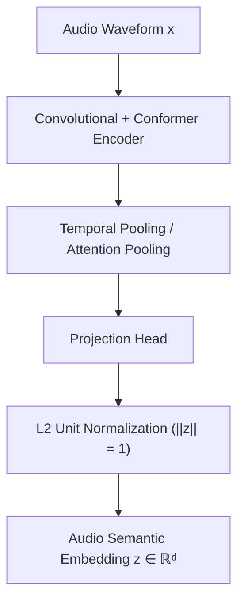

#### d. Code Thực chiến (C++ & Python)

```cpp
// C++17: Chuẩn hóa L2-Normalization cho vector Audio Embedding
#include <iostream>
#include <vector>
#include <cmath>

void l2_normalize(std::vector<float>& vec) {
    float norm_sq = 0.0f;
    for (float v : vec) norm_sq += v * v;
    float norm = std::sqrt(norm_sq + 1e-12f);
    for (float& v : vec) v /= norm;
}

int main() {
    std::vector<float> emb = {3.0f, 4.0f, 0.0f};
    l2_normalize(emb);
    std::cout << "Normalized embedding: [" << emb[0] << ", " << emb[1] << "]\n";
    return 0;
}
```

```python
# Python / Transformers: Trích xuất Audio Embedding bằng HuBERT
import torch
from transformers import HubertModel

# Khởi tạo mô hình HuBERT pre-trained
model = HubertModel.from_pretrained("facebook/hubert-base-ls960")
model.eval()

waveform = torch.randn(1, 16000) # 1s 16kHz
with torch.no_grad():
    outputs = model(waveform)
    # outputs.last_hidden_state: [Batch, Time_Frames, Hidden_Dim(768)]
    audio_embedding = torch.mean(outputs.last_hidden_state, dim=1) # Mean pooling

print("Pooled Audio Embedding Shape:", audio_embedding.shape)
```

#### e. Lỗi Thường gặp & Ổn định Số học
- Sự sụp đổ biểu diễn (Representation Collapse): Trong huấn luyện học không giám sát tự thân (Self-Supervised Learning), mô hình chiếu toàn bộ âm thanh thành một vector hằng số duy nhất. Cần duy trì kích thước batch âm tính đủ lớn hoặc sử dụng cơ chế Stop-Gradient.

#### f. Ứng dụng Thực chiến trong AI
Tìm kiếm âm thanh tương đồng (Audio Search/Retrieval), phân loại sự kiện âm thanh môi trường (AudioSet), và nhận dạng người nói zero-shot.
