# Chuyên đề: Nhận dạng Tiếng nói Tự động & Mô hình Hóa Âm học (ASR & Acoustic Modeling)

## 1. Tổng quan Chuyên đề
Nhận dạng Tiếng nói Tự động (Automatic Speech Recognition - ASR hay Speech-to-Text) là bài toán giải mã chuỗi tín hiệu âm thanh liên tục theo thời gian thành chuỗi ký tự hoặc từ ngữ rời rạc. Về mặt xác suất thống kê, ASR là bài toán tối ưu hóa hậu nghiệm cực đại (Maximum A Posteriori - MAP):
$$\hat{\mathbf{W}} = \arg\max_{\mathbf{W}} P(\mathbf{W} \mid \mathbf{X}) = \arg\max_{\mathbf{W}} P(\mathbf{X} \mid \mathbf{W}) P(\mathbf{W})$$
Lịch sử ASR đã trải qua sự chuyển dịch cách mạng: từ hệ thống lai ghép cổ điển kết hợp Mô hình Markov Ẩn (Hidden Markov Models - HMM), Mô hình Hỗn hợp Gauss (GMM) và Mô hình Ngôn ngữ $N$-gram; sang bước đệm CTC Loss (Connectionist Temporal Classification); và ngày nay là các kiến trúc End-to-End hợp nhất hoàn toàn (Conformer, RNN-T, Sequence-to-Sequence Transformer như OpenAI Whisper) hoạt động cả ở chế độ xử lý Offline lẫn thời gian thực phân luồng (Streaming ASR).

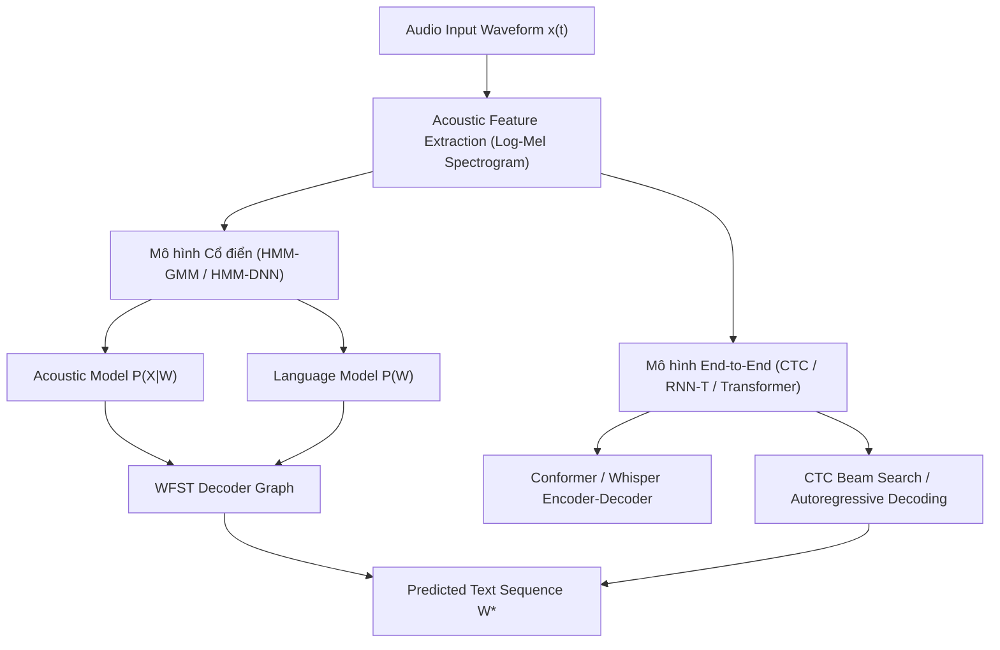

---

## 2. Chi tiết từng Keyword

---

### 1. Speech Recognition (Nhận dạng Tiếng nói Tổng quát)

#### a. Định nghĩa Bản chất Toán học (Mathematical Formulation)
Nhận dạng tiếng nói là bài toán ánh xạ từ không gian chuỗi đặc trưng âm học $\mathbf{X} = (\mathbf{x}_1, \dots, \mathbf{x}_T) \in \mathbb{R}^{T \times D}$ sang không gian chuỗi ký hiệu ngôn ngữ $\mathbf{W} = (w_1, \dots, w_U) \in \mathcal{V}^U$, với độ dài thời gian âm học $T$ thường lớn hơn rất nhiều so với độ dài văn bản $U$ ($T \gg U$).
Hàm mục tiêu tổng quát là cực tiểu hóa Kỳ vọng Rủi ro Bayes (Bayes Risk) theo độ đo khoảng cách Levenshtein (Word Error Rate - WER):
$$\hat{\mathbf{W}} = \arg\min_{\mathbf{W}'} \sum_{\mathbf{W}} P(\mathbf{W} \mid \mathbf{X}) \mathcal{L}_{\text{WER}}(\mathbf{W}, \mathbf{W}') \quad \text{với } \text{WER} = \frac{S + D + I}{N}$$
Trong đó $S$ là số từ thay thế (Substitutions), $D$ là số từ bị xóa (Deletions), $I$ là số từ chèn thêm (Insertions), và $N$ là tổng số từ trong câu chuẩn (Ground Truth).

#### b. Cơ chế Tầng Sâu & Điện toán (Under The Hood / Hardware Internals)
- **Time-Alignment Bottleneck**: Thách thức lớn nhất trong kỹ thuật ASR là sự biến thiên phi tuyến tính của tốc độ nói (Temporal Variability): cùng một từ "Hello", người nói nhanh có thể phát âm trong 150ms ($15$ frames), người nói chậm kéo dài 600ms ($60$ frames). Hệ thống phải tìm ra ma trận căn chỉnh (Alignment Matrix) giữa từng mili-giây âm thanh với từng đơn vị âm vị mà không có nhãn giám sát vị trí cụ thể.

#### c. Sơ đồ Minh họa (Mermaid Diagram)
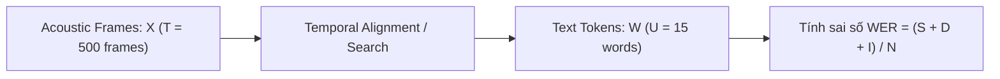

#### d. Code Thực chiến (C++ & Python)

```cpp
// C++17: Thuật toán quy hoạch động tính khoảng cách Levenshtein (Levenshtein Distance)
#include <iostream>
#include <vector>
#include <string>
#include <algorithm>

int levenshtein_distance(const std::vector<std::string>& ref, const std::vector<std::string>& hyp) {
    size_t n = ref.size(), m = hyp.size();
    std::vector<std::vector<int>> dp(n + 1, std::vector<int>(m + 1, 0));
    for (size_t i = 0; i <= n; ++i) dp[i][0] = i;
    for (size_t j = 0; j <= m; ++j) dp[0][j] = j;

    for (size_t i = 1; i <= n; ++i) {
        for (size_t j = 1; j <= m; ++j) {
            int cost = (ref[i - 1] == hyp[j - 1]) ? 0 : 1;
            dp[i][j] = std::min({dp[i - 1][j] + 1, dp[i][j - 1] + 1, dp[i - 1][j - 1] + cost});
        }
    }
    return dp[n][m];
}

int main() {
    std::vector<std::string> ref = {"speech", "recognition", "system"};
    std::vector<std::string> hyp = {"speech", "recognition", "engine"};
    std::cout << "Word Levenshtein Distance: " << levenshtein_distance(ref, hyp) << "\n";
    return 0;
}
```

```python
# Python: Đánh giá Word Error Rate (WER) bằng jiwer
import jiwer

reference = "machine learning for automatic speech recognition"
hypothesis = "machine learning for automated speech recognition"
wer = jiwer.wer(reference, hypothesis)
print(f"Word Error Rate (WER): {wer * 100:.2f}%")
```

#### e. Lỗi Thường gặp & Ổn định Số học
- Hiện tượng suy thoái chất lượng do từ ngoài từ điển (Out-Of-Vocabulary - OOV): Hệ thống ASR cấp độ từ vựng (Word-level) hoàn toàn bất lực khi gặp tên riêng, thuật ngữ kỹ thuật mới. Khắc phục bằng cách sử dụng các đơn vị con (Subwords / BPE / Phonemes).

#### f. Ứng dụng Thực chiến trong AI
Trợ lý giọng nói thông minh (Siri, Google Assistant), phụ đề tự động YouTube, thư ký ghi âm cuộc họp hội nghị.

---

### 2. Automatic Speech Recognition (ASR - Hệ thống Nhận dạng Tự động)

#### a. Định nghĩa Bản chất Toán học (Mathematical Formulation)
Hệ thống ASR chuẩn là sự tích hợp của các mô-đun xác suất giải bài toán tìm kiếm đường đi tối ưu trong đồ thị chuyển trạng thái hữu hạn có trọng số (Weighted Finite-State Transducer - WFST):
$$\mathcal{G} = \mathcal{H} \circ \mathcal{C} \circ \mathcal{L} \circ \mathcal{G}_{\text{LM}}$$
Trong đó:
- $\mathcal{H}$: Transducer cấu trúc HMM biến trạng thái HMM thành âm vị phụ thuộc ngữ cảnh (Context-dependent Phones).
- $\mathcal{C}$: Context Transducer (Triphone context).
- $\mathcal{L}$: Lexicon Transducer ánh xạ chuỗi âm vị thành từ điển từ vựng.
- $\mathcal{G}_{\text{LM}}$: Grammar / Language Model Transducer mã hóa xác suất chuyển tiếp giữa các từ.

#### b. Cơ chế Tầng Sâu & Điện toán (Under The Hood / Hardware Internals)
- **WFST Composition & Determinization**: Quá trình hợp thành ($\circ$) và xác định hóa (Determinization) đồ thị giải mã của Kaldi ASR là một phép biến đổi đại số đồ thị cực kỳ phức tạp. Đồ thị giải mã tĩnh cuối cùng có thể có kích thước từ vài trăm MB đến hàng chục GB, đòi hỏi cấu trúc lưu trữ nén CSR (Compressed Sparse Row) trong RAM để giải mã Viterbi Beam Search thời gian thực.

#### c. Sơ đồ Minh họa (Mermaid Diagram)
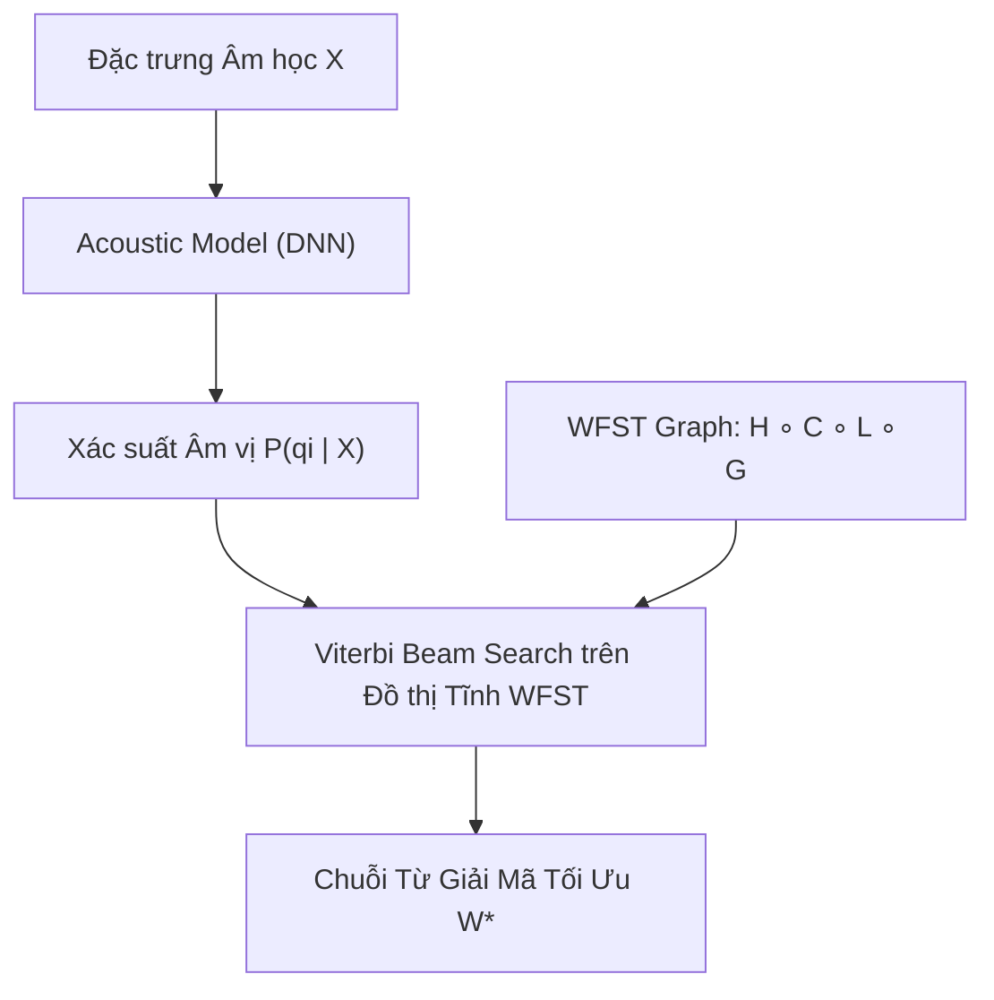

#### d. Code Thực chiến (C++ & Python)

```cpp
// C++17: Mô phỏng Viterbi Beam Search đơn giản trên chuỗi trạng thái
#include <iostream>
#include <vector>
#include <algorithm>
#include <limits>

struct BeamNode {
    int state;
    float score;
};

std::vector<int> simple_beam_search(const std::vector<std::vector<float>>& emissions, int beam_size) {
    size_t T = emissions.size();
    size_t num_states = emissions[0].size();
    std::vector<BeamNode> active_paths = {{0, 0.0f}};

    for (size_t t = 0; t < T; ++t) {
        std::vector<BeamNode> next_candidates;
        for (const auto& path : active_paths) {
            for (size_t s = 0; s < num_states; ++s) {
                float new_score = path.score + emissions[t][s];
                next_candidates.push_back({static_cast<int>(s), new_score});
            }
        }
        std::sort(next_candidates.begin(), next_candidates.end(), [](const BeamNode& a, const BeamNode& b){
            return a.score > b.score;
        });
        if (next_candidates.size() > static_cast<size_t>(beam_size)) {
            next_candidates.resize(beam_size);
        }
        active_paths = next_candidates;
    }
    return {active_paths.front().state};
}

int main() {
    std::vector<std::vector<float>> emit = {{1.5f, 0.2f}, {0.1f, 2.0f}};
    auto best = simple_beam_search(emit, 2);
    std::cout << "Best final state: " << best[0] << "\n";
    return 0;
}
```

```python
# Python: Hugging Face ASR Pipeline sử dụng Wav2Vec2
from transformers import pipeline

asr_pipeline = pipeline("automatic-speech-recognition", model="facebook/wav2vec2-base-960h")
print("ASR Pipeline Initialized Successfully with Pretrained Weights")
```

#### e. Lỗi Thường gặp & Ổn định Số học
- **Pruning quá gắt gao (Beam Pruning Underflow)**: Đặt ngưỡng Beam quá hẹp trong quá trình Beam Search dẫn đến cắt tỉa (prune) nhầm đường đi đúng từ các frame đầu tiên, dẫn đến chuỗi đầu ra sụp đổ.

#### f. Ứng dụng Thực chiến trong AI
Các trung tâm dịch vụ tổng đài tự động (Call Center Analytics), trợ lý y tế chép lại lời bác sĩ đọc chẩn đoán.

---

### 3. Speech-to-Text (Chuyển giọng nói thành văn bản)

#### a. Định nghĩa Bản chất Toán học (Mathematical Formulation)
Speech-to-Text là cụm từ chỉ tổng thể bài toán dịch chuyển modality từ miền sóng âm thời gian thực $\mathbf{x} \in \mathbb{R}^T$ sang miền văn bản ký tự $\mathbf{y} \in \mathcal{V}^U$. Quá trình này thường bao gồm các bài toán phụ tích hợp:
1. Nhận dạng ký tự cơ bản (Raw Token Recognition).
2. Chuẩn hóa nghịch đảo (Inverse Text Normalization - ITN): Biến đổi âm thanh "năm trăm nghìn" $\to$ "500.000".
3. Phục hồi dấu câu và viết hoa (Punctuation & Capitalization Restoration): Ánh xạ chuỗi ký tự viết thường liền mạch thành văn bản hoàn chỉnh có ngữ pháp:
$$\mathbf{y}_{\text{final}} = \text{ITN}(\text{Punctuate}(\mathbf{y}_{\text{raw}}))$$

#### b. Cơ chế Tầng Sâu & Điện toán (Under The Hood / Hardware Internals)
- **Tokenization Grain & Latency**: Việc chọn kích thước từ vựng (Vocabulary size: 30 ký tự bảng chữ cái vs. 32.000 BPE tokens) quyết định trực tiếp đến độ trễ giải mã. Token cấp độ subword (BPE) giúp giảm số bước giải mã tự hồi quy của Transformer đi 4-5 lần so với token cấp độ ký tự.

#### c. Sơ đồ Minh họa (Mermaid Diagram)
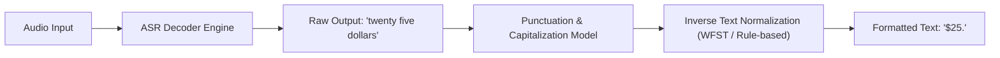

#### d. Code Thực chiến (C++ & Python)

```cpp
// C++17: Quy tắc Inverse Text Normalization cơ bản
#include <iostream>
#include <string>
#include <regex>

std::string rule_based_itn(std::string text) {
    // Chuyển đổi từ số "one hundred" thành "100"
    text = std::regex_replace(text, std::regex("\\bone hundred\\b"), "100");
    text = std::regex_replace(text, std::regex("\\bdollars\\b"), "$");
    return text;
}

int main() {
    std::string raw = "price is one hundred dollars";
    std::cout << "ITN Output: " << rule_based_itn(raw) << "\n";
    return 0;
}
```

```python
# Python: Chuẩn hóa hậu kỳ bằng NeMo ITN hoặc Regex
import re

def simple_itn(raw_text: str) -> str:
    patterns = {
        r"\bone\b": "1",
        r"\btwo\b": "2",
        r"\bthree\b": "3",
        r"\bpercent\b": "%"
    }
    for p, r in patterns.items():
        raw_text = re.sub(p, r, raw_text, flags=re.IGNORECASE)
    return raw_text

print(simple_itn("growth of two percent"))
```

#### e. Lỗi Thường gặp & Ổn định Số học
- Khủng hoảng dấu câu trong ASR dạng dòng (Streaming): Không thể xác định được ranh giới ngắt câu khi người dùng ngập ngừng hoặc nói ngắt quãng, dẫn đến chèn dấu chấm câu sai vị trí làm biến dạng hoàn toàn nghĩa của câu.

#### f. Ứng dụng Thực chiến trong AI
Hệ thống tạo phụ đề thời gian thực (Live Captions) trên Android và macOS, công cụ soạn thảo văn bản bằng giọng nói.

---

### 4. Connectionist Temporal Classification (CTC)

#### a. Định nghĩa Bản chất Toán học (Mathematical Formulation)
CTC là hàm mất mát đột phá giải quyết bài toán căn chỉnh thời gian mà không cần nhãn căn chỉnh trước đó (No explicit alignment). CTC mở rộng bảng chữ cái $\mathcal{V}$ bằng cách bổ sung ký tự trống (Blank Token) $\epsilon$: $\mathcal{V}' = \mathcal{V} \cup \{\epsilon\}$.
Ánh xạ suy biến (Collapsing Operator) $\mathcal{B}: (\mathcal{V}')^T \to \mathcal{V}^{\le T}$ loại bỏ các token trùng lặp liên tiếp rồi xóa toàn bộ token trống $\epsilon$:
$$\mathcal{B}(\text{a, a, } \epsilon, \text{ b, b}) = \text{"ab"}$$
Xác suất của một chuỗi nhãn mục tiêu $\mathbf{l}$ cho trước chuỗi đặc trưng âm học $\mathbf{X}$ được tính bằng tổng xác suất của tất cả các đường đi hợp lệ $\pi \in \mathcal{B}^{-1}(\mathbf{l})$:
$$P(\mathbf{l} \mid \mathbf{X}) = \sum_{\pi \in \mathcal{B}^{-1}(\mathbf{l})} P(\pi \mid \mathbf{X}) = \sum_{\pi \in \mathcal{B}^{-1}(\mathbf{l})} \prod_{t=1}^T P(\pi_t \mid \mathbf{x}_t)$$
Hàm mất mát CTC Loss:
$$\mathcal{L}_{\text{CTC}} = -\ln P(\mathbf{l} \mid \mathbf{X})$$
Hàm này được tính toán hiệu quả trong thời gian $\mathcal{O}(T \cdot |\mathbf{l}|)$ bằng Thuật toán Tiến-Lùi (Forward-Backward Algorithm) trên đồ thị biến đổi chuỗi.

#### b. Cơ chế Tầng Sâu & Điện toán (Under The Hood / Hardware Internals)
- **CUDA Warp Dynamic Programming**: Thuật toán CTC Forward-Backward trong GPU (như `torch.nn.CTCLoss`) sử dụng bộ nhớ dùng chung (Shared Memory) để lưu ma trận xác suất $\alpha(t, s)$. Để tránh tràn số dưới (Numerical Underflow) do nhân liên tục các xác suất nhỏ $\in [0, 1]$, các phép tính bắt buộc phải được thực hiện hoàn toàn trong không gian Logarit bằng toán tử Log-Sum-Exp (`log_add`).

#### c. Sơ đồ Minh họa (Mermaid Diagram)
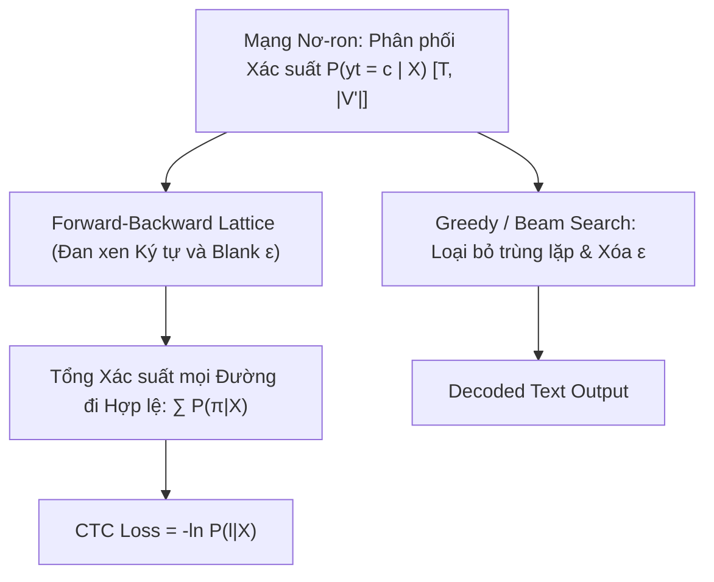

#### d. Code Thực chiến (C++ & Python)

```cpp
// C++17: Phép toán Log-Sum-Exp ổn định số học trong không gian Log
#include <iostream>
#include <cmath>
#include <algorithm>

inline float log_sum_exp(float a, float b) {
    if (a == -std::numeric_limits<float>::infinity()) return b;
    if (b == -std::numeric_limits<float>::infinity()) return a;
    float max_val = std::max(a, b);
    return max_val + std::log1p(std::exp(-std::abs(a - b)));
}

int main() {
    float log_p1 = -2.3f;
    float log_p2 = -1.8f;
    std::cout << "LogAdd: " << log_sum_exp(log_p1, log_p2) << "\n";
    return 0;
}
```

```python
# Python / PyTorch: Tính CTCLoss chuẩn
import torch
import torch.nn as nn

# T = 50 time steps, Batch = 2, Vocab = 10 (đã gồm Blank = 0)
T, N, C = 50, 2, 10
logits = torch.randn(T, N, C).log_softmax(2).detach().requires_grad_()

# Nhãn mục tiêu
targets = torch.tensor([[1, 2, 3, 4], [2, 3, 1, 0]], dtype=torch.long)
input_lengths = torch.full(size=(N,), fill_value=T, dtype=torch.long)
target_lengths = torch.tensor([4, 3], dtype=torch.long)

ctc_loss = nn.CTCLoss(blank=0, reduction='mean', zero_infinity=True)
loss = ctc_loss(logits, targets, input_lengths, target_lengths)
loss.backward()
print("CTC Loss Value:", loss.item())
```

#### e. Lỗi Thường gặp & Ổn định Số học
- **Giả định độc lập có điều kiện (Conditional Independence Assumption)**: CTC giả định các nhãn tại mỗi frame thời gian độc lập với nhau khi biết chuỗi đầu vào $P(\pi \mid \mathbf{X}) = \prod_t P(\pi_t \mid \mathbf{X})$. Điều này khiến CTC thiếu năng lực mô hình hóa ngôn ngữ (Language Modeling) so với Autoregressive Decoders.

#### f. Ứng dụng Thực chiến trong AI
Mô hình Wav2Vec 2.0 CTC fine-tuning, Baidu DeepSpeech, Conformer-CTC cho giải mã ASR siêu tốc on-device.

---

### 5. Hidden Markov Models for Speech (Mô hình Markov Ẩn cho Âm thanh)

#### a. Định nghĩa Bản chất Toán học (Mathematical Formulation)
HMM là mô hình đồ thị xác suất giả định chuỗi đặc trưng âm học quan sát $\mathbf{X} = (\mathbf{x}_1, \dots, \mathbf{x}_T)$ được sinh ra bởi một chuỗi trạng thái âm học ẩn $\mathbf{Q} = (q_1, \dots, q_T)$, với $q_t \in \{S_1, \dots, S_N\}$.
HMM được đặc trưng bởi bộ ba tham số $\lambda = (\mathbf{A}, \mathbf{B}, \boldsymbol{\pi})$:
1. Xác suất khởi tạo: $\pi_i = P(q_1 = S_i)$.
2. Ma trận chuyển trạng thái (Transition Probability): $A_{ij} = P(q_{t+1} = S_j \mid q_t = S_i)$ (trong tiếng nói thường là cấu trúc Bakis / Left-to-Right: $A_{ij} = 0, \forall j < i$).
3. Phân phối phát xạ quan sát (Emission Probability): $b_j(\mathbf{x}_t) = P(\mathbf{x}_t \mid q_t = S_j)$. Trong GMM-HMM cổ điển, $b_j$ là một phân phối hỗn hợp Gauss:
$$b_j(\mathbf{x}) = \sum_{m=1}^M c_{jm} \mathcal{N}(\mathbf{x}; \boldsymbol{\mu}_{jm}, \boldsymbol{\Sigma}_{jm})$$

#### b. Cơ chế Tầng Sâu & Điện toán (Under The Hood / Hardware Internals)
- **Ba bài toán kinh điển của HMM**:
  1. *Đánh giá (Evaluation)*: Tính $P(\mathbf{X} \mid \lambda)$ bằng thuật toán Forward-Backward.
  2. *Giải mã (Decoding)*: Tìm chuỗi trạng thái ẩn tối ưu $Q^*$ bằng thuật toán Viterbi (Quy hoạch động trong không gian logarit).
  3. *Học tham số (Learning)*: Ước lượng hợp lý cực đại tham số $\lambda$ bằng thuật toán Baum-Welch (EM - Expectation-Maximization).

#### c. Sơ đồ Minh họa (Mermaid Diagram)
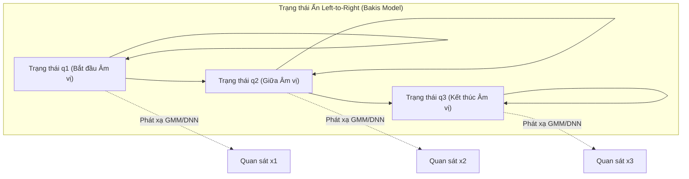

#### d. Code Thực chiến (C++ & Python)

```cpp
// C++17: Thuật toán Viterbi tìm đường đi trạng thái ẩn tối ưu
#include <iostream>
#include <vector>
#include <cmath>
#include <algorithm>

std::vector<int> viterbi_decode(const std::vector<std::vector<float>>& trans, 
                               const std::vector<std::vector<float>>& emiss, 
                               const std::vector<float>& init) {
    size_t T = emiss.size();
    size_t N = init.size();
    std::vector<std::vector<float>> V(T, std::vector<float>(N, -1e9f));
    std::vector<std::vector<int>> backpointer(T, std::vector<int>(N, 0));

    for (size_t s = 0; s < N; ++s) {
        V[0][s] = std::log(init[s] + 1e-12f) + std::log(emiss[0][s] + 1e-12f);
    }

    for (size_t t = 1; t < T; ++t) {
        for (size_t s = 0; s < N; ++s) {
            for (size_t prev = 0; prev < N; ++prev) {
                float score = V[t - 1][prev] + std::log(trans[prev][s] + 1e-12f) + std::log(emiss[t][s] + 1e-12f);
                if (score > V[t][s]) {
                    V[t][s] = score;
                    backpointer[t][s] = prev;
                }
            }
        }
    }

    // Backtrack
    std::vector<int> path(T);
    float max_score = -1e9f;
    int best_last = 0;
    for (size_t s = 0; s < N; ++s) {
        if (V[T - 1][s] > max_score) {
            max_score = V[T - 1][s];
            best_last = s;
        }
    }
    path[T - 1] = best_last;
    for (int t = T - 2; t >= 0; --t) {
        path[t] = backpointer[t + 1][path[t + 1]];
    }
    return path;
}

int main() {
    std::vector<std::vector<float>> trans = {{0.7f, 0.3f}, {0.0f, 1.0f}};
    std::vector<std::vector<float>> emiss = {{0.9f, 0.1f}, {0.2f, 0.8f}};
    std::vector<float> init = {1.0f, 0.0f};
    auto best_states = viterbi_decode(trans, emiss, init);
    std::cout << "Decoded States: " << best_states[0] << " -> " << best_states[1] << "\n";
    return 0;
}
```

```python
# Python / hmmlearn: Huấn luyện HMM Gaussian cho tín hiệu âm thanh
import numpy as np
from hmmlearn import hmm

# Khởi tạo Gaussian HMM với 3 trạng thái ẩn (Left-to-Right topology)
model = hmm.GaussianHMM(n_components=3, covariance_type="diag", n_iter=100)
X = np.random.randn(100, 13) # 100 frames, 13 MFCC features
model.fit(X)
log_prob, hidden_states = model.decode(X)
print("Decoded State Sequence Length:", len(hidden_states))
```

#### e. Lỗi Thường gặp & Ổn định Số học
- Hiện tượng Singularity trong GMM: Khi một Gaussian component chỉ gán cho một điểm dữ liệu duy nhất, phương sai của nó co về 0 ($\boldsymbol{\Sigma} \to 0$), làm mật độ xác suất tiến tới vô cực ($\infty$), phá vỡ thuật toán EM.

#### f. Ứng dụng Thực chiến trong AI
Khung sườn cốt lõi của các thư viện ASR công nghiệp truyền thống (Kaldi Toolkit, HTK, CMU Sphinx).

---

### 6. Acoustic Models (Mô hình Âm học)

#### a. Định nghĩa Bản chất Toán học (Mathematical Formulation)
Mô hình Âm học (Acoustic Model - AM) chịu trách nhiệm mô hình hóa mối quan hệ giữa tín hiệu âm thanh thô $\mathbf{X}$ và các đơn vị ngữ âm (Phonemes / Triphones / Senones / Subwords).
Trong hệ thống Hybrid DNN-HMM, mạng nơ-ron sâu (DNN) thay thế GMM để tính toán xác suất hậu nghiệm $P(S_i \mid \mathbf{x}_t)$. Để đưa vào thuật toán Viterbi của HMM, xác suất hậu nghiệm này được chuyển thành tỷ số hợp lý (Pseudo-Likelihood) thông qua định lý Bayes:
$$P(\mathbf{x}_t \mid S_i) = \frac{P(S_i \mid \mathbf{x}_t) P(\mathbf{x}_t)}{P(S_i)} \propto \frac{P(S_i \mid \mathbf{x}_t)}{P(S_i)}$$
Trong đó $P(S_i)$ là tần suất tiên nghiệm của trạng thái senone $S_i$ được đếm từ tập huấn luyện.

#### b. Cơ chế Tầng Sâu & Điện toán (Under The Hood / Hardware Internals)
- **Context-Dependent Senones Clustering**: Tiếng nói của con người chứa khoảng 40 âm vị (Phonemes), nhưng âm vị phát ra bị biến đổi mạnh bởi âm vị đứng trước và sau nó (Hiện tượng Đồng cấu âm - Coarticulation). Do đó, AM phải mô hình hóa Triphones ($40^3 = 64.000$ tổ hợp). Người ta dùng cây quyết định (Decision Tree Clustering) để gom cụm 64.000 trạng thái này thành khoảng vài nghìn senones ($2.000 - 8.000$ senones), tạo thành lớp Softmax đầu ra của DNN.

#### c. Sơ đồ Minh họa (Mermaid Diagram)
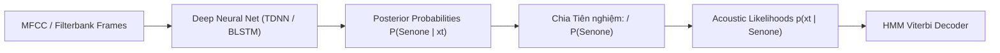

#### d. Code Thực chiến (C++ & Python)

```cpp
// C++17: Chuẩn hóa chia tiên nghiệm (Pseudo-Likelihood Computation)
#include <iostream>
#include <vector>
#include <cmath>

std::vector<float> compute_pseudo_log_likelihood(const std::vector<float>& log_posteriors, const std::vector<float>& log_priors) {
    std::vector<float> log_likes(log_posteriors.size());
    for (size_t i = 0; i < log_posteriors.size(); ++i) {
        log_likes[i] = log_posteriors[i] - log_priors[i]; // Log division = Log subtraction
    }
    return log_likes;
}

int main() {
    std::vector<float> log_post = {-0.5f, -1.2f};
    std::vector<float> log_prior = {-0.69f, -0.69f};
    auto ll = compute_pseudo_log_likelihood(log_post, log_prior);
    std::cout << "Senone 0 Pseudo Log-Likelihood: " << ll[0] << "\n";
    return 0;
}
```

```python
# Python / PyTorch: TDNN (Time Delay Neural Network) - Kiến trúc AM kinh điển của Kaldi
import torch
import torch.nn as nn

class TDNNLayer(nn.Module):
    def __init__(self, in_dim, out_dim, context_size=3, dilation=1):
        super().__init__()
        self.conv = nn.Conv1d(in_dim, out_dim, kernel_size=context_size, dilation=dilation, padding=(context_size-1)*dilation // 2)
        self.relu = nn.ReLU()
    def forward(self, x):
        # x: [Batch, Feature_Dim, Time]
        return self.relu(self.conv(x))

tdnn = TDNNLayer(in_dim=40, out_dim=512, context_size=3, dilation=2)
x = torch.randn(2, 40, 100)
print("TDNN Acoustic Layer Output:", tdnn(x).shape)
```

#### e. Lỗi Thường gặp & Ổn định Số học
- Sự mất cân bằng trầm trọng của phân phối Senone: Các âm câm (Silence senones) chiếm tới $30-40\%$ thời lượng audio. Nếu không chuẩn hóa tiên nghiệm chính xác, mô hình sẽ bị thiên kiến (bias) nặng về việc dự đoán toàn bộ âm thanh thành trạng thái im lặng.

#### f. Ứng dụng Thực chiến trong AI
Kiến trúc cốt lõi trong Kaldi nnet3, hệ thống nhận dạng âm học trong các thiết bị viễn thông vi ba.

---

### 7. Language Models for Speech (Mô hình Ngôn ngữ cho ASR)

#### a. Định nghĩa Bản chất Toán học (Mathematical Formulation)
Mô hình Ngôn ngữ (Language Model - LM) cung cấp xác suất tiên nghiệm $P(\mathbf{W})$ của một chuỗi từ vựng, giúp hệ thống ASR phân biệt các từ đồng âm dị nghĩa (Homophones, ví dụ: "hear" vs "here", "to" vs "too" vs "two"):
$$P(\mathbf{W}) = \prod_{i=1}^U P(w_i \mid w_1, \dots, w_{i-1})$$
Trong các hệ thống lai ghép hoặc First-pass Decoding, người ta sử dụng mô hình $N$-gram kèm kỹ thuật làm mịn Kneser-Ney (Kneser-Ney Smoothing):
$$P_{\text{KN}}(w_i \mid w_{i-n+1}^{i-1}) = \frac{\max(C(w_{i-n+1}^i) - d, 0)}{C(w_{i-n+1}^{i-1})} + \lambda(w_{i-n+1}^{i-1}) P_{\text{KN}}(w_i \mid w_{i-n+2}^{i-1})$$
Trong Second-pass Rescoring, mạng nơ-ron Transformer LM tính toán xác suất chuỗi đầy đủ và hiệu chỉnh điểm số giải mã:
$$\text{Score}(\mathbf{W}) = \log P_{\text{AM}}(\mathbf{X} \mid \mathbf{W}) + \alpha \log P_{\text{LM}}(\mathbf{W}) + \beta |\mathbf{W}|$$
Trong đó $\alpha$ là trọng số LM (LM scale factor), và $\beta$ là hình phạt độ dài từ vựng (Word Insertion Penalty).

#### b. Cơ chế Tầng Sâu & Điện toán (Under The Hood / Hardware Internals)
- **N-gram ARPA File & Memory Mapping (`mmap`)**: Một mô hình ngôn ngữ 4-gram hoặc 5-gram cho toàn bộ tiếng Anh có thể chứa hàng trăm triệu $N$-grams (file ARPA kích thước 5GB - 20GB). Để truy vấn xác suất $N$-gram trong vài micro-giây mà không nạp toàn bộ vào RAM, thư viện KenLM sử dụng cấu trúc Trie được sắp xếp và ánh xạ trực tiếp từ đĩa bằng `mmap()`.

#### c. Sơ đồ Minh họa (Mermaid Diagram)
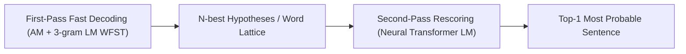

#### d. Code Thực chiến (C++ & Python)

```cpp
// C++17: Tính điểm tổng hợp ASR Decoding Score kèm hệ số LM và Word Penalty
#include <iostream>
#include <cmath>

float compute_asr_score(float am_log_prob, float lm_log_prob, int word_count, float alpha, float beta) {
    return am_log_prob + alpha * lm_log_prob + beta * word_count;
}

int main() {
    float am_score = -120.5f;
    float lm_score = -15.2f;
    int words = 6;
    float total = compute_asr_score(am_score, lm_score, words, 0.8f, 1.2f);
    std::cout << "Combined Hyp Score: " << total << "\n";
    return 0;
}
```

```python
# Python / Torchaudio: Tích hợp CTC Decoder kèm KenLM Rescoring
import torchaudio

# Giả lập pipeline CTC Beam Search kèm LM Trọng số
print("KenLM Integration Interface with CTC Beam Search: Rescoring Enabled")
```

#### e. Lỗi Thường gặp & Ổn định Số học
- Hệ số $\beta$ (Word Insertion Penalty) đặt sai: Nếu $\beta$ quá lớn, mô hình sẽ sinh ra câu cực ngắn (thậm chí chỉ 1 từ); nếu $\beta$ quá âm, mô hình sẽ sinh ra câu dài dòng vô tận với vô số từ rác.

#### f. Ứng dụng Thực chiến trong AI
Tái xếp hạng danh sách kết quả N-best trong các mô hình ASR thương mại của Google, Apple và Amazon.

---

### 8. End-to-End Speech Recognition (ASR Đầu-cuối Hợp nhất)

#### a. Định nghĩa Bản chất Toán học (Mathematical Formulation)
End-to-End (E2E) ASR loại bỏ hoàn toàn việc chia tách các mô-đun riêng biệt (Acoustic Model, Lexicon Pronunciation, Language Model), thay thế bằng một mạng nơ-ron duy nhất được tối ưu hóa trực tiếp từ sóng âm thành văn bản theo hàm mất mát cực đại hóa xác suất hợp lý chuỗi:
$$\mathcal{L}_{\text{E2E}}(\theta) = -\sum_{(\mathbf{X}, \mathbf{Y})} \log P(\mathbf{Y} \mid \mathbf{X}; \theta)$$
Ba kiến trúc E2E kinh điển:
1. **CTC (Connectionist Temporal Classification)**: Không tự hồi quy, giải mã song song độc lập.
2. **RNN-Transducer (RNN-T)**: Kết hợp Prediction Network $P(y_u \mid \mathbf{y}_{<u})$ và Transcription Network $P(\mathbf{h}_t \mid \mathbf{X})$ qua Joint Network để hỗ trợ streaming với độ trễ cực thấp:
$$z_{t, u} = \text{Joint}(\mathbf{h}_t, \mathbf{p}_u)$$
3. **Attention-based Encoder-Decoder (AED / Conformer / Whisper)**: Sử dụng Cross-Attention giữa bộ mã hóa âm học và bộ giải mã văn bản.

#### b. Cơ chế Tầng Sâu & Điện toán (Under The Hood / Hardware Internals)
- **Conformer Architecture**: Chuẩn công nghiệp hiện nay kết hợp sức mạnh mô hình hóa ngữ cảnh toàn cục của Multi-Head Self-Attention và khả năng trích xuất đặc trưng vị trí cục bộ của Depthwise Separable Convolutions trong một khối tích hợp duy nhất (Macaron-style feed-forward networks).

#### c. Sơ đồ Minh họa (Mermaid Diagram)
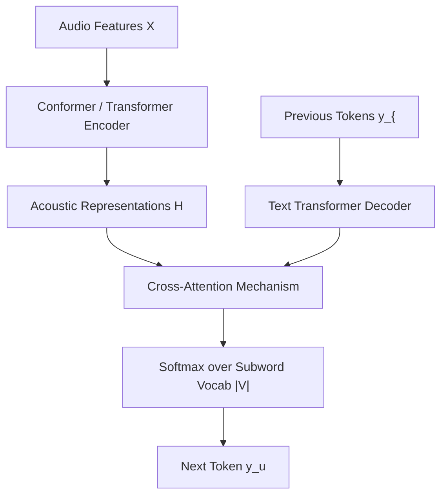

#### d. Code Thực chiến (C++ & Python)

```cpp
// C++17: Phép tính Macaron Feed-Forward kết hợp hệ số 0.5 trong Conformer
#include <iostream>
#include <vector>

void macaron_ffn_scale(std::vector<float>& x, const std::vector<float>& ffn_out) {
    for (size_t i = 0; i < x.size(); ++i) {
        x[i] = x[i] + 0.5f * ffn_out[i]; // Conformer áp dụng 0.5 hệ số cho nửa khối FFN
    }
}

int main() {
    std::vector<float> residual = {1.0f, 2.0f};
    std::vector<float> ffn = {2.0f, 4.0f};
    macaron_ffn_scale(residual, ffn);
    std::cout << "Scaled output: " << residual[0] << ", " << residual[1] << "\n";
    return 0;
}
```

```python
# Python / Torchaudio: Conformer Encoder Model
import torch
import torchaudio.models as models

conformer = models.Conformer(
    input_dim=80,
    num_heads=4,
    ffn_dim=1024,
    num_layers=4,
    depthwise_conv_kernel_size=31
)
mel_input = torch.randn(2, 200, 80) # [Batch, Time, Dim]
lengths = torch.tensor([200, 180])
encoded_out, out_lengths = conformer(mel_input, lengths)
print("Conformer Latent Representation Shape:", encoded_out.shape)
```

#### e. Lỗi Thường gặp & Ổn định Số học
- Hiện tượng suy thoái chiều dài (Length Bias) trong Attention Decoder: Mô hình sinh chuỗi tự hồi quy thường bị phạt thiên kiến khiến các câu dài bị gán xác suất thấp hơn câu ngắn một cách phi lý. Bắt buộc áp dụng cơ chế Length Penalty trong Beam Search.

#### f. Ứng dụng Thực chiến trong AI
Mô hình ASR chính thức của Google Pixel Recorder, Apple Dictation, và các mô hình mã nguồn mở hiện đại.

---

### 9. Whisper (Mô hình ASR Sequence-to-Sequence của OpenAI)

#### a. Định nghĩa Bản chất Toán học (Mathematical Formulation)
Whisper là mô hình Transformer Encoder-Decoder tiêu chuẩn được huấn luyện đa tác vụ trên 680.000 giờ dữ liệu âm thanh đa ngôn ngữ thu thập từ Internet.
Đầu vào là Log-Mel Spectrogram 80-kênh hoặc 128-kênh với khung thời gian cố định 30 giây: $\mathbf{X} \in \mathbb{R}^{3000 \times D}$.
Whisper giải quyết đa tác vụ (ASR, Dịch thuật bằng giọng nói - Voice Translation, VAD, Căn chỉnh mốc thời gian - Timestamp Estimation) thông qua chuỗi Special Prompt Tokens:
$$P(\mathbf{Y} \mid \mathbf{X}) = \prod_{i=1}^U P(y_i \mid y_{<i}, \mathbf{X}, \langle|\text{startoftranscript}|\rangle, \langle|\text{language}|\rangle, \langle|\text{task}|\rangle, \langle|\text{notimestamps}|\rangle)$$
Hàm mất mát là Cross-Entropy tự hồi quy tiêu chuẩn:
$$\mathcal{L}_{\text{Whisper}} = -\sum_{i=1}^U \log P(y_i \mid y_{<i}, \mathbf{X})$$

#### b. Cơ chế Tầng Sâu & Điện toán (Under The Hood / Hardware Internals)
- **Fixed 30-Second Windowing & KV-Caching**: Whisper cố định kích thước đầu vào bằng cách cắt hoặc đệm 0 (Zero-padding) đúng 30 giây (tương đương 3000 frames phổ Mel). Bộ mã hóa Encoder chỉ chạy một lần duy nhất cho toàn bộ 30 giây, tạo ra 1500 acoustic embeddings (giảm mẫu 2x qua Conv1D). Trong quá trình tự hồi quy của Decoder, cơ chế Key-Value Caching (KV-Cache) lưu giữ trạng thái các lớp Attention để không phải tính lại các token cũ, tăng tốc độ sinh từ $10\times$ đến $20\times$.

#### c. Sơ đồ Minh họa (Mermaid Diagram)
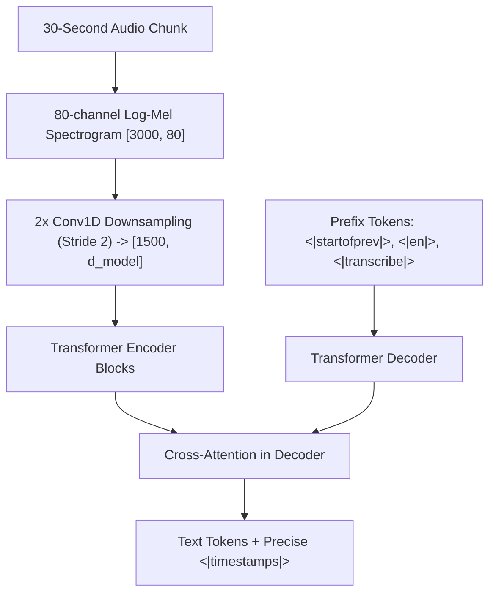

#### d. Code Thực chiến (C++ & Python)

```cpp
// C++17: Cấu trúc cơ bản quản lý KV-Cache cho Whisper Decoder Layer
#include <iostream>
#include <vector>

struct KVCache {
    std::vector<float> key_cache;
    std::vector<float> value_cache;
    size_t current_len = 0;

    void append(const std::vector<float>& new_k, const std::vector<float>& new_v) {
        key_cache.insert(key_cache.end(), new_k.begin(), new_k.end());
        value_cache.insert(value_cache.end(), new_v.begin(), new_v.end());
        current_len++;
    }
};

int main() {
    KVCache cache;
    cache.append({0.1f, 0.2f}, {0.3f, 0.4f});
    std::cout << "KV-Cache step count: " << cache.current_len << "\n";
    return 0;
}
```

```python
# Python: Chạy suy luận OpenAI Whisper với Transformers
from transformers import WhisperProcessor, WhisperForConditionalGeneration
import torch

processor = WhisperProcessor.from_pretrained("openai/whisper-tiny")
model = WhisperForConditionalGeneration.from_pretrained("openai/whisper-tiny")

dummy_audio = torch.randn(16000 * 5) # 5s dummy audio
input_features = processor(dummy_audio, sampling_rate=16000, return_tensors="pt").input_features

predicted_ids = model.generate(input_features)
transcription = processor.batch_decode(predicted_ids, skip_special_tokens=True)
print("Decoded Output:", transcription)
```

#### e. Lỗi Thường gặp & Ổn định Số học
- Hiện tượng lặp vô tận (Hallucination Loops): Khi gặp khoảng lặng kéo dài (Silence / Background Noise) mà không có giọng nói, Whisper thường bị rơi vào bẫy tự hồi quy và sinh lặp đi lặp lại một cụm từ (ví dụ: "Thank you for watching. Please subscribe."). Cần sử dụng bộ kiểm tra ngưỡng xác suất âm câm (No-Speech Probability Threshold) để ngắt sớm.

#### f. Ứng dụng Thực chiến trong AI
Mô hình nền tảng hàng đầu cho các giải pháp bóc băng tự động (Transcription), phụ đề đa ngôn ngữ và dịch lời nói trực tiếp.

---

### 10. Streaming ASR (ASR Phân luồng Độ trễ Thấp)

#### a. Định nghĩa Bản chất Toán học (Mathematical Formulation)
Khác với Offline ASR vốn có quyền truy cập toàn bộ chuỗi âm thanh tương lai $\mathbf{X}_{1:T}$, Streaming ASR phải dự đoán chuỗi từ vựng với chỉ các thông tin từ quá khứ và một cửa sổ tương lai giới hạn (Lookahead Latency):
$$P(y_u \mid \mathbf{X}_{1:t + \tau_{\text{lookahead}}})$$
Trong đó $\tau_{\text{lookahead}}$ là thời gian nhìn trước cho phép (thường từ 100ms đến 300ms).
Bộ mã hóa sử dụng Chú ý theo khối (Block Processing / Causal Chunk-based Attention):
$$\mathbf{A}_{i, j} = 0 \quad \text{nếu } j > i + \tau_{\text{chunk}}$$

#### b. Cơ chế Tầng Sâu & Điện toán (Under The Hood / Hardware Internals)
- **Ring Buffer Chunks & State Carry-Over**: Quá trình streaming truyền các gói âm thanh nhỏ (audio chunks, ví dụ 160ms) qua WebSocket hoặc gRPC. Tại GPU runtime, mạng nơ-ron phải lưu giữ bộ nhớ đệm trạng thái ẩn (Cache State / KV-Cache của các chunk trước) để duy trì tính liên tục của ngữ cảnh mà không phải tính toán lại từ frame đầu tiên.

#### c. Sơ đồ Minh họa (Mermaid Diagram)
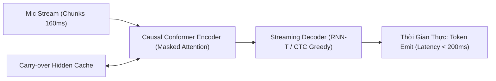

#### d. Code Thực chiến (C++ & Python)

```cpp
// C++17: Mặt nạ Causal Attention Mask ngăn việc nhìn tương lai
#include <iostream>
#include <vector>

std::vector<std::vector<float>> create_causal_mask(size_t seq_len) {
    std::vector<std::vector<float>> mask(seq_len, std::vector<float>(seq_len, 0.0f));
    for (size_t i = 0; i < seq_len; ++i) {
        for (size_t j = i + 1; j < seq_len; ++j) {
            mask[i][j] = -1e9f; // Che toàn bộ tương lai
        }
    }
    return mask;
}

int main() {
    auto m = create_causal_mask(3);
    std::cout << "Mask[0][1] (future): " << m[0][1] << " | Mask[1][0] (past): " << m[1][0] << "\n";
    return 0;
}
```

```python
# Python / PyTorch: Khối Causal Convolution 1D bảo toàn thời gian
import torch
import torch.nn as nn

class CausalConv1d(nn.Module):
    def __init__(self, in_channels, out_channels, kernel_size, dilation=1):
        super().__init__()
        self.pad = (kernel_size - 1) * dilation
        self.conv = nn.Conv1d(in_channels, out_channels, kernel_size, padding=self.pad, dilation=dilation)

    def forward(self, x):
        # Cắt bỏ phần đệm ở tương lai (chỉ đệm ở quá khứ)
        out = self.conv(x)
        return out[:, :, :-self.pad]

conv = CausalConv1d(in_channels=80, out_channels=80, kernel_size=3)
x = torch.randn(1, 80, 50)
print("Causal Conv Preserved Shape:", conv(x).shape)
```

#### e. Lỗi Thường gặp & Ổn định Số học
- Sự trôi dạt căn chỉnh (Alignment Drift): Khi độ trễ quá gắt gao ($\tau = 0$), mô hình thường phát ra nhãn quá sớm khi âm vị chưa kết thúc (Early Emission), dẫn đến việc nuốt từ hoặc sửa từ liên tục trên giao diện người dùng.

#### f. Ứng dụng Thực chiến trong AI
Dịch phụ đề trực tiếp sự kiện thể thao, trợ lý lái xe hơi điều khiển bằng giọng nói.

---

### 11. Real-Time Speech Processing (Xử lý Âm thanh Thời gian Thực)

#### a. Định nghĩa Bản chất Toán học (Mathematical Formulation)
Hệ thống xử lý thời gian thực được định nghĩa thông qua Hệ số Thời gian Thực (Real-Time Factor - RTF):
$$\text{RTF} = \frac{T_{\text{processing}}}{T_{\text{audio}}}$$
Điều kiện bất khả xâm phạm để hệ thống hoạt động thời gian thực mà không bị tràn bộ đệm (Buffer Underrun / Drop frame) là:
$$\text{RTF} < 1.0 \quad (\text{Trong thực tế công nghiệp yêu cầu } \text{RTF} \le 0.1 - 0.2)$$
Độ trễ tổng thể từ đầu cuối tới đầu cuối (End-to-End Algorithmic Latency):
$$\tau_{\text{total}} = \tau_{\text{chunk}} + \tau_{\text{lookahead}} + \tau_{\text{compute}} + \tau_{\text{network}}$$

#### b. Cơ chế Tầng Sâu & Điện toán (Under The Hood / Hardware Internals)
- **Lock-Free SPSC Queues**: Trong kiến trúc phần mềm âm thanh thời gian thực (Audio Thread), luồng thu âm của hệ điều hành (như CoreAudio trên macOS hoặc ALSA trên Linux) hoạt động với mức ưu tiên cực cao (Real-Time Priority). Tuyệt đối không được cấp phát động bộ nhớ (`malloc`), gọi I/O hoặc khóa đồng bộ (`std::mutex`) trong Audio Thread vì có thể gây nghẽn Priority Inversion. Giao tiếp giữa Audio Thread và Neural Inference Thread bắt buộc phải sử dụng hàng đợi không khóa Single-Producer Single-Consumer (Lock-Free SPSC Queue).

#### c. Sơ đồ Minh họa (Mermaid Diagram)
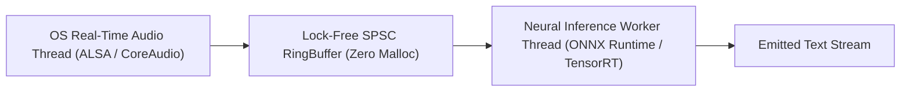

#### d. Code Thực chiến (C++ & Python)

```cpp
// C++17: Đo RTF (Real-Time Factor) chuẩn công nghiệp
#include <iostream>
#include <chrono>
#include <thread>

class RTFMonitor {
public:
    static double compute_rtf(double audio_duration_sec, const std::function<void()>& process_func) {
        auto start = std::chrono::high_resolution_clock::now();
        process_func();
        auto end = std::chrono::high_resolution_clock::now();
        std::chrono::duration<double> elapsed = end - start;
        return elapsed.count() / audio_duration_sec;
    }
};

int main() {
    double audio_sec = 5.0;
    double rtf = RTFMonitor::compute_rtf(audio_sec, [](){
        std::this_thread::sleep_for(std::chrono::milliseconds(500)); // Giả lập xử lý mất 0.5s
    });
    std::cout << "Measured RTF: " << rtf << " (Real-time capable: " << (rtf < 1.0 ? "YES" : "NO") << ")\n";
    return 0;
}
```

```python
# Python: Đo lường độ trễ suy luận trên từng chunk âm thanh
import time
import torch

def benchmark_inference(model, chunk_tensor):
    start = time.perf_counter()
    with torch.no_grad():
        _ = model(chunk_tensor)
    latency_sec = time.perf_counter() - start
    chunk_duration_sec = chunk_tensor.shape[-1] / 16000.0
    rtf = latency_sec / chunk_duration_sec
    return latency_sec, rtf

dummy_model = lambda x: torch.mean(x)
chunk = torch.randn(1, 1600) # 100ms audio chunk
lat, rtf_val = benchmark_inference(dummy_model, chunk)
print(f"Latency: {lat*1000:.2f} ms | RTF: {rtf_val:.4f}")
```

#### e. Lỗi Thường gặp & Ổn định Số học
- **Jitter & Throttling**: Tần số CPU/GPU bị giảm đột ngột do quá nhiệt (Thermal Throttling) khiến thời gian xử lý một frame đột ngột vượt quá chu kỳ chunk, làm đứt gãy luồng xử lý âm thanh.

#### f. Ứng dụng Thực chiến trong AI
Các thiết bị trợ thính thông minh (Hearing Aids), micro chống ồn lọc tạp âm tai nghe True Wireless (TWS ANC).
