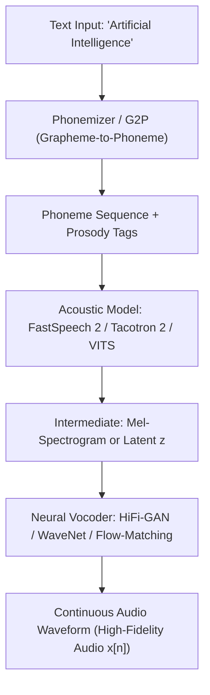
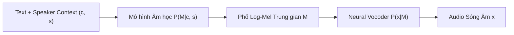
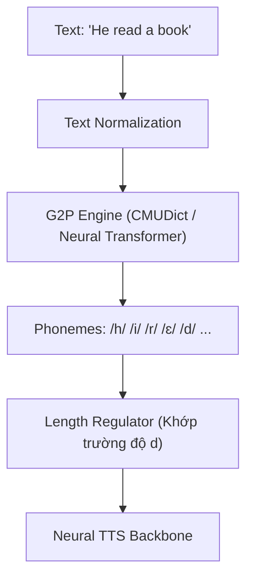
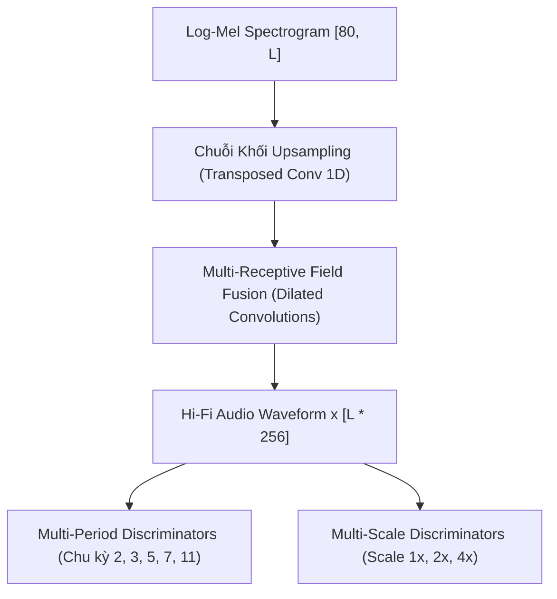
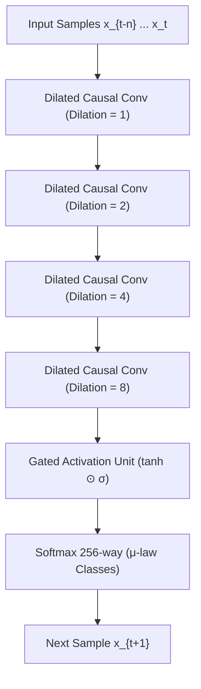
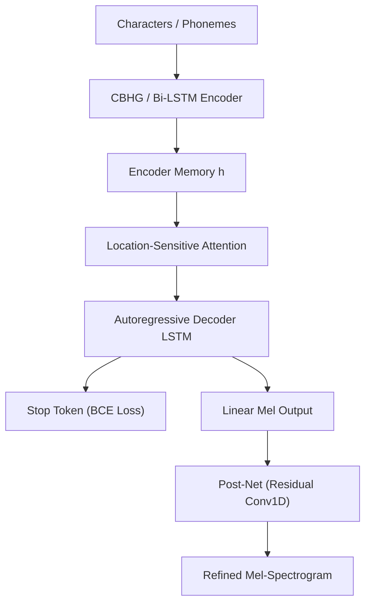
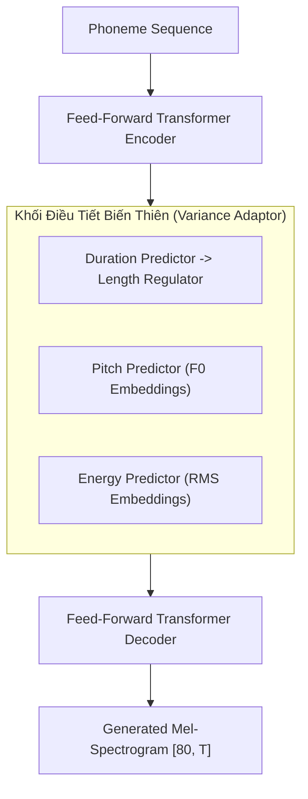
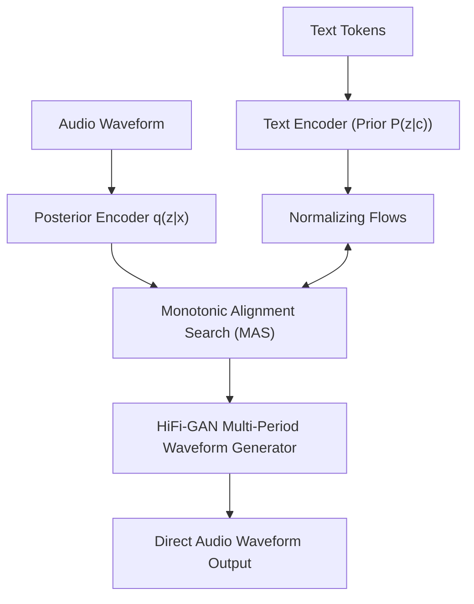
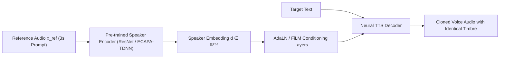

```mermaid
graph LR
    InputAudio["Input Speech (Giọng nói + Cảm xúc)"] --> CodecEnc["Neural Audio Codec Encoder (RVQ)"]
    CodecEnc --> InTokens["Discrete Semantic Tokens"]
    InTokens --> NativeLLM["Omni-LLM Backbone (GPT-4o / Moshi / Gemini Live)"]
    NativeLLM --> OutTokens["Output Discrete Audio Tokens"]
    OutTokens --> CodecDec["Neural Audio Codec Decoder"]
    CodecDec --> OutAudio["Output Synthesized Speech (Zero Text Latency)"]
```

# Chuyên đề: Tổng hợp Tiếng nói, TTS & Neural Vocoders (Speech Synthesis & Vocoders)

## 1. Tổng quan Chuyên đề
Tổng hợp Tiếng nói (Speech Synthesis hay Text-to-Speech - TTS) là bài toán nghịch đảo của ASR: chuyển đổi chuỗi văn bản ký tự thành dạng sóng âm thanh liên tục tự nhiên và giàu cảm xúc. Một hệ thống TTS hiện đại thường được chia thành hai giai đoạn hoặc hợp nhất đầu-cuối:
1. **Acoustic Model (Mô hình Hóa Âm học)**: Chuyển đổi văn bản thành biểu diễn âm thanh trung gian (phổ Mel-Spectrogram).
2. **Neural Vocoder (Bộ Tổng hợp Sóng Âm Học sâu)**: Khôi phục dạng sóng âm thanh 1D với đầy đủ thông tin góc pha và chi tiết hài âm tần số cao từ phổ Mel trung gian.

Sự tiến hóa từ mô hình ghép nối âm vị (Concatenative TTS), tổng hợp tham số thống kê (Parametric HMM TTS), đến các mạng nơ-ron tự hồi quy (WaveNet, Tacotron 2), mạng nơ-ron song song không tự hồi quy (FastSpeech 2), và kiến trúc biến phân dòng chảy thế hệ mới (VITS, Voicebox) đã đưa chất lượng giọng nói nhân tạo tiệm cận hoàn toàn giọng người thật (MOS > 4.5).



---

## 2. Chi tiết từng Keyword

---

### 1. Speech Synthesis (Tổng hợp Tiếng nói Tổng quát)

#### a. Định nghĩa Bản chất Toán học (Mathematical Formulation)
Tổng hợp tiếng nói là bài toán ước lượng phân phối điều kiện của dạng sóng âm thanh $\mathbf{x} = (x_1, \dots, x_T) \in \mathbb{R}^T$ cho trước ngữ cảnh văn bản $\mathbf{c}$ và các thuộc tính phong cách/người nói $\mathbf{s}$:
$$P(\mathbf{x} \mid \mathbf{c}, \mathbf{s}) = \int P(\mathbf{x} \mid \mathbf{M}) P(\mathbf{M} \mid \mathbf{c}, \mathbf{s}) d\mathbf{M}$$
Trong đó $\mathbf{M} \in \mathbb{R}^{B \times F}$ là biểu diễn phổ tần trung gian.
Chất lượng của hệ thống tổng hợp được đánh giá thông qua thang điểm Mean Opinion Score (MOS) từ 1 (rất tệ) đến 5 (tuyệt vời) bởi người thẩm định thính giác chuẩn ITU-T P.800:
$$\text{MOS} = \frac{1}{N \cdot K} \sum_{i=1}^N \sum_{j=1}^K r_{ij}$$

#### b. Cơ chế Tầng Sâu & Điện toán (Under The Hood / Hardware Internals)
- **Phase Inversion & Over-smoothing Problem**: Các mô hình tổng hợp phổ tần thường tạo ra các đường phổ bị làm mịn quá mức (Over-smoothed Spectrograms) do tối ưu hóa hàm mất mát $L_1/L_2$. Khi đưa vào thuật toán khôi phục pha cổ điển Griffin-Lim, âm thanh bị hiện tượng rỗng tiếng, nghẹt mũi và kim loại (robotic/metallic artifacts).

#### c. Sơ đồ Minh họa (Mermaid Diagram)


#### d. Code Thực chiến (C++ & Python)

```cpp
// C++17: Tính điểm trung bình MOS từ ma trận đánh giá thính giác
#include <iostream>
#include <vector>
#include <numeric>

double calculate_mos(const std::vector<std::vector<int>>& ratings) {
    double total = 0.0;
    size_t count = 0;
    for (const auto& subject : ratings) {
        total += std::accumulate(subject.begin(), subject.end(), 0.0);
        count += subject.size();
    }
    return count > 0 ? (total / count) : 0.0;
}

int main() {
    std::vector<std::vector<int>> scores = {{4, 5, 4}, {5, 4, 5}};
    std::cout << "Mean Opinion Score (MOS): " << calculate_mos(scores) << "\n";
    return 0;
}
```

```python
# Python: Đánh giá chất lượng âm thanh bằng độ đo Mel-Cepstral Distortion (MCD)
import numpy as np

def mel_cepstral_distortion(ref_mfcc: np.ndarray, syn_mfcc: np.ndarray) -> float:
    # MCD (dB) đo độ lệch năng lượng quang phổ giữa âm thanh thật và âm thanh tổng hợp
    diff = ref_mfcc - syn_mfcc
    mcd = (10.0 * np.sqrt(2.0) / np.log(10.0)) * np.mean(np.sqrt(np.sum(diff ** 2, axis=-1)))
    return mcd

mfcc_ref = np.random.randn(100, 13)
mfcc_syn = mfcc_ref + np.random.normal(0, 0.1, (100, 13))
print(f"Mel-Cepstral Distortion: {mel_cepstral_distortion(mfcc_ref, mfcc_syn):.2f} dB")
```

#### e. Lỗi Thường gặp & Ổn định Số học
- Sự mất đồng bộ độ dài thời gian giữa âm thanh mẫu và âm thanh sinh ra khi đo các chỉ số khách quan như MCD hoặc PESQ. Bắt buộc phải áp dụng thuật toán Dynamic Time Warping (DTW) để căn chỉnh thời gian trước khi tính khoảng cách Euclidean.

#### f. Ứng dụng Thực chiến trong AI
Lồng tiếng tự động cho phim (AI Dubbing), hỗ trợ người khiếm thị đọc sách (Audiobooks), thiết bị GPS định vị.

---

### 2. Text-to-Speech (TTS - Chuyển Văn bản thành Giọng nói)

#### a. Định nghĩa Bản chất Toán học (Mathematical Formulation)
Pipeline TTS hoàn chỉnh bắt đầu từ giai đoạn Frontend xử lý văn bản (Text Normalization) và Chuyển tự sang âm vị (Grapheme-to-Phoneme - G2P):
$$\mathbf{T}_{\text{raw}} \xrightarrow{\text{Normalize}} \mathbf{T}_{\text{norm}} \xrightarrow{\text{G2P}} \mathbf{P} = (p_1, p_2, \dots, p_N)$$
Mô hình G2P ánh xạ các chữ cái sang bảng ký hiệu ngữ âm quốc tế (IPA - International Phonetic Alphabet) hoặc từ điển CMUDict:
$$P(p_n \mid p_{<n}, \mathbf{t}) = \prod_{n=1}^N \text{Softmax}(\mathbf{W}_p \mathbf{h}_n)$$
Sau đó, bộ dự đoán cao độ (Pitch $F_0$), năng lượng (Energy), và trường độ âm vị (Duration $d_n \in \mathbb{Z}^+$) được tính toán để điều khiển ngữ điệu tự nhiên (Prosody Modeling).

#### b. Cơ chế Tầng Sâu & Điện toán (Under The Hood / Hardware Internals)
- **Heteronym Ambiguity**: Từ vựng tiếng Anh có nhiều từ viết giống hệt nhau nhưng phát âm khác nhau tùy ngữ cảnh (Heteronyms, ví dụ: "read" trong quá khứ /rɛd/ và hiện tại /riːd/, "tear" là nước mắt /tɪər/ hay xé rách /tɛər/). Một lỗi phát âm nhỏ trong tầng G2P frontend sẽ phá hủy hoàn toàn cảm giác tự nhiên của giọng đọc.

#### c. Sơ đồ Minh họa (Mermaid Diagram)


#### d. Code Thực chiến (C++ & Python)

```cpp
// C++17: Bộ mở rộng trường độ âm vị (Length Regulator) trong C++
#include <iostream>
#include <vector>

std::vector<int> length_regulator(const std::vector<int>& phonemes, const std::vector<int>& durations) {
    std::vector<int> expanded;
    for (size_t i = 0; i < phonemes.size(); ++i) {
        for (int d = 0; d < durations[i]; ++d) {
            expanded.push_back(phonemes[i]);
        }
    }
    return expanded;
}

int main() {
    std::vector<int> p = {10, 20, 30};
    std::vector<int> d = {2, 3, 1}; // Lặp 10 hai lần, 20 ba lần, 30 một lần
    auto out = length_regulator(p, d);
    std::cout << "Expanded Sequence Size: " << out.size() << "\n";
    return 0;
}
```

```python
# Python: Sử dụng g2p_en để chuyển đổi Grapheme thành Phoneme
from g2p_en import G2p

g2p = G2p()
text = "Artificial intelligence converts text to speech."
phonemes = g2p(text)
print("Phoneme Sequence:", phonemes)
```

#### e. Lỗi Thường gặp & Ổn định Số học
- Độ dài dự đoán $d_n \le 0$: Trong các mô hình FastSpeech, mạng hồi quy trường độ âm vị có thể dự đoán ra số thực âm hoặc bằng 0. Nếu không áp dụng hàm `clamp(min=1)` hoặc hàm làm tròn số nguyên không âm `round()`, mạng nơ-ron sẽ bị sụp đổ kích thước ma trận tensor.

#### f. Ứng dụng Thực chiến trong AI
Giọng đọc trợ lý ảo thông minh, hệ thống đọc báo tự động của các tòa soạn điện tử.

---

### 3. Neural Vocoders (Bộ Tổng hợp Sóng Âm Mạng Nơ-ron)

#### a. Định nghĩa Bản chất Toán học (Mathematical Formulation)
Neural Vocoder giải bài toán phục hồi trực tiếp chuỗi sóng âm thời gian thực $x = [x_1, \dots, x_T]^T \in \mathbb{R}^T$ từ đặc trưng phổ Mel $\mathbf{S} \in \mathbb{R}^{M \times L}$ (với $T = L \times H$, $H$ là bước nhảy hop length):
$$\hat{\mathbf{x}} = G_\theta(\mathbf{S})$$
Kiến trúc tiêu chuẩn hiện nay là HiFi-GAN sử dụng mạng sinh đối nghịch (Generative Adversarial Networks - GAN) với hai bộ phân biệt đa tỉ lệ:
1. **Multi-Period Discriminator (MPD)**: Bẻ gãy chuỗi 1D thành các cấu trúc 2D với chu kỳ $p \in \{2, 3, 5, 7, 11\}$ để bắt trọn các hài âm định kỳ của dây thanh quản.
2. **Multi-Scale Discriminator (MSD)**: Đánh giá âm thanh ở các thang đo phân giải thời gian khác nhau (Audio thô, Average-pooled 2x, 4x).
Hàm mất mát kết hợp Feature Matching Loss và Mel-Spectrogram Loss:
$$\mathcal{L}_{\text{FM}}(G, D) = \mathbb{E}\left[ \sum_{i=1}^T \frac{1}{N_i} \|D^{(i)}(\mathbf{x}) - D^{(i)}(\hat{\mathbf{x}})\|_1 \right]$$

#### b. Cơ chế Tầng Sâu & Điện toán (Under The Hood / Hardware Internals)
- **Transposed 1D Convolution Upsampling Artifacts**: Để phóng to chiều dài chuỗi từ $L$ frames lên $T = L \times 256$ mẫu, Vocoder sử dụng chuỗi các lớp tích chập chuyển vị (Transposed Convolutions). Nếu kích thước kernel không chia hết cho bước nhảy (stride), hiện tượng bàn cờ (Checkerboard Artifacts) sẽ xuất hiện trong miền thời gian, tạo ra tiếng rít tần số cao khó chịu.

#### c. Sơ đồ Minh họa (Mermaid Diagram)


#### d. Code Thực chiến (C++ & Python)

```cpp
// C++17: Khối tích chập giãn nở 1D (Dilated Convolution) phục hồi trường tiếp nhận
#include <iostream>
#include <vector>

void dilated_conv1d_step(const float* in, float* out, const float* weight, size_t len, int dilation) {
    for (size_t i = dilation; i < len; ++i) {
        out[i] = in[i] * weight[0] + in[i - dilation] * weight[1];
    }
}

int main() {
    std::vector<float> in = {0.1f, 0.2f, 0.3f, 0.4f, 0.5f};
    std::vector<float> out(5, 0.0f);
    std::vector<float> w = {0.5f, 0.2f};
    dilated_conv1d_step(in.data(), out.data(), w.data(), 5, 2);
    std::cout << "Dilated Conv Out[4]: " << out[4] << "\n";
    return 0;
}
```

```python
# Python / PyTorch: Trích xuất Feature Matching Loss cho GAN Vocoder
import torch
import torch.nn.functional as F

def feature_matching_loss(disc_real_features, disc_fake_features):
    loss = 0.0
    for feat_r, feat_f in zip(disc_real_features, disc_fake_features):
        loss += F.l1_loss(feat_f, feat_r)
    return loss

# Giả lập feature maps từ Discriminator
f_real = [torch.randn(2, 64, 100), torch.randn(2, 128, 50)]
f_fake = [f + torch.randn_like(f) * 0.05 for f in f_real]
print("Feature Matching Loss:", feature_matching_loss(f_real, f_fake).item())
```

#### e. Lỗi Thường gặp & Ổn định Số học
- Sự sụp đổ chế độ (Mode Collapse) hoặc mất cân bằng động lực học Min-Max giữa Generator và Discriminators trong quá trình huấn luyện GAN, dẫn đến âm thanh đầu ra là tiếng ồn trắng (White noise) hoặc nổ loa.

#### f. Ứng dụng Thực chiến trong AI
Mô-đun tái tạo âm thanh của HiFi-GAN, BigVGAN, MelGAN trong toàn bộ hệ thống trợ lý giọng nói.

---

### 4. WaveNet (Mạng Nơ-ron Tự hồi quy Waveform của DeepMind)

#### a. Định nghĩa Bản chất Toán học (Mathematical Formulation)
WaveNet là kiến trúc tự hồi quy sâu mô hình hóa trực tiếp phân phối xác suất đồng thời của chuỗi sóng âm thô $x = (x_1, \dots, x_T)$:
$$P(\mathbf{x}) = \prod_{t=1}^T P(x_t \mid x_1, \dots, x_{t-1})$$
Mỗi mẫu âm thanh $x_t$ được lượng tử hóa phi tuyến thành 256 mức rời rạc thông qua Phép biến đổi $\mu$-law:
$$f(x_t) = \text{sgn}(x_t) \frac{\ln(1 + \mu |x_t|)}{\ln(1 + \mu)} \quad \text{với } \mu = 255$$
Đặc trưng cốt lõi của WaveNet là các lớp Tích chập Giãn nở Nhân quả (Dilated Causal Convolutions) với độ giãn nở $d$ tăng theo cấp số nhân $2^0, 2^1, 2^2, \dots, 2^9$, kết hợp Cổng kích hoạt Gated Activation Unit:
$$\mathbf{z} = \tanh(\mathbf{W}_{f, k} * \mathbf{x}) \odot \sigma(\mathbf{W}_{g, k} * \mathbf{x})$$

#### b. Cơ chế Tầng Sâu & Điện toán (Under The Hood / Hardware Internals)
- **Autoregressive Inference Bottleneck**: Để sinh ra 1 giây âm thanh ở tần số 24kHz, WaveNet nguyên bản phải chạy $24.000$ bước chuyển tiếp xuôi (Forward passes) tuần tự liên tiếp. Vì mẫu $x_t$ phụ thuộc vào $x_{t-1}$, GPU hoàn toàn không thể tính toán song song, dẫn đến tốc độ sinh cực kỳ chậm (mất hàng phút để sinh vài giây âm thanh). Kỹ thuật bộ đệm vòng FIFO (Fast Wavenet Cache) đã được thiết kế để lưu giữ các trạng thái trung gian, giảm độ phức tạp từ $\mathcal{O}(2^L)$ xuống $\mathcal{O}(L)$.

#### c. Sơ đồ Minh họa (Mermaid Diagram)


#### d. Code Thực chiến (C++ & Python)

```cpp
// C++17: Biến đổi Mu-law Companding và Inverse Mu-law
#include <iostream>
#include <cmath>
#include <algorithm>

int float_to_mulaw(float x, int mu = 255) {
    x = std::max(-1.0f, std::min(1.0f, x));
    float sign = (x >= 0.0f) ? 1.0f : -1.0f;
    float companded = sign * std::log1p(mu * std::abs(x)) / std::log1p(mu);
    return static_cast<int>((companded + 1.0f) / 2.0f * mu + 0.5f);
}

float mulaw_to_float(int y, int mu = 255) {
    float norm = (2.0f * y / mu) - 1.0f;
    float sign = (norm >= 0.0f) ? 1.0f : -1.0f;
    return sign * (1.0f / mu) * (std::pow(1.0f + mu, std::abs(norm)) - 1.0f);
}

int main() {
    float orig = 0.45f;
    int quantized = float_to_mulaw(orig);
    float reconstructed = mulaw_to_float(quantized);
    std::cout << "Original: " << orig << " -> Quantized: " << quantized << " -> Reconstructed: " << reconstructed << "\n";
    return 0;
}
```

```python
# Python / PyTorch: Khối Gated Activation Unit của WaveNet
import torch
import torch.nn as nn

class WaveNetGatedUnit(nn.Module):
    def __init__(self, channels):
        super().__init__()
        self.conv_filter = nn.Conv1d(channels, channels, kernel_size=3, padding=2, dilation=2)
        self.conv_gate = nn.Conv1d(channels, channels, kernel_size=3, padding=2, dilation=2)

    def forward(self, x):
        f = torch.tanh(self.conv_filter(x))
        g = torch.sigmoid(self.conv_gate(x))
        return f * g

unit = WaveNetGatedUnit(64)
x = torch.randn(2, 64, 100)
print("Gated Unit Output:", unit(x).shape)
```

#### e. Lỗi Thường gặp & Ổn định Số học
- Sự rò rỉ thông tin tương lai (Information Leakage): Nếu sử dụng padding tiêu chuẩn thay vì Causal Padding, nơ-ron tại bước $t$ sẽ "nhìn thấy" thông tin của $x_{t+1}$, khiến mạng nơ-ron học vẹt trong lúc train nhưng sụp đổ hoàn toàn khi autoregressive inference.

#### f. Ứng dụng Thực chiến trong AI
Mô hình khởi xướng cuộc cách mạng âm thanh chất lượng cao của Google Assistant và DeepMind (2016).

---

### 5. Tacotron (Mô hình TTS Sequence-to-Sequence Attention)

#### a. Định nghĩa Bản chất Toán học (Mathematical Formulation)
Tacotron (và Tacotron 2) là mô hình mạng nơ-ron E2E chuyển đổi chuỗi ký tự/âm vị $\mathbf{x} = (x_1, \dots, x_N)$ thành chuỗi phổ Mel-Spectrogram $\mathbf{y} = (\mathbf{y}_1, \dots, \mathbf{y}_T)$ sử dụng kiến trúc Encoder-Decoder với Cơ chế Chú ý Nhạy vị trí (Location-Sensitive Attention):
$$\alpha_i = \text{Score}(\mathbf{s}_{t-1}, \mathbf{h}_i, \mathbf{f}_i) = \mathbf{v}_a^T \tanh(\mathbf{W} \mathbf{s}_{t-1} + \mathbf{V} \mathbf{h}_i + \mathbf{U} \mathbf{f}_i + \mathbf{b})$$
Trong đó $\mathbf{f}_i = \mathbf{F} * \boldsymbol{\alpha}_{t-1}$ là đặc trưng vị trí được trích xuất từ trọng số chú ý của bước trước bằng phép tích chập 1D.
Mô hình sử dụng mạng hậu xử lý Post-Net (5 lớp Conv1D) để dự đoán sai số dư $\hat{\mathbf{y}}_{\text{fine}} = \hat{\mathbf{y}}_{\text{mel}} + \text{PostNet}(\hat{\mathbf{y}}_{\text{mel}})$, tối ưu hóa bằng tổng tổn thất MSE:
$$\mathcal{L}_{\text{Taco2}} = \|\mathbf{y}_{\text{mel}} - \hat{\mathbf{y}}_{\text{mel}}\|_2^2 + \|\mathbf{y}_{\text{mel}} - \hat{\mathbf{y}}_{\text{fine}}\|_2^2 + \text{BCE}(\text{StopToken})$$

#### b. Cơ chế Tầng Sâu & Điện toán (Under The Hood / Hardware Internals)
- **Attention Alignment Failure & Catastrophic Loops**: Do sử dụng cơ chế Attention tự do (Content-based Attention), Tacotron rất dễ bị lỗi trôi dạt căn chỉnh (Alignment Drift): bỏ qua một từ (Skip words) hoặc bị kẹt trong một vòng lặp vô tận (Phát âm lặp đi lặp lại một từ hàng chục lần). Để khắc phục, ma trận căn chỉnh Attention bắt buộc phải có dạng đường chéo tuyến tính (Strictly Diagonal Alignment).

#### c. Sơ đồ Minh họa (Mermaid Diagram)


#### d. Code Thực chiến (C++ & Python)

```cpp
// C++17: Kiểm tra tính đơn điệu của Attention Alignment (Monotonicity Check)
#include <iostream>
#include <vector>

bool is_attention_monotonic(const std::vector<int>& max_attention_indices) {
    for (size_t i = 1; i < max_attention_indices.size(); ++i) {
        if (max_attention_indices[i] < max_attention_indices[i - 1]) {
            return false; // Bị trôi ngược về quá khứ
        }
    }
    return true;
}

int main() {
    std::vector<int> good_align = {0, 1, 1, 2, 3, 4};
    std::vector<int> bad_align = {0, 1, 2, 1, 2, 3}; // Vòng lặp
    std::cout << "Good Monotonic: " << is_attention_monotonic(good_align) << "\n";
    std::cout << "Bad Monotonic: " << is_attention_monotonic(bad_align) << "\n";
    return 0;
}
```

```python
# Python / PyTorch: Cơ chế Guided Attention Loss để ép Attention đi theo đường chéo
import torch

def guided_attention_loss(attn_matrix: torch.Tensor, g: float = 0.2) -> torch.Tensor:
    # attn_matrix: [N_mel, N_text]
    T, N = attn_matrix.shape
    t = torch.arange(T).unsqueeze(1).float()
    n = torch.arange(N).unsqueeze(0).float()
    W = 1.0 - torch.exp(-((t / T - n / N) ** 2) / (2 * g ** 2))
    return torch.mean(attn_matrix * W)

dummy_attn = torch.eye(10) # Hoàn hảo theo đường chéo
print("Guided Attention Loss (Ideal):", guided_attention_loss(dummy_attn).item())
```

#### e. Lỗi Thường gặp & Ổn định Số học
- Dự đoán sai Stop Token: Bộ giải mã không sinh được tín hiệu kết thúc (Stop Token probability > 0.5), dẫn đến việc suy luận chạy liên tục cho đến khi chạm giới hạn `max_decoder_steps`, tạo ra tiếng rít dài vô tận ở đuôi file âm thanh.

#### f. Ứng dụng Thực chiến trong AI
Mô hình nền tảng thế hệ thứ 2 cho hệ thống Google Cloud Text-to-Speech thương mại.

---

### 6. FastSpeech (Mô hình TTS Song song Không Tự hồi quy)

#### a. Định nghĩa Bản chất Toán học (Mathematical Formulation)
FastSpeech (và FastSpeech 2) loại bỏ hoàn toàn cơ chế giải mã tự hồi quy và Attention lỏng lẻo, thay thế bằng kiến trúc Feed-Forward Transformer hoàn toàn song song (Non-autoregressive).
Để giải quyết bài toán chênh lệch độ dài giữa chuỗi âm vị $N$ và chuỗi Mel $T$, FastSpeech giới thiệu Bộ điều tiết độ dài (Length Regulator - LR) dựa trên Duration Predictor:
$$\mathbf{H}_{\text{mel}} = \text{LengthRegulator}(\mathbf{H}_{\text{text}}, \mathbf{d})$$
Trong FastSpeech 2, các biến ẩn âm học quan trọng được mô hình hóa và dự đoán rõ ràng (Explicit Variance Adaptor):
1. **Duration Predictor**: Dự đoán số frame thời gian $d_i \in \mathbb{Z}^+$ của từng âm vị.
2. **Pitch Predictor**: Dự đoán tần số cơ bản $F_0$ liên tục (Continuous Wavelet Transform hoặc Log-$F_0$).
3. **Energy Predictor**: Dự đoán mức năng lượng biên độ RMS của từng frame.
Hàm mất mát là tổng MSE của các dự đoán âm học và phổ Mel:
$$\mathcal{L} = \|\mathbf{Y}_{\text{mel}} - \hat{\mathbf{Y}}_{\text{mel}}\|_1 + \mathcal{L}_{\text{dur}} + \mathcal{L}_{\text{pitch}} + \mathcal{L}_{\text{energy}}$$

#### b. Cơ chế Tầng Sâu & Điện toán (Under The Hood / Hardware Internals)
- **Tăng tốc suy luận GPU (30x - 50x Speedup)**: Vì toàn bộ kiến trúc là Feed-Forward thuần túy, tất cả các frame phổ Mel của câu nói (hàng trăm frames) được sinh ra trong một lần tính toán duy nhất trên Tensor Cores GPU. Hệ số RTF giảm xuống mức ấn tượng $\approx 0.005$, hoàn toàn giải quyết triệt để lỗi lặp từ và nuốt từ của Tacotron.

#### c. Sơ đồ Minh họa (Mermaid Diagram)


#### d. Code Thực chiến (C++ & Python)

```cpp
// C++17: Mô phỏng Variance Adaptor cộng dồn Embedding Pitch và Energy
#include <iostream>
#include <vector>

void add_variance_embeddings(std::vector<float>& hidden, const std::vector<float>& pitch_emb, const std::vector<float>& energy_emb) {
    for (size_t i = 0; i < hidden.size(); ++i) {
        hidden[i] += pitch_emb[i] + energy_emb[i];
    }
}

int main() {
    std::vector<float> h = {1.0f, 0.5f};
    std::vector<float> p = {0.2f, -0.1f};
    std::vector<float> e = {0.05f, 0.05f};
    add_variance_embeddings(h, p, e);
    std::cout << "Adapted Hidden[0]: " << h[0] << "\n";
    return 0;
}
```

```python
# Python / PyTorch: Duration Predictor trong FastSpeech 2
import torch
import torch.nn as nn

class DurationPredictor(nn.Module):
    def __init__(self, d_model=256, filter_size=256, kernel_size=3, dropout=0.1):
        super().__init__()
        self.conv1 = nn.Conv1d(d_model, filter_size, kernel_size, padding=1)
        self.conv2 = nn.Conv1d(filter_size, filter_size, kernel_size, padding=1)
        self.linear = nn.Linear(filter_size, 1)
        self.relu = nn.ReLU()

    def forward(self, x):
        # x: [Batch, Dim, Seq]
        out = self.relu(self.conv1(x))
        out = self.relu(self.conv2(out))
        out = self.linear(out.transpose(1, 2)).squeeze(-1)
        return torch.relu(out) # Dự đoán thời lượng không âm

dp = DurationPredictor()
x = torch.randn(2, 256, 15)
pred_dur = dp(x)
print("Predicted Durations:", pred_dur.shape)
```

#### e. Lỗi Thường gặp & Ổn định Số học
- Sự tích lũy sai số từ công cụ trích xuất căn chỉnh ngoài (MFA - Montreal Forced Aligner). Nếu dữ liệu ground truth duration bị lệch vài chục mili-giây, mô hình sẽ học cách phát âm giật cục, thiếu tự nhiên.

#### f. Ứng dụng Thực chiến trong AI
Tiêu chuẩn công nghiệp cho các hệ thống TTS thời gian thực trên biên (Edge devices), hệ thống phát thanh nhà ga, sân bay.

---

### 7. VITS (Mô hình E2E Hợp nhất Biến phân và Đối nghịch)

#### a. Định nghĩa Bản chất Toán học (Mathematical Formulation)
VITS (Conditional Variational Autoencoder with Adversarial Learning for End-to-End Text-to-Speech) hợp nhất hoàn toàn mô hình âm học và vocoder thành một mạng nơ-ron duy nhất, tối ưu hóa qua Cận dưới Biến phân (ELBO):
$$\log P_\theta(\mathbf{x} \mid \mathbf{c}) \ge \mathbb{E}_{q_\phi(\mathbf{z} \mid \mathbf{x})}\left[ \log P_\theta(\mathbf{x} \mid \mathbf{z}) \right] - D_{\text{KL}}\left( q_\phi(\mathbf{z} \mid \mathbf{x}) \,||\, P_\theta(\mathbf{z} \mid \mathbf{c}, \mathbf{A}) \right)$$
Trong đó:
- $q_\phi(\mathbf{z} \mid \mathbf{x})$: Posterior Encoder trích xuất phân phối ẩn từ phổ tuyến tính của sóng âm.
- $P_\theta(\mathbf{z} \mid \mathbf{c}, \mathbf{A})$: Prior Distribution từ chuỗi văn bản qua Normalizing Flows để làm giàu phân phối.
- $\mathbf{A}$: Ma trận căn chỉnh thời gian tối ưu được tìm tự động qua Thuật toán Tìm kiếm Căn chỉnh Đơn điệu (Monotonic Alignment Search - MAS):
$$\mathbf{A}^* = \arg\max_{\mathbf{A}} \log P(\mathbf{z} \mid \mathbf{c}, \mathbf{A})$$

#### b. Cơ chế Tầng Sâu & Điện toán (Under The Hood / Hardware Internals)
- **Monotonic Alignment Search (MAS) Dynamic Programming**: MAS giải bài toán quy hoạch động tìm đường đi lớn nhất trên ma trận xác suất hợp lý giữa văn bản và âm thanh sao cho đường đi bắt buộc phải đi từ góc trên-trái xuống góc dưới-phải và chỉ được phép đi ngang hoặc chéo xuống. Thuật toán này chạy bằng C++ Cython Extension trên CPU hoặc CUDA kernel để không làm nghẽn tiến trình huấn luyện.

#### c. Sơ đồ Minh họa (Mermaid Diagram)


#### d. Code Thực chiến (C++ & Python)

```cpp
// C++17: Monotonic Alignment Search (MAS) Quy hoạch động
#include <iostream>
#include <vector>
#include <algorithm>

std::vector<int> monotonic_alignment_search(const std::vector<std::vector<float>>& log_p) {
    size_t text_len = log_p.size();
    size_t mel_len = log_p[0].size();
    std::vector<std::vector<float>> Q(text_len, std::vector<float>(mel_len, -1e9f));

    Q[0][0] = log_p[0][0];
    for (size_t j = 1; j < mel_len; ++j) Q[0][j] = Q[0][j - 1] + log_p[0][j];

    for (size_t i = 1; i < text_len; ++i) {
        for (size_t j = i; j < mel_len; ++j) {
            Q[i][j] = std::max(Q[i - 1][j - 1], Q[i][j - 1]) + log_p[i][j];
        }
    }

    // Backtrack alignment
    std::vector<int> path(mel_len);
    int curr_i = text_len - 1;
    for (int j = mel_len - 1; j >= 0; --j) {
        path[j] = curr_i;
        if (curr_i > 0 && (curr_i == j || Q[curr_i - 1][j - 1] >= Q[curr_i][j - 1])) {
            curr_i--;
        }
    }
    return path;
}

int main() {
    std::vector<std::vector<float>> log_probs = {{0.5f, 0.4f}, {0.1f, 0.8f}};
    auto align = monotonic_alignment_search(log_probs);
    std::cout << "MAS Frame 0 mapped to Text Token: " << align[0] << ", Frame 1: " << align[1] << "\n";
    return 0;
}
```

```python
# Python: Hugging Face VITS Pretrained Pipeline
from transformers import VitsModel, AutoTokenizer
import torch

model = VitsModel.from_pretrained("facebook/mms-tts-eng")
tokenizer = AutoTokenizer.from_pretrained("facebook/mms-tts-eng")

inputs = tokenizer("End to end speech synthesis with VITS.", return_tensors="pt")
with torch.no_grad():
    waveform = model(**inputs).waveform
print("Generated Waveform Tensor Shape:", waveform.shape)
```

#### e. Lỗi Thường gặp & Ổn định Số học
- Sự sụp đổ của Normalizing Flow: Trong quá trình tính nghịch đảo Jacobian determinant của các lớp coupling trong Flow, nếu định thức quá tiệm cận 0, phép tính log-determinant sẽ gây ra lỗi `NaN`.

#### f. Ứng dụng Thực chiến trong AI
Mô hình tổng hợp giọng nói chuẩn của dự án Meta MMS (Massively Multilingual Speech) hỗ trợ hơn 1.100 ngôn ngữ.

---

### 8. Voice Cloning (Sao chép Giọng nói Zero-Shot)

#### a. Định nghĩa Bản chất Toán học (Mathematical Formulation)
Voice Cloning (hoặc Speaker Adaptation) là bài toán điều kiện hóa mô hình TTS để tái tạo ngữ điệu, âm sắc (Timbre) và đặc tính sinh trắc học của một người nói mục tiêu chỉ từ một đoạn âm thanh mẫu cực ngắn (Few-Shot hoặc Zero-Shot):
$$\hat{\mathbf{x}} = G_\theta(\mathbf{T}, \mathbf{s}_{\text{target}}) \quad \text{với } \mathbf{s}_{\text{target}} = \text{SpeakerEncoder}(\mathbf{x}_{\text{ref}})$$
Vector biểu diễn người nói $\mathbf{s} \in \mathbb{R}^d$ (d-vector / x-vector) được trích xuất bằng mạng nơ-ron huấn luyện qua hàm mất mát GE2E (Generalized End-to-End Loss) hoặc CosFace:
$$\mathcal{L}_{\text{GE2E}} = -\sum_{j, k} \log \frac{\exp(w \cdot \cos(\mathbf{e}_{j, k}, \mathbf{c}_j) + b)}{\sum_i \exp(w \cdot \cos(\mathbf{e}_{j, k}, \mathbf{c}_i) + b)}$$
Trong đó $\mathbf{c}_j$ là tâm cụm đặc trưng (Centroid) của người nói thứ $j$.

#### b. Cơ chế Tầng Sâu & Điện toán (Under The Hood / Hardware Internals)
- **Modality Leakage & Cross-Attention Conditioning**: Khi đưa d-vector vào các lớp Adaptive LayerNorm (AdaLN) hoặc FiLM (Feature-wise Linear Modulation) của bộ giải mã, thông tin tạp âm môi trường từ đoạn âm thanh mẫu rất dễ bị rò rỉ (Acoustic Leakage) vào giọng nói tổng hợp. Cần áp dụng bộ lọc phân tách đặc trưng (Disentanglement Autoencoder) để cô lập hoàn toàn đặc trưng người nói khỏi đặc trưng tạp âm nền.

#### c. Sơ đồ Minh họa (Mermaid Diagram)


#### d. Code Thực chiến (C++ & Python)

```cpp
// C++17: Tính Feature-wise Linear Modulation (FiLM) cho Speaker Conditioning
#include <iostream>
#include <vector>

void apply_film_conditioning(std::vector<float>& features, const std::vector<float>& gamma, const std::vector<float>& beta) {
    for (size_t i = 0; i < features.size(); ++i) {
        features[i] = gamma[i] * features[i] + beta[i]; // FiLM(x) = γ * x + β
    }
}

int main() {
    std::vector<float> feat = {1.0f, -0.5f};
    std::vector<float> gamma = {1.2f, 0.8f};
    std::vector<float> beta = {0.1f, -0.1f};
    apply_film_conditioning(feat, gamma, beta);
    std::cout << "Conditioned Feature[0]: " << feat[0] << "\n";
    return 0;
}
```

```python
# Python / Torchaudio: Trích xuất x-vector định danh người nói
import torch
import torchaudio

# Sử dụng mô hình x-vector hoặc ECAPA-TDNN cho Speaker Embedding
class SimpleSpeakerEncoder(torch.nn.Module):
    def __init__(self, emb_dim=192):
        super().__init__()
        self.conv = torch.nn.Conv1d(80, emb_dim, kernel_size=5, padding=2)
        self.pool = torch.nn.AdaptiveAvgPool1d(1)
    def forward(self, mel):
        x = torch.relu(self.conv(mel))
        return torch.nn.functional.normalize(self.pool(x).squeeze(-1), p=2, dim=-1)

enc = SimpleSpeakerEncoder()
mel_prompt = torch.randn(1, 80, 300) # 3s mel spectrogram
spk_emb = enc(mel_prompt)
print("Speaker Vector Shape:", spk_emb.shape, "| L2 Norm:", torch.norm(spk_emb).item())
```

#### e. Lỗi Thường gặp & Ổn định Số học
- Sự thay đổi cao độ đột ngột (Pitch Flickering): Khi sao chép giọng nói có dải tần rộng hoặc người nói thì thầm, mô hình không ước lượng được $F_0$ chính xác, dẫn đến việc giọng bị gãy (Voice break) hoặc giật cục.

#### f. Ứng dụng Thực chiến trong AI
Tạo giọng nói thương hiệu độc quyền cho doanh nghiệp, lồng tiếng đa ngôn ngữ giữ nguyên chất giọng gốc của diễn viên (ElevenLabs).

---

### 9. Streaming TTS (Tổng hợp Giọng nói Phân luồng Độ trễ Thấp)

#### a. Định nghĩa Bản chất Toán học (Mathematical Formulation)
Streaming TTS phải bắt đầu phát ra các mẫu sóng âm đầu tiên khi chuỗi văn bản đầu vào vẫn đang được sinh ra từ Mô hình Ngôn ngữ Lớn (LLM Streaming Output):
$$\text{TTFB (Time-To-First-Byte)} = t_{\text{first\_chunk\_emitted}} - t_{\text{prompt\_received}} \le 200\text{ ms}$$
Thay vì đợi toàn bộ câu hoàn tất, mô hình xử lý văn bản theo từng cụm ngữ nghĩa (Clause/Phrase Chunks):
$$\mathbf{y}_{\text{chunk}_k} = G\left( \mathbf{T}_{k}, \mathbf{S}_{k-1} \right)$$
Trong đó $\mathbf{S}_{k-1}$ là trạng thái ngữ cảnh âm học tiếp nối từ chunk trước để đảm bảo không bị ngắt quãng hoặc méo ngữ điệu tại điểm nối (Boundary Stitching).

#### b. Cơ chế Tầng Sâu & Điện toán (Under The Hood / Hardware Internals)
- **Overlap-and-Add (OLA) Stitching**: Khi ghép hai đoạn sóng âm được sinh từ hai chunk liên tiếp, tại điểm nối luôn tồn tại sự gián đoạn về pha và biên độ. Để loại bỏ tiếng nổ lách tách (Clicks/Pops), hệ thống thực hiện phép phối trộn chéo (Cross-fading / Overlap-Add) với cửa sổ hình thang trong khoảng 10ms - 20ms.

#### c. Sơ đồ Minh họa (Mermaid Diagram)


#### d. Code Thực chiến (C++ & Python)

```cpp
// C++17: Kỹ thuật Cross-Fading Overlap-Add để ghép hai đoạn âm thanh không gây tiếng click
#include <iostream>
#include <vector>

void crossfade_stitch(const std::vector<float>& chunk1, const std::vector<float>& chunk2, std::vector<float>& out, size_t overlap_len) {
    size_t len1 = chunk1.size() - overlap_len;
    for (size_t i = 0; i < len1; ++i) out.push_back(chunk1[i]);

    // Cross-fade vùng chồng lấn
    for (size_t i = 0; i < overlap_len; ++i) {
        float alpha = static_cast<float>(i) / overlap_len;
        float blended = (1.0f - alpha) * chunk1[len1 + i] + alpha * chunk2[i];
        out.push_back(blended);
    }

    for (size_t i = overlap_len; i < chunk2.size(); ++i) out.push_back(chunk2[i]);
}

int main() {
    std::vector<float> c1 = {1.0f, 1.0f, 1.0f, 0.8f, 0.6f};
    std::vector<float> c2 = {0.4f, 0.2f, 0.0f, 0.0f, 0.0f};
    std::vector<float> result;
    crossfade_stitch(c1, c2, result, 2);
    std::cout << "Stitched Buffer Size: " << result.size() << "\n";
    return 0;
}
```

```python
# Python: Bộ chia cụm ngữ nghĩa cho LLM Streaming TTS
import re

def stream_text_chunker(token_generator):
    buffer = ""
    for token in token_generator:
        buffer += token
        # Cắt câu ngay khi gặp dấu phẩy, chấm, chấm phẩy hoặc dấu hỏi
        if re.search(r"[,.!?;:\n]", token):
            yield buffer.strip()
            buffer = ""
    if buffer.strip():
        yield buffer.strip()

tokens = ["Hello", " world,", " how", " are", " you", " today?"]
for chunk in stream_text_chunker(tokens):
    print("TTS Synthesizing Chunk:", chunk)
```

#### e. Lỗi Thường gặp & Ổn định Số học
- Sự mất nhất quán về cao độ ngữ điệu giữa các chunk: Do chunk đầu tiên không biết câu tiếp theo là câu hỏi hay câu khẳng định, ngữ điệu bị cụt ở đuôi câu hoặc lên giọng bất thường.

#### f. Ứng dụng Thực chiến trong AI
Trợ lý đàm thoại thời gian thực (Voice Chatbot như OpenAI GPT-4o Voice Mode, Vapi, LiveKit).

---

### 10. Speech-to-Speech Models (Mô hình Giọng nói Đầu-cuối Toàn năng)

#### a. Định nghĩa Bản chất Toán học (Mathematical Formulation)
Mô hình Speech-to-Speech (S2S) loại bỏ hoàn toàn việc chuyển đổi trung gian qua văn bản (Cascade pipeline: $\text{Audio} \to \text{ASR} \to \text{LLM} \to \text{TTS}$). Mô hình ánh xạ trực tiếp từ không gian âm thanh đầu vào sang không gian âm thanh đầu ra:
$$P(\mathbf{Y}_{\text{audio}} \mid \mathbf{X}_{\text{audio}}) = \prod_{t=1}^T P(\mathbf{y}_t \mid \mathbf{y}_{<t}, \mathbf{X}_{\text{audio}})$$
Bằng cách biểu diễn cả âm thanh đầu vào và đầu ra dưới dạng các token âm thanh rời rạc (Discrete Neural Audio Tokens) được trích xuất từ Neural Codec (như EnCodec hay SoundStream):
$$\mathbf{X} \to (u_1^1, \dots, u_T^K) \quad \text{và} \quad \mathbf{Y} \to (v_1^1, \dots, v_{T'}^K)$$
Mô hình ngôn ngữ tự hồi quy đa kênh (Autoregressive Language Model) mô hình hóa trực tiếp sự phân bố có điều kiện này, bảo tồn trọn vẹn ngữ điệu, tiếng cười, cảm xúc và độ trễ dưới 200ms.

#### b. Cơ chế Tầng Sâu & Điện toán (Under The Hood / Hardware Internals)
- **Flattening Codec Token Streams**: Mỗi bước thời gian của Neural Codec sinh ra $K$ mã token song song (tương ứng $K$ cấp Residual Vector Quantization - RVQ). Để đưa vào kiến trúc Transformer chuẩn, người ta sử dụng chiến lược xen kẽ hình mẫu (Pattern Flattening): Delay Pattern (mỗi kênh trễ 1 bước) hoặc Flat Pattern để duy trì tính nhân quả trong lúc huấn luyện.

#### c. Sơ đồ Minh họa (Mermaid Diagram)


#### d. Code Thực chiến (C++ & Python)

```cpp
// C++17: Cấu trúc làm trễ token âm thanh (Delay Pattern) cho RVQ 4-stage
#include <iostream>
#include <vector>

std::vector<std::vector<int>> apply_rvq_delay_pattern(const std::vector<std::vector<int>>& tokens) {
    size_t num_stages = tokens.size();
    size_t num_frames = tokens[0].size();
    std::vector<std::vector<int>> delayed(num_stages, std::vector<int>(num_frames + num_stages - 1, -1)); // -1 là pad token

    for (size_t k = 0; k < num_stages; ++k) {
        for (size_t t = 0; t < num_frames; ++t) {
            delayed[k][t + k] = tokens[k][t]; // Trễ k bước
        }
    }
    return delayed;
}

int main() {
    std::vector<std::vector<int>> rvq_tokens = {{1, 2}, {3, 4}};
    auto del = apply_rvq_delay_pattern(rvq_tokens);
    std::cout << "Delayed RVQ Stage 1 Frame 1: " << del[1][1] << "\n";
    return 0;
}
```

```python
# Python: Kiến trúc tổng hợp Speech-to-Speech trừu tượng
import torch
import torch.nn as nn

class OmniSpeechTransformer(nn.Module):
    def __init__(self, vocab_size=2048, hidden_dim=512):
        super().__init__()
        self.audio_embed = nn.Embedding(vocab_size, hidden_dim)
        self.transformer_layer = nn.TransformerEncoderLayer(d_model=hidden_dim, nhead=8)
        self.head = nn.Linear(hidden_dim, vocab_size)

    def forward(self, audio_tokens):
        # audio_tokens: [Batch, Seq_Len]
        emb = self.audio_embed(audio_tokens)
        h = self.transformer_layer(emb)
        logits = self.head(h)
        return logits

model = OmniSpeechTransformer()
in_tokens = torch.randint(0, 2048, (1, 100))
print("Speech-to-Speech Next Token Logits:", model(in_tokens).shape)
```

#### e. Lỗi Thường gặp & Ổn định Số học
- Sự phân kỳ đồng bộ đa kênh (RVQ Codebook Desynchronization): Nếu dự đoán sai token ở cấp RVQ cao nhất (Stage 0 - Semantic), toàn bộ các cấp chi tiết âm thanh bên dưới (Stage 1-7) sẽ sinh ra âm thanh méo mó hoàn toàn không thể cứu vãn.

#### f. Ứng dụng Thực chiến trong AI
Các hệ thống đàm thoại thế hệ mới: OpenAI GPT-4o Voice, Kyutai Moshi, Google Astra.
