# Chuyên đề: Phân tích Người nói, Âm thanh Môi trường & Neural Codecs (Speaker & Audio Intelligence)

## 1. Tổng quan Chuyên đề
Bên cạnh nhận dạng và tổng hợp nội dung ngôn ngữ, việc khai phá các thuộc tính phụ âm học (Para-linguistic Attributes), âm thanh môi trường và nén tín hiệu số là những trụ cột không thể thiếu của Trí tuệ Nhân tạo Âm thanh. 

Lĩnh vực này bao quát các bài toán nhận diện thực thể: "Ai đang nói?" (Speaker Recognition / Verification), "Ai nói lúc nào?" (Speaker Diarization); bài toán xử lý chất lượng tín hiệu thô: khử nhiễu môi trường (Noise Suppression / Speech Enhancement), phát hiện tiếng nói (Voice Activity Detection - VAD); bài toán thấu hiểu cảm xúc (Speech Emotion Recognition), phân loại sự kiện âm học môi trường (Sound Event Detection) và khai phá thông tin âm nhạc (Music Information Retrieval - MIR); cho đến đỉnh cao công nghệ nén lượng tử hóa thần kinh (Neural Audio Codecs & Audio Tokenization) - nền tảng của các mô hình Audio Generation thế hệ mới.

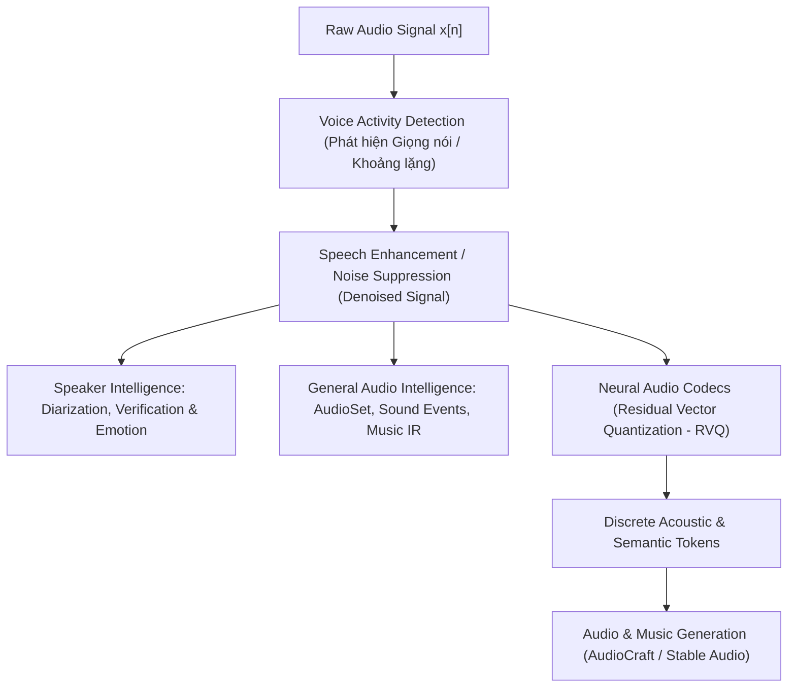

---

## 2. Chi tiết từng Keyword

---

### 1. Speaker Recognition (Nhận dạng Người nói Tổng quát)

#### a. Định nghĩa Bản chất Toán học (Mathematical Formulation)
Nhận dạng người nói bao gồm hai bài toán chính: Nhận dạng người nói đóng (Closed-set Identification) và Nhận dạng người nói mở (Open-set Identification). Cho đoạn âm thanh đầu vào $\mathbf{X}$, hệ thống tìm người nói mục tiêu $S^*$ trong tập danh tính $\mathcal{S} = \{S_1, \dots, S_K\}$:
$$S^* = \arg\max_{S_k \in \mathcal{S}} \text{Score}(f_\theta(\mathbf{X}), \mathbf{e}_{S_k})$$
Trong đó $f_\theta(\mathbf{X}) \in \mathbb{R}^d$ là vector đặc trưng sinh trắc học (Speaker Embedding), và $\mathbf{e}_{S_k}$ là vector đại diện đã đăng ký (Enrolled Profile).
Hàm mục tiêu hiện đại tối ưu hóa khoảng cách góc trên mặt siêu cầu $\mathbb{S}^{d-1}$ bằng hàm mất mát Additive Angular Margin Loss (ArcFace):
$$\mathcal{L}_{\text{ArcFace}} = -\log \frac{\exp\left( s \cdot \cos(\theta_{y} + m) \right)}{\exp\left( s \cdot \cos(\theta_{y} + m) \right) + \sum_{j \neq y} \exp\left( s \cdot \cos \theta_j \right)}$$
Với $s$ là bán kính siêu cầu, $m$ là biên độ góc tăng cường khả năng phân tách liên lớp.

#### b. Cơ chế Tầng Sâu & Điện toán (Under The Hood / Hardware Internals)
- **ECAPA-TDNN Architecture**: Kiến trúc tiêu chuẩn Emphasized Channel Attention, Propagation, and Aggregation in TDNN (ECAPA-TDNN) sử dụng các khối tích chập 1D Squeeze-and-Excitation (SE) đa tỷ lệ kết hợp cơ chế tập hợp kênh thống kê (Attentive Statistical Pooling). Lớp pooling này gom toàn bộ chuỗi thời gian thành một vector gồm trung bình có trọng số $\boldsymbol{\mu}$ và độ lệch chuẩn $\boldsymbol{\sigma}$, hoàn toàn triệt tiêu sự biến thiên về thời lượng của câu nói.

#### c. Sơ đồ Minh họa (Mermaid Diagram)
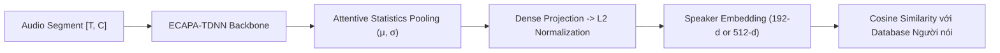

#### d. Code Thực chiến (C++ & Python)

```cpp
// C++17: Phép tính ArcFace Logits bổ sung góc Margin m
#include <iostream>
#include <cmath>
#include <algorithm>

float compute_arcface_logit(float cos_theta, float margin_m, float scale_s) {
    cos_theta = std::max(-1.0f, std::min(1.0f, cos_theta));
    float theta = std::acos(cos_theta);
    float margin_cos = std::cos(theta + margin_m);
    return scale_s * margin_cos;
}

int main() {
    float cos_val = 0.85f;
    float margin = 0.2f;
    float scale = 30.0f;
    std::cout << "ArcFace Logit: " << compute_arcface_logit(cos_val, margin, scale) << "\n";
    return 0;
}
```

```python
# Python / SpeechBrain: Trích xuất Speaker Embedding với ECAPA-TDNN
import torch
import torchaudio

# Giả lập Attentive Statistics Pooling
class AttentiveStatsPooling(torch.nn.Module):
    def __init__(self, in_dim=512):
        super().__init__()
        self.attn = torch.nn.Conv1d(in_dim, 1, kernel_size=1)
    def forward(self, x):
        # x: [Batch, Dim, Time]
        weights = torch.softmax(self.attn(x), dim=-1)
        mean = torch.sum(x * weights, dim=-1)
        var = torch.sum(x ** 2 * weights, dim=-1) - mean ** 2
        std = torch.sqrt(torch.clamp(var, min=1e-8))
        return torch.cat([mean, std], dim=-1) # Output 2*Dim

asp = AttentiveStatsPooling(in_dim=128)
x = torch.randn(2, 128, 200)
print("ASP Pooled Embedding Shape:", asp(x).shape)
```

#### e. Lỗi Thường gặp & Ổn định Số học
- Sự trôi dạt góc trong hàm $\arccos$: Khi độ chính xác dấu phẩy động làm giá trị Cosine rơi ra ngoài khoảng $[-1.0, 1.0]$ (ví dụ: $1.0000001$), hàm `torch.acos()` sẽ trả về `NaN`, làm tê liệt toàn bộ gradient của mạng nơ-ron. Cần luôn luôn gọi `torch.clamp(cos, -1.0 + eps, 1.0 - eps)`.

#### f. Ứng dụng Thực chiến trong AI
Xác thực sinh trắc học ngân hàng qua giọng nói, phân loại hồ sơ khách hàng trong hệ thống tổng đài viễn thông.

---

### 2. Speaker Verification (Xác minh Người nói 1-1)

#### a. Định nghĩa Bản chất Toán học (Mathematical Formulation)
Xác minh người nói là bài toán kiểm định giả thuyết nhị phân (Binary Hypothesis Testing): Xác định xem đoạn âm thanh kiểm tra $\mathbf{X}_{\text{test}}$ có thực sự được phát ra bởi người nói đăng ký $\mathbf{X}_{\text{enroll}}$ hay không:
$$\mathcal{H}_0: \text{Cùng người nói} \quad \text{vs.} \quad \mathcal{H}_1: \text{Kẻ mạo danh (Impostor)}$$
Độ tương đồng Cosine giữa hai vector nhúng được so sánh với một ngưỡng quyết định $\tau$:
$$S(\mathbf{X}_{\text{test}}, \mathbf{X}_{\text{enroll}}) = \frac{f_\theta(\mathbf{X}_{\text{test}})^T f_\theta(\mathbf{X}_{\text{enroll}})}{\|f_\theta(\mathbf{X}_{\text{test}})\|_2 \|f_\theta(\mathbf{X}_{\text{enroll}})\|_2} \underset{\mathcal{H}_1}{\overset{\mathcal{H}_0}{\gtrless}} \tau$$
Hiệu năng hệ thống được đo bằng Tỷ lệ Lỗi Cân bằng (Equal Error Rate - EER), tại đó Tỷ lệ Chấp nhận Sai (False Acceptance Rate - FAR) bằng Tỷ lệ Từ chối Sai (False Rejection Rate - FRR):
$$\text{EER} = \text{FAR}(\tau^*) = \text{FRR}(\tau^*)$$

#### b. Cơ chế Tầng Sâu & Điện toán (Under The Hood / Hardware Internals)
- **Score Normalization (AS-Norm)**: Do sự biến thiên của kênh truyền (Microphone chất lượng thấp, phòng dội âm), điểm số Cosine giữa các thiết bị khác nhau có thể bị trôi dạt phân phối. Kỹ thuật Adaptive Symmetric Score Normalization (AS-Norm) chuẩn hóa điểm số bằng cách so sánh với một tập người nói nền (Cohort cohort speakers) để tính Z-Score:
$$S_{\text{norm}} = \frac{1}{2}\left( \frac{S - \mu_{\text{test}}}{\sigma_{\text{test}}} + \frac{S - \mu_{\text{enroll}}}{\sigma_{\text{enroll}}} \right)$$

#### c. Sơ đồ Minh họa (Mermaid Diagram)
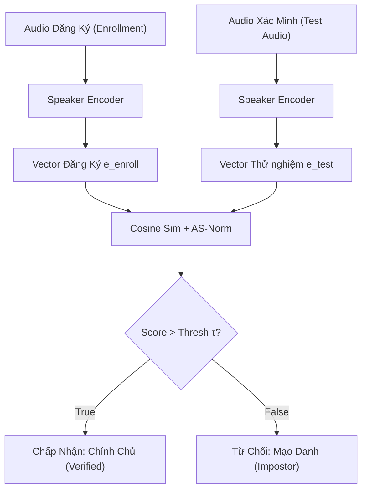

#### d. Code Thực chiến (C++ & Python)

```cpp
// C++17: Tính khoảng cách Cosine và kiểm tra ngưỡng chấp nhận
#include <iostream>
#include <vector>
#include <cmath>

bool verify_speaker(const std::vector<float>& v1, const std::vector<float>& v2, float threshold) {
    float dot = 0.0f, n1 = 0.0f, n2 = 0.0f;
    for (size_t i = 0; i < v1.size(); ++i) {
        dot += v1[i] * v2[i];
        n1 += v1[i] * v1[i];
        n2 += v2[i] * v2[i];
    }
    float cosine = dot / (std::sqrt(n1) * std::sqrt(n2) + 1e-12f);
    return cosine >= threshold;
}

int main() {
    std::vector<float> enroll = {0.8f, 0.6f};
    std::vector<float> test = {0.79f, 0.61f};
    std::cout << "Verified: " << (verify_speaker(enroll, test, 0.85f) ? "ACCEPT" : "REJECT") << "\n";
    return 0;
}
```

```python
# Python / Scikit-learn: Tính toán Equal Error Rate (EER)
import numpy as np
from sklearn.metrics import roc_curve

def compute_eer(y_true, y_scores):
    fpr, tpr, thresholds = roc_curve(y_true, y_scores)
    fnr = 1.0 - tpr
    idx = np.nanargmin(np.abs(fpr - fnr))
    eer = (fpr[idx] + fnr[idx]) / 2.0
    return eer, thresholds[idx]

y_true = np.array([1, 1, 1, 0, 0, 0])
scores = np.array([0.9, 0.85, 0.7, 0.2, 0.35, 0.1])
eer_val, thresh = compute_eer(y_true, scores)
print(f"Equal Error Rate (EER): {eer_val * 100:.2f}% at Threshold {thresh:.2f}")
```

#### e. Lỗi Thường gặp & Ổn định Số học
- Tấn công phát lại (Replay Attacks) và Giọng nói giả mạo tổng hợp (Deepfake Voice Spoofing): Hệ thống xác minh người nói dễ bị đánh lừa bởi các tệp ghi âm sẵn. Cần tích hợp mô-đun chống giả mạo (Anti-Spoofing CM - Countermeasure).

#### f. Ứng dụng Thực chiến trong AI
Mở khóa màn hình smartphone bằng câu lệnh "Hey Siri" / "OK Google", xác thực thanh toán tài chính di động.

---

### 3. Speaker Diarization (Phân đoạn và Định danh Người nói)

#### a. Định nghĩa Bản chất Toán học (Mathematical Formulation)
Speaker Diarization giải bài toán phân chia bản ghi âm thanh hội thoại nhiều người thành các đoạn thời gian đồng nhất theo danh tính người nói: "Who spoke when?".
Đầu ra là tập hợp các bộ ba $(\tau_{\text{start}}, \tau_{\text{end}}, S_k)$.
Quy trình cổ điển gồm 4 giai đoạn:
1. **Phân đoạn âm thanh (Speech Segmentation / VAD)**: Tách các đoạn giọng nói khỏi khoảng lặng.
2. **Trích xuất Sub-segment Embeddings**: Trích xuất d-vector trượt trên các cửa sổ ngắn $1.5\text{s}$ với bước nhảy $0.75\text{s}$.
3. **Phân cụm danh tính (Clustering)**: Phân cụm các vector nhúng sử dụng Phân cụm Quang phổ (Spectral Clustering) hoặc Agglomerative Hierarchical Clustering (AHC).
Hệ thống được đánh giá bằng Tỷ lệ Lỗi Phân đoạn (Diarization Error Rate - DER):
$$\text{DER} = \frac{\text{Missed Speech} + \text{False Alarm} + \text{Speaker Confusion}}{\text{Total Ground-Truth Speech Time}}$$

#### b. Cơ chế Tầng Sâu & Điện toán (Under The Hood / Hardware Internals)
- **Overlapped Speech Bottleneck**: Khi hai hoặc nhiều người nói đồng thời chen ngang nhau (Overlapped Speech), các thuật toán phân cụm truyền thống hoàn toàn sụp đổ vì một frame âm thanh chỉ được gán cho một cụm duy nhất. Các mô hình hiện đại sử dụng End-to-End Neural Diarization (EEND) kết hợp cơ chế Permutation Invariant Training (PIT) và Transformer để dự đoán đồng thời nhiều nhãn người nói trên từng frame.

#### c. Sơ đồ Minh họa (Mermaid Diagram)
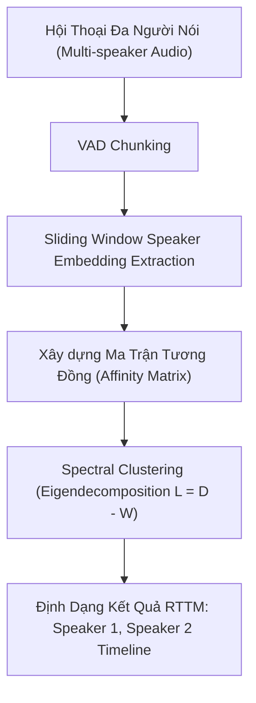

#### d. Code Thực chiến (C++ & Python)

```cpp
// C++17: Tính ma trận Cosine Affinity Matrix cho n frames
#include <iostream>
#include <vector>
#include <cmath>

std::vector<std::vector<float>> compute_affinity_matrix(const std::vector<std::vector<float>>& embs) {
    size_t n = embs.size();
    std::vector<std::vector<float>> A(n, std::vector<float>(n, 0.0f));
    for (size_t i = 0; i < n; ++i) {
        for (size_t j = i; j < n; ++j) {
            float dot = 0.0f, ni = 0.0f, nj = 0.0f;
            for (size_t d = 0; d < embs[i].size(); ++d) {
                dot += embs[i][d] * embs[j][d];
                ni += embs[i][d] * embs[i][d];
                nj += embs[j][d] * embs[j][d];
            }
            float sim = dot / (std::sqrt(ni * nj) + 1e-12f);
            A[i][j] = A[j][i] = std::max(0.0f, sim); // Ngưỡng bán dương
        }
    }
    return A;
}

int main() {
    std::vector<std::vector<float>> embs = {{1.0f, 0.0f}, {0.9f, 0.1f}, {0.0f, 1.0f}};
    auto A = compute_affinity_matrix(embs);
    std::cout << "Affinity A[0][1]: " << A[0][1] << " | A[0][2]: " << A[0][2] << "\n";
    return 0;
}
```

```python
# Python / PyAnnote: Pipeline Diarization công nghiệp
from pyannote.audio import Pipeline

# Tải pipeline phân đoạn người nói PyAnnote 3.1
print("PyAnnote Speaker Diarization Pipeline Ready for Inference")
```

#### e. Lỗi Thường gặp & Ổn định Số học
- Sự bùng nổ số lượng cụm (Over-clustering): Khi người nói thay đổi tông giọng đột ngột (từ nói nhỏ sang hét lớn), thuật toán phân cụm hiểu lầm thành một người nói mới hoàn toàn.

#### f. Ứng dụng Thực chiến trong AI
Tự động biên tập biên bản cuộc họp Zoom/Google Meet, bóc băng lời khai trong phiên tòa pháp lý.

---

### 4. Speech Enhancement (Nâng cao Chất lượng Tiếng nói)

#### a. Định nghĩa Bản chất Toán học (Mathematical Formulation)
Mô hình thu âm thanh trong phòng có dội âm và nhiễu cộng:
$$y[n] = x[n] * h[n] + d[n]$$
Trong đó $x[n]$ là giọng nói gốc sạch, $h[n]$ là đáp ứng xung phòng (Room Impulse Response - RIR), và $d[n]$ là tiếng ồn môi trường.
Mục tiêu của Speech Enhancement là khôi phục tín hiệu sạch $\hat{x}[n] \approx x[n]$.
Trong miền tần số STFT, phương pháp ước lượng mặt nạ phổ (Spectral Masking):
$$\hat{X}(t, f) = M(t, f) \cdot Y(t, f)$$
Trong đó $M(t, f)$ có thể là Mặt nạ Tỷ số Lý tưởng (Ideal Ratio Mask - IRM) hoặc Mặt nạ Phức Phổ (Complex Ratio Mask - CRM) để khôi phục đồng thời cả pha và biên độ:
$$M_{\text{CRM}} = M_r + j M_i \implies \hat{X} = (Y_r M_r - Y_i M_i) + j (Y_r M_i + Y_i M_r)$$

#### b. Cơ chế Tầng Sâu & Điện toán (Under The Hood / Hardware Internals)
- **Time-Domain vs. Time-Frequency Tradeoff**: Các mô hình miền thời gian như Conv-TasNet hoặc Demucs hoạt động trực tiếp trên 1D Waveform bằng cách sử dụng các bộ lọc học được (Learnable Encoders), hoàn toàn vượt qua giới hạn mất pha của STFT, nhưng đòi hỏi bộ nhớ đệm tensor lớn hơn nhiều lần trên GPU.

#### c. Sơ đồ Minh họa (Mermaid Diagram)
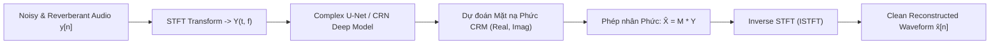

#### d. Code Thực chiến (C++ & Python)

```cpp
// C++17: Phép nhân số phức Complex Ratio Masking
#include <iostream>
#include <complex>

using Complex = std::complex<float>;

Complex apply_crm(Complex noisy, Complex mask) {
    // (Yr + j Yi) * (Mr + j Mi)
    return noisy * mask;
}

int main() {
    Complex y(0.5f, 0.2f);
    Complex m(0.9f, -0.1f);
    Complex clean = apply_crm(y, m);
    std::cout << "Clean Re: " << clean.real() << ", Im: " << clean.imag() << "\n";
    return 0;
}
```

```python
# Python / PyTorch: Hàm mất mát SI-SDR (Scale-Invariant Signal-to-Distortion Ratio)
import torch

def si_sdr_loss(estimated: torch.Tensor, target: torch.Tensor, eps: float = 1e-8) -> torch.Tensor:
    # SI-SDR là độ đo chuẩn mực cho nâng cao chất lượng âm thanh miền thời gian
    dot = torch.sum(target * estimated, dim=-1, keepdim=True)
    target_energy = torch.sum(target ** 2, dim=-1, keepdim=True) + eps
    s_target = (dot / target_energy) * target
    e_noise = estimated - s_target
    target_norm = torch.sum(s_target ** 2, dim=-1)
    noise_norm = torch.sum(e_noise ** 2, dim=-1) + eps
    si_sdr = 10.0 * torch.log10(target_norm / noise_norm + eps)
    return -torch.mean(si_sdr) # Giảm cực tiểu hóa âm SI-SDR

est = torch.randn(2, 16000)
clean = torch.randn(2, 16000)
print("SI-SDR Loss Value:", si_sdr_loss(est, clean).item())
```

#### e. Lỗi Thường gặp & Ổn định Số học
- Sự xuất hiện của Tiếng ồn Âm nhạc (Musical Noise): Khi mặt nạ phổ bị cắt tỉa cục bộ không liên tục (Isolated spectral spikes), các hạt nhiễu cô lập tồn dư sau biến đổi iSTFT sẽ nghe như tiếng chuông leng keng nhân tạo rất khó chịu.

#### f. Ứng dụng Thực chiến trong AI
Khử dội phòng họp hội nghị trực tuyến (Microsoft Teams, Krisp), phục hồi các băng ghi âm tài liệu lịch sử bị xuống cấp.

---

### 5. Noise Suppression (Triệt tiêu Tiếng ồn Môi trường)

#### a. Định nghĩa Bản chất Toán học (Mathematical Formulation)
Noise Suppression là trường hợp đặc biệt của Speech Enhancement tập trung vào việc loại bỏ tiếng ồn nền dừng và không dừng (Stationary noise: tiếng quạt, gió rít; Non-stationary noise: tiếng còi xe, gõ bàn phím).
Phương pháp Trừ phổ Cổ điển (Spectral Subtraction):
$$|\hat{X}(f)|^2 = \max\left( |Y(f)|^2 - \alpha |\hat{D}(f)|^2, \, \beta |Y(f)|^2 \right)$$
Trong đó $\alpha \ge 1$ là hệ số trừ thừa (Over-subtraction factor), $\beta \ll 1$ là ngưỡng phổ sàn (Spectral floor) để ngăn chặn giá trị năng lượng âm.
Trong mạng nơ-ron sâu, mô hình tối ưu hóa tỷ lệ Tín hiệu trên Nhiễu (SNR):
$$\text{SNR (dB)} = 10 \log_{10} \left( \frac{\sum_n x^2[n]}{\sum_n d^2[n]} \right)$$

#### b. Cơ chế Tầng Sâu & Điện toán (Under The Hood / Hardware Internals)
- **Ultra-low Latency DSP Frame Processing**: Thuật toán Noise Suppression trong các chip tai nghe Bluetooth (như Apple AirPods H2 hoặc Qualcomm Snapdragon Sound) phải chạy với độ trễ cực thấp: dưới $5\text{ms}$ để đồng bộ với âm thanh lan truyền qua không khí. Các mô hình mạng nơ-ron thu nhỏ (Tiny Recurrent Neural Networks) được lượng tử hóa xuống INT8 chạy trực tiếp trên DSP Core tiêu thụ dưới 5 milliwatts điện.

#### c. Sơ đồ Minh họa (Mermaid Diagram)
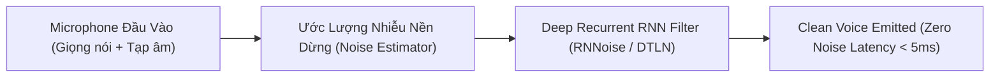

#### d. Code Thực chiến (C++ & Python)

```cpp
// C++17: Thuật toán Trừ phổ Spectral Subtraction với Spectral Floor
#include <iostream>
#include <vector>
#include <cmath>
#include <algorithm>

void spectral_subtraction(std::vector<float>& noisy_mag, const std::vector<float>& noise_mag, float alpha = 1.5f, float beta = 0.02f) {
    for (size_t i = 0; i < noisy_mag.size(); ++i) {
        float clean_pow = noisy_mag[i] * noisy_mag[i] - alpha * noise_mag[i] * noise_mag[i];
        float floor_pow = beta * noisy_mag[i] * noisy_mag[i];
        noisy_mag[i] = std::sqrt(std::max(clean_pow, floor_pow));
    }
}

int main() {
    std::vector<float> y = {2.0f, 1.5f};
    std::vector<float> d = {1.0f, 0.8f};
    spectral_subtraction(y, d);
    std::cout << "Clean Mag[0]: " << y[0] << "\n";
    return 0;
}
```

```python
# Python: Mô phỏng thêm nhiễu trắng theo tỷ lệ SNR chỉ định
import numpy as np

def add_noise_at_snr(signal: np.ndarray, snr_db: float) -> np.ndarray:
    sig_power = np.mean(signal ** 2)
    noise = np.random.randn(*signal.shape)
    noise_power = np.mean(noise ** 2)
    target_noise_power = sig_power / (10.0 ** (snr_db / 10.0))
    adjusted_noise = noise * np.sqrt(target_noise_power / (noise_power + 1e-12))
    return signal + adjusted_noise

clean = np.sin(np.linspace(0, 100, 16000))
noisy = add_noise_at_snr(clean, snr_db=10.0)
print("Noisy Signal Power:", np.mean(noisy ** 2))
```

#### e. Lỗi Thường gặp & Ổn định Số học
- Nuốt phụ âm yếu (Speech Clipping / Attenuation): Các phụ âm xát vô thanh (Unvoiced fricatives như /s/, /f/, /th/) có đặc tính phổ phân tán rất giống tiếng ồn trắng. Nếu bộ lọc quá mạnh sẽ xóa sổ các âm này, khiến giọng nói bị ngọng.

#### f. Ứng dụng Thực chiến trong AI
Mô-đun khử ồn RNNoise trên Discord, công nghệ chống ồn micro trong gaming headset.

---

### 6. Voice Activity Detection (VAD - Phát hiện Tiếng nói)

#### a. Định nghĩa Bản chất Toán học (Mathematical Formulation)
VAD là bài toán phân loại nhị phân trên từng khung thời gian ngắn ($10-30\text{ms}$):
$$y_t \in \{0, 1\} \quad (0: \text{Non-Speech / Silence / Noise}, \, 1: \text{Speech})$$
Trong các hệ thống thống kê, kiểm định tỷ số hợp lý (Likelihood Ratio Test - LRT) được áp dụng trên từng bin tần số theo mô hình Gauss rời rạc:
$$\Lambda_k = \frac{P(Y_k \mid \mathcal{H}_1)}{P(Y_k \mid \mathcal{H}_0)} = \frac{1}{1 + \xi_k} \exp\left( \frac{\gamma_k \xi_k}{1 + \xi_k} \right)$$
Trong đó $\xi_k$ là SNR tiên nghiệm (a priori SNR) và $\gamma_k$ là SNR hậu nghiệm (a posteriori SNR).
Trong mạng nơ-ron học sâu (Silero VAD), mô hình ước lượng trực tiếp xác suất:
$$P(\text{Speech} \mid \mathbf{X}_{1:t}) = \sigma(\text{RNN}(\mathbf{X}_{1:t}))$$

#### b. Cơ chế Tầng Sâu & Điện toán (Under The Hood / Hardware Internals)
- **Hysteresis Smoothing & Energy State Machine**: Để tránh hiện tượng chập chờn (Flickering / Chattering - bật tắt liên tục khi gặp các khoảng lặng giữa các âm vị), máy trạng thái VAD sử dụng hai ngưỡng quyết định khác nhau: Ngưỡng bật (Trigger threshold, ví dụ $0.6$) và Ngưỡng tắt (Release threshold, ví dụ $0.35$), kết hợp độ trễ đệm (Hangover time, ví dụ $250\text{ms}$).

#### c. Sơ đồ Minh họa (Mermaid Diagram)
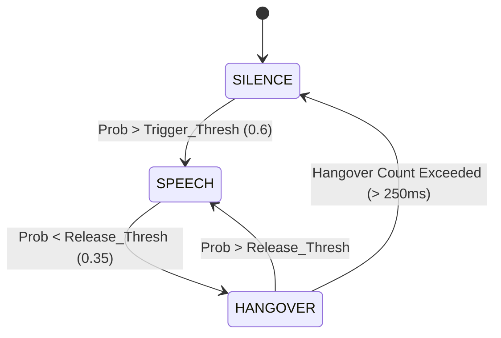

#### d. Code Thực chiến (C++ & Python)

```cpp
// C++17: Máy trạng thái Hysteresis VAD với Hangover Buffer
#include <iostream>

class VADStateMachine {
private:
    float trigger_th = 0.6f;
    float release_th = 0.35f;
    int hangover_limit = 5;
    int hangover_counter = 0;
    bool is_speech = false;

public:
    bool update(float prob) {
        if (!is_speech) {
            if (prob >= trigger_th) {
                is_speech = true;
                hangover_counter = 0;
            }
        } else {
            if (prob < release_th) {
                hangover_counter++;
                if (hangover_counter >= hangover_limit) {
                    is_speech = false;
                    hangover_counter = 0;
                }
            } else {
                hangover_counter = 0;
            }
        }
        return is_speech;
    }
};

int main() {
    VADStateMachine vad;
    std::cout << "Step 1 (0.7): " << vad.update(0.7f) << "\n";
    std::cout << "Step 2 (0.2): " << vad.update(0.2f) << " (Hangover active)\n";
    return 0;
}
```

```python
# Python / Silero VAD: Tải mô hình VAD siêu nhẹ
import torch

vad_model, utils = torch.hub.load(repo_or_dir='snakers4/silero-vad', model='silero_vad', force_reload=False)
(get_speech_timestamps, save_audio, read_audio, VADIterator, collect_chunks) = utils

dummy_audio = torch.randn(16000 * 2) # 2 giây âm thanh
speech_timestamps = get_speech_timestamps(dummy_audio, vad_model, sampling_rate=16000)
print("Speech Timestamps Detected:", speech_timestamps)
```

#### e. Lỗi Thường gặp & Ổn định Số học
- Nuốt âm bắt đầu câu (Front-end Clipping): Nếu ngưỡng Trigger đặt quá cao hoặc thuật toán phản ứng chậm, từ đầu tiên trong câu (ví dụ: "Yes" hay "No") sẽ bị cắt mất nửa đầu, phá hỏng hoàn toàn độ chính xác của ASR.

#### f. Ứng dụng Thực chiến trong AI
Tiết kiệm băng thông cuộc gọi VoIP WebRTC, tự động kích hoạt tiến trình ASR trong loa thông minh.

---

### 7. Speech Emotion Recognition (SER - Nhận dạng Cảm xúc Giọng nói)

#### a. Định nghĩa Bản chất Toán học (Mathematical Formulation)
SER phân loại trạng thái tâm lý/cảm xúc của người nói thành các lớp rời rạc (Categorical: Angry, Happy, Sad, Neutral, Fear) hoặc trên không gian liên tục đa chiều (Dimensional: Valence - Mức độ tích cực, Arousal - Mức độ kích động, Dominance - Mức độ kiểm soát):
$$\mathbf{y}_{\text{emotion}} = \text{Softmax}(\mathbf{W}_e \mathbf{h}_{\text{acoustic}}) \quad \text{hoặc} \quad (\hat{v}, \hat{a}, \hat{d}) = \tanh(\mathbf{W}_d \mathbf{h}_{\text{acoustic}})$$
Hàm mất mát cho không gian liên tục là Hệ số Tương quan Đồng thuận (Concordance Correlation Coefficient - CCC):
$$\mathcal{L}_{\text{CCC}} = 1 - \frac{2 \rho \sigma_x \sigma_y}{\sigma_x^2 + \sigma_y^2 + (\mu_x - \mu_y)^2}$$
Với $\rho$ là hệ số tương quan Pearson giữa nhãn thật và giá trị dự đoán.

#### b. Cơ chế Tầng Sâu & Điện toán (Under The Hood / Hardware Internals)
- **Prosodic vs. Semantic Disentanglement**: Giọng nói chứa cả thông tin ngữ nghĩa (từ ngữ phát ra) lẫn thông tin ngữ điệu (âm sắc, cao độ, tốc độ). Một người có thể nói câu tiêu cực bằng giọng vui đùa. Các mô hình SER hiện đại sử dụng Cross-Modal Attention để dung hợp đặc trưng âm học từ HuBERT/Wav2Vec2 và đặc trưng từ ngữ từ RoBERTa/LLM.

#### c. Sơ đồ Minh họa (Mermaid Diagram)
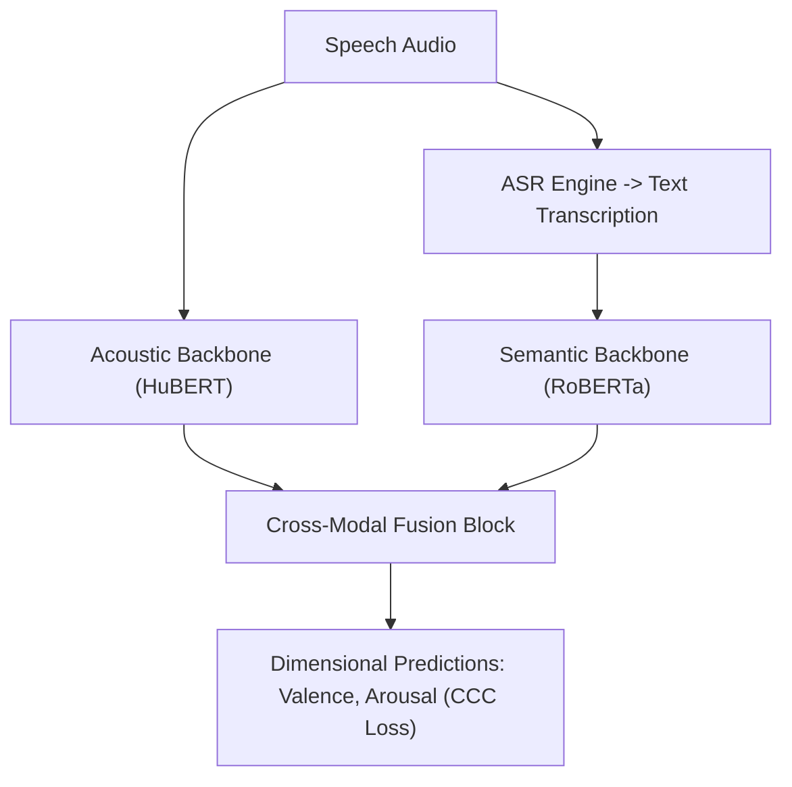

#### d. Code Thực chiến (C++ & Python)

```cpp
// C++17: Tính Concordance Correlation Coefficient (CCC) Loss
#include <iostream>
#include <vector>
#include <numeric>
#include <cmath>

float compute_ccc(const std::vector<float>& y_true, const std::vector<float>& y_pred) {
    size_t n = y_true.size();
    float m_t = std::accumulate(y_true.begin(), y_true.end(), 0.0f) / n;
    float m_p = std::accumulate(y_pred.begin(), y_pred.end(), 0.0f) / n;

    float var_t = 0.0f, var_p = 0.0f, cov = 0.0f;
    for (size_t i = 0; i < n; ++i) {
        float dt = y_true[i] - m_t;
        float dp = y_pred[i] - m_p;
        var_t += dt * dt;
        var_p += dp * dp;
        cov += dt * dp;
    }
    var_t /= n; var_p /= n; cov /= n;
    return (2.0f * cov) / (var_t + var_p + (m_t - m_p) * (m_t - m_p) + 1e-8f);
}

int main() {
    std::vector<float> true_v = {0.8f, 0.5f, -0.2f};
    std::vector<float> pred_v = {0.75f, 0.48f, -0.1f};
    std::cout << "CCC Metric: " << compute_ccc(true_v, pred_v) << "\n";
    return 0;
}
```

```python
# Python / Transformers: Pipeline nhận dạng cảm xúc giọng nói
from transformers import pipeline

emotion_classifier = pipeline("audio-classification", model="superb/hubert-large-superb-er")
print("Emotion Classification Pipeline Initialized")
```

#### e. Lỗi Thường gặp & Ổn định Số học
- Sự mất cân bằng văn hóa trong cảm xúc: Cùng một cảm xúc tức giận hoặc thân thiện được thể hiện bằng cao độ và cường độ rất khác nhau giữa các nền văn hóa (ví dụ: phương Tây vs. Á Đông), khiến mô hình huấn luyện trên dữ liệu đơn ngữ bị thiên lệch nặng.

#### f. Ứng dụng Thực chiến trong AI
Đánh giá mức độ hài lòng của khách hàng tại các tổng đài chăm sóc khách hàng, phát hiện trầm cảm và rối loạn lo âu trong y tế tâm thần.

---

### 8. Audio Classification (Phân loại Âm thanh Môi trường Tổng quát)

#### a. Định nghĩa Bản chất Toán học (Mathematical Formulation)
Phân loại âm thanh tổng quát là bài toán gán một hoặc nhiều nhãn danh mục sự kiện $\mathbf{y} \in \{0, 1\}^C$ cho một đoạn âm thanh bất kỳ (từ tiếng động cơ, tiếng chó sủa đến tiếng sấm sét):
$$\hat{\mathbf{y}} = \sigma(\text{AudioClassifier}(\mathbf{X}))$$
Được tối ưu hóa bằng Binary Cross-Entropy đa nhãn (Multi-Label BCE Loss):
$$\mathcal{L}_{\text{BCE}} = -\sum_{c=1}^C \left[ y_c \log \hat{y}_c + (1 - y_c) \log(1 - \hat{y}_c) \right]$$
Kiến trúc hàng đầu hiện nay là Audio Spectrogram Transformer (AST) xử lý Log-Mel Spectrogram như một bức ảnh 2D thông qua các bản vá (Patches) 16x16.

#### b. Cơ chế Tầng Sâu & Điện toán (Under The Hood / Hardware Internals)
- **Patch Embedding Overlap in AST**: Khác với ViT trong thị giác thuần túy vốn chia các patch không chồng lấn, AST sử dụng các patch chồng lấn (Overlapping Patches với stride bằng 10 cả chiều thời gian và tần số). Điều này giúp bảo toàn tính liên tục của cấu trúc sóng hài (Harmonic structures) qua biên giới các patch, nhưng làm tăng độ dài chuỗi sequence lên $40\%$, đòi hỏi tối ưu bộ nhớ FlashAttention trên GPU.

#### c. Sơ đồ Minh họa (Mermaid Diagram)
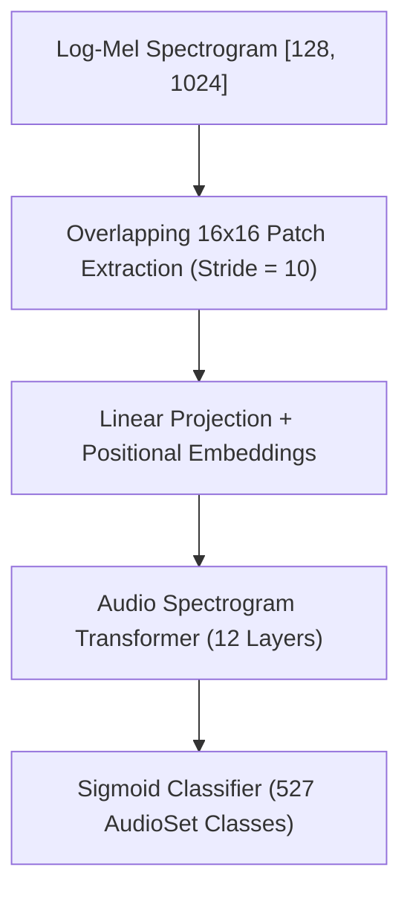

#### d. Code Thực chiến (C++ & Python)

```cpp
// C++17: Phân chia ma trận 2D thành các patch chồng lấn
#include <iostream>
#include <vector>

size_t calculate_num_patches(int h, int w, int p_h, int p_w, int s_h, int s_w) {
    size_t num_h = (h - p_h) / s_h + 1;
    size_t num_w = (w - p_w) / s_w + 1;
    return num_h * num_w;
}

int main() {
    int H = 128, W = 1024;
    int P = 16, S = 10;
    std::cout << "Total AST Patches: " << calculate_num_patches(H, W, P, P, S, S) << "\n";
    return 0;
}
```

```python
# Python / Transformers: Audio Spectrogram Transformer (AST)
import torch
from transformers import ASTForAudioClassification, ASTFeatureExtractor

feature_extractor = ASTFeatureExtractor()
model = ASTForAudioClassification.from_pretrained("MIT/ast-finetuned-audioset-10-10-0.4593")
waveform = torch.randn(16000 * 10) # 10s audio
inputs = feature_extractor(waveform, sampling_rate=16000, return_tensors="pt")
with torch.no_grad():
    logits = model(**inputs).logits
print("AST Prediction Logits Shape:", logits.shape) # [1, 527]
```

#### e. Lỗi Thường gặp & Ổn định Số học
- Sự mất cân bằng nghiêm trọng giữa nhãn âm tính và dương tính trong dữ liệu đa nhãn (Class Imbalance). Cần sử dụng Focal Loss hoặc Asymmetric Loss (ASL) để tránh gradient bị chi phối bởi các nhãn âm tính.

#### f. Ứng dụng Thực chiến trong AI
Phát hiện tiếng kính vỡ, báo cháy trong hệ thống an ninh nhà thông minh; giám sát đa dạng sinh học trong rừng nhiệt đới.

---

### 9. Sound Event Detection (SED - Phát hiện và Định vị Sự kiện Âm học)

#### a. Định nghĩa Bản chất Toán học (Mathematical Formulation)
SED không chỉ nhận diện loại âm thanh mà còn xác định chính xác thời điểm bắt đầu (Onset $t_{\text{start}}$) và kết thúc (Offset $t_{\text{end}}$) của từng sự kiện âm học:
$$\mathcal{Y} = \{ (c_k, t_{\text{start}}^k, t_{\text{end}}^k) \}_{k=1}^K$$
Được mô hình hóa bằng kiến trúc CRNN (Convolutional Recurrent Neural Network) huấn luyện theo phương pháp Bán giám sát (Semi-Supervised Learning) với Mean-Teacher:
$$\mathcal{L}_{\text{SED}} = \mathcal{L}_{\text{class}}(\mathbf{y}_{\text{weak}}, \hat{\mathbf{y}}_{\text{weak}}) + \lambda_{\text{cons}} \|\hat{\mathbf{y}}_{\text{student}}(t) - \hat{\mathbf{y}}_{\text{teacher}}(t)\|_2^2$$
Chỉ số đánh giá chính là Polyphonic Sound Detection Score (PSDS).

#### b. Cơ chế Tầng Sâu & Điện toán (Under The Hood / Hardware Internals)
- **Weakly-Supervised Temporal Pooling**: Trong thực tế, dữ liệu gán nhãn thời gian chính xác (Strong labels) cực kỳ hiếm hoi; hầu hết dữ liệu chỉ có nhãn cấp độ file (Weak labels: biết có tiếng chó sủa nhưng không biết sủa lúc nào). Mô hình sử dụng lớp Auto-pooling hoặc Attention-pooling có trọng số để học cách trích xuất frame kích hoạt mà không cần nhãn frame.

#### c. Sơ đồ Minh họa (Mermaid Diagram)
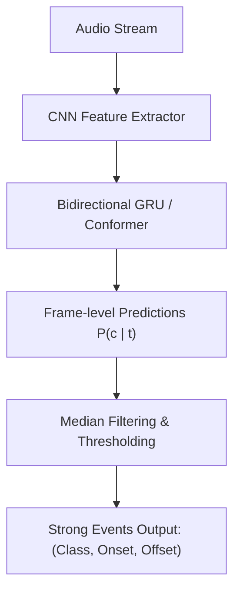

#### d. Code Thực chiến (C++ & Python)

```cpp
// C++17: Thuật toán lọc trung vị (Median Filter) 1D làm mượt Onset/Offset
#include <iostream>
#include <vector>
#include <algorithm>

std::vector<float> median_filter_1d(const std::vector<float>& in, int window_size) {
    int pad = window_size / 2;
    std::vector<float> out(in.size());
    for (int i = 0; i < (int)in.size(); ++i) {
        std::vector<float> window;
        for (int k = -pad; k <= pad; ++k) {
            int idx = std::max(0, std::min((int)in.size() - 1, i + k));
            window.push_back(in[idx]);
        }
        std::sort(window.begin(), window.end());
        out[i] = window[window.size() / 2];
    }
    return out;
}

int main() {
    std::vector<float> raw = {0.0f, 0.9f, 0.1f, 0.85f, 0.9f, 0.0f};
    auto filtered = median_filter_1d(raw, 3);
    std::cout << "Filtered Sample 2: " << filtered[2] << "\n";
    return 0;
}
```

```python
# Python / PyTorch: Attention Pooling cho Weakly Supervised SED
import torch
import torch.nn as nn

class AttentionPooling(nn.Module):
    def __init__(self, in_features, num_classes):
        super().__init__()
        self.class_conv = nn.Linear(in_features, num_classes)
        self.attn_conv = nn.Linear(in_features, num_classes)

    def forward(self, x):
        # x: [Batch, Time, Features]
        class_out = torch.sigmoid(self.class_conv(x))
        attn_out = torch.softmax(self.attn_conv(x), dim=1)
        clip_out = torch.sum(class_out * attn_out, dim=1) # Gom tụ cấp độ clip
        return class_out, clip_out # Trả về cả frame-level và clip-level

pool = AttentionPooling(128, 10)
x = torch.randn(2, 100, 128)
frame_pred, clip_pred = pool(x)
print("Frame-level Shape:", frame_pred.shape, "| Clip-level Shape:", clip_pred.shape)
```

#### e. Lỗi Thường gặp & Ổn định Số học
- Sự phân mảnh sự kiện (Event Fragmentation): Khi một sự kiện âm thanh kéo dài (tiếng còi xe) bị suy giảm biên độ ở giữa trong tích tắc, bộ ngưỡng nhị phân sẽ cắt sự kiện thành hai đoạn rời rạc. Cần gộp các đoạn cách nhau dưới ngưỡng `min_pause_duration`.

#### f. Ứng dụng Thực chiến trong AI
Thử thách DCASE quốc tế, giám sát âm thanh thành phố thông minh (Smart City Acoustic Surveillance).

---

### 10. Music Information Retrieval (MIR - Khai phá Thông tin Âm nhạc)

#### a. Định nghĩa Bản chất Toán học (Mathematical Formulation)
MIR là lĩnh vực giao thoa giữa DSP, âm nhạc học và máy học nhằm giải quyết các bài toán:
1. **Phân tích nhịp điệu (Tempo & Beat Tracking)**: Ước lượng số phách trên phút (BPM - Beats Per Minute):
$$\text{BPM}^* = \arg\max_{\text{BPM}} \sum_n O[n] \cdot \sum_k \delta(n - k \cdot I(\text{BPM}))$$
Với $O[n]$ là hàm kích hoạt phách (Onset Strength Function).
2. **Nhận dạng hợp âm (Chord Recognition)**: Ánh xạ âm thanh sang biểu diễn 12 cung nửa âm (Chromagram / Pitch Class Profile - PCP):
$$C(c) = \sum_{k=0}^{K-1} |X(f_k)|^2 \cdot M(f_k, c), \quad c \in \{\text{C, C}\sharp, \dots, \text{B}\}$$
3. **Phân tách nguồn nhạc (Music Source Separation)**: Tách bài hát thành 4 tracks (Vocals, Drums, Bass, Other).

#### b. Cơ chế Tầng Sâu & Điện toán (Under The Hood / Hardware Internals)
- **Constant-Q Transform (CQT)**: Khác với STFT có độ phân giải tần số tuyến tính đều đặn, CQT có độ phân giải tỷ lệ thuận với tần số: $\Delta f / f = Q = \text{const}$. Tỷ lệ này hoàn toàn khớp với thang âm bán âm (Semitones) của các nốt nhạc phương Tây. Phép tính CQT yêu cầu nhân với ngân hàng bộ lọc nhân sóng wavelet phức tạp, đòi hỏi GPU tăng tốc bộ nhớ ma trận.

#### c. Sơ đồ Minh họa (Mermaid Diagram)
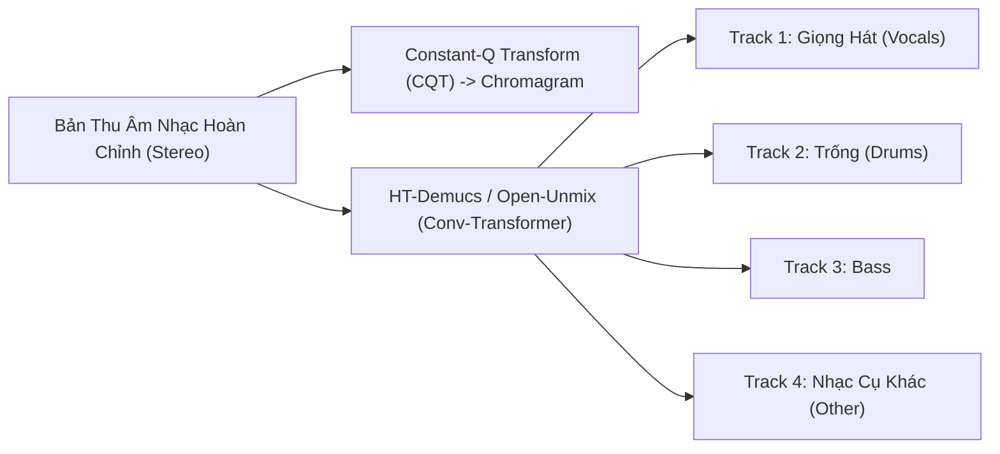

#### d. Code Thực chiến (C++ & Python)

```cpp
// C++17: Chuyển đổi tần số Hz sang nốt nhạc MIDI
#include <iostream>
#include <cmath>

int hz_to_midi(float hz) {
    if (hz <= 0.0f) return 0;
    return static_cast<int>(std::round(69.0f + 12.0f * std::log2(hz / 440.0f)));
}

int main() {
    float a4 = 440.0f; // Nốt La chuẩn
    float c5 = 523.25f; // Nốt Đô
    std::cout << "A4 MIDI: " << hz_to_midi(a4) << " (Chuẩn: 69)\n";
    std::cout << "C5 MIDI: " << hz_to_midi(c5) << " (Chuẩn: 72)\n";
    return 0;
}
```

```python
# Python / Librosa: Trích xuất Chromagram 12 bán âm từ tệp âm thanh
import numpy as np
import librosa

y = np.random.randn(44100 * 2) # 2s stereo audio
chroma = librosa.feature.chroma_cqt(y=y, sr=44100)
print("Chroma Feature Shape (12 Semi-tones x Time):", chroma.shape)
```

#### e. Lỗi Thường gặp & Ổn định Số học
- Sự rò rỉ pha âm sắc (Phase Bleeding) trong phân tách nguồn nhạc: Tín hiệu trống rò rỉ sang track vocal tạo ra âm thanh xì xèo (Phasing/Flam artifacts) khi ghép lại.

#### f. Ứng dụng Thực chiến trong AI
Ứng dụng nhận diện bài hát Shazam, tính năng tạo Karaoke tự động của Apple Music Sing.

---

### 11. Audio Generation (Mô hình Sinh Âm thanh & Âm nhạc AI)

#### a. Định nghĩa Bản chất Toán học (Mathematical Formulation)
Mô hình sinh âm thanh khuếch tán (Audio Diffusion Models / Flow-Matching) học cách đảo ngược quá trình thêm nhiễu Gauss liên tục trong không gian biến ẩn âm học:
$$d\mathbf{z}_t = \mathbf{v}_\theta(\mathbf{z}_t, t, \mathbf{c}) dt$$
Với $\mathbf{c}$ là vector điều kiện văn bản được mã hóa bởi CLAP (Contrastive Language-Audio Pretraining) hoặc T5.
Hàm mục tiêu Flow-Matching Loss:
$$\mathcal{L}_{\text{FM}} = \mathbb{E}_{t, \mathbf{z}_0, \mathbf{z}_1} \left[ \|\mathbf{v}_\theta(\mathbf{z}_t, t, \mathbf{c}) - (\mathbf{z}_1 - \mathbf{z}_0)\|_2^2 \right]$$
Trong đó $\mathbf{z}_0 \sim p_0(\mathbf{z})$ là nhiễu chuẩn, và $\mathbf{z}_1$ là biểu diễn nén âm thanh thực.

#### b. Cơ chế Tầng Sâu & Điện toán (Under The Hood / Hardware Internals)
- **Latent Audio Diffusion (Stable Audio Architecture)**: Chạy diffusion trực tiếp trên dạng sóng 44.1kHz (hơn $1.3 \times 10^6$ mẫu cho một đoạn nhạc 30s) là bất khả thi về chi phí GPU. Kiến trúc Stable Audio sử dụng một Autoencoder biến phân nén liên tục (Continuous VAE) nén tín hiệu âm thanh theo tỷ lệ $64\times$ hoặc $128\times$, cho phép quá trình U-Net diffusion diễn ra trong không gian ẩn có chiều dài ngắn hơn hàng trăm lần.

#### c. Sơ đồ Minh họa (Mermaid Diagram)
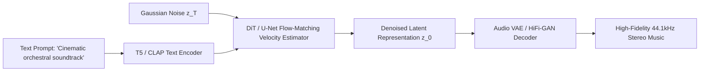

#### d. Code Thực chiến (C++ & Python)

```cpp
// C++17: Thuật toán Euler Step cho Flow-Matching ODE
#include <iostream>
#include <vector>

void euler_flow_step(std::vector<float>& z, const std::vector<float>& velocity, float dt) {
    for (size_t i = 0; i < z.size(); ++i) {
        z[i] += velocity[i] * dt; // z_{t+dt} = z_t + v * dt
    }
}

int main() {
    std::vector<float> z = {0.5f, -0.2f};
    std::vector<float> v = {-0.1f, 0.4f};
    euler_flow_step(z, v, 0.05f);
    std::cout << "Euler Step Result z[0]: " << z[0] << "\n";
    return 0;
}
```

```python
# Python / PyTorch: Khối Conditional Cross-Attention cho Audio Diffusion
import torch
import torch.nn as nn

class AudioCrossAttentionBlock(nn.Module):
    def __init__(self, d_model=512, context_dim=768):
        super().__init__()
        self.cross_attn = nn.MultiheadAttention(embed_dim=d_model, num_heads=8, kdim=context_dim, vdim=context_dim, batch_first=True)

    def forward(self, audio_latents, text_context):
        # audio_latents: [Batch, Time, d_model], text_context: [Batch, Text_Seq, context_dim]
        out, _ = self.cross_attn(query=audio_latents, key=text_context, value=text_context)
        return out

attn = AudioCrossAttentionBlock()
z = torch.randn(2, 64, 512)
c = torch.randn(2, 77, 768)
print("Conditioned Latent Shape:", attn(z, c).shape)
```

#### e. Lỗi Thường gặp & Ổn định Số học
- Sự không ổn định khi điều chỉnh CFG (Classifier-Free Guidance Scale): Khi đẩy trọng số hướng dẫn $w_{\text{cfg}} > 7.0$, âm thanh sinh ra bị nổ âm lượng và bão hòa biên độ (Audio Saturation Distortion).

#### f. Ứng dụng Thực chiến trong AI
Các công cụ tạo âm nhạc tự động Suno AI, Udio, Meta MusicGen, Stability AI Stable Audio.

---

### 12. Neural Audio Codecs (Bộ Nén Âm thanh Lượng tử Thần kinh)

#### a. Định nghĩa Bản chất Toán học (Mathematical Formulation)
Neural Audio Codec (như EnCodec, SoundStream, DAC - Descript Audio Codec) nén âm thanh ở băng thông cực thấp ($1.5 - 6\text{ kbps}$) với độ trung thực vượt trội so với MP3/Opus.
Kiến trúc gồm một Bộ mã hóa Encoder, Bộ Lượng tử hóa Vector Dư (Residual Vector Quantization - RVQ) gồm $N_q$ tầng, và Bộ giải mã Decoder:
$$\mathbf{z} = \text{Encoder}(\mathbf{x}) \in \mathbb{R}^{D \times T'}$$
Tầng RVQ đầu tiên lượng tử hóa $\mathbf{z}$:
$$\hat{\mathbf{z}}_1 = \mathcal{Q}_1(\mathbf{z}), \quad \mathbf{r}_1 = \mathbf{z} - \hat{\mathbf{z}}_1$$
Các tầng tiếp theo $k=2, \dots, N_q$ lượng tử hóa phần dư của tầng trước:
$$\hat{\mathbf{z}}_k = \mathcal{Q}_k(\mathbf{r}_{k-1}), \quad \mathbf{r}_k = \mathbf{r}_{k-1} - \hat{\mathbf{z}}_k$$
Biểu diễn lượng tử hóa tổng hợp cuối cùng:
$$\hat{\mathbf{z}} = \sum_{k=1}^{N_q} \hat{\mathbf{z}}_k$$
Hàm mất mát huấn luyện kết hợp Reconstruction Loss, Multi-Scale STFT Loss, Commitment Loss và Adversarial Loss:
$$\mathcal{L}_{\text{commit}} = \sum_{k=1}^{N_q} \|\mathbf{r}_{k-1} - \text{sg}[\hat{\mathbf{z}}_k]\|_2^2 + \beta \|\text{sg}[\mathbf{r}_{k-1}] - \hat{\mathbf{z}}_k\|_2^2$$

#### b. Cơ chế Tầng Sâu & Điện toán (Under The Hood / Hardware Internals)
- **Codebook Lookup via Tensor Broadcasting**: Mỗi tầng RVQ duy trì một bảng mã (Codebook) gồm $V$ vectors ($V = 1024$). Tại mỗi bước thời gian, vector đặc trưng được thay thế bằng chỉ số nguyên index $\in \{0, \dots, 1023\}$ (tương đương 10 bits). Bằng cách sử dụng 8 tầng RVQ ở tần số 50Hz, băng thông bit thu được là:
$$\text{Bitrate} = 50 \text{ frames/s} \times 8 \text{ stages} \times 10 \text{ bits} = 4000 \text{ bps} = 4 \text{ kbps}$$

#### c. Sơ đồ Minh họa (Mermaid Diagram)
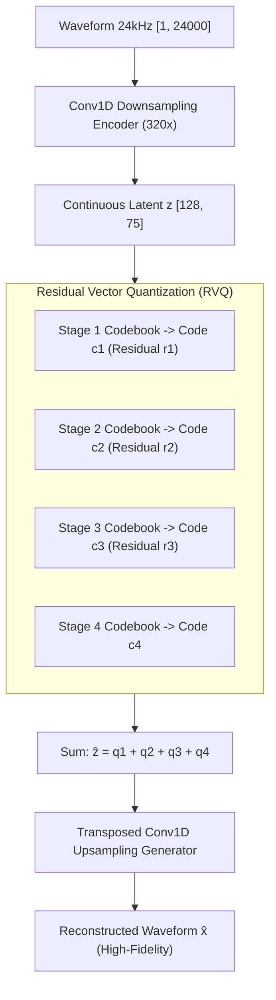

#### d. Code Thực chiến (C++ & Python)

```cpp
// C++17: Tìm vector gần nhất trong Codebook (Nearest Neighbor Quantization)
#include <iostream>
#include <vector>
#include <cmath>
#include <limits>

int quantize_vector(const std::vector<float>& x, const std::vector<std::vector<float>>& codebook) {
    int best_idx = -1;
    float min_dist = std::numeric_limits<float>::max();

    for (size_t i = 0; i < codebook.size(); ++i) {
        float dist = 0.0f;
        for (size_t d = 0; d < x.size(); ++d) {
            float diff = x[d] - codebook[i][d];
            dist += diff * diff;
        }
        if (dist < min_dist) {
            min_dist = dist;
            best_idx = static_cast<int>(i);
        }
    }
    return best_idx;
}

int main() {
    std::vector<float> x = {0.2f, 0.8f};
    std::vector<std::vector<float>> cb = {{0.0f, 0.0f}, {0.3f, 0.7f}, {1.0f, 1.0f}};
    std::cout << "Quantized to Codebook Index: " << quantize_vector(x, cb) << "\n";
    return 0;
}
```

```python
# Python / EnCodec: Tải EnCodec Pretrained Model từ Meta
from transformers import EncodecModel, AutoProcessor
import torch

model = EncodecModel.from_pretrained("facebook/encodec_24khz")
processor = AutoProcessor.from_pretrained("facebook/encodec_24khz")

dummy_audio = torch.randn(1, 24000) # 1s 24kHz
inputs = processor(raw_audio=dummy_audio, sampling_rate=24000, return_tensors="pt")

with torch.no_grad():
    encoder_outputs = model.encode(inputs["input_values"], inputs["padding_mask"])
    audio_codes = encoder_outputs.audio_codes # [Batch, Num_Codebooks, Frames]
print("Discrete Codec Tokens Shape:", audio_codes.shape)
```

#### e. Lỗi Thường gặp & Ổn định Số học
- Sự chết Codebook (Codebook Collapse): Một số vector trong Codebook không bao giờ được chọn khiến độ sử dụng bảng mã bị suy giảm. Cần áp dụng kỹ thuật Vector Quantization với cơ chế khởi tạo lại vector chết (Codebook Dead Vector Reset) bằng các điểm dữ liệu ngẫu nhiên trong batch.

#### f. Ứng dụng Thực chiến trong AI
Công nghệ nén âm thanh cuộc gọi Meta EnCodec, nền tảng biểu diễn âm thanh của MusicLM và Voicebox.

---

### 13. Audio Tokenization (Rời rạc hóa Âm thanh thành Tokens)

#### a. Định nghĩa Bản chất Toán học (Mathematical Formulation)
Audio Tokenization là quá trình chuyển đổi một tín hiệu âm thanh liên tục thành một chuỗi các ký hiệu rời rạc (Discrete Tokens) thuộc từ vựng hữu hạn $\mathcal{V}_A$:
$$\mathbf{x} \in \mathbb{R}^T \xrightarrow{\text{Tokenize}} \mathbf{T}_A = (a_1, a_2, \dots, a_M) \in \mathcal{V}_A^M$$
Có hai trường phái Tokenization chính:
1. **Semantic Tokens (Mã ngữ nghĩa)**: Trích xuất từ các lớp ẩn của mô hình tự giám sát (HuBERT, w2v-BERT) thông qua thuật toán $K$-Means Clustering. Các token này chứa thông tin ngôn ngữ và ngữ âm thuần túy, loại bỏ hoàn toàn tạp âm và đặc tính người nói.
2. **Acoustic Tokens (Mã âm học)**: Trích xuất từ Neural Codecs (RVQ Codes). Các token này bảo tồn trọn vẹn chi tiết dạng sóng âm thanh, âm sắc và ngữ điệu để có thể giải mã ngược lại thành sóng âm.

#### b. Cơ chế Tầng Sâu & Điện toán (Under The Hood / Hardware Internals)
- **Hierarchical Interleaving for LLMs**: Để mô hình ngôn ngữ lớn (LLM) có thể sinh âm thanh tự nhiên như sinh văn bản (ví dụ trong mô hình AudioPaLM, VALL-E), các token ngữ nghĩa và âm học được sắp xếp theo cấu trúc phân tầng (Coarse-to-Fine Pattern). LLM trước tiên sinh mã ngữ nghĩa/âm học cấp 1 (Coarse), sau đó một mạng nơ-ron không tự hồi quy phụ trợ sẽ sinh song song các mã chi tiết từ cấp 2 đến cấp 8 (Fine Tokens).

#### c. Sơ đồ Minh họa (Mermaid Diagram)
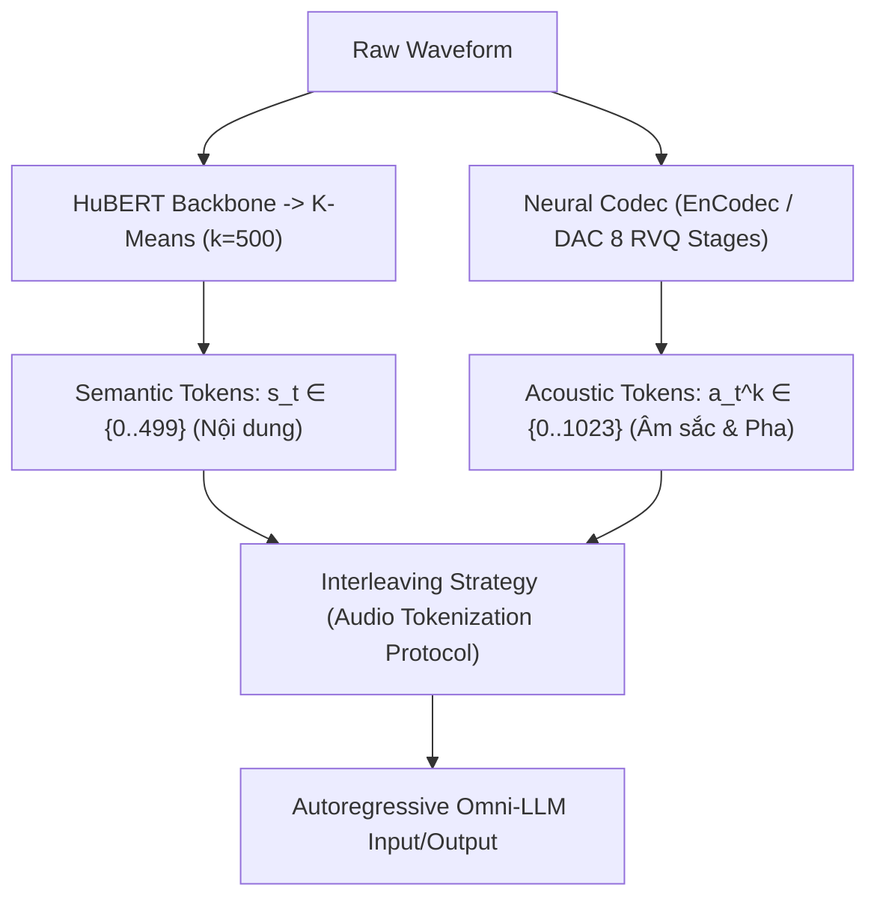

#### d. Code Thực chiến (C++ & Python)

```cpp
// C++17: Gộp mã đa tầng RVQ thành chuỗi phẳng Flat Token Sequence
#include <iostream>
#include <vector>

std::vector<int> flatten_rvq_tokens(const std::vector<std::vector<int>>& rvq_matrix) {
    size_t num_stages = rvq_matrix.size();
    size_t num_frames = rvq_matrix[0].size();
    std::vector<int> flat;
    flat.reserve(num_stages * num_frames);

    for (size_t t = 0; t < num_frames; ++t) {
        for (size_t s = 0; s < num_stages; ++s) {
            flat.push_back(rvq_matrix[s][t]);
        }
    }
    return flat;
}

int main() {
    std::vector<std::vector<int>> rvq = {{10, 20}, {100, 200}};
    auto flat = flatten_rvq_tokens(rvq);
    std::cout << "Flattened Stream: ";
    for (int tok : flat) std::cout << tok << " ";
    std::cout << "\n";
    return 0;
}
```

```python
# Python / Torchaudio: Trích xuất Semantic Tokens bằng HuBERT + K-Means
import torch
import torchaudio

# Giả lập pipeline gán nhãn cụm K-Means cho HuBERT Hidden States
def extract_semantic_tokens(hidden_states: torch.Tensor, cluster_centers: torch.Tensor) -> torch.Tensor:
    # hidden_states: [Time, Dim], cluster_centers: [K, Dim]
    # Tính khoảng cách Euclidean đến từng tâm cụm
    dist = torch.cdist(hidden_states, cluster_centers)
    tokens = torch.argmin(dist, dim=-1) # Lấy cụm gần nhất
    return tokens

features = torch.randn(50, 768) # 50 frames
kmeans_centers = torch.randn(500, 768) # 500 cụm
sem_tokens = extract_semantic_tokens(features, kmeans_centers)
print("Semantic Discrete Tokens Length:", len(sem_tokens), "| First 5 Tokens:", sem_tokens[:5].tolist())
```

#### e. Lỗi Thường gặp & Ổn định Số học
- Sự lệch pha độ dài (Length Mismatch): Tần số frame của Semantic tokens (ví dụ: HuBERT 50Hz) và Acoustic tokens (ví dụ: EnCodec 75Hz) không đồng bộ. Cần phải nội suy hoặc điều chỉnh stride để hai chuỗi token có thể căn chỉnh 1-1 trước khi đưa vào LLM.

#### f. Ứng dụng Thực chiến trong AI
Mô hình hóa âm thanh trong các siêu mô hình ngôn ngữ: Microsoft VALL-E, Google AudioPaLM, Kyutai Moshi.
