# Chuyên đề: Nền tảng Đa phương thức, Dung hợp & Căn chỉnh Biểu diễn (Multimodal Foundations & Fusion)

## 1. Tổng quan Chuyên đề
Trí tuệ Nhân tạo Đa phương thức (Multimodal AI) mở rộng phạm vi của học máy từ việc xử lý các dạng dữ liệu đơn lẻ (Unimodal: chỉ văn bản, chỉ hình ảnh, hoặc chỉ âm thanh) sang việc tiếp nhận, liên kết và suy luận đồng thời trên nhiều phương thức cảm nhận khác nhau của thế giới thực.

Trung tâm của AI Đa phương thức là bài toán biểu diễn học (Representation Learning): làm thế nào để ánh xạ các luồng tín hiệu có cấu trúc hình học và vật lý hoàn toàn khác biệt (ma trận pixel 2D/3D của thị giác, chuỗi token rời rạc 1D của văn bản, dao động áp suất liên tục của âm thanh) vào một Không gian Nhúng Chung (Joint Embedding Space). Các chiến lược dung hợp (Fusion: Early, Late, Intermediate, Cross-Modal Attention) và các cơ chế căn chỉnh đa phương thức (Cross-Modal Alignment, Contrastive Learning) đóng vai trò là chiếc cầu nối toán học giúp cỗ máy AI đồng hóa tri thức xuyên suốt các giác quan.

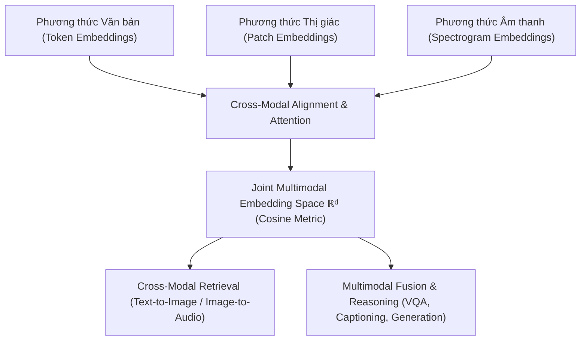

---

## 2. Chi tiết từng Keyword

---

### 1. Multimodal Learning (Học Đa phương thức Tổng quát)

#### a. Định nghĩa Bản chất Toán học (Mathematical Formulation)
Học Đa phương thức là bài toán tối ưu hóa phân phối đồng thời hoặc phân phối điều kiện của tập hợp $M$ phương thức dữ liệu $\mathcal{M} = \{m_1, m_2, \dots, m_M\}$:
$$P(y \mid \mathbf{x}_{m_1}, \mathbf{x}_{m_2}, \dots, \mathbf{x}_{m_M}) \quad \text{hoặc} \quad P(\mathbf{x}_{m_1}, \mathbf{x}_{m_2}, \dots, \mathbf{x}_{m_M})$$
Theo lý thuyết thông tin (Information Theory), sự kết hợp đa phương thức mang lại Lượng thông tin tương hỗ bổ sung (Synergistic Information):
$$\mathcal{I}(\mathbf{X}_1, \mathbf{X}_2; Y) = \mathcal{I}(\mathbf{X}_1; Y) + \mathcal{I}(\mathbf{X}_2; Y) - \mathcal{I}_{\text{redundant}} + \mathcal{I}_{\text{synergy}}$$
Trong đó $\mathcal{I}_{\text{synergy}} > 0$ chứng minh rằng việc kết hợp hai phương thức cung cấp lượng thông tin dự đoán lớn hơn tổng thông tin của từng phương thức độc lập cộng lại.

#### b. Cơ chế Tầng Sâu & Điện toán (Under The Hood / Hardware Internals)
- **Modality Imbalance & Greedy Optimization**: Trong quá trình huấn luyện đa phương thức (ví dụ: Video + Audio Classification), mạng nơ-ron thường bị hiện tượng "lười biếng" (Modality Bias / Collapse): một phương thức có tín hiệu mạnh hơn và dễ tối ưu hơn (như Audio) sẽ chiếm lĩnh hoàn toàn gradient, khiến nhánh của phương thức kia (như Video) không được tối ưu hóa. Cần áp dụng kỹ thuật cân bằng gradient Gradient Blending hoặc On-the-fly Gradient Modulation (OGM).

#### c. Sơ đồ Minh họa (Mermaid Diagram)
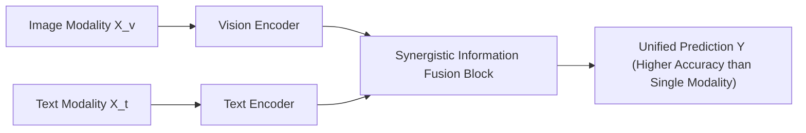

#### d. Code Thực chiến (C++ & Python)

```cpp
// C++17: Kiểm tra tỷ lệ đóng góp năng lượng của hai phương thức
#include <iostream>
#include <vector>
#include <cmath>

float compute_modality_ratio(const std::vector<float>& feat1, const std::vector<float>& feat2) {
    float n1 = 0.0f, n2 = 0.0f;
    for (float v : feat1) n1 += v * v;
    for (float v : feat2) n2 += v * v;
    return std::sqrt(n1) / (std::sqrt(n2) + 1e-8f);
}

int main() {
    std::vector<float> vision = {3.0f, 4.0f};
    std::vector<float> audio = {1.0f, 2.0f};
    std::cout << "Vision/Audio Norm Ratio: " << compute_modality_ratio(vision, audio) << "\n";
    return 0;
}
```

```python
# Python / PyTorch: Thuật toán On-the-fly Gradient Modulation (OGM) cân bằng hai nhánh
import torch

def modulate_gradients(grad_v: torch.Tensor, grad_t: torch.Tensor, alpha: float = 0.8):
    ratio = torch.norm(grad_v) / (torch.norm(grad_t) + 1e-8)
    if ratio > 1.0:
        # Nhánh thị giác quá mạnh -> giảm gradient nhánh thị giác
        grad_v = grad_v * (1.0 - alpha * torch.tanh(ratio - 1.0))
    return grad_v, grad_t

gv = torch.randn(10, 10) * 5.0 # Gradient lớn
gt = torch.randn(10, 10) * 1.0 # Gradient nhỏ
new_gv, new_gt = modulate_gradients(gv, gt)
print("Modulated Vision Grad Norm:", torch.norm(new_gv).item(), "| Original:", torch.norm(gv).item())
```

#### e. Lỗi Thường gặp & Ổn định Số học
- Giả định tính độc lập có điều kiện ngây thơ giữa các phương thức: Bỏ qua mối tương quan phi tuyến sâu giữa hình ảnh và lời nói dẫn đến suy giảm độ chính xác khi một phương thức bị nhiễu (Missing Modality problem).

#### f. Ứng dụng Thực chiến trong AI
Xe tự hành kết hợp Camera, LiDAR và Radar; phân tích bệnh án đa phương thức kết hợp ảnh chụp X-ray và văn bản hồ sơ bệnh án.

---

### 2. Multimodal Representation Learning (Học Biểu diễn Đa phương thức)

#### a. Định nghĩa Bản chất Toán học (Mathematical Formulation)
Học biểu diễn đa phương thức là việc tìm kiếm hàm ánh xạ phi tuyến $f_m: \mathcal{X}_m \to \mathbb{R}^d$ cho mỗi phương thức $m \in \{1, \dots, M\}$ sao cho khoảng cách ngữ nghĩa được bảo toàn:
$$\mathcal{D}_{\text{semantic}}(x_i, x_j) \approx \|f_a(x_i^{(a)}) - f_b(x_j^{(b)})\|$$
Biểu diễn học đa phương thức được chia thành hai cấu trúc cơ bản:
1. **Biểu diễn phối hợp (Coordinated Representations)**: Mỗi phương thức giữ một không gian riêng nhưng được ràng buộc bởi hàm khoảng cách (như Cosine similarity trong CLIP).
2. **Biểu diễn hợp nhất (Joint Representations)**: Các phương thức được ánh xạ thẳng vào cùng một vector biểu diễn tổng hợp duy nhất:
$$\mathbf{z} = f_{\text{joint}}(x_1, x_2, \dots, x_M) \in \mathbb{R}^d$$

#### b. Cơ chế Tầng Sâu & Điện toán (Under The Hood / Hardware Internals)
- **Dimensionality Matching & Projection Bottlenecks**: Các bộ trích xuất đặc trưng đơn lẻ thường có số chiều đầu ra khác nhau: ViT-Large xuất ra $1024$ chiều, BERT xuất ra $768$ chiều, Audio ResNet xuất ra $512$ chiều. Để đưa vào không gian chung, cần các lớp chiếu tuyến tính (Linear Projection Layers) hoặc MLP 2 tầng kèm chuẩn hóa LayerNorm để cân bằng phương sai trước khi ghép ma trận (Concatenation).

#### c. Sơ đồ Minh họa (Mermaid Diagram)
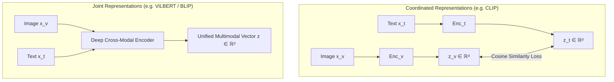

#### d. Code Thực chiến (C++ & Python)

```cpp
// C++17: Chiếu vector chiều d1 sang d2 bằng phép nhân ma trận trọng số
#include <iostream>
#include <vector>

std::vector<float> linear_project(const std::vector<float>& x, const std::vector<std::vector<float>>& W, const std::vector<float>& b) {
    size_t out_dim = W.size();
    size_t in_dim = x.size();
    std::vector<float> out(out_dim, 0.0f);
    for (size_t i = 0; i < out_dim; ++i) {
        float sum = b[i];
        for (size_t j = 0; j < in_dim; ++j) {
            sum += W[i][j] * x[j];
        }
        out[i] = sum;
    }
    return out;
}

int main() {
    std::vector<float> x = {1.0f, 2.0f}; // 2-dim
    std::vector<std::vector<float>> W = {{0.5f, 0.5f}, {0.1f, -0.1f}, {1.0f, 0.0f}}; // 3x2
    std::vector<float> b = {0.0f, 0.0f, 0.0f};
    auto z = linear_project(x, W, b);
    std::cout << "Projected to 3-dim: [" << z[0] << ", " << z[1] << ", " << z[2] << "]\n";
    return 0;
}
```

```python
# Python / PyTorch: Lớp MLP Projector chiếu không gian đặc trưng đa phương thức
import torch
import torch.nn as nn

class MultimodalProjector(nn.Module):
    def __init__(self, in_features, joint_dim):
        super().__init__()
        self.proj = nn.Sequential(
            nn.Linear(in_features, joint_dim),
            nn.GELU(),
            nn.Linear(joint_dim, joint_dim),
            nn.LayerNorm(joint_dim)
        )
    def forward(self, x):
        return self.proj(x)

proj_vision = MultimodalProjector(1024, 512)
proj_text = MultimodalProjector(768, 512)
v_emb = proj_vision(torch.randn(2, 1024))
t_emb = proj_text(torch.randn(2, 768))
print("Aligned Dimensions:", v_emb.shape, t_emb.shape)
```

#### e. Lỗi Thường gặp & Ổn định Số học
- Sự sụp đổ không gian nhúng (Representation Collapse): Toàn bộ các mẫu ảnh và văn bản bị chiếu về một cụm duy nhất hoặc các vector trực giao hoàn toàn với nhau khi hàm mất mát bị mất cân bằng trọng số điều chuẩn.

#### f. Ứng dụng Thực chiến trong AI
Mã hóa hồ sơ sản phẩm thương mại điện tử kết hợp hình ảnh bìa và mô tả văn bản để gợi ý mua sắm thông minh.

---

### 3. Modality Embeddings (Vector Nhúng Phân định Phương thức)

#### a. Định nghĩa Bản chất Toán học (Mathematical Formulation)
Khi đưa nhiều phương thức dữ liệu khác nhau vào cùng một chuỗi token phẳng cho một bộ giải mã Transformer duy nhất (như Flamingo, ImageBind, hay GPT-4o), mô hình cần biết token nào thuộc phương thức nào. Modality Embedding là một vector học được $\mathbf{e}_{\text{mod}} \in \mathbb{R}^d$ được cộng trực tiếp vào token embedding tương tự như Positional Embedding:
$$\tilde{\mathbf{x}}_i^{(m)} = \mathbf{x}_i^{(m)} + \mathbf{p}_i + \mathbf{e}_{\text{mod}}^{(m)}$$
Trong đó $m \in \{\text{text}, \text{vision}, \text{audio}, \text{depth}, \text{thermal}\}$, $\mathbf{p}_i$ là vector vị trí thứ tự.

#### b. Cơ chế Tầng Sâu & Điện toán (Under The Hood / Hardware Internals)
- **Broadcasting Additions in GPU Kernels**: Thao tác $\mathbf{x} + \mathbf{p} + \mathbf{e}_{\text{mod}}$ được thực thi bằng một Triton/CUDA kernel kết hợp (Fused Elementwise Kernel). Phép cộng broadcast từ vector $\mathbb{R}^d$ lên tensor 3D $\mathbb{R}^{B \times S \times d}$ được nạp trực tiếp qua thanh ghi Register mà không phải đọc lại nhiều lần từ VRAM.

#### c. Sơ đồ Minh họa (Mermaid Diagram)
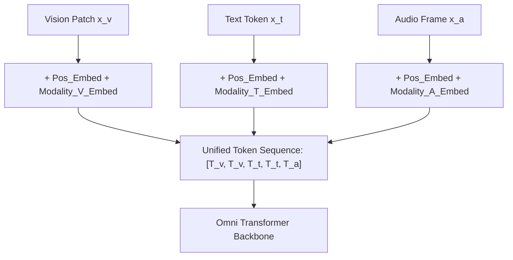

#### d. Code Thực chiến (C++ & Python)

```cpp
// C++17: Cộng Modality Embedding và Positional Embedding vào Token
#include <iostream>
#include <vector>

void fuse_embeddings(std::vector<float>& token, const std::vector<float>& pos, const std::vector<float>& mod) {
    for (size_t i = 0; i < token.size(); ++i) {
        token[i] += pos[i] + mod[i];
    }
}

int main() {
    std::vector<float> token = {0.5f, -0.2f};
    std::vector<float> pos = {0.01f, 0.02f};
    std::vector<float> mod_type_vision = {0.1f, 0.1f};
    fuse_embeddings(token, pos, mod_type_vision);
    std::cout << "Fused Token[0]: " << token[0] << "\n";
    return 0;
}
```

```python
# Python / PyTorch: Khởi tạo và cộng Modality Embedding đa phương thức
import torch
import torch.nn as nn

class UnifiedMultimodalEmbedding(nn.Module):
    def __init__(self, embed_dim=768, num_modalities=4):
        super().__init__()
        self.modality_embeddings = nn.Embedding(num_modalities, embed_dim) # 0: Text, 1: Image, 2: Audio

    def forward(self, tokens, modality_id):
        # tokens: [Batch, Seq_Len, Dim]
        mod_emb = self.modality_embeddings(torch.tensor([modality_id], device=tokens.device))
        return tokens + mod_emb.unsqueeze(1)

embedder = UnifiedMultimodalEmbedding(embed_dim=512)
v_tokens = torch.randn(2, 50, 512)
v_tagged = embedder(v_tokens, modality_id=1) # Tag là Image
print("Vision Tagged Shape:", v_tagged.shape)
```

#### e. Lỗi Thường gặp & Ổn định Số học
- Quên chuẩn hóa sau khi cộng dồn nhiều vector nhúng khiến phương sai của tensor tăng gấp 3 lần ($\text{Var}(X + P + M) = 3 \sigma^2$), làm bão hòa các hàm kích hoạt Softmax ở lớp Attention đầu tiên. Bắt buộc đặt một lớp `nn.LayerNorm` ngay sau khi cộng.

#### f. Ứng dụng Thực chiến trong AI
Kiến trúc mô hình hợp nhất giác quan ImageBind (Meta), Flamingo (DeepMind), Omni-Perceiver.

---

### 4. Joint Embedding Spaces (Không gian Nhúng Chung)

#### a. Định nghĩa Bản chất Toán học (Mathematical Formulation)
Không gian Nhúng Chung là một không gian Metric $\mathcal{Z} = (\mathbb{R}^d, D)$ sao cho các biểu diễn thuộc các phương thức khác nhau của cùng một thực thể ngữ nghĩa nằm tiệm cận gần nhau:
$$D(f_{\text{img}}(x_{\text{img}}), f_{\text{txt}}(x_{\text{txt}})) \to 0 \quad \text{khi } x_{\text{img}} \text{ và } x_{\text{txt}} \text{ cùng mô tả một đối tượng}$$
Độ đo khoảng cách chuẩn mực là Khoảng cách Cosine hoặc Tích vô hướng chuẩn hóa trên mặt siêu cầu đơn vị $\mathbb{S}^{d-1}$:
$$\mathcal{S}(\mathbf{z}_v, \mathbf{z}_t) = \frac{\mathbf{z}_v^T \mathbf{z}_t}{\|\mathbf{z}_v\|_2 \|\mathbf{z}_t\|_2} = \cos(\theta)$$
Được tối ưu hóa bằng Hàm mất mát Tương phản Song đối xứng (Symmetric InfoNCE Loss):
$$\mathcal{L} = \frac{1}{2} \left( \mathcal{L}_{v \to t} + \mathcal{L}_{t \to v} \right)$$
$$\mathcal{L}_{v \to t} = -\frac{1}{B} \sum_{i=1}^B \log \frac{\exp(\mathbf{z}_{v, i}^T \mathbf{z}_{t, i} / \tau)}{\sum_{j=1}^B \exp(\mathbf{z}_{v, i}^T \mathbf{z}_{t, j} / \tau)}$$

#### b. Cơ chế Tầng Sâu & Điện toán (Under The Hood / Hardware Internals)
- **Large Batch All-Gather Communication**: Để không gian nhúng chung phân biệt tốt, kích thước Batch Size $B$ trong tương phản phải cực lớn (ví dụ: $B = 32.768$ trong CLIP). Khi huấn luyện phân tán trên hàng trăm GPU, phép tính ma trận tương quan $\mathbf{Z}_v \mathbf{Z}_t^T \in \mathbb{R}^{B \times B}$ đòi hỏi giao thức mạng `torch.distributed.all_gather` để thu thập toàn bộ embeddings từ tất cả các GPU trước khi tính Softmax chéo.

#### c. Sơ đồ Minh họa (Mermaid Diagram)
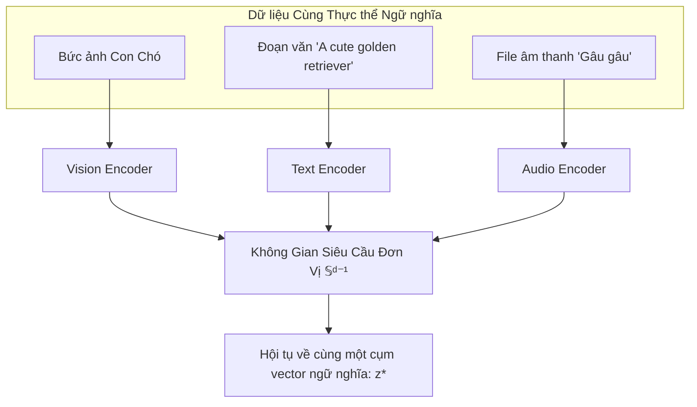

#### d. Code Thực chiến (C++ & Python)

```cpp
// C++17: Tính ma trận tương tự Cosine Similarity giữa hai Batch embeddings
#include <iostream>
#include <vector>
#include <cmath>

std::vector<std::vector<float>> compute_cosine_matrix(const std::vector<std::vector<float>>& V, const std::vector<std::vector<float>>& T) {
    size_t B = V.size();
    size_t D = V[0].size();
    std::vector<std::vector<float>> sim(B, std::vector<float>(B, 0.0f));

    for (size_t i = 0; i < B; ++i) {
        for (size_t j = 0; j < B; ++j) {
            float dot = 0.0f;
            for (size_t d = 0; d < D; ++d) {
                dot += V[i][d] * T[j][d];
            }
            sim[i][j] = dot; // Đã chuẩn hóa L2
        }
    }
    return sim;
}

int main() {
    std::vector<std::vector<float>> v = {{1.0f, 0.0f}, {0.0f, 1.0f}};
    std::vector<std::vector<float>> t = {{0.9f, 0.1f}, {0.1f, 0.9f}};
    auto S = compute_cosine_matrix(v, t);
    std::cout << "Sim(v0, t0): " << S[0][0] << " | Sim(v0, t1): " << S[0][1] << "\n";
    return 0;
}
```

```python
# Python / PyTorch: Hàm mất mát Đối xứng Contrastive InfoNCE (CLIP Loss)
import torch
import torch.nn.functional as F

def clip_contrastive_loss(image_features, text_features, logit_scale):
    # Chuẩn hóa L2 về mặt siêu cầu
    i_norm = F.normalize(image_features, p=2, dim=-1)
    t_norm = F.normalize(text_features, p=2, dim=-1)
    
    # Ma trận tương quan tích vô hướng nhân tỉ lệ nhiệt độ
    logits_per_image = torch.matmul(i_norm, t_norm.t()) * logit_scale.exp()
    logits_per_text = logits_per_image.t()

    labels = torch.arange(len(image_features), device=image_features.device)
    loss_i = F.cross_entropy(logits_per_image, labels)
    loss_t = F.cross_entropy(logits_per_text, labels)
    return (loss_i + loss_t) / 2.0

img_f = torch.randn(4, 512)
txt_f = torch.randn(4, 512)
scale = torch.tensor(2.659) # ln(1/0.07)
print("CLIP Symmetric Loss:", clip_contrastive_loss(img_f, txt_f, scale).item())
```

#### e. Lỗi Thường gặp & Ổn định Số học
- **Modality Gap**: Hiện tượng các vector nhúng của hình ảnh và văn bản nằm ở hai cụm hình học tách biệt hoàn toàn trên mặt siêu cầu (không giao nhau) do sự bất đối xứng của hàm khởi tạo và kiến trúc mạng. Khắc phục bằng cách căn chỉnh nhiệt độ học hoặc phép chiếu bổ sung.

#### f. Ứng dụng Thực chiến trong AI
Tìm kiếm hình ảnh bằng văn bản (Text-to-Image Search), phân loại ảnh Zero-Shot (CLIP), và liên kết 6 giác quan trong Meta ImageBind.

---

### 5. Multimodal Fusion (Dung hợp Đa phương thức)

#### a. Định nghĩa Bản chất Toán học (Mathematical Formulation)
Dung hợp đa phương thức là quá trình tích hợp thông tin từ nhiều kênh tín hiệu dị thể $\mathbf{x}_1, \dots, \mathbf{x}_M$ thành một biểu diễn thống nhất để phục vụ tác vụ dự đoán $\hat{y} = g(\mathcal{F}(\mathbf{x}_1, \dots, \mathbf{x}_M))$.
Các toán tử dung hợp cơ bản:
1. **Phép ghép nối (Concatenation)**: $\mathbf{z} = [\mathbf{x}_1 \,\|\, \mathbf{x}_2] \in \mathbb{R}^{d_1 + d_2}$.
2. **Phép cộng / Trung bình có trọng số**: $\mathbf{z} = w_1 \mathbf{x}_1 + w_2 \mathbf{x}_2$.
3. **Tích song tuyến tính (Bilinear / Outer Product Fusion)**: Mô hình hóa toàn bộ tương tác cặp giữa các chiều:
$$\mathbf{z} = \mathbf{x}_1 \otimes \mathbf{x}_2 \in \mathbb{R}^{d_1 \times d_2}$$
Do tích Kronecker làm bùng nổ số chiều, người ta dùng kỹ thuật xấp xỉ MCB (Multimodal Compact Bilinear Pooling) dựa trên biến đổi FFT qua định lý Count Sketch.

#### b. Cơ chế Tầng Sâu & Điện toán (Under The Hood / Hardware Internals)
- **Tích chập ngoài và độ phức tạp bộ nhớ**: Tính toán tích ngoài $\mathbf{x}_1 \otimes \mathbf{x}_2$ với $d_1 = d_2 = 1024$ tạo ra ma trận $1024 \times 1024 \approx 10^6$ phần tử cho mỗi mẫu dữ liệu. Khi batch size lớn, bộ nhớ VRAM nhanh chóng cạn kiệt. Do đó, tích song tuyến tính compact thông qua phép nhân Hadamard trong miền FFT là lựa chọn tối ưu phần cứng.

#### c. Sơ đồ Minh họa (Mermaid Diagram)
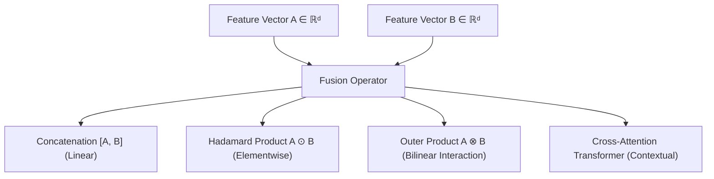

#### d. Code Thực chiến (C++ & Python)

```cpp
// C++17: Phép nhân tích vô hướng Hadamard (Element-wise Multiplication Fusion)
#include <iostream>
#include <vector>

std::vector<float> hadamard_fusion(const std::vector<float>& a, const std::vector<float>& b) {
    std::vector<float> out(a.size());
    for (size_t i = 0; i < a.size(); ++i) {
        out[i] = a[i] * b[i];
    }
    return out;
}

int main() {
    std::vector<float> a = {0.5f, 2.0f};
    std::vector<float> b = {1.2f, -0.5f};
    auto fused = hadamard_fusion(a, b);
    std::cout << "Fused Output: [" << fused[0] << ", " << fused[1] << "]\n";
    return 0;
}
```

```python
# Python / PyTorch: Gated Multimodal Fusion Unit
import torch
import torch.nn as nn

class GatedMultimodalFusion(nn.Module):
    def __init__(self, dim):
        super().__init__()
        self.gate = nn.Sequential(
            nn.Linear(dim * 2, dim),
            nn.Sigmoid()
        )
    def forward(self, h_v, h_t):
        # Cổng điều tiết động: z = g * h_v + (1 - g) * h_t
        concat = torch.cat([h_v, h_t], dim=-1)
        g = self.gate(concat)
        return g * h_v + (1.0 - g) * h_t

gmf = GatedMultimodalFusion(512)
v = torch.randn(2, 512)
t = torch.randn(2, 512)
print("Gated Fusion Output Shape:", gmf(v, t).shape)
```

#### e. Lỗi Thường gặp & Ổn định Số học
- Sự chênh lệch tỷ lệ độ lớn (Scale Mismatch): Nếu phương thức A có chuẩn Euclidean $\|\mathbf{x}_A\|_2 \approx 100$ trong khi phương thức B có chuẩn $\|\mathbf{x}_B\|_2 \approx 1$, phép cộng hoặc tích chập sẽ làm thông tin của B biến mất hoàn toàn. Bắt buộc chuẩn hóa LayerNorm từng nhánh trước khi dung hợp.

#### f. Ứng dụng Thực chiến trong AI
Dung hợp dữ liệu đa cảm biến trên robot hút bụi (Camera RGB + Cảm biến va chạm Lidar), phân tích video TikTok kết hợp nhạc nền và khung hình.

---

### 6. Early Fusion (Dung hợp Sớm / Cấp độ Dữ liệu Thô)

#### a. Định nghĩa Bản chất Toán học (Mathematical Formulation)
Early Fusion (hay Data-level / Input-level Fusion) là chiến lược tích hợp trực tiếp các tín hiệu đa phương thức ngay tại tầng đầu vào trước khi đưa qua bất kỳ mạng nơ-ron trích xuất đặc trưng sâu nào:
$$\mathbf{X}_{\text{fused}} = \text{Preprocess}(\mathbf{X}_1, \mathbf{X}_2, \dots, \mathbf{X}_M)$$
$$\hat{y} = f_\theta(\mathbf{X}_{\text{fused}})$$
Ví dụ kinh điển là việc xếp chồng các kênh cảm biến (Channel Stacking): Ảnh RGB 3 kênh ghép thêm kênh chiều sâu Depth (RGB-D 4 kênh): $\mathbf{I} \in \mathbb{R}^{H \times W \times 4}$, hoặc ảnh vệ tinh viễn thám đa phổ (Multispectral 12 kênh).

#### b. Cơ chế Tầng Sâu & Điện toán (Under The Hood / Hardware Internals)
- **Rigid Temporal/Spatial Synchronization**: Yêu cầu bắt buộc của Early Fusion là các luồng dữ liệu phải được đồng bộ chính xác hoàn hảo về mặt thời gian và không gian (Spatial Calibration & Temporal Sync). Nếu camera hoạt động ở 30FPS còn cảm biến Lidar quay ở 10Hz, cần nội suy ma trận tọa độ và đồng hồ phần cứng phần mềm (PTP - Precision Time Protocol) để tránh sai lệch định vị.

#### c. Sơ đồ Minh họa (Mermaid Diagram)
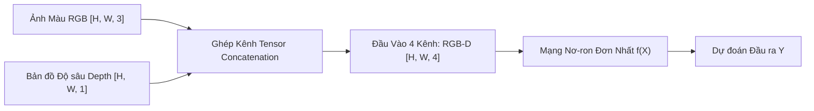

#### d. Code Thực chiến (C++ & Python)

```cpp
// C++17: Ghép kênh dữ liệu RGB và Depth thành mảng 4 kênh phẳng
#include <iostream>
#include <vector>

void stack_rgb_depth(const uint8_t* rgb, const float* depth, float* rgbd, size_t num_pixels) {
    for (size_t i = 0; i < num_pixels; ++i) {
        rgbd[4 * i + 0] = static_cast<float>(rgb[3 * i + 0]) / 255.0f;
        rgbd[4 * i + 1] = static_cast<float>(rgb[3 * i + 1]) / 255.0f;
        rgbd[4 * i + 2] = static_cast<float>(rgb[3 * i + 2]) / 255.0f;
        rgbd[4 * i + 3] = depth[i]; // Depth kênh thứ 4
    }
}

int main() {
    uint8_t rgb[3] = {255, 128, 0};
    float depth[1] = {1.5f}; // 1.5m
    float rgbd[4];
    stack_rgb_depth(rgb, depth, rgbd, 1);
    std::cout << "RGB-D Pixel 0: [" << rgbd[0] << ", " << rgbd[1] << ", " << rgbd[2] << ", " << rgbd[3] << "]\n";
    return 0;
}
```

```python
# Python / PyTorch: Lớp tích chập đầu vào 4 kênh cho Early Fusion RGB-D
import torch
import torch.nn as nn

class RGBDConvNet(nn.Module):
    def __init__(self, out_channels=64):
        super().__init__()
        # 4 kênh đầu vào: R, G, B, Depth
        self.stem = nn.Conv2d(in_channels=4, out_channels=out_channels, kernel_size=7, stride=2, padding=3)
    def forward(self, rgb, depth):
        # rgb: [B, 3, H, W], depth: [B, 1, H, W]
        rgbd = torch.cat([rgb, depth], dim=1)
        return self.stem(rgbd)

model = RGBDConvNet()
rgb = torch.randn(2, 3, 224, 224)
depth = torch.randn(2, 1, 224, 224)
print("Early Fusion Output:", model(rgb, depth).shape)
```

#### e. Lỗi Thường gặp & Ổn định Số học
- Sự bất tương thích về hình dạng dữ liệu (Shape Mismatch): Rất khó áp dụng Early Fusion khi dung hợp hai phương thức hoàn toàn khác biệt về cấu trúc như Văn bản (chuỗi token 1D rời rạc) và Video (tensor 4D liên tục).

#### f. Ứng dụng Thực chiến trong AI
Xử lý ảnh viễn thám vệ tinh đa quang phổ (Sentinel, Landsat), camera nhận diện khuôn mặt quét 3D TrueDepth (FaceID).

---

### 7. Late Fusion (Dung hợp Muộn / Cấp độ Quyết định)

#### a. Định nghĩa Bản chất Toán học (Mathematical Formulation)
Late Fusion (hay Decision-level Fusion) duy trì các mạng nơ-ron chuyên biệt hoàn toàn độc lập cho từng phương thức. Việc dung hợp chỉ diễn ra tại lớp dự đoán cuối cùng thông qua việc kết hợp các phân phối xác suất hoặc điểm số quyết định:
$$\hat{y} = \text{Aggregate}\left( f_1(\mathbf{x}_1), f_2(\mathbf{x}_2), \dots, f_M(\mathbf{x}_M) \right)$$
Các toán tử kết hợp phổ biến:
1. **Bầu chọn trung bình có trọng số (Weighted Averaging)**:
$$\mathbf{p}_{\text{final}} = \sum_{m=1}^M \alpha_m \text{Softmax}(\mathbf{z}_m) \quad \text{với } \sum_m \alpha_m = 1$$
2. **Quy tắc tích xác suất Bayes (Multiplication Rule)**:
$$\mathbf{p}_{\text{final}} \propto \prod_{m=1}^M \mathbf{p}_m$$
3. **Bầu chọn đa số (Majority Voting)**: Dùng cho các bộ phân loại nhãn rời rạc.

#### b. Cơ chế Tầng Sâu & Điện toán (Under The Hood / Hardware Internals)
- **Modularity & Fault Tolerance**: Ưu điểm vượt trội của Late Fusion là tính mô-đun hóa cực cao: các mạng nơ-ron của từng phương thức có thể được huấn luyện riêng biệt trên các máy chủ khác nhau. Nếu một cảm biến đột ngột bị mất kết nối trong quá trình vận hành thực tế, hệ thống chỉ cần đặt trọng số $\alpha_m = 0$ cho cảm biến đó mà không làm sụp đổ toàn bộ pipeline.

#### c. Sơ đồ Minh họa (Mermaid Diagram)
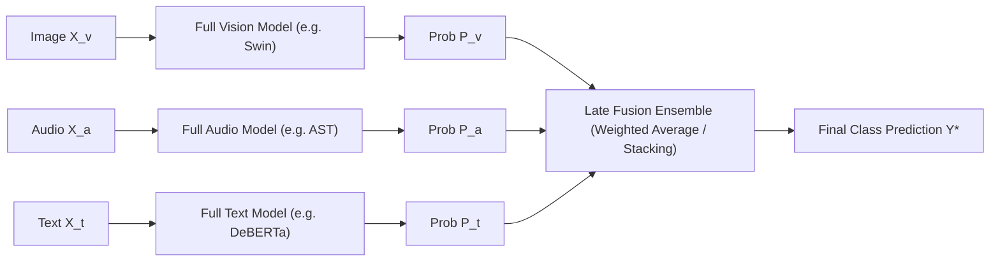

#### d. Code Thực chiến (C++ & Python)

```cpp
// C++17: Bầu chọn xác suất trung bình có trọng số cho Late Fusion
#include <iostream>
#include <vector>

std::vector<float> late_fusion_weighted_average(const std::vector<float>& p1, const std::vector<float>& p2, float w1, float w2) {
    std::vector<float> p_out(p1.size());
    for (size_t i = 0; i < p1.size(); ++i) {
        p_out[i] = w1 * p1[i] + w2 * p2[i];
    }
    return p_out;
}

int main() {
    std::vector<float> p_vision = {0.8f, 0.2f};
    std::vector<float> p_audio = {0.4f, 0.6f};
    auto p_final = late_fusion_weighted_average(p_vision, p_audio, 0.7f, 0.3f);
    std::cout << "Class 0 Final Prob: " << p_final[0] << ", Class 1: " << p_final[1] << "\n";
    return 0;
}
```

```python
# Python / PyTorch: Late Fusion Stacking Classifier
import torch
import torch.nn as nn

class LateFusionMetaLearner(nn.Module):
    def __init__(self, num_classes=5, num_modalities=2):
        super().__init__()
        # Meta-classifier học cách cân bằng xác suất từ các mô hình chuyên biệt
        self.classifier = nn.Linear(num_classes * num_modalities, num_classes)
    def forward(self, logits_v, logits_a):
        # logits_v: [B, C], logits_a: [B, C]
        combined = torch.cat([logits_v, logits_a], dim=-1)
        return self.classifier(combined)

meta = LateFusionMetaLearner(num_classes=3, num_modalities=2)
v_log = torch.tensor([[2.0, 0.5, 0.1]])
a_log = torch.tensor([[0.2, 1.8, 0.3]])
print("Stacked Late Fusion Output:", meta(v_log, a_log))
```

#### e. Lỗi Thường gặp & Ổn định Số học
- **Bỏ lỡ tương tác cấp thấp (Missing Low-level Correlations)**: Do hai nhánh xử lý hoàn toàn độc lập cho đến tận đầu ra, mô hình hoàn toàn không có khả năng học các tương tác ngữ nghĩa tinh tế giữa các chi tiết cục bộ (ví dụ: một cử chỉ tay cụ thể đi kèm một từ nói cụ thể).

#### f. Ứng dụng Thực chiến trong AI
Các giải pháp chiến thắng trong các cuộc thi Kaggle đa phương thức; phân loại hành vi gian lận tài chính kết hợp dữ liệu giao dịch và đồ thị mạng lưới.

---

### 8. Intermediate Fusion (Dung hợp Trung gian / Cấp độ Đặc trưng)

#### a. Định nghĩa Bản chất Toán học (Mathematical Formulation)
Intermediate Fusion (hay Feature-level / Mid-level Fusion) là giải pháp cân bằng ưu thế giữa Early và Late Fusion. Dữ liệu của từng phương thức được đưa qua các tầng xử lý riêng biệt để tạo ra các biểu diễn trung gian trừu tượng, sau đó được dung hợp ở các tầng ẩn sâu:
$$\mathbf{h}_1 = \text{Encoder}_1^{(1:l_1)}(\mathbf{x}_1), \quad \mathbf{h}_2 = \text{Encoder}_2^{(1:l_2)}(\mathbf{x}_2)$$
$$\mathbf{h}_{\text{fused}} = \text{FusionLayer}(\mathbf{h}_1, \mathbf{h}_2)$$
$$\hat{y} = \text{Predictor}(\mathbf{h}_{\text{fused}})$$
Dung hợp trung gian có thể diễn ra ở một tầng duy nhất hoặc diễn ra liên tục qua nhiều tầng liên tiếp (Multi-stage Hierarchical Fusion).

#### b. Cơ chế Tầng Sâu & Điện toán (Under The Hood / Hardware Internals)
- **Gradient Backpropagation Across Dual Encoders**: Khác với Late Fusion nơi gradient chỉ cập nhật cho từng mô hình đơn lập, trong Intermediate Fusion gradient từ hàm mất mát cuối cùng lan truyền ngược đồng thời qua cả hai nhánh Encoder, buộc hai bộ trích xuất đặc trưng phải tự điều chỉnh để tối ưu hóa không gian biểu diễn tương hỗ.

#### c. Sơ đồ Minh họa (Mermaid Diagram)
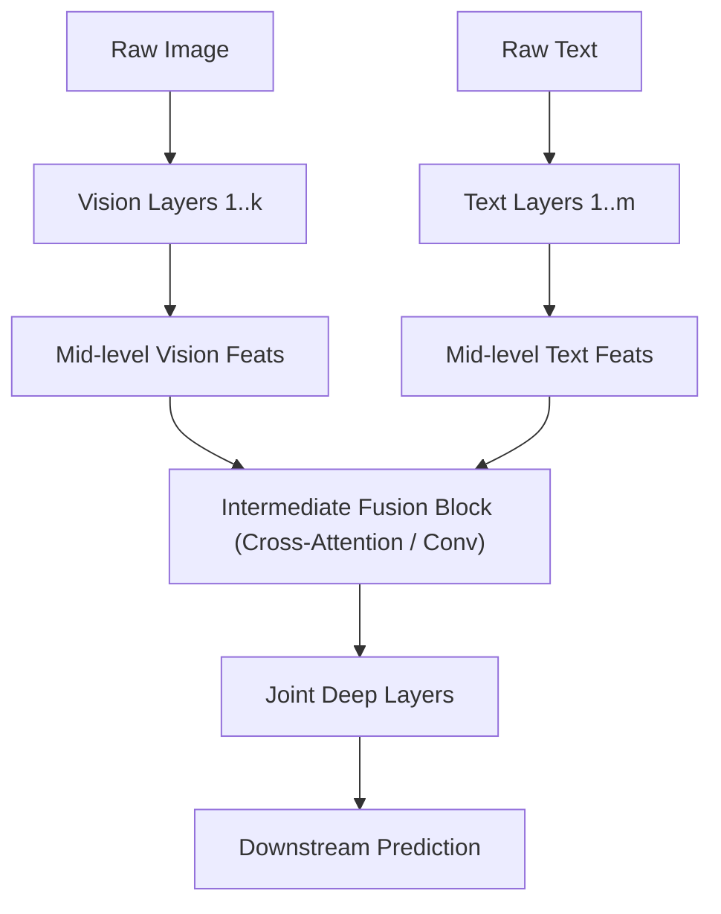

#### d. Code Thực chiến (C++ & Python)

```cpp
// C++17: Ghép nối vector trung gian và chiếu tuyến tính
#include <iostream>
#include <vector>

std::vector<float> intermediate_concat_proj(const std::vector<float>& h_v, const std::vector<float>& h_t, const std::vector<float>& W_row) {
    // W_row có kích thước h_v.size() + h_t.size()
    float sum = 0.0f;
    for (size_t i = 0; i < h_v.size(); ++i) sum += h_v[i] * W_row[i];
    for (size_t i = 0; i < h_t.size(); ++i) sum += h_t[i] * W_row[h_v.size() + i];
    return {sum};
}

int main() {
    std::vector<float> hv = {1.0f, 2.0f};
    std::vector<float> ht = {0.5f, -0.5f};
    std::vector<float> w = {0.2f, 0.2f, 0.5f, 0.5f};
    auto out = intermediate_concat_proj(hv, ht, w);
    std::cout << "Projected Mid-Feature: " << out[0] << "\n";
    return 0;
}
```

```python
# Python / PyTorch: Kiến trúc Intermediate Fusion với Bottleneck Fusion
import torch
import torch.nn as nn

class BottleneckFusion(nn.Module):
    def __init__(self, dim, num_bottlenecks=4):
        super().__init__()
        # Sử dụng các token trung gian làm "nút thắt cổ chai" trao đổi thông tin
        self.bottlenecks = nn.Parameter(torch.randn(1, num_bottlenecks, dim))
        self.cross_attn = nn.MultiheadAttention(dim, num_heads=4, batch_first=True)

    def forward(self, v_tokens, t_tokens):
        # Thông tin hai bên chỉ được giao tiếp thông qua nút thắt bottlenecks
        b = self.bottlenecks.repeat(v_tokens.size(0), 1, 1)
        fused_v, _ = self.cross_attn(b, v_tokens, v_tokens)
        fused_t, _ = self.cross_attn(fused_v, t_tokens, t_tokens)
        return fused_t

bf = BottleneckFusion(dim=256)
v = torch.randn(2, 20, 256)
t = torch.randn(2, 15, 256)
print("Bottleneck Fused Representation:", bf(v, t).shape)
```

#### e. Lỗi Thường gặp & Ổn định Số học
- Việc lựa chọn tầng dung hợp (Fusion Layer Depth) tùy tiện: Nếu dung hợp quá sớm (tầng 1-2), mô hình bị nhược điểm của Early Fusion; nếu dung hợp quá muộn (tầng áp chót), mô hình biến thành Late Fusion. Cần tối ưu vị trí dung hợp thông qua Neural Architecture Search (NAS).

#### f. Ứng dụng Thực chiến trong AI
Kiến trúc tiêu chuẩn của Visual Question Answering (VQA 2.0), phân tích nội dung phim điện ảnh (Movie Description).

---

### 9. Cross-Modal Attention (Cơ chế Chú ý Xuyên Phương thức)

#### a. Định nghĩa Bản chất Toán học (Mathematical Formulation)
Cross-Modal Attention cho phép một phương thức mục tiêu (Target Modality $A$) chủ động truy vấn và trích xuất các thông tin tương thích ngữ nghĩa từ một phương thức nguồn (Source Modality $B$):
$$\mathbf{H}_{A \to B} = \text{Softmax}\left( \frac{\mathbf{Q}_A \mathbf{K}_B^T}{\sqrt{d_k}} \right) \mathbf{V}_B$$
Trong đó:
- Ma trận Query xuất phát từ phương thức $A$: $\mathbf{Q}_A = \mathbf{X}_A \mathbf{W}_Q \in \mathbb{R}^{L_A \times d_k}$.
- Ma trận Key và Value xuất phát từ phương thức $B$: $\mathbf{K}_B = \mathbf{X}_B \mathbf{W}_K \in \mathbb{R}^{L_B \times d_k}, \, \mathbf{V}_B = \mathbf{X}_B \mathbf{W}_V \in \mathbb{R}^{L_B \times d_v}$.
Ma trận trọng số chú ý $\mathbf{A} \in \mathbb{R}^{L_A \times L_B}$ đo lường mức độ tương thích ngữ nghĩa giữa từng phần tử của $A$ và $B$.

#### b. Cơ chế Tầng Sâu & Điện toán (Under The Hood / Hardware Internals)
- **Cross-Modal KV Cache in Large Multimodal Models**: Trong các mô hình như LLaVA hay Flamingo, các visual tokens của bức ảnh đóng vai trò là Keys và Values. Do ảnh là ngữ cảnh tĩnh trong suốt quá trình sinh câu trả lời tự hồi quy, các Keys và Values này được tính toán trước một lần duy nhất và lưu vào VRAM KV-Cache, giúp tốc độ sinh từ văn bản không bị chậm bởi số lượng lớn các visual tokens.

#### c. Sơ đồ Minh họa (Mermaid Diagram)
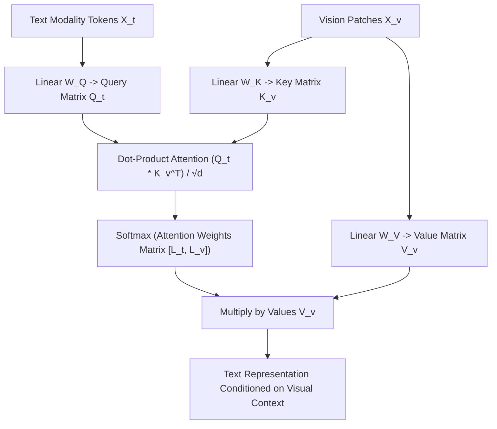

#### d. Code Thực chiến (C++ & Python)

```cpp
// C++17: Tính toán Cross-Attention Attention Weights ma trận thô
#include <iostream>
#include <vector>
#include <cmath>

std::vector<std::vector<float>> cross_attention_scores(const std::vector<std::vector<float>>& Q, const std::vector<std::vector<float>>& K, float scale) {
    size_t L_q = Q.size();
    size_t L_k = K.size();
    size_t D = Q[0].size();
    std::vector<std::vector<float>> scores(L_q, std::vector<float>(L_k, 0.0f));

    for (size_t i = 0; i < L_q; ++i) {
        float row_max = -1e9f;
        for (size_t j = 0; j < L_k; ++j) {
            float dot = 0.0f;
            for (size_t d = 0; d < D; ++d) dot += Q[i][d] * K[j][d];
            scores[i][j] = dot * scale;
            if (scores[i][j] > row_max) row_max = scores[i][j];
        }
        // Softmax ổn định
        float sum_exp = 0.0f;
        for (size_t j = 0; j < L_k; ++j) {
            scores[i][j] = std::exp(scores[i][j] - row_max);
            sum_exp += scores[i][j];
        }
        for (size_t j = 0; j < L_k; ++j) scores[i][j] /= sum_exp;
    }
    return scores;
}

int main() {
    std::vector<std::vector<float>> Q = {{1.0f, 0.0f}};
    std::vector<std::vector<float>> K = {{1.0f, 0.0f}, {0.0f, 1.0f}};
    auto attn = cross_attention_scores(Q, K, 1.0f);
    std::cout << "Attn to K0: " << attn[0][0] << " | Attn to K1: " << attn[0][1] << "\n";
    return 0;
}
```

```python
# Python / PyTorch: Khối Cross-Attention chuẩn PyTorch
import torch
import torch.nn as nn

class CrossModalAttentionBlock(nn.Module):
    def __init__(self, d_model=512, n_heads=8):
        super().__init__()
        self.mha = nn.MultiheadAttention(embed_dim=d_model, num_heads=n_heads, batch_first=True)
        self.norm = nn.LayerNorm(d_model)

    def forward(self, target_q, source_kv):
        # target_q: [B, L_q, D], source_kv: [B, L_kv, D]
        attn_out, weights = self.mha(query=target_q, key=source_kv, value=source_kv)
        return self.norm(target_q + attn_out), weights

cross_block = CrossModalAttentionBlock()
q_text = torch.randn(2, 10, 512)
kv_img = torch.randn(2, 64, 512)
out, attn_map = cross_block(q_text, kv_img)
print("Conditioned Output Shape:", out.shape, "| Attention Map Shape:", attn_map.shape)
```

#### e. Lỗi Thường gặp & Ổn định Số học
- Sự mất cân bằng số lượng token (Sequence Length Asymmetry): Số lượng patch của ảnh độ phân giải cao có thể lên tới $2.000-4.000$ tokens trong khi câu văn bản chỉ có $20$ tokens. Ma trận Attention Softmax qua $4.000$ tokens dễ bị phân tán làm mờ nhạt trọng số (Over-dispersed Attention). Bắt buộc áp dụng cơ chế nén token như Perceiver Resampler.

#### f. Ứng dụng Thực chiến trong AI
Mô-đun Cross-Attention của Stable Diffusion (điều khiển tạo ảnh từ văn bản), DeepMind Flamingo Perceiver Resampler.

---

### 10. Cross-Modal Alignment (Căn chỉnh Xuyên Phương thức)

#### a. Định nghĩa Bản chất Toán học (Mathematical Formulation)
Cross-Modal Alignment là việc thiết lập sự tương ứng ngữ nghĩa tường minh hoặc tiềm ẩn giữa các thực thể con (Sub-components) của hai phương thức khác nhau:
1. **Căn chỉnh toàn cục (Coarse-grained Alignment)**: Căn chỉnh toàn bộ bức ảnh với toàn bộ câu văn:
$$\max_{\theta} \text{sim}(f_{\text{img}}(I), f_{\text{txt}}(T))$$
2. **Căn chỉnh cục bộ hạt mịn (Fine-grained Alignment)**: Căn chỉnh từng vùng đối tượng trong ảnh (Bounding Box / Segmentation Mask $r_i$) với từng cụm từ trong câu (Noun Phrase $w_j$):
$$\mathcal{S}_{\text{fine}}(I, T) = \frac{1}{|T|} \sum_{j=1}^{|T|} \max_{i=1}^{|I|} \left( \frac{\mathbf{v}_{r_i}^T \mathbf{u}_{w_j}}{\|\mathbf{v}_{r_i}\| \|\mathbf{u}_{w_j}\|} \right)$$
Được tối ưu hóa bằng thuật toán Vận chuyển Tối ưu (Optimal Transport / Wasserstein Distance / Sinkhorn-Knopp).

#### b. Cơ chế Tầng Sâu & Điện toán (Under The Hood / Hardware Internals)
- **Sinkhorn-Knopp Matrix Balancing on GPU**: Để giải bài toán căn chỉnh hạt mịn gán ghép cặp đôi (Bipartite Matching) giữa $M$ vùng ảnh và $N$ từ văn bản trong lúc huấn luyện, thuật toán Sinkhorn lặp ma trận tương đồng trên GPU bằng các phép chuẩn hóa hàng và cột tuần hoàn nhanh hơn 100 lần so với thuật toán Hungarian trên CPU.

#### c. Sơ đồ Minh họa (Mermaid Diagram)
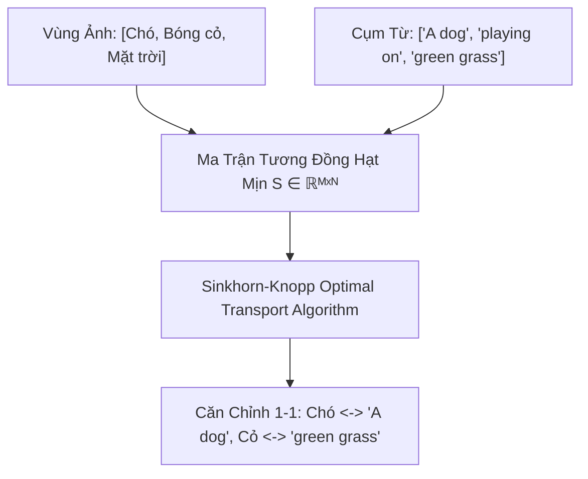

#### d. Code Thực chiến (C++ & Python)

```cpp
// C++17: Thuật toán Sinkhorn lặp chuẩn hóa ma trận phân phối
#include <iostream>
#include <vector>
#include <cmath>

void sinkhorn_step(std::vector<std::vector<float>>& P, size_t max_iter = 5) {
    size_t R = P.size();
    size_t C = P[0].size();
    for (size_t it = 0; it < max_iter; ++it) {
        // Chuẩn hóa hàng
        for (size_t i = 0; i < R; ++i) {
            float sum = 0.0f;
            for (size_t j = 0; j < C; ++j) sum += P[i][j];
            for (size_t j = 0; j < C; ++j) P[i][j] /= (sum + 1e-8f);
        }
        // Chuẩn hóa cột
        for (size_t j = 0; j < C; ++j) {
            float sum = 0.0f;
            for (size_t i = 0; i < R; ++i) sum += P[i][j];
            for (size_t i = 0; i < R; ++i) P[i][j] /= (sum + 1e-8f);
        }
    }
}

int main() {
    std::vector<std::vector<float>> P = {{1.0f, 2.0f}, {3.0f, 1.0f}};
    sinkhorn_step(P);
    std::cout << "Sinkhorn Balanced P[0][0]: " << P[0][0] << "\n";
    return 0;
}
```

```python
# Python / PyTorch: Thuật toán căn chỉnh Optimal Transport với hàm Sinkhorn
import torch

def sinkhorn_alignment(cost_matrix: torch.Tensor, reg: float = 0.1, max_iter: int = 10) -> torch.Tensor:
    # K: [M, N] ma trận kernel Gibbs
    K = torch.exp(-cost_matrix / reg)
    u = torch.ones(K.shape[0], device=K.device) / K.shape[0]
    for _ in range(max_iter):
        v = (1.0 / K.shape[1]) / (torch.matmul(K.t(), u) + 1e-8)
        u = (1.0 / K.shape[0]) / (torch.matmul(K, v) + 1e-8)
    return torch.matmul(torch.diag(u), torch.matmul(K, torch.diag(v)))

cost = torch.tensor([[0.2, 0.8], [0.7, 0.1]])
transport_plan = sinkhorn_alignment(cost)
print("Aligned Transport Plan:\n", transport_plan)
```

#### e. Lỗi Thường gặp & Ổn định Số học
- Sự trừng phạt sai lệch trong câu có nhiều thực thể tương đồng: Một bức ảnh có 3 con mèo, mô hình hạt mịn thường bị nhầm lẫn khi căn chỉnh từ "the black cat" với con mèo màu trắng do đặc trưng nền trùng lặp.

#### f. Ứng dụng Thực chiến trong AI
Mô hình Grounding DINO, GLIP (Grounded Language-Image Pretraining) cho phát hiện đối tượng theo nhãn tự do.

---

### 11. Image-Text Alignment (Căn chỉnh Ảnh - Văn bản)

#### a. Định nghĩa Bản chất Toán học (Mathematical Formulation)
Image-Text Alignment là bài toán căn chỉnh phổ biến nhất trong AI Đa phương thức. Mô hình tối ưu hóa để cực đại hóa xác suất tương ứng giữa cặp ảnh - mô tả $(\mathbf{I}_k, \mathbf{T}_k)$:
Hàm mất mát Image-Text Matching (ITM) nhị phân kết hợp Contrastive Learning (ITC) như trong BLIP/ALBEF:
$$\mathcal{L}_{\text{total}} = \mathcal{L}_{\text{ITC}}(\mathbf{I}, \mathbf{T}) + \mathcal{L}_{\text{ITM}}(\mathbf{I}, \mathbf{T})$$
$$\mathcal{L}_{\text{ITM}} = -y \log P(\text{match} \mid \mathbf{I}, \mathbf{T}) - (1 - y) \log (1 - P(\text{match} \mid \mathbf{I}, \mathbf{T}))$$
Trong đó các mẫu âm tính khó (Hard Negatives) được chủ động chọn ra từ các cặp có độ tương đồng Cosine cao nhất nhưng không phải là cặp tương ứng thực tế.

#### b. Cơ chế Tầng Sâu & Điện toán (Under The Hood / Hardware Internals)
- **Hard Negative Mining in GPU Shared Memory**: Để tìm Hard Negatives hiệu quả trong một mini-batch, GPU tính ma trận tương đồng $B \times B$. Sau đó hàm `torch.topk` được gọi để chọn ra 1 mẫu âm tính có điểm số cao nhất cho mỗi bức ảnh để đưa qua khối Cross-Attention đắt đỏ, giúp tiết kiệm $95\%$ chi phí tính toán so với việc đánh giá toàn bộ $B^2$ cặp.

#### c. Sơ đồ Minh họa (Mermaid Diagram)
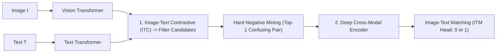

#### d. Code Thực chiến (C++ & Python)

```cpp
// C++17: Chọn chỉ số Hard Negative có điểm số cao nhất nhưng không phải đường chéo
#include <iostream>
#include <vector>

int find_hard_negative(const std::vector<float>& sim_row, int positive_idx) {
    int hard_neg_idx = -1;
    float max_neg_sim = -1e9f;
    for (int j = 0; j < (int)sim_row.size(); ++j) {
        if (j != positive_idx && sim_row[j] > max_neg_sim) {
            max_neg_sim = sim_row[j];
            hard_neg_idx = j;
        }
    }
    return hard_neg_idx;
}

int main() {
    std::vector<float> similarities = {0.9f, 0.75f, 0.82f, 0.1f}; // Pos = 0
    std::cout << "Hard Negative Index: " << find_hard_negative(similarities, 0) << " (Score: 0.82)\n";
    return 0;
}
```

```python
# Python / Transformers: Đánh giá Image-Text Matching với BLIP
from transformers import BlipProcessor, BlipForImageTextRetrieval
import torch
from PIL import Image

processor = BlipProcessor.from_pretrained("Salesforce/blip-itm-base-coco")
model = BlipForImageTextRetrieval.from_pretrained("Salesforce/blip-itm-base-coco")

dummy_image = Image.new('RGB', (224, 224), color = 'red')
caption = "A completely red image."
inputs = processor(images=dummy_image, text=caption, return_tensors="pt")
itm_out = model(**inputs)
cosine_score = itm_out.itm_score[0][1].item() # Xác suất match
print(f"Image-Text Matching Probability: {cosine_score * 100:.2f}%")
```

#### e. Lỗi Thường gặp & Ổn định Số học
- Dữ liệu Web thu thập bị gán nhãn ồn ào (Noisy Web Captions): Văn bản đi kèm ảnh trên Internet thường là quảng cáo hoặc tiêu đề giật gân không miêu tả hình ảnh. Cần áp dụng bộ lọc chú thích CapFilt (như trong BLIP) để loại bỏ các cặp nhiễu trước khi căn chỉnh.

#### f. Ứng dụng Thực chiến trong AI
Kiểm duyệt nội dung vi phạm kết hợp ảnh và text (Multimodal Hate Speech Detection) trên mạng xã hội Facebook, Instagram.

---

### 12. Cross-Modal Retrieval (Truy xuất Xuyên Phương thức)

#### a. Định nghĩa Bản chất Toán học (Mathematical Formulation)
Truy xuất xuyên phương thức bao gồm:
1. **Text-to-Image Retrieval (T2I)**: Cho câu truy vấn $q_{\text{txt}}$, tìm ảnh $I^* \in \mathcal{G}_{\text{img}}$:
$$I^* = \arg\max_{I \in \mathcal{G}_{\text{img}}} \cos\left( f_{\text{txt}}(q_{\text{txt}}), f_{\text{img}}(I) \right)$$
2. **Image-to-Text Retrieval (I2T)**: Cho ảnh truy vấn $q_{\text{img}}$, tìm chú thích tương ứng $T^*$.
Chỉ số đánh giá tiêu chuẩn là Recall at K (R@1, R@5, R@10) và Trung vị Thứ hạng (Median Rank - MedR):
$$\text{R@K} = \frac{1}{|Q|} \sum_{q=1}^{|Q|} \mathbb{I}\left( \text{Rank}(q) \le K \right)$$

#### b. Cơ chế Tầng Sâu & Điện toán (Under The Hood / Hardware Internals)
- **Vector Database & HNSW Indexing**: Khi tập cơ sở dữ liệu ảnh $\mathcal{G}_{\text{img}}$ lên tới hàng trăm triệu ảnh, việc tính toán trực tiếp tích vô hướng $f_{\text{txt}}(q) \cdot f_{\text{img}}(I)$ với toàn bộ cơ sở dữ liệu (Brute-force Flat Search) là quá chậm. Người ta tính trước toàn bộ vector nhúng của ảnh rồi nạp vào cơ sở dữ liệu vector (Faiss, Milvus, Qdrant) sử dụng cấu trúc đồ thị Hierarchical Navigable Small World (HNSW) kết hợp lượng tử hóa tích phân lượng tử (Product Quantization - PQ) để truy vấn trong dưới $5\text{ms}$.

#### c. Sơ đồ Minh họa (Mermaid Diagram)


#### d. Code Thực chiến (C++ & Python)

```cpp
// C++17: Tính chỉ số Recall@1 từ mảng thứ hạng các truy vấn
#include <iostream>
#include <vector>

float compute_recall_at_k(const std::vector<int>& ranks, int k) {
    size_t hits = 0;
    for (int r : ranks) {
        if (r <= k) hits++;
    }
    return static_cast<float>(hits) / ranks.size();
}

int main() {
    std::vector<int> query_ranks = {1, 3, 1, 8, 2, 1}; // Thứ hạng ground-truth tìm được
    std::cout << "Recall@1: " << compute_recall_at_k(query_ranks, 1) * 100.0f << "%\n";
    std::cout << "Recall@5: " << compute_recall_at_k(query_ranks, 5) * 100.0f << "%\n";
    return 0;
}
```

```python
# Python / Faiss: Xây dựng chỉ mục HNSW tìm kiếm đa phương thức tốc độ cao
import faiss
import numpy as np

dim = 512
num_images = 10000

# Tạo dữ liệu giả lập các vector ảnh chuẩn hóa L2
image_embeddings = np.random.randn(num_images, dim).astype('float32')
faiss.normalize_L2(image_embeddings)

# Khởi tạo HNSW Index với metric Inner Product
index = faiss.IndexHNSWFlat(dim, 32, faiss.METRIC_INNER_PRODUCT)
index.add(image_embeddings)

# Truy vấn bằng vector câu hỏi
query_text_vector = np.random.randn(1, dim).astype('float32')
faiss.normalize_L2(query_text_vector)

D, I = index.search(query_text_vector, k=5)
print("Top 5 Retrieved Image IDs:", I[0])
print("Cosine Similarities:", D[0])
```

#### e. Lỗi Thường gặp & Ổn định Số học
- Sự mất mát độ chính xác do lượng tử hóa tích phân lượng tử (PQ Loss): Việc nén vector nhúng từ float32 xuống 8-bit codes trong cơ sở dữ liệu vector lớn có thể làm thay đổi thứ tự của các kết quả Top-1 nhạy cảm. Cần cấu hình bước tái xếp hạng (Reranking) với vector gốc cho Top-50 ứng viên.

#### f. Ứng dụng Thực chiến trong AI
Tính năng tìm kiếm bằng hình ảnh của Google Lens, Pinterest Visual Search, hệ thống Multimodal RAG (Retrieval-Augmented Generation).
