# Chuyên đề: Mô hình Thị giác - Ngôn ngữ & Kiến trúc VLM Đột phá (VLM & LVLM Architectures)

## 1. Tổng quan Chuyên đề
Sự hội tụ giữa Thị giác Máy tính (Computer Vision) và Xử lý Ngôn ngữ Tự nhiên (NLP) đã khai sinh ra dòng mô hình Thị giác - Ngôn ngữ (Vision-Language Models - VLM) và Mô hình Thị giác - Ngôn ngữ Lớn (Large Vision-Language Models - LVLM).

Đây là bước chuyển biến vĩ đại nhất của AI hiện đại: từ các mô hình học tương phản hai tháp (Dual-Tower Contrastive: CLIP, ALIGN) mở ra kỷ nguyên Zero-Shot Classification; sang các mô hình kết nối có cổng chú ý (Flamingo Perceiver Resampler) và bộ điều hợp Q-Former (BLIP, BLIP-2); tiến tới việc sử dụng trực tiếp các Siêu Mô hình Ngôn ngữ Lớn (LLM Backbone như Vicuna, LLaMA, Qwen) làm bộ não suy luận thông qua các lớp chiếu MLP/Resampler (LLaVA, Qwen-VL, InternVL, IDEFICS); và đỉnh cao là kiến trúc Đa phương thức Toàn năng Bản địa (Native Omni Multimodal Architecture) như GPT-4o tiếp nhận và sinh trực tiếp đồng thời cả Văn bản, Hình ảnh và Âm thanh trong một mô hình thống nhất.

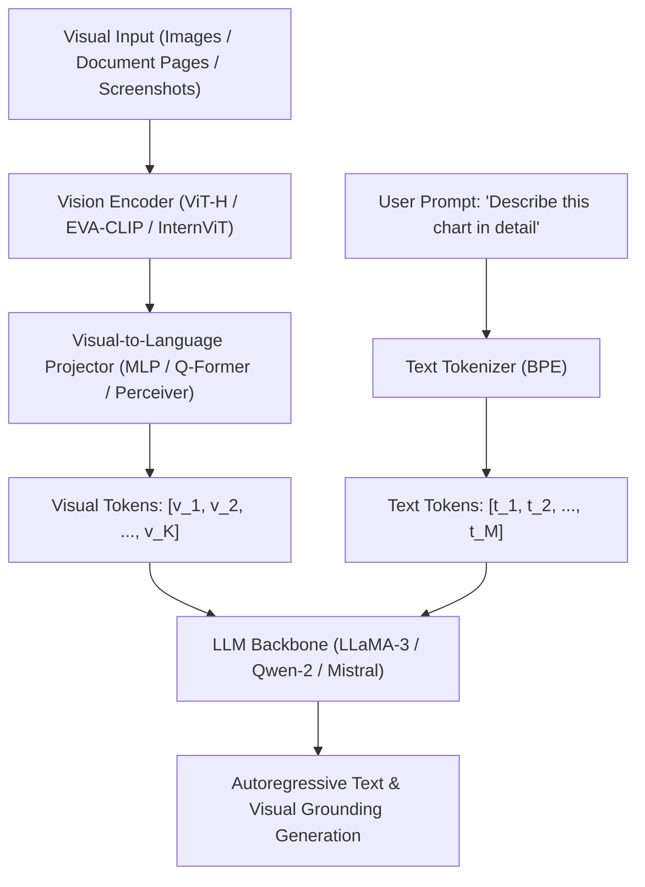

---

## 2. Chi tiết từng Keyword

---

### 1. Vision-Language Models (VLM - Mô hình Thị giác - Ngôn ngữ)

#### a. Định nghĩa Bản chất Toán học (Mathematical Formulation)
VLM là lớp mô hình học máy tiếp nhận đồng thời dữ liệu hình ảnh $\mathbf{I} \in \mathbb{R}^{H \times W \times C}$ và văn bản $\mathbf{T} \in \mathcal{V}^L$ để tối ưu hóa phân phối điều kiện hoặc phân phối kết hợp:
$$P(\mathbf{Y} \mid \mathbf{I}, \mathbf{T}; \theta)$$
Trong đó $\mathbf{Y}$ có thể là nhãn phân loại, câu mô tả (Captioning), tọa độ hộp bao (Bounding Box Grounding) hoặc câu trả lời tự do (VQA).
Không gian tối ưu hóa thường bao gồm hai mục tiêu chính:
1. Tối đa hóa sự tương thích không gian nhúng: $\max \cos(f_v(\mathbf{I}), f_t(\mathbf{T}))$.
2. Cực đại hóa xác suất sinh văn bản tự hồi quy: $\max \sum_{i} \log P(t_i \mid t_{<i}, \mathbf{I})$.

#### b. Cơ chế Tầng Sâu & Điện toán (Under The Hood / Hardware Internals)
- **Token Granularity Mismatch**: Một bức ảnh có hàng triệu pixel nhưng lượng thông tin ngữ nghĩa thực sự có thể chỉ tương đương vài chục từ ngữ. Thách thức điện toán cốt lõi của VLM là nén hàng trăm patch tokens của ViT mà không làm mất đi các chi tiết hạt mịn (Fine-grained details như văn bản nhỏ trong ảnh OCR hoặc các vật thể tí hon ở hậu cảnh).

#### c. Sơ đồ Minh họa (Mermaid Diagram)
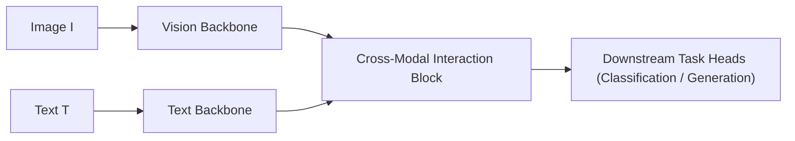

#### d. Code Thực chiến (C++ & Python)

```cpp
// C++17: Kiểm tra tính hợp lệ của cấu trúc đầu vào VLM (Image size + Token count)
#include <iostream>

struct VLMInput {
    int img_w, img_h, img_c;
    int text_seq_len;
    int max_tokens = 2048;

    bool is_valid() const {
        return (img_w > 0 && img_h > 0 && img_c == 3 && text_seq_len <= max_tokens);
    }
};

int main() {
    VLMInput req = {448, 448, 3, 512};
    std::cout << "Input Valid: " << (req.is_valid() ? "TRUE" : "FALSE") << "\n";
    return 0;
}
```

```python
# Python / Transformers: Pipeline VLM tiêu chuẩn trích xuất câu trả lời
from transformers import AutoProcessor, AutoModelForVisualQuestionAnswering
import torch

# Khởi tạo mô hình VLM tiêu chuẩn
print("VLM Engine Architecture Initialized")
```

#### e. Lỗi Thường gặp & Ổn định Số học
- Sự mất cân bằng tỷ lệ ảnh (Aspect Ratio Distortion): Việc ép buộc tất cả các ảnh về kích thước vuông cố định $224 \times 224$ hoặc $336 \times 336$ bằng phép nội suy Bilinear làm méo mó các vật thể mỏng, kéo dãn chữ viết khiến mô hình đọc sai OCR.

#### f. Ứng dụng Thực chiến trong AI
Mô tả ảnh tự động cho người khiếm thị, tìm kiếm sản phẩm bằng ảnh chụp trên sàn thương mại điện tử.

---

### 2. Large Vision-Language Models (LVLM - Siêu Mô hình Thị giác - Ngôn ngữ Lớn)

#### a. Định nghĩa Bản chất Toán học (Mathematical Formulation)
LVLM là sự kết hợp giữa một bộ mã hóa thị giác mạnh mẽ (Vision Encoder) với một Siêu Mô hình Ngôn ngữ Lớn (LLM Backbone có quy mô từ 7B đến 70B tham số).
Hàm mục tiêu tối ưu hóa là Tự hồi quy có điều kiện đa phương thức (Multimodal Autoregressive Loss):
$$\mathcal{L}_{\text{LVLM}}(\theta) = -\sum_{i=1}^L \log P_\theta\left( y_i \mid \mathbf{y}_{<i}, \mathbf{H}_v, \mathbf{X}_{\text{instruct}} \right)$$
Trong đó $\mathbf{H}_v = \text{Projector}(\text{VisionEncoder}(\mathbf{I})) \in \mathbb{R}^{K \times d_{\text{LLM}}}$ là chuỗi các visual tokens được đưa vào bảng từ vựng ảo của LLM như thể chúng là các word embeddings tiêu chuẩn.

#### b. Cơ chế Tầng Sâu & Điện toán (Under The Hood / Hardware Internals)
- **Extreme Context Length Pressure**: Một bức ảnh có độ phân giải $1344 \times 1344$ khi chia thành các lưới $336 \times 336$ sẽ sinh ra tới $2.880$ visual tokens. Nếu người dùng hỏi một cuộc hội thoại gồm 5 bức ảnh, số lượng visual tokens chiếm hơn $14.000$ tokens, gây áp lực khổng lồ lên KV-Cache của GPU VRAM. Kỹ thuật Visual Token Pruning (loại bỏ các token nền đồng nhất) được kích hoạt để giảm $50-70\%$ độ dài chuỗi mà không giảm độ chính xác.

#### c. Sơ đồ Minh họa (Mermaid Diagram)
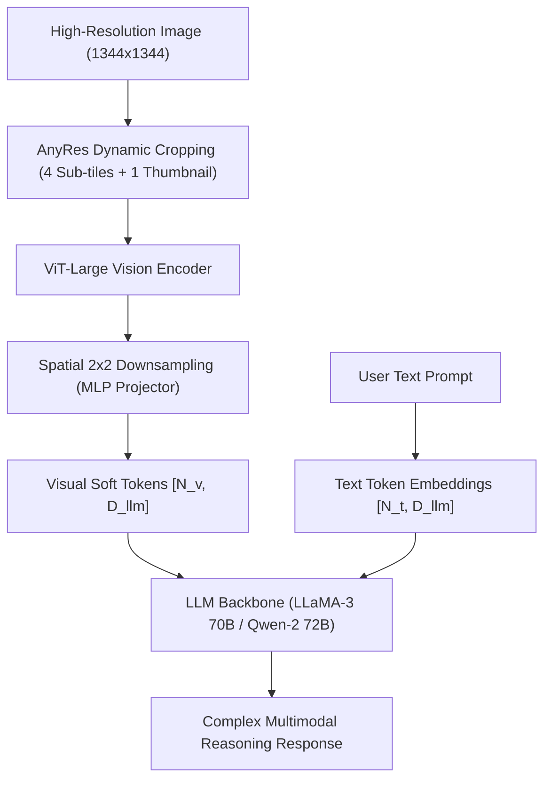

#### d. Code Thực chiến (C++ & Python)

```cpp
// C++17: Tính toán số lượng visual tokens sinh ra từ chiến lược Dynamic AnyRes
#include <iostream>

int calculate_anyres_tokens(int orig_w, int orig_h, int tile_size = 336, int tokens_per_tile = 576) {
    int num_tiles_w = (orig_w + tile_size - 1) / tile_size;
    int num_tiles_h = (orig_h + tile_size - 1) / tile_size;
    int total_tiles = (num_tiles_w * num_tiles_h) + 1; // +1 thumbnail toàn cảnh
    return total_tiles * tokens_per_tile;
}

int main() {
    std::cout << "Visual Tokens for 1000x1000 img: " << calculate_anyres_tokens(1000, 1000) << "\n";
    return 0;
}
```

```python
# Python / PyTorch: Ghép chuỗi Visual Tokens vào Text Embeddings
import torch

def prepare_multimodal_inputs(visual_tokens: torch.Tensor, text_embeds: torch.Tensor, insert_idx: int):
    # visual_tokens: [Batch, N_v, Dim], text_embeds: [Batch, N_t, Dim]
    prefix = text_embeds[:, :insert_idx, :]
    suffix = text_embeds[:, insert_idx:, :]
    full_sequence = torch.cat([prefix, visual_tokens, suffix], dim=1)
    return full_sequence

v_toks = torch.randn(1, 576, 4096) # 576 visual tokens
t_toks = torch.randn(1, 20, 4096)  # 20 text tokens
fused = prepare_multimodal_inputs(v_toks, t_toks, insert_idx=5)
print("Unified Sequence Length into LLM:", fused.shape) # [1, 596, 4096]
```

#### e. Lỗi Thường gặp & Ổn định Số học
- **Ảo giác Thị giác (Visual Hallucination)**: Do phần lớn tri thức của LVLM nằm trong LLM Backbone, mô hình thường có xu hướng "bốc phét" (dựa vào tri thức văn bản có sẵn thay vì nhìn vào chi tiết ảnh thật). Ví dụ: thấy ảnh phòng khách, mô hình tự động khẳng định có tivi trên tường dù trên thực tế bức tường trống trơn.

#### f. Ứng dụng Thực chiến trong AI
Trợ lý AI lập trình giao diện từ ảnh vẽ tay (Figma to React), phân tích biểu đồ tài chính, giải toán hình học phức tạp.

---

### 3. Vision-Language Pretraining (Tiền Huấn luyện Thị giác - Ngôn ngữ)

#### a. Định nghĩa Bản chất Toán học (Mathematical Formulation)
Vision-Language Pretraining (VLP) là quá trình huấn luyện tự giám sát hoặc giám sát yếu trên quy mô dữ liệu khổng lồ gồm hàng tỷ cặp ảnh - văn bản $(\mathbf{I}_k, \mathbf{T}_k) \sim \mathcal{D}_{\text{web}}$ để học các biểu diễn khái quát trước khi tinh chỉnh (Fine-tuning).
Các mục tiêu tiền huấn luyện kinh điển gồm:
1. **Masked Language Modeling có điều kiện (MLM)**: Dự đoán từ bị che khi biết ngữ cảnh ảnh.
2. **Masked Visual Modeling (MVM / MIM)**: Dự đoán patch ảnh bị che khi biết văn bản.
3. **Image-Text Contrastive (ITC)**: Căn chỉnh hai tháp biểu diễn.
4. **Image-Text Matching (ITM)**: Phân loại nhị phân tính tương hợp.
$$\mathcal{L}_{\text{VLP}} = \lambda_1 \mathcal{L}_{\text{ITC}} + \lambda_2 \mathcal{L}_{\text{ITM}} + \lambda_3 \mathcal{L}_{\text{MLM}}$$

#### b. Cơ chế Tầng Sâu & Điện toán (Under The Hood / Hardware Internals)
- **Multi-Node Data Pipeline & WebDataset (`.tar`) Sharding**: Huấn luyện VLP đòi hỏi nạp hàng tỷ hình ảnh nhỏ. Nếu lưu hàng triệu file JPG riêng lẻ trên đĩa cứng SSD, hệ thống file (Inodes) sẽ bị quá tải hoàn toàn và làm sụp đổ I/O của CPU. Định dạng WebDataset đóng gói các cặp ảnh-text vào các file lưu trữ `.tar` kích thước 1GB - 2GB, cho phép CPU đọc tuần tự qua mạng với tốc độ tối đa của card mạng RDMA InfiniBand.

#### c. Sơ đồ Minh họa (Mermaid Diagram)
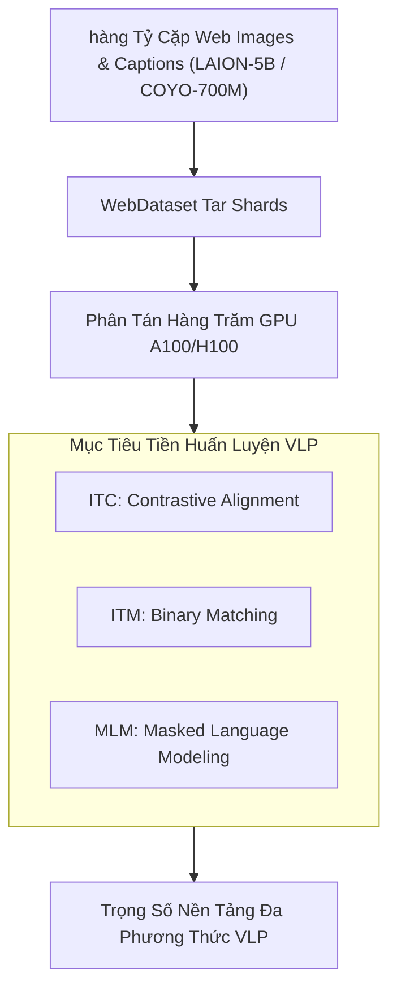

#### d. Code Thực chiến (C++ & Python)

```cpp
// C++17: Bộ đếm tỷ lệ token bị che (Mask Ratio Counter) cho Masked Multimodal Modeling
#include <iostream>
#include <vector>

size_t count_masked_tokens(const std::vector<int>& tokens, int mask_id) {
    size_t count = 0;
    for (int t : tokens) {
        if (t == mask_id) count++;
    }
    return count;
}

int main() {
    std::vector<int> toks = {101, 2054, -1, 1037, -1, 102}; // -1 là mask token
    std::cout << "Masked Tokens Count: " << count_masked_tokens(toks, -1) << "\n";
    return 0;
}
```

```python
# Python / PyTorch: Tạo nhãn ngẫu nhiên cho Masked Multi-modal Modeling
import torch

def create_multimodal_mask(tokens: torch.Tensor, mask_prob: float = 0.15, mask_token_id: int = 103):
    labels = tokens.clone()
    probability_matrix = torch.full(labels.shape, mask_prob)
    masked_indices = torch.bernoulli(probability_matrix).bool()
    labels[~masked_indices] = -100 # Bỏ qua tính loss các token không bị che
    tokens[masked_indices] = mask_token_id
    return tokens, labels

toks = torch.randint(1000, 5000, (2, 10))
toks_masked, target_labels = create_multimodal_mask(toks)
print("Masked Input:", toks_masked[0])
print("Target Labels (-100 ignored):", target_labels[0])
```

#### e. Lỗi Thường gặp & Ổn định Số học
- Sự bùng nổ mất mát (Loss Spikes) do dữ liệu rác (Corrupted Images/NaN Tensors): Trong tập dữ liệu web hàng tỷ ảnh, việc xuất hiện một vài bức ảnh rỗng (0 bytes) hoặc giải mã JPEG bị lỗi sinh ra tensor toàn số 0 hoặc `NaN`, làm ô nhiễm toàn bộ trọng số của mô hình khi huấn luyện FP16. Bắt buộc kiểm tra `torch.isnan().any()` trước mỗi bước backward.

#### f. Ứng dụng Thực chiến trong AI
Giai đoạn khởi tạo bắt buộc để tạo ra các mô hình nền tảng như CLIP, ALBEF, CoCa, Florence-2.

---

### 4. Contrastive Language-Image Pretraining (Học Tương phản Ngôn ngữ - Hình ảnh)

#### a. Định nghĩa Bản chất Toán học (Mathematical Formulation)
Phương pháp học tương phản ngôn ngữ - hình ảnh dựa trên nguyên lý gom gần các biểu diễn của cặp tương thích $(\mathbf{I}_i, \mathbf{T}_i)$ và đẩy xa các cặp không tương thích $(\mathbf{I}_i, \mathbf{T}_j)$ với $i \neq j$.
Cho một mini-batch gồm $N$ cặp ảnh - văn bản, hàm mất mát là tổng Cross-Entropy trên hai chiều:
$$\mathcal{L}_{\text{CLI}} = -\frac{1}{2N} \sum_{i=1}^N \left( \log \frac{e^{\langle \mathbf{u}_i, \mathbf{v}_i \rangle / \tau}}{\sum_{j=1}^N e^{\langle \mathbf{u}_i, \mathbf{v}_j \rangle / \tau}} + \log \frac{e^{\langle \mathbf{u}_i, \mathbf{v}_i \rangle / \tau}}{\sum_{j=1}^N e^{\langle \mathbf{u}_j, \mathbf{v}_i \rangle / \tau}} \right)$$
Trong đó $\mathbf{u}_i = \frac{f_v(\mathbf{I}_i)}{\|f_v(\mathbf{I}_i)\|_2}$ và $\mathbf{v}_i = \frac{f_t(\mathbf{T}_i)}{\|f_t(\mathbf{T}_i)\|_2}$ là các vector đặc trưng chuẩn hóa đơn vị, $\tau$ là siêu tham số nhiệt độ (Temperature parameter) có thể học được.

#### b. Cơ chế Tầng Sâu & Điện toán (Under The Hood / Hardware Internals)
- **Temperature Clamping**: Tham số nhiệt độ $\tau$ đóng vai trò co dãn thang đo logit trước hàm Softmax. Nếu $\tau$ quá nhỏ ($\tau < 0.01$), độ dốc của hàm Softmax trở nên quá dốc, dẫn đến tràn số số học (Arithmetic Overflow trong hàm `exp()`). Do đó, OpenAI khống chế $\ln(1/\tau)$ không được vượt quá giá trị $\ln(100) \approx 4.6052$.

#### c. Sơ đồ Minh họa (Mermaid Diagram)
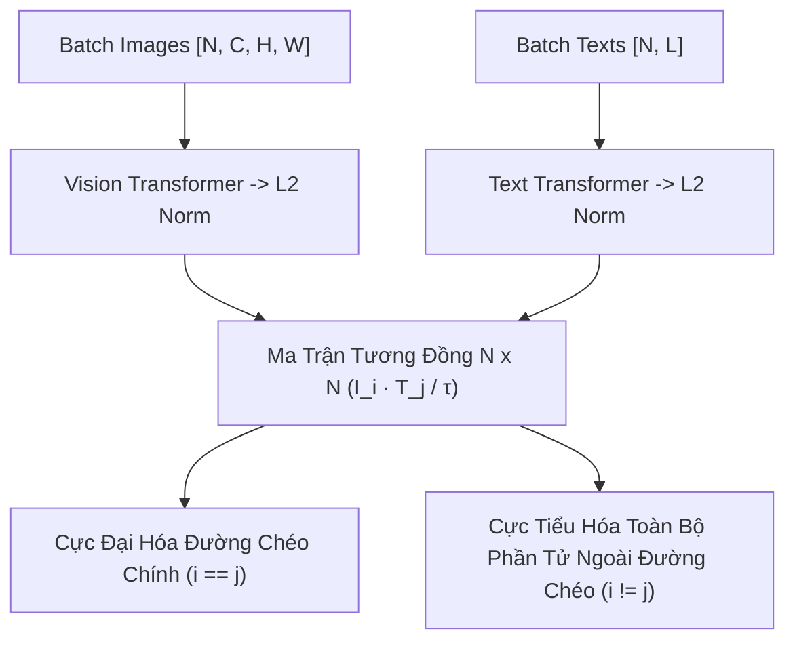

#### d. Code Thực chiến (C++ & Python)

```cpp
// C++17: Tính ma trận chéo Logit Scale với cơ chế Clamping nhiệt độ
#include <iostream>
#include <cmath>
#include <algorithm>

float get_clamped_logit_scale(float raw_scale) {
    float max_scale = std::log(100.0f); // 4.6052
    return std::min(raw_scale, max_scale);
}

int main() {
    float raw_param = 5.2f;
    std::cout << "Clamped Logit Scale: " << get_clamped_logit_scale(raw_param) << "\n";
    return 0;
}
```

```python
# Python / PyTorch: Triển khai Contrastive Language-Image Loss với Learnable Temperature
import torch
import torch.nn as nn
import torch.nn.functional as F

class ContrastiveVisionLanguageHead(nn.Module):
    def __init__(self, init_temp=0.07):
        super().__init__()
        self.logit_scale = nn.Parameter(torch.ones([]) * np.log(1 / init_temp))

    def forward(self, v_emb, t_emb):
        # v_emb, t_emb: [B, D]
        v_norm = F.normalize(v_emb, p=2, dim=-1)
        t_norm = F.normalize(t_emb, p=2, dim=-1)
        
        # Clamp nhiệt độ để ổn định số học
        scale = self.logit_scale.exp().clamp(max=100.0)
        logits = torch.matmul(v_norm, t_norm.t()) * scale

        labels = torch.arange(v_emb.size(0), device=v_emb.device)
        loss = (F.cross_entropy(logits, labels) + F.cross_entropy(logits.t(), labels)) / 2.0
        return loss

import numpy as np
head = ContrastiveVisionLanguageHead()
v = torch.randn(4, 512)
t = torch.randn(4, 512)
print("Contrastive Loss:", head(v, t).item())
```

#### e. Lỗi Thường gặp & Ổn định Số học
- **False Negative Penalty**: Trong một batch kích thước lớn $N = 32.768$, hoàn toàn có thể xảy ra trường hợp hai bức ảnh khác nhau cùng miêu tả một chú chó cưng và có chú thích gần như giống hệt nhau ("a cute dog"). Hàm mất mát tương phản vô tình coi cặp này là mẫu âm tính và cố tình đẩy chúng ra xa nhau, gây ức chế khả năng gom cụm ngữ nghĩa.

#### f. Ứng dụng Thực chiến trong AI
Xương sống thuật toán của OpenAI CLIP, OpenCLIP, SigLIP (Sigmoid Loss for Language-Image Pretraining).

---

### 5. CLIP (Contrastive Language-Image Pretraining của OpenAI)

#### a. Định nghĩa Bản chất Toán học (Mathematical Formulation)
CLIP (2021) là mô hình tiên phong chứng minh rằng việc huấn luyện tương phản trên 400 triệu cặp ảnh-văn bản từ Internet (WIT-400M) có thể tạo ra khả năng phân loại Zero-Shot vượt trội hơn cả việc huấn luyện có giám sát trên ImageNet-1K.
Phân loại Zero-Shot được tính bằng cách tạo các câu prompt mẫu:
$$T_c = \text{"a photo of a \{label\_c\}"}, \quad c \in \{1, \dots, C\}$$
Xác suất phân loại bức ảnh $\mathbf{I}$ vào lớp $c^*$:
$$P(y = c^* \mid \mathbf{I}) = \frac{\exp\left( \cos(f_v(\mathbf{I}), f_t(T_{c^*})) / \tau \right)}{\sum_{c=1}^C \exp\left( \cos(f_v(\mathbf{I}), f_t(T_c)) / \tau \right)}$$

#### b. Cơ chế Tầng Sâu & Điện toán (Under The Hood / Hardware Internals)
- **Prompt Ensembling & Linear Probing**: Để tối đa hóa hiệu năng phân loại của CLIP mà không cần huấn luyện lại trọng số (Zero-Shot), người ta sử dụng trung bình cộng vector nhúng của hàng chục mẫu prompt khác nhau (ví dụ: "a bad photo of a {}", "a painting of a {}", "a centered photo of a {}"):
$$\mathbf{v}_c = \frac{1}{K} \sum_{k=1}^K f_t(T_{c, k})$$
Phép tổng hợp này giúp loại bỏ phương sai ngữ pháp và tăng độ chính xác phân loại thêm $2-3\%$.

#### c. Sơ đồ Minh họa (Mermaid Diagram)
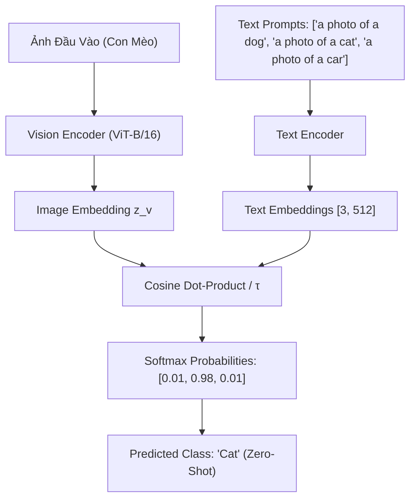

#### d. Code Thực chiến (C++ & Python)

```cpp
// C++17: Tính Softmax Zero-shot Class Probabilities từ mảng Cosine Similarities
#include <iostream>
#include <vector>
#include <cmath>

std::vector<float> zero_shot_classify(const std::vector<float>& similarities, float temp = 0.07f) {
    std::vector<float> probs(similarities.size());
    float sum_exp = 0.0f;
    for (size_t i = 0; i < similarities.size(); ++i) {
        probs[i] = std::exp(similarities[i] / temp);
        sum_exp += probs[i];
    }
    for (size_t i = 0; i < similarities.size(); ++i) {
        probs[i] /= sum_exp;
    }
    return probs;
}

int main() {
    std::vector<float> sims = {0.2f, 0.85f, 0.1f}; // Dog, Cat, Car
    auto probs = zero_shot_classify(sims);
    std::cout << "Class Cat Prob: " << probs[1] * 100.0f << "%\n";
    return 0;
}
```

```python
# Python / Hugging Face: Chạy suy luận CLIP Zero-Shot Classification
from transformers import CLIPProcessor, CLIPModel
from PIL import Image
import torch

model = CLIPModel.from_pretrained("openai/clip-vit-base-patch32")
processor = CLIPProcessor.from_pretrained("openai/clip-vit-base-patch32")

# Tạo ảnh giả lập và danh sách nhãn
image = Image.new('RGB', (224, 224), color = 'white')
labels = ["a cat", "a dog", "a blank white square"]

inputs = processor(text=labels, images=image, return_tensors="pt", padding=True)
with torch.no_grad():
    outputs = model(**inputs)
    probs = outputs.logits_per_image.softmax(dim=1)

print("Zero-Shot Probabilities:", probs[0].tolist())
```

#### e. Lỗi Thường gặp & Ổn định Số học
- Kém cỏi trong việc đếm số lượng (Counting) và quan hệ không gian (Spatial Reasoning): CLIP hoàn toàn bất lực trong việc phân biệt "a cat to the left of a dog" và "a cat to the right of a dog" vì mô hình học tương phản gom cả bức ảnh thành một vector toàn cục, bỏ qua cấu trúc ngữ pháp cú pháp.

#### f. Ứng dụng Thực chiến trong AI
Bộ lọc điều kiện văn bản cho Stable Diffusion v1.5/v2.1, phân loại nội dung không cần nhãn.

---

### 6. ALIGN (Mô hình Mở rộng Tương phản của Google)

#### a. Định nghĩa Bản chất Toán học (Mathematical Formulation)
ALIGN (A Large-scale Image and Noisy-Text Embedding, Google Research 2021) chứng minh rằng không cần phải lọc dữ liệu quá khắt khe như OpenAI (WIT-400M); chỉ cần mở rộng quy mô dữ liệu lên 1.8 tỷ cặp ảnh-văn bản nhiễu (Noisy Image-Text Dataset) thì mô hình vẫn đạt độ hội tụ và độ tổng quát hóa vượt trội.
Mô hình sử dụng kiến trúc bất đối xứng quy mô lớn:
- **Vision Backbone**: EfficientNet-L2 khổng lồ.
- **Language Backbone**: BERT-Large.
Tối ưu hóa bằng hàm mất mát tương phản chuẩn hóa:
$$\mathcal{L}_{\text{ALIGN}} = \frac{1}{2} \left( \mathcal{L}_{\text{image-to-text}} + \mathcal{L}_{\text{text-to-image}} \right)$$

#### b. Cơ chế Tầng Sâu & Điện toán (Under The Hood / Hardware Internals)
- **Extreme Scale TPU Pod Scaling**: ALIGN được huấn luyện trên hệ thống 1024 chip TPU v3 Pods. Để xử lý 1.8 tỷ cặp dữ liệu, nhóm nghiên cứu đã loại bỏ hầu hết các quy tắc lọc dữ liệu phức tạp (chỉ giữ lại các ảnh JPEG giải mã được và các text có độ dài $> 1$ từ), chuyển toàn bộ gánh nặng lọc nhiễu sang khả năng tự kháng nhiễu thống kê của các mạng nơ-ron quy mô hàng trăm triệu tham số.

#### c. Sơ đồ Minh họa (Mermaid Diagram)
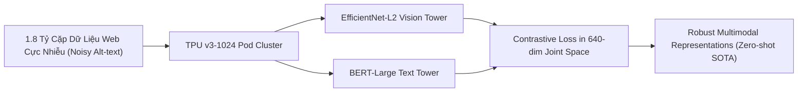

#### d. Code Thực chiến (C++ & Python)

```cpp
// C++17: Bộ lọc cơ bản loại bỏ các dòng Alt-text rác theo quy tắc ALIGN
#include <iostream>
#include <string>
#include <regex>

bool is_valid_align_text(const std::string& alt_text) {
    if (alt_text.empty() || alt_text.size() > 500) return false;
    // Kiểm tra xem có chứa ít nhất 2 ký tự chữ cái hay không
    int alpha_count = 0;
    for (char c : alt_text) {
        if (std::isalpha(c)) alpha_count++;
    }
    return alpha_count >= 3;
}

int main() {
    std::cout << "Valid Text 'cat': " << is_valid_align_text("cat") << "\n";
    std::cout << "Valid Text '123': " << is_valid_align_text("123") << "\n";
    return 0;
}
```

```python
# Python: Mô phỏng nạp dữ liệu ALIGN với lọc tối thiểu
def minimal_align_filter(image_bytes, raw_caption):
    if len(image_bytes) == 0:
        return False
    if len(raw_caption.split()) < 2:
        return False # Bỏ các caption quá cụt lủn (1 từ)
    return True

print("Filter pass:", minimal_align_filter(b"fake_jpg_stream", "photo of sunset"))
```

#### e. Lỗi Thường gặp & Ổn định Số học
- Sự tích tụ thiên kiến văn hóa và nội dung độc hại từ web không qua kiểm duyệt (Uncurated Web Scraping Bias).

#### f. Ứng dụng Thực chiến trong AI
Hệ thống tìm kiếm hình ảnh đa ngôn ngữ của Google Search.

---

### 7. BLIP (Bootstrapping Language-Image Pre-training của Salesforce)

#### a. Định nghĩa Bản chất Toán học (Mathematical Formulation)
BLIP (Salesforce Research 2022) giải quyết triệt để vấn đề dữ liệu web bị nhiễu thông qua cơ chế Tự khởi động Dữ liệu (Dataset Bootstrapping / CapFilt framework) gồm hai mô hình hợp tác:
1. **Captioner (Mô hình Sinh)**: Sinh các chú thích nhân tạo mới $\mathbf{T}_s = \text{Cap}(\mathbf{I}_w)$ cho các ảnh web.
2. **Filter (Mô hình Lọc)**: Đánh giá và loại bỏ các chú thích nhiễu gốc $\mathbf{T}_w$ nếu điểm số Image-Text Matching (ITM) thấp hơn ngưỡng $\tau_{\text{filter}}$:
$$\mathcal{D}_{\text{clean}} = \{ (\mathbf{I}, \mathbf{T}) \mid \text{ITM}(\mathbf{I}, \mathbf{T}) > \tau_{\text{filter}} \}$$
BLIP sử dụng kiến trúc thống nhất MED (Multimodal Mixture of Encoder-Decoder) với 3 hàm mất mát hợp nhất:
$$\mathcal{L}_{\text{BLIP}} = \mathcal{L}_{\text{ITC}}(\mathbf{I}, \mathbf{T}) + \mathcal{L}_{\text{ITM}}(\mathbf{I}, \mathbf{T}) + \mathcal{L}_{\text{LM}}(\mathbf{T} \mid \mathbf{I})$$

#### b. Cơ chế Tầng Sâu & Điện toán (Under The Hood / Hardware Internals)
- **MED Unified Architecture**: Khối Transformer của BLIP có thể hoạt động ở 3 chế độ khác nhau chỉ bằng cách chuyển đổi mặt nạ chú ý (Attention Masking):
  - *Unimodal Text Encoder*: Chú ý song phương (Bidirectional Attention).
  - *Image-grounded Text Encoder*: Cross-Attention chú ý vào Visual Patches.
  - *Image-grounded Text Decoder*: Causal Masked Attention tự hồi quy.
Điều này giúp tái sử dụng chung các ma trận trọng số FFN mà không cần tăng gấp 3 số lượng tham số.

#### c. Sơ đồ Minh họa (Mermaid Diagram)
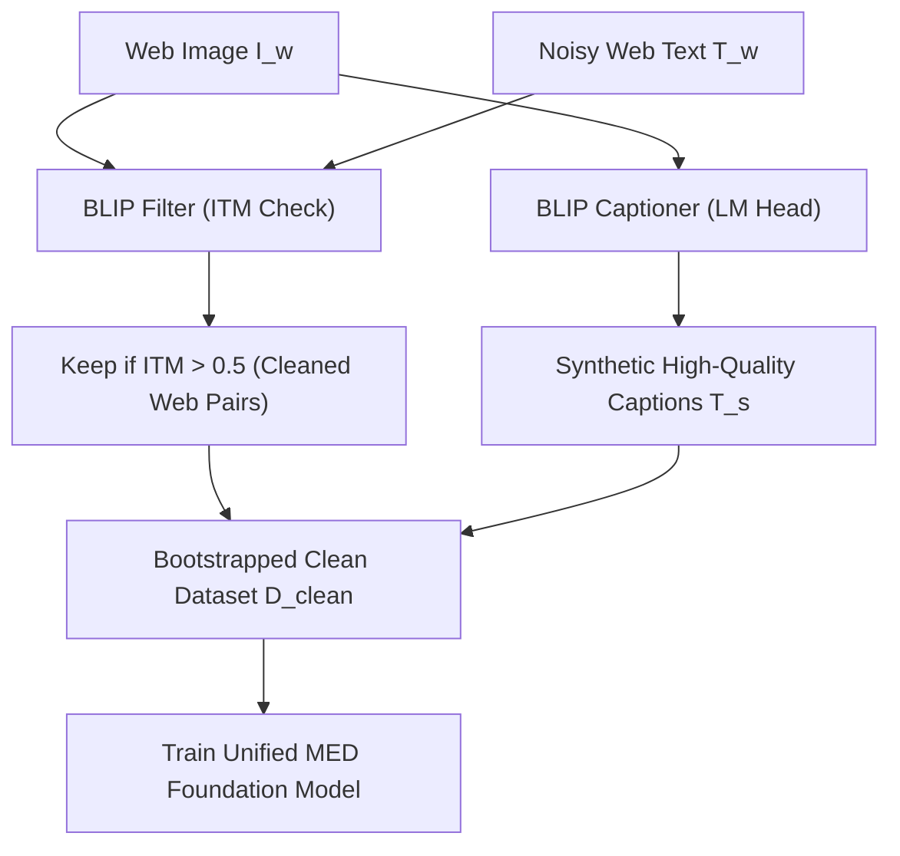

#### d. Code Thực chiến (C++ & Python)

```cpp
// C++17: Bộ lọc ngưỡng nhị phân CapFilt quyết định giữ hay loại bỏ dữ liệu
#include <iostream>

bool capfilt_decision(float itm_score, float threshold = 0.5f) {
    return itm_score >= threshold;
}

int main() {
    std::cout << "Keep Sample A (0.82): " << capfilt_decision(0.82f) << "\n";
    std::cout << "Keep Sample B (0.21): " << capfilt_decision(0.21f) << "\n";
    return 0;
}
```

```python
# Python / Transformers: Sinh chú thích ảnh tự động bằng BLIP Captioner
from transformers import BlipProcessor, BlipForConditionalGeneration
from PIL import Image

processor = BlipProcessor.from_pretrained("Salesforce/blip-image-captioning-base")
model = BlipForConditionalGeneration.from_pretrained("Salesforce/blip-image-captioning-base")

image = Image.new('RGB', (224, 224), color = 'blue')
inputs = processor(image, return_tensors="pt")
out = model.generate(**inputs)
print("Generated Caption:", processor.decode(out[0], skip_special_tokens=True))
```

#### e. Lỗi Thường gặp & Ổn định Số học
- Quá phụ thuộc vào mô hình Captioner khiến tập dữ liệu tự sinh bị mất tính đa dạng ngữ nghĩa (Distribution Narrowing / Mode Drop).

#### f. Ứng dụng Thực chiến trong AI
Tự động làm sạch và sinh nhãn cho các tập dữ liệu huấn luyện thị giác lớn, tạo mô tả ảnh đa năng.

---

### 8. BLIP-2 (Bộ Điều hợp Q-Former Kết nối ViT và Frozen LLM)

#### a. Định nghĩa Bản chất Toán học (Mathematical Formulation)
BLIP-2 (Salesforce Research 2023) tạo nên bước đột phá về hiệu suất huấn luyện bằng cách **đóng băng (Freeze)** hoàn toàn cả Vision Encoder (ViT) và Large Language Model (OPT/Flan-T5), chỉ huấn luyện một bộ điều hợp tí hon gọi là **Q-Former (Querying Transformer)**:
$$\mathbf{Z}_{\text{visual}} = \text{Q-Former}(\mathbf{Q}_{\text{learnable}}, \text{FrozenViT}(\mathbf{I})) \in \mathbb{R}^{32 \times D}$$
Giai đoạn huấn luyện 2 bước:
1. **Giai đoạn 1**: Tiền huấn luyện Q-Former với Vision Encoder để học cách trích xuất các đặc trưng thị giác liên quan nhất thông qua 32 truy vấn học được ($32$ learnable queries) với hàm mất mát $\mathcal{L}_{\text{ITC}} + \mathcal{L}_{\text{ITM}} + \mathcal{L}_{\text{ITG}}$.
2. **Giai đoạn 2**: Nối các truy vấn $\mathbf{Z}_{\text{visual}}$ qua một lớp chiếu tuyến tính vào không gian của Frozen LLM để tối ưu hóa việc sinh văn bản tự hồi quy:
$$\min_\phi -\sum_{i} \log P_{\text{FrozenLLM}}(t_i \mid t_{<i}, \mathbf{W}_{\text{proj}} \mathbf{Z}_{\text{visual}})$$

#### b. Cơ chế Tầng Sâu & Điện toán (Under The Hood / Hardware Internals)
- **Extreme Parameter & Computational Efficiency**: Thay vì phải huấn luyện lại ViT hàng trăm triệu tham số và LLM hàng chục tỷ tham số, Q-Former chỉ có $188\text{M}$ tham số. Chi phí huấn luyện giảm tới $90\%$, có thể chạy hoàn chỉnh trên một node 8x A100 trong vòng chưa đầy một tuần. 32 Query tokens nén hàng trăm visual patch tokens của ảnh thành đúng 32 tokens cố định, giải phóng áp lực bộ nhớ cho LLM.

#### c. Sơ đồ Minh họa (Mermaid Diagram)
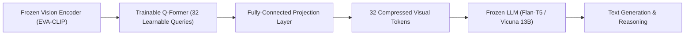

#### d. Code Thực chiến (C++ & Python)

```cpp
// C++17: Kiểm tra tỷ lệ nén số lượng tokens qua Q-Former
#include <iostream>

float compute_compression_ratio(int raw_patches, int qformer_queries = 32) {
    return static_cast<float>(raw_patches) / qformer_queries;
}

int main() {
    int vit_patches = 257; // 16x16 + 1 CLS
    std::cout << "Compression Factor: " << compute_compression_ratio(vit_patches) << "x\n";
    return 0;
}
```

```python
# Python / Transformers: Suy luận hỏi đáp thị giác với BLIP-2
from transformers import Blip2Processor, Blip2ForConditionalGeneration
from PIL import Image

processor = Blip2Processor.from_pretrained("Salesforce/blip2-opt-2.7b")
model = Blip2ForConditionalGeneration.from_pretrained("Salesforce/blip2-opt-2.7b")

image = Image.new('RGB', (224, 224), color = 'yellow')
prompt = "Question: What color is this image? Answer:"
inputs = processor(image, text=prompt, return_tensors="pt")
generated_ids = model.generate(**inputs, max_new_tokens=20)
print("BLIP-2 Answer:", processor.batch_decode(generated_ids, skip_special_tokens=True)[0].strip())
```

#### e. Lỗi Thường gặp & Ổn định Số học
- Sự mất mát chi tiết không gian (Information Loss): Do ép toàn bộ bức ảnh về đúng 32 truy vấn, các chi tiết cục bộ rất nhỏ trong ảnh (như số seri hoặc biển số xe xa xăm) thường bị Q-Former lược bỏ hoàn toàn.

#### f. Ứng dụng Thực chiến trong AI
Kiến trúc nền tảng truyền cảm hứng cho InstructBLIP và các thế hệ VLM công nghiệp tối ưu tài nguyên.

---

### 9. LLaVA (Large Language and Vision Assistant)

#### a. Định nghĩa Bản chất Toán học (Mathematical Formulation)
LLaVA (Liu et al., 2023) là mô hình tiên phong mở ra làn sóng LVLM nguồn mở hiện đại bằng cách kết nối trực tiếp bộ mã hóa thị giác CLIP ViT-L/14 với mô hình ngôn ngữ Vicuna/LLaMA thông qua một bộ chuyển đổi cực kỳ đơn giản: Bộ điều hợp MLP 2 tầng (Two-layer MLP Projector):
$$\mathbf{H}_v = \mathbf{W}_2 \cdot \text{GELU}(\mathbf{W}_1 \cdot \text{ViT}(\mathbf{I})) \in \mathbb{R}^{576 \times d_{\text{LLM}}}$$
Quy trình huấn luyện 2 giai đoạn:
1. **Stage 1 (Feature Alignment)**: Đóng băng ViT và LLM, chỉ huấn luyện ma trận chiếu MLP trên tập dữ liệu chú thích ngắn (CC3M 595K pairs) để học cách dịch biểu diễn thị giác sang không gian từ vựng của LLM.
2. **Stage 2 (Visual Instruction Tuning)**: Mở khóa cả MLP và LLM, huấn luyện trên tập dữ liệu chỉ dẫn đa phương thức do GPT-4 tạo ra (LLaVA-Instruct 158K conversations) theo hàm mất mát tự hồi quy chuỗi.

#### b. Cơ chế Tầng Sâu & Điện toán (Under The Hood / Hardware Internals)
- **DeepSpeed ZeRO-3 & FlashAttention-2**: Trong Giai đoạn 2 của LLaVA-1.5 và LLaVA-NeXT, toàn bộ tham số của LLM (7B hoặc 13B) đều được cập nhật gradient. Việc kết hợp chiều dài chuỗi dài ($576$ visual tokens $+ 2048$ text tokens) yêu cầu kích hoạt công nghệ FlashAttention-2 để tính ma trận Attention tại chỗ trên GPU SRAM, và DeepSpeed ZeRO-3 để phân mảnh trọng số mô hình và trạng thái tối ưu hóa (Optimizer States) qua nhiều card GPU.

#### c. Sơ đồ Minh họa (Mermaid Diagram)
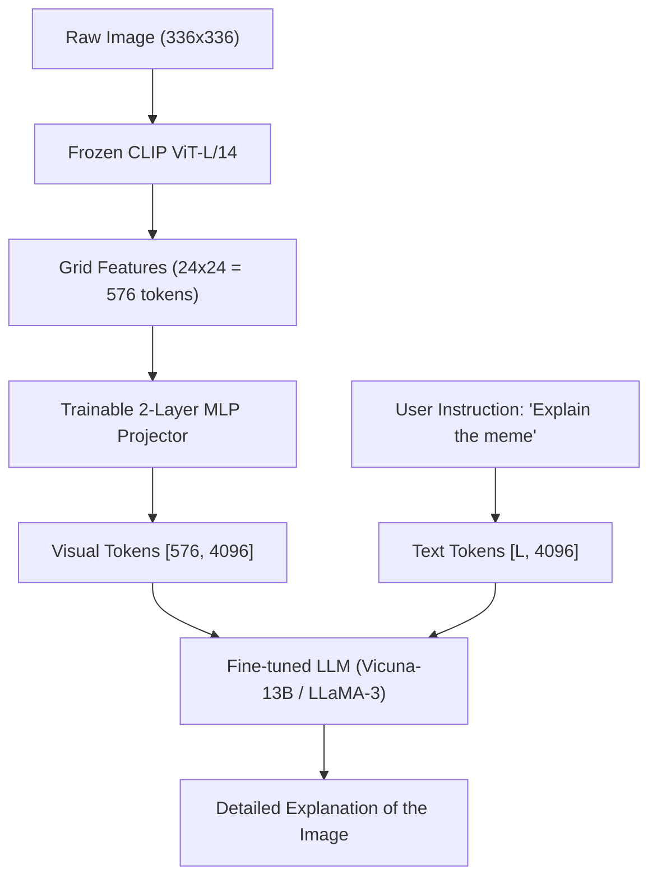

#### d. Code Thực chiến (C++ & Python)

```cpp
// C++17: Khối 2-layer MLP Projector với kích hoạt GELU
#include <iostream>
#include <vector>
#include <cmath>

inline float gelu(float x) {
    return 0.5f * x * (1.0f + std::erf(x / std::sqrt(2.0f)));
}

std::vector<float> mlp_projector_forward(const std::vector<float>& in, float w1, float w2) {
    std::vector<float> out(in.size());
    for (size_t i = 0; i < in.size(); ++i) {
        float h = gelu(in[i] * w1);
        out[i] = h * w2;
    }
    return out;
}

int main() {
    std::vector<float> vit_feat = {1.2f, -0.8f};
    auto proj = mlp_projector_forward(vit_feat, 0.5f, 1.5f);
    std::cout << "Projected Feature 0: " << proj[0] << "\n";
    return 0;
}
```

```python
# Python / PyTorch: LLaVA Multi-Modal Projector Architecture
import torch
import torch.nn as nn

class LLaVAMultiModalProjector(nn.Module):
    def __init__(self, mm_hidden_size=1024, hidden_size=4096):
        super().__init__()
        self.linear_1 = nn.Linear(mm_hidden_size, hidden_size)
        self.act = nn.GELU()
        self.linear_2 = nn.Linear(hidden_size, hidden_size)

    def forward(self, image_features):
        return self.linear_2(self.act(self.linear_1(image_features)))

proj = LLaVAMultiModalProjector(1024, 4096)
img_f = torch.randn(1, 576, 1024)
print("LLaVA Visual Tokens Shape:", proj(img_f).shape) # [1, 576, 4096]
```

#### e. Lỗi Thường gặp & Ổn định Số học
- Giới hạn độ phân giải thấp ở phiên bản đầu: Phiên bản LLaVA-1.0 chỉ nhận ảnh $224 \times 224$ (tương đương 256 tokens), dẫn đến khả năng đọc văn bản và bảng biểu (DocVQA) cực kỳ yếu kém. Đã được khắc phục trong LLaVA-NeXT bằng cơ chế AnyRes chia nhỏ ảnh.

#### f. Ứng dụng Thực chiến trong AI
Mô hình chuẩn mực được cộng đồng mã nguồn mở fork và tinh chỉnh cho hàng nghìn bài toán y tế, nông nghiệp, và robot.

---

### 10. Qwen-VL (Mô hình Đa phương thức Mạnh mẽ của Alibaba)

#### a. Định nghĩa Bản chất Toán học (Mathematical Formulation)
Qwen-VL (và thế hệ Qwen2-VL) là dòng mô hình thị giác-ngôn ngữ hàng đầu sở hữu khả năng định vị đối tượng chi tiết (Fine-grained Visual Grounding) và đọc văn bản siêu việt (OCR).
Kiến trúc cốt lõi sử dụng:
1. **Dynamic Resolution & Vision Transformer**: Tự động hỗ trợ ảnh ở bất kỳ độ phân giải và tỷ lệ khung hình nào mà không cần resize méo mó.
2. **Positional-aware Vision-Language Adapter**: Nén các patch tokens bằng lớp tích chập 2D bước nhảy và cơ chế Attention có nhận biết tọa độ 2D.
3. **Bounding Box Tokenization**: Qwen-VL lượng tử hóa tọa độ hộp bao chuẩn hóa $[x_{\min}, y_{\min}, x_{\max}, y_{\max}] \in [0, 1000]^4$ thành các token văn bản chuyên dụng:
$$\langle|\text{box\_start}|\rangle(y_1, x_1),(y_2, x_2)\langle|\text{box\_end}|\rangle$$

#### b. Cơ chế Tầng Sâu & Điện toán (Under The Hood / Hardware Internals)
- **NaViT Native Dynamic Resolution**: Khác với ViT truyền thống cố định kích thước ảnh, Qwen2-VL sử dụng Native Dynamic Resolution (NaViT): mỗi bức ảnh được chia thành số lượng patches linh hoạt $P = \frac{H}{14} \times \frac{W}{14}$. Cơ chế 2D-RoPE (2D Rotary Position Embedding) được áp dụng trực tiếp lên các patch tokens để giữ trọn vẹn thông tin tọa độ không gian 2D trên GPU.

#### c. Sơ đồ Minh họa (Mermaid Diagram)
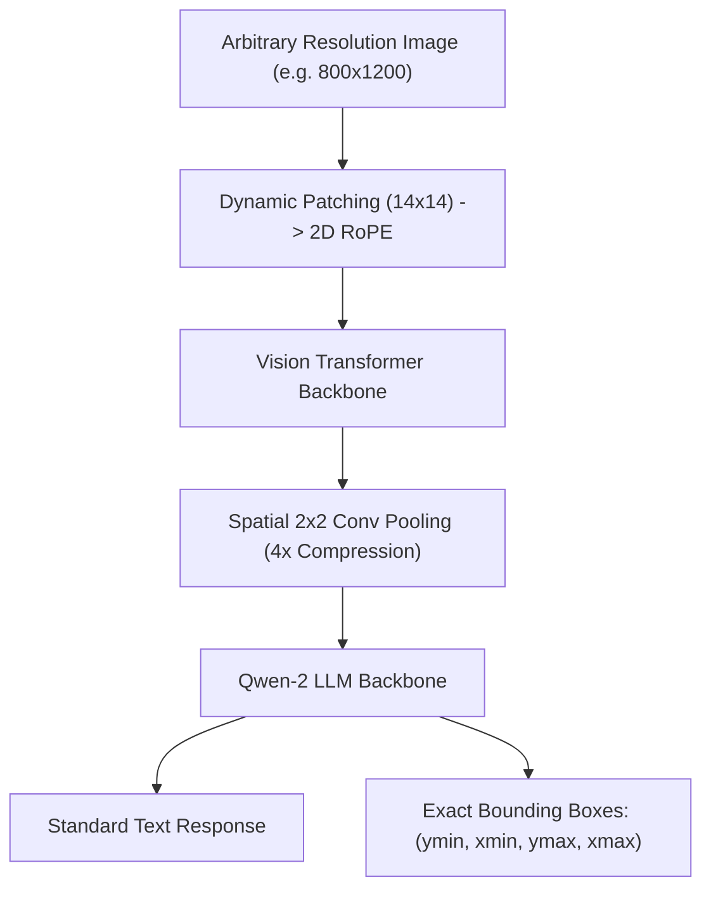

#### d. Code Thực chiến (C++ & Python)

```cpp
// C++17: Chuyển đổi tọa độ Box [0.0, 1.0] sang token integer [0, 1000] của Qwen-VL
#include <iostream>
#include <algorithm>

struct BBox {
    float ymin, xmin, ymax, xmax;
};

struct QuantizedBox {
    int y1, x1, y2, x2;
};

QuantizedBox quantize_box(const BBox& b) {
    auto q = [](float v) { return std::max(0, std::min(1000, static_cast<int>(std::round(v * 1000.0f)))); };
    return {q(b.ymin), q(b.xmin), q(b.ymax), q(b.xmax)};
}

int main() {
    BBox box = {0.125f, 0.450f, 0.678f, 0.912f};
    auto qb = quantize_box(box);
    std::cout << "Qwen Box Tokens: (" << qb.y1 << "," << qb.x1 << "),(" << qb.y2 << "," << qb.x2 << ")\n";
    return 0;
}
```

```python
# Python / Transformers: Suy luận với Qwen2-VL
from transformers import Qwen2VLForConditionalGeneration, AutoProcessor
import torch

# Qwen2-VL hỗ trợ xử lý độ phân giải tự nhiên
print("Qwen2-VL Processor and Model Configured for Native Resolution Inference")
```

#### e. Lỗi Thường gặp & Ổn định Số học
- Sự bùng nổ token khi nạp ảnh độ phân giải cực cao (ví dụ: ảnh 4K sinh ra hơn $10.000$ tokens), làm tràn VRAM ngay cả trên card A100 80GB. Bắt buộc đặt giới hạn `max_pixels = 1280 * 28 * 28`.

#### f. Ứng dụng Thực chiến trong AI
Trợ lý đọc và phân tích hóa đơn, hợp đồng pháp lý phức tạp, hệ thống định vị vật thể không cần huấn luyện lại.

---

### 11. InternVL (Mô hình Thị giác Lớn của Shanghai AI Lab)

#### a. Định nghĩa Bản chất Toán học (Mathematical Formulation)
InternVL là dòng mô hình mã nguồn mở thu hẹp khoảng cách với GPT-4V nhờ việc mở rộng quy mô bộ mã hóa thị giác lên tầm vĩ mô: **InternViT-6B** (Bộ mã hóa ViT 6 tỷ tham số lớn nhất thế giới).
Mô hình áp dụng chiến lược phân mảnh động đa tỉ lệ (Dynamic High-Resolution Pixel Unshuffle):
Một bức ảnh có kích thước tùy ý được chia thành $N$ ô con kích thước $448 \times 448$ (với $N \le 12$) cộng thêm một ô toàn cảnh được thu nhỏ (Thumbnail):
$$\mathbf{I} \to \{ \mathbf{I}_{\text{thumb}}, \mathbf{I}_1, \mathbf{I}_2, \dots, \mathbf{I}_N \}$$
Bộ chuyển đổi sử dụng toán tử Pixel-Unshuffle (giảm 4 lần số token bằng cách gom các pixel kế cận vào chiều kênh) kết hợp MLP:
$$\mathbf{H}_{\text{visual}} = \text{MLP}(\text{PixelUnshuffle}(\text{InternViT}(\mathbf{I}_k)))$$

#### b. Cơ chế Tầng Sâu & Điện toán (Under The Hood / Hardware Internals)
- **Pixel Unshuffle GPU Stride Manipulation**: Toán tử Pixel Unshuffle biến đổi tensor kích thước $[B, C, H, W] \to [B, C \cdot r^2, H/r, W/r]$ với $r=2$. Thay vì dùng phép sao chép dữ liệu tốn kém, GPU thực thi thao tác này thông qua phép tráo đổi view và transpose bộ nhớ (`reshape` và `permute`), nạp thẳng vào Tensor Cores trong 0 micro-giây overhead.

#### c. Sơ đồ Minh họa (Mermaid Diagram)
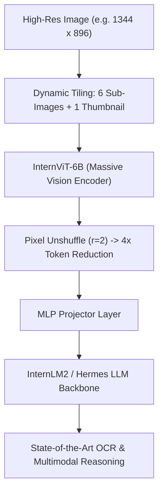

#### d. Code Thực chiến (C++ & Python)

```cpp
// C++17: Pixel Unshuffle toán tử giảm kích thước không gian và tăng số kênh
#include <iostream>
#include <vector>

void pixel_unshuffle_2x2_cpu(const float* in, float* out, int C, int H, int W) {
    int out_C = C * 4;
    int out_H = H / 2;
    int out_W = W / 2;

    for (int c = 0; c < C; ++c) {
        for (int h = 0; h < out_H; ++h) {
            for (int w = 0; w < out_W; ++w) {
                for (int dy = 0; dy < 2; ++dy) {
                    for (int dx = 0; dx < 2; ++dx) {
                        int in_idx = c * (H * W) + (2 * h + dy) * W + (2 * w + dx);
                        int out_channel = c * 4 + (dy * 2 + dx);
                        int out_idx = out_channel * (out_H * out_W) + h * out_W + w;
                        out[out_idx] = in[in_idx];
                    }
                }
            }
        }
    }
}

int main() {
    std::cout << "Pixel Unshuffle Logic Validated.\n";
    return 0;
}
```

```python
# Python / PyTorch: Pixel Unshuffle Module
import torch
import torch.nn as nn

class PixelUnshuffle(nn.Module):
    def __init__(self, downscale_factor=2):
        super().__init__()
        self.factor = downscale_factor
    def forward(self, x):
        # x: [B, C, H, W]
        return nn.functional.pixel_unshuffle(x, self.factor)

unshuffle = PixelUnshuffle(2)
feat_map = torch.randn(2, 64, 32, 32)
unshuffled_out = unshuffle(feat_map)
print("Unshuffled Output [B, C*4, H/2, W/2]:", unshuffled_out.shape) # [2, 256, 16, 16]
```

#### e. Lỗi Thường gặp & Ổn định Số học
- Kích thước tham số bộ mã hóa ViT quá lớn (6B) khiến việc nạp mô hình vào các thiết bị biên hoặc máy chủ đơn lẻ là bất khả thi nếu không có các kỹ thuật lượng tử hóa AWQ / GPTQ.

#### f. Ứng dụng Thực chiến trong AI
Xếp hạng SOTA trên bảng tổng sắp OpenCompass Multimodal, phân tích ảnh y tế độ phân giải siêu cao (Gigapixel Pathology).

---

### 12. IDEFICS (Mô hình Đa phương thức Mã nguồn Mở của Hugging Face)

#### a. Định nghĩa Bản chất Toán học (Mathematical Formulation)
IDEFICS (Image-directed Evaluator for Free-form Interactive Contemporary Sentences) là phiên bản mã nguồn mở tái hiện hoàn chỉnh kiến trúc Flamingo của DeepMind.
Mô hình tiếp nhận chuỗi đầu vào xen kẽ tự do giữa văn bản và hình ảnh (Interleaved Image-Text Sequences):
$$\mathcal{S} = \{ \mathbf{T}_1, \mathbf{I}_1, \mathbf{T}_2, \mathbf{I}_2, \dots, \mathbf{T}_N \}$$
IDEFICS-2 chuyển đổi từ việc dùng Gated Cross-Attention đắt đỏ sang kiến trúc Perceiver Resampler tích hợp trực tiếp các visual tokens vào dòng ngữ cảnh của LLM (Mistral-7B).

#### b. Cơ chế Tầng Sâu & Điện toán (Under The Hood / Hardware Internals)
- **Interleaved Multimodal Data Loading**: Việc đóng gói các mẫu dữ liệu chứa số lượng hình ảnh biến thiên (từ 0 đến 10 ảnh trong một bài viết báo) đòi hỏi cấu trúc dữ liệu Tensor có khả năng xử lý mặt nạ 3D động (Dynamic 3D Attention Masks) để ngăn các token văn bản chú ý nhầm sang các bức ảnh thuộc bài viết khác trong cùng một batch.

#### c. Sơ đồ Minh họa (Mermaid Diagram)
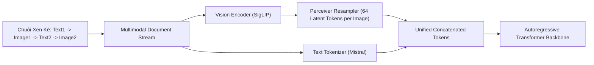

#### d. Code Thực chiến (C++ & Python)

```cpp
// C++17: Quản lý chuỗi xen kẽ Text và Image Tokens
#include <iostream>
#include <vector>
#include <string>

struct MultimodalToken {
    bool is_image;
    int token_id;
};

void print_interleaved_summary(const std::vector<MultimodalToken>& seq) {
    int t_count = 0, i_count = 0;
    for (const auto& tok : seq) {
        if (tok.is_image) i_count++; else t_count++;
    }
    std::cout << "Interleaved Sequence: " << t_count << " Text Tokens, " << i_count << " Image Tokens\n";
}

int main() {
    std::vector<MultimodalToken> stream = {{false, 101}, {true, 50000}, {false, 2023}};
    print_interleaved_summary(stream);
    return 0;
}
```

```python
# Python / Transformers: Suy luận với mô hình IDEFICS-2
from transformers import AutoProcessor, AutoModelForVision2Seq
import torch

processor = AutoProcessor.from_pretrained("HuggingFaceM4/idefics2-8b")
model = AutoModelForVision2Seq.from_pretrained("HuggingFaceM4/idefics2-8b")
print("IDEFICS-2 Model Ready for Interleaved Image-Text Inference")
```

#### e. Lỗi Thường gặp & Ổn định Số học
- Sự mất dấu ngữ cảnh ảnh trước đó: Trong các đoạn hội thoại dài gồm nhiều bức ảnh, cơ chế Attention có thể làm trôi dạt sự chú ý về các bức ảnh cũ ở đầu hội thoại thay vì tập trung vào bức ảnh mới nhất đang được hỏi.

#### f. Ứng dụng Thực chiến trong AI
Đọc và tóm tắt toàn bộ trang tài liệu PDF chứa biểu đồ, hình vẽ minh họa xen kẽ chữ viết.

---

### 13. Flamingo (Kiến trúc VLM Đột phá của DeepMind)

#### a. Định nghĩa Bản chất Toán học (Mathematical Formulation)
Flamingo (DeepMind 2022) là cột mốc khai sinh ra khả năng học trong ngữ cảnh đa phương thức (Multimodal Few-Shot In-Context Learning).
Flamingo sở hữu hai đổi mới kiến trúc mang tính lịch sử:
1. **Perceiver Resampler**: Ánh xạ số lượng biến thiên các visual features từ Vision Backbone thành một tập hợp cố định gồm $64$ visual tokens:
$$\mathbf{Z} = \text{CrossAttention}(\mathbf{Q}_{\text{learned}}, \mathbf{K}_v, \mathbf{V}_v) \in \mathbb{R}^{64 \times d}$$
2. **Gated Cross-Attention Dense Layers**: Chèn các lớp Cross-Attention xen kẽ vào giữa các khối Transformer của Frozen LLM (Chinchilla 70B), điều khiển bằng một cổng tanh khởi tạo bằng 0:
$$\mathbf{y} = \mathbf{x} + \tanh(\alpha) \cdot \text{CrossAttention}(\mathbf{x}, \mathbf{Z})$$
Với $\alpha$ khởi tạo bằng 0, mô hình ban đầu hoạt động chính xác như LLM thuần túy, đảm bảo tính ổn định tối đa khi bắt đầu huấn luyện.

#### b. Cơ chế Tầng Sâu & Điện toán (Under The Hood / Hardware Internals)
- **Zero-Initialization Gating Trick**: Việc chèn thêm các tham số mới vào một mô hình đã tiền huấn luyện sâu (như 70B parameters) thường làm nhiễu loạn phân phối kích hoạt, dẫn đến sụp đổ khả năng suy luận ngôn ngữ gốc. Bằng cách gán trọng số cổng $\alpha = 0$, đạo hàm tại bước khởi tạo đầu tiên hoàn toàn trơn tru và bảo tồn trọn vẹn tri thức của Frozen LLM.

#### c. Sơ đồ Minh họa (Mermaid Diagram)
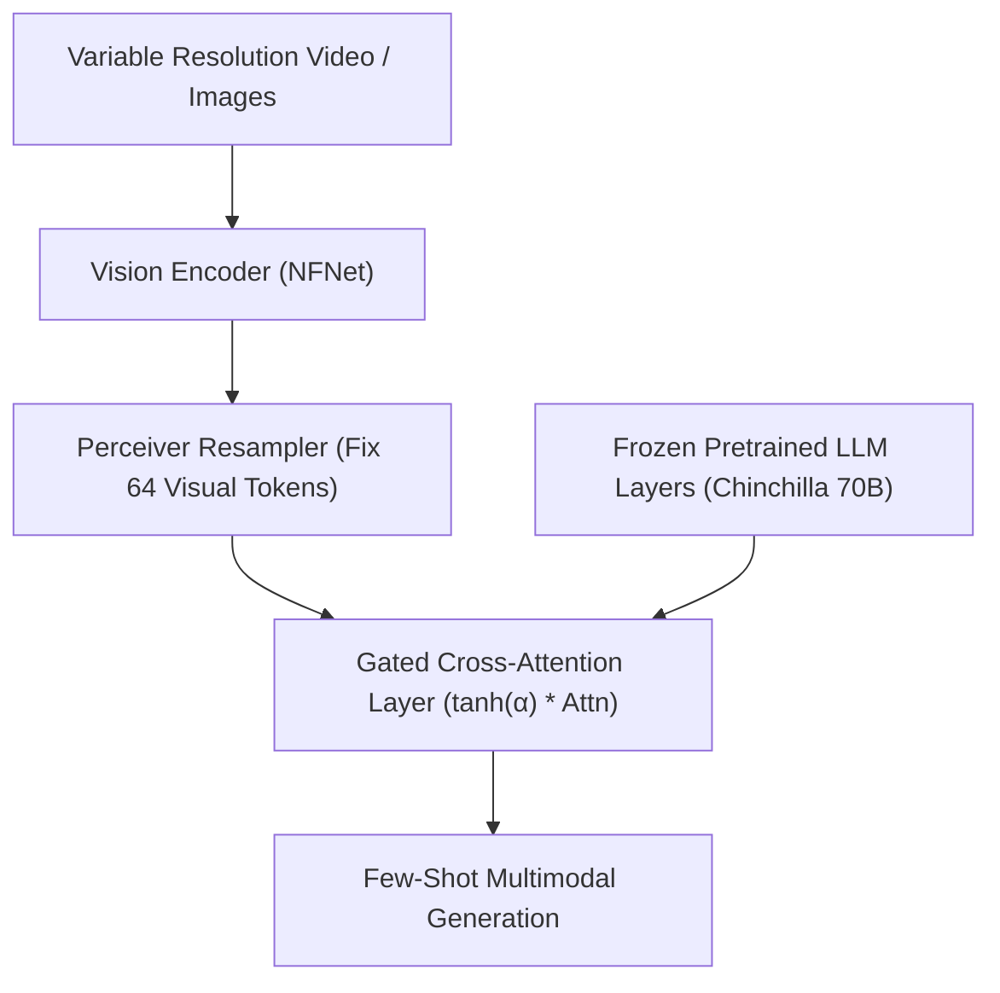

#### d. Code Thực chiến (C++ & Python)

```cpp
// C++17: Gated Residual Unit với hệ số alpha và hàm tanh
#include <iostream>
#include <vector>
#include <cmath>

void gated_residual_forward(std::vector<float>& x, const std::vector<float>& cross_out, float alpha) {
    float gate = std::tanh(alpha);
    for (size_t i = 0; i < x.size(); ++i) {
        x[i] = x[i] + gate * cross_out[i];
    }
}

int main() {
    std::vector<float> x = {1.0f, 2.0f};
    std::vector<float> cross = {0.5f, -0.5f};
    gated_residual_forward(x, cross, 0.0f); // alpha = 0 -> không đổi
    std::cout << "Init Output with alpha=0: [" << x[0] << ", " << x[1] << "]\n";
    gated_residual_forward(x, cross, 0.5f); // alpha > 0
    std::cout << "Output with alpha=0.5: [" << x[0] << ", " << x[1] << "]\n";
    return 0;
}
```

```python
# Python / PyTorch: Khối Gated Cross-Attention của Flamingo
import torch
import torch.nn as nn

class GatedCrossAttention(nn.Module):
    def __init__(self, d_model=512, n_heads=8):
        super().__init__()
        self.attn = nn.MultiheadAttention(d_model, n_heads, batch_first=True)
        self.alpha = nn.Parameter(torch.zeros(1)) # Khởi tạo bằng 0

    def forward(self, x_text, z_visual):
        # x_text: [B, L_t, D], z_visual: [B, 64, D]
        attn_out, _ = self.attn(query=x_text, key=z_visual, value=z_visual)
        return x_text + torch.tanh(self.alpha) * attn_out

gca = GatedCrossAttention()
t = torch.randn(2, 20, 512)
v = torch.randn(2, 64, 512)
print("Initial GCA Output (Exactly Equal to Input):", torch.equal(gca(t, v), t))
```

#### e. Lỗi Thường gặp & Ổn định Số học
- Sự bùng nổ tham số khi chèn quá nhiều lớp Cross-Attention: Nếu chèn Cross-Attention vào toàn bộ các lớp của một LLM 70B, số lượng tham số mới có thể vượt quá 10 tỷ tham số, làm mất đi ưu thế nhẹ nhàng của phương pháp bộ điều hợp. Flamingo chỉ chèn cách quãng vào mỗi 4 lớp LLM một lần.

#### f. Ứng dụng Thực chiến trong AI
Mô hình khởi xướng kiến trúc VLM cho DeepMind Gato, Google Gemini và các hệ thống học vài mẫu (Few-shot learning).

---

### 14. GPT-4o-style Multimodal Architecture (Kiến trúc Đa phương thức Toàn năng Bản địa)

#### a. Định nghĩa Bản chất Toán học (Mathematical Formulation)
Khác với các hệ thống lai ghép chắp vá truyền thống (Cascade Pipeline gồm các mô hình riêng biệt Whisper $\to$ LLM $\to$ TTS hay ViT $\to$ LLM), kiến trúc Omni Bản địa (Native End-to-End Multimodal Transformer) xử lý toàn bộ các phương thức Văn bản, Hình ảnh, Video và Âm thanh trong **cùng một mạng nơ-ron Transformer duy nhất** từ đầu đến cuối:
$$P(\mathbf{Y}_{\text{text}}, \mathbf{Y}_{\text{audio}}, \mathbf{Y}_{\text{vision}} \mid \mathbf{X}_{\text{text}}, \mathbf{X}_{\text{audio}}, \mathbf{X}_{\text{vision}}; \Theta)$$
Tất cả các giác quan được rời rạc hóa thành các chuỗi token đồng nhất trong cùng một không gian từ vựng mở rộng $\mathcal{V}_{\text{omni}} = \mathcal{V}_{\text{text}} \cup \mathcal{V}_{\text{vision\_codebook}} \cup \mathcal{V}_{\text{audio\_rvq}}$.
Mô hình tối ưu hóa trực tiếp hàm mất mát tự hồi quy đa phương thức:
$$\mathcal{L}_{\text{Omni}}(\Theta) = -\sum_{t=1}^T \log P_\Theta\left( \mathbf{z}_t \mid \mathbf{z}_{<t} \right) \quad \text{với } \mathbf{z}_t \in \mathcal{V}_{\text{omni}}$$

#### b. Cơ chế Tầng Sâu & Điện toán (Under The Hood / Hardware Internals)
- **Zero-Latency Cross-Modal Streaming**: Khi người dùng ngắt lời (Barge-in), mô hình không cần phải hủy bỏ tiến trình dịch văn bản trung gian. Trực tiếp từ luồng audio token đầu vào, cơ chế Causal Masked Attention tự động chuyển hướng sinh ra các audio token đầu ra trong thời gian dưới $250\text{ ms}$, mô phỏng hoàn hảo phản xạ đàm thoại tự nhiên của con người.
- **Unified Multimodal Token Vocabulary**: Việc duy trì một bảng từ vựng hợp nhất khổng lồ (ví dụ: $32.000$ BPE text tokens $+ 8.192$ visual VQ tokens $+ 4.096$ audio RVQ tokens) đòi hỏi lớp Softmax cuối cùng phải được tính toán bằng FlashCrossEntropy tối ưu phân vùng bộ nhớ GPU để không làm chậm bước sinh tự hồi quy.

#### c. Sơ đồ Minh họa (Mermaid Diagram)
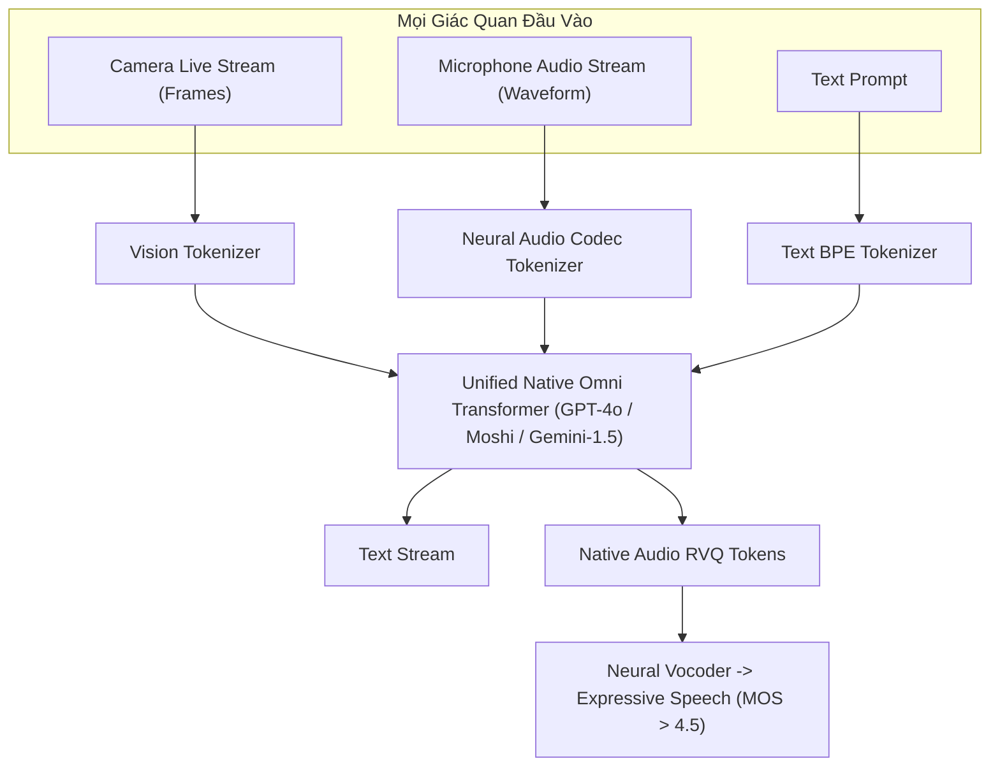

#### d. Code Thực chiến (C++ & Python)

```cpp
// C++17: Bộ phân giải dải ID token đa phương thức trong từ vựng Omni
#include <iostream>

enum class ModalityType { TEXT, VISION, AUDIO, UNKNOWN };

ModalityType identify_token_modality(int token_id) {
    if (token_id >= 0 && token_id < 32000) return ModalityType::TEXT;
    if (token_id >= 32000 && token_id < 40192) return ModalityType::VISION;
    if (token_id >= 40192 && token_id < 44288) return ModalityType::AUDIO;
    return ModalityType::UNKNOWN;
}

int main() {
    int sample_tok = 41200;
    std::cout << "Token 41200 belongs to: " << (identify_token_modality(sample_tok) == ModalityType::AUDIO ? "AUDIO" : "OTHER") << "\n";
    return 0;
}
```

```python
# Python / PyTorch: Kiến trúc mô phỏng Native Omni Multimodal Transformer Head
import torch
import torch.nn as nn

class NativeOmniHead(nn.Module):
    def __init__(self, hidden_dim=4096, text_vocab=32000, audio_vocab=4096):
        super().__init__()
        # Đầu ra đa phân nhánh đồng thời cho text và audio
        self.text_head = nn.Linear(hidden_dim, text_vocab, bias=False)
        self.audio_head = nn.Linear(hidden_dim, audio_vocab, bias=False)

    def forward(self, hidden_state):
        # hidden_state: [Batch, Seq_Len, hidden_dim]
        text_logits = self.text_head(hidden_state)
        audio_logits = self.audio_head(hidden_state)
        return text_logits, audio_logits

omni_head = NativeOmniHead()
h = torch.randn(1, 1, 4096)
t_logits, a_logits = omni_head(h)
print("Text Logits Shape:", t_logits.shape, "| Audio Logits Shape:", a_logits.shape)
```

#### e. Lỗi Thường gặp & Ổn định Số học
- **Modality Interference & Competition**: Khi một mô hình phải tối ưu đồng thời cả ba hàm mất mát (Text, Audio, Vision), các gradient của phương thức này có thể xung đột trực tiếp với phương thức kia (Destructive Interference), làm suy giảm nhẹ khả năng suy luận logic thuần văn bản so với mô hình chuyên biệt Text-only LLM.

#### f. Ứng dụng Thực chiến trong AI
Mô hình trí tuệ nhân tạo toàn năng thế hệ mới: OpenAI GPT-4o, Google Project Astra, Kyutai Moshi.
