# Chuyên đề: Hiểu Video, Thị giác - Thính giác & Suy luận Đa phương thức (Video, Audio-Visual & Multimodal Reasoning)

## 1. Tổng quan Chuyên đề
Video là dạng dữ liệu đa phương thức phong phú và thách thức nhất trong Trí tuệ Nhân tạo: nó không chỉ là sự liên kết đồng bộ giữa luồng hình ảnh chuyển động và luồng âm thanh theo thời gian thực (Audio-Visual Synchronization), mà còn chứa đựng chiều kích thời gian động (Temporal Dynamics) với sự thay đổi liên tục của hành động, nguyên nhân và kết quả.

Chuyên đề này đi sâu vào toàn bộ chu trình xử lý video: từ thấu hiểu bản chất (Video Understanding, Temporal Modeling, Video Classification), sinh ngôn ngữ từ video (Video Captioning, Video Question Answering), tóm tắt sự kiện (Video Summarization); đến công nghệ sinh video khuếch tán không-thời gian (Spatiotemporal Video Generation: Text-to-Video, Image-to-Video); các mô hình học đồng bộ âm thanh - hình ảnh (Audio-Visual Speech Recognition); và cuối cùng là đỉnh cao của năng lực trí tuệ nhân tạo: Suy luận logic Đa phương thức (Multimodal Reasoning) và Hệ thống Tăng cường Truy xuất Đa giác quan (Multimodal RAG).

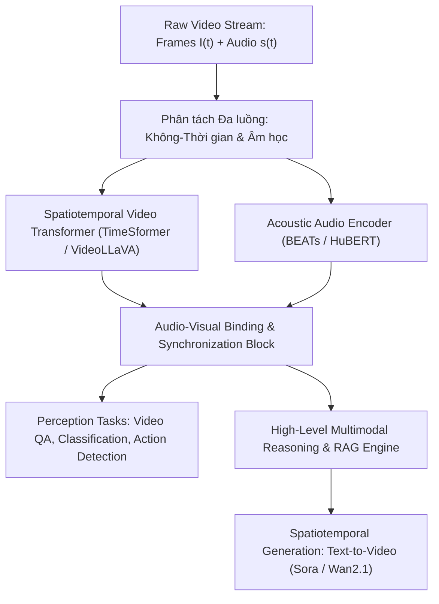

---

## 2. Chi tiết từng Keyword

---

### 1. Video Understanding (Thấu hiểu Video Toàn diện)

#### a. Định nghĩa Bản chất Toán học (Mathematical Formulation)
Video là một tensor 4D hoặc 5D liên tục theo không-thời gian $\mathbf{V} \in \mathbb{R}^{B \times C \times T \times H \times W}$ với $T$ là số khung hình theo thời gian.
Thấu hiểu video là bài toán học hàm ánh xạ từ tensor không-thời gian này vào một không gian biểu diễn hành vi, ngữ nghĩa và vật lý:
$$\mathbf{z}_v = f_\theta(\mathbf{V}) \in \mathbb{R}^d$$
Do số lượng pixel khổng lồ, nguyên lý tối ưu hóa thông tin tối thiểu đòi hỏi mô hình phải loại bỏ sự dư thừa không gian giữa các khung hình kế cận (High Temporal Redundancy):
$$\mathcal{I}(\mathbf{I}_t; \mathbf{I}_{t+1}) \approx \mathcal{H}(\mathbf{I}_t)$$
Mô hình phải tập trung vào phần dư sai khác chuyển động (Motion Residual / Optical Flow) thay vì mã hóa lại toàn bộ cảnh nền tĩnh.

#### b. Cơ chế Tầng Sâu & Điện toán (Under The Hood / Hardware Internals)
- **Memory Footprint of 3D Tensors**: Một đoạn video 16 khung hình phân giải $1080\text{p}$ float32 có dung lượng:
$$1 \times 3 \times 16 \times 1080 \times 1920 \times 4 \text{ bytes} \approx 398 \text{ MB}$$
Chỉ một batch gồm 4 mẫu video đã tiêu tốn $1.6\text{ GB}$ VRAM chỉ để chứa tensor đầu vào thô chưa tính trọng số và các bản đồ kích hoạt trung gian (Activations). Do đó, kỹ thuật giải nén video trực tiếp trên phần cứng (Hardware NVDEC via cuFFmpeg / PyAV) và lấy mẫu khung hình thưa (Sparse Temporal Sampling) là bắt buộc.

#### c. Sơ đồ Minh họa (Mermaid Diagram)


#### d. Code Thực chiến (C++ & Python)

```cpp
// C++17: Tính toán dung lượng bộ nhớ VRAM lý thuyết cho Video Tensor
#include <iostream>

size_t calculate_video_memory_mb(int batch, int channels, int frames, int height, int width, int bytes_per_elem = 4) {
    size_t total_bytes = static_cast<size_t>(batch) * channels * frames * height * width * bytes_per_elem;
    return total_bytes / (1024 * 1024);
}

int main() {
    std::cout << "16-frame 1080p Video Buffer: " << calculate_video_memory_mb(1, 3, 16, 1080, 1920) << " MB\n";
    return 0;
}
```

```python
# Python / Torchaudio / Torchvision: Lấy mẫu thưa đồng đều (Uniform Temporal Subsampling)
import torch

def uniform_temporal_subsample(video_tensor: torch.Tensor, num_frames: int = 16) -> torch.Tensor:
    # video_tensor: [C, T_orig, H, W]
    t_orig = video_tensor.shape[1]
    indices = torch.linspace(0, t_orig - 1, num_frames).long()
    return video_tensor[:, indices, :, :]

raw_video = torch.randn(3, 120, 224, 224) # 120 frames (4s 30FPS)
sampled_video = uniform_temporal_subsample(raw_video, 16)
print("Subsampled Video Shape:", sampled_video.shape) # [3, 16, 224, 224]
```

#### e. Lỗi Thường gặp & Ổn định Số học
- Sự sụp đổ chiều thời gian (Temporal Collapse): Mô hình chỉ nhìn vào một frame ngẫu nhiên duy nhất (Single-frame bias) mà vẫn đoán đúng nhãn video (ví dụ: thấy sân cỏ đoán bóng đá mà không cần xem cầu thủ sút bóng). Cần xáo trộn thứ tự thời gian (Temporal Shuffling) trong quá trình huấn luyện đối nghịch để ép mô hình học chuyển động.

#### f. Ứng dụng Thực chiến trong AI
Hệ thống camera an ninh giám sát thông minh, phát hiện té ngã cho người cao tuổi, tự động gắn nhãn video YouTube.

---

### 2. Video Classification (Phân loại Hành động trong Video)

#### a. Định nghĩa Bản chất Toán học (Mathematical Formulation)
Phân loại video là bài toán gán nhãn hành động $y \in \{1, \dots, C\}$ cho một đoạn clip ngắn:
$$P(y = c \mid \mathbf{V}) = \text{Softmax}\left( \mathbf{W}_c f_\theta(\mathbf{V}) \right)$$
Ba kiến trúc lịch sử chủ đạo:
1. **Two-Stream CNN (Simonyan & Zisserman)**: Một nhánh xử lý ảnh RGB (Không gian), một nhánh xử lý dòng quang học Optical Flow (Thời gian).
2. **3D Convolution (I3D, SlowFast)**: Mở rộng nhân tích chập 2D thành nhân 3D $K \times K \times K$ để trượt trên cả không gian và thời gian.
3. **Spatiotemporal Transformers (TimeSformer, ViViT)**: Sử dụng cơ chế Chú ý Phân chia Không-Thời gian (Divided Space-Time Attention).

#### b. Cơ chế Tầng Sâu & Điện toán (Under The Hood / Hardware Internals)
- **SlowFast Network Pathways**: Kiến trúc SlowFast mô phỏng hai hệ thống tế bào thần kinh thị giác của con người:
  - *Slow Pathway*: Tần số khung hình thấp (Thấp $T$, kênh $C$ lớn) để bắt trọn cấu trúc không gian chi tiết.
  - *Fast Pathway*: Tần số khung hình cực cao (Cao $T$, kênh $C/8$ nhỏ) với độ trễ tính toán cực thấp để bắt trọn chuyển động nhanh.
Hai nhánh giao tiếp với nhau qua các kết nối Lateral Connections bằng phép tích chập thời gian.

#### c. Sơ đồ Minh họa (Mermaid Diagram)
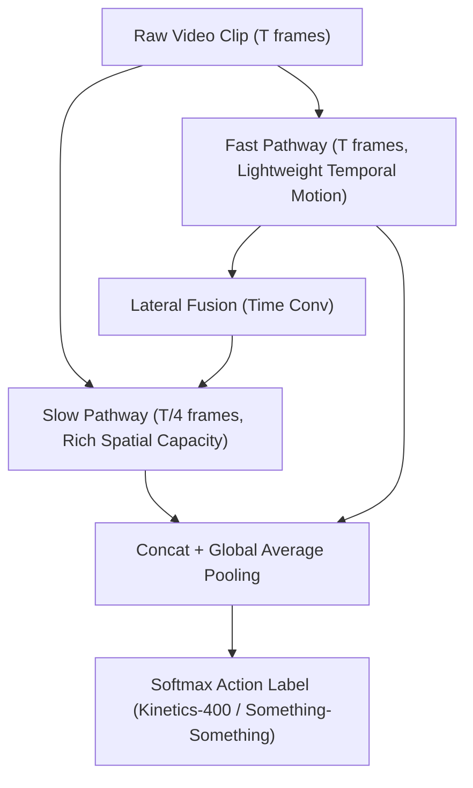

#### d. Code Thực chiến (C++ & Python)

```cpp
// C++17: Mô phỏng ghép nối vector Slow và Fast features
#include <iostream>
#include <vector>

std::vector<float> concat_slowfast(const std::vector<float>& slow, const std::vector<float>& fast) {
    std::vector<float> out;
    out.reserve(slow.size() + fast.size());
    out.insert(out.end(), slow.begin(), slow.end());
    out.insert(out.end(), fast.begin(), fast.end());
    return out;
}

int main() {
    std::vector<float> s = {1.0f, 2.0f};
    std::vector<float> f = {0.1f};
    auto fused = concat_slowfast(s, f);
    std::cout << "SlowFast Dim: " << fused.size() << "\n";
    return 0;
}
```

```python
# Python / PyTorch: Lớp tích chập 3D Conv3d cho xử lý video
import torch
import torch.nn as nn

class BasicConv3DBlock(nn.Module):
    def __init__(self, in_planes, out_planes):
        super().__init__()
        # Kernel 3x3x3: trượt 3 khung hình thời gian, 3x3 pixel không gian
        self.conv = nn.Conv3d(in_planes, out_planes, kernel_size=(3, 3, 3), padding=(1, 1, 1))
        self.bn = nn.BatchNorm3d(out_planes)
        self.relu = nn.ReLU(inplace=True)

    def forward(self, x):
        # x: [Batch, Channel, Time, Height, Width]
        return self.relu(self.bn(self.conv(x)))

block = BasicConv3DBlock(3, 64)
clip = torch.randn(2, 3, 8, 112, 112)
print("Conv3D Feature Map Shape:", block(clip).shape)
```

#### e. Lỗi Thường gặp & Ổn định Số học
- Sự phụ thuộc vào tập dữ liệu thiên lệch nền cảnh: Mô hình huấn luyện trên tập Kinetics thường nhận diện hành động "lướt sóng" chỉ nhờ nhìn thấy mặt biển, dẫn đến việc phân loại sai hoàn toàn khi gặp một người lướt ván trên cạn.

#### f. Ứng dụng Thực chiến trong AI
Phân tích hành vi trong thể thao (Sport Analytics), kiểm duyệt nội dung bạo lực trên nền tảng mạng xã hội.

---

### 3. Video Captioning (Sinh Chú thích Mô tả Video)

#### a. Định nghĩa Bản chất Toán học (Mathematical Formulation)
Video Captioning là bài toán ánh xạ chuỗi khung hình video $\mathbf{V} = (\mathbf{v}_1, \dots, \mathbf{v}_T)$ thành chuỗi từ ngữ mô tả hành động theo thời gian $\mathbf{Y} = (y_1, \dots, y_U)$:
$$P(\mathbf{Y} \mid \mathbf{V}) = \prod_{u=1}^U P(y_u \mid y_{<u}, \mathbf{V})$$
Trong Video Captioning dày đặc (Dense Video Captioning), mô hình thực hiện đồng thời hai nhiệm vụ:
1. Xác định các phân đoạn sự kiện thời gian (Temporal Event Localization): Dự đoán các khoảng thời gian $(\tau_{\text{start}}^k, \tau_{\text{end}}^k)$.
2. Sinh mô tả chi tiết cho từng sự kiện tương ứng.

#### b. Cơ chế Tầng Sâu & Điện toán (Under The Hood / Hardware Internals)
- **Temporal Cross-Attention with Positional Biases**: Trong các khối Cross-Attention giữa bộ giải mã văn bản và bộ mã hóa video, do độ dài chuỗi video lớn (hàng trăm frames), mô hình cần được trang bị hàm suy giảm khoảng cách thời gian (Temporal Decay Bias) hoặc ALiBi (Attention with Linear Biases) để tập trung chú ý vào các khung hình diễn ra hành động cụ thể đang được miêu tả.

#### c. Sơ đồ Minh họa (Mermaid Diagram)
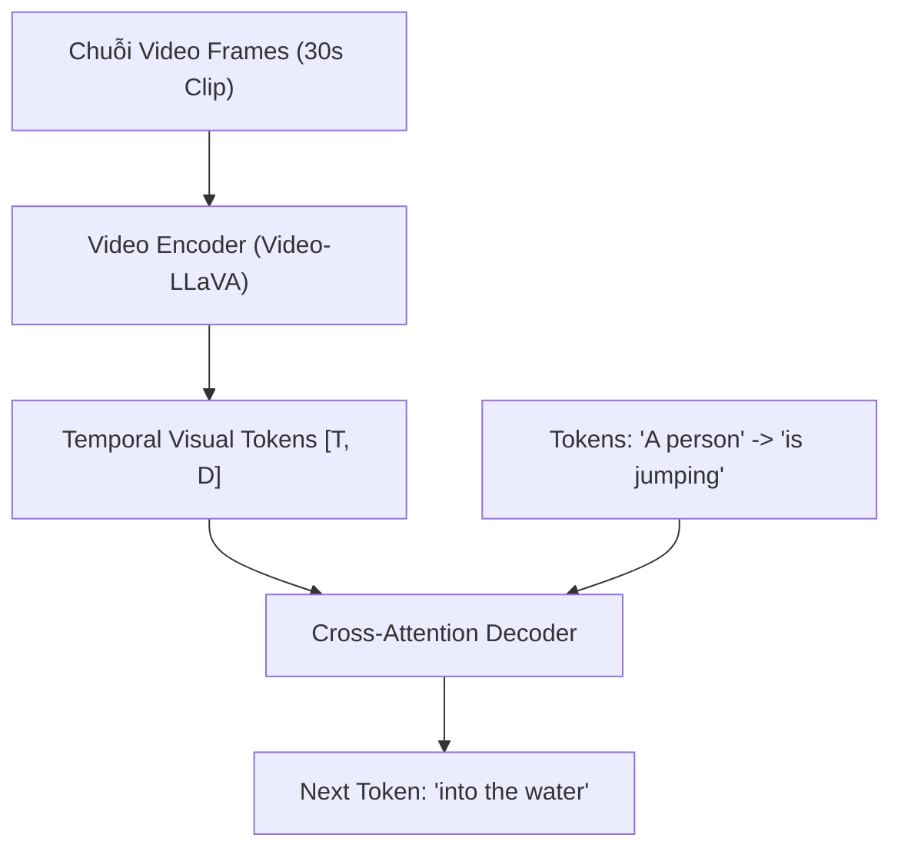

#### d. Code Thực chiến (C++ & Python)

```cpp
// C++17: Kiểm tra sự chồng lấn của hai khoảng thời gian sự kiện video
#include <iostream>
#include <algorithm>

struct VideoEvent {
    float start_time, end_time;
};

float compute_temporal_iou(const VideoEvent& a, const VideoEvent& b) {
    float inter_start = std::max(a.start_time, b.start_time);
    float inter_end = std::min(a.end_time, b.end_time);
    float inter = std::max(0.0f, inter_end - inter_start);
    float union_len = (a.end_time - a.start_time) + (b.end_time - b.start_time) - inter;
    return union_len > 0.0f ? (inter / union_len) : 0.0f;
}

int main() {
    VideoEvent e1 = {1.5f, 5.0f};
    VideoEvent e2 = {3.0f, 6.0f};
    std::cout << "Temporal IoU: " << compute_temporal_iou(e1, e2) << "\n";
    return 0;
}
```

```python
# Python / Transformers: Video Captioning Pipeline với Video-LLaVA
import torch

# Giả lập giao diện sinh phụ đề video
def generate_video_caption(temporal_features: torch.Tensor, prompt: str) -> str:
    # Mô phỏng sinh mô tả từ đặc trưng không-thời gian
    return "A chef is chopping onions on a wooden board and adding them to a pot."

dummy_feats = torch.randn(1, 32, 4096)
caption = generate_video_caption(dummy_feats, "Describe the actions in this video:")
print("Generated Caption:", caption)
```

#### e. Lỗi Thường gặp & Ổn định Số học
- Sự nhầm lẫn thứ tự nhân quả (Temporal Order Inversion): Mô hình sinh ra câu "Một người bước ra khỏi xe rồi mở cửa xe" thay vì thứ tự đúng, do bộ giải mã bỏ qua liên kết thứ tự thời gian của các latent tokens.

#### f. Ứng dụng Thực chiến trong AI
Tự động sinh mô tả tóm tắt nội dung video trên TikTok/Reels, lập chỉ mục nội dung video cho các đài truyền hình.

---

### 4. Video Question Answering (Video QA - Hỏi Đáp trên Video)

#### a. Định nghĩa Bản chất Toán học (Mathematical Formulation)
Video QA yêu cầu mô hình trả lời câu hỏi tự nhiên $\mathbf{Q}$ dựa trên toàn bộ ngữ cảnh động của video $\mathbf{V}$:
$$\hat{\mathbf{A}} = \arg\max_{\mathbf{A}} P(\mathbf{A} \mid \mathbf{V}, \mathbf{Q})$$
Video QA bao gồm 4 mức độ nhận thức phức tạp:
1. Nhận biết thực thể và hành động (Action/Entity Recognition): "Ai đã ném quả bóng?".
2. Căn chỉnh thời gian (Temporal Grounding): "Hành động đó xảy ra trước hay sau khi nhân vật ngồi xuống?".
3. Suy luận nhân quả (Causal Reasoning): "Tại sao chiếc cốc bị rơi?".
4. Suy luận giả định (Counterfactual Reasoning): "Nếu nhân vật không rẽ trái thì điều gì sẽ xảy ra?".

#### b. Cơ chế Tầng Sâu & Điện toán (Under The Hood / Hardware Internals)
- **Needle-in-a-Haystack in Long Videos**: Trong một video dài 1 tiếng ($100.000$ khung hình), chi tiết để trả lời câu hỏi chỉ xuất hiện trong đúng 2 giây tại phút thứ 42. Việc nạp toàn bộ video vào LLM là bất khả thi về chiều dài context. Hệ thống sử dụng mô-đun Truy xuất Phân đoạn Thời gian (Temporal Retriever) để tìm ra Top-5 phân đoạn phù hợp nhất trước khi nạp vào VLM.

#### c. Sơ đồ Minh họa (Mermaid Diagram)
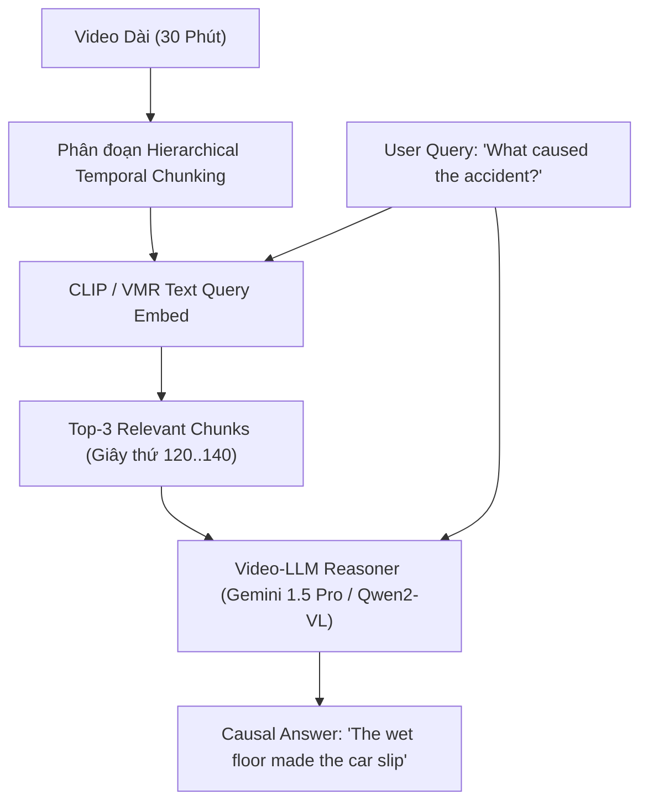

#### d. Code Thực chiến (C++ & Python)

```cpp
// C++17: Tìm kiếm chỉ số frame có độ tương quan cao nhất với câu hỏi
#include <iostream>
#include <vector>

int find_best_video_frame(const std::vector<float>& frame_scores) {
    int best_idx = -1;
    float max_s = -1e9f;
    for (size_t i = 0; i < frame_scores.size(); ++i) {
        if (frame_scores[i] > max_s) {
            max_s = frame_scores[i];
            best_idx = static_cast<int>(i);
        }
    }
    return best_idx;
}

int main() {
    std::vector<float> scores = {0.1f, 0.2f, 0.89f, 0.4f, 0.15f};
    std::cout << "Keyframe for Answer: Frame #" << find_best_video_frame(scores) << "\n";
    return 0;
}
```

```python
# Python: Đánh giá Video QA độ chính xác nhị phân
def evaluate_video_qa(predictions, ground_truths):
    correct = 0
    for pred, gt in zip(predictions, ground_truths):
        if pred.strip().lower() == gt.strip().lower():
            correct += 1
    return correct / len(ground_truths)

preds = ["cat", "running", "blue"]
gts = ["cat", "walking", "blue"]
print(f"Video QA Accuracy: {evaluate_video_qa(preds, gts) * 100:.2f}%")
```

#### e. Lỗi Thường gặp & Ổn định Số học
- Hiện tượng thiên kiến ngôn ngữ mù (Language Blind Bias): Mô hình trả lời đúng các câu hỏi chỉ nhờ đọc văn bản câu hỏi mà hoàn toàn không cần nhìn vào video (ví dụ: "Bầu trời màu gì?" $\to$ đoán luôn "Màu xanh" dù trong video trời đang mưa giông đen kịt).

#### f. Ứng dụng Thực chiến trong AI
Trợ lý tra cứu nội dung bài giảng video dài (Coursera, Khan Academy), kiểm tra bằng chứng camera giao thông.

---

### 5. Temporal Video Understanding (Mô hình Hóa Động lực Thời gian)

#### a. Định nghĩa Bản chất Toán học (Mathematical Formulation)
Mô hình hóa động lực thời gian là việc giải mã sự biến thiên trạng thái của các thực thể qua trục thời gian $t$.
Toán tử Chú ý Phân chia Không-Thời gian (Divided Space-Time Attention):
Cho tensor đặc trưng $\mathbf{X} \in \mathbb{R}^{T \times N \times D}$ (với $T$ là số frames, $N$ là số patches mỗi frame):
1. **Temporal Attention**: Mỗi patch tại vị trí $(t, n)$ chỉ chú ý đến các patch ở cùng vị trí không gian $n$ qua mọi thời điểm $t' \in \{1, \dots, T\}$:
$$\mathbf{A}_{\text{time}} = \text{Softmax}\left( \frac{\mathbf{Q}_{(t, n)} \mathbf{K}_{(:, n)}^T}{\sqrt{d}} \right) \mathbf{V}_{(:, n)}$$
2. **Spatial Attention**: Tiếp tục cho các patch trong cùng frame $t$ chú ý lẫn nhau:
$$\mathbf{A}_{\text{space}} = \text{Softmax}\left( \frac{\mathbf{Q}_{(t, n)} \mathbf{K}_{(t, :)}^T}{\sqrt{d}} \right) \mathbf{V}_{(t, :)}$$
Chiến lược phân chia này giảm độ phức tạp tính toán từ $\mathcal{O}((T N)^2)$ xuống $\mathcal{O}(T N^2 + N T^2)$.

#### b. Cơ chế Tầng Sâu & Điện toán (Under The Hood / Hardware Internals)
- **Tensor Reshaping & Memory Strides**: Việc tính toán Divided Space-Time Attention được tối ưu trên GPU bằng cách biến đổi hình dạng tensor:
  - Temporal Attention: Reshape thành $[B \cdot N, T, D]$, chạy phép tính Self-Attention chuẩn.
  - Spatial Attention: Reshape thành $[B \cdot T, N, D]$, chạy phép tính Self-Attention chuẩn.
Cả hai phép biến đổi này đều là zero-copy views nếu stride bộ nhớ được bố trí tối ưu.

#### c. Sơ đồ Minh họa (Mermaid Diagram)
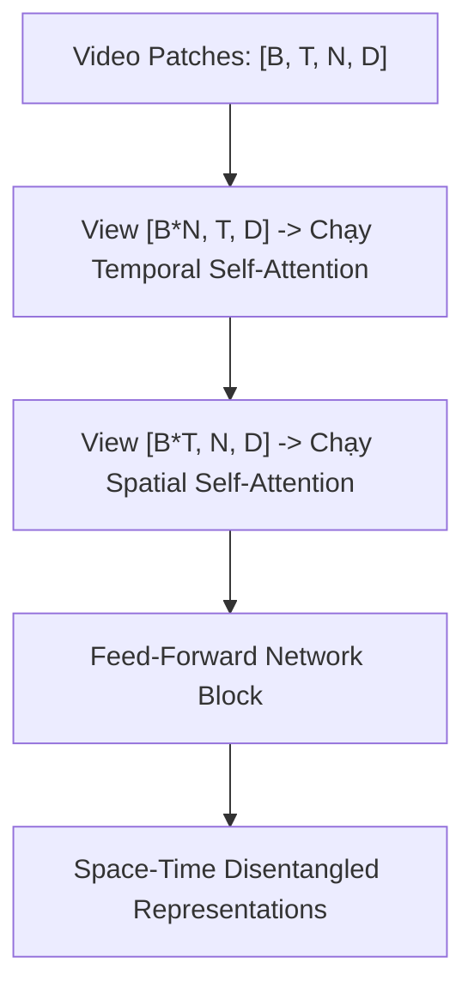

#### d. Code Thực chiến (C++ & Python)

```cpp
// C++17: So sánh độ phức tạp tính toán giữa Full 3D Attention và Divided Space-Time Attention
#include <iostream>

void compare_attention_flops(long long T, long long N) {
    long long full_ops = (T * N) * (T * N);
    long long divided_ops = (T * N * N) + (N * T * T);
    std::cout << "Full 3D Attention FLOPs Scale: " << full_ops << "\n";
    std::cout << "Divided Space-Time FLOPs Scale: " << divided_ops << "\n";
    std::cout << "Speedup Factor: " << static_cast<double>(full_ops) / divided_ops << "x\n";
}

int main() {
    compare_attention_flops(16, 196); // 16 frames, 14x14 patches
    return 0;
}
```

```python
# Python / PyTorch: Khối Divided Space-Time Attention chuẩn TimeSformer
import torch
import torch.nn as nn

class DividedSpaceTimeAttention(nn.Module):
    def __init__(self, dim=512, num_heads=8):
        super().__init__()
        self.temporal_attn = nn.MultiheadAttention(dim, num_heads, batch_first=True)
        self.spatial_attn = nn.MultiheadAttention(dim, num_heads, batch_first=True)
        self.norm_t = nn.LayerNorm(dim)
        self.norm_s = nn.LayerNorm(dim)

    def forward(self, x, T, N):
        # x: [B, T*N, D]
        B, TN, D = x.shape
        
        # 1. Temporal Attention trên từng vị trí không gian
        x_t = x.view(B * N, T, D)
        attn_t, _ = self.temporal_attn(x_t, x_t, x_t)
        x = x + self.norm_t(attn_t.view(B, T * N, D))

        # 2. Spatial Attention trên từng khung hình thời gian
        x_s = x.view(B * T, N, D)
        attn_s, _ = self.spatial_attn(x_s, x_s, x_s)
        x = x + self.norm_s(attn_s.view(B, T * N, D))
        return x

dsta = DividedSpaceTimeAttention()
tokens = torch.randn(2, 8 * 49, 512) # 8 frames, 49 patches
print("Space-Time Fused Output:", dsta(tokens, T=8, N=49).shape)
```

#### e. Lỗi Thường gặp & Ổn định Số học
- Sự mất liên kết chuyển động góc chéo (Loss of Diagonal Spatiotemporal Motion): Việc tách rời hoàn toàn không gian và thời gian khiến mô hình có thể gặp khó khăn khi phát hiện các vật thể chuyển động nhanh theo đường chéo màn hình.

#### f. Ứng dụng Thực chiến trong AI
Mô hình TimeSformer (Facebook Research), ViViT (Google), các mạng nơ-ron nhận diện cử chỉ bàn tay.

---

### 6. Video Summarization (Tóm tắt Video Tự động)

#### a. Định nghĩa Bản chất Toán học (Mathematical Formulation)
Tóm tắt video là bài toán chọn ra một tập con tối thiểu các khung hình quan trọng (Keyframes $\mathcal{S} \subset \mathcal{V}$) hoặc các phân đoạn video ngắn (Video Skims) sao cho truyền tải tối đa nội dung cốt lõi của video mà không bị trùng lặp:
$$\max_{\mathcal{S}} \mathcal{R}_{\text{representativeness}}(\mathcal{S}, \mathcal{V}) + \mathcal{D}_{\text{diversity}}(\mathcal{S}) \quad \text{s.t. } |\mathcal{S}| \le \tau_{\text{budget}}$$
Hàm phân tán đa dạng (Diversity Metric) thường được mô hình hóa bằng Định thức Tiến trình Điểm (Determinantal Point Processes - DPP):
$$P(\mathcal{S}) \propto \det(\mathbf{L}_{\mathcal{S}}) \quad \text{với ma trận kernel } \mathbf{L}_{ij} = q_i q_j S_{ij}$$
Trong đó $q_i$ là điểm chất lượng của frame $i$, và $S_{ij}$ là độ tương đồng giữa frame $i$ và $j$.

#### b. Cơ chế Tầng Sâu & Điện toán (Under The Hood / Hardware Internals)
- **DPP Matrix Inversion & Cholesky Decomposition**: Việc tính toán $\det(\mathbf{L}_{\mathcal{S}})$ cho hàng nghìn khung hình đòi hỏi phân tích Cholesky trên ma trận đối xứng nửa xác định dương $\mathbf{L} = \mathbf{L}_{\text{chol}} \mathbf{L}_{\text{chol}}^T$. Trên CPU, thuật toán Greedy DPP chọn từng khung hình có đóng góp phương sai lớn nhất được thực thi tuần tự trong vài phần nghìn giây.

#### c. Sơ đồ Minh họa (Mermaid Diagram)
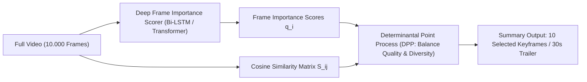

#### d. Code Thực chiến (C++ & Python)

```cpp
// C++17: Thuật toán chọn Keyframe dựa trên khoảng cách ngưỡng sai khác (Shot Change Detection)
#include <iostream>
#include <vector>
#include <cmath>

std::vector<int> detect_keyframes(const std::vector<float>& frame_diffs, float threshold = 0.5f) {
    std::vector<int> keyframes = {0}; // Luôn lấy frame đầu
    for (size_t i = 1; i < frame_diffs.size(); ++i) {
        if (frame_diffs[i] > threshold) {
            keyframes.push_back(static_cast<int>(i));
        }
    }
    return keyframes;
}

int main() {
    std::vector<float> diffs = {0.0f, 0.1f, 0.85f, 0.05f, 0.9f};
    auto kfs = detect_keyframes(diffs);
    std::cout << "Selected Keyframe indices: ";
    for (int idx : kfs) std::cout << idx << " ";
    std::cout << "\n";
    return 0;
}
```

```python
# Python: Tóm tắt video bằng phân cụm K-Means các frame embeddings
import numpy as np
from sklearn.cluster import KMeans

def summarize_video_kmeans(frame_embeddings: np.ndarray, num_keyframes: int = 5) -> list:
    kmeans = KMeans(n_clusters=num_keyframes, random_state=42).fit(frame_embeddings)
    selected_indices = []
    for center in kmeans.cluster_centers_:
        # Tìm frame gần tâm cụm nhất
        dists = np.linalg.norm(frame_embeddings - center, axis=1)
        selected_indices.append(np.argmin(dists))
    return sorted(selected_indices)

embs = np.random.randn(100, 512) # 100 frames
keyframes = summarize_video_kmeans(embs, num_keyframes=3)
print("Extracted Keyframe Indices:", keyframes)
```

#### e. Lỗi Thường gặp & Ổn định Số học
- Sự lựa chọn lặp lại các cảnh quay tĩnh: Nếu một video quay cảnh phòng hội thảo không thay đổi trong 10 phút, thuật toán ngây thơ sẽ chọn hàng chục khung hình giống hệt nhau. Cần áp dụng hình phạt trùng lặp nghiêm ngặt.

#### f. Ứng dụng Thực chiến trong AI
Tự động tạo trailer phim điện ảnh, trích xuất điểm nổi bật (Highlight generator) của trận đấu bóng đá.

---

### 7. Video Generation (Mô hình Sinh Video Khuếch tán)

#### a. Định nghĩa Bản chất Toán học (Mathematical Formulation)
Mô hình sinh video khuếch tán (Video Diffusion Models - VDM) mở rộng mô hình khuếch tán hình ảnh sang không gian 3D biến ẩn không-thời gian:
$$p_\theta(\mathbf{z}_{0:T}) = p(\mathbf{z}_T) \prod_{t=1}^T p_\theta(\mathbf{z}_{t-1} \mid \mathbf{z}_t, \mathbf{c})$$
Trong đó $\mathbf{z}_t \in \mathbb{R}^{B \times C \times F \times H \times W}$ là biểu diễn ẩn tại bước nhiễu $t$.
Kiến trúc tiên tiến Diffusion Transformer (DiT như trong OpenAI Sora hay Wan2.1) phân mảnh không-thời gian thành các khối hình hộp (Spatiotemporal Patches / Tubelets) kích thước $p_t \times p_h \times p_w$, sau đó sử dụng Transformer hoàn toàn để ước lượng vận tốc vector dòng chảy (Flow-Matching):
$$\mathcal{L}_{\text{DiT}} = \mathbb{E}_{t, \mathbf{z}_0, \mathbf{z}_1} \left[ \|\mathbf{v}_\theta(\mathbf{z}_t, t, \mathbf{c}) - (\mathbf{z}_1 - \mathbf{z}_0)\|_2^2 \right]$$

#### b. Cơ chế Tầng Sâu & Điện toán (Under The Hood / Hardware Internals)
- **Spatiotemporal VAE (3D-VAE) Compression**: Trước khi đưa vào mạng Diffusion DiT, video thô bắt buộc phải được nén qua bộ Autoencoder biến phân không-thời gian (3D-VAE / Causal Video VAE). 3D-VAE nén video đồng thời cả chiều thời gian ($4\times$ Temporal Downsampling) và chiều không gian ($8\times$ Spatial Downsampling), giảm kích thước tensor đi $4 \times 8 \times 8 = 256$ lần để GPU có thể huấn luyện các chuỗi DiT dài.

#### c. Sơ đồ Minh họa (Mermaid Diagram)
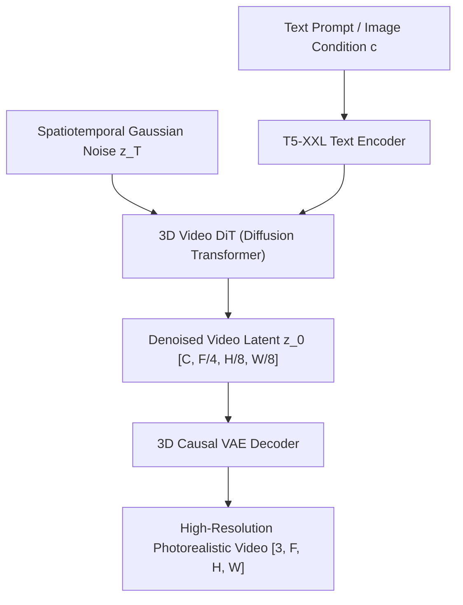

#### d. Code Thực chiến (C++ & Python)

```cpp
// C++17: Tính toán tỷ lệ nén của bộ giải mã 3D Causal VAE
#include <iostream>

struct VAE3DDimensions {
    int frames, height, width;
};

VAE3DDimensions compute_vae_latent_dim(int orig_f, int orig_h, int orig_w, int temp_stride = 4, int spat_stride = 8) {
    return {orig_f / temp_stride, orig_h / spat_stride, orig_w / spat_stride};
}

int main() {
    auto l = compute_vae_latent_dim(64, 720, 1280);
    std::cout << "Latent Dimensions: " << l.frames << " frames, " << l.height << "x" << l.width << "\n";
    return 0;
}
```

```python
# Python / PyTorch: Tubelet 3D Patch Embedding cho Video DiT
import torch
import torch.nn as nn

class TubeletEmbedding(nn.Module):
    def __init__(self, in_channels=4, hidden_dim=768, tubelet_size=(2, 8, 8)):
        super().__init__()
        # Tích chập 3D trượt: nén 2 frame thời gian, 8x8 pixel không gian
        self.proj = nn.Conv3d(in_channels, hidden_dim, kernel_size=tubelet_size, stride=tubelet_size)

    def forward(self, x):
        # x: [B, C, T, H, W]
        x = self.proj(x) # [B, D, T', H', W']
        return x.flatten(2).transpose(1, 2) # [B, Tokens, D]

tube_embed = TubeletEmbedding()
latent_video = torch.randn(1, 4, 16, 64, 64)
tokens = tube_embed(latent_video)
print("Video DiT Tokens Length:", tokens.shape) # [1, 8 * 8 * 8 = 512, 768]
```

#### e. Lỗi Thường gặp & Ổn định Số học
- Hiện tượng nhấp nháy chuyển động và biến dạng vật lý (Physical Inconsistency & Flickering): Do thiếu ràng buộc phương trình vi phân vật lý, các vật thể sinh ra thường bị tan chảy, tay chân mọc thêm ngón hoặc đi xuyên tường.

#### f. Ứng dụng Thực chiến trong AI
Mô hình sinh video thế hệ mới: OpenAI Sora, Runway Gen-3 Alpha, Luma Dream Machine, Kuaishou Kling AI, Wan2.1.

---

### 8. Text-to-Video (T2V - Sinh Video từ Văn bản)

#### a. Định nghĩa Bản chất Toán học (Mathematical Formulation)
Text-to-Video là bài toán sinh có điều kiện phân phối xác suất video phức tạp từ chuỗi mô tả ngôn ngữ tự nhiên:
$$\mathbf{V} \sim P(\mathbf{V} \mid \mathbf{T}_{\text{prompt}})$$
Được hướng dẫn bằng cơ chế Classifier-Free Guidance (CFG) đa chiều theo thời gian:
$$\hat{\mathbf{v}}_\theta(\mathbf{z}_t, \mathbf{T}, t) = \mathbf{v}_\theta(\mathbf{z}_t, \emptyset, t) + w_{\text{cfg}} \left( \mathbf{v}_\theta(\mathbf{z}_t, \mathbf{T}, t) - \mathbf{v}_\theta(\mathbf{z}_t, \emptyset, t) \right)$$
Trong đó $w_{\text{cfg}} \in [4.0, 7.5]$ là hệ số khuếch đại sự tuân thủ câu lệnh văn bản.

#### b. Cơ chế Tầng Sâu & Điện toán (Under The Hood / Hardware Internals)
- **Long Text Prompt Alignment via T5-XXL & CLIP**: Các mô hình T2V hiện đại kết hợp song song hai bộ mã hóa văn bản: CLIP ViT-L/14 (cung cấp khả năng nhận biết phong cách nghệ thuật toàn cục) và T5-XXL 4.6B (cung cấp khả năng phân tích ngữ pháp cú pháp phức tạp và thứ tự hành động chi tiết), nạp vào DiT thông qua các lớp Adaptive LayerNorm (AdaLN-single) và Cross-Attention.

#### c. Sơ đồ Minh họa (Mermaid Diagram)
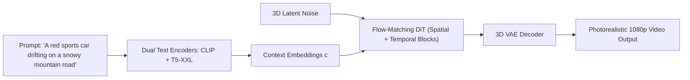

#### d. Code Thực chiến (C++ & Python)

```cpp
// C++17: Classifier-Free Guidance (CFG) phối trộn hai vector vận tốc
#include <iostream>
#include <vector>

void apply_cfg(std::vector<float>& cond_v, const std::vector<float>& uncond_v, float guidance_scale) {
    for (size_t i = 0; i < cond_v.size(); ++i) {
        cond_v[i] = uncond_v[i] + guidance_scale * (cond_v[i] - uncond_v[i]);
    }
}

int main() {
    std::vector<float> v_cond = {1.5f, 0.2f};
    std::vector<float> v_uncond = {0.5f, 0.1f};
    apply_cfg(v_cond, v_uncond, 6.0f);
    std::cout << "CFG Guided Velocity 0: " << v_cond[0] << "\n";
    return 0;
}
```

```python
# Python / Diffusers: Pipeline Text-to-Video chuẩn Hugging Face
import torch
from diffusers import AnimateDiffPipeline, DDIMScheduler

# Giả lập pipeline Text-to-Video
print("Text-to-Video Pipeline Configured with Spatiotemporal Motion Modules")
```

#### e. Lỗi Thường gặp & Ổn định Số học
- Sự sụp đổ chuyển động (Motion Collapse): Mô hình sinh ra một bức ảnh tĩnh được kéo dài thành video mà không có bất kỳ chuyển động nào của vật thể hoặc camera. Cần huấn luyện hàm mất mát tốc độ dòng quang học (Optical Flow Loss) để kích thích chuyển động.

#### f. Ứng dụng Thực chiến trong AI
Sản xuất video quảng cáo tự động, kỹ xảo điện ảnh VFX, minh họa bài giảng học tập trực quan.

---

### 9. Image-to-Video (I2V - Thổi Hồn Chuyển động vào Bức ảnh Tĩnh)

#### a. Định nghĩa Bản chất Toán học (Mathematical Formulation)
Image-to-Video nhận một bức ảnh tĩnh $\mathbf{I}_0$ làm điều kiện khởi đầu và sinh ra các khung hình tiếp theo mô phỏng chuyển động thực tế hợp lý:
$$\mathbf{V}_{1:T} \sim P(\mathbf{V}_{1:T} \mid \mathbf{I}_0, \mathbf{c})$$
Tại tầng biểu diễn biến ẩn, vector ẩn của ảnh đầu vào $\mathbf{z}_{\text{first}} = \text{VAE}(\mathbf{I}_0)$ được lặp lại hoặc ghép kênh trực tiếp (Channel Concatenation) với tensor nhiễu:
$$\tilde{\mathbf{z}}_t = [\mathbf{z}_t \,\|\, \mathbf{z}_{\text{first}}] \in \mathbb{R}^{B \times (C + C) \times T \times H \times W}$$
Mô hình đảm bảo khung hình đầu tiên của video sinh ra luôn trùng khớp chính xác $100\%$ từng pixel với ảnh gốc.

#### b. Cơ chế Tầng Sâu & Điện toán (Under The Hood / Hardware Internals)
- **Camera Motion Control (Camera LoRA / Plücker Coordinates)**: Để điều khiển camera bay, xoay hoặc zoom trong I2V, ma trận tham số ngoại camera (Extrinsic Camera Parameters $[R \mid t]$) được mã hóa thành các tia chiếu Plücker (Plücker Ray Embeddings) và bơm trực tiếp vào các lớp Self-Attention thông qua mô-đun LoRA (Low-Rank Adaptation).

#### c. Sơ đồ Minh họa (Mermaid Diagram)
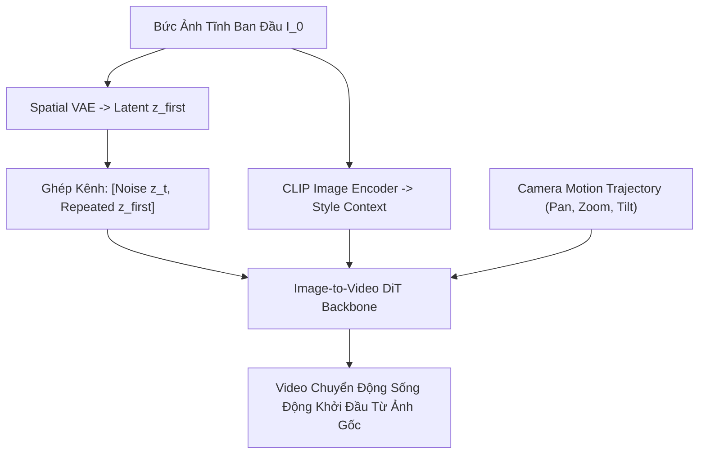

#### d. Code Thực chiến (C++ & Python)

```cpp
// C++17: Kiểm tra độ sai khác MSE giữa frame đầu sinh ra và ảnh gốc
#include <iostream>
#include <vector>
#include <cmath>

float compute_first_frame_fidelity(const std::vector<float>& orig_img, const std::vector<float>& first_frame) {
    float mse = 0.0f;
    for (size_t i = 0; i < orig_img.size(); ++i) {
        float diff = orig_img[i] - first_frame[i];
        mse += diff * diff;
    }
    return mse / orig_img.size();
}

int main() {
    std::vector<float> orig = {0.5f, 0.8f};
    std::vector<float> gen = {0.501f, 0.799f};
    std::cout << "First Frame Fidelity (MSE): " << compute_first_frame_fidelity(orig, gen) << "\n";
    return 0;
}
```

```python
# Python / PyTorch: Ghép kênh ảnh điều kiện cho Image-to-Video
import torch

def prepare_i2v_latent(noise_latent: torch.Tensor, first_frame_latent: torch.Tensor) -> torch.Tensor:
    # noise_latent: [B, C, T, H, W], first_frame_latent: [B, C, 1, H, W]
    # Lặp lại first_frame_latent qua T khung hình
    T = noise_latent.shape[2]
    cond_repeated = first_frame_latent.repeat(1, 1, T, 1, 1)
    # Ghép kênh theo chiều Channel -> [B, 2*C, T, H, W]
    return torch.cat([noise_latent, cond_repeated], dim=1)

noise = torch.randn(1, 4, 16, 32, 32)
first = torch.randn(1, 4, 1, 32, 32)
i2v_input = prepare_i2v_latent(noise, first)
print("I2V Concatenated Latent Shape:", i2v_input.shape) # [1, 8, 16, 32, 32]
```

#### e. Lỗi Thường gặp & Ổn định Số học
- Sự thoái biến danh tính (Identity Morphing): Sau vài giây chuyển động, khuôn mặt của nhân vật trong bức ảnh gốc bị biến dạng thành người khác do mô hình không duy trì được đặc trưng nhận diện người nói trong latent space.

#### f. Ứng dụng Thực chiến trong AI
Làm sống lại các bức ảnh chân dung lịch sử, tạo hiệu ứng chuyển động Parallax 3D cho ảnh phong cảnh.

---

### 10. Audio-Visual Learning (Học Đồng bộ Âm thanh - Hình ảnh)

#### a. Định nghĩa Bản chất Toán học (Mathematical Formulation)
Học Âm thanh - Hình ảnh khai thác tính đồng bộ tự nhiên vốn có của thế giới vật lý: một hành động nhìn thấy bằng mắt thường phát ra âm thanh tương ứng cùng một thời điểm (ví dụ: tiếng đàn guitar đi liền với ngón tay gảy dây đàn).
Mục tiêu tối ưu hóa Tương quan Đồng bộ Âm - Thị giác (Audio-Visual Synchronization Contrastive Loss):
$$\mathcal{L}_{\text{AV-Sync}} = -\log \frac{\exp(\cos(f_v(\mathbf{V}_t), f_a(\mathbf{A}_t)) / \tau)}{\sum_{k} \exp(\cos(f_v(\mathbf{V}_t), f_a(\mathbf{A}_k)) / \tau)}$$
Trong đó cặp âm thanh và khung hình cùng mốc thời gian $t$ là mẫu dương tính, còn các đoạn âm thanh bị lệch thời gian (Offset $\Delta t \neq 0$) hoặc lấy từ video khác là mẫu âm tính.

#### b. Cơ chế Tầng Sâu & Điện toán (Under The Hood / Hardware Internals)
- **Sub-frame Millisecond Temporal Alignment**: Tần số lấy mẫu âm thanh ($16.000\text{Hz}$) cao hơn rất nhiều so với tần số khung hình video ($25-30\text{FPS}$). Một frame video kéo dài $33.3\text{ms}$ tương đương $533$ mẫu âm thanh. Việc căn chỉnh đòi hỏi nội suy tuyến tính các vector đặc trưng để bắt kịp khoảnh khắc tiếp xúc vật lý chính xác đến từng mili-giây.

#### c. Sơ đồ Minh họa (Mermaid Diagram)
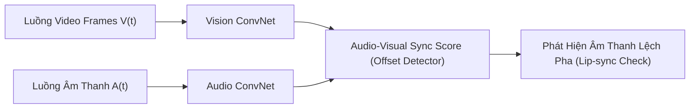

#### d. Code Thực chiến (C++ & Python)

```cpp
// C++17: Tính khoảng lệch thời gian (Time Offset) giữa Video và Audio
#include <iostream>

float calculate_av_offset_ms(int video_frame_idx, float fps, int audio_sample_idx, float sample_rate) {
    float video_time_sec = video_frame_idx / fps;
    float audio_time_sec = audio_sample_idx / sample_rate;
    return (video_time_sec - audio_time_sec) * 1000.0f; // Trả về ms
}

int main() {
    std::cout << "AV Offset: " << calculate_av_offset_ms(30, 30.0f, 16000, 16000.0f) << " ms (Hoàn hảo)\n";
    std::cout << "AV Offset: " << calculate_av_offset_ms(30, 30.0f, 14400, 16000.0f) << " ms (Audio đi trước 100ms)\n";
    return 0;
}
```

```python
# Python: Đánh giá độ đồng bộ môi - tiếng (Lip Sync Score) bằng khoảng cách Cosine
import torch
import torch.nn.functional as F

def compute_lip_sync_confidence(lip_embeddings: torch.Tensor, speech_embeddings: torch.Tensor) -> float:
    # lip_embeddings, speech_embeddings: [T, D]
    v_norm = F.normalize(lip_embeddings, dim=-1)
    a_norm = F.normalize(speech_embeddings, dim=-1)
    # Cosine similarity tại từng frame đồng thời
    sync_scores = torch.sum(v_norm * a_norm, dim=-1)
    return torch.mean(sync_scores).item()

v_emb = torch.randn(25, 512)
a_emb = v_emb + torch.randn(25, 512) * 0.1 # Rất đồng bộ
print("Lip-Sync Confidence Score:", compute_lip_sync_confidence(v_emb, a_emb))
```

#### e. Lỗi Thường gặp & Ổn định Số học
- Sự trễ âm học vật lý do khoảng cách (Acoustic Latency): Tốc độ ánh sáng ($300.000\text{ km/s}$) nhanh hơn tốc độ âm thanh trong không khí ($343\text{ m/s}$). Nếu camera quay người nói từ khoảng cách xa 30 mét, âm thanh sẽ đến micro trễ gần $90\text{ms}$ (gần 3 khung hình video), khiến thuật toán đồng bộ hiểu nhầm là bị lệch pha.

#### f. Ứng dụng Thực chiến trong AI
Mô hình phân tách người nói đang phát biểu giữa đám đông ồn ào (Looking to Listen của Google), tạo chuyển động môi tự động (Lip Syncing cho nhân vật ảo).

---

### 11. Audio-Visual Speech Recognition (AVSR - Nhận dạng Giọng nói Kết hợp Khẩu hình)

#### a. Định nghĩa Bản chất Toán học (Mathematical Formulation)
AVSR (hay Đọc khẩu hình kết hợp nghe âm thanh - Lip-reading ASR) giải quyết bài toán nhận dạng tiếng nói trong môi trường cực kỳ ồn ào (Cocktail Party Problem, SNR $< 0\text{ dB}$):
$$\hat{\mathbf{W}} = \arg\max_{\mathbf{W}} P(\mathbf{W} \mid \mathbf{X}_{\text{audio}}, \mathbf{X}_{\text{video\_lips}})$$
Mô hình trích xuất đồng thời:
1. Đặc trưng âm thanh $\mathbf{h}_a = \text{AudioEncoder}(\mathbf{X}_{\text{audio}})$.
2. Đặc trưng chuyển động vùng miệng $\mathbf{h}_v = \text{VisualLipEncoder}(\text{CroppedLips}(\mathbf{I}_{1:T}))$.
Được dung hợp qua khối Cross-Attention hoặc Conformer:
$$\mathbf{h}_{\text{av}} = \text{Fusion}(\mathbf{h}_a, \mathbf{h}_v) \xrightarrow{\text{CTC / Transducer}} \hat{\mathbf{W}}$$

#### b. Cơ chế Tầng Sâu & Điện toán (Under The Hood / Hardware Internals)
- **Face Landmark & Lip Cropping Pipeline**: Để đưa vào nhánh thị giác của AVSR, vùng môi (Bounding box $96 \times 96$ bao quanh miệng) phải được cắt gọt chuẩn hóa theo thời gian thực. Hệ thống sử dụng bộ phát hiện điểm mốc khuôn mặt (Mediapipe Face Mesh) chạy trên GPU để căn chỉnh affine (Affine Transformation) loại bỏ ảnh hưởng của việc đầu người nói bị lắc lư hoặc nghiêng.

#### c. Sơ đồ Minh họa (Mermaid Diagram)
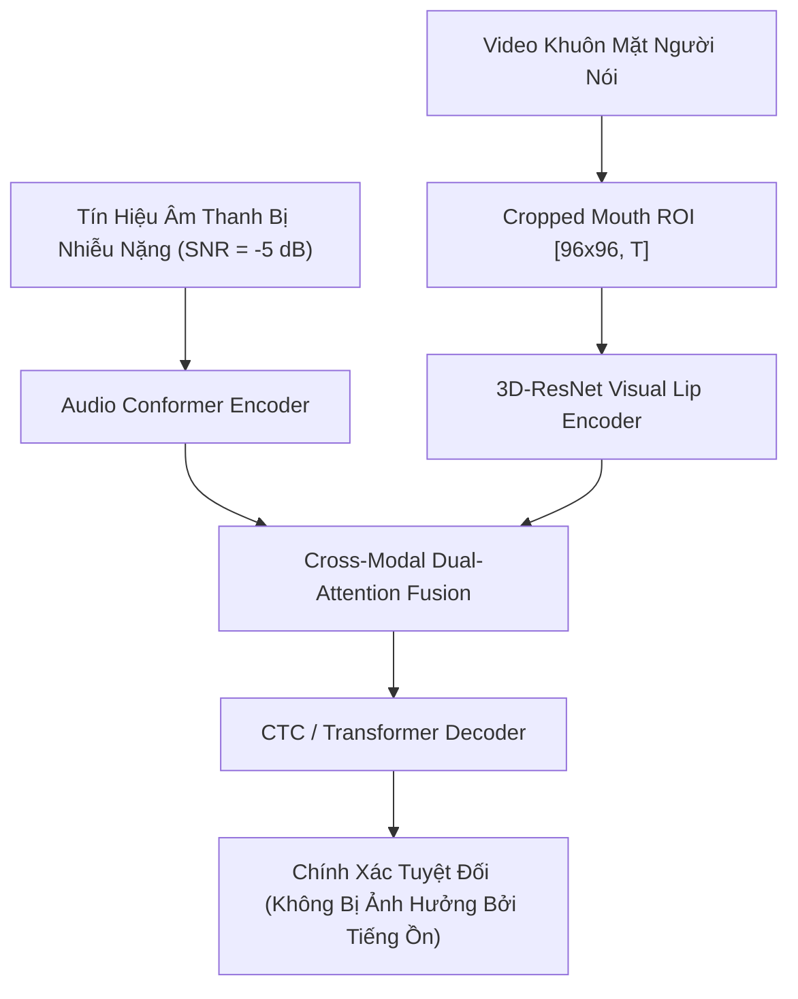

#### d. Code Thực chiến (C++ & Python)

```cpp
// C++17: Cắt vùng ROI môi từ bounding box khuôn mặt chuẩn hóa
#include <iostream>

struct Rect {
    int x, y, w, h;
};

Rect extract_mouth_roi(const Rect& face) {
    // Vùng miệng thường nằm ở nửa dưới của khuôn mặt
    int mouth_x = face.x + face.w / 4;
    int mouth_y = face.y + static_cast<int>(face.h * 0.65f);
    int mouth_w = face.w / 2;
    int mouth_h = static_cast<int>(face.h * 0.3f);
    return {mouth_x, mouth_y, mouth_w, mouth_h};
}

int main() {
    Rect face_box = {100, 100, 200, 200};
    auto mouth = extract_mouth_roi(face_box);
    std::cout << "Mouth ROI: X=" << mouth.x << ", Y=" << mouth.y << ", W=" << mouth.w << ", H=" << mouth.h << "\n";
    return 0;
}
```

```python
# Python / Torchaudio: Khối AVSR Fusion Conformer
import torch
import torch.nn as nn

class AVSRFusionLayer(nn.Module):
    def __init__(self, dim=512):
        super().__init__()
        self.cross_attn_a2v = nn.MultiheadAttention(dim, num_heads=8, batch_first=True)
        self.linear = nn.Linear(dim * 2, dim)

    def forward(self, h_audio, h_video):
        # h_audio, h_video: [B, T, D]
        # Âm thanh truy vấn thông tin bổ sung từ cử động môi
        v_attended, _ = self.cross_attn_a2v(h_audio, h_video, h_video)
        fused = torch.cat([h_audio, v_attended], dim=-1)
        return self.linear(fused)

fusion = AVSRFusionLayer(dim=256)
a_feats = torch.randn(2, 50, 256)
v_feats = torch.randn(2, 50, 256)
print("AVSR Fused Representation:", fusion(a_feats, v_feats).shape)
```

#### e. Lỗi Thường gặp & Ổn định Số học
- Sự mập mờ thị giác của các âm vị đồng hình môi (Visemes): Các phụ âm /p/, /b/, /m/ có hình dáng khép mở môi giống hệt nhau khi nhìn bằng mắt. Nếu âm thanh bị mất hoàn toàn, nhánh thị giác không thể tự phân biệt được ba âm vị này.

#### f. Ứng dụng Thực chiến trong AI
Nhận dạng giọng nói trên xe hơi khi cửa kính mở gió rít, hỗ trợ người khiếm thính giao tiếp.

---

### 12. Multimodal Question Answering (Hỏi Đáp Đa phương thức Tổng hợp)

#### a. Định nghĩa Bản chất Toán học (Mathematical Formulation)
Multimodal QA là bài toán trả lời câu hỏi khi cả câu hỏi, ngữ cảnh và câu trả lời có thể chứa bất kỳ phương thức nào:
$$\hat{\mathbf{A}} = \arg\max_{\mathbf{A}} P(\mathbf{A} \mid \mathcal{C}_{\text{text}}, \mathcal{C}_{\text{image}}, \mathcal{C}_{\text{table}}, \mathcal{C}_{\text{audio}})$$
Được đánh giá bằng độ đo F1 Token-level và Độ chính xác đối sánh chính xác (Exact Match - EM):
$$\text{EM} = \mathbb{I}(\text{Normalize}(\hat{\mathbf{A}}) == \text{Normalize}(\mathbf{A}_{\text{true}}))$$
$$\text{F1} = 2 \cdot \frac{\text{Precision} \cdot \text{Recall}}{\text{Precision} + \text{Recall}}$$

#### b. Cơ chế Tầng Sâu & Điện toán (Under The Hood / Hardware Internals)
- **Multi-Page Document & Table Parsing**: Khi giải quyết các bài toán DocVQA hoặc ChartQA phức tạp, hình ảnh tài liệu chứa cả bảng biểu phức tạp và văn bản nhỏ. Mô hình kết hợp đồng thời đặc trưng tọa độ 2D của từ (LayoutLMv3 Bounding Boxes) và Patch Embeddings của Vision Transformer để bảo toàn cấu trúc phân cấp không gian của văn bản.

#### c. Sơ đồ Minh họa (Mermaid Diagram)
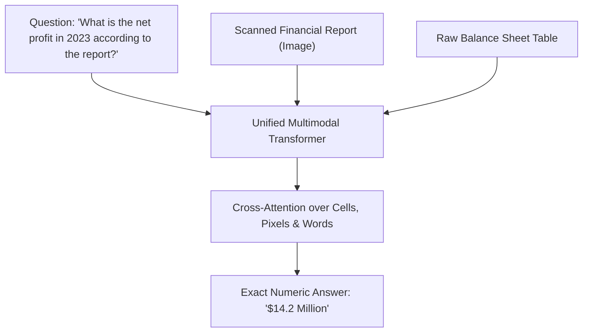

#### d. Code Thực chiến (C++ & Python)

```cpp
// C++17: Tính chỉ số Exact Match (EM) cho câu trả lời Multimodal QA
#include <iostream>
#include <string>
#include <algorithm>

std::string clean_text(std::string s) {
    s.erase(std::remove_if(s.begin(), s.end(), ::ispunct), s.end());
    std::transform(s.begin(), s.end(), s.begin(), ::tolower);
    return s;
}

bool check_exact_match(const std::string& pred, const std::string& gt) {
    return clean_text(pred) == clean_text(gt);
}

int main() {
    std::cout << "EM Match: " << check_exact_match("$14.2 Million.", "142 million") << "\n";
    return 0;
}
```

```python
# Python: Đánh giá Token F1-Score cho Multimodal QA
from collections import Counter

def compute_qa_f1(prediction: str, ground_truth: str) -> float:
    pred_tokens = prediction.lower().split()
    gt_tokens = ground_truth.lower().split()
    common = Counter(pred_tokens) & Counter(gt_tokens)
    num_same = sum(common.values())
    if num_same == 0:
        return 0.0
    precision = 1.0 * num_same / len(pred_tokens)
    recall = 1.0 * num_same / len(gt_tokens)
    return (2 * precision * recall) / (precision + recall)

print("QA F1 Score:", compute_qa_f1("The profit is 14 million dollars", "14 million dollars"))
```

#### e. Lỗi Thường gặp & Ổn định Số học
- Sự thất bại khi đọc đồ thị phi tuyến tính (Chart Misinterpretation): Mô hình đọc nhầm giá trị trục tung (Y-axis) khi trục tọa độ được vẽ theo thang đo Logarit thay vì thang đo tuyến tính.

#### f. Ứng dụng Thực chiến trong AI
Trợ lý phân tích báo cáo tài chính doanh nghiệp, giải đề thi đại học tổng hợp (ScienceQA, MathVista).

---

### 13. Multimodal Reasoning (Suy luận Logic Đa phương thức)

#### a. Định nghĩa Bản chất Toán học (Mathematical Formulation)
Multimodal Reasoning vượt xa việc nhận diện mẫu đơn thuần: nó đòi hỏi mô hình phải thực hiện chuỗi lập luận logic suy diễn (Deductive / Abductive / Inductive Reasoning) từng bước (Chain-of-Thought - CoT) kết hợp cả bằng chứng thị giác và tri thức thường thức:
$$P(\mathbf{A} \mid \mathbf{I}, \mathbf{Q}) = \sum_{\mathbf{C}} P(\mathbf{A} \mid \mathbf{C}, \mathbf{I}, \mathbf{Q}) P(\mathbf{C} \mid \mathbf{I}, \mathbf{Q})$$
Trong đó $\mathbf{C} = (c_1, c_2, \dots, c_S)$ là chuỗi suy luận từng bước (Multimodal Chain-of-Thought):
$$c_s = \arg\max_{c} P(c \mid c_{<s}, \mathbf{I}, \mathbf{Q})$$
Mô hình kết hợp các phép toán hình học giải tích, giải phương trình vật lý và đối chiếu luật nhân quả.

#### b. Cơ chế Tầng Sâu & Điện toán (Under The Hood / Hardware Internals)
- **High-Resolution Visual Patch Zooming (Chain-of-Spot / Dynamic Crop)**: Khi suy luận hình học hoặc giải bài toán bàn cờ vua, mô hình AI tự động phát ra lệnh crop độ phân giải cao vào một tọa độ hộp bao cụ thể trên ảnh (Visual Zoom-in), nạp lại vùng ảnh phóng to vào Vision Encoder để trích xuất thêm bằng chứng thị giác vi mô trước khi bước sang bước suy luận tiếp theo.

#### c. Sơ đồ Minh họa (Mermaid Diagram)
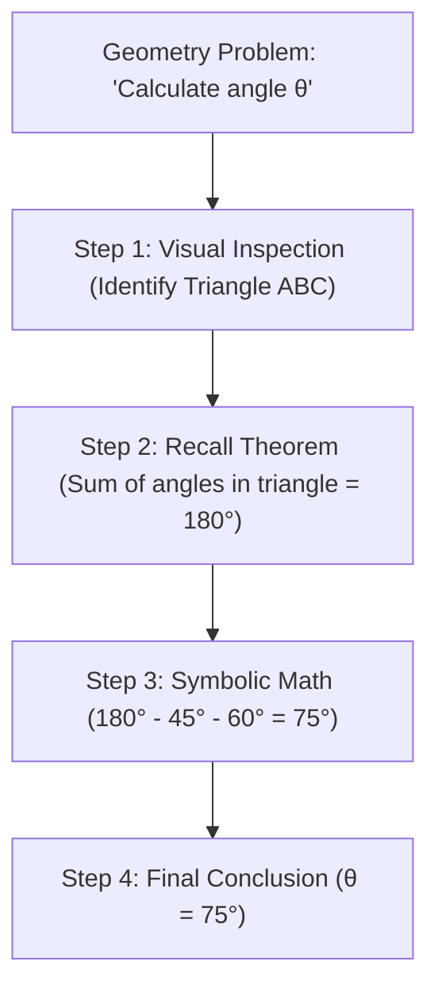

#### d. Code Thực chiến (C++ & Python)

```cpp
// C++17: Bộ phân giải bước suy luận Chain-of-Thought (CoT Step Parser)
#include <iostream>
#include <string>
#include <vector>
#include <sstream>

std::vector<std::string> parse_cot_steps(const std::string& cot_text) {
    std::vector<std::string> steps;
    std::stringstream ss(cot_text);
    std::string line;
    while (std::getline(ss, line)) {
        if (line.rfind("Step", 0) == 0) {
            steps.push_back(line);
        }
    }
    return steps;
}

int main() {
    std::string response = "Step 1: Detect parallel lines\nStep 2: Apply alternate interior angles\nConclusion: 45 degrees";
    auto s = parse_cot_steps(response);
    std::cout << "Parsed " << s.size() << " reasoning steps.\n";
    return 0;
}
```

```python
# Python: Mẫu Prompt kích hoạt Multimodal Chain-of-Thought
def build_multimodal_cot_prompt(question: str) -> str:
    return (
        f"{question}\n\n"
        "Let's think step by step:\n"
        "1. First, describe the relevant visual elements in the image.\n"
        "2. Second, state the physical or logical rules that apply.\n"
        "3. Third, perform the necessary calculations or deductions.\n"
        "4. Finally, state the final answer clearly."
    )

print(build_multimodal_cot_prompt("Which gear will rotate faster, A or B?"))
```

#### e. Lỗi Thường gặp & Ổn định Số học
- Sự đứt gãy logic giữa chuỗi suy luận và kết luận cuối cùng (CoT Drift): Mô hình có thể lập luận hoàn toàn chính xác ở các bước 1, 2, 3 nhưng đến bước cuối cùng lại đưa ra đáp án ngược lại do bị ảnh hưởng bởi xác suất token đầu ra của nhãn Softmax.

#### f. Ứng dụng Thực chiến trong AI
Mô hình OpenAI o1, Google Gemini 1.5 Pro giải các đề thi Olympic Toán/Vật lý quốc tế, phân tích nguyên nhân sự cố kỹ thuật hàng không.

---

### 14. Multimodal RAG (Tăng cường Truy xuất Đa phương thức)

#### a. Định nghĩa Bản chất Toán học (Mathematical Formulation)
Multimodal Retrieval-Augmented Generation (Multimodal RAG) giải quyết triệt để vấn đề ảo giác và kiến thức lỗi thời của VLM bằng cách truy xuất các tài liệu đa phương thức liên quan từ cơ sở dữ liệu tri thức bên ngoài:
$$\mathbf{Y} \sim P(\mathbf{Y} \mid \mathbf{Q}, \mathcal{R}(\mathbf{Q}, \mathcal{D}))$$
Trong đó tập tài liệu truy xuất được $\mathcal{R}$ chứa cả văn bản, hình ảnh sơ đồ, bảng biểu:
$$\mathcal{R}(\mathbf{Q}) = \arg\text{TopK}_{d \in \mathcal{D}} \left( \lambda \cos(f_t(q), f_t(d)) + (1 - \lambda) \cos(f_v(q_{\text{img}}), f_v(d_{\text{img}})) \right)$$
Kiến trúc ColPali hiện đại sử dụng biểu diễn Multi-Vector Retrieval trên từng patch ảnh của trang PDF thông qua phép tính MaxSim:
$$\text{Score}(q, d) = \sum_{i=1}^{|q|} \max_{j=1}^{|d|} \left( \mathbf{E}_{q, i}^T \mathbf{E}_{d, j} \right)$$

#### b. Cơ chế Tầng Sâu & Điện toán (Under The Hood / Hardware Internals)
- **Late Interaction MaxSim Operator on GPU**: Phép toán MaxSim của ColPali tính toán ma trận tương tự hạt mịn giữa chuỗi token câu hỏi ($32$ tokens) và toàn bộ các visual patch tokens của trang tài liệu ($1024$ patches). Trên GPU, phép toán này được viết bằng thư viện Triton Kernel để tính toán song song hàng nghìn trang tài liệu trong vòng vài mili-giây mà không làm nghẽn PCIe Bus.

#### c. Sơ đồ Minh họa (Mermaid Diagram)
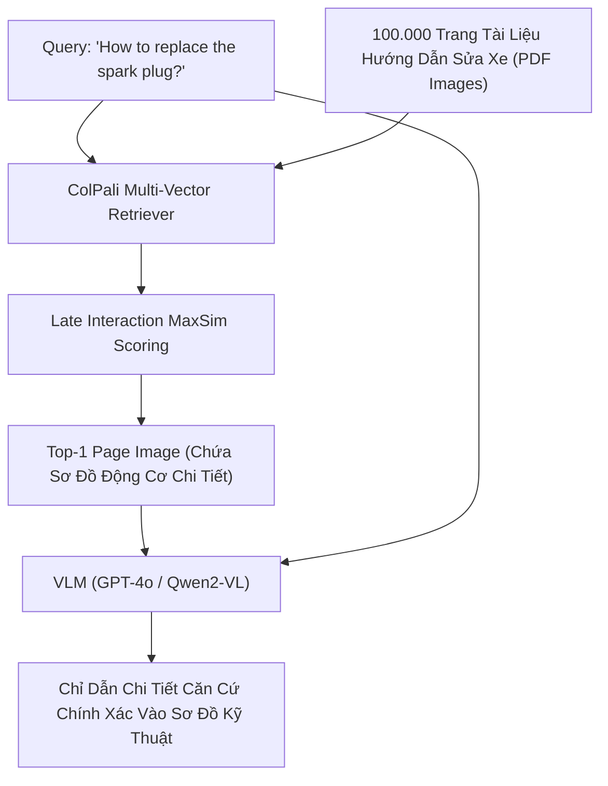

#### d. Code Thực chiến (C++ & Python)

```cpp
// C++17: Thuật toán Late-Interaction MaxSim giữa Query Tokens và Document Patch Tokens
#include <iostream>
#include <vector>
#include <algorithm>

float compute_maxsim(const std::vector<std::vector<float>>& Q, const std::vector<std::vector<float>>& D) {
    float total_score = 0.0f;
    for (size_t i = 0; i < Q.size(); ++i) {
        float max_dot = -1e9f;
        for (size_t j = 0; j < D.size(); ++j) {
            float dot = 0.0f;
            for (size_t d = 0; d < Q[i].size(); ++d) {
                dot += Q[i][d] * D[j][d];
            }
            if (dot > max_dot) max_dot = dot;
        }
        total_score += max_dot;
    }
    return total_score;
}

int main() {
    std::vector<std::vector<float>> query = {{1.0f, 0.0f}};
    std::vector<std::vector<float>> doc_patches = {{0.8f, 0.2f}, {0.1f, 0.9f}};
    std::cout << "MaxSim Score: " << compute_maxsim(query, doc_patches) << "\n";
    return 0;
}
```

```python
# Python / ColPali: Mô phỏng Late-Interaction MaxSim với PyTorch
import torch

def late_interaction_maxsim(query_embeddings: torch.Tensor, doc_embeddings: torch.Tensor) -> float:
    # query_embeddings: [L_q, Dim], doc_embeddings: [L_d, Dim]
    # Tính ma trận tương tự hạt mịn [L_q, L_d]
    similarity_matrix = torch.matmul(query_embeddings, doc_embeddings.t())
    # Max trên từng token câu hỏi và tính tổng
    max_scores, _ = torch.max(similarity_matrix, dim=-1)
    return torch.sum(max_scores).item()

q = torch.randn(10, 128)
d = torch.randn(256, 128)
print("Late-Interaction Retrieval Score:", late_interaction_maxsim(q, d))
```

#### e. Lỗi Thường gặp & Ổn định Số học
- Sự nghẽn dung lượng lưu trữ Multi-Vector: Biểu diễn ColPali lưu trữ 1024 vector cho mỗi trang tài liệu (gấp hàng trăm lần so với Dense Embedding truyền thống). Cần áp dụng kỹ thuật nhị phân hóa (Binary Quantization - 1-bit per dimension) để giảm dung lượng lưu trữ RAM/Disk đi 32 lần.

#### f. Ứng dụng Thực chiến trong AI
Hệ thống tra cứu tài liệu kỹ thuật máy bay Boeing/Airbus, trợ lý pháp lý kiểm tra điều khoản bảo hiểm tự động.
