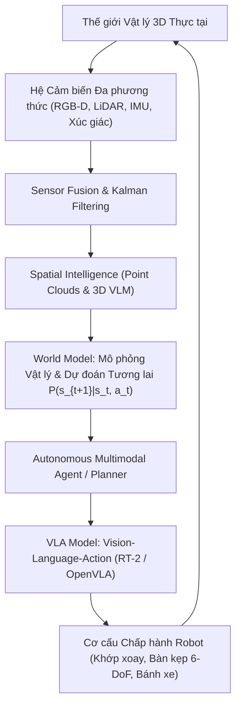
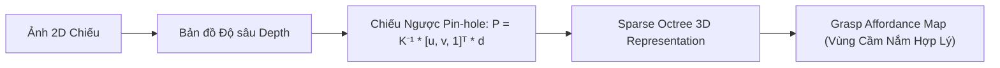
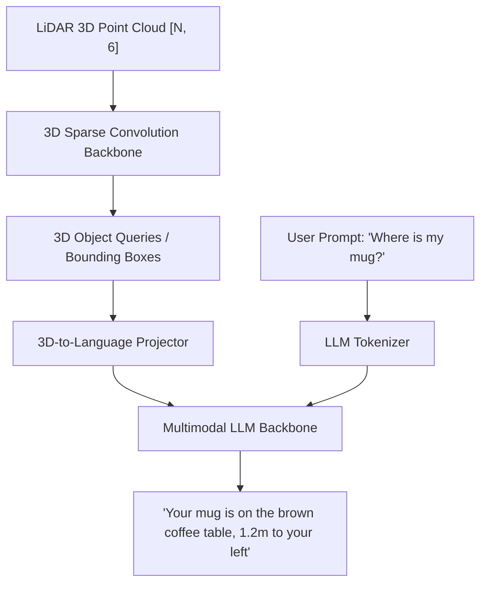
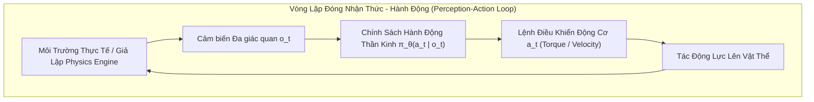
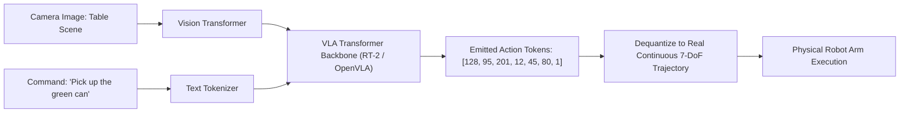
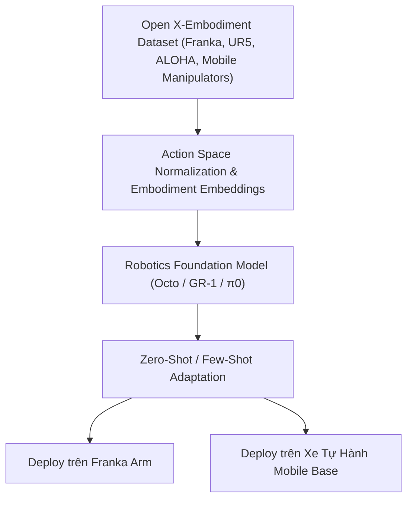
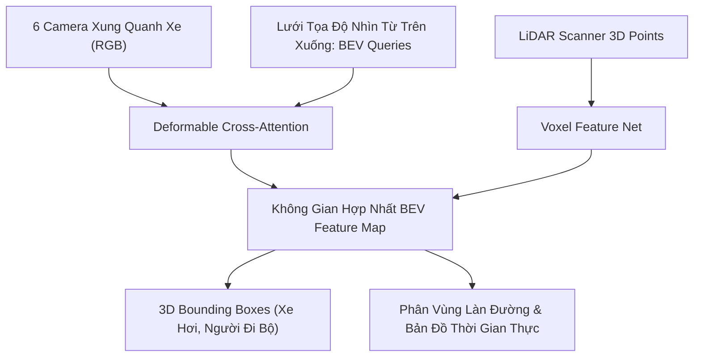
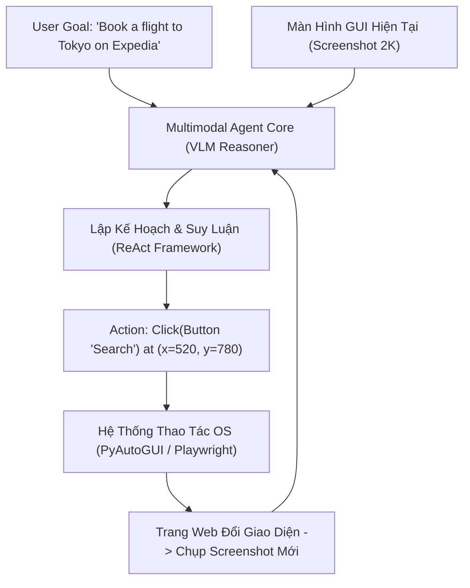

# Chuyên đề: Trí tuệ Không gian, Embodied AI, World Models & Multimodal Agents (Physical AI & Agents)

## 1. Tổng quan Chuyên đề
Đích đến tối thượng của Trí tuệ Nhân tạo không dừng lại ở thế giới số (màn hình máy tính và văn bản tĩnh) mà phải bước ra tương tác trực tiếp với thế giới vật lý thực tại. Sự hội tụ đỉnh cao này được định nghĩa bởi Trí tuệ Thể hiện (Embodied AI) và Trí tuệ Nhân tạo Vật lý (Physical AI).

Từ năng lực định vị và thấu hiểu không gian ba chiều (Spatial Intelligence, 3D Vision-Language Models); đến việc chuyển hóa nhận thức thị giác và ngôn ngữ thành chuỗi hành vi cơ học điều khiển khớp robot (Vision-Language-Action - VLA Models, Robotics Foundation Models); việc xây dựng các Mô hình Thế giới (World Models) có khả năng mô phỏng và dự đoán tương lai tuân theo các định luật vật lý thực; cơ chế dung hợp đa cảm biến thời gian thực (Sensor Fusion); và sự tiến hóa của các Tác nhân Đa phương thức Tự hành (Multimodal Agents) có khả năng tự quan sát màn hình, thao tác bàn phím, chuột và giải quyết các tác vụ phức tạp của con người.



---

## 2. Chi tiết từng Keyword

---

### 1. Spatial Intelligence (Trí tuệ Không gian)

#### a. Định nghĩa Bản chất Toán học (Mathematical Formulation)
Trí tuệ Không gian là năng lực của hệ thống AI trong việc suy luận hình học, cấu trúc 3 chiều, quan hệ vị trí tương đối và các thuộc tính vật lý của thế giới từ các dữ liệu quan sát giác quan:
$$\mathcal{S} = (\mathcal{G}_{\text{geom}}, \mathcal{T}_{\text{topology}}, \mathcal{P}_{\text{physics}})$$
Bao gồm các phép biến đổi không gian Euclid ba chiều đặc biệt $SE(3)$:
$$\mathbf{T} = \begin{bmatrix} \mathbf{R} & \mathbf{t} \\ \mathbf{0}^T & 1 \end{bmatrix} \in SE(3), \quad \mathbf{R} \in SO(3), \, \mathbf{t} \in \mathbb{R}^3$$
Và suy luận các thuộc tính affordance (Khả năng tương tác): Điểm nào trên vật thể có thể cầm nắm được (Grasp affordance map) $\mathcal{A}(\mathbf{p}) \in [0, 1]$ cho mỗi tọa độ $\mathbf{p} \in \mathbb{R}^3$.

#### b. Cơ chế Tầng Sâu & Điện toán (Under The Hood / Hardware Internals)
- **Octree & Voxel Grid Memory Alignment**: Không gian 3D liên tục rất thưa thớt (phần lớn là không khí trống). Việc biểu diễn bằng mảng 3D dày đặc (Dense Voxel Grid kích thước $512^3$) ngốn tới $512\text{ MB}$ bộ nhớ cho mỗi cảnh. Các hệ thống Trí tuệ Không gian sử dụng cây bát phân (Sparse Octree) hoặc cấu trúc dữ liệu Hash Grid (như trong Instant-NGP) để ánh xạ các tọa độ không gian 3D vào bảng băm bộ nhớ đệm L1 của GPU với độ truy cập $\mathcal{O}(1)$.

#### c. Sơ đồ Minh họa (Mermaid Diagram)


#### d. Code Thực chiến (C++ & Python)

```cpp
// C++17: Phép chiếu ngược (Unprojection) từ tọa độ Pixel 2D sang Tọa độ 3D Camera
#include <iostream>

struct Point3D {
    float x, y, z;
};

Point3D pixel_to_point3d(float u, float v, float depth, float fx, float fy, float cx, float cy) {
    float z = depth;
    float x = (u - cx) * z / fx;
    float y = (v - cy) * z / fy;
    return {x, y, z};
}

int main() {
    auto p = pixel_to_point3d(320.0f, 240.0f, 2.0f, 525.0f, 525.0f, 320.0f, 240.0f);
    std::cout << "3D Point: [" << p.x << ", " << p.y << ", " << p.z << "] meters\n";
    return 0;
}
```

```python
# Python / PyTorch: Tạo ma trận biến đổi Affine 3D SE(3)
import torch

def create_se3_transform(rotation_matrix: torch.Tensor, translation_vector: torch.Tensor) -> torch.Tensor:
    # R: [3, 3], t: [3, 1]
    T = torch.eye(4)
    T[:3, :3] = rotation_matrix
    T[:3, 3:] = translation_vector
    return T

R = torch.eye(3)
t = torch.tensor([[0.5], [-0.2], [1.0]])
T_mat = create_se3_transform(R, t)
print("SE(3) Transformation Matrix:\n", T_mat)
```

#### e. Lỗi Thường gặp & Ổn định Số học
- Sự mất cân bằng tỷ lệ độ sâu trong không gian chiếu phối cảnh: Các điểm ở xa camera có sai số độ sâu $\Delta z$ lớn hơn gấp nhiều lần so với các điểm ở gần do tính chất phi tuyến của ma trận nghịch đảo độ sâu ($z \propto 1 / \text{disparity}$).

#### f. Ứng dụng Thực chiến trong AI
Khái niệm nền tảng do Fei-Fei Li và World Labs tiên phong cho robot tương tác thực tế, kính thực tế ảo Apple Vision Pro.

---

### 2. 3D Vision-Language Models (Mô hình Thị giác - Ngôn ngữ Không gian 3D)

#### a. Định nghĩa Bản chất Toán học (Mathematical Formulation)
3D VLM (như 3D-LLM, LEO, ScanQA) mở rộng khả năng tiếp nhận của VLM từ ảnh 2D sang các đám mây điểm 3D (3D Point Clouds $\mathcal{P} \in \mathbb{R}^{N \times 6}$ gồm tọa độ $(x, y, z)$ và màu sắc $(r, g, b)$):
$$P(\mathbf{Y} \mid \mathcal{P}, \mathbf{T}_{\text{query}})$$
Mô hình chiếu các đặc trưng của đám mây điểm 3D vào không gian từ vựng của LLM:
$$\mathbf{H}_{3D} = \text{PointProjector}(\text{PointNet++ / 3D-SparseConv}(\mathcal{P})) \in \mathbb{R}^{M \times d_{\text{LLM}}}$$
Cho phép trả lời các câu hỏi định vị không gian phức tạp: "Chiếc ghế nào nằm gần cửa sổ nhất và có thể ngồi được?".

#### b. Cơ chế Tầng Sâu & Điện toán (Under The Hood / Hardware Internals)
- **Sparse 3D Convolution (MinkowskiEngine)**: Đám mây điểm 3D không có cấu trúc lưới cố định như pixel ảnh. Việc áp dụng tích chập 3D dày đặc là bất khả thi. Thư viện MinkowskiEngine sử dụng cấu trúc lưu trữ tọa độ thưa (Sparse Coordinate Hash Tables) trên CUDA GPU, chỉ thực hiện phép nhân chập tại các vị trí có điểm dữ liệu thực tế, tăng tốc độ tính toán gấp $50$ lần.

#### c. Sơ đồ Minh họa (Mermaid Diagram)


#### d. Code Thực chiến (C++ & Python)

```cpp
// C++17: Cấu trúc biểu diễn một Bounding Box 3D hướng (Oriented BBox)
#include <iostream>

struct OrientedBoundingBox3D {
    float center_x, center_y, center_z;
    float size_dx, size_dy, size_dz;
    float yaw_rotation;

    float compute_volume() const {
        return size_dx * size_dy * size_dz;
    }
};

int main() {
    OrientedBoundingBox3D table = {0.0f, 1.5f, 0.5f, 1.2f, 0.8f, 0.75f, 0.0f};
    std::cout << "3D BBox Volume: " << table.compute_volume() << " m^3\n";
    return 0;
}
```

```python
# Python / PyTorch: Chiếu đám mây điểm 3D qua MLP Projector vào không gian LLM
import torch
import torch.nn as nn

class PointCloudToLLMProjector(nn.Module):
    def __init__(self, point_feat_dim=288, llm_dim=4096):
        super().__init__()
        self.net = nn.Sequential(
            nn.Linear(point_feat_dim, 1024),
            nn.GELU(),
            nn.Linear(1024, llm_dim),
            nn.LayerNorm(llm_dim)
        )
    def forward(self, point_features):
        return self.net(point_features)

proj = PointCloudToLLMProjector()
p_feats = torch.randn(1, 128, 288) # 128 3D object proposals
print("3D Tokens for LLM:", proj(p_feats).shape) # [1, 128, 4096]
```

#### e. Lỗi Thường gặp & Ổn định Số học
- Sự nhầm lẫn hướng xoay trục (Yaw Ambiguity): Các vật thể đối xứng như bàn tròn hoặc cốc nước có góc xoay hướng không xác định, dẫn đến lỗi gradient khi huấn luyện hàm mất mát góc hướng hộp bao 3D.

#### f. Ứng dụng Thực chiến trong AI
Robot phục vụ trong gia đình tìm đồ vật thất lạc, hệ thống số hóa bản sao ảo tòa nhà (Digital Twins).

---

### 3. Embodied AI (Trí tuệ Nhân tạo Thể hiện)

#### a. Định nghĩa Bản chất Toán học (Mathematical Formulation)
Embodied AI là mô hình trí tuệ nhân tạo được "nhập thể" vào một thực thể vật lý (Robot, Xe tự hành, Drone) tương tác trực tiếp với môi trường thông qua vòng lặp đóng Nhận thức - Hành động (Perception-Action Loop):
$$s_{t+1} \sim \mathcal{P}(s_{t+1} \mid s_t, a_t), \quad r_t = \mathcal{R}(s_t, a_t)$$
Tác nhân học chính sách hành vi tối ưu $\pi_\theta(a_t \mid o_t)$ từ các quan sát đa giác quan $o_t$ (ảnh camera, lực cản xúc giác) để tối đa hóa phần thưởng tích lũy kỳ vọng:
$$J(\theta) = \mathbb{E}_{\tau \sim \pi_\theta} \left[ \sum_{t=0}^T \gamma^t r(s_t, a_t) \right]$$
Bài toán cốt lõi là giải quyết khoảng cách giữa mô phỏng và thực tế (Sim-to-Real Gap).

#### b. Cơ chế Tầng Sâu & Điện toán (Under The Hood / Hardware Internals)
- **Domain Randomization for Sim-to-Real**: Để robot được huấn luyện trong môi trường mô phỏng (Isaac Sim / MuJoCo) có thể chạy mượt mà ngoài đời thực mà không cần thu thập lại dữ liệu, kỹ thuật Domain Randomization được kích hoạt trên GPU: xáo trộn ngẫu nhiên độ ma sát bề mặt, khối lượng vật thể, độ trễ động cơ, màu sắc ánh sáng và độ nhiễu cảm biến trong hàng triệu môi trường mô phỏng song song.

#### c. Sơ đồ Minh họa (Mermaid Diagram)


#### d. Code Thực chiến (C++ & Python)

```cpp
// C++17: Bộ điều khiển tỷ lệ vi phân PD Controller cơ bản cho khớp cánh tay Robot
#include <iostream>

struct PDController {
    float Kp, Kd;
    float prev_error = 0.0f;

    float compute_torque(float target_pos, float current_pos, float dt) {
        float error = target_pos - current_pos;
        float derivative = (error - prev_error) / dt;
        prev_error = error;
        return Kp * error + Kd * derivative;
    }
};

int main() {
    PDController joint_ctrl = {100.0f, 10.0f};
    float torque = joint_ctrl.compute_torque(1.57f, 1.20f, 0.01f);
    std::cout << "Applied Motor Torque: " << torque << " N.m\n";
    return 0;
}
```

```python
# Python / Gymnasium: Vòng lặp cơ bản Embodied AI
import numpy as np

class DummyRobotEnv:
    def step(self, action):
        observation = np.random.randn(12) # 12 trạng thái khớp
        reward = -np.linalg.norm(action)   # Phạt tiêu thụ năng lượng
        done = False
        return observation, reward, done, {}

env = DummyRobotEnv()
obs, reward, done, _ = env.step(np.array([0.1, -0.2]))
print("Robot Step Successful. Observation Dim:", len(obs))
```

#### e. Lỗi Thường gặp & Ổn định Số học
- Sự chậm trễ vòng lặp điều khiển (Control Loop Lag): Nếu mạng nơ-ron suy luận mất $100\text{ms}$ trong khi tần số ổn định động cơ yêu cầu $500\text{Hz}$ ($2\text{ms}$), cánh tay robot sẽ bị rung lắc dữ dội (Instability Oscillation) và phá hỏng phần cứng.

#### f. Ứng dụng Thực chiến trong AI
Robot hình người (Tesla Optimus, Figure 01, Boston Dynamics Atlas), robot kho bãi Amazon Kiva.

---

### 4. Vision-Language-Action Models (VLA - Mô hình Thị giác - Ngôn ngữ - Hành động)

#### a. Định nghĩa Bản chất Toán học (Mathematical Formulation)
VLA (như RT-1, RT-2 của Google DeepMind, OpenVLA) biến đổi trực tiếp bài toán điều khiển robot thành bài toán sinh chuỗi token ngôn ngữ tự nhiên:
$$\mathbf{a}_t = \text{VLA}(\mathbf{I}_t, \mathbf{T}_{\text{task}})$$
Hành động điều khiển cơ học của robot (thường là vector 7-DoF hoặc 8-DoF gồm: độ dịch chuyển $\Delta x, \Delta y, \Delta z$, góc xoay roll, pitch, yaw và độ mở bàn kẹp gripper $\in [0, 1]$) được lượng tử hóa thành 256 mức rời rạc và gán nhãn bằng các token văn bản:
$$\mathbf{a} = [\Delta x, \Delta y, \Delta z, \Delta \text{roll}, \Delta \text{pitch}, \Delta \text{yaw}, \text{grip}] \to (\text{"tok\_128"}, \text{"tok\_64"}, \dots)$$
Mô hình được huấn luyện đồng thời trên cả dữ liệu Web ảnh-văn bản (VLM) và dữ liệu hành trình cánh tay robot (Robot Trajectories) theo hàm mất mát Cross-Entropy chuẩn.

#### b. Cơ chế Tầng Sâu & Điện toán (Under The Hood / Hardware Internals)
- **Action Tokenization & Co-fine-tuning**: Bằng cách đưa các action tokens vào từ vựng chung của PaLM-E hoặc LLaMA, mô hình VLA thừa hưởng toàn bộ khả năng suy luận logic và thường thức của siêu mô hình ngôn ngữ: khi người dùng ra lệnh "Gắp quả chuối bị hỏng bỏ vào thùng rác", robot tự nhận biết quả chuối nào bị thâm đen (Visual reasoning) và vị trí thùng rác để gắp thả mà không cần lập trình luật tường minh.

#### c. Sơ đồ Minh họa (Mermaid Diagram)


#### d. Code Thực chiến (C++ & Python)

```cpp
// C++17: Lượng tử hóa và Giải lượng tử hóa Action Vector 7-DoF
#include <iostream>
#include <vector>
#include <algorithm>

int float_to_action_bin(float val, float min_val = -1.0f, float max_val = 1.0f, int num_bins = 256) {
    float clamped = std::max(min_val, std::min(max_val, val));
    float norm = (clamped - min_val) / (max_val - min_val);
    return std::min(num_bins - 1, static_cast<int>(norm * num_bins));
}

float action_bin_to_float(int bin, float min_val = -1.0f, float max_val = 1.0f, int num_bins = 256) {
    float norm = (bin + 0.5f) / num_bins;
    return min_val + norm * (max_val - min_val);
}

int main() {
    float original_dx = 0.35f;
    int bin = float_to_action_bin(original_dx);
    float reconstructed_dx = action_bin_to_float(bin);
    std::cout << "Original: " << original_dx << " -> Bin Token: " << bin << " -> Reconstructed: " << reconstructed_dx << "\n";
    return 0;
}
```

```python
# Python / PyTorch: Giải mã chuỗi Action Tokens từ đầu ra LLM
import torch

def decode_action_tokens(action_token_ids: list, num_bins: int = 256, action_ranges=(-1.0, 1.0)) -> torch.Tensor:
    min_v, max_v = action_ranges
    bins = torch.tensor(action_token_ids).float()
    normalized = (bins + 0.5) / num_bins
    continuous_actions = min_v + normalized * (max_v - min_v)
    return continuous_actions

# 7 action tokens đại diện cho 7 bậc tự do cánh tay
dummy_tokens = [128, 140, 110, 128, 128, 128, 255]
continuous_7dof = decode_action_tokens(dummy_tokens)
print("Continuous Robot Command (dx, dy, dz, r, p, y, grip):\n", continuous_7dof)
```

#### e. Lỗi Thường gặp & Ổn định Số học
- Sự tích lũy sai số trôi dạt (Drift Accumulation): Một lỗi dự đoán nhỏ vài milimet ở bước $t$ sẽ làm thay đổi góc nhìn camera ở bước $t+1$, khiến chuỗi hành động tiếp theo bị sai lệch dây chuyền không thể hoàn thành nhiệm vụ. Cần sử dụng kỹ thuật DAgger (Dataset Aggregation) để sửa lỗi tương tác.

#### f. Ứng dụng Thực chiến trong AI
Mô hình Google RT-2, Stanford OpenVLA, hệ thống gắp đồ tự động trong nhà máy công nghiệp.

---

### 5. Robotics Foundation Models (Mô hình Nền tảng Robot)

#### a. Định nghĩa Bản chất Toán học (Mathematical Formulation)
Robotics Foundation Model là mô hình quy mô lớn được tiền huấn luyện trên các tập dữ liệu hành vi đa dạng từ hàng chục loại phần cứng robot khác nhau (như tập dữ liệu Open X-Embodiment gồm hơn 1 triệu hành trình robot từ 22 trường đại học):
$$\Theta^* = \arg\min_\Theta \sum_{e \in \mathcal{E}} \mathbb{E}_{(\tau, \mathbf{c}) \sim \mathcal{D}_e} \left[ \mathcal{L}_{\text{behavior}}(\pi_\Theta(a \mid o, \mathbf{c}, e)) \right]$$
Trong đó $e$ là mã nhận diện cấu trúc robot (Embodiment Identifier), giúp mô hình học được chính sách khái quát xuyên cấu trúc phần cứng (Cross-Embodiment Generalization).

#### b. Cơ chế Tầng Sâu & Điện toán (Under The Hood / Hardware Internals)
- **Cross-Embodiment Action Normalization**: Mỗi robot có số khớp xoay, giới hạn vận tốc góc và cấu trúc cánh tay hoàn toàn khác nhau (ví dụ: Franka Emika 7 khớp vs. Universal Robots UR5e 6 khớp). Để huấn luyện chung một mô hình nền tảng, toàn bộ không gian hành động được chuẩn hóa về phân phối Gauss chuẩn tắc $\mathcal{N}(0, \mathbf{I})$ cho từng loại robot dựa trên thống kê phương sai của tập dữ liệu đó.

#### c. Sơ đồ Minh họa (Mermaid Diagram)


#### d. Code Thực chiến (C++ & Python)

```cpp
// C++17: Chuẩn hóa Z-Score cho Action Vector dựa trên tham số trung bình và độ lệch chuẩn của Robot
#include <iostream>
#include <vector>

void normalize_robot_action(std::vector<float>& act, const std::vector<float>& mean, const std::vector<float>& std) {
    for (size_t i = 0; i < act.size(); ++i) {
        act[i] = (act[i] - mean[i]) / (std[i] + 1e-8f);
    }
}

int main() {
    std::vector<float> action = {0.2f, -0.1f};
    std::vector<float> mean = {0.0f, 0.0f};
    std::vector<float> std = {0.1f, 0.05f};
    normalize_robot_action(action, mean, std);
    std::cout << "Normalized Action: [" << action[0] << ", " << action[1] << "]\n";
    return 0;
}
```

```python
# Python / Octo: Kiến trúc Transformer đa cấu trúc robot (Diffusion Policy Head)
import torch
import torch.nn as nn

class DiffusionPolicyHead(nn.Module):
    def __init__(self, token_dim=512, action_dim=7):
        super().__init__()
        # Sử dụng MLP dự đoán chuỗi hành động hành trình 8 bước tương lai
        self.action_pred = nn.Linear(token_dim, 8 * action_dim)
    def forward(self, robot_tokens):
        # robot_tokens: [Batch, Dim]
        return self.action_pred(robot_tokens).view(-1, 8, 7)

head = DiffusionPolicyHead()
emb = torch.randn(2, 512)
trajectory = head(emb)
print("Predicted 8-Step Future Action Trajectory Shape:", trajectory.shape) # [2, 8, 7]
```

#### e. Lỗi Thường gặp & Ổn định Số học
- Sự xung đột hình học phần cứng (Negative Transfer): Việc học chung dữ liệu của robot hai tay (Bimanual ALOHA) với robot một tay có thể làm giảm hiệu năng của robot một tay nếu không gán nhãn Modality Token rõ ràng.

#### f. Ứng dụng Thực chiến trong AI
Mô hình Octo (UC Berkeley), Physical Intelligence $\pi_0$, dự án Google DeepMind AutoRT.

---

### 6. World Models (Mô hình Thế giới)

#### a. Định nghĩa Bản chất Toán học (Mathematical Formulation)
Mô hình Thế giới là một cỗ máy mô phỏng nội tại (Internal Simulator) học cách mô hình hóa động lực học của môi trường thực:
$$s_{t+1} \sim P_\theta(s_{t+1} \mid s_t, a_t)$$
$$o_t \sim P_\phi(o_t \mid s_t)$$
Kiến trúc tiêu chuẩn (như trong DreamerV3 của Hafner et al.) sử dụng Mô hình Trạng thái Không gian Tái phát (Recurrent State Space Model - RSSM):
1. **Deterministic Path**: $h_t = f_\theta(h_{t-1}, z_{t-1}, a_{t-1})$ (Biểu diễn qua GRU).
2. **Stochastic Path**: $z_t \sim q_\phi(z_t \mid h_t, o_t)$ (Biểu diễn biến ngẫu nhiên ẩn).
Tác nhân AI có thể tưởng tượng (Dream) hàng triệu kịch bản tương lai hoàn toàn trong không gian ẩn của World Model mà không cần tác động nguy hiểm lên môi trường thực.

#### b. Cơ chế Tầng Sâu & Điện toán (Under The Hood / Hardware Internals)
- **Imagination Rollouts in VRAM**: Thay vì phải tương tác trực tiếp với thế giới thật (vốn bị giới hạn bởi thời gian thực: 1 giây ngoài đời mất đúng 1 giây), tác nhân AI chạy các bước tưởng tượng (Latent Imagination) song song trên GPU Tensor Cores với tốc độ hàng triệu bước mỗi giây, cho phép thuật toán học tăng cường hội tụ trong vài giờ thay vì hàng năm.

#### c. Sơ đồ Minh họa (Mermaid Diagram)


#### d. Code Thực chiến (C++ & Python)

```cpp
// C++17: Cập nhật đường chuyển trạng thái xác định Deterministic Path của RSSM
#include <iostream>
#include <vector>
#include <cmath>

void rssm_gru_step(const std::vector<float>& h_prev, const std::vector<float>& z_prev, const std::vector<float>& a_prev, std::vector<float>& h_next) {
    for (size_t i = 0; i < h_next.size(); ++i) {
        // Mô phỏng hàm cập nhật phi tuyến h_t = tanh(W_h * h + W_z * z + W_a * a)
        h_next[i] = std::tanh(0.7f * h_prev[i] + 0.2f * z_prev[i] + 0.1f * a_prev[i]);
    }
}

int main() {
    std::vector<float> h = {0.5f};
    std::vector<float> z = {0.1f};
    std::vector<float> a = {1.0f};
    std::vector<float> h_next(1);
    rssm_gru_step(h, z, a, h_next);
    std::cout << "Next Hidden State h_{t+1}: " << h_next[0] << "\n";
    return 0;
}
```

```python
# Python / PyTorch: Khối KL Divergence cân bằng giữa Representation và Dynamics trong DreamerV3
import torch
import torch.nn.functional as F

def world_model_kl_loss(post_logits: torch.Tensor, prior_logits: torch.Tensor, free_bits: float = 1.0) -> torch.Tensor:
    # post_logits: Phân phối hậu nghiệm khi có ảnh thật q(z|h, o)
    # prior_logits: Phân phối tiên nghiệm chỉ dựa vào tưởng tượng p(z|h)
    p_post = F.softmax(post_logits, dim=-1)
    p_prior = F.softmax(prior_logits, dim=-1)
    kl = torch.sum(p_post * (torch.log(p_post + 1e-8) - torch.log(p_prior + 1e-8)), dim=-1)
    # Cơ chế Free Bits tránh sụp đổ KL
    loss = torch.mean(torch.clamp(kl, min=free_bits))
    return loss

post = torch.randn(2, 32, 32)
prior = torch.randn(2, 32, 32)
print("World Model KL Loss:", world_model_kl_loss(post, prior).item())
```

#### e. Lỗi Thường gặp & Ổn định Số học
- Sự ảo tưởng rủi ro (Delusional Bias / Objective Collapse): Nếu World Model dự đoán sai một quy luật vật lý (ví dụ: nghĩ rằng chiếc xe có thể đi xuyên qua tường mà không hỏng), chính sách AI sẽ khai thác lỗi này (Exploitation) và đưa ra các hành động tự sát khi chạy thực tế.

#### f. Ứng dụng Thực chiến trong AI
Mô hình DreamerV3 phá đảo game Minecraft từ con số 0 mà không cần dữ liệu người chơi, hệ thống lái xe tự động Wayve GAIA-1.

---

### 7. Physical AI (Trí tuệ Nhân tạo Tuân thủ Vật lý)

#### a. Định nghĩa Bản chất Toán học (Mathematical Formulation)
Physical AI là sự kết hợp sâu sắc giữa Mạng nơ-ron Học sâu và các Phương trình Vi phân Đạo hàm riêng (PDE) mô tả thế giới tự nhiên (Định luật bảo toàn năng lượng, định luật chuyển động Newton, phương trình Navier-Stokes cho chất lưu):
$$\mathcal{L}_{\text{PhysicalAI}} = \mathcal{L}_{\text{data}}(\mathbf{y}, \hat{\mathbf{y}}) + \lambda_{\text{physics}} \|\mathcal{N}[\hat{\mathbf{y}}] - \mathbf{f}\|_2^2$$
Trong đó $\mathcal{N}[\cdot]$ là toán tử vi phân phi tuyến (ví dụ: $\mathcal{N}[u] = \frac{\partial u}{\partial t} + u \frac{\partial u}{\partial x} - \nu \frac{\partial^2 u}{\partial x^2}$).
Mô hình đảm bảo rằng mọi dự đoán hành vi của AI đều không vi phạm các định luật nhiệt động lực học và bảo toàn động lượng.

#### b. Cơ chế Tầng Sâu & Điện toán (Under The Hood / Hardware Internals)
- **Automatic Differentiation for High-Order Derivatives**: Việc tính toán thành phần tổn thất vật lý $\frac{\partial^2 u}{\partial x^2}$ đòi hỏi đồ thị tính toán đạo hàm tự động (Autograd Graph) phải được lưu trữ để tính đạo hàm bậc hai (Hessian-vector products). Kỹ thuật này đòi hỏi bộ nhớ GPU gấp 3-4 lần so với huấn luyện mạng nơ-ron thông thường.

#### c. Sơ đồ Minh họa (Mermaid Diagram)


#### d. Code Thực chiến (C++ & Python)

```cpp
// C++17: Kiểm tra định luật bảo toàn động lượng cho va chạm đàn hồi 1D
#include <iostream>
#include <cmath>

bool verify_momentum_conservation(float m1, float v1_i, float m2, float v2_i, float v1_f, float v2_f, float tol = 1e-4f) {
    float initial_momentum = m1 * v1_i + m2 * v2_i;
    float final_momentum = m1 * v1_f + m2 * v2_f;
    return std::abs(initial_momentum - final_momentum) <= tol;
}

int main() {
    std::cout << "Conservation Check: " << verify_momentum_conservation(1.0f, 2.0f, 2.0f, -1.0f, -0.66f, 0.33f) << "\n";
    return 0;
}
```

```python
# Python / PyTorch: Tính phần dư đạo hàm riêng vật lý bằng torch.autograd
import torch

def physics_loss_harmonic_oscillator(t: torch.Tensor, model: torch.nn.Module, omega: float = 2.0) -> torch.Tensor:
    t.requires_grad_(True)
    x = model(t)
    # Đạo hàm bậc 1 dx/dt
    dx_dt = torch.autograd.grad(x, t, torch.ones_like(x), create_graph=True)[0]
    # Đạo hàm bậc 2 d^2x/dt^2
    d2x_dt2 = torch.autograd.grad(dx_dt, t, torch.ones_like(dx_dt), create_graph=True)[0]
    # Phương trình dao động điều hòa: d^2x/dt^2 + omega^2 * x = 0
    residual = d2x_dt2 + (omega ** 2) * x
    return torch.mean(residual ** 2)

dummy_pinn = torch.nn.Linear(1, 1)
t_sample = torch.linspace(0, 1, 10).view(-1, 1)
print("Physics Residual Loss:", physics_loss_harmonic_oscillator(t_sample, dummy_pinn).item())
```

#### e. Lỗi Thường gặp & Ổn định Số học
- Sự triệt tiêu gradient giữa mất mát dữ liệu và mất mát vật lý (Gradient Pathologies): Đạo hàm của hàm mất mát vật lý thường có độ biến thiên cực kỳ lớn so với mất mát dữ liệu thông thường. Cần sử dụng thuật toán tối ưu hóa thích ứng trọng số như GradNorm.

#### f. Ứng dụng Thực chiến trong AI
Dự báo thời tiết toàn cầu NVIDIA FourCastNet/GraphCast, mô phỏng khí động học xe đua F1 không cần hầm gió.

---

### 8. Sensor Fusion (Dung hợp Cảm biến Đa giác quan)

#### a. Định nghĩa Bản chất Toán học (Mathematical Formulation)
Sensor Fusion là kỹ thuật kết hợp dữ liệu từ nhiều cảm biến dị thể (Camera RGB, LiDAR đám mây điểm, Radar sóng milimet, Cảm biến quán tính IMU, GPS) để ước lượng trạng thái thực của hệ thống với độ không đảm bảo (Uncertainty) thấp hơn bất kỳ cảm biến đơn lẻ nào.
Thuật toán lọc Kalman Mở rộng (Extended Kalman Filter - EKF):
1. **Bước dự đoán (Predict)**:
$$\hat{\mathbf{x}}_{t \mid t-1} = f(\hat{\mathbf{x}}_{t-1 \mid t-1}, \mathbf{u}_t), \quad \mathbf{P}_{t \mid t-1} = \mathbf{F}_t \mathbf{P}_{t-1 \mid t-1} \mathbf{F}_t^T + \mathbf{Q}_t$$
2. **Bước cập nhật đo lường (Update)**:
$$\mathbf{K}_t = \mathbf{P}_{t \mid t-1} \mathbf{H}_t^T \left( \mathbf{H}_t \mathbf{P}_{t \mid t-1} \mathbf{H}_t^T + \mathbf{R}_t \right)^{-1}$$
$$\hat{\mathbf{x}}_{t \mid t} = \hat{\mathbf{x}}_{t \mid t-1} + \mathbf{K}_t \left( \mathbf{z}_t - h(\hat{\mathbf{x}}_{t \mid t-1}) \right)$$
$$\mathbf{P}_{t \mid t} = (\mathbf{I} - \mathbf{K}_t \mathbf{H}_t) \mathbf{P}_{t \mid t-1}$$
Trong Deep Learning hiện đại, kiến trúc BEVFormer chiếu toàn bộ dữ liệu Camera và LiDAR vào Không gian Nhìn từ Trên xuống (Bird's-Eye-View - BEV).

#### b. Cơ chế Tầng Sâu & Điện toán (Under The Hood / Hardware Internals)
- **Spatial Cross-Attention in BEV Space**: Mỗi vị trí truy vấn (BEV Query) trên mặt đất hai chiều chiếu các điểm tham chiếu 3D (3D Reference Points) lên từng mặt phẳng ảnh của 6 camera xung quanh xe. Lớp CUDA Deformable Attention chỉ lấy mẫu 4 điểm xung quanh hình chiếu, cho phép dung hợp 6 luồng camera 4K ở tốc độ 30FPS mà không làm nghẽn GPU.

#### c. Sơ đồ Minh họa (Mermaid Diagram)


#### d. Code Thực chiến (C++ & Python)

```cpp
// C++17: Thuật toán Kalman Filter 1D đơn giản ước lượng khoảng cách
#include <iostream>

struct KalmanFilter1D {
    float x = 0.0f; // Trạng thái ước lượng
    float P = 1.0f; // Ma trận hiệp phương sai sai số
    float Q = 0.05f; // Nhiễu quá trình
    float R = 0.5f;  // Nhiễu đo lường cảm biến

    float update(float z_measured) {
        // Dự đoán
        P = P + Q;
        // Cập nhật
        float K = P / (P + R);
        x = x + K * (z_measured - x);
        P = (1.0f - K) * P;
        return x;
    }
};

int main() {
    KalmanFilter1D kf;
    std::cout << "Step 1 Filtered: " << kf.update(1.2f) << "\n";
    std::cout << "Step 2 Filtered: " << kf.update(1.8f) << "\n";
    return 0;
}
```

```python
# Python / PyTorch: Trích xuất không gian BEV (Bird's Eye View) bằng phép chiếu ngược
import torch
import torch.nn as nn

class SimpleBEVProjection(nn.Module):
    def __init__(self, bev_h=100, bev_w=100, embed_dim=256):
        super().__init__()
        # Khởi tạo các truy vấn BEV trên mặt phẳng tọa độ mặt đất
        self.bev_queries = nn.Parameter(torch.randn(1, bev_h * bev_w, embed_dim))

    def forward(self, camera_features):
        # Biến đổi đặc trưng camera thành không gian nhìn từ trên cao
        return self.bev_queries

bev = SimpleBEVProjection()
print("BEV Query Tensor Shape:", bev(None).shape) # [1, 10000, 256]
```

#### e. Lỗi Thường gặp & Ổn định Số học
- Sự trôi dạt định vị khi mất tín hiệu GPS (Sensor Dropout): Khi xe đi vào đường hầm, tín hiệu GPS biến mất, hệ thống chỉ phụ thuộc vào IMU và bánh xe (Dead Reckoning). Sai số tích phân sẽ tăng theo cấp số nhân theo thời gian ($e \propto t^2$).

#### f. Ứng dụng Thực chiến trong AI
Ngăn xếp nhận thức xe tự hành (Tesla Autopilot, Waymo Driver), hệ thống hạ cánh tự động của máy bay không người lái.

---

### 9. Multimodal Agents (Tác nhân Đa phương thức Tự hành)

#### a. Định nghĩa Bản chất Toán học (Mathematical Formulation)
Multimodal Agent là hệ thống tự hành nhận thức thế giới thông qua hình ảnh màn hình giao diện (GUI Screenshots), âm thanh, video hoặc cảm biến, sau đó tự lập kế hoạch và phát ra các hành động số (Click chuột, Gõ phím, Gọi API, Chạy code Terminal):
$$\mathbf{a}_t \sim \pi_\theta(\mathbf{a}_t \mid \mathbf{I}_{\text{screen}}, \mathbf{h}_{\text{history}}, \mathbf{g}_{\text{goal}})$$
Không gian hành động số thường được chuẩn hóa dưới dạng JSON Action Protocol:
$$\mathbf{a}_t = \{ \text{action: 'click'}, \, x: 450, \, y: 620 \} \quad \text{hoặc} \quad \{ \text{action: 'type'}, \, \text{text: 'submit order'} \}$$
Tác nhân duy trì một bộ nhớ làm việc (Working Memory) và vòng lặp tự phản tỉnh (Self-Reflection / ReAct framework: Reason $\to$ Act $\to$ Observe).

#### b. Cơ chế Tầng Sâu & Điện toán (Under The Hood / Hardware Internals)
- **High-DPI Coordinate Normalization & OS Sandboxing**: Khi thao tác trên màn hình máy tính có độ phân giải thay đổi (từ màn hình Full HD $1920 \times 1080$ đến màn hình Retina $4K$), tọa độ dự đoán của VLM bắt buộc phải được chuẩn hóa về thang tỷ lệ phần trăm $[0, 1000]$ độc lập với phần cứng. Đồng thời, toàn bộ hành vi của Agent phải được cô lập trong môi trường ảo hóa Docker Sandbox hoặc gVisor để ngăn chặn việc Agent vô tình xóa nhầm file hệ điều hành của người dùng.

#### c. Sơ đồ Minh họa (Mermaid Diagram)


#### d. Code Thực chiến (C++ & Python)

```cpp
// C++17: Phân giải lệnh JSON Action từ bộ suy luận Multimodal Agent
#include <iostream>
#include <string>

struct AgentAction {
    std::string type; // "click", "type", "press_enter"
    int x, y;
    std::string text_payload;
};

void execute_agent_action(const AgentAction& act) {
    if (act.type == "click") {
        std::cout << "OS Event: Mouse Click at (" << act.x << ", " << act.y << ")\n";
    } else if (act.type == "type") {
        std::cout << "OS Event: Typing string '" << act.text_payload << "'\n";
    }
}

int main() {
    AgentAction act = {"click", 640, 480, ""};
    execute_agent_action(act);
    return 0;
}
```

```python
# Python / Playwright: Mô phỏng hành động tương tác trình duyệt của Multimodal Agent
def format_agent_ui_action(action_type: str, coordinate_x: int, coordinate_y: int, input_text: str = "") -> dict:
    # Chuẩn hóa giao thức hành động GUI của Agent
    action_dict = {
        "action": action_type,
        "coordinates": {"x": coordinate_x, "y": coordinate_y},
        "text": input_text
    }
    return action_dict

action = format_agent_ui_action("click", 450, 320)
print("Emitted Agent Digital Action Protocol:\n", action)
```

#### e. Lỗi Thường gặp & Ổn định Số học
- Bẫy vòng lặp giao diện vô tận (UI Infinite Stalling): Khi một trang web xuất hiện cửa sổ Pop-up quảng cáo bất ngờ hoặc mã Captcha, Agent không nhận diện được và liên tục bấm click vào vị trí cũ hàng trăm lần mà không có tiến triển. Bắt buộc tích hợp cơ chế phát hiện lặp và ngắt khẩn cấp (Circuit Breaker).

#### f. Ứng dụng Thực chiến trong AI
Tác nhân điều khiển máy tính tự động: Anthropic Claude Computer Use, OpenAI Operator, Microsoft UI-TARS.
