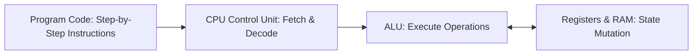
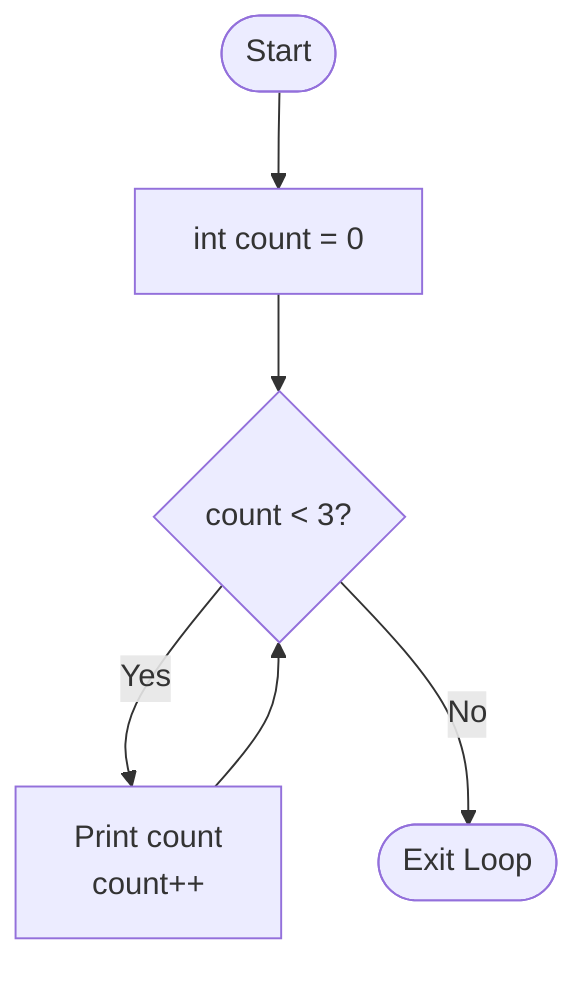

# 1.1. Imperative Programming (Lập trình Mệnh lệnh)

## Tổng quan về Imperative Programming
**Lập trình mệnh lệnh (Imperative Programming)** là mô hình lập trình lâu đời và trực tiếp nhất, mô phỏng sát nhất kiến trúc phần cứng của máy tính theo kiến trúc Von Neumann.
- **Tư tưởng cốt lõi**: Trọng tâm là câu hỏi **"Làm như thế nào?" (HOW to do it)** thay vì "Làm cái gì?" (WHAT to do). Lập trình viên trực tiếp chỉ huy máy tính thực hiện từng bước lệnh cụ thể để thay đổi trạng thái (state) của bộ nhớ nhằm đạt được kết quả mong muốn.
- **Bản chất dưới tầng máy (Hardware Level)**: Kiến trúc Von Neumann bao gồm CPU (với các thanh ghi, ALU, Control Unit) và Bộ nhớ (RAM). Lập trình mệnh lệnh ánh xạ 1:1 với các thao tác mã máy: nạp dữ liệu từ RAM vào thanh ghi (`LOAD`), biến đổi (`ADD`, `SUB`...), rồi ghi ngược lại vào RAM (`STORE`).



---

## 2. Chi tiết từng Keyword (Under-the-Hood Deep Dive)

### 1. Statement và Expression

#### Khái niệm bản chất
- **Expression (Biểu thức)**: Là một đơn vị mã có thể tính toán và **trả về một giá trị**. Biểu thức có thể kết hợp từ các toán tử (operators), toán hạng (operands), hàm (functions) và biến (variables).
- **Statement (Câu lệnh)**: Là một đơn vị hành động hoàn chỉnh trong chương trình nhằm thực hiện một tác vụ nào đó (thay đổi biến, điều khiển luồng, gọi hàm không trả về...). Statement **không nhất thiết phải sinh ra giá trị**, mà thường tạo ra **Side Effect (hiệu ứng phụ)** hoặc thay đổi trạng thái.

#### Cơ chế hoạt động sâu (Under the hood)
- Ở cấp độ trình biên dịch (AST - Abstract Syntax Tree), `Expression` tương ứng với các nút sinh ra giá trị (Expression Node) được đưa vào thanh ghi (Register) hoặc đỉnh của Stack (ví dụ `EAX/RAX` trên x86_64).
- `Statement` là các nút câu lệnh (Statement Node) chỉ huy việc rẽ nhánh, gán bộ nhớ, hoặc kết thúc bằng một dấu chấm phẩy `;` trong các ngôn ngữ họ C.

#### Code minh họa (C++ vs TypeScript)
```cpp
// C++: Statement vs Expression
#include <iostream>

int main() {
    // 5 + 3 là một Expression (sinh ra giá trị 8)
    // int x = 5 + 3; là một Statement (khai báo và gán giá trị)
    int x = 5 + 3; 

    // Ternary operator là một Expression: trả về giá trị int
    int maxVal = (x > 10) ? x : 10; 

    // if-else là một Statement: không trả về giá trị trực tiếp để gán
    // int y = (if (x > 10) x else 10); // LỖI BIÊN DỊCH!
    int y;
    if (x > 10) {
        y = x; // Statement
    } else {
        y = 10; // Statement
    }

    return 0; // Return statement
}
```

```typescript
// TypeScript: Expression vs Statement
// Expression: sinh ra giá trị chuỗi
const greeting = "Hello " + "World"; 

// Hàm arrow một dòng là expression body
const add = (a: number, b: number): number => a + b;

// if-else là Statement
let statusText: string;
if (add(2, 3) > 4) {
    statusText = "Passed";
} else {
    statusText = "Failed";
}
```

---

### 2. Sequential Execution (Thực thi tuần tự)

#### Khái niệm bản chất
Chương trình được thực thi lần lượt từng dòng lệnh từ trên xuống dưới, từ lệnh này sang lệnh kế tiếp, trừ khi gặp các cấu trúc điều khiển luồng (Control Flow).

#### Cơ chế hoạt động sâu (Under the hood)
- **Program Counter (PC) / Instruction Pointer (RIP trên x86-64)**: CPU sử dụng thanh ghi đặc biệt này để trỏ tới địa chỉ ô nhớ chứa chỉ thị máy tiếp theo cần nạp (Instruction Fetch).
- Sau khi một chỉ thị hoàn thành chu kỳ Fetch-Decode-Execute, CPU tự động tăng giá trị của `PC` lên kích thước của chỉ thị đó (`PC = PC + sizeof(Instruction)`), trừ khi xảy ra lệnh nhảy (`JMP`, `CALL`, `RET`).

#### Code minh họa (C++)
```cpp
#include <iostream>

int main() {
    int balance = 100;     // Bước 1: PC trỏ vào lệnh gán 100
    balance -= 20;        // Bước 2: PC tăng, trỏ vào lệnh trừ 20
    balance += 50;        // Bước 3: PC tăng, trỏ vào lệnh cộng 50
    std::cout << balance; // Bước 4: PC tăng, in ra 130
    return 0;
}
```

---

### 3. Conditional Execution (Thực thi có điều kiện)

#### Khái niệm bản chất
Cho phép chương trình lựa chọn các nhánh thực thi khác nhau dựa trên giá trị chân lý (boolean `true`/`false`) của một điều kiện tại thời điểm chạy (runtime).

#### Cơ chế hoạt động sâu (Under the hood)
- Khi biên dịch sang mã máy, câu lệnh `if-else` được chuyển hóa thành các lệnh **So sánh (CMP/TEST)** và các lệnh **Nhảy có điều kiện (Conditional Jump)**:
  - `JZ` / `JE`: Jump if Zero / Jump if Equal
  - `JNZ` / `JNE`: Jump if Not Zero / Jump if Not Equal
  - `JG` / `JL`: Jump if Greater / Jump if Less
- **Branch Prediction (Dự đoán rẽ nhánh)**: Để tối ưu Pipeline, CPU hiện đại dự đoán trước nhánh nào sẽ được thực thi. Nếu dự đoán sai (Branch Misprediction), CPU buộc phải hủy bỏ các chỉ thị đã nạp sẵn trong Pipeline (Pipeline Flush), gây tổn hao chu kỳ xung nhịp (thường mất từ 10 - 20 cycles).

#### Code minh họa (C++)
```cpp
#include <iostream>

void processOrder(double amount, bool isVip) {
    double discount = 0.0;

    // Phân nhánh logic
    if (isVip && amount > 100.0) {
        discount = 0.20; // 20% discount
    } else if (amount > 50.0) {
        discount = 0.05; // 5% discount
    } else {
        discount = 0.0;
    }

    double finalPrice = amount * (1.0 - discount);
    std::cout << "Final Price: " << finalPrice << "\n";
}
```

---

### 4. Iteration (Lặp)

#### Khái niệm bản chất
Cơ chế lặp lại một khối lệnh nhiều lần dựa trên một điều kiện dừng (`for`, `while`, `do-while`). Đây là nền tảng để xử lý danh sách dữ liệu và các tác vụ lặp trong mô hình mệnh lệnh.

#### Cơ chế hoạt động sâu (Under the hood)
Vòng lặp trong hợp ngữ (Assembly) bản chất là sự kết hợp giữa:
1. Nhãn (Label) làm mốc địa chỉ.
2. Kiểm tra điều kiện (`CMP`).
3. Lệnh nhảy ngược về nhãn (`JMP` hoặc lệnh nhảy có điều kiện) để tiếp tục lặp lại khối mã.

#### Code minh họa (C++)
```cpp
#include <iostream>
#include <vector>

int main() {
    std::vector<int> numbers = {10, 20, 30, 40, 50};
    int total = 0;

    // Vòng lặp kiểm soát bằng biến đếm i (State)
    for (size_t i = 0; i < numbers.size(); ++i) {
        total += numbers[i]; // State mutation qua từng vòng lặp
    }

    std::cout << "Sum: " << total << std::endl;
    return 0;
}
```

---

### 5. State Mutation (Biến đổi trạng thái)

#### Khái niệm bản chất
**State (Trạng thái)** là toàn bộ dữ liệu được lưu trữ trong bộ nhớ tại một thời điểm nhất định của chương trình. **State Mutation** là hành động ghi đè hoặc sửa đổi trực tiếp dữ liệu tại các ô nhớ đã được cấp phát, khiến trạng thái cũ bị biến mất và thay thế bởi trạng thái mới.

#### Cơ chế hoạt động sâu (Under the hood)
- Khi một biến bị "mutate", CPU thực hiện lệnh ghi bộ nhớ (`MOV [address], value`).
- Trong môi trường đơn luồng (Single-thread), mutation diễn ra an toàn. Nhưng trong môi trường đa luồng (Multi-threading) của hệ thống Backend, việc biến đổi trạng thái chia sẻ (Shared Mutable State) mà không đồng bộ hóa sẽ gây ra **Race Condition** và **Data Corruption**.

#### Code minh họa (TypeScript)
```typescript
interface UserProfile {
    id: string;
    username: string;
    loginCount: number;
}

const user: UserProfile = {
    id: "u-101",
    username: "alex",
    loginCount: 1
};

// State Mutation: Thay đổi trực tiếp giá trị ô nhớ của đối tượng
user.loginCount += 1;
user.username = "alex_pro";

console.log(user); // Trạng thái ban đầu đã biến mất vĩnh viễn
```

---

### 6. Assignment (Phép gán)

#### Khái niệm bản chất
Phép gán (toán tử `=`) lưu trữ giá trị thu được từ một biểu thức vế phải (R-value) vào vị trí ô nhớ được định danh bởi biến vế trái (L-value).

#### Khái niệm L-value và R-value trong C++:
- **L-value (Locator value)**: Đại diện cho một đối tượng chiếm vị trí ô nhớ xác định (có địa chỉ bộ nhớ cụ thể để lấy địa chỉ `&x`).
- **R-value (Read value / Expression result)**: Đại diện cho một giá trị tạm thời, giá trị rác hoặc kết quả của biểu thức, không có vị trí ô nhớ lâu dài (không thể lấy `&3` hay `&(a + b)`).

```cpp
#include <iostream>

int main() {
    int a = 10;        // a là L-value, 10 là R-value
    int b = 20;        // b là L-value, 20 là R-value
    a = b + 5;         // (b + 5) là R-value tạm thời được tính toán, sau đó lưu vào ô nhớ của a

    // 10 = a;         // LỖI: R-value không thể đứng bên trái phép gán
    return 0;
}
```

---

### 7. Control Flow (Luồng điều khiển)

#### Khái niệm bản chất
Trình tự mà các câu lệnh riêng lẻ, các chỉ thị hoặc các lời gọi hàm được thực thi hoặc đánh giá khi chương trình chạy. Mặc định là tuyến tính (Sequential), nhưng có thể bị bẻ cong bởi:
- Rẽ nhánh (`if`, `switch`)
- Lặp (`for`, `while`)
- Lệnh nhảy vô điều kiện (`goto`, `break`, `continue`)
- Gọi và trả về hàm (`call`, `return`)
- Xử lý ngoại lệ (`try`, `catch`, `throw`)

#### Biểu đồ Control Flow Graph (CFG)


---

### 8. Data Flow (Luồng dữ liệu)

#### Khái niệm bản chất
Quá trình truyền, biến đổi và tiêu thụ dữ liệu giữa các biến, các hàm hoặc các thành phần hệ thống.
- **Sự khác biệt giữa Control Flow và Data Flow**:
  - *Control Flow*: Chỉ định **thứ tự thời gian** các lệnh được CPU thực thi.
  - *Data Flow*: Chỉ định **sự phụ thuộc dữ liệu** (Data Dependency) – lệnh B cần giá trị sinh ra từ lệnh A.

#### Code minh họa (TypeScript)
```typescript
// Data Flow trong xử lý dữ liệu Backend
function sanitizeInput(raw: string): string {
    return raw.trim().toLowerCase();
}

function validateEmail(email: string): boolean {
    return email.includes("@") && email.includes(".");
}

// Luồng dữ liệu rõ ràng: rawInput -> sanitized -> isValid
const rawInput = "   UserAdmin@Example.COM  ";
const sanitized = sanitizeInput(rawInput); // Dữ liệu di chuyển từ rawInput sang sanitized
const isValid = validateEmail(sanitized);   // Dữ liệu sanitized đi vào bộ kiểm tra
```

---

### 9. Side Effects (Hiệu ứng phụ)

#### Khái niệm bản chất
Một thao tác hoặc biểu thức được coi là có **Side Effect** nếu ngoài việc trả về giá trị (hoặc không trả về), nó còn **thay đổi bất kỳ trạng thái nào bên ngoài phạm vi cục bộ của nó** hoặc thực hiện tương tác có thể quan sát được với môi trường bên ngoài.

#### Các dạng Side Effects điển hình:
1. Thay đổi biến toàn cục (Global variable) hoặc biến tĩnh (Static variable).
2. Thay đổi đối tượng truyền vào qua con trỏ hoặc tham chiếu (Reference).
3. Thực hiện I/O: Ghi file, in ra Terminal/Console (`std::cout`, `console.log`).
4. Gửi HTTP Request, truy vấn cơ sở dữ liệu (Database query).
5. Ném ra Exception làm gián đoạn luồng thực thi thông thường.

#### Phân tích mã nguồn (C++)
```cpp
#include <iostream>

int globalCounter = 0;

// Hàm KHÔNG CÓ Side Effect (Pure logic)
int add(int a, int b) {
    return a + b; // Chỉ phụ thuộc vào tham số, không làm thay đổi thế giới bên ngoài
}

// Hàm CÓ Side Effects (Impure)
int incrementAndLog(int step) {
    globalCounter += step; // Side Effect 1: Thay đổi biến ngoài phạm vi hàm
    std::cout << "Counter updated to: " << globalCounter << "\n"; // Side Effect 2: I/O Operation
    return globalCounter;
}

int main() {
    add(5, 10);             // An toàn, có thể gọi bao nhiêu lần cũng không gây ảnh hưởng
    incrementAndLog(5);     // Thay đổi trạng thái toàn cục
    incrementAndLog(5);     // Kết quả phụ thuộc vào lịch sử thực thi trước đó
    return 0;
}
```

---

## Tổng kết Imperative Programming trong Kiến trúc Backend
Trong các hệ thống Backend (như Node.js, Spring Boot, Go, C++ Microservices):
- Hầu hết mã xử lý thuật toán cốt lõi (Core Business Algorithms), các driver kết nối thiết bị mạng/socket và các engine xử lý hiệu năng cao đều được viết theo phong cách Imperative nhằm tận dụng tối đa tốc độ của CPU, kiểm soát bộ nhớ Cache L1/L2/L3 và hạn chế overhead của các tầng trừu tượng.
- **Thách thức**: Quản lý nhiều `State Mutation` và `Side Effects` trong ứng dụng Backend đa luồng dễ dẫn đến deadlock, race condition và khó khăn trong Unit Testing. Do đó, các kỹ sư thường cô lập phần imperative vào các module nội bộ nhỏ và hướng tới kiến trúc Stateless ở tầng service.
