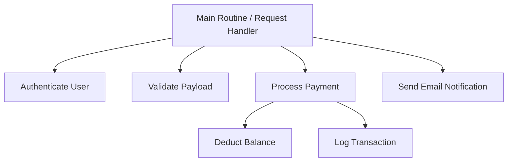
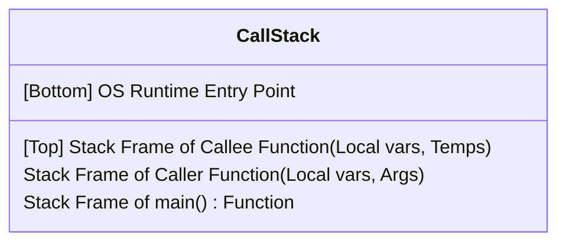

# 1.2. Procedural Programming (Lập trình Thủ tục)

## Tổng quan về Procedural Programming
**Lập trình thủ tục (Procedural Programming)** là một nhánh phát triển trực tiếp từ Lập trình mệnh lệnh (Imperative Programming). 
- Thay vì để một chuỗi các câu lệnh dài vô tận trong một hàm duy nhất (`main`), lập trình thủ tục tổ chức mã nguồn thành các khối logic có thể tái sử dụng được gọi là **Procedures** (thủ tục) hoặc **Functions** (hàm).
- **Mục tiêu cốt lõi**: Giải quyết vấn đề "Spaghetti Code" (mã rối rắm, nhảy lung tung bằng lệnh `goto`), tăng cường tính cấu trúc thông qua **Top-down Design** (thiết kế từ trên xuống) và phân rã bài toán lớn thành các bài toán con độc lập.



---

## 2. Chi tiết từng Keyword (Under-the-Hood Deep Dive)

### 1. Procedure và Function (Thủ tục và Hàm)

#### Khái niệm bản chất
- **Procedure (Thủ tục)**: Là một tập hợp các lệnh được nhóm lại để thực hiện một chuỗi hành động nhất định. Procedure **không trả về giá trị** trực tiếp (trong C/C++ được biểu diễn bằng kiểu trả về `void`). Mục đích chính của nó là sinh ra các Side Effects (ghi log, sửa đổi trạng thái, in dữ liệu ra màn hình).
- **Function (Hàm)**: Xuất phát từ khái niệm hàm toán học $f(x) = y$. Một function nhận vào các đầu vào và **bắt buộc tính toán trả về một giá trị**.

#### So sánh nhanh
| Tiêu chí | Procedure (Thủ tục) | Function (Hàm) |
| :--- | :--- | :--- |
| **Giá trị trả về** | Không (`void`) | Có (`int`, `std::string`, `T`...) |
| **Mục đích chính** | Tạo ra tác động, side effect | Tính toán và trả về kết quả |
| **Cách dùng** | Được gọi như một câu lệnh độc lập | Thường nằm trong một biểu thức |

#### Code minh họa (C++)
```cpp
#include <iostream>
#include <string>

// PROCEDURE: Không trả về giá trị (void), thực hiện tác vụ ghi dữ liệu
void logAuditEvent(const std::string& action, const std::string& userId) {
    std::cout << "[AUDIT] User " << userId << " performed: " << action << std::endl;
}

// FUNCTION: Nhận đầu vào, tính toán và trả về giá trị cụ thể
double calculateTax(double subtotal, double taxRate) {
    return subtotal * taxRate;
}

int main() {
    // Gọi Function trong biểu thức
    double tax = calculateTax(100.0, 0.08); 

    // Gọi Procedure như một câu lệnh
    logAuditEvent("CHECKOUT", "user_99");

    return 0;
}
```

---

### 2. Function Call (Lời gọi hàm)

#### Khái niệm bản chất
Hành động chuyển giao quyền điều khiển của CPU từ hàm hiện tại (Caller) sang một hàm khác (Callee), truyền các đối số cần thiết, thực thi thân hàm của Callee, và sau đó quay trở lại ngay vị trí sau lệnh gọi ban đầu trong Caller.

#### Cơ chế hoạt động sâu (Under the hood)
Khi thực hiện một `Function Call`:
1. **Calling Convention (Quy ước gọi hàm)**: Xác định cách truyền tham số (qua thanh ghi như `RDI, RSI, RDX, RCX, R8, R9` trên x86_64 System V AMD64 ABI hoặc đẩy lên Stack) và dọn dẹp Stack.
2. **Lệnh `CALL`**: Đẩy địa chỉ quay về (Return Address) hiện tại vào Call Stack, sau đó nạp địa chỉ hàm mục tiêu vào `RIP/EIP` (Instruction Pointer).
3. **Prolog của Callee**: Tạo lập Stack Frame mới cho hàm được gọi.
4. **Epilog của Callee & Lệnh `RET`**: Dọn dẹp Stack Frame, `POP` địa chỉ quay về vào `RIP/EIP` để CPU tiếp tục thực thi hàm Caller.

---

### 3. Parameters và Arguments (Tham số và Đối số)

#### Khái niệm bản chất
- **Parameter (Tham số hình thức)**: Biến được định nghĩa trong chữ ký của hàm (Function Signature). Nó đóng vai trò là "chỗ giữ chỗ" (placeholder) cục bộ.
- **Argument (Đối số thực tế)**: Giá trị hoặc biểu thức thực tế được truyền vào hàm khi lời gọi hàm diễn ra tại thời điểm chạy.

#### Code minh họa (TypeScript)
```typescript
// 'username' và 'role' là Parameters (Tham số)
function createUser(username: string, role: string = "GUEST") {
    return {
        id: Math.random().toString(36).substr(2, 9),
        username,
        role,
        createdAt: new Date()
    };
}

// "ductri0981" và "ADMIN" là Arguments (Đối số thực tế)
const adminUser = createUser("ductri0981", "ADMIN");
```

---

### 4. Return Values (Giá trị trả về)

#### Khái niệm bản chất
Dữ liệu được hàm gửi ngược trở lại cho phía gọi hàm (Caller) sau khi đã hoàn thành tính toán thông qua từ khóa `return`.

#### Cơ chế hoạt động sâu (Under the hood)
- Các giá trị kích thước nhỏ (số nguyên, con trỏ, giá trị 32-bit/64-bit) được đưa trực tiếp vào thanh ghi chuyên dụng của CPU (ví dụ `RAX` hoặc `EAX` trên x86_64).
- Các cấu trúc dữ liệu lớn (Large Struct / Object): Trình biên dịch C++ áp dụng kỹ thuật **RVO (Return Value Optimization)** hoặc tạo ra một con trỏ ẩn (Hidden Pointer) trỏ tới vùng đệm đã cấp phát sẵn của Caller để Callee ghi dữ liệu trực tiếp vào đó mà không cần copy tốn kém.

---

### 5. Local và Global Variables (Biến cục bộ và Biến toàn cục)

#### Khái niệm bản chất
- **Local Variable (Biến cục bộ)**: Được khai báo bên trong một hàm hoặc khối lệnh `{}`. Chỉ tồn tại và có thể truy cập được trong phạm vi của khối lệnh đó.
- **Global Variable (Biến toàn cục)**: Được khai báo bên ngoài tất cả các hàm. Tồn tại trong suốt vòng đời của chương trình và có thể được đọc/ghi từ bất kỳ nơi nào trong mã nguồn.

#### Phân bổ bộ nhớ (Memory Allocation)
- **Local Variables**: Thường được phân bổ trên **Stack Memory** (tự động giải phóng khi hàm kết thúc).
- **Global Variables**: Nằm ở phân vùng **Data Segment** (nếu có khởi tạo) hoặc **BSS Segment** (nếu chưa khởi tạo) của tiến trình trong RAM.

#### Code minh họa (C++)
```cpp
#include <iostream>

// Biến toàn cục (Nằm ở Data Segment)
int g_requestCounter = 0; 

void handleRequest() {
    // Biến cục bộ (Nằm trên Stack Frame của hàm handleRequest)
    int localStatusCode = 200; 

    g_requestCounter++; // Truy cập và sửa đổi biến toàn cục (tiềm ẩn nguy hiểm)
    std::cout << "Status: " << localStatusCode << ", Total Requests: " << g_requestCounter << std::endl;
} // localStatusCode bị hủy tại đây khi thoát hàm
```

---

### 6. Scope (Phạm vi truy cập)

#### Khái niệm bản chất
**Scope (Phạm vi)** là vùng ngữ cảnh trong mã nguồn mà tại đó một định danh (biến, hàm, hằng số) có thể được nhìn thấy và truy cập được.
- **Block Scope**: Giới hạn trong cặp dấu ngoặc nhọn `{}`.
- **Function Scope**: Giới hạn trong toàn bộ thân hàm.
- **File / Translation Unit Scope**: Giới hạn trong một file nguồn duy nhất.

#### Biến che khuất (Variable Shadowing)
Hiện tượng một biến được khai báo trong scope con có cùng tên với biến ở scope cha, dẫn đến việc biến ở scope con "che khuất" biến scope cha.

```cpp
#include <iostream>

int main() {
    int value = 10; // Outer scope
    {
        int value = 50; // Inner scope làm "shadow" biến ngoài
        std::cout << "Inner: " << value << "\n"; // In ra 50
    }
    std::cout << "Outer: " << value << "\n"; // In ra 10
    return 0;
}
```

---

### 7. Call Stack (Ngăn xếp cuộc gọi)

#### Khái niệm bản chất
Cấu trúc dữ liệu dạng Ngăn xếp (LIFO - Last In, First Out) được quản lý tự động bởi phần cứng và hệ điều hành, dùng để lưu trữ thông tin về các hàm đang hoạt động của luồng thực thi (Thread).

#### Cấu trúc một Stack Frame (Activation Record)
Mỗi khi một hàm được gọi, một khung ngăn xếp (**Stack Frame**) được đẩy (`PUSH`) vào Call Stack, bao gồm:
1. **Return Address**: Địa chỉ lệnh tiếp theo của Caller.
2. **Saved Frame Pointer (RBP)**: Con trỏ cơ sở của Frame trước đó.
3. **Function Arguments**: Các đối số truyền vào (nếu không đủ chỗ trong thanh ghi).
4. **Local Variables**: Không gian lưu các biến cục bộ của Callee.



> **Nguy cơ Stack Overflow**: Xảy ra khi số lượng Stack Frame vượt quá giới hạn dung lượng vùng nhớ Stack được cấp phát (mặc định từ 1MB - 8MB tùy OS), phổ biến nhất là do **đệ quy vô tận (infinite recursion)** hoặc khai báo các mảng cục bộ quá lớn trên Stack.

---

### 8. Modular Programming (Lập trình Mô-đun)

#### Khái niệm bản chất
Kỹ thuật thiết kế phần mềm tách biệt chức năng của chương trình thành các phần độc lập, có thể hoán đổi cho nhau, được gọi là **Mô-đun (Modules)**.
- Mỗi module chỉ thực hiện một nhiệm vụ chuyên biệt và công khai một giao diện (Interface / API công khai).
- Các chi tiết cài đặt bên trong module được giấu kín (Encapsulation).

#### Ví dụ tổ chức mã nguồn (C++ & TypeScript)
- Trong **C++**: Tách biệt file khai báo header (`.hpp` / `.h`) và file định nghĩa cài đặt (`.cpp`), hoặc từ C++20 sử dụng cú pháp Module hiện đại (`export module math;`).
- Trong **TypeScript**: Sử dụng cơ chế ES Modules chuẩn (`export`, `import`).

```typescript
// mathModule.ts
export function add(a: number, b: number): number {
    return a + b;
}

// Hàm nội bộ không export -> Bị ẩn khỏi thế giới bên ngoài
function privateHelper(): void {
    // helper logic
}
```

---

### 9. Top-down Design (Thiết kế từ trên xuống)

#### Khái niệm bản chất
Chiến lược phân rã bài toán (Stepwise Refinement): Tiếp cận bài toán ở mức độ trừu tượng cao nhất, sau đó chia nhỏ thành các tác vụ con cấp thấp hơn, và tiếp tục chia nhỏ cho đến khi các hàm con chỉ giải quyết những tác vụ nguyên tử đơn giản nhất.

#### Minh họa quá trình phân rã (Stepwise Refinement):
1. Cấp 0: `ProcessECommerceOrder()`
2. Cấp 1: Phân rã thành:
   - `ValidateCart()`
   - `ChargePaymentGateway()`
   - `UpdateInventory()`
   - `SendConfirmationEmail()`
3. Cấp 2: Tiếp tục phân rã `ChargePaymentGateway()` thành `BuildPaymentPayload()`, `CallStripeAPI()`, `HandlePaymentResponse()`.

---

### 10. Code Reusability (Khả năng tái sử dụng mã nguồn)

#### Khái niệm bản chất
Nguyên tắc sử dụng lại mã nguồn hoặc logic đã được viết và kiểm thử trước đó cho nhiều nơi khác nhau thay vì viết lại (tránh trùng lặp mã - DRY: Don't Repeat Yourself).

#### Lợi ích trong phát triển phần mềm:
- **Giảm lỗi**: Logic chỉ được viết và kiểm tra một lần tại một nơi duy nhất.
- **Dễ bảo trì**: Khi có thay đổi nghiệp vụ (ví dụ: công thức tính thuế), chỉ cần cập nhật hàm đó một lần duy nhất.
- **Tăng tốc độ phát triển**: Đóng gói các hàm tiện ích (Utilities/Libraries) để chia sẻ giữa các service.

---

## Ứng dụng Procedural Programming trong Hệ thống Hiện đại
Mặc dù lập trình Hướng đối tượng (OOP) và Hướng hàm (FP) rất thịnh hành, mô hình Procedural vẫn là nền tảng:
- Toàn bộ Kernel của hệ điều hành Linux được viết bằng ngôn ngữ **C** theo phong cách Procedural thuần túy kết hợp thiết kế hướng cấu trúc.
- Ngôn ngữ **Go (Golang)** - một ngôn ngữ backend cực kỳ phổ biến hiện nay - mang tư tưởng rất gần với Procedural hiện đại: sử dụng functions, structs, package/module rõ ràng, không kế thừa phức tạp, hướng tới sự đơn giản, trực diện và hiệu năng thực thi cao.
