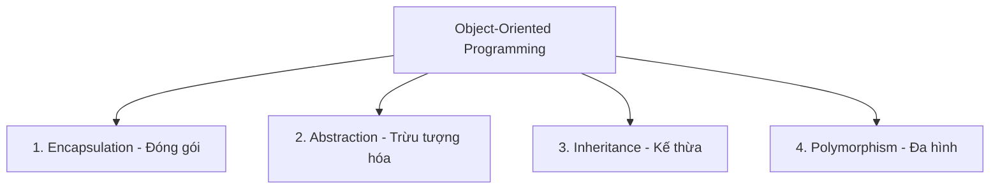
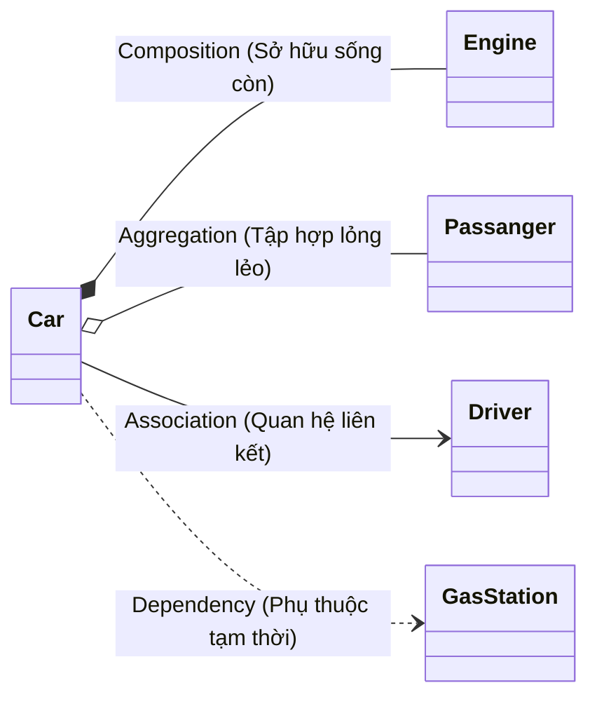
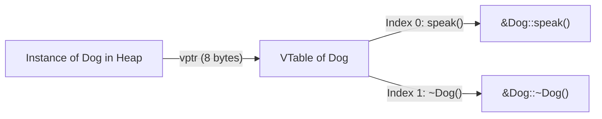

# 1.3. Object-Oriented Programming (OOP - Lập trình Hướng đối tượng)

## Tổng quan về OOP
**Lập trình Hướng đối tượng (Object-Oriented Programming - OOP)** là mô hình lập trình tổ chức mã nguồn xoay quanh các **Đối tượng (Objects)** thay vì các hành động và dữ liệu tách rời nhau.
- **Tư tưởng cốt lõi**: Gom dữ liệu (State/Data) và các hành vi (Behavior/Functions) thao tác trên dữ liệu đó vào trong một thể thống nhất gọi là Object.
- Mô hình này ánh xạ các thực thể của thế giới thực (hoặc các thực thể nghiệp vụ trừu tượng) vào trong phần mềm, giúp việc quản lý các hệ thống phần mềm quy mô lớn trở nên trực quan, module hóa và dễ mở rộng.

---

## 4 Trụ cột Cốt lõi của OOP (The 4 Pillars)



### 1. Encapsulation (Đóng gói)
- **Bản chất**: Che giấu trạng thái bên trong của đối tượng và chỉ cho phép truy cập, sửa đổi thông qua các phương thức công khai (Public Interface/Getters/Setters). 
- **Mục đích**: Bảo vệ tính toàn vẹn của dữ liệu (Data Integrity), ngăn chặn thế giới bên ngoài tùy tiện can thiệp làm sai lệch trạng thái nội bộ (Invariants).
- **Access Modifiers**: `private`, `protected`, `public`.

### 2. Abstraction (Trừu tượng hóa)
- **Bản chất**: Ẩn đi các chi tiết cài đặt kỹ thuật phức tạp bên dưới, chỉ cung cấp ra ngoài một giao diện tinh gọn, rõ ràng chứa những thông tin thực sự cần thiết đối với người dùng.
- **Ví dụ thực tế**: Lái xe ô tô chỉ cần biết vô-lăng, bàn đạp ga và phanh; không cần biết chi tiết quá trình phun xăng điện tử hay van xả hoạt động ra sao.

### 3. Inheritance (Kế thừa)
- **Bản chất**: Cơ chế cho phép một Class con (Derived/Child Class) kế thừa các thuộc tính và hành vi từ một Class cha (Base/Parent Class), thể hiện mối quan hệ **IS-A** (Ví dụ: `Dog IS-A Animal`).
- **Mục đích**: Tái sử dụng mã nguồn và thiết lập hệ thống phân cấp quan hệ kiểu.

### 4. Polymorphism (Đa hình)
- **Bản chất**: Từ ngữ bắt nguồn từ tiếng Hy Lạp nghĩa là "nhiều hình thái". Cho phép một lời gọi hàm duy nhất biểu hiện các hành vi khác nhau tùy thuộc vào đối tượng thực tế đang thực thi tại thời điểm chạy (Runtime).
- Thể hiện qua **Static Polymorphism** (Overloading, Templates) và **Dynamic Polymorphism** (Overriding, Virtual Functions).

---

## 2. Chi tiết từng Keyword (Under-the-Hood Deep Dive)

### 1. Class và Object (Lớp và Đối tượng)

#### Khái niệm bản chất
- **Class (Lớp)**: Là một bản thiết kế (Blueprint/Template) hoặc một kiểu dữ liệu do người dùng tự định nghĩa. Nó mô tả các thuộc tính và phương thức mà các đối tượng thuộc lớp đó sẽ có. Class không chiếm dung lượng bộ nhớ cho dữ liệu nghiệp vụ (trừ metadata của class).
- **Object (Đối tượng / Instance)**: Là một thể hiện cụ thể được cấp phát trong bộ nhớ (Stack hoặc Heap) dựa trên bản thiết kế của Class.

#### Code minh họa (C++)
```cpp
#include <iostream>
#include <string>

// Class: Bản thiết kế
class BankAccount {
private:
    std::string accountNumber; // Attribute
    double balance;            // Attribute

public:
    // Constructor
    BankAccount(std::string accNum, double initialBalance)
        : accountNumber(accNum), balance(initialBalance) {}

    // Method
    void deposit(double amount) {
        if (amount > 0) balance += amount;
    }

    double getBalance() const { return balance; }
};

int main() {
    // Objects: Các thể hiện cụ thể trong bộ nhớ
    BankAccount accountA("ACC_001", 1000.0); // Cấp phát trên Stack
    BankAccount* accountB = new BankAccount("ACC_002", 500.0); // Cấp phát trên Heap

    accountA.deposit(250.0);
    std::cout << "Account A balance: " << accountA.getBalance() << std::endl;

    delete accountB; // Giải phóng Heap
    return 0;
}
```

---

### 2. Attributes và Methods (Thuộc tính và Phương thức)

- **Attributes (Thuộc tính / Fields / Properties)**: Đại diện cho dữ liệu, trạng thái tĩnh của đối tượng (ví dụ: `name`, `age`, `email`).
- **Methods (Phương thức)**: Đại diện cho các hành vi, chức năng xử lý dữ liệu của đối tượng (ví dụ: `login()`, `calculateSalary()`). Về mặt bản chất máy tính, method là một hàm nhận thêm một tham số ẩn là con trỏ `this` trỏ tới chính đối tượng đang gọi nó.

---

### 3. Interface và Abstract Class

#### Khái niệm bản chất
- **Abstract Class (Lớp trừu tượng)**: Là class có chứa ít nhất một phương thức thuần ảo (Pure Virtual Function trong C++) hoặc được đánh dấu `abstract`. Không thể khởi tạo đối tượng trực tiếp từ abstract class. Nó có thể chứa cả thuộc tính và các phương thức đã được cài đặt sẵn.
- **Interface (Giao diện)**: Là một bản hợp đồng (Contract) thuần túy định nghĩa các phương thức mà class cài đặt bắt buộc phải tuân theo. Thông thường không chứa trạng thái (không có instance fields).

#### So sánh
| Tiêu chí | Abstract Class | Interface |
| :--- | :--- | :--- |
| **Mối quan hệ** | Kế thừa bản chất: **IS-A** | Khả năng / Hành vi: **CAN-DO** |
| **Trạng thái (Fields)** | Có thể chứa biến thành viên | Chỉ chứa hằng số (hoặc không có state) |
| **Đa kế thừa** | Đa số ngôn ngữ chỉ cho đơn kế thừa | Một class có thể implement nhiều interface |

#### Code minh họa (TypeScript)
```typescript
// Interface định nghĩa hợp đồng thông báo
interface Notifier {
    send(recipient: string, message: string): Promise<boolean>;
}

// Abstract Class làm khung sườn
abstract class BasePaymentProcessor {
    abstract processPayment(amount: number): Promise<void>;

    // Phương thức có cài đặt sẵn
    protected generateTransactionId(): string {
        return "TXN-" + Math.random().toString(36).substr(2, 9).toUpperCase();
    }
}

// Cài đặt cụ thể
class StripeProcessor extends BasePaymentProcessor implements Notifier {
    async processPayment(amount: number): Promise<void> {
        const txnId = this.generateTransactionId();
        console.log(`Processing Stripe payment: $${amount} with ID: ${txnId}`);
    }

    async send(recipient: string, message: string): Promise<boolean> {
        console.log(`Sending email to ${recipient}: ${message}`);
        return true;
    }
}
```

---

### 4. Các mối quan hệ giữa các Đối tượng (Object Relationships)



1. **Dependency (Phụ thuộc - "Uses-A")**: Mối quan hệ yếu nhất. Class A sử dụng Class B như một tham số truyền vào hàm hoặc biến cục bộ ngắn hạn. Khi B thay đổi, A có thể bị ảnh hưởng.
2. **Association (Liên kết - "Has-A" dạng lỏng lẻo)**: Class A và Class B biết nhau, có thể giữ tham chiếu tới nhau, nhưng vòng đời độc lập.
3. **Aggregation (Tập hợp - "Has-A" dạng sở hữu một phần)**: Đối tượng cha chứa đối tượng con, nhưng nếu đối tượng cha bị hủy, đối tượng con vẫn tiếp tục tồn tại độc lập (ví dụ: `Phòng học` chứa các `Học sinh`).
4. **Composition (Cấu thành - "Part-Of" dạng sở hữu sống còn)**: Đối tượng cha sở hữu trọn vẹn đối tượng con. Vòng đời đối tượng con phụ thuộc hoàn toàn vào cha; nếu cha bị hủy, con cũng bị hủy theo (ví dụ: `Ngôi nhà` sở hữu các `Căn phòng`, `Xe hơi` sở hữu `Động cơ`).

#### Code minh họa (C++)
```cpp
#include <iostream>
#include <memory>
#include <vector>

// COMPOSITION: Engine gắn chặt với Car
class Engine {
public:
    void start() { std::cout << "Engine roaring!\n"; }
};

class Car {
private:
    Engine engine; // Sống và chết cùng với Car
public:
    void drive() { engine.start(); }
};

// AGGREGATION: Department và Professor
class Professor {
public:
    std::string name;
    Professor(std::string n) : name(n) {}
};

class Department {
private:
    std::vector<Professor*> professors; // Chỉ trỏ tới, không sở hữu vòng đời
public:
    void addProfessor(Professor* p) { professors.push_back(p); }
};
```

---

### 5. Static Dispatch vs Dynamic Dispatch

#### Khái niệm bản chất
- **Static Dispatch (Early Binding / Liên kết tĩnh)**: Trình biên dịch xác định chính xác địa chỉ hàm nào sẽ được gọi ngay tại **thời điểm biên dịch (Compile-time)**. Tốc độ cực nhanh, cho phép tối ưu Inlining.
- **Dynamic Dispatch (Late Binding / Liên kết động)**: Quyết định gọi phiên bản hàm nào được hoãn lại cho tới **thời điểm chạy (Runtime)**, dựa trên kiểu thực tế của đối tượng.

#### Cơ chế hoạt động sâu của Dynamic Dispatch: VTABLE & VPTR
Trong C++, Dynamic Dispatch đạt được thông qua từ khóa `virtual`:
1. Mỗi Class có hàm ảo sẽ được trình biên dịch sinh ra một bảng các con trỏ hàm gọi là **VTABLE (Virtual Method Table)**.
2. Mỗi instance của Class đó sẽ mang một con trỏ ẩn gọi là **VPTR (Virtual Table Pointer)** trỏ đến VTABLE của class nó.
3. Khi gọi hàm `obj->speak()`, CPU sẽ truy cập: `vptr -> VTABLE -> tìm offset của speak -> nhảy tới địa chỉ hàm thực tế`. Thao tác này tốn thêm 1-2 lần dereference con trỏ.



#### Code minh họa (C++)
```cpp
#include <iostream>

class Animal {
public:
    // Virtual Function kích hoạt Dynamic Dispatch
    virtual void speak() { std::cout << "Animal generic sound\n"; }
    virtual ~Animal() = default; // Destructor ảo bắt buộc trong đa hình
};

class Dog : public Animal {
public:
    void speak() override { std::cout << "Woof! Woof!\n"; }
};

int main() {
    Animal* myPet = new Dog();
    
    // Dynamic Dispatch: Lúc runtime, CPU nhìn vào vptr của myPet để gọi Dog::speak()
    myPet->speak(); // In ra: Woof! Woof!

    delete myPet;
    return 0;
}
```

---

### 6. Method Overloading vs Method Overriding

- **Method Overloading (Nạp chồng phương thức)**: 
  - Diễn ra trong **cùng một phạm vi / Class**.
  - Các hàm có cùng tên nhưng khác nhau về chữ ký (số lượng, kiểu dữ liệu của tham số).
  - Thuộc loại **Static Polymorphism** (phân giải lúc biên dịch bằng cơ chế Name Mangling).
- **Method Overriding (Ghi đè phương thức)**:
  - Diễn ra giữa **Class cha và Class con**.
  - Phương thức ở class con định nghĩa lại hoàn toàn hành vi của phương thức ảo ở class cha với cùng tên, cùng tham số và cùng kiểu trả về.
  - Thuộc loại **Dynamic Polymorphism** (phân giải lúc runtime).

---

### 7. Constructor, Destructor và Object Lifecycle

#### Vòng đời của Đối tượng (Object Lifecycle)
1. **Allocation (Cấp phát)**: Bộ nhớ được cấp phát trên Stack hoặc Heap.
2. **Initialization (Khởi tạo)**: Hàm tạo (**Constructor**) được thực thi để thiết lập trạng thái ban đầu của đối tượng và cấp phát các tài nguyên cần thiết.
3. **Usage (Sử dụng)**: Các phương thức của đối tượng được gọi để phục vụ nghiệp vụ.
4. **Destruction (Hủy bỏ)**: Hàm hủy (**Destructor**) được gọi để thu hồi các tài nguyên ngoại vi (đóng file, ngắt kết nối mạng, giải phóng bộ nhớ động).
5. **Deallocation (Thu hồi bộ nhớ)**: Vùng nhớ của đối tượng được trả lại cho OS hoặc Heap Allocator.

---

## SOLID Principles (5 Nguyên lý Vàng trong Thiết kế Hướng đối tượng)

### 1. S - Single Responsibility Principle (SRP - Đơn trách nhiệm)
> *"A class should have one, and only one, reason to change."*
Mỗi class chỉ nên chịu trách nhiệm cho một tác vụ hoặc khía cạnh nghiệp vụ duy nhất.

```typescript
// VI PHẠM: Class vừa chứa logic nghiệp vụ vừa tự lưu database và gửi email
class OrderServiceBad {
    processOrder(order: any) { /* calculate */ }
    saveToDatabase(order: any) { /* SQL queries */ }
    sendEmailConfirmation(order: any) { /* SMTP calls */ }
}

// TUÂN THỦ SRP: Tách thành các class riêng biệt
class OrderProcessor {
    process(order: any) { /* calculations */ }
}
class OrderRepository {
    save(order: any) { /* Database */ }
}
class NotificationService {
    sendConfirmation(order: any) { /* Email */ }
}
```

### 2. O - Open/Closed Principle (OCP - Đóng mở)
> *"Software entities should be open for extension, but closed for modification."*
Có thể dễ dàng mở rộng thêm tính năng mới mà không được sửa đổi mã nguồn đã tồn tại và đã chạy ổn định.

### 3. L - Liskov Substitution Principle (LSP - Thay thế Liskov)
> *"Derived types must be completely substitutable for their base types."*
Các đối tượng thuộc class con phải có khả năng thay thế hoàn toàn cho đối tượng của class cha mà không làm hỏng tính đúng đắn của chương trình.
- *Ví dụ kinh điển vi phạm LSP*: Class `Square` kế thừa từ `Rectangle`. Khi hàm thay đổi `width` làm thay đổi cả `height`, nó phá vỡ giả định logic của `Rectangle`.

### 4. I - Interface Segregation Principle (ISP - Phân tách giao diện)
> *"Clients should not be forced to depend upon interfaces that they do not use."*
Thà tạo nhiều interface nhỏ, chuyên biệt còn hơn tạo một interface khổng lồ "Fat Interface" với quá nhiều phương thức không liên quan.

### 5. D - Dependency Inversion Principle (DIP - Đảo ngược phụ thuộc)
> *"High-level modules should not depend on low-level modules. Both should depend on abstractions."*
Các module cấp cao (chứa business logic) không được phụ thuộc trực tiếp vào các module cấp thấp (database, HTTP client, file system). Cả hai phải phụ thuộc vào lớp trừu tượng (Interface/Abstract Class). Đây là nền tảng của kỹ thuật **Dependency Injection (DI)** trong Backend.

---

## Favor Composition over Inheritance (Ưu tiên Cấu thành hơn Kế thừa)

### Tại sao Kế thừa sâu là "con dao hai lưỡi"?
1. **Khớp nối chặt (Tight Coupling)**: Class con phụ thuộc sâu vào chi tiết nội bộ của class cha. Thay đổi nhỏ ở class cha có thể làm gãy vỡ hàng loạt class con.
2. **Vấn đề Fragile Base Class**: Khó khăn trong việc kiểm soát các side-effect khi hệ thống phân cấp kế thừa quá 3-4 tầng.
3. **Đa kế thừa phức tạp (Deadly Diamond of Death)**.

### Giải pháp Composition:
Xây dựng đối tượng phức tạp bằng cách kết hợp nhiều đối tượng nhỏ, độc lập thông qua việc chứa tham chiếu (has-a) và ủy nhiệm hành vi (delegation).

```cpp
#include <iostream>
#include <memory>

// Tách các khả năng thành các interface độc lập
class FlyBehavior {
public:
    virtual void fly() = 0;
    virtual ~FlyBehavior() = default;
};

class FastFly : public FlyBehavior {
public:
    void fly() override { std::cout << "Flying at supersonic speed!\n"; }
};

// Monster "has-a" FlyBehavior thay vì Monster kế thừa từ FlyingCreature
class Monster {
private:
    std::unique_ptr<FlyBehavior> flySkill;
public:
    void setFlySkill(std::unique_ptr<FlyBehavior> skill) {
        flySkill = std::move(skill);
    }

    void performFly() {
        if (flySkill) flySkill->fly();
        else std::cout << "Cannot fly!\n";
    }
};

int main() {
    Monster dragon;
    dragon.setFlySkill(std::make_unique<FastFly>());
    dragon.performFly(); // Linh hoạt thay đổi hành vi lúc Runtime mà không cần sửa code class
    return 0;
}
```
