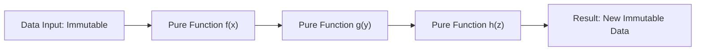

# 1.4. Functional Programming (Lập trình Hướng hàm)

## Tổng quan về Functional Programming
**Lập trình Hướng hàm (Functional Programming - FP)** là mô hình lập trình xem tính toán như sự đánh giá của các **Hàm toán học thuần túy (Mathematical Functions)** và kiên quyết tránh sự thay đổi trạng thái (**State Mutation**) cũng như dữ liệu khả biến (**Mutable Data**).
- **Tư tưởng cốt lõi**: Trọng tâm là câu hỏi **"Tính toán cái gì?" (WHAT to compute)** bằng cách kết hợp các hàm biến đổi dữ liệu, loại bỏ hoàn toàn các Side Effects tiềm ẩn.
- **Tại sao FP quan trọng trong Backend hiện đại?**: Trong kỷ nguyên điện toán đám mây và xử lý đa lõi (Multi-core / Concurrent systems), "Shared Mutable State" là nguồn gốc của 90% lỗi Race Condition và Deadlock. FP giải quyết triệt để vấn đề này nhờ nguyên lý bất biến (**Immutability**).



---

## 2. Chi tiết từng Keyword (Under-the-Hood Deep Dive)

### 1. Pure Functions và Impure Functions

#### Pure Function (Hàm thuần túy)
Một hàm được coi là Pure khi và chỉ khi thỏa mãn **hai điều kiện bắt buộc**:
1. **Tính tất định (Deterministic)**: Với cùng một tập đối số đầu vào, hàm **luôn luôn** trả về duy nhất một giá trị đầu ra giống nhau tại mọi thời điểm.
2. **Không có Side Effects**: Không làm biến đổi bất kỳ trạng thái nào ngoài phạm vi cục bộ của nó (không ghi file, không gọi API, không sửa biến toàn cục, không sửa tham số truyền vào).

#### Impure Function (Hàm không thuần túy)
Hàm vi phạm một trong hai điều kiện trên (ví dụ: đọc đồng hồ hệ thống `Date.now()`, sinh số ngẫu nhiên `rand()`, đọc DB, ghi log ra màn hình).

#### Code minh họa (C++ & TypeScript)
```cpp
#include <iostream>

// PURE FUNCTION: Kết quả chỉ phụ thuộc vào a và b, không gây tác dụng phụ
int pureMultiply(int a, int b) {
    return a * b;
}

// IMPURE FUNCTION: Đọc và thay đổi trạng thái bên ngoài
int g_counter = 0;
int impureIncrement(int step) {
    g_counter += step; // Thay đổi biến ngoài scope
    return g_counter;
}
```

```typescript
// PURE FUNCTION
const calculateDiscount = (price: number, discountPercentage: number): number => {
    return price * (1 - discountPercentage / 100);
};

// IMPURE FUNCTION: Phụ thuộc vào I/O và thời gian hệ thống
const generateInvoiceNumber = (prefix: string): string => {
    return `${prefix}-${Date.now()}-${Math.floor(Math.random() * 1000)}`;
};
```

---

### 2. Immutability (Tính bất biến)

#### Khái niệm bản chất
Dữ liệu một khi đã được tạo ra trong bộ nhớ thì **không bao giờ có thể bị thay đổi**. Nếu muốn có dữ liệu mới, ta phải tạo ra một bản sao (clone) kèm theo phần giá trị thay đổi.

#### Cơ chế hoạt động sâu (Structural Sharing)
Nhiều lập trình viên lo ngại: "Clone toàn bộ dữ liệu có làm tràn RAM không?". Trong các thư viện FP chuyên nghiệp (như Immutable.js, Immer hoặc runtime của Clojure/Haskell), cơ chế **Persistent Data Structures** sử dụng kỹ thuật **Structural Sharing (Chia sẻ cấu trúc cây - Trie)**. Khi thay đổi một phần tử, các nhánh không bị ảnh hưởng được tái sử dụng con trỏ tới vùng nhớ cũ, chỉ có nút mới được cấp phát. Do đó độ phức tạp chỉ là $O(\log N)$ thay vì sao chép toàn bộ $O(N)$.

#### Code minh họa (TypeScript)
```typescript
interface UserState {
    readonly id: string;
    readonly name: string;
    readonly permissions: readonly string[];
}

const originalUser: UserState = {
    id: "usr_1",
    name: "Tri",
    permissions: ["READ"]
};

// MUTATION (VI PHẠM FP): originalUser.permissions.push("WRITE"); // Lỗi compile nếu dùng readonly

// IMMUTABLE UPDATE: Tạo đối tượng mới, giữ nguyên đối tượng cũ
const updatedUser: UserState = {
    ...originalUser,
    name: "Tri Duc",
    permissions: [...originalUser.permissions, "WRITE"] // Shallow copy mảng với phần tử mới
};
```

---

### 3. Referential Transparency (Tính trong suốt tham chiếu)

#### Khái niệm bản chất
Một biểu thức được gọi là có tính "trong suốt tham chiếu" nếu ta có thể **thay thế hoàn toàn biểu thức đó bằng giá trị kết quả của nó tại bất kỳ vị trí nào trong chương trình mà không làm thay đổi hành vi của hệ thống**.
- *Hệ quả quan trọng*: Cho phép trình biên dịch áp dụng cơ chế **Memoization** (lưu đệm kết quả), **Common Subexpression Elimination**, và **Parallelization** an toàn tuyệt đối.

---

### 4. First-Class Functions và Higher-Order Functions

#### First-Class Functions (Hàm là công dân hạng nhất)
Hàm được đối xử bình đẳng như bất kỳ biến dữ liệu thông thường nào khác:
- Có thể gán hàm vào một biến.
- Có thể truyền hàm như một đối số cho hàm khác.
- Có thể trả về một hàm từ một hàm khác.
- Có thể lưu trữ hàm trong mảng hoặc cấu trúc dữ liệu.

#### Higher-Order Functions (HOF - Hàm bậc cao)
Là hàm thỏa mãn ít nhất một trong hai tiêu chí:
1. Nhận một hoặc nhiều hàm khác làm tham số.
2. Trả về một hàm mới.

#### Code minh họa (C++)
```cpp
#include <iostream>
#include <vector>
#include <functional>

// HIGHER-ORDER FUNCTION: Nhận vào một hàm biến đổi std::function
std::vector<int> transformVector(const std::vector<int>& input, std::function<int(int)> transformer) {
    std::vector<int> result;
    result.reserve(input.size());
    for (int x : input) {
        result.push_back(transformer(x)); // Thực thi hàm truyền vào
    }
    return result;
}

int main() {
    std::vector<int> data = {1, 2, 3, 4};

    // First-class function: Lưu lambda vào biến
    auto square = [](int n) { return n * n; };

    // Truyền hàm vào HOF
    auto squaredData = transformVector(data, square);

    for (int n : squaredData) std::cout << n << " "; // 1 4 9 16
    return 0;
}
```

---

### 5. Lambda Expressions và Closures

#### Lambda Expressions (Biểu thức Lambda / Anonymous Functions)
Là một hàm ẩn danh (không có tên định danh tường minh) được định nghĩa tại chỗ (inline) ngay trong biểu thức.

#### Closures (Bao đóng)
Một **Closure** là sự kết hợp giữa một hàm và **môi trường từ vựng (Lexical Environment)** mà hàm đó được khai báo. Closure cho phép một hàm truy cập vào các biến thuộc phạm vi của hàm bao bọc nó, ngay cả khi hàm bao bọc đó đã hoàn thành thực thi và rời khỏi Call Stack.

#### Cơ chế hoạt động sâu (Under the hood)
Khi một hàm con tham chiếu tới biến của hàm cha (biến bị "bắt giữ" - Captured variable), các biến này không thể lưu trên Stack (vì Stack của hàm cha sẽ bị hủy khi thoát). Engine (như V8 trong Node.js) sẽ tự động di chuyển các biến bị captured đó từ **Stack lên Heap** và lưu trong ngữ cảnh Closure Object của hàm con.

#### Code minh họa (TypeScript & C++)
```typescript
// Closure trong TypeScript
function createCounter(initialValue: number) {
    let count = initialValue; // Nằm trong Lexical Scope của createCounter

    return {
        increment: () => ++count, // Bắt giữ biến count
        get: () => count
    };
}

const counterA = createCounter(10);
console.log(counterA.increment()); // 11
console.log(counterA.increment()); // 12
// Biến count vẫn tồn tại và được bảo vệ dù createCounter đã chạy xong!
```

```cpp
// C++: Bắt biến bằng capture list [&] hoặc [=]
#include <iostream>

auto makeMultiplier(int factor) {
    // factor được bắt bằng giá trị [factor] và đóng gói trong đối tượng hàm lambda
    return [factor](int value) {
        return value * factor;
    };
}

int main() {
    auto doubleIt = makeMultiplier(2);
    std::cout << doubleIt(5) << std::endl; // 10
    return 0;
}
```

---

### 6. Function Composition (Hợp thành hàm)

#### Khái niệm bản chất
Hợp thành hàm là kỹ thuật kết hợp hai hoặc nhiều hàm lại với nhau để tạo ra một hàm mới. Xuất phát từ toán học: $(f \circ g)(x) = f(g(x))$. Dữ liệu đầu ra của hàm này là đầu vào của hàm kế tiếp theo dạng đường ống (Pipeline).

```typescript
// Function Composition trong TypeScript
const compose = <T>(f: (x: T) => T, g: (x: T) => T) => (x: T): T => f(g(x));

const trim = (s: string) => s.trim();
const toUpper = (s: string) => s.toUpperCase();

const sanitize = compose(toUpper, trim);
console.log(sanitize("   admin   ")); // "ADMIN"
```

---

### 7. Map / Filter / Reduce (Bộ ba thần thánh xử lý dữ liệu)

1. **Map**: Biến đổi từng phần tử trong một tập hợp theo một quy tắc nhất định, trả về tập hợp mới có cùng kích thước: $[A] \rightarrow [B]$.
2. **Filter**: Lọc các phần tử thỏa mãn điều kiện logic (Predicate), trả về tập hợp con: $[A] \rightarrow [A_{sub}]$.
3. **Reduce (Fold)**: Tích lũy toàn bộ các phần tử trong tập hợp thành một giá trị đơn duy nhất: $[A] \rightarrow B$.

#### Code minh họa (C++20 Ranges vs TypeScript)
```cpp
#include <iostream>
#include <vector>
#include <numeric>
#include <ranges>

int main() {
    std::vector<int> numbers = {1, 2, 3, 4, 5, 6, 7, 8, 9, 10};

    // C++20 Ranges: Xử lý dạng pipeline hướng hàm
    auto evenSquares = numbers 
        | std::views::filter([](int n) { return n % 2 == 0; }) // Filter
        | std::views::transform([](int n) { return n * n; });   // Map

    // Reduce: Tính tổng
    int sum = std::accumulate(evenSquares.begin(), evenSquares.end(), 0);
    std::cout << "Sum of even squares: " << sum << std::endl; // 2^2 + 4^2 + 6^2 + 8^2 + 10^2 = 220
    return 0;
}
```

---

### 8. Recursion và Tail Recursion (Đệ quy và Đệ quy đuôi)

#### Recursion (Đệ quy)
Hàm tự gọi lại chính nó để giải quyết các trường hợp nhỏ hơn của bài toán cho đến khi chạm tới trường hợp cơ sở (Base Case).

#### Tail Recursion (Đệ quy đuôi)
Lời gọi đệ quy là **hành động cuối cùng** được thực thi trong hàm trước khi trả về kết quả (không còn phép tính toán nào chờ xử lý sau khi hàm con trả về).

#### Tail Call Optimization (TCO - Tối ưu hóa lời gọi đuôi)
Khi một hàm là Tail Recursive, trình biên dịch thông minh (như GCC, Clang với cờ `-O2/-O3`) sẽ tái sử dụng trực tiếp Stack Frame hiện tại thay vì đẩy thêm Stack Frame mới. Quá trình đệ quy được biến đổi thành một vòng lặp máy (`JMP`), **ngăn ngừa hoàn toàn nguy cơ Stack Overflow**.

#### Code minh họa (C++)
```cpp
// Đệ quy thông thường: Chưa thể giải phóng stack vì phải chờ phép nhân n * ...
long long factorialNormal(int n) {
    if (n <= 1) return 1;
    return n * factorialNormal(n - 1); // Cần giữ stack frame để nhân với n
}

// Đệ quy đuôi: Phép tính tích lũy được truyền trực tiếp vào tham số
long long factorialTail(int n, long long accumulator = 1) {
    if (n <= 1) return accumulator;
    return factorialTail(n - 1, n * accumulator); // TCO biến lời gọi này thành lệnh nhảy (loop)
}
```

---

### 9. Currying và Partial Application

- **Currying**: Kỹ thuật biến đổi một hàm nhận $N$ đối số thành một chuỗi gồm $N$ hàm lồng nhau, mỗi hàm chỉ nhận **đúng 1 đối số**: $f(a, b, c) \rightarrow f(a)(b)(c)$.
- **Partial Application (Áp dụng một phần)**: Kỹ thuật cố định trước một số đối số của hàm, tạo ra một hàm mới nhận số đối số ít hơn: $f(a, b, c)$ truyền trước $a \rightarrow f_{new}(b, c)$.

#### Code minh họa (TypeScript)
```typescript
// Currying
const curriedAdd = (a: number) => (b: number) => a + b;
const add5 = curriedAdd(5); // Cố định tham số a = 5
console.log(add5(10));      // 15

// Partial Application với Logger trong Backend
const log = (level: string) => (module: string) => (message: string) => {
    console.log(`[${level.toUpperCase()}] [${module}] ${message}`);
};

const authErrorLog = log("error")("AUTH_SERVICE");
authErrorLog("Invalid JWT signature");
authErrorLog("Token expired");
```

---

### 10. Lazy Evaluation vs Eager Evaluation

- **Eager Evaluation (Đánh giá ngay lập tức)**: Biểu thức được tính toán ngay khi nó được gán hoặc xuất hiện trong mã (mặc định trong C++, Java, JS).
- **Lazy Evaluation (Đánh giá lười biếng / Trì hoãn)**: Biểu thức chỉ được thực thi tính toán vào đúng thời điểm mà kết quả của nó **thực sự cần được sử dụng**.
  - Cho phép làm việc với các dãy số vô hạn (Infinite Streams/Generators).
  - Tối ưu hóa hiệu năng, bỏ qua các bước tính toán không cần thiết.

---

### 11. Pattern Matching và Algebraic Data Types (ADT)

#### Algebraic Data Types (ADT)
Kiểu dữ liệu đại số bao gồm:
- **Product Types**: Kiểu dữ liệu kết hợp từ nhiều kiểu khác bằng phép AND (ví dụ: `struct`, `tuple`, `class`). Một struct gồm `{int, bool}` có số lượng trạng thái là kích thước của `int` nhân với `bool`.
- **Sum Types (Tagged Union / Variant)**: Kiểu dữ liệu lựa chọn bằng phép OR (ví dụ: `Result<T, E> = Success(T) | Error(E)`). Biến chỉ có thể là một trong các khả năng.

#### Pattern Matching (Khớp mẫu)
Cấu trúc điều khiển luồng mạnh mẽ cho phép "bóc tách" (destructure) cấu trúc của ADT và rẽ nhánh an toàn với sự kiểm tra bao phủ toàn diện (exhaustiveness check) từ trình biên dịch.

#### Code minh họa (C++ `std::variant` & `std::visit`)
```cpp
#include <iostream>
#include <variant>
#include <string>

// Sum Type: NetworkResponse có thể là một trong 3 trạng thái
struct Success { std::string payload; };
struct Error { int statusCode; std::string message; };
struct Loading {};

using NetworkResponse = std::variant<Success, Error, Loading>;

void handleResponse(const NetworkResponse& res) {
    // Pattern Matching bằng std::visit
    std::visit([](auto&& arg) {
        using T = std::decay_t<decltype(arg)>;
        if constexpr (std::is_same_v<T, Success>) {
            std::cout << "Data received: " << arg.payload << "\n";
        } else if constexpr (std::is_same_v<T, Error>) {
            std::cout << "Error " << arg.statusCode << ": " << arg.message << "\n";
        } else if constexpr (std::is_same_v<T, Loading>) {
            std::cout << "Request pending...\n";
        }
    }, res);
}
```

---

### 12. Functors và Monads (Khái niệm cốt lõi)

#### Functor là gì?
Một **Functor** là một cấu trúc dữ liệu đóng gói một giá trị (Context Wrapper) và cung cấp phương thức `map` cho phép áp dụng một hàm lên giá trị bên trong mà không làm mất đi ngữ cảnh bao bọc.
- Toán học: $F(A) \xrightarrow{map(A \rightarrow B)} F(B)$
- Ví dụ kinh điển: Mảng `Array.prototype.map` trong JavaScript hoặc `std::optional` có phương thức `.transform()` trong C++23.

#### Monad là gì?
Một **Monad** là một Functor nâng cao giải quyết bài toán: Điều gì xảy ra nếu hàm biến đổi lại trả về chính một Monad khác ($A \rightarrow M(B)$)? Nếu dùng `map`, ta sẽ bị lồng nhau thành $M(M(B))$.
- Monad cung cấp phương thức `flatMap` (hoặc `bind` / `and_then` trong C++23) để vừa biến đổi vừa "làm phẳng" (flatten) ngữ cảnh.
- **Ứng dụng Monad**:
  - `Maybe / Option Monad`: Xử lý giá trị `null / undefined` một cách an toàn mà không cần lồng `if (x != null)`.
  - `Result / Either Monad`: Xử lý lỗi mà không cần quăng Exception (dùng rộng rãi trong Rust, Go, C++23 `std::expected`).
  - `Promise / Future Monad`: Đóng gói tác vụ bất đồng bộ trong tương lai.
