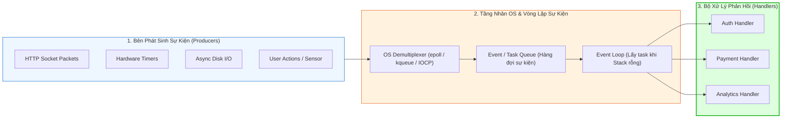
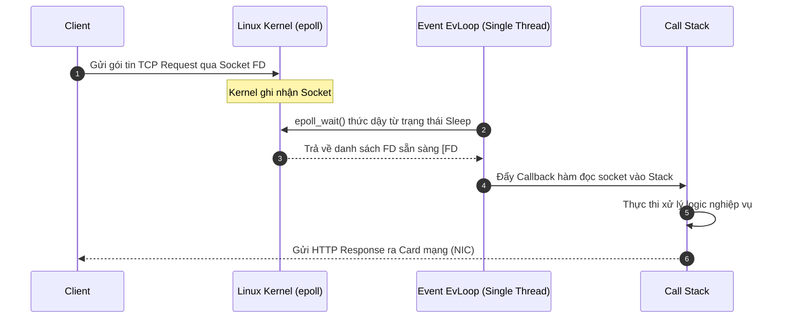
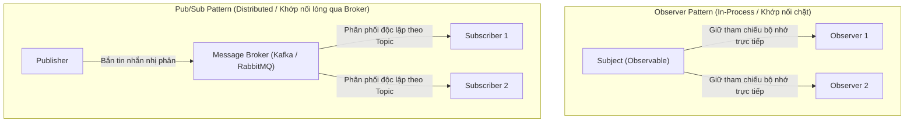

# 1.6. Event-Driven Programming (Lập trình Hướng sự kiện)

> [!IMPORTANT]
> **Nếu bạn chỉ được nhớ một điều duy nhất**: Trong lập trình tuần tự truyền thống, chương trình hoạt động như một người phục vụ nhà hàng vụng về: đứng chôn chân tại một bàn ăn chờ khách nhai xong mới dám bước sang bàn khác (**Blocking I/O**). Ngược lại, **Lập trình Hướng sự kiện (Event-Driven Programming - EDP)** vận hành như một sân bay quốc tế hiện đại: đài kiểm soát không lưu không bao giờ chạy đến từng chiếc máy bay để hỏi "Bạn đã sẵn sàng cất cánh chưa?"; thay vào đó, các máy bay tự phát tín hiệu (**Event Emitters**), vòng lặp trung tâm (**Event Loop** kết hợp `epoll`/`kqueue` ở tầng nhân hệ điều hành) bắt tín hiệu và điều phối ngay các đội hậu cần chuyên trách (**Event Handlers**). Mô hình này cho phép một luồng đơn lẻ (Single Thread) phục vụ hàng chục ngàn kết nối đồng thời với mức tiêu hao tài nguyên RAM và CPU tối thiểu.

---

## 1. Kiến trúc Tổng quan & Mô hình Tư duy (Mental Model)

Lập trình hướng sự kiện phân rã luồng thực thi thành các nhà sản xuất sự kiện (**Event Producers**), cỗ máy bắt giữ điều phối trung tâm (**Event Loop / Demultiplexer**), và các bên tiêu thụ xử lý (**Event Handlers / Listeners**):



---

## 2. Chi tiết từng Keyword (Under-the-Hood Deep Dive)

### 2.1. Event (Sự kiện)

- **Bản chất của Event**: Một đối tượng dữ liệu (Message/Signal) đại diện cho một sự thật bất biến đã xảy ra trong quá khứ (**An Immutable Fact in the Past**).
- **Quy ước đặt tên**: Luôn sử dụng thì quá khứ hoặc danh từ hành động đã hoàn tất (ví dụ: `UserRegistered`, `OrderPlaced`, `InvoicePaid`, `SensorThresholdExceeded`).
- **Cấu trúc Payload chuẩn**:
  - `event_id`: Mã định danh duy nhất (UUIDv4) phục vụ việc chống trùng lặp.
  - `event_type`: Chuỗi phân loại sự kiện để Router điều phối.
  - `timestamp`: Dấu thời gian Unix Epoch (micro-seconds) khi sự kiện phát sinh.
  - `data`: Bản tin chi tiết (Payload) mang thông tin nghiệp vụ.

---

### 2.2. Event Handler và Callback

- **Event Handler (Bộ xử lý sự kiện / Listener)**: Một hàm hoặc lớp nghiệp vụ được đăng ký trước với hệ thống, có trách nhiệm tiếp nhận payload và thực thi logic khi sự kiện tương ứng xuất hiện.
- **Callback (Hàm gọi lại)**:
  - Một con trỏ hàm (hoặc lambda closure) được truyền như đối số vào một hàm khác, với cam kết sẽ được kích hoạt lại khi tác vụ I/O dài hạn hoàn tất.
- **Vấn đề "Callback Hell" (Pyramid of Doom)**:
  - Khi nhiều tác vụ bất đồng bộ phụ thuộc liên tiếp vào kết quả của nhau, việc lồng các callback tạo ra cấu trúc mã nguồn tam giác thụt lề sâu hoắm, khiến việc xử lý ngoại lệ và luồng điều khiển trở thành ác mộng.
  - *Giải pháp hiện đại*: **Promises / Futures** và cú pháp **Async/Await**, chuyển đổi luồng tư duy bất đồng bộ về dạng phẳng như mã nguồn đồng bộ tuần tự.

---

### 2.3. Event Loop (Vòng lặp sự kiện & Epoll/Kqueue/IOCP Internals)

Làm thế nào một luồng duy nhất của Node.js, Nginx hoặc Redis có thể phục vụ hơn $100.000$ kết nối đồng thời (Bài toán C10K / C100K) mà không làm tràn RAM do tạo quá nhiều luồng?



1. **Không sử dụng Busy-Waiting**: CPU không chạy vòng lặp `while(true)` rỗng vì sẽ đốt cháy $100\%$ CPU vô ích.
2. **Hệ thống System Call I/O Multiplexing**:
   - Linux: `epoll_create`, `epoll_ctl`, `epoll_wait`.
   - macOS / BSD: `kqueue`.
   - Windows: `IOCP` (I/O Completion Ports).
3. **Cơ chế hoạt động**:
   - Tiến trình đăng ký hàng ngàn Socket File Descriptors (FD) vào bảng theo dõi của Kernel.
   - Luồng ứng dụng gọi `epoll_wait()` và đi vào trạng thái ngủ (**Sleep / Blocked**), giải phóng CPU cho các tiến trình khác.
   - Khi Card mạng (NIC) nhận được gói tin TCP và kích hoạt ngắt phần cứng, Kernel đánh thức luồng ứng dụng dậy và trả về danh sách các Socket FD đã sẵn sàng đọc/ghi dữ liệu.

---

### 2.4. Event Dispatcher (Bộ điều phối sự kiện)

Thành phần trung gian trong kiến trúc nội bộ, chịu trách nhiệm quản lý ánh xạ giữa tên sự kiện và danh sách các hàm lắng nghe:
- `subscribe(eventType, handler)`: Đăng ký một listener vào bảng băm nội bộ.
- `emit(eventType, payload)`: Kích hoạt sự kiện và phân phối dữ liệu tới toàn bộ listeners đã đăng ký.
- `unsubscribe(eventType, handler)`: Hủy đăng ký để tránh rò rỉ bộ nhớ (Listener Memory Leak).

---

### 2.5. Observer Pattern vs Pub/Sub Pattern (Phân biệt Rạch ròi)

Rất nhiều kỹ sư nhầm lẫn giữa hai mẫu này:



| Tiêu chí | Observer Pattern | Publish / Subscribe (Pub/Sub) |
| :--- | :--- | :--- |
| **Thực thể Trung gian** | Không có (Subject gọi trực tiếp phương thức của Observer) | Có **Message Broker / Event Bus** độc lập đứng giữa |
| **Mức độ Khớp nối (Coupling)**| Phụ thuộc vào Interface trong cùng bộ nhớ | Hoàn toàn tách biệt; Publisher không biết Subscriber tồn tại |
| **Phạm vi Hoạt động** | Cùng một tiến trình (**In-Memory**) | Thường phân tán qua mạng (**Distributed Network**) |
| **Thời gian Tồn tại** | Observer chết theo tiến trình ứng dụng | Tin nhắn được lưu bền vững trên đĩa cứng của Broker |

---

### 2.6. Reactive Programming (Lập trình Phản ứng)

- **Triết lý**: Xử lý dữ liệu dưới dạng các **Luồng Dữ liệu Bất đồng bộ (Asynchronous Data Streams)**.
- Mọi thứ đều là Stream: Từ sự kiện click chuột, các gói tin WebSocket, thông báo từ Redis, cho tới biến dữ liệu thay đổi.
- **Toán tử Hàm (Functional Operators)**: Cung cấp bộ công cụ mạnh mẽ (`map`, `filter`, `debounceTime`, `mergeMap`, `zip`, `retryWhen`) cho phép biến đổi và hợp nhất các dòng dữ liệu thời gian thực mà không cần quản lý trạng thái luồng thủ công (Thư viện tiêu biểu: RxJS, ReactiveX, Project Reactor).

---

### 2.7. Event-Driven Architecture (EDA - Kiến trúc Hướng sự kiện)

Kiến trúc cấp hệ thống trong các hệ thống Microservices phân tán hiện đại:
1. **Event Notification**: Thông báo một sự kiện vừa xảy ra với payload nhẹ (Consumer phải gọi ngược lại REST API để lấy thêm dữ liệu nếu cần).
2. **Event-Carried State Transfer**: Gửi kèm toàn bộ snapshot dữ liệu mới nhất trong payload của Event, giúp Consumer không bao giờ phải gọi ngược lại hệ thống nguồn, triệt tiêu phụ thuộc thời gian thực.
3. **Event Sourcing**: Thay vì chỉ lưu trạng thái hiện tại (Current State) trong Database, hệ thống lưu trữ toàn bộ chuỗi các sự kiện đã diễn ra từ quá khứ đến hiện tại như một cuốn sổ cái kế toán bất biến (**Append-Only Ledger**).
4. **CQRS (Command Query Responsibility Segregation)**: Tách riêng mô hình ghi dữ liệu (Command) và mô hình đọc tối ưu hóa (Query), đồng bộ hóa hai bên thông qua luồng Events bất đồng bộ.

---

## 3. Dual-Engine Code Implementation

### Engine 1: C++20 — Thread-Safe Event Dispatcher Đa Luồng Với Thread Pool

Chương trình minh họa một bộ điều phối sự kiện an toàn luồng (Thread-safe) trong C++20, hỗ trợ đăng ký lắng nghe và phân phối sự kiện bất đồng bộ tới các Worker Threads độc lập.

```cpp
#include <iostream>
#include <string>
#include <vector>
#include <unordered_map>
#include <functional>
#include <mutex>
#include <thread>
#include <queue>
#include <condition_variable>

// Event Payload Struct
struct OrderCreatedEvent {
    std::string order_id;
    double amount;
    std::string customer_email;
};

// Thread-Safe Event Dispatcher
class ThreadSafeEventDispatcher {
public:
    using Handler = std::function<void(const OrderCreatedEvent&)>;

    void subscribe(const std::string& event_type, Handler handler) {
        std::lock_guard<std::mutex> lock(reg_mutex);
        subscribers[event_type].push_back(handler);
    }

    void emit_synchronous(const std::string& event_type, const OrderCreatedEvent& event) {
        std::vector<Handler> targets;
        {
            std::lock_guard<std::mutex> lock(reg_mutex);
            if (subscribers.contains(event_type)) {
                targets = subscribers[event_type];
            }
        }
        for (const auto& handler : targets) {
            handler(event);
        }
    }

private:
    std::unordered_map<std::string, std::vector<Handler>> subscribers;
    std::mutex reg_mutex;
};

int main() {
    std::cout << "=== THỬ NGHIỆM THREAD-SAFE EVENT DISPATCHER (C++20) ===\n\n";

    ThreadSafeEventDispatcher dispatcher;

    // Đăng ký Listener 1: Bộ phận Kho vận
    dispatcher.subscribe("ORDER_CREATED", [](const OrderCreatedEvent& ev) {
        std::cout << "  [Inventory Service]: Đã khóa hàng tồn kho cho Order #" << ev.order_id << '\n';
    });

    // Đăng ký Listener 2: Dịch vụ Email Khách hàng
    dispatcher.subscribe("ORDER_CREATED", [](const OrderCreatedEvent& ev) {
        std::cout << "  [Email Service]: Đã gửi hóa đơn $" << ev.amount 
                  << " tới email " << ev.customer_email << '\n';
    });

    // Kích hoạt sự kiện
    OrderCreatedEvent new_order{"ORD-9981", 350.0, "alice@enterprise.com"};
    std::cout << "[Step]: Phát sự kiện ORDER_CREATED cho đơn hàng: " << new_order.order_id << "\n";
    dispatcher.emit_synchronous("ORDER_CREATED", new_order);

    std::cout << "\n[Kết luận]: Toàn bộ các dịch vụ con đã phản hồi độc lập thành công!\n";
    return 0;
}
```

```text
=== THỬ NGHIỆM THREAD-SAFE EVENT DISPATCHER (C++20) ===

[Step]: Phát sự kiện ORDER_CREATED cho đơn hàng: ORD-9981
  [Inventory Service]: Đã khóa hàng tồn kho cho Order #ORD-9981
  [Email Service]: Đã gửi hóa đơn $350 tới email alice@enterprise.com

[Kết luận]: Toàn bộ các dịch vụ con đã phản hồi độc lập thành công!
```

---

### Engine 2: Python — Hiện Thực Event Loop & Asynchronous Event Pipeline với `asyncio`

Chương trình minh họa kiến trúc Event-Driven bất đồng bộ hoàn chỉnh: Xử lý đơn hàng thông qua `asyncio.Queue`, bảo đảm non-blocking I/O và mô phỏng chính xác hành vi của các Message Consumers trong môi trường sản xuất.

```python
#!/usr/bin/env python3
"""
Asynchronous Event-Driven Pipeline Simulator using Python's asyncio.
Demonstrates non-blocking Event Emitter, In-memory Queue, and Concurrent Handlers.
"""
import asyncio
import time
from typing import Dict, Any, List, Callable, Awaitable

class AsyncEventBus:
    def __init__(self):
        self.subscribers: Dict[str, List[Callable[[Dict[str, Any]], Awaitable[None]]]] = {}
        self.event_queue: asyncio.Queue = asyncio.Queue()

    def subscribe(self, event_type: str, handler: Callable[[Dict[str, Any]], Awaitable[None]]):
        if event_type not in self.subscribers:
            self.subscribers[event_type] = []
        self.subscribers[event_type].append(handler)

    async def publish(self, event_type: str, payload: Dict[str, Any]):
        """Đẩy sự kiện vào hàng đợi bất đồng bộ mà không chặn luồng gọi."""
        await self.event_queue.put((event_type, payload))

    async def start_consumer(self):
        """Worker lặp vô tận tiêu thụ và điều phối các sự kiện."""
        while True:
            event_type, payload = await self.event_queue.get()
            handlers = self.subscribers.get(event_type, [])
            
            # Kích hoạt tất cả các handler đồng thời
            tasks = [asyncio.create_task(h(payload)) for h in handlers]
            if tasks:
                await asyncio.gather(*tasks)
            self.event_queue.task_done()


# --- CÁC MICROSERVICES ĐỘC LẬP LẮNG NGHE SỰ KIỆN ---
async def inventory_handler(payload: Dict[str, Any]):
    await asyncio.sleep(0.05) # Giả lập ghi cơ sở dữ liệu
    print(f"  [Warehouse]: Cập nhật tồn kho thành công cho {payload['order_id']}")

async def billing_handler(payload: Dict[str, Any]):
    await asyncio.sleep(0.08) # Giả lập gọi Stripe API
    print(f"  [Billing]: Thu tiền ${payload['amount']} thành công cho {payload['order_id']}")

async def notification_handler(payload: Dict[str, Any]):
    await asyncio.sleep(0.02) # Giả lập gửi Email
    print(f"  [Notification]: Đã gửi thông báo tới {payload['user_email']}")


async def main():
    print("=== ASYNC EVENT-DRIVEN PROCESSING ENGINE (Python 3.11+) ===\n")
    bus = AsyncEventBus()

    # Đăng ký các consumers
    bus.subscribe("ORDER_PLACED", inventory_handler)
    bus.subscribe("ORDER_PLACED", billing_handler)
    bus.subscribe("ORDER_PLACED", notification_handler)

    # Khởi động Consumer Worker ở chế độ nền
    consumer_task = asyncio.create_task(bus.start_consumer())

    # Phát 2 sự kiện liên tiếp
    print("[Producer]: Khách hàng tạo 2 đơn hàng mới liên tiếp...")
    await bus.publish("ORDER_PLACED", {"order_id": "ORD-101", "amount": 120.0, "user_email": "bob@gmail.com"})
    await bus.publish("ORDER_PLACED", {"order_id": "ORD-102", "amount": 450.0, "user_email": "carol@yahoo.com"})

    # Chờ hàng đợi xử lý sạch sẽ
    await bus.event_queue.join()
    consumer_task.cancel()
    print("\n[Producer]: Tất cả các tác vụ nền đã hoàn tất không gián đoạn API chính!")

if __name__ == "__main__":
    asyncio.run(main())
```

```text
=== ASYNC EVENT-DRIVEN PROCESSING ENGINE (Python 3.11+) ===

[Producer]: Khách hàng tạo 2 đơn hàng mới liên tiếp...
  [Notification]: Đã gửi thông báo tới bob@gmail.com
  [Warehouse]: Cập nhật tồn kho thành công cho ORD-101
  [Billing]: Thu tiền $120.0 thành công cho ORD-101
  [Notification]: Đã gửi thông báo tới carol@yahoo.com
  [Warehouse]: Cập nhật tồn kho thành công cho ORD-102
  [Billing]: Thu tiền $450.0 thành công cho ORD-102

[Producer]: Tất cả các tác vụ nền đã hoàn tất không gián đoạn API chính!
```

---

## 4. Systems Engineering & Production Pitfalls

### 4.1. Cạm Bẫy Tràn Hàng Đợi (Queue Saturation) & Hiện Tượng Backpressure

Trong các hệ thống hướng sự kiện, nếu tốc độ phát sinh sự kiện của Producer cao hơn tốc độ xử lý của Consumer:
- Hàng đợi (Buffer / Queue) sẽ phình to không giới hạn cho tới khi cạn kiệt RAM và kích hoạt **Linux OOM Killer**.
- **Giải pháp Công nghiệp**: Áp dụng cơ chế **Backpressure (Áp lực Ngược)**:
  - Giới hạn kích thước hàng đợi (**Bounded Queue**).
  - Khi hàng đợi đạt ngưỡng $80\%$, ép Producer phải giảm tốc độ hoặc từ chối nhận request mới (HTTP 429 Too Many Requests).

---

### 4.2. Các Công cụ Giám sát Sockets & I/O Trên Linux

```bash
# 1. Kiểm tra số lượng kết nối TCP và các socket đang ở trạng thái LISTEN
ss -tulpn

# 2. Xem các file descriptor và network sockets đang mở của tiến trình backend
lsof -p <PID> | grep -E 'IPv4|IPv6'

# 3. Theo dõi số lượng sự kiện I/O epoll được kernel phục vụ
cat /proc/sys/fs/epoll/max_user_watches
```

---

## 5. Bảng So sánh & Decision Matrix

| Mô hình Tương tác | Cơ chế Giao tiếp | Khả năng Ghép nối (Coupling) | Tính Đồng bộ | Kịch bản Áp dụng Tối ưu |
| :--- | :--- | :--- | :--- | :--- |
| **Request - Response (REST / RPC)** | Trực tiếp 1-1 qua HTTP/TCP | Chặt chẽ (Caller phải biết địa chỉ Callee) | Đồng bộ (Synchronous blocking) | Truy vấn dữ liệu tức thì (Dashboard, Login) |
| **Observer Pattern** | Trực tiếp 1-N trong bộ nhớ | Chặt chẽ ở mức Interface | Thường là đồng bộ | GUI Components, Event Listeners in-memory |
| **Publish - Subscribe (EDA)** | Gián tiếp 1-N qua Message Broker | **Hoàn toàn lỏng (Decoupled)** | Bất đồng bộ (Async Buffered) | Tác vụ nền, Tích hợp hệ thống phân tán đa dịch vụ |
| **Reactive Streams** | Luồng dữ liệu đẩy liên tục | Lỏng, hỗ trợ Backpressure | Bất đồng bộ không chặn | Stream thời gian thực, IoT Telemetry, Chat feeds |
