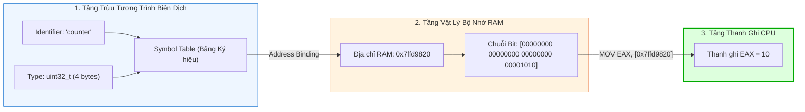
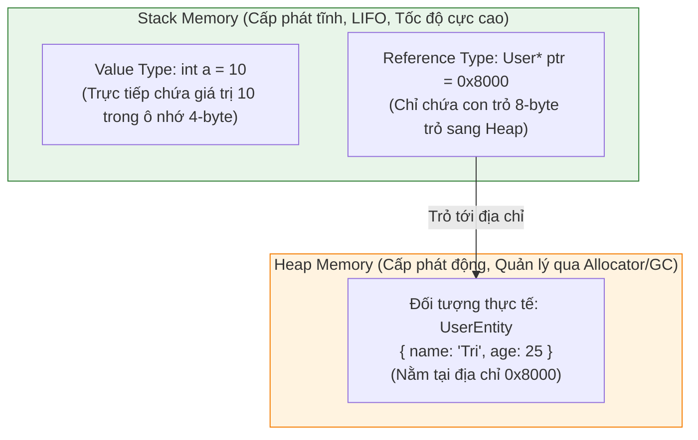
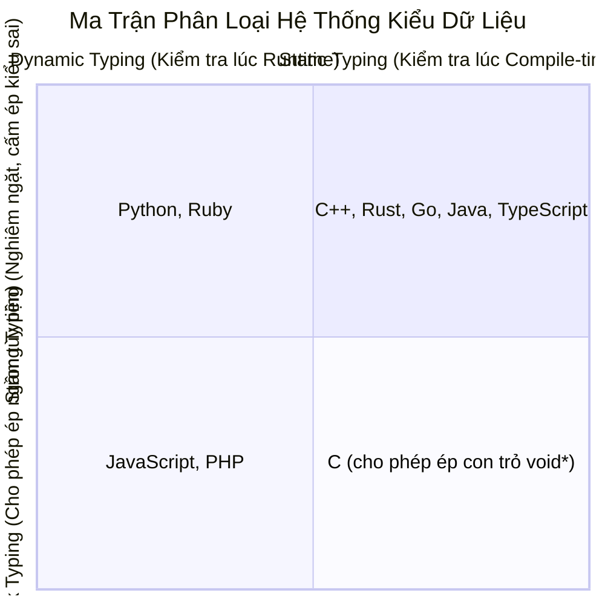

# 2.1. Variables và Data (Biến và Dữ liệu)

> [!IMPORTANT]
> **Nếu bạn chỉ được nhớ một điều duy nhất**: Đối với thanh ghi và các bóng bán dẫn phần cứng bên trong CPU, không hề tồn tại cái gọi là "tên biến", "chuỗi ký tự" hay "đối tượng người dùng" — thế giới vật lý chỉ có **Địa chỉ ô nhớ (Memory Addresses)** và các khối bit nhị phân `0` và `1` trần trụi. **Biến (Variable)** là chiếc nhãn dán định danh được gắn vào một vùng nhớ cụ thể; còn **Kiểu Dữ liệu (Data Type)** chính là chiếc kính giải mã quyết định CPU phải đọc vùng nhớ đó như thế nào: đọc $4$ bytes thành số nguyên bù hai (`int32_t`), đọc $8$ bytes thành số thực dấu phẩy động IEEE 754 (`double`), hay xem đó là một con trỏ địa chỉ (**Reference**) trỏ tới một cấu trúc phức hợp nằm sâu trong bộ nhớ Heap.

---

## 1. Kiến trúc Tổng quan & Mô hình Tư duy (Mental Model)

Sự tương quan giữa mã nguồn cấp cao, bảng ký hiệu của trình biên dịch và hiện thực vật lý trên các thanh ghi và ô nhớ RAM:



---

## 2. Chi tiết từng Keyword (Under-the-Hood Deep Dive)

### 2.1. Declaration, Initialization và Assignment (Khai báo, Khởi tạo và Phép gán)

- **Variable Declaration (Khai báo biến)**:
  - Báo hiệu cho Trình biên dịch (hoặc Trình thông dịch) ghi nhận **Tên định danh (Identifier)** và **Kiểu dữ liệu (Type)** vào Bảng ký hiệu (**Symbol Table**).
  - Trình biên dịch tính toán kích thước và dành sẵn không gian trên ngăn xếp (**Stack Frame Allocation**), nhưng **chưa gán bất kỳ giá trị hợp lệ nào**. Giá trị bên trong ô nhớ lúc này là dữ liệu rác còn sót lại từ các tiến trình trước (**Garbage Value**).
- **Variable Initialization (Khởi tạo biến)**:
  - Hành động nạp giá trị hợp lệ đầu tiên vào ô nhớ của biến ngay tại thời điểm biến đó ra đời.
  - *Best Practice*: Luôn luôn khởi tạo biến ngay khi khai báo để triệt tiêu lỗi Undefined Behavior do đọc nhầm giá trị rác.
- **Variable Assignment (Phép gán biến)**:
  - Thao tác ghi đè một giá trị mới vào ô nhớ của một biến đã tồn tại từ trước trong quá trình thực thi chương trình.

---

### 2.2. Constants và Literals

#### Constants (Hằng số)
Biến có giá trị không thể bị thay đổi sau khi được gán lần đầu:
- **`const` (Runtime Constant)**: Giá trị không thể bị sửa đổi trong suốt vòng đời của biến, nhưng giá trị đó có thể được tính toán hoặc lấy từ môi trường thời gian chạy (ví dụ: `const int port = read_config_file();`).
- **`constexpr` / `consteval` trong C++20 (Compile-time Constant)**: Bắt buộc giá trị phải được tính toán và xác định **ngay trong giai đoạn biên dịch**. Trình biên dịch nhúng trực tiếp giá trị vào mã máy nhị phân, giải phóng 100% chi phí tính toán khi chạy (Zero runtime overhead).

#### Literals (Giá trị nguyên văn)
Các giá trị cố định được viết trực tiếp vào mã nguồn mà không thông qua biến:
- *Integer Literals*: `42` (Decimal), `0x2A` (Hex), `0b101010` (Binary), `1'000'000` (Digit Separator).
- *Floating-point Literals*: `3.14159f` (Float 32-bit), `2.71828` (Double 64-bit).
- *String Literals*: `"Hello World"` (Được lưu trữ vĩnh viễn trong phân vùng chỉ đọc `.rodata` của file nhị phân).

---

### 2.3. Identifiers và Naming Conventions (Định danh và Quy ước đặt tên)

- **Identifier (Định danh)**: Chuỗi ký tự do kỹ sư đặt tên cho các thực thể: biến, hàm, lớp, module.
  - *Quy tắc cú pháp*: Bắt đầu bằng chữ cái hoặc dấu gạch dưới `_`, không bắt đầu bằng số, không trùng từ khóa hệ thống (`class`, `return`, `volatile`).
- **Các Quy ước Đặt tên Chuẩn Công nghiệp**:
  1. `camelCase`: Phổ biến trong JavaScript, TypeScript, Java (ví dụ: `userAccountBalance`, `orderService`).
  2. `snake_case`: Chuẩn mực của C, C++, Python, Linux Kernel, Database Columns (ví dụ: `account_balance`, `user_id`).
  3. `PascalCase`: Dùng cho Classes, Structs, Types, Interfaces (ví dụ: `OrderProcessor`, `CustomerEntity`).
  4. `SCREAMING_SNAKE_CASE`: Dành riêng cho Hằng số toàn cục và Biến môi trường (ví dụ: `MAX_BUFFER_CAPACITY`, `DATABASE_URL`).
  5. `kebab-case`: Chuẩn cho tên file, URL endpoints, CSS classes (ví dụ: `order-service.cpp`, `/api/v1/user-profiles`).

---

### 2.4. Phân loại Kiểu Dữ liệu: Primitive vs Composite, Value vs Reference



- **Primitive Types (Kiểu nguyên thủy)**: Các kiểu cơ bản của phần cứng không thể chia nhỏ: số nguyên (`int8`, `int16`, `int32`, `int64`), số thực (`float`, `double`), ký tự (`char`), boolean (`bool`).
- **Composite Types (Kiểu phức hợp)**: Được tạo thành từ sự kết hợp của nhiều kiểu nguyên thủy: `struct`, `class`, `array`, `tuple`, `union`.
- **Value Types vs Reference Types (Sự khác biệt sống còn)**:
  - *Value Types*: Biến chứa trực tiếp dữ liệu thô. Khi thực hiện phép gán `b = a`, toàn bộ dữ liệu được sao chép độc lập (**Deep Copy by default**). Thay đổi `b` không ảnh hưởng tới `a`.
  - *Reference Types*: Biến chỉ chứa địa chỉ con trỏ trỏ tới vùng nhớ thực tế (thường trên Heap). Khi gán `b = a`, hệ thống chỉ copy địa chỉ 8-byte. Cả hai biến cùng trỏ vào một đối tượng duy nhất; sửa đổi dữ liệu qua `b` sẽ phản ánh trực tiếp lên `a`.

---

### 2.5. Type Conversion, Type Casting và Type Coercion

Ba thuật ngữ chuyển đổi kiểu dữ liệu thường bị nhầm lẫn:
1. **Type Conversion (Chuyển đổi kiểu tổng quát)**: Thuật ngữ chung chỉ hành vi biến đổi dữ liệu từ kiểu này sang kiểu khác.
2. **Type Casting (Ép kiểu tường minh - Explicit)**: Kỹ sư chủ động yêu cầu trình biên dịch thực hiện chuyển đổi thông qua cú pháp rõ ràng.
   - Trong C++:
     - `static_cast<T>`: Ép kiểu an toàn lúc biên dịch giữa các kiểu có quan hệ logic (ví dụ `double` sang `int`).
     - `dynamic_cast<T>`: Ép kiểu an toàn lúc chạy có kiểm tra con trỏ thông qua bảng ảo RTTI.
     - `reinterpret_cast<T>`: Ép kiểu mã nhị phân thô (ép con trỏ bất kỳ thành `uintptr_t`).
3. **Type Coercion (Ép kiểu ngầm định - Implicit)**: Trình biên dịch hoặc Runtime Engine tự ý biến đổi kiểu mà không cần lệnh từ kỹ sư.
   - Nguồn gốc của hàng loạt thảm họa trong JavaScript (`"5" + 2 = "52"`, nhưng `"5" - 2 = 3`).

---

### 2.6. Type Inference và Type Checking

- **Type Inference (Suy luận kiểu tự động)**:
  - Khả năng của Trình biên dịch tự phân tích kiểu của biểu thức vế phải để gán kiểu cho biến vế trái mà không bắt kỹ sư phải gõ lại kiểu tường minh.
  - Ví dụ: `auto x = 42;` (C++), `const total = 100;` (TypeScript), `count := 10` (Go).
  - Vẫn bảo toàn $100\%$ tính an toàn kiểu tĩnh (Static Typing).
- **Type Checking (Kiểm tra kiểu)**:
  - Quy trình xác thực xem các toán tử và hàm có được áp dụng lên các kiểu dữ liệu hợp lệ hay không (ví dụ: cấm lấy chuỗi nhân với ma trận).

---

### 2.7. Phân loại Type Systems: Static vs Dynamic, Strong vs Weak



1. **Static Typing vs Dynamic Typing (Thời điểm Kiểm tra)**:
   - *Static Typing*: Kiểu dữ liệu gắn liền với **Biến** và được xác thực tại **Compile-time** (C++, Rust, Java, Go). Giúp bắt lỗi cực sớm trước khi triển khai và cho phép tối ưu mã máy tối đa.
   - *Dynamic Typing*: Kiểu dữ liệu gắn liền với **Giá trị tại Runtime** chứ không gắn với biến (Python, JavaScript). Biến có thể chứa số nguyên ở dòng 1 và chứa chuỗi ở dòng 2.
2. **Strong Typing vs Weak Typing (Mức độ Nghiêm ngặt)**:
   - *Strong Typing*: Tuyệt đối không cho phép thực hiện thao tác trên các kiểu dữ liệu không tương thích nếu không có ép kiểu tường minh. (Python là Dynamic nhưng là Strong: `"5" + 2` sẽ ném lỗi `TypeError` ngay lập tức).
   - *Weak Typing*: Tự ý thực hiện ép kiểu ngầm định (Coercion) bừa bãi giữa các kiểu không tương thích (JavaScript, C).

---

## 3. Dual-Engine Code Implementation

### Engine 1: C++20 — Khám Nghiệm Bố Cục Ô Nhớ, Value vs Reference & Compile-Time Constexpr

Chương trình minh họa sự khác biệt căn bản giữa ngữ nghĩa Giá trị (Value Semantics) và Tham chiếu (Reference Semantics), in địa chỉ vật lý ô nhớ RAM và thực thi tính toán ngay tại thời điểm biên dịch bằng `constexpr`.

```cpp
#include <iostream>
#include <cstdint>

struct Coordinate {
    int32_t x;
    int32_t y;
};

// Hàm tính toán thực thi 100% tại Compile-time
constexpr int64_t compute_factorial_compile_time(int n) {
    int64_t res = 1;
    for (int i = 2; i <= n; ++i) res *= i;
    return res;
}

int main() {
    std::cout << "=== KHÁM NGHIỆM BIẾN & DỮ LIỆU TRÊN BỘ NHỚ RAM (C++20) ===\n\n";

    // 1. Compile-time Constant (Được giải mã ngay khi build)
    constexpr int64_t fact_10 = compute_factorial_compile_time(10);
    std::cout << "[1] Compile-time constexpr fact(10): " << fact_10 << '\n';

    // 2. Value Semantics (Sao chép giá trị độc lập trên Stack)
    Coordinate pt1{10, 20};
    Coordinate pt2 = pt1; // Deep copy: Cấp phát ô nhớ mới và copy từng byte
    pt2.x = 999;

    std::cout << "\n[2] So sánh Value Semantics:\n";
    std::cout << "    pt1: (" << pt1.x << ", " << pt1.y << ") tại địa chỉ: " << &pt1 << '\n';
    std::cout << "    pt2: (" << pt2.x << ", " << pt2.y << ") tại địa chỉ: " << &pt2 << '\n';
    std::cout << "    => pt1.x vẫn giữ nguyên = 10 (Hai ô nhớ hoàn toàn độc lập!)\n";

    // 3. Reference Semantics (Bí danh chia sẻ chung ô nhớ)
    Coordinate& ptRef = pt1;
    ptRef.x = 777; // Sửa qua tham chiếu

    std::cout << "\n[3] So sánh Reference Semantics:\n";
    std::cout << "    ptRef địa chỉ: " << &ptRef << " (Trùng khớp 100% với pt1!)\n";
    std::cout << "    Giá trị pt1.x sau khi sửa qua tham chiếu: " << pt1.x << '\n';

    return 0;
}
```

```text
=== KHÁM NGHIỆM BIẾN & DỮ LIỆU TRÊN BỘ NHỚ RAM (C++20) ===

[1] Compile-time constexpr fact(10): 3628800

[2] So sánh Value Semantics:
    pt1: (10, 20) tại địa chỉ: 0x7ffd9820a100
    pt2: (999, 20) tại địa chỉ: 0x7ffd9820a108
    => pt1.x vẫn giữ nguyên = 10 (Hai ô nhớ hoàn toàn độc lập!)

[3] So sánh Reference Semantics:
    ptRef địa chỉ: 0x7ffd9820a100 (Trùng khớp 100% với pt1!)
    Giá trị pt1.x sau khi sửa qua tham chiếu: 777
```

---

### Engine 2: Python — Soi Chi Tiết ID Ô Nhớ, Reference Counting & Khả Biến (Mutability)

Chương trình minh họa cách Python quản lý các đối tượng trong bộ nhớ: Phân biệt đối tượng Bất biến (**Immutable**) và Khả biến (**Mutable**), cùng cơ chế theo dõi số lượng tham chiếu (**Reference Counting**) qua `sys.getrefcount`.

```python
#!/usr/bin/env python3
"""
Python Memory & Object Inspection Engine.
Demonstrates object identity, reference counting, and mutable vs immutable types.
"""
import sys

def inspect_memory_mechanics():
    print("=== KHÁM NGHIỆM ĐỐI TƯỢNG VÀ THAM CHIẾU TRONG PYTHON ===\n")

    # 1. Immutable Type (Số nguyên và Chuỗi)
    a = 1000
    b = a
    print(f"[1] Phép gán ban đầu (b = a):")
    print(f"    id(a): {id(a)} | id(b): {id(b)} (Cùng trỏ vào 1 object số nguyên)")

    b += 1  # Khi sửa giá trị, Python tạo ra một object mới hoàn toàn vì int là Immutable!
    print(f"    Sau khi b += 1:")
    print(f"    id(a): {id(a)} (a = {a})")
    print(f"    id(b): {id(b)} (b = {b}) => b đã nhảy sang địa chỉ ô nhớ mới!\n")

    # 2. Mutable Type (List, Dict)
    list1 = [1, 2, 3]
    list2 = list1  # Chỉ sao chép con trỏ tham chiếu
    list2.append(99)

    print(f"[2] Khả biến (Mutable Reference Semantics):")
    print(f"    id(list1): {id(list1)} | id(list2): {id(list2)}")
    print(f"    list1 sau khi sửa qua list2: {list1} (list1 bị biến đổi theo!)\n")

    # 3. Theo dõi Reference Counting của Garbage Collector
    target_obj = [42, "Enterprise Data"]
    initial_refs = sys.getrefcount(target_obj)
    print(f"[3] Reference Counting cho target_obj:")
    print(f"    Số lượng tham chiếu ban đầu: {initial_refs}")

    alias1 = target_obj
    alias2 = target_obj
    print(f"    Sau khi tạo thêm 2 bí danh: {sys.getrefcount(target_obj)}")

    del alias1
    print(f"    Sau khi xóa 1 bí danh:       {sys.getrefcount(target_obj)}")

if __name__ == "__main__":
    inspect_memory_mechanics()
```

```text
=== KHÁM NGHIỆM ĐỐI TƯỢNG VÀ THAM CHIẾU TRONG PYTHON ===

[1] Phép gán ban đầu (b = a):
    id(a): 140498214408112 | id(b): 140498214408112 (Cùng trỏ vào 1 object số nguyên)
    Sau khi b += 1:
    id(a): 140498214408112 (a = 1000)
    id(b): 140498214408144 (b = 1001) => b đã nhảy sang địa chỉ ô nhớ mới!

[2] Khả biến (Mutable Reference Semantics):
    id(list1): 140498214451200 | id(list2): 140498214451200
    list1 sau khi sửa qua list2: [1, 2, 3, 99] (list1 bị biến đổi theo!)

[3] Reference Counting cho target_obj:
    Số lượng tham chiếu ban đầu: 2
    Sau khi tạo thêm 2 bí danh: 4
    Sau khi xóa 1 bí danh:       3
```

---

## 4. Systems Engineering & Production Pitfalls

### 4.1. Hiểm Họa Biến Chưa Khởi Tạo (Uninitialized Variable Undefined Behavior)

Trong C và C++, khai báo một biến cục bộ trên Stack mà không gán giá trị khởi tạo sẽ khiến biến nhận bất kỳ giá trị rác nào đang nằm sẵn trong bộ nhớ:
```cpp
// NGUY HIỂM CHẾT NGƯỜI
bool is_admin; // Không khởi tạo -> Nhận giá trị rác khác 0!
if (is_admin) {
    grant_full_root_access(); // Lỗ hổng bảo mật nghiêm trọng!
}
```
- **Quy tắc Kiểm soát**: Bật cờ cảnh báo của trình biên dịch: `-Wall -Wextra -Werror` và kích hoạt Clang-Tidy trong CI pipeline để cấm tuyệt đối biến chưa khởi tạo.

---

### 4.2. Các Công cụ Khám nghiệm Bộ nhớ Trên Linux

```bash
# 1. Soi giá trị nhị phân tại địa chỉ biến bằng GDB
(gdb) x/4xb &my_variable    # Xem 4 bytes đầu tiên dưới dạng Hexadecimal

# 2. Phát hiện đọc biến chưa khởi tạo với Valgrind Memcheck
valgrind --tool=memcheck --track-origins=yes ./my_binary

# 3. Quét tràn số nguyên bằng Clang UndefinedBehaviorSanitizer (UBSan)
clang++ -fsanitize=undefined -g src/main.cpp -o app && ./app
```

---

## 5. Bảng So sánh & Decision Matrix

| Khía cạnh Kỹ thuật | Static Typing | Dynamic Typing | Strong Typing | Weak Typing |
| :--- | :--- | :--- | :--- | :--- |
| **Thời điểm Bắt lỗi** | Compile-time (Trước khi chạy) | Runtime (Khi dòng code được kích hoạt) | Ngay khi thực hiện thao tác sai kiểu | Thường không báo lỗi, tự ép kiểu ngầm |
| **Chi phí Hiệu năng CPU** | Zero runtime checking overhead | Tốn chi phí kiểm tra Type Tag trong RAM | Rất nhỏ | Tiềm ẩn bug logic sai lệch giá trị |
| **Độ tin cậy Dự án Lớn** | **Rất cao** (Dễ tái cấu trúc an toàn) | Thấp (Đòi hỏi độ phủ test rất cao) | Cao | Rất thấp (Dễ phát sinh Heisenbugs) |
| **Tốc độ Viết Code Ban đầu**| Chậm hơn (Phải khai báo kiểu) | Cực nhanh (Prototyping linh hoạt) | Chuẩn mực | Khó đoán định hành vi |
| **Ngôn ngữ Đại diện** | C++, Rust, Go, Java, Swift | Python, JavaScript, Ruby, PHP | Python, Rust, Java, Go | JavaScript, C, PHP |
