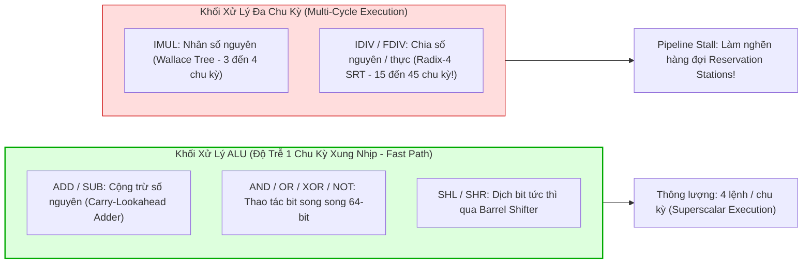

# 2.2. Operators (Toán tử)

> [!IMPORTANT]
> **Nếu chỉ nhớ một điều...**
> Toán tử không phải là những ký tự văn bản trừu tượng vô hại: Ở tầng bán dẫn, mỗi toán tử ánh xạ trực tiếp đến một mạch logic điện tử chuyên biệt bên trong **Khối Số Học & Logic (ALU - Arithmetic Logic Unit)** của CPU. Một phép toán Bitwise (`AND`, `OR`, `XOR`, `SHL`) thực thi trong đúng **$1$ chu kỳ xung nhịp (sub-nanosecond)**, trong khi một phép chia nguyên (`IDIV`) có thể làm đóng băng Pipeline tới **$15 - 45$ chu kỳ xung nhịp**. Hiểu sai về độ chính xác số thực IEEE-754 (`0.1 + 0.2 != 0.3`), lạm dụng toán tử dịch bit trên số âm, hay kích hoạt hiện tượng tràn số nguyên (**Integer Overflow Undefined Behavior**) trong C/C++ có thể làm sụp đổ toàn bộ hệ thống an ninh hoặc làm nổ tung tên lửa ngoài đời thực (thảm họa tên lửa Ariane 5)!

---

## 1. Tư Duy Kiến Trúc & Mô Hình Trực Quan (Mental Model & Intuition)

### Ẩn Dụ Thực Tế: Hộp Số Xe Đua & Cầu Dao Điện Tự Động

Hãy liên tưởng toán tử với các cơ cấu truyền động và an toàn cơ khí:
- **Bitwise vs Arithmetic (Gạt công tắc điện vs Xoay bánh răng)**: Phép toán Bitwise giống như bạn gạt 64 chiếc công tắc điện độc lập trên một bảng điều khiển trong nháy mắt ($1\text{ cycle}$). Phép nhân/chia số học giống như một hệ thống bánh răng phức hợp phải quay nhiều vòng liên tục (Wallace Tree Multiplier, Radix-4 Divider) để tính ra kết quả.
- **Short-Circuit Evaluation (Cầu dao tự ngắt Aptomat)**: Trong mạch điện nối tiếp `A && B`, nếu cầu dao tổng `A` đã sập (False), dòng điện lập tức bị ngắt hoàn toàn. Thợ điện không cần bước vào kiểm tra bóng đèn `B` (bảo vệ chương trình khỏi Null Pointer Dereference).
- **Floating-Point Comparison (Thước đo có độ co giãn)**: Khi dùng thước đo gỗ bị co giãn bởi nhiệt độ, bạn không thể đòi hỏi hai đoạn thẳng dài $10\text{ cm}$ phải khớp nhau tới từng nanomet. Trong máy tính, hai số thực không bao giờ được so sánh bằng `==`, mà phải so sánh khoảng cách chênh lệch qua một sai số dung sai nhỏ (**Epsilon $\epsilon$**).



---

## 2. Chi tiết từng Keyword

### 2.1. Arithmetic Operators (Toán tử số học)

- **Các Toán Tử Cốt Lõi**: `+` (Cộng), `-` (Trừ), `*` (Nhân), `/` (Chia), `%` (Modulo / Chia lấy phần dư).
- **Bản Chất Tầng Vi Kiến Trúc & Chi Phí Lệnh**:
  - Phép cộng/trừ số nguyên: Sử dụng mạch cộng gánh trước (**Carry-Lookahead Adder**), hoàn thành trong $1$ chu kỳ máy với thông lượng cực đại 4 lệnh/chu kỳ trên CPU x86-64 hiện đại.
  - Phép chia nguyên (`IDIV`): CPU không thể tính toán trong 1 chu kỳ mà phải dùng thuật toán lặp SRT Division. Trình biên dịch hiện đại (`-O3`) luôn tìm cách thay thế phép chia cho hằng số bằng phép nhân với số ma thuật nghịch đảo (**Reciprocal Multiplication**) kết hợp phép dịch bit:
    $$\frac{x}{4} \equiv x \gg 2$$
- **Cạm Bẫy Tràn Số Nguyên (Integer Overflow)**:
  - Trong chuẩn C/C++, tràn số có dấu (**Signed Integer Overflow**) là **Undefined Behavior (UB)**. Trình biên dịch có quyền giả định hiện tượng này không bao giờ xảy ra và tự ý xóa bỏ các đoạn mã kiểm tra an ninh!
  - Trong Java, Python, Go: Tràn số có dấu được định nghĩa quay vòng modulo $2^{32}$ hoặc $2^{64}$ (Two's Complement Wrap-around).

### 2.2. Relational Operators (Toán tử quan hệ / so sánh)

- **Các Toán Tử**: `==` (Bằng), `!=` (Khác), `<` (Nhỏ hơn), `<=` (Nhỏ hơn hoặc bằng), `>`, `>=`.
- **Cơ Chế Máy Tính**: Lệnh so sánh `CMP eax, ebx` thực chất thực hiện phép trừ ngầm `eax - ebx`, không lưu kết quả mà chỉ cập nhật các cờ trạng thái trong thanh ghi **RFLAGS**:
  - `ZF` (Zero Flag): Bật lên $1$ nếu hai số bằng nhau ($A - B = 0$).
  - `SF` (Sign Flag) & `OF` (Overflow Flag): Xác định quan hệ thứ tự số có dấu.
- **Thảm Họa So Sánh Số Thực IEEE-754**:
  Do số thực được lưu dưới dạng nhị phân $\text{Sign} \times \text{Mantissa} \times 2^{\text{Exponent}}$, các số thập phân như $0.1$ hay $0.2$ là số tuần hoàn vô hạn trong hệ nhị phân, dẫn đến lỗi làm tròn:
  $$0.1 + 0.2 = 0.3000000000000000444 \neq 0.3$$
  *Quy tắc chuẩn*: Luôn so sánh qua ngưỡng dung sai: $|a - b| < \epsilon$ (với $\epsilon = 10^{-9}$).

### 2.3. Logical Operators (Toán tử logic)

- **Các Toán Tử**: `&&` (Logical AND), `||` (Logical OR), `!` (Logical NOT).
- **Đại Số Boole & Bảng Chân Trị**:
  Toán tử logic hoạt động trên các giá trị chân lý (`true` / `false` hoặc `0` / `1`). Phép toán phủ định `!` tương ứng với cổng logic NOT, đảo ngược trạng thái bit cờ.
- **Phân Biệt Cốt Lõi với Toán Tử Bitwise**:
  - `a && b`: Trả về kết quả kiểu boolean ($1$ hoặc $0$) và kích hoạt cơ chế đánh giá ngắn mạch.
  - `a & b`: Thực hiện phép nhân logic trên từng cặp bit tương ứng của hai từ nhớ 32-bit/64-bit, không có ngắn mạch. Nhầm lẫn giữa `&` và `&&` là lỗi kinh điển dẫn đến bug logic ngầm!

### 2.4. Bitwise Operators (Toán tử thao tác bit)

- **Các Toán Tử Cốt Lõi**:
  - `&` (Bitwise AND): Giữ lại các bit cùng là $1$.
  - `|` (Bitwise OR): Bật bit thành $1$ nếu ít nhất một bên là $1$.
  - `^` (Bitwise XOR): Bằng $1$ nếu hai bit khác nhau ($1 \oplus 1 = 0, 0 \oplus 0 = 0$). Có tính chất tự hủy: $A \oplus B \oplus B = A$.
  - `~` (Bitwise NOT): Đảo ngược toàn bộ bit (phép bù 1).
  - `<<` (Shift Left): Dịch trái, tương đương nhân với $2^k$.
  - `>>` (Shift Right): Dịch phải, tương đương chia cho $2^k$.
- **Ứng Dụng Thực Chiến trong Backend: Bitmask Permissions**:
  Thay vì lưu trữ 10 cột boolean trong Database (`can_read`, `can_write`, `can_delete`), ta gom toàn bộ vào một số nguyên 8-bit duy nhất:
  - Đặt quyền: `user_perms |= PERM_WRITE;`
  - Thu hồi quyền: `user_perms &= ~PERM_WRITE;`
  - Kiểm tra quyền: `if (user_perms & PERM_READ) { ... }`

### 2.5. Short-Circuit Evaluation (Đánh giá ngắn mạch)

- **Cơ Chế Hoạt Động**:
  - Với biểu thức `A && B`: Nếu `A` là `false`, biểu thức con `B` **hoàn toàn không được thực thi hay tính toán**.
  - Với biểu thức `C || D`: Nếu `C` là `true`, biểu thức con `D` **bị bỏ qua ngay lập tức**.
- **Ý Nghĩa Sống Còn trong Phòng Thủ Mã Nguồn**:
  Ngăn ngừa lỗi Crash hệ thống do giải tham chiếu con trỏ rỗng (**Null Pointer Dereference**) hoặc truy cập mảng ngoài giới hạn:
  ```cpp
  if (ptr != nullptr && ptr->is_active()) { // ptr->is_active() chỉ được gọi khi ptr hợp lệ!
      process(ptr);
  }
  ```
  Nếu không có Short-Circuit (ví dụ viết nhầm `&` thay vì `&&`), chương trình sẽ đọc ô nhớ `0x0` và nhận tín hiệu hạt nhân `SIGSEGV` lập tức làm sập tiến trình.

### 2.6. Ternary Operator (Toán tử ba ngôi `?:`)

- **Cú Pháp & Bản Chất Biểu Thức**:
  `condition ? expression_if_true : expression_if_false;`
- **Khác Biệt Căn Bản Giữa Statement và Expression**:
  - Câu lệnh `if-else` là một **Statement** (mệnh lệnh): Nó không trả về giá trị trực tiếp và không thể dùng trong phép gán biến bất biến (`const`).
  - Toán tử ba ngôi `?:` là một **Expression** (biểu thức toán học): Nó trả về một giá trị duy nhất, cho phép khởi tạo các biến hằng số an toàn:
    ```cpp
    const int timeout_ms = is_production ? 5000 : 30000;
    ```
- **Tối Ưu Hóa Trình Biên Dịch (Branchless Assembly `CMOV`)**:
  Trình biên dịch có thể chuyển đổi toán tử ba ngôi thành lệnh máy `CMOV` (Conditional Move) mà không cần lệnh nhảy `JMP`, triệt tiêu hoàn toàn tổn thất do đoán sai nhánh rẽ (**Branch Misprediction Penalty**).

### 2.7. Operator Precedence và Associativity (Độ ưu tiên và Tính kết hợp)

- **Độ Ưu Tiên (Operator Precedence)**: Xác định thứ tự các toán tử được gom nhóm khi không có dấu ngoặc đơn `()`. Ví dụ: Phép nhân `*` có độ ưu tiên cao hơn phép cộng `+`, do đó `2 + 3 * 4` luôn được tính là `2 + (3 * 4) = 14`.
- **Tính Kết Hợp (Operator Associativity)**: Xác định thứ tự thực thi khi các toán tử có cùng mức ưu tiên:
  - *Kết hợp Trái-sang-Phải (Left-to-Right)*: Hầu hết các toán tử số học, logic (`a - b - c` được hiểu là `(a - b) - c`).
  - *Kết hợp Phải-sang-Trái (Right-to-Left)*: Toán tử gán và toán tử ba ngôi (`a = b = c` được hiểu là `a = (b = c)`).
- **Thuật Toán Ký Pháp Ba Lan Thuận (Shunting-Yard Algorithm)**:
  Edsger Dijkstra đã sáng chế thuật toán này để chuyển đổi các biểu thức toán tử Trung tố (Infix) thành Hậu tố (Postfix) bằng hai cấu trúc ngăn xếp Stack (Operator Stack và Output Queue), đóng vai trò cốt lõi trong mọi trình biên dịch Compiler và công cụ phân tích biểu thức.

---

## 3. Hiện Thực Hóa Mã Nguồn Dual-Engine

### 3.1. C++20: Bitmask Permission Engine & Floating-Point Safe Arithmetic

Chương trình C++20 hiện thực hệ thống quản lý phân quyền tốc độ cao bằng Bitmask kết hợp so sánh số thực an toàn bằng Epsilon:

```cpp
#include <iostream>
#include <iomanip>
#include <cmath>
#include <cstdint>
#include <limits>

// Dinh nghia cac bit co quyen han (Bitmask)
enum PermissionFlags : uint8_t {
    NONE    = 0,
    READ    = 1 << 0, // 0000 0001 = 1
    WRITE   = 1 << 1, // 0000 0010 = 2
    EXECUTE = 1 << 2, // 0000 0100 = 4
    DELETE  = 1 << 3  // 0000 1000 = 8
};

// So sanh so thuc an toan voi nguong Epsilon
bool are_floats_equal(double a, double b, double epsilon = 1e-9) {
    return std::abs(a - b) < epsilon;
}

int main() {
    std::cout << "=== PHAN 1: HE THONG PHAN QUYEN BANG TOAN TU BITWISE ===\n";
    uint8_t user_perms = PermissionFlags::NONE;

    // 1. Cap quyen READ va WRITE bang Bitwise OR (|)
    user_perms |= (PermissionFlags::READ | PermissionFlags::WRITE);
    std::cout << "-> Da cap quyen READ & WRITE. Ma bitmask: 0x" 
              << std::hex << (int)user_perms << std::dec << "\n";

    // 2. Kiem tra quyen bang Bitwise AND (&)
    std::cout << "   Kiem tra quyen READ   : " << ((user_perms & PermissionFlags::READ) ? "CO QUYEN" : "TU CHOI") << "\n";
    std::cout << "   Kiem tra quyen DELETE : " << ((user_perms & PermissionFlags::DELETE) ? "CO QUYEN" : "TU CHOI") << "\n";

    // 3. Thu hoi quyen WRITE bang Bitwise AND voi NOT (~): mask &= ~WRITE
    user_perms &= ~PermissionFlags::WRITE;
    std::cout << "-> Da thu hoi quyen WRITE.\n";
    std::cout << "   Kiem tra quyen WRITE  : " << ((user_perms & PermissionFlags::WRITE) ? "CO QUYEN" : "TU CHOI") << "\n";

    std::cout << "\n=== PHAN 2: CAM BAY SO SANH SO THUC IEEE-754 ===\n";
    double x = 0.1;
    double y = 0.2;
    double sum = x + y;
    double expected = 0.3;

    std::cout << std::fixed << std::setprecision(17);
    std::cout << "Gia tri thuc te x + y: " << sum << "\n";
    std::cout << "Gia tri mong doi     : " << expected << "\n";

    // So sanh truc tiep sai lam
    if (sum == expected) {
        std::cout << "[NGUY HIEM]: Hai so thuc bang nhau (Khong bao gio xay ra o day!)\n";
    } else {
        std::cout << "[CANH BAO]: sum == 0.3 tra ve FALSE vi sai so lam tron mantissa!\n";
    }

    // So sanh an toan qua Epsilon
    if (are_floats_equal(sum, expected)) {
        std::cout << "[CHUAN XAC]: So sanh qua |a - b| < epsilon tra ve TRUE!\n";
    }

    return 0;
}
```

### 3.2. Python 3.11+: Shunting-Yard Infix Expression Parser

Chương trình Python hiện thực thuật toán Shunting-Yard của Dijkstra để chuyển đổi biểu thức có độ ưu tiên toán tử thành Hậu tố RPN (Reverse Polish Notation) và tính toán kết quả:

```python
#!/usr/bin/env python3
# -*- coding: utf-8 -*-
"""
Shunting-Yard Algorithm & RPN Evaluator
Minh hoa cach trinh bien dich xu ly Do uu tien (Precedence) va Tinh ket hop (Associativity)
"""
from typing import List

# Bang do uu tien va tinh ket hop
PRECEDENCE = {
    '+': (1, 'L'),
    '-': (1, 'L'),
    '*': (2, 'L'),
    '/': (2, 'L'),
    '^': (3, 'R')  # Luy thua co tinh ket hop Phai-sang-Trai
}

def shunting_yard(tokens: List[str]) -> List[str]:
    """Chuyen doi tu Infix sang Postfix RPN"""
    output_queue: List[str] = []
    operator_stack: List[str] = []

    for token in tokens:
        if token.isdigit():
            output_queue.append(token)
        elif token in PRECEDENCE:
            p1, assoc1 = PRECEDENCE[token]
            while operator_stack and operator_stack[-1] in PRECEDENCE:
                p2, _ = PRECEDENCE[operator_stack[-1]]
                if (assoc1 == 'L' and p1 <= p2) or (assoc1 == 'R' and p1 < p2):
                    output_queue.append(operator_stack.pop())
                else:
                    break
            operator_stack.append(token)
        elif token == '(':
            operator_stack.append(token)
        elif token == ')':
            while operator_stack and operator_stack[-1] != '(':
                output_queue.append(operator_stack.pop())
            operator_stack.pop() # Xoa bo '('

    while operator_stack:
        output_queue.append(operator_stack.pop())

    return output_queue

def evaluate_rpn(rpn_tokens: List[str]) -> float:
    """Tinh toan bieu thuc Hau to RPN bang Ngan xep Stack"""
    stack: List[float] = []
    for token in rpn_tokens:
        if token.isdigit():
            stack.append(float(token))
        else:
            b = stack.pop()
            a = stack.pop()
            if token == '+': stack.append(a + b)
            elif token == '-': stack.append(a - b)
            elif token == '*': stack.append(a * b)
            elif token == '/': stack.append(a / b)
            elif token == '^': stack.append(a ** b)
    return stack[0]

if __name__ == "__main__":
    expression = ["3", "+", "4", "*", "2", "/", "(", "1", "-", "5", ")", "^", "2"]
    print(">>> BIEU THUC BAN DAU (INFIX):", " ".join(expression))

    postfix = shunting_yard(expression)
    print(">>> BIEU THUC HAU TO (RPN)  :", " ".join(postfix))

    result = evaluate_rpn(postfix)
    print(f">>> KET QUA TINH TOAN CHUAN : {result} (Dung theo quy tac toan hoc: 3 + 8 / 16 = 3.5)")
```

### 3.3. Realistic Terminal Output

```bash
=== PHAN 1: HE THONG PHAN QUYEN BANG TOAN TU BITWISE ===
-> Da cap quyen READ & WRITE. Ma bitmask: 0x3
   Kiem tra quyen READ   : CO QUYEN
   Kiem tra quyen DELETE : TU CHOI
-> Da thu hoi quyen WRITE.
   Kiem tra quyen WRITE  : TU CHOI

=== PHAN 2: CAM BAY SO SANH SO THUC IEEE-754 ===
Gia tri thuc te x + y: 0.30000000000000004
Gia tri mong doi     : 0.29999999999999999
[CANH BAO]: sum == 0.3 tra ve FALSE vi sai so lam tron mantissa!
[CHUAN XAC]: So sanh qua |a - b| < epsilon tra ve TRUE!

>>> BIEU THUC BAN DAU (INFIX): 3 + 4 * 2 / ( 1 - 5 ) ^ 2
>>> BIEU THUC HAU TO (RPN)  : 3 4 2 * 1 5 - 2 ^ / +
>>> KET QUA TINH TOAN CHUAN : 3.5 (Dung theo quy tac toan hoc: 3 + 8 / 16 = 3.5)
```

---

## 4. Kỹ Thuật Hệ Thống & Cạm Bẫy Thực Tế (Systems Engineering & Pitfalls)

### 4.1. Thảm Họa Tên Lửa Ariane 5: Bài Học Đắt Giá Về Toán Tử Tràn Số

- **Sự cố lịch sử**: Ngày 4 tháng 6 năm 1996, chuyến bay đầu tiên của tên lửa châu Âu **Ariane 5** phát nổ sau đúng 37 giây cất cánh, gây thiệt hại hơn $370$ triệu USD.
- **Nguyên nhân kỹ thuật**:
  Một phép gán toán tử chuyển đổi kiểu dữ liệu từ số thực dấu phẩy động 64-bit (**Float 64**) sang số nguyên có dấu 16-bit (**Signed Int 16**). Giá trị vận tốc ngang của tên lửa vượt quá giới hạn cực đại của số nguyên 16-bit ($+32{,}767$). Phép gán kích hoạt lỗi tràn số nguyên không được bắt ngoại lệ, đẩy hệ thống dẫn đường vào tình trạng tê liệt và tự kích nổ tên lửa!
- **Giải pháp Production**:
  1. Biên dịch với cờ an toàn `-fsanitize=undefined` và `-ftrapv` trong GCC/Clang để phát hiện lập tức các phép toán tràn số nguyên trong quá trình CI/CD.
  2. Sử dụng thư viện toán học an toàn (Safe Math / Checked Arithmetic) trong các hệ thống tiền tệ và nhúng thời gian thực.

### 4.2. Diagnostic CLI Commands cho Chẩn Đoán Toán Tử & ASM

```bash
# 1. Xem truc tiep ma may hop ngu (Disassembly) de kiem tra phep nhan dich bit thay cho phep chia
objdump -d -M intel --no-show-raw-insn ./bin_operators | grep -A 10 "calculate"

# 2. Bat cac loi Undefined Behavior ve toan tu so hoc bang Clang UBSan
clang++ -O2 -fsanitize=undefined -g operators_test.cpp -o operators_test
./operators_test

# 3. Kiem tra cac phep toan chia cho 0 hoac SIGFPE bang GDB
gdb ./bin_operators -ex "catch signal SIGFPE" -ex "run"

# 4. Kiem tra co toi uu hoa CMOV thay cho JMP bang perf annotate
perf record ./bin_operators && perf annotate --stdio
```

---

## 5. Bảng So Sánh & Quyết Định Kỹ Thuật (Decision Matrix)

| Nhóm Toán tử | Toán tử Tiêu biểu | Chi phí CPU Cycles | Mạch Phần cứng Tương ứng | Nguy cơ Lỗi Tiềm ẩn |
| :--- | :--- | :--- | :--- | :--- |
| **Bitwise** | `&`, `\|`, `^`, `~`, `<<`, `>>` | $1\text{ cycle}$ (Cực nhanh) | Mạch logic cổng AND/OR, Barrel Shifter | Nhầm lẫn `&` với `&&`, Dịch bit số âm |
| **Số học Cộng/Trừ** | `+`, `-` | $1\text{ cycle}$ (Fast Path) | Carry-Lookahead Adder (CLA) | Tràn số nguyên (Integer Overflow UB) |
| **Số học Nhân** | `*` | $3 - 4\text{ cycles}$ | Wallace Tree / Booth's Multiplier | Tràn số khi nhân hai số 64-bit lớn |
| **Số học Chia/Dư** | `/`, `%` | $15 - 45\text{ cycles}$ (Rất chậm) | SRT Radix-4 Divider | Chia cho 0 (`SIGFPE`), Nghẽn Pipeline |
| **So sánh Logic** | `==`, `!=`, `<`, `>` | $1\text{ cycle}$ | Phép trừ CMP + Kiểm tra cờ RFLAGS | So sánh số thực `0.1 + 0.2 == 0.3` |
| **Ngắn Mạch (Short-Circuit)**| `&&`, `\|\|` | Phụ thuộc rẽ nhánh | Lệnh nhảy điều kiện `JZ / JNZ` | Side-effects bên trong vế sau bị bỏ qua |
| **Ba ngôi (Ternary)** | `?:` | $1 - 2\text{ cycles}$ | CMOV (Conditional Move instruction) | Viết lồng nhau quá nhiều gây khó đọc |
