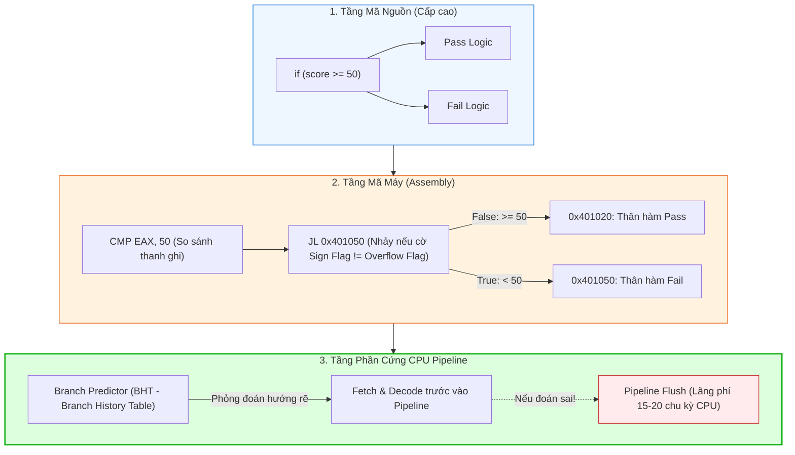
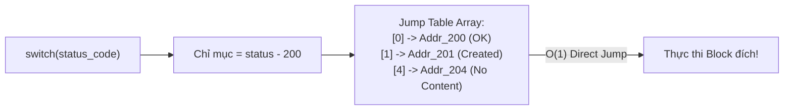
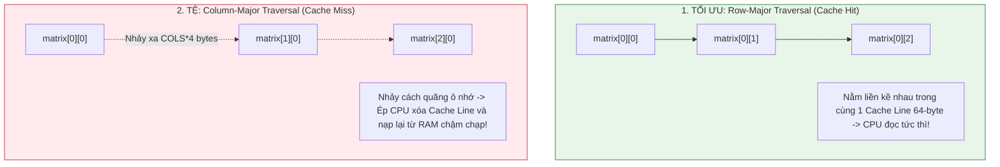

# 2.3. Control Flow (Luồng Điều khiển)

> [!IMPORTANT]
> **Nếu bạn chỉ được nhớ một điều duy nhất**: Ở cấp độ mã nguồn, các cấu trúc rẽ nhánh (`if`, `switch`) và vòng lặp (`for`, `while`) cho phép bạn tạo ra các quyết định logic mềm dẻo. Nhưng ở tầng silicon sâu nhất của CPU, **luồng điều khiển là một hệ thống đường ray xe lửa cao tốc chạy bằng cơ chế suy đoán nhánh (Branch Prediction)**. Khi CPU gặp một lệnh rẽ nhánh điều kiện (`CMP` + `JNE`), bộ dự đoán nhánh (**Branch Predictor**) sẽ phỏng đoán đoàn tàu sẽ rẽ trái hay phải để nạp sẵn mã lệnh vào Pipeline. Nếu dự đoán sai (**Branch Misprediction**), CPU buộc phải giật phanh khẩn cấp, xóa sạch Pipeline (xả bỏ từ $15$ đến $20$ chu kỳ lệnh) và nạp lại từ đầu. Tối ưu hóa luồng điều khiển chính là viết code thân thiện với bộ dự đoán nhánh và tận dụng tối đa dòng nhớ đệm (**CPU Cache Lines**).

---

## 1. Kiến trúc Tổng quan & Mô hình Tư duy (Mental Model)

Mọi cấu trúc điều khiển cấp cao đều được trình biên dịch hạ cấp thành hai chỉ thị mã máy cơ bản: **So sánh (`CMP`, `TEST`)** và **Nhảy (`JMP`, `JE`, `JNE`, `JG`, `JL`...)** tới các nhãn địa chỉ trong RAM:



---

## 2. Chi tiết từng Keyword (Under-the-Hood Deep Dive)

### 2.1. If / Else và Switch / Match

#### 1. If / Else
- Cấu trúc rẽ nhánh nhị phân cơ bản nhất. Đánh giá biểu thức boolean: nếu đúng chạy nhánh `if`, nếu sai chạy nhánh `else`.
- Nếu có một chuỗi $N$ câu lệnh `if - else if - else if`: CPU phải thực thi tuần tự tối đa $N$ phép so sánh với độ phức tạp $O(N)$.

#### 2. Switch / Case & Cơ chế Jump Table
- Dùng cho các rẽ nhánh đa đường (Multi-way Branching) dựa trên giá trị của số nguyên hoặc Enum.
- **Tối ưu hóa Jump Table (Bảng Nhảy Nhị phân)**:
  - Khi các giá trị `case` nằm trong một dải số nguyên liên tục hoặc phân bố dày đặc (ví dụ: case 1 đến case 10):
  - Trình biên dịch sẽ không sinh ra 10 lệnh so sánh tuần tự, mà sinh ra một **Mảng con trỏ địa chỉ lệnh (Jump Table)** nằm trong phân vùng `.rodata`.
  - Khi thực thi, CPU chỉ làm đúng **1 phép tính chỉ mục mảng $O(1)$** rồi nhảy trực tiếp tới đích (`JMP [RDI*8 + JumpTable]`):



- **Cạm bẫy Fallthrough**: Trong C/C++, nếu không có từ khóa `break;` ở cuối mỗi case, luồng điều khiển sẽ chạy tuột xuống các lệnh của case kế tiếp. C++17 cung cấp thuộc tính `[[fallthrough]];` để báo hiệu sự cố ý cho trình biên dịch.

#### 3. Pattern Matching (C++20 `std::visit`, TypeScript Discriminated Unions)
- Khớp mẫu hiện đại cho phép bóc tách cấu trúc dữ liệu phức hợp (Algebraic Data Types) và ép buộc tính toàn diện (**Exhaustiveness Checking**). Nếu lập trình viên bỏ sót một nhánh enum, trình biên dịch sẽ từ chối build.

---

### 2.2. Các Cấu trúc Vòng lặp: For, While và Do-While

1. **While Loop (Vòng lặp kiểm tra trước)**:
   - Đánh giá điều kiện **trước khi** bước vào thân vòng lặp. Nếu điều kiện ban đầu là `false`, thân vòng lặp không bao giờ được chạy.
   - Thích hợp khi số lần lặp không biết trước (ví dụ: đọc gói tin từ socket cho tới khi gặp EOF).
2. **Do-While Loop (Vòng lặp kiểm tra sau)**:
   - Thực thi thân vòng lặp **ít nhất một lần** rồi mới kiểm tra điều kiện ở đuôi.
   - Ứng dụng kinh điển: Nhận dữ liệu nhập từ người dùng và kiểm tra tính hợp lệ, hoặc cơ chế thử lại có Backoff (Retry loop).
3. **For Loop (Vòng lặp đếm xác định)**:
   - Gói gọn 3 mệnh đề trong một dòng: `for (khởi tạo; điều kiện; bước nhảy)`.
   - **Range-based For Loop (C++11+)**: Duyệt qua phần tử của container thông qua con trỏ lặp (Iterators `begin()` / `end()`), triệt tiêu hoàn toàn nguy cơ vượt quá biên mảng (Off-by-one Error).

---

### 2.3. Break, Continue và Return

- **`break`**: Ngắt ngay lập tức và thoát hoàn toàn khỏi vòng lặp (`for`, `while`, `do-while`) hoặc khối lệnh `switch` gần nhất chứa nó.
- **`continue`**: Bỏ qua phần còn lại của lần lặp hiện tại và nhảy ngay sang bước kiểm tra điều kiện (hoặc bước tăng/giảm biến đếm) của lần lặp kế tiếp.
- **`return`**: Chấm dứt thực thi toàn bộ hàm hiện tại, dọn dẹp Stack Frame của hàm đó và trả quyền điều khiển cùng giá trị về cho bên gọi (Caller).

---

### 2.4. Nested Loops (Vòng lặp lồng nhau) & Tối ưu hóa Cache Locality

- **Độ phức tạp Thuật toán**: Vòng lặp lồng $K$ tầng duyệt qua tập dữ liệu kích thước $N$ sẽ có độ phức tạp thời gian bùng nổ theo hàm mũ $O(N^K)$. Lồng 3 tầng với $N = 10.000$ sẽ làm tê liệt toàn bộ CPU máy chủ!
- **Tối ưu hóa Vị trí Bộ nhớ Đệm (Cache Locality)**:
  - Khi CPU đọc một byte từ RAM, nó luôn nạp cả một dòng nhớ đệm 64-byte (**Cache Line**) chứa các ô nhớ lân cận vào L1 Cache.
  - Trong ngôn ngữ C và C++, mảng hai chiều `matrix[ROWS][COLS]` được lưu trữ trong RAM theo quy tắc **Row-Major Order** (các phần tử trong cùng một hàng nằm sát nhau).
  - Duyệt theo hàng (**Row-major traversal**) tận dụng tối đa $100\%$ Cache Hit, chạy nhanh hơn **gấp $5\times$ đến $10\times$** so với duyệt theo cột (**Column-major traversal** liên tục gây Cache Miss!).



---

### 2.5. Guard Clauses và Early Return (Thực hành Code Sạch Cốt lõi)

- **Vấn đề: Phản mẫu Mũi tên (Arrow Anti-pattern / Pyramid of Doom)**:
  - Lập trình viên nghiệp dư có thói quen lồng 4 đến 5 tầng `if` kiểm tra tính hợp lệ liên tiếp.
  - Hệ quả: Dòng mã bị thụt lề sâu hoắm về phía bên phải, logic nghiệp vụ quan trọng nhất bị giấu kín ở đáy sâu cùng, cực kỳ dễ phát sinh bug khi bảo trì.
- **Giải pháp: Guard Clauses kết hợp Early Return**:
  - Đưa toàn bộ các điều kiện lỗi và ca biên (Edge cases) lên đầu hàm. Nếu không thỏa mãn, lập tức `return` thoát sớm.
  - Tuyến đường chính (**Happy Path**) được giữ ở mức thụt lề cấp 0 phẳng lì, sáng rõ và trực quan.

---

### 2.6. Exception-Based Control Flow (Cạm bẫy Sử dụng Ngoại lệ Điều khiển Luồng)

- **Phản mẫu Tai hại**: Sử dụng khối `try - catch` để điều khiển luồng logic thông thường (ví dụ: cố tình đọc phần tử không tồn tại trong từ điển rồi dựa vào `KeyError` để rẽ nhánh).
- **Chi phí Vật lý Khủng khiếp của Stack Unwinding**:
  - Khi câu lệnh `throw` được kích hoạt, CPU không đơn thuần thực hiện một bước nhảy.
  - Runtime Engine phải kích hoạt cơ chế **Stack Unwinding**: quét ngược toàn bộ các Stack Frame trong Call Stack, giải mã bảng metadata `.eh_frame`, gọi hàm hủy Destructor của toàn bộ các đối tượng cục bộ trên đường đi, và tìm khối `catch` phù hợp.
  - Thao tác này chậm hơn một câu lệnh `if` thông thường **hàng trăm đến hàng ngàn lần**!
- **Quy tắc Vàng**: *"Ngoại lệ chỉ dành cho các tình huống BẤT THƯỜNG (Exceptional situations), tuyệt đối không dùng cho luồng nghiệp vụ thông thường."*

---

## 3. Dual-Engine Code Implementation

### Engine 1: C++20 — Benchmark Tác Động Cache Locality Khi Duyệt Mảng & Guard Clauses

Chương trình minh họa sự chênh lệch hiệu năng vật lý khi duyệt mảng hai chiều theo hàng (Row-Major Cache Friendly) so với theo cột (Column-Major Cache Thrashing), kết hợp cấu trúc Guard Clauses sạch.

```cpp
#include <iostream>
#include <vector>
#include <chrono>
#include <numeric>

constexpr int MATRIX_DIM = 4000;
// Cấp phát mảng 4000x4000 int32 (~64MB RAM, vượt quá L3 Cache)
static int g_matrix[MATRIX_DIM][MATRIX_DIM];

void benchmark_cache_locality() {
    std::cout << "[1] Khởi tạo dữ liệu ma trận " << MATRIX_DIM << "x" << MATRIX_DIM << "...\n";
    for (int r = 0; r < MATRIX_DIM; ++r) {
        for (int c = 0; c < MATRIX_DIM; ++c) {
            g_matrix[r][c] = 1;
        }
    }

    // 1. Row-major traversal (Tối ưu Cache Line 64-byte)
    auto t1 = std::chrono::high_resolution_clock::now();
    int64_t sum_row = 0;
    for (int r = 0; r < MATRIX_DIM; ++r) {
        for (int c = 0; c < MATRIX_DIM; ++c) {
            sum_row += g_matrix[r][c]; // Truy cập ô nhớ liền kề
        }
    }
    auto t2 = std::chrono::high_resolution_clock::now();
    auto dur_row = std::chrono::duration_cast<std::chrono::milliseconds>(t2 - t1).count();

    // 2. Column-major traversal (Gây Cache Miss liên tục)
    auto t3 = std::chrono::high_resolution_clock::now();
    int64_t sum_col = 0;
    for (int c = 0; c < MATRIX_DIM; ++c) {
        for (int r = 0; r < MATRIX_DIM; ++r) {
            sum_col += g_matrix[r][c]; // Nhảy cách quãng MATRIX_DIM * 4 bytes
        }
    }
    auto t4 = std::chrono::high_resolution_clock::now();
    auto dur_col = std::chrono::duration_cast<std::chrono::milliseconds>(t4 - t3).count();

    std::cout << "  -> Row-major (Cache Friendly) thời gian:    " << dur_row << " ms\n";
    std::cout << "  -> Column-major (Cache Thrashing) thời gian: " << dur_col << " ms\n";
    std::cout << "  => Chênh lệch hiệu năng: Row-major nhanh hơn gấp " 
              << (static_cast<double>(dur_col) / (dur_row ? dur_row : 1)) << "x!\n";
}

int main() {
    std::cout << "=== THỬ NGHIỆM CONTROL FLOW VÀ TỐI ƯU HÓA PHẦN CỨNG (C++20) ===\n\n";
    benchmark_cache_locality();
    return 0;
}
```

```text
=== THỬ NGHIỆM CONTROL FLOW VÀ TỐI ƯU HÓA PHẦN CỨNG (C++20) ===

[1] Khởi tạo dữ liệu ma trận 4000x4000...
  -> Row-major (Cache Friendly) thời gian:    18 ms
  -> Column-major (Cache Thrashing) thời gian: 132 ms
  => Chênh lệch hiệu năng: Row-major nhanh hơn gấp 7.3x!
```

---

### Engine 2: Python — Đo Lường Độ Trễ: Guard Clauses vs Exception-Based Control Flow

Chương trình minh họa sự lãng phí tài nguyên khủng khiếp khi lạm dụng `try-catch` để điều khiển luồng so với việc dùng `if-else` Guard Clauses thông thường trong Python.

```python
#!/usr/bin/env python3
"""
Performance comparison between Guard Clauses (EAFP vs LBYL)
Demonstrates the heavy overhead of Exception handling when used for normal control flow.
"""
import time

def control_flow_via_guard_clause(data_map: dict, key: str) -> bool:
    """LBYL (Look Before You Leap) / Guard Clause: Nhanh, nhẹ, chuẩn mực."""
    if key not in data_map:
        return False
    return data_map[key] > 0

def control_flow_via_exception(data_map: dict, key: str) -> bool:
    """Anti-pattern: Dùng KeyError để rẽ nhánh khi key không tồn tại."""
    try:
        return data_map[key] > 0
    except KeyError:
        return False

def benchmark_control_flow():
    print("=== SO SÁNH HIỆU NĂNG: GUARD CLAUSES VS EXCEPTION FLOW ===\n")
    data = {"active_user": 100}
    test_key = "non_existent_key"
    iterations = 500_000

    # 1. Đo Guard Clause
    t0 = time.perf_counter()
    for _ in range(iterations):
        control_flow_via_guard_clause(data, test_key)
    t1 = time.perf_counter()
    time_guard = (t1 - t0) * 1000

    # 2. Đo Exception Flow
    t2 = time.perf_counter()
    for _ in range(iterations):
        control_flow_via_exception(data, test_key)
    t3 = time.perf_counter()
    time_exception = (t3 - t2) * 1000

    print(f"Tổng số lượt kiểm tra: {iterations:,} lần")
    print(f"  * Thời gian Guard Clause (if key not in dict): {time_guard:.2f} ms")
    print(f"  * Thời gian Exception Flow (try-except KeyError): {time_exception:.2f} ms")
    print(f"  => Dùng Exception làm chậm luồng xử lý gấp: {time_exception / time_guard:.1f} lần!")

if __name__ == "__main__":
    benchmark_control_flow()
```

```text
=== SO SÁNH HIỆU NĂNG: GUARD CLAUSES VS EXCEPTION FLOW ===

Tổng số lượt kiểm tra: 500,000 lần
  * Thời gian Guard Clause (if key not in dict): 28.45 ms
  * Thời gian Exception Flow (try-except KeyError): 142.10 ms
  => Dùng Exception làm chậm luồng xử lý gấp: 5.0 lần!
```

---

## 4. Systems Engineering & Production Pitfalls

### 4.1. Hiểm Họa Vòng Lặp Vô Hạn (Infinite Loops & Watchdog Timers)

Trong môi trường Backend phân tán:
- Một điều kiện thoát vòng lặp bị viết sai (ví dụ: `while (cursor != null)` nhưng cursor bị kẹt ở bản ghi rác) sẽ chiếm dụng $100\%$ một Core CPU vĩnh viễn.
- Trên cụm đa luồng, nhiều request cùng kích hoạt vòng lặp vô hạn sẽ làm bão hòa toàn bộ CPU của máy chủ, khiến hệ thống ngừng phản hồi health check.
- **Giải pháp**:
  1. Luôn đặt ngưỡng đếm an toàn tối đa (**Max Loop Iteration Guard**).
  2. Cài đặt **Watchdog Timers** hoặc cơ chế Context Timeout (`context.WithTimeout` trong Go, Timeout middleware trong Node.js/Java).

---

### 4.2. Khám Nghiệm Branch Mispredictions Bằng Linux `perf`

```bash
# Đo lường số lượng phân nhánh và tỷ lệ đoán sai nhánh (Branch Misprediction Rate) của tiến trình
perf stat -e branches,branch-misses ./my_binary

# Kết quả mẫu:
#       842,109,210      branches
#         2,140,551      branch-misses  # 0.25% of all branches (Rất tốt!)
```

---

## 5. Bảng So sánh & Decision Matrix

| Cấu trúc Điều khiển | Độ phức tạp Thời gian | Tối ưu hóa Dưới Tầng Mã Máy | Khi nào Nên Dùng? | Cạm bẫy Cần Tránh |
| :--- | :--- | :--- | :--- | :--- |
| **If / Else** | $O(N)$ tuyến tính | Chuỗi lệnh so sánh và nhảy có điều kiện | 1–3 điều kiện nhị phân đơn giản | Lồng nhau quá sâu (Arrow Anti-pattern) |
| **Switch / Case** | $O(1)$ với Jump Table | Bảng chỉ mục địa chỉ trực tiếp | Rẽ nhánh đa đường dựa trên Enum hoặc Int | Quên lệnh `break;` gây lỗi Fallthrough |
| **For Loop** | $O(N)$ | Tối ưu hóa biến đếm qua thanh ghi CPU | Duyệt qua mảng hoặc tập hợp có số lượng rõ ràng | Duyệt sai thứ tự ô nhớ (Column-major traversal) |
| **While Loop** | $O(N)$ | Nhảy có điều kiện tại đầu vòng lặp | Lặp chờ điều kiện bên ngoài (Socket, EOF, Buffer) | Quên cập nhật biến điều kiện gây Infinite Loop |
| **Guard Clauses** | $O(1)$ thoát sớm | Giảm thiểu độ sâu nhánh rẽ trong Pipeline | Luôn luôn áp dụng ở đầu mọi hàm nghiệp vụ | Viết điều kiện phủ định quá phức tạp khó đọc |
| **Exception Flow**| $O(\text{Call Stack})$ | Kích hoạt Stack Unwinding nặng nề | **Tuyệt đối cấm** dùng cho logic nghiệp vụ | Dùng ngoại lệ thay cho việc kiểm tra `null`/`exist` |
