# 2.4. Functions (Hàm)

> [!IMPORTANT]
> **Nếu chỉ nhớ một điều...**
> Ở cấp độ vi kiến trúc phần cứng, một lời gọi hàm (**Function Call**) không phải là một "hộp ma thuật" miễn phí: Nó là một nghi thức cơ khí tốn kém tuân theo chuẩn **System V AMD64 ABI**. CPU phải nạp đối số vào thanh ghi (`RDI`, `RSI`), thực hiện lệnh `CALL` để đẩy địa chỉ quay về (**Return Address `RIP`**) lên Stack, thiết lập con trỏ khung ngăn xếp (`RBP`), và trừ con trỏ `RSP` để cấp phát bộ nhớ cho biến cục bộ. Lời gọi hàm làm đứt gãy luồng nạp lệnh tuần tự của bộ đệm CPU Instruction Cache. Nếu một hàm tính toán siêu nhỏ bị gọi hàng triệu lần trong vòng lặp kín, chi phí "thủ tục hành chính" có thể nuốt chửng $70 - 80\%$ hiệu năng! Khai thác **Function Inlining**, nắm vững cơ chế **Pass by Reference** (Zero-Copy), và áp dụng **Tail Call Optimization (TCO)** là ranh giới giữa một lập trình viên thông thường và một kỹ sư hệ thống hiệu năng cao.

---

## 1. Tư Duy Kiến Trúc & Mô Hình Trực Quan (Mental Model & Intuition)

### Ẩn Dụ Thực Tế: Chuyến Công Tác & Thư Ký Lưu Trữ Hồ Sơ

Hãy liên tưởng quy trình gọi hàm với một giám đốc cử nhân viên đi công tác:
- **Lời gọi hàm thông thường (Đi công tác ngoại tỉnh)**: Giám đốc (Caller) đang giải quyết công việc dở dang. Để giao một việc cho trợ lý (Callee), ông phải:
  1. Ghi lại số trang tài liệu đang đọc dở vào sổ tay (**Lưu địa chỉ Return Address `RIP` vào Stack**).
  2. Bàn giao va li tài liệu (**Nạp tham số vào các thanh ghi `RDI`, `RSI`**).
  3. Trợ lý di chuyển sang phòng làm việc mới, mở bàn làm việc riêng (**Tạo Stack Frame mới bằng `RBP` và `RSP`**).
  4. Sau khi xong việc, trợ lý dọn dẹp bàn ghế (**Thu hồi Stack Frame**), cầm phong bì kết quả nộp lại cho giám đốc (**Trả kết quả qua thanh ghi `RAX`**).
  5. Giám đốc mở sổ tay ra xem lại trang cũ để đọc tiếp (**Lệnh `RET` nạp lại `RIP`**).
  Nếu chỉ để hỏi một câu *"2 + 2 bằng mấy"* mà bắt nhân viên đi công tác nguyên ngày, chi phí thủ tục sẽ áp đảo hoàn toàn công việc thực tế!
- **Function Inlining (Nhập phòng làm việc chung)**: Giám đốc kéo trợ lý ngồi ngay bên cạnh bàn của mình. Khi cần tính `2 + 2`, ông tự tay ghi số `4` vào tài liệu. Không cần di chuyển, không cần đóng dấu, không tốn bất kỳ chi phí thủ tục nào ($0\text{ ns}$ Overhead).

```mermaid
sequenceDiagram
    autonumber
    participant Caller as Hàm Gọi: main()
    participant Regs as Thanh Ghi CPU (RDI, RSI, RAX)
    participant Stack as Call Stack (RAM)
    participant Callee as Hàm Được Gọi: compute()

    Caller->>Regs: 1. Nạp tham số: MOV RDI, a&#59; MOV RSI, b
    Caller->>Stack: 2. CALL compute: PUSH Return Address (RIP) vào đỉnh Stack
    Caller->>Callee: 3. Nhảy con trỏ lệnh RIP tới địa chỉ của compute()

    Note over Callee,Stack: [CALLEE PROLOGUE: THIẾT LẬP FRAME]<br/>1. PUSH RBP (Lưu frame cũ của Caller)<br/>2. MOV RBP, RSP (Thiết lập gốc frame mới)<br/>3. SUB RSP, 16 (Cấp phát RAM cho biến cục bộ)

    Callee->>Callee: 4. Thực thi phép toán trên thanh ghi ALU
    Callee->>Regs: 5. Ghi kết quả trả về vào thanh ghi RAX

    Note over Callee,Stack: [CALLEE EPILOGUE: THU HỒI FRAME]<br/>1. MOV RSP, RBP (Hủy toàn bộ biến cục bộ)<br/>2. POP RBP (Khôi phục con trỏ frame của main)<br/>3. RET (POP địa chỉ quay về nạp lại vào RIP!)

    Stack-->>Caller: 6. CPU quay trở lại thực thi dòng lệnh kế tiếp của main()!
```



---

## 2. Chi tiết từng Keyword

### 2.1. Function Definition và Invocation (Định nghĩa và Lời gọi hàm)

- **Định Nghĩa (Function Definition)**: Bao gồm tên hàm, danh sách kiểu tham số hình thức, kiểu trả về, và khối lệnh thân hàm. Về mặt vật lý, định nghĩa hàm là một khối mã máy (Instruction Sequence) được lưu trữ cố định trong phân vùng **`.text`** (Code Segment) của bộ nhớ ảo.
- **Lời Gọi Hàm (Function Invocation)**:
  Thực hiện lệnh hợp ngữ `CALL <function_address>`. Thao tác này kích hoạt cơ chế phần cứng:
  1. Đẩy địa chỉ của lệnh máy kế tiếp sau lệnh `CALL` vào vùng nhớ Stack.
  2. Ghi địa chỉ bắt đầu của hàm vào thanh ghi đếm lệnh `RIP / EIP`.
  3. CPU chuyển hướng thực thi luồng lệnh sang địa chỉ mới.

### 2.2. Các Dạng Tham Số: Default, Named và Variadic

- **Default Parameters (Tham số mặc định)**:
  - Cho phép bỏ qua giá trị khi gọi hàm; trình biên dịch sẽ tự động chèn giá trị mặc định vào vị trí đối số tại **thời điểm biên dịch (Compile-time)**.
  - *Cạm bẫy trong Python*: Nếu giá trị mặc định là một Mutable Object (ví dụ `def append_to(item, target_list=[])`), mảng `target_list` chỉ được khởi tạo **duy nhất một lần** khi module được load, dẫn đến dữ liệu bị tích lũy qua các lần gọi hàm khác nhau!
- **Named / Keyword Parameters (Tham số có tên)**:
  - Cho phép truyền đối số không theo thứ tự vị trí (`create_user(name="Alice", age=30)`). Giúp mã nguồn tự tài liệu hóa, loại trừ hoàn toàn nguy cơ nhầm lẫn giữa các tham số cùng kiểu (Boolean Blindness).
- **Variadic Parameters (Tham số biến thiên / Rest Parameters)**:
  - Cho phép hàm nhận số lượng đối số tùy ý (`printf(const char* fmt, ...)` trong C hoặc `*args, **kwargs` trong Python).
  - Trong C++11+, kỹ thuật **Variadic Templates** và **Fold Expressions** (C++17) cho phép duyệt tham số ở thời điểm biên dịch với hiệu năng tối đa mà không cần ép kiểu con trỏ `va_list` nguy hiểm.

### 2.3. Return Types và Void Functions

- **Quy Ước Trả Về (Return Conventions)**:
  - Các kiểu dữ liệu nguyên thủy (Primitive Types: số nguyên, con trỏ) có kích thước $\le 64\text{-bit}$ được trả về thông qua thanh ghi **`RAX / EAX`**.
  - Các số thực (Float, Double) được trả về qua thanh ghi vector **`XMM0`**.
  - Đối với các Object lớn ($> 128\text{-bit}$): Caller sẽ cấp phát một vùng nhớ tạm trên Stack của mình và âm thầm truyền con trỏ tới vùng nhớ đó qua thanh ghi ẩn `RDI` (**Hidden Return Pointer**).
- **Void Functions**: Không trả về giá trị nghiệp vụ, hàm kết thúc đơn thuần bằng việc khôi phục con trỏ khung và lệnh `RET`.
- **RVO (Return Value Optimization) & Copy Elision**:
  Trình biên dịch hiện đại xây dựng đối tượng trả về trực tiếp trên bộ nhớ của hàm gọi, triệt tiêu hoàn toàn chi phí Copy Constructor và Move Constructor.

### 2.4. Cơ Chế Truyền Đối Số: Pass by Value, Pass by Reference, Pass by Sharing

- **Pass by Value (Truyền theo giá trị)**:
  - Bản sao độc lập của dữ liệu được tạo ra trên Stack của Callee. Mọi thay đổi bên trong hàm hoàn toàn không ảnh hưởng tới biến gốc của Caller.
  - *Chi phí*: Nếu truyền một `std::vector<int>` có 1 triệu phần tử theo giá trị, CPU phải tốn thời gian cấp phát bộ nhớ mới và sao chép $4\text{ MB}$ dữ liệu trên Heap!
- **Pass by Reference (Truyền theo tham chiếu - C++ / Rust)**:
  - Truyền trực tiếp địa chỉ ô nhớ của biến gốc. Callee thao tác trực tiếp trên biến của Caller mà không tốn chi phí sao chép ($0\text{ allocation}$).
  - Sử dụng `const T&` để vừa đạt hiệu năng Zero-Copy, vừa đảm bảo tính bất biến (Immutability).
- **Pass by Sharing (Truyền theo chia sẻ - Python, Java, JavaScript, Go)**:
  - Giá trị của con trỏ/tham chiếu đối tượng được sao chép theo giá trị (Pass reference by value). Cả Caller và Callee cùng trỏ tới một đối tượng trên Heap.
  - *Đặc điểm*: Gán lại biến (`obj = new_object`) không làm thay đổi biến của Caller; nhưng biến đổi thuộc tính (`obj.name = "Bob"`) sẽ làm thay đổi đối tượng dùng chung!

### 2.5. Stack Frames và Function Call Overhead

- **Cấu Trúc Một Khung Ngăn Xếp (Stack Frame Anatomy)**:
  ```text
  [ High Memory ]
    Đối số thứ 7, 8... (Nếu có quá 6 tham số)
    Return Address (Địa chỉ quay về lệnh CALL)
    Saved Frame Pointer (Con trỏ RBP cũ của Caller) <--- RBP trỏ vào đây
    Biến cục bộ 1, 2, 3...
    Thanh ghi tạm thời (Spill registers)             <--- RSP trỏ vào đỉnh hiện tại
  [ Low Memory  ]
  ```
- **Chi Phí Thủ Tục (Function Call Overhead)**:
  Bao gồm:
  1. *Độ trễ lệnh*: Cặp lệnh `CALL` và `RET` tốn khoảng $3 - 5\text{ cycles}$.
  2. *Lưu và khôi phục thanh ghi*: Callee-saved registers (`RBX`, `R12 - R15`).
  3. *Tổn thất Cache*: Con trỏ lệnh nhảy tới một trang bộ nhớ khác làm trượt bộ đệm **L1 Instruction Cache (I-Cache Miss)**.

### 2.6. Function Inlining (Nội suy hàm)

- **Bản Chất Cơ Chế**:
  Trình biên dịch thay thế toàn bộ lời gọi hàm bằng chính thân mã của hàm đó ngay tại vị trí gọi, triệt tiêu hoàn toàn lệnh `CALL`, `RET`, và việc tạo Stack Frame.
- **Từ Khóa `inline` vs Quyết Định Của Trình Biên Dịch**:
  Từ khóa `inline` trong C++ hiện đại chỉ là một gợi ý (Hint) và dùng để tránh lỗi vi phạm luật **One Definition Rule (ODR)** khi định nghĩa hàm trong header. Trình biên dịch sử dụng các thuật toán **Heuristics dựa trên chi phí (Cost Model)** để tự động quyết định inlining:
  - Các hàm nhỏ (Getters, Setters, toán tử đơn giản): Luôn được inline tự động (`-O2`, `-O3`).
  - Các hàm quá lớn hoặc có đệ quy phức tạp: Bị từ chối inline để tránh hiện tượng phình to kích thước nhị phân (**Code Bloat**), làm tràn bộ đệm L1 I-Cache.

### 2.7. Function Contracts (Hợp đồng của hàm: Preconditions, Postconditions, Invariants)

- **Triết Lý Thiết Kế Theo Hợp Đồng (Design by Contract - DbC)** do Bertrand Meyer đề xuất:
  Mỗi hàm là một bản giao kèo pháp lý ràng buộc giữa Caller và Callee:
  1. **Tiền Điều Kiện (Preconditions)**: Nghĩa vụ của Caller. Caller phải đảm bảo đối số truyền vào thỏa mãn điều kiện (ví dụ: `denominator != 0`). Nếu vi phạm, hàm có quyền từ chối phục vụ.
  2. **Hậu Điều Kiện (Postconditions)**: Nghĩa vụ của Callee. Hàm cam kết kết quả trả về phải thỏa mãn một tính chất nhất định (ví dụ: `result >= 0`).
  3. **Bất Biến (Invariants)**: Trạng thái của đối tượng phải luôn toàn vẹn và hợp lệ cả trước và sau khi hàm thực thi xong.
- **Hiện Thực Hóa**: Được chuẩn hóa qua `assert()`, các thư viện Contract trong C++20/C++26, hoặc các Type Invariant types.

---

## 3. Hiện Thực Hóa Mã Nguồn Dual-Engine

### 3.1. C++20: Call Overhead vs Inlining & Pass-by-Reference Simulator

Chương trình C++20 đo lường chi phí giữa Pass-by-Value (sao chép mảng) và Pass-by-Reference (Zero-Copy), đồng thời đối chiếu mã máy sinh ra khi có Inlining:

```cpp
#include <iostream>
#include <vector>
#include <string>
#include <chrono>
#include <iomanip>
#include <numeric>

struct HeavyPayload {
    std::vector<uint64_t> buffer;
    HeavyPayload(size_t size) : buffer(size, 42ULL) {}
};

// 1. Pass-by-Value: Buoc phai sao chep toan bo mang Heap cua HeavyPayload
__attribute__((noinline))
uint64_t process_by_value(HeavyPayload payload) {
    uint64_t sum = 0;
    for (uint64_t v : payload.buffer) sum += v;
    return sum;
}

// 2. Pass-by-Const-Reference: Khong sao chep, truyen truc tiep con tro 8-byte
__attribute__((noinline))
uint64_t process_by_reference(const HeavyPayload& payload) {
    uint64_t sum = 0;
    for (uint64_t v : payload.buffer) sum += v;
    return sum;
}

// 3. Inline Function: Triet tieu hoan toan CALL / RET overhead
inline uint64_t fast_add_inline(uint64_t a, uint64_t b) {
    return a + b;
}

int main() {
    const size_t VECTOR_SIZE = 1'000'000;
    const size_t ITERATIONS = 100;
    std::cout << ">>> Khoi tao HeavyPayload dung luong " << (VECTOR_SIZE * sizeof(uint64_t) / 1024 / 1024) << " MB...\n";
    HeavyPayload data(VECTOR_SIZE);

    // Benchmark Pass by Value
    auto t1 = std::chrono::high_resolution_clock::now();
    uint64_t sum_val = 0;
    for (size_t i = 0; i < ITERATIONS; ++i) {
        sum_val += process_by_value(data);
    }
    auto t2 = std::chrono::high_resolution_clock::now();
    double dur_val = std::chrono::duration<double, std::milli>(t2 - t1).count();

    // Benchmark Pass by Reference
    auto t3 = std::chrono::high_resolution_clock::now();
    uint64_t sum_ref = 0;
    for (size_t i = 0; i < ITERATIONS; ++i) {
        sum_ref += process_by_reference(data);
    }
    auto t4 = std::chrono::high_resolution_clock::now();
    double dur_ref = std::chrono::duration<double, std::milli>(t4 - t3).count();

    std::cout << std::fixed << std::setprecision(4);
    std::cout << "\n================ KET QUA BENCHMARK CO CHE TRUYEN THAM SO ================\n";
    std::cout << "1. Pass-by-Value (Copy Heap Vector):\n";
    std::cout << "   - Tong thoi gian (" << ITERATIONS << " calls): " << dur_val << " ms\n";
    std::cout << "   - Thoi gian trung binh / call : " << (dur_val / ITERATIONS) << " ms\n";
    std::cout << "2. Pass-by-Const-Reference (Zero-Copy 8-byte Pointer):\n";
    std::cout << "   - Tong thoi gian (" << ITERATIONS << " calls): " << dur_ref << " ms\n";
    std::cout << "   - Thoi gian trung binh / call : " << (dur_ref / ITERATIONS) << " ms\n";
    std::cout << "-------------------------------------------------------------------------\n";
    std::cout << "-> Pass-by-Reference nhanh hon gap: " << (dur_val / dur_ref) << "x lan!\n";
    std::cout << "=========================================================================\n";

    return 0;
}
```

### 3.2. Python 3.11+: Tail Call Optimization & Contract Enforcement Decorator

Chương trình Python hiện thực Decorator kiểm tra hợp đồng hàm (Function Contracts Pre/Post conditions) và giải pháp khử đệ quy đuôi (Tail Recursion Trampoline):

```python
#!/usr/bin/env python3
# -*- coding: utf-8 -*-
"""
Python Function Contracts & Tail Call Trampoline Engine
"""
import functools
from typing import Callable, Any

def contract(precondition: Callable[..., bool], postcondition: Callable[[Any], bool]):
    """Decorator kiem soat tien dieu kien va hau dieu kien cua ham (DbC)"""
    def decorator(func: Callable):
        @functools.wraps(func)
        def wrapper(*args, **kwargs):
            # 1. Kiem tra Precondition
            if not precondition(*args, **kwargs):
                raise ValueError(f"[VI PHẠM HỢP ĐỒNG]: Tiền điều kiện (Precondition) thất bại với args={args}")
            
            # 2. Thuc thi Callee
            result = func(*args, **kwargs)

            # 3. Kiem tra Postcondition
            if not postcondition(result):
                raise ValueError(f"[VI PHẠM HỢP ĐỒNG]: Hậu điều kiện (Postcondition) thất bại với kết quả result={result}")
            
            return result
        return wrapper
    return decorator

class TailCallTrampoline:
    """Bien de quy duoi thanh vong lap while de tranh RecursionError (Stack Overflow)"""
    def __init__(self, func: Callable):
        self.func = func

    def __call__(self, *args, **kwargs):
        res = self.func(*args, **kwargs)
        while callable(res):
            res = res()
        return res

# Dinh nghia de quy duoi tinh giai thua (Tail-Recursive Factorial)
def factorial_tail(n: int, acc: int = 1):
    if n <= 1:
        return acc
    # Thay vi goi de quy lam phinh Stack, tra ve mot Thunk (Lambda bao boc)
    return lambda: factorial_tail(n - 1, n * acc)

@contract(
    precondition=lambda balance, amount: amount > 0 and balance >= amount,
    postcondition=lambda new_balance: new_balance >= 0
)
def withdraw_funds(balance: float, amount: float) -> float:
    """Ham rut tien tuan thu nghiem ngat hop dong tai chinh"""
    return balance - amount

if __name__ == "__main__":
    print("=== TEST 1: FUNCTION CONTRACTS (DbC) ===")
    current_wallet = 1000.0
    print(f"Vi hien tai: ${current_wallet}")
    
    # Rut tien hop le
    current_wallet = withdraw_funds(current_wallet, 250.0)
    print(f"-> Rut thanh cong $250. So du con lai: ${current_wallet}")

    # Rut tien vi pham tien dieu kien (So tien vuot qua so du)
    try:
        withdraw_funds(current_wallet, 9999.0)
    except ValueError as e:
        print(f"-> Chan dung hanh vi bat hop phap: {e}")

    print("\n=== TEST 2: TAIL CALL TRAMPOLINE (CHỐNG TRÀN NGĂN XẾP STACK) ===")
    safe_factorial = TailCallTrampoline(factorial_tail)
    
    # Goi giai thua voi n = 2500 (Binh thuong Python mac dinh gioi han 1000 stack frames se Crash!)
    n = 2500
    big_result = safe_factorial(n)
    print(f"-> Tinh toan thanh cong {n}! (Ket qua co {len(str(big_result))} chu so ma KHONG bi Stack Overflow!)")
```

### 3.3. Realistic Terminal Output

```bash
>>> Khoi tao HeavyPayload dung luong 7 MB...

================ KET QUA BENCHMARK CO CHE TRUYEN THAM SO ================
1. Pass-by-Value (Copy Heap Vector):
   - Tong thoi gian (100 calls): 128.4520 ms
   - Thoi gian trung binh / call : 1.2845 ms
2. Pass-by-Const-Reference (Zero-Copy 8-byte Pointer):
   - Tong thoi gian (100 calls): 8.1200 ms
   - Thoi gian trung binh / call : 0.0812 ms
-------------------------------------------------------------------------
-> Pass-by-Reference nhanh hon gap: 15.8192x lan!
=========================================================================

=== TEST 1: FUNCTION CONTRACTS (DbC) ===
Vi hien tai: $1000.0
-> Rut thanh cong $250. So du con lai: $750.0
-> Chan dung hanh vi bat hop phap: [VI PHẠM HỢP ĐỒNG]: Tiền điều kiện (Precondition) thất bại với args=(750.0, 9999.0)

=== TEST 2: TAIL CALL TRAMPOLINE (CHỐNG TRÀN NGĂN XẾP STACK) ===
-> Tinh toan thanh cong 2500! (Ket qua co 7412 chu so ma KHONG bi Stack Overflow!)
```

---

## 4. Kỹ Thuật Hệ Thống & Cạm Bẫy Thực Tế (Systems Engineering & Pitfalls)

### 4.1. Thảm Họa Trả Về Tham Chiếu Tới Biến Cục Bộ (Dangling Reference)

- **Cạm bẫy chết người trong C/C++**:
  ```cpp
  const std::string& get_temporary_id() {
      std::string id = "USER_" + std::to_string(rand());
      return id; // NGUY HIỂM CHẾT NGƯỜI: id bị giải phóng ngay khi hàm thoát!
  }
  ```
  - Biến `id` được cấp phát trên Stack Frame của hàm `get_temporary_id`. Khi hàm gặp lệnh `RET`, toàn bộ Stack Frame bị thu hồi.
  - Tham chiếu trả về trở thành con trỏ lơ lửng (**Dangling Reference / Use-After-Free**). Vùng nhớ đó có thể bị ghi đè bởi bất kỳ lời gọi hàm nào kế tiếp, dẫn đến dữ liệu bị sai lệch ngẫu nhiên hoặc hacker chiếm quyền điều khiển con trỏ lệnh `RIP`.
- **Giải pháp**: Luôn trả về theo giá trị (Pass-by-Value) đối với các biến cục bộ để tận dụng cơ chế **Named Return Value Optimization (NRVO)** hoặc Move Semantics của C++11+.

### 4.2. Diagnostic CLI Commands cho Phân Tích Lời Gọi Hàm & Stack

```bash
# 1. Soi ma may Assembler de xac nhan ham da duoc Inline hay van sinh lenh CALL
objdump -d -M intel --no-show-raw-insn ./bin_functions | grep -E "call.*process"

# 2. Bat cac loi Stack Buffer Overflow va Dangling Reference bang AddressSanitizer
clang++ -O1 -fsanitize=address -g functions_test.cpp -o functions_test
./functions_test

# 3. Kiem tra do sau Call Stack khi bi Crash bang GDB backtrace
gdb ./bin_functions -ex "run" -ex "bt 20" -ex "info frame"

# 4. Do thoi gian CPU bi tieu ton trong thu tuc goi ham bang perf top
perf record -g ./bin_functions && perf report -g "graph,0.5,caller"
```

---

## 5. Bảng So Sánh & Quyết Định Kỹ Thuật (Decision Matrix)

| Cơ chế Gọi Hàm | Bản chất Vật lý | Chi phí CPU / Bộ nhớ | Ưu điểm Lớn nhất | Nguy cơ / Nhược điểm |
| :--- | :--- | :--- | :--- | :--- |
| **Pass-by-Value** | Sao chép toàn bộ bit vào Stack | Cao với Struct/Vector lớn ($O(N)$) | Độc lập tuyệt đối, Thread-safe | Cạn kiệt RAM, Tăng áp lực GC/Heap |
| **Pass-by-Reference (`const T&`)** | Truyền con trỏ địa chỉ 8-byte | Thấp nhất ($0\text{ memory copy}$) | Tốc độ cực cao (Zero-Copy) | Nguy cơ Dangling Reference nếu trả về |
| **Pass-by-Sharing** | Sao chép tham chiếu đối tượng | Thấp ($8\text{-byte pointer copy}$) | Trực quan trong OOP | Dễ vô tình làm biến đổi State chung |
| **Function Inlining** | Chèn mã trực tiếp vào Caller | $0\text{ cycle overhead}$ | Triệt tiêu hoàn toàn CALL/RET | Làm phình to nhị phân (Code Bloat) |
| **Tail Recursion (TCO)** | Tái sử dụng Frame, đổi sang `JMP` | Cố định $O(1)$ Stack Space | Khử hoàn toàn lỗi Stack Overflow | Không phải compiler nào cũng hỗ trợ |
