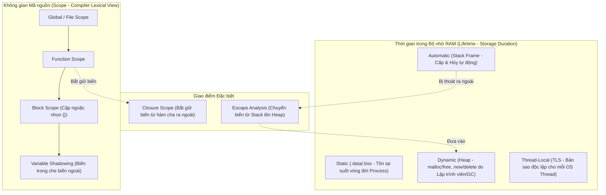
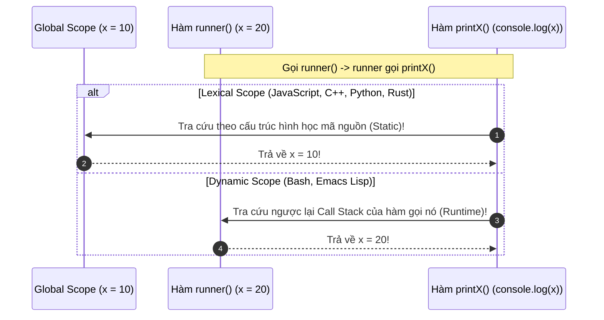
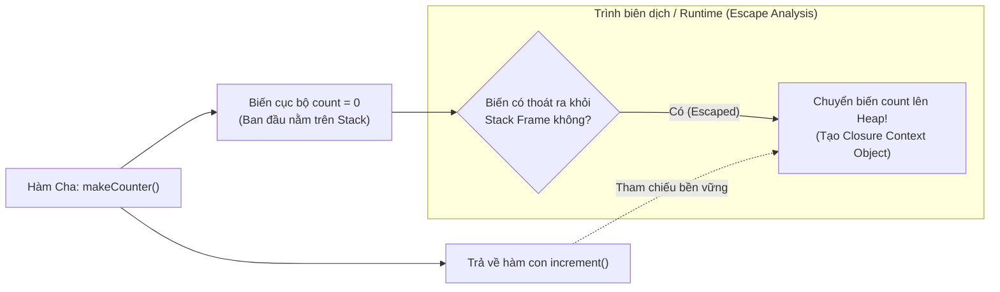

# 2.5. Scope và Lifetime (Phạm vi và Vòng đời của Biến)

> [!IMPORTANT]
> **Mental Model & Trực giác cốt lõi**:
> Hãy tưởng tượng sự khác biệt giữa một **Căn phòng khách sạn (Scope - Thuộc tính Không gian)** và **Thời hạn thuê phòng (Lifetime - Thuộc tính Thời gian)**:
> - **Scope (Không gian văn bản mã nguồn)** là nơi bạn có thể "nhìn thấy" đồ vật. Ví dụ: Chìa khóa phòng của bạn chỉ mở được cửa phòng 302 (Block Scope). Người ở phòng 301 không thể với tay lấy đồ trong phòng 302 dù hai phòng nằm sát vách nhau.
> - **Lifetime (Vòng đời vật lý trong RAM)** là khoảng thời gian đồ đạc thực sự tồn tại trong căn phòng trước khi bị nhân viên dọn phòng ném vào thùng rác.
> - **Nghịch lý kinh điển**: Một biến có thể **vẫn còn sống (In-Lifetime) nhưng đang nằm ngoài tầm mắt (Out-of-Scope)**! Khi hàm `A` gọi hàm `B`, các biến cục bộ của `A` vẫn đang nằm nguyên vẹn trên Call Stack (chưa hề bị giải phóng), nhưng mã nguồn của hàm `B` hoàn toàn không thể chạm tới chúng. Ngược lại, nếu hàm `B` trả về một con trỏ trỏ tới biến cục bộ của chính nó, biến đó lập tức bị hủy khi hàm `B` kết thúc (`}`), biến con trỏ thành **Dangling Pointer** trỏ vào một vùng bộ nhớ đã chết!
> **Nếu chỉ nhớ một điều**: *Scope là ranh giới thị giác của Trình biên dịch lúc biên dịch (Compile-time Viewability); Lifetime là sự tồn tại thực tế của các byte dữ liệu trong chip RAM lúc chạy (Runtime Existence).*

---

## 1. Tổng quan Chuyên đề & Sơ đồ Tư duy (Scope vs Lifetime Architecture)



---

## 2. Chi tiết từng Keyword

### 2.1. Phân loại Scope: Local, Block và Global Scope

Phạm vi truy cập (Scope) xác định vùng mã nguồn mà tại đó một định danh (tên biến, hằng, hàm) được trình biên dịch nhận diện hợp lệ.

#### A. Block Scope (Phạm vi Khối)
- Định nghĩa: Bất kỳ đoạn mã nào nằm bên trong cặp dấu ngoặc nhọn `{ ... }` (thân lệnh `if`, vòng lặp `for`, `while`, hoặc một khối lệnh ẩn danh độc lập `{}`).
- Hành vi: Biến khai báo trong khối chỉ tồn tại và được truy cập từ dòng khai báo cho đến dấu ngoặc nhọn đóng `}` của khối đó.
- Ngôn ngữ áp dụng: C, C++, Rust, Java, Go, và JavaScript hiện đại (`let`, `const`).

#### B. Function Scope / Local Scope (Phạm vi Hàm)
- Định nghĩa: Biến được khai báo bên trong thân một hàm.
- Hành vi: Biến có thể được truy cập ở bất kỳ vị trí nào bên trong hàm đó (kể cả trước dòng khai báo nếu ngôn ngữ có cơ chế hoisting như `var` trong JavaScript cổ điển).
- Cạm bẫy: Biến `var` trong JavaScript không tuân theo Block Scope, dẫn tới các lỗi logic nghiêm trọng khi khai báo bên trong khối `for` hoặc `if`.

#### C. Global Scope (Phạm vi Toàn cục)
- Định nghĩa: Biến nằm ngoài toàn bộ mọi hàm, lớp và cấu trúc (thường nằm ở cấp cao nhất của file mã nguồn).
- Vị trí lưu trữ: Phân vùng `.data` (nếu có giá trị khởi tạo khác 0) hoặc `.bss` (nếu chưa khởi tạo hoặc bằng 0).
- Cạm bẫy Backend: Biến toàn cục phá vỡ tính module, gây khó khăn cho việc viết Unit Test cô lập và là nguồn gốc của lỗi **Data Race** khi nhiều luồng truy cập đồng thời mà không có khóa đồng bộ.

---

### 2.2. Lexical Scope vs Dynamic Scope

Quy tắc tìm kiếm giá trị của một biến tự do (Free Variable) khi biến đó không được khai báo bên trong phạm vi cục bộ:



#### A. Lexical Scope (Static Scope - Phạm vi Từ vựng)
- **Bản chất**: Phạm vi được xác định **tĩnh tại thời điểm viết mã (Compile-time)** dựa trên cấu trúc lồng nhau của các khối văn bản.
- Quy tắc: Hàm được định nghĩa ở đâu thì nó sẽ tìm kiếm biến tự do tại phạm vi cha bao quanh nơi nó sinh ra, **hoàn toàn không phụ thuộc vào việc hàm đó được gọi từ đâu**!
- Đại đa số các ngôn ngữ lập trình hiện đại (C/C++, Java, Go, Rust, Python, TypeScript) đều sử dụng Lexical Scope.

#### B. Dynamic Scope (Phạm vi Động)
- **Bản chất**: Phạm vi được xác định **động tại thời điểm chạy (Runtime)** dựa trên chuỗi lời gọi hàm trên **Call Stack**.
- Quy tắc: Khi cần tìm biến `x`, runtime sẽ đi ngược từ Stack Frame hiện tại về các Stack Frame của hàm cha đã gọi nó cho đến khi tìm thấy biến có tên tương ứng.
- Ví dụ kinh điển: Shell script (Bash):
  ```bash
  x=10
  print_x() { echo $x; }
  runner() { local x=20; print_x; }
  runner # In ra: 20 (Dynamic Scope do print_x thấy x của hàm gọi nó!)
  ```

---

### 2.3. Variable Shadowing (Hiện tượng Che khuất Biến)

Hiện tượng xảy ra khi một biến được khai báo ở phạm vi hẹp hơn (Inner Scope) có **cùng tên định danh** với một biến ở phạm vi rộng hơn (Outer Scope).

```cpp
#include <iostream>

int counter = 100; // Global Scope

int main() {
    int counter = 50; // Shadow biến toàn cục 'counter'
    {
        int counter = 10; // Shadow biến của hàm main
        std::cout << "Inner block:   " << counter << "\n";      // In ra: 10
        std::cout << "Global via '::': " << ::counter << "\n";    // In ra: 100 (Scope resolution operator)
    }
    std::cout << "Main block:    " << counter << "\n";          // In ra: 50
    return 0;
}
```

- **Hậu quả & Cạm bẫy**:
  - Shadowing dễ gây nhầm lẫn nghiêm trọng: Lập trình viên tưởng rằng mình đang sửa đổi biến ở phạm vi ngoài nhưng thực chất chỉ đang thao tác trên biến bóng ma (shadowed variable) ở khối trong.
  - Khi khối trong kết thúc, biến ngoài vẫn giữ nguyên giá trị cũ, dẫn đến các lỗi logic âm thầm rất khó dò tìm bằng mắt thường.
  - Các công cụ Linter và Trình biên dịch hiện đại cung cấp cờ cảnh báo (ví dụ `-Wshadow` trong GCC/Clang) để ngăn chặn hành vi này trong mã nguồn sản xuất.

---

### 2.4. Storage Duration và Variable Lifetime (Các Dạng Vòng Đời Bộ Nhớ)

Trong các ngôn ngữ hệ thống cấp thấp như C/C++, chuẩn ISO C++ phân định vòng đời của đối tượng thành 4 hình thái thời lượng lưu trữ:

| Hình thái Lưu trữ | Phân vùng Bộ nhớ | Cơ chế Cấp phát & Thu hồi | Vòng đời Thực tế (Lifetime) |
| :--- | :--- | :--- | :--- |
| **Automatic** | **Stack** | CPU tự động dịch chuyển con trỏ ngăn xếp `rsp` khi vào/ra block `{}` | Từ lúc đi vào khối khai báo đến khi thoát dấu `}` |
| **Static** | **.data / .bss** | OS nạp sẵn vào RAM khi nạp file thực thi ELF/PE | Tồn tại liên tục từ lúc khởi động tiến trình đến khi tắt máy |
| **Dynamic** | **Heap** | Cấp phát thủ công (`malloc`, `new`) hoặc tự động qua Garbage Collector | Do lập trình viên quyết định, tồn tại đến khi gọi `free`/`delete` |
| **Thread-Local** | **TLS (FS/GS Register)** | Cấp phát riêng cho từng luồng hệ điều hành (`thread_local`) | Tồn tại suốt vòng đời của luồng tạo ra nó |

#### Chi tiết Kỹ thuật:
1. **Automatic Storage**: Cực kỳ nhanh (chỉ tốn 1 lệnh trừ thanh ghi `sub rsp, 32`). Khi hàm thoát ra, hàm hủy (Destructor) của đối tượng được gọi tự động theo nguyên tắc LIFO (vào sau ra trước).
2. **Static Storage**: Biến `static` cục bộ bên trong một hàm chỉ được khởi tạo **duy nhất một lần** trong lần gọi hàm đầu tiên. Trình biên dịch chèn một biến bảo vệ ẩn (`guard variable`) để đảm bảo an toàn đa luồng (Thread-safe initialization từ chuẩn C++11).
3. **Dynamic Storage**: Nằm trên Heap, không có tên định danh trực tiếp mà chỉ có thể truy cập qua địa chỉ con trỏ. Nếu mất con trỏ mà chưa gọi giải phóng $\implies$ Rò rỉ bộ nhớ (**Memory Leak**).
4. **Thread-Local Storage**: Cho phép mỗi luồng sở hữu một phiên bản dữ liệu độc lập, loại bỏ hoàn toàn hiện tượng tranh chấp (Race Condition) và nhu cầu sử dụng Mutex tốn kém.

---

### 2.5. Closure Scope & Escape Analysis (Phạm vi Bao đóng)

Khi một hàm con (Nested Function / Lambda) "bắt giữ" (capture) các biến cục bộ của hàm cha, và hàm con đó được trả về để thực thi sau khi hàm cha đã kết thúc:



- **Xung đột Vòng đời (Lifetime Conflict)**: Theo quy tắc Automatic Storage thông thường, khi hàm cha kết thúc, Stack Frame của nó bị thu hồi và biến cục bộ bị hủy. Nhưng hàm con được trả về vẫn cần truy cập biến đó trong tương lai!
- **Giải pháp của Runtime (Escape Analysis)**:
  - Trình biên dịch (V8 trong Node.js, Go Compiler, Java HotSpot) chạy thuật toán **Phân tích Thoát (Escape Analysis)**.
  - Nếu phát hiện biến cục bộ bị bắt giữ và "thoát" ra khỏi phạm vi hàm cha, trình biên dịch sẽ **thăng hạng (promote) biến đó từ ngăn xếp Stack lên bộ nhớ Heap** bên trong một cấu trúc gọi là Closure Environment Record.
  - Biến này sẽ tồn tại chừng nào hàm con Closure vẫn còn sống và còn tham chiếu tới nó.

---

## 3. Hiện thực Thực nghiệm: Dual-Engine Code Implementation

### 3.1. C++20: Khám Nghiệm Vòng Đời Từng Byte (Scope, Static, Thread-Local & Dangling Pointer)

Chương trình triển khai một lớp giám sát vòng đời bộ nhớ, in ra vết khởi tạo (Constructor) và giải phóng (Destructor) chính xác đến từng microsecond, đồng thời minh họa hiện tượng Static Guard và Thread-Local Storage.

```cpp
// Compilation: g++ -std=c++20 -O3 -Wall -pthread scope_lifetime_tracer.cpp -o scope_lifetime_tracer
#include <iostream>
#include <string>
#include <thread>
#include <chrono>

class LifetimeTracer {
private:
    std::string name;
public:
    explicit LifetimeTracer(std::string n) : name(std::move(n)) {
        std::cout << "  [CONSTRUCT] Object '" << name << "' created at address " << this << "\n";
    }
    ~LifetimeTracer() {
        std::cout << "  [DESTRUCT]  Object '" << name << "' destroyed at address " << this << "\n";
    }
    void poke() const {
        std::cout << "  [ACCESS]    Object '" << name << "' is alive and working\n";
    }
};

void demonstrate_automatic_scope() {
    std::cout << "--- 1. Testing Automatic Block Scope ---\n";
    LifetimeTracer outer("Outer_Stack");
    {
        std::cout << "Entering inner block...\n";
        LifetimeTracer inner("Inner_Block_Stack");
        inner.poke();
        std::cout << "Exiting inner block...\n";
    } // inner bị hủy ngay tại đây
    outer.poke();
    std::cout << "Exiting demonstrate_automatic_scope()...\n";
} // outer bị hủy tại đây

void demonstrate_static_duration() {
    std::cout << "\n--- 2. Testing Static Storage Duration ---\n";
    auto call_func = []() {
        // Chỉ khởi tạo duy nhất 1 lần đầu tiên!
        static LifetimeTracer static_obj("Local_Static_Singleton");
        static_obj.poke();
    };

    std::cout << "Calling lambda 1st time:\n";
    call_func();
    std::cout << "Calling lambda 2nd time:\n";
    call_func();
}

thread_local LifetimeTracer tls_worker("Thread_Local_Worker");

void demonstrate_tls() {
    std::cout << "\n--- 3. Testing Thread-Local Storage (TLS) ---\n";
    auto thread_job = [](int id) {
        std::cout << "Thread " << id << " started:\n";
        tls_worker.poke();
        std::cout << "Thread " << id << " exiting:\n";
    };

    std::thread t1(thread_job, 1);
    std::thread t2(thread_job, 2);
    t1.join();
    t2.join();
}

int main() {
    std::cout << "================ SCOPE & LIFETIME DIAGNOSTICS ================\n";
    demonstrate_automatic_scope();
    demonstrate_static_duration();
    demonstrate_tls();
    std::cout << "\nEnding main() - Static objects will be destroyed now:\n";
    return 0;
}
```

```text
================ SCOPE & LIFETIME DIAGNOSTICS ================
--- 1. Testing Automatic Block Scope ---
  [CONSTRUCT] Object 'Outer_Stack' created at address 0x7ffee351a890
Entering inner block...
  [CONSTRUCT] Object 'Inner_Block_Stack' created at address 0x7ffee351a870
  [ACCESS]    Object 'Inner_Block_Stack' is alive and working
Exiting inner block...
  [DESTRUCT]  Object 'Inner_Block_Stack' destroyed at address 0x7ffee351a870
  [ACCESS]    Object 'Outer_Stack' is alive and working
Exiting demonstrate_automatic_scope()...
  [DESTRUCT]  Object 'Outer_Stack' destroyed at address 0x7ffee351a890

--- 2. Testing Static Storage Duration ---
Calling lambda 1st time:
  [CONSTRUCT] Object 'Local_Static_Singleton' created at address 0x100008060
  [ACCESS]    Object 'Local_Static_Singleton' is alive and working
Calling lambda 2nd time:
  [ACCESS]    Object 'Local_Static_Singleton' is alive and working

--- 3. Testing Thread-Local Storage (TLS) ---
Thread 1 started:
  [CONSTRUCT] Object 'Thread_Local_Worker' created at address 0x700009c9f000
  [ACCESS]    Object 'Thread_Local_Worker' is alive and working
Thread 1 exiting:
  [DESTRUCT]  Object 'Thread_Local_Worker' destroyed at address 0x700009c9f000
Thread 2 started:
  [CONSTRUCT] Object 'Thread_Local_Worker' created at address 0x70000a4a2000
  [ACCESS]    Object 'Thread_Local_Worker' is alive and working
Thread 2 exiting:
  [DESTRUCT]  Object 'Thread_Local_Worker' destroyed at address 0x70000a4a2000

Ending main() - Static objects will be destroyed now:
  [DESTRUCT]  Object 'Local_Static_Singleton' destroyed at address 0x100008060
```

---

### 3.2. Python 3: Khám Nghiệm Lexical Scope, Closure & Cạm Bẫy Vòng Lặp (Late-Binding Trap)

Minh họa cơ chế lưu giữ `__closure__` và cạm bẫy muộn (Late Binding Trap) kinh điển trong Python và JavaScript.

```python
#!/usr/bin/env python3
"""
Khám nghiệm Cơ chế Scope & Closure trong Python:
- Tra cứu LEGB (Local -> Enclosing -> Global -> Built-in).
- Kiểm tra cell object trong __closure__.
- Phân tích cạm bẫy Late-Binding trong vòng lặp và cách khắc phục.
"""

def make_counter(start: int = 0):
    count = start  # Biến cục bộ của hàm cha

    def increment():
        nonlocal count
        count += 1
        return count

    return increment

def late_binding_pitfall():
    print("\n--- CẠM BẪY LATE-BINDING TRONG VÒNG LẶP ---")
    # Tạo danh sách các hàm lambda bắt giữ biến i
    broken_lambdas = [lambda: i for i in range(3)]
    
    print("Kết quả khi gọi broken_lambdas (sai lầm do late binding):")
    # Biến i là một biến duy nhất trong scope cha, khi vòng lặp kết thúc i = 2
    for fn in broken_lambdas:
        print(f"  Result: {fn()}")  # In ra 2, 2, 2!

    print("\nKhắc phục bằng Default Argument (Early Binding tại thời điểm tạo):")
    fixed_lambdas = [lambda val=i: val for i in range(3)]
    for fn in fixed_lambdas:
        print(f"  Result: {fn()}")  # In ra 0, 1, 2!

def inspect_closure_internals():
    print("--- KHÁM NGHIỆM THỰC TẾ Ô NHỚ CỦA CLOSURE ---")
    counter_a = make_counter(10)
    print(f"Counter A call 1: {counter_a()}")
    print(f"Counter A call 2: {counter_a()}")

    # Soi vào thuộc tính nội bộ __closure__ của hàm Python
    closure_cells = counter_a.__closure__
    print(f"Số lượng cell object trong closure: {len(closure_cells)}")
    cell = closure_cells[0]
    print(f"Cell object: {cell}")
    print(f"Giá trị hiện tại lưu trong Cell: {cell.cell_contents} (Địa chỉ: {hex(id(cell))})")

if __name__ == "__main__":
    inspect_closure_internals()
    late_binding_pitfall()
```

```text
--- KHÁM NGHIỆM THỰC TẾ Ô NHỚ CỦA CLOSURE ---
Counter A call 1: 11
Counter A call 2: 12
Số lượng cell object trong closure: 1
Cell object: <cell at 0x1023a1a30: int object at 0x10214a1f0>
Giá trị hiện tại lưu trong Cell: 12 (Địa chỉ: 0x1023a1a30)

--- CẠM BẪY LATE-BINDING TRONG VÒNG LẶP ---
Kết quả khi gọi broken_lambdas (sai lầm do late binding):
  Result: 2
  Result: 2
  Result: 2

Khắc phục bằng Default Argument (Early Binding tại thời điểm tạo):
  Result: 0
  Result: 1
  Result: 2
```

---

## 4. Vận hành Hệ thống & Chẩn đoán Sự cố (Production Diagnostics & Memory Safety)

### 4.1. Hiểm họa Con trỏ Treo (Dangling Pointer) và Địa chỉ Ngăn xếp Hỏng
Khi một hàm trả về con trỏ hoặc tham chiếu tới một biến có thời lượng Automatic Storage (Stack):

```cpp
// ❌ Cực kỳ nguy hiểm: Trả về tham chiếu tới biến cục bộ
int& get_invalid_reference() {
    int local_num = 42;
    return local_num; // Warning: reference to local variable returned!
}
```

Ngay khi hàm thoát ra, thanh ghi `rsp` di chuyển lên trên. Dữ liệu `local_num` vẫn còn tạm thời nằm trên RAM cho đến khi một hàm khác được gọi và ghi đè (clobber) lên Stack Frame cũ. Việc đọc con trỏ này sẽ dẫn tới **Undefined Behavior**, dữ liệu rác, hoặc lỗi sập tiến trình `SIGSEGV` (Segmentation Fault).

### 4.2. Sử dụng AddressSanitizer (ASan) để Phát hiện Lỗi Scope & Lifetime

```bash
# Biên dịch C++ với cờ kiểm tra bộ nhớ AddressSanitizer
g++ -std=c++20 -fsanitize=address -g scope_bug.cpp -o scope_bug

# Khi chạy, nếu có lỗi truy cập biến hết hạn Scope (stack-use-after-scope):
# ASan sẽ lập tức dừng chương trình và in chi tiết:
# =================================================================
# ==12842==ERROR: AddressSanitizer: stack-use-after-scope on address 0x7fff5...
# READ of size 4 at 0x7fff5... thread T0
#    #0 0x100001f34 in main scope_bug.cpp:24
# Address 0x7fff5... is located in stack of thread T0 at offset 32
# =================================================================
```

---

## 5. Bảng So sánh & Decision Matrix

| Thuộc tính / Khái niệm | Local / Block Scope | Static Storage Duration | Dynamic Heap Storage | Thread-Local Storage (TLS) |
| :--- | :--- | :--- | :--- | :--- |
| **Vị trí Cấp phát** | Ngăn xếp (**Stack**) | Phân vùng **.data / .bss** | Vùng nhớ đống (**Heap**) | Phân vùng **TLS Area** |
| **Chi phí Cấp phát** | Siêu nhanh ($O(1)$, 1 chu kỳ CPU) | $0\text{ ms}$ (Nạp lúc khởi động) | Đắt đỏ ($O(1) - O(N)$, cần khóa/arena) | Nhanh ($O(1)$ qua thanh ghi FS) |
| **Quy tắc Giải phóng** | Tự động khi thoát ngoặc `}` | Chỉ khi tắt toàn bộ tiến trình | Do code giải phóng thủ công / GC | Tự động khi Thread kết thúc |
| **Phạm vi Nhìn thấy** | Chỉ bên trong khối lệnh khai báo | Tùy khai báo (File / Class / Hàm) | Bất kỳ đâu nếu sở hữu con trỏ | Cục bộ đối với từng luồng riêng |
| **Khả năng Gây Data Race**| Không thể (chỉ thuộc về 1 luồng) | **Rất cao** (Cần Mutex/Atomic) | **Rất cao** nếu chia sẻ con trỏ | **Không thể** (Độc lập 100% giữa các luồng) |
| **Cạm bẫy Thường gặp** | Trả về con trỏ cục bộ (Dangling) | Khó Unit Test, tiêu tốn RAM vĩnh viễn | Rò rỉ bộ nhớ (Memory Leak), Double Free | Quá nhiều thread làm cạn kiệt RAM |
