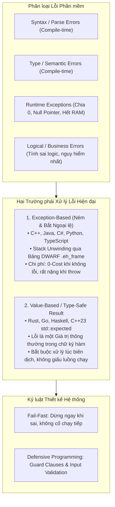
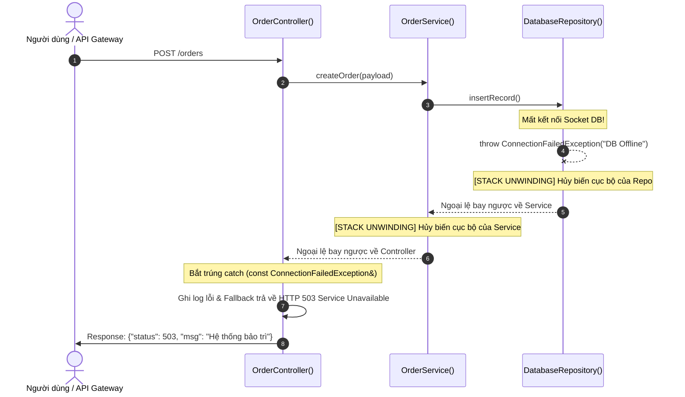
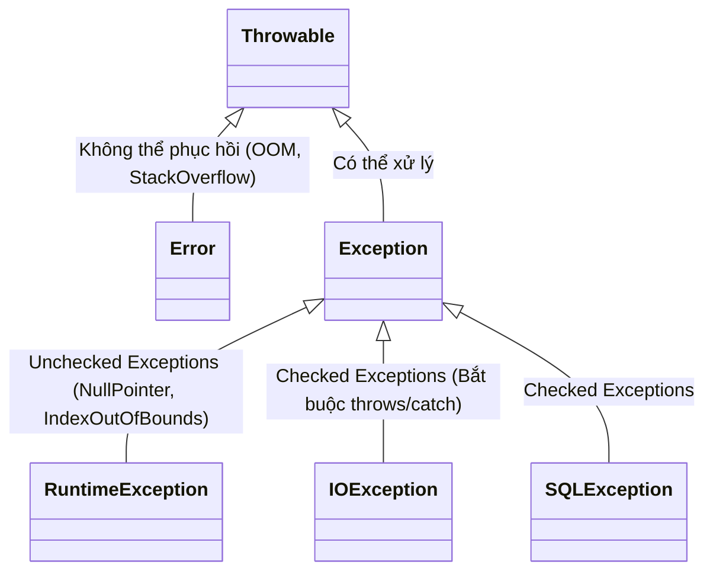
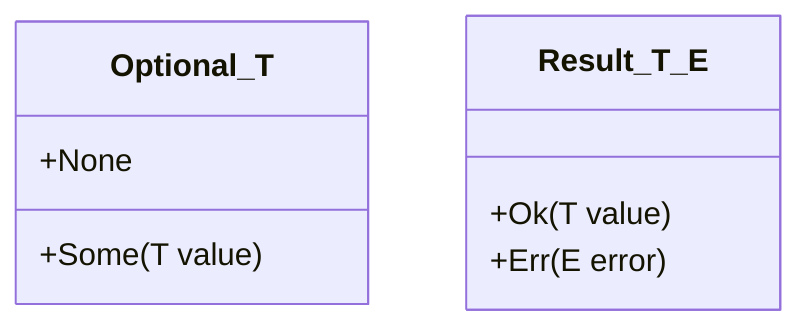

# 2.6. Error Handling (Xử lý Lỗi và Ngoại lệ)

> [!IMPORTANT]
> **Mental Model & Trực giác cốt lõi**:
> Hãy tưởng tượng một đoàn tàu chở khách đang chạy trên đường ray:
> - **Chương trình không xử lý lỗi** giống như đoàn tàu gặp hòn đá tảng trên ray nhưng lái tàu nhắm mắt tiếp tục tăng ga: kết quả là cả đoàn tàu bị lật nhào, gây tai nạn thảm khốc và hủy hoại toàn bộ hàng hóa (**Fatal Crash / Data Corruption**).
> - **Cơ chế Exception (`try / throw / catch`)** giống như hệ thống phanh khẩn cấp trên từng toa tàu: khi một toa gặp sự cố cháy trục bánh xe, một tín hiệu cảnh báo màu đỏ được giật tung (**`throw`**), còi báo động réo vang, các khoang tự động ngắt điện cách ly (**Stack Unwinding & RAII Clean up**) và cảnh báo truyền ngược về buồng lái của trưởng tàu để xử lý (**`catch`**). Nếu không có ai trong buồng lái nhận cuộc gọi khẩn cấp này, toàn bộ đoàn tàu sẽ bị hệ thống ngắt an toàn cưỡng bức dừng lại (**`std::terminate()`**).
> - **Cơ chế Type-Safe Result (`Result<T, E>` / `std::expected`)** giống như việc mỗi kiện hàng gửi đi đều có 2 ngăn tem: Ngăn xanh chứa "Hàng hóa thành công" (**`Ok`**), ngăn đỏ chứa "Lý do không giao được hàng" (**`Err`**). Người nhận buộc phải nhìn thấy tem đỏ/xanh trước khi mở gói hàng, không bao giờ bị bất ngờ bởi tai nạn ngoài ý muốn.
> **Nếu chỉ nhớ một điều**: *Xử lý lỗi xuất sắc không phải là ngăn chặn mọi lỗi lầm xảy ra (điều bất khả thi trong thế giới thực đầy nhiễu), mà là kiểm soát lỗi một cách duyên dáng (Graceful Degradation), phát hiện lỗi sớm nhất có thể (Fail-Fast), và không bao giờ để trạng thái hỏng lan truyền làm bẩn cơ sở dữ liệu.*

---

## 1. Tổng quan Chuyên đề & Sơ đồ Kiến trúc (Exception vs Result Architecture)



---

## 2. Chi tiết từng Keyword

### 2.1. Phân loại các Loại Lỗi trong Vòng đời Phần mềm (Syntax, Compile-time, Runtime, Logical)

Trong vòng đời phát triển phần mềm, lỗi được phân chia dựa trên thời điểm phát hiện và mức độ tác động:

| Loại Lỗi | Thời điểm Phát hiện | Cơ chế Bắt | Mức độ Nguy hiểm | Ví dụ Thực tế |
| :--- | :--- | :--- | :--- | :--- |
| **Syntax Error** | Lúc biên dịch (Compile-time) | Trình phân tích cú pháp (Parser) của Compiler | Thấp nhất (Chặn không cho tạo file chạy) | Quên dấu chấm phẩy, đóng mở ngoặc nhọn `{}` cọc cạch |
| **Compile-time / Type Error** | Lúc biên dịch / Type Check | Trình kiểm tra kiểu tĩnh (Type Checker / AST) | Thấp (Phát hiện ngay tại IDE) | Truyền biến chuỗi `string` vào hàm nhận số thực `double` |
| **Runtime Error** | Lúc đang chạy (Runtime) | Bộ vi xử lý (CPU Trap) hoặc OS Signal | Cao (Có thể làm sập tiến trình) | Chia cho 0 (`SIGFPE`), giải tham chiếu con trỏ rỗng (`SIGSEGV`) |
| **Logical Error** | Sau khi chạy (Post-execution) | Unit Test, Integration Test hoặc Người dùng phản hồi | **Cực kỳ nguy hiểm** | Tính sai công thức lãi suất ngân hàng, lệch múi giờ UTC |

- **Ý nghĩa Kỹ thuật**: Lỗi càng được dịch chuyển về phía bên trái (Compile-time) thì chi phí sửa chữa càng tiệm cận bằng 0. Ngược lại, một lỗi logic thoát được ra Production có thể gây thiệt hại hàng triệu USD cho doanh nghiệp.

---

### 2.2. Cơ chế Exceptions (Ngoại lệ), Exception Propagation và Stack Unwinding

#### A. Bản chất của Ngoại lệ (What is an Exception?)
Ngoại lệ là một đối tượng dữ liệu được sinh ra khi một đoạn mã gặp phải một tình huống bất thường vượt quá khả năng tự giải quyết tại chỗ, buộc phải chuyển giao trách nhiệm xử lý lên các tầng cao hơn của ngăn xếp lời gọi hàm (Call Stack).

#### B. Cơ chế Cuộn ngược Ngăn xếp (Stack Unwinding)
Khi lệnh `throw` được thực thi:
1. **Dừng luồng bình thường**: CPU lập tức ngừng thực thi các dòng lệnh tiếp theo của hàm hiện tại.
2. **Tìm kiếm Landing Pad**: Runtime của ngôn ngữ (ví dụ: `libunwind` và `__cxa_throw` theo chuẩn Itanium ABI) duyệt ngược lại bảng siêu dữ liệu ngoại lệ (`.eh_frame` sinh ra bởi compiler) để tìm khối `catch` phù hợp.
3. **Giải phóng Tài nguyên Tự động (Destructor Calling)**: Trong quá trình cuộn ngược qua từng Stack Frame, hệ thống tự động gọi Destructor của toàn bộ các biến cục bộ đang nằm trên Stack theo thứ tự ngược lại (LIFO). Đây là nền tảng của nguyên lý **RAII (Resource Acquisition Is Initialization)** trong C++ và Rust.
4. **Hậu quả khi Không ai Bắt (Unhandled Exception)**: Nếu quá trình cuộn ngược lùi về tận hàm `main()` mà không tìm thấy bất kỳ khối `catch` nào tương thích, hàm `std::terminate()` sẽ được kích hoạt, hệ điều hành ghi nhận Crash và sinh ra file **Core Dump**.



---

### 2.3. Khối lệnh Try / Catch / Finally và Kỹ thuật Throw / Rethrow

#### A. Cấu trúc Khối lệnh Chuẩn mực
- **`try`**: Bao bọc vùng mã nguồn có rủi ro phát sinh ngoại lệ.
- **`catch`**: Bắt giữ ngoại lệ theo kiểu dữ liệu. Nên bắt theo tham chiếu hằng (`catch (const std::exception& e)`) để tránh hiện tượng cắt xén đối tượng (Object Slicing).
- **`finally`** (trong Java, C#, TypeScript, Python): Khối mã **luôn luôn được thực thi**, bất kể `try` thành công hay bị ném ngoại lệ. Thường dùng để đóng file, ngắt kết nối socket. Trong C++, khối `finally` không cần thiết vì Destructor của RAII tự động đảm nhận việc này.

#### B. Kỹ thuật Bắt và Ném tiếp (Rethrowing)
Trong kiến trúc phần mềm phân tầng (Multi-tier Architecture):
- Tầng bên dưới (Data Access Layer) bắt ngoại lệ để ghi log chi tiết mã lỗi kỹ thuật nội bộ (Internal Error Code).
- Sau đó sử dụng lệnh `throw;` (không kèm tham số) để **ném tiếp nguyên vẹn ngoại lệ đó lên tầng trên** (Business Logic / Controller) mà không làm mất đi dấu vết ngăn xếp (Stack Trace) ban đầu.

---

### 2.4. Checked vs Unchecked Exceptions (Triết lý Java & Thiết kế Ngôn ngữ Hiện đại)

Khái niệm phân nhánh kinh điển do ngôn ngữ **Java** tiên phong:



1. **Checked Exceptions**:
   - Trình biên dịch Java bắt buộc lập trình viên phải bao bọc trong `try-catch` hoặc khai báo tường minh từ khóa `throws` trên chữ ký hàm (ví dụ: `IOException`, `SQLException`).
   - *Mục đích ban đầu*: Ép kỹ sư phải chuẩn bị kịch bản ứng phó cho các lỗi ngoại cảnh không tránh khỏi.
   - *Hạn chế thực tế*: Khiến mã nguồn bị ô nhiễm bởi hàng trăm khối `try-catch` rỗng (Swallowing Exceptions) và phá vỡ tính bao bọc khi thay đổi cài đặt bên dưới.
2. **Unchecked Exceptions**:
   - Kế thừa từ `RuntimeException`. Trình biên dịch không ép buộc phải khai báo (ví dụ: `NullPointerException`, `IllegalArgumentException`).
   - Đại diện cho lỗi logic trong code của lập trình viên, cần được sửa bằng cách viết code cẩn thận chứ không phải bằng cách `try-catch`.
3. **Triết lý Thiết kế Ngôn ngữ Hiện đại**: Các ngôn ngữ ra đời sau (C#, Go, Rust, Kotlin, Swift) đều **loại bỏ hoàn toàn Checked Exceptions**.

---

### 2.5. Type-Safe Error Handling: Result Type và Option/Maybe Type

Để khắc phục nhược điểm về hiệu năng và luồng điều khiển khó lường của Exception, các ngôn ngữ hiện đại sử dụng **Đại số Kiểu Dữ liệu (Algebraic Data Types - Sum Types)**: Biến lỗi thành một giá trị kiểu dữ liệu thông thường!



1. **`Option<T>` / `Maybe` (C++17 `std::optional<T>`)**:
   - Đại diện cho một giá trị **có thể tồn tại (`Some`) hoặc không (`None`)**.
   - Thay thế hoàn toàn giá trị `nullptr` nguy hiểm, buộc lập trình viên phải kiểm tra trước khi trích xuất giá trị.
2. **`Result<T, E>` (C++23 `std::expected<T, E>`, Rust `Result`)**:
   - Đại diện cho kết quả của một phép tính: hoặc là thành công chứa dữ liệu `T` (`Ok`), hoặc là thất bại chứa mã lỗi `E` (`Err`).
   - **Ưu điểm vượt trội**:
     - Thể hiện rõ ràng trong chữ ký hàm: Nhìn vào hàm `parse_int(str) -> Result<int, ParseError>`, lập trình viên biết ngay hàm có thể lỗi mà không cần đọc tài liệu.
     - Tốc độ thực thi cực nhanh (không tốn chi phí Stack Unwinding).

---

### 2.6. Fail-Fast Principle và Defensive Programming (Lập trình Phòng thủ)

#### A. Nguyên lý Thất bại Nhanh (Fail-Fast Principle)
Hệ thống được thiết kế để **lập tức báo lỗi, ném ngoại lệ hoặc dừng chương trình ngay tại điểm phát sinh sự cố đầu tiên**, thay vì cố gắng che giấu và tiếp tục chạy trong một trạng thái không xác định (Corrupted State).

> [!CAUTION]
> **Hiểm họa Cố chạy khi Lỗi (Fail-Silent)**:
> Nếu một hàm nạp cấu hình tài khoản thất bại nhưng trả về giá trị mặc định `0` và âm thầm tiếp tục chạy, giao dịch chuyển khoản sau đó có thể trừ tiền của người khác hoặc cấp sai hạn mức tín dụng! Thà sập ngay một yêu cầu (Fail-Fast) còn hơn làm hỏng toàn bộ cơ sở dữ liệu tài chính.

#### B. Lập trình Phòng thủ (Defensive Programming) & Guard Clauses
Thói quen thiết kế mã nguồn luôn giả định rằng:
- Mọi dữ liệu do người dùng hoặc dịch vụ bên ngoài gửi đến đều có thể bị lỗi, rỗng hoặc chứa mã độc.
- Mạng có thể đứt, ổ đĩa có thể đầy, bộ nhớ có thể cạn kiệt.
- **Kỹ thuật Guard Clauses (Mệnh đề Bảo vệ)**: Đặt toàn bộ các kiểm tra điều kiện lỗi lên đầu hàm, nếu không hợp lệ thì thoát ngay lập tức, giữ cho luồng xử lý chính phẳng và không bị lồng ghép (Arrow Code).

---

## 3. Hiện thực Thực nghiệm: Dual-Engine Code Implementation

### 3.1. C++20/C++23: Hiện thực Type-Safe Error Handling với Monadic `Result`

Chương trình minh họa xử lý lỗi kiểu hiện đại sử dụng `std::expected` (chuẩn C++23, mô phỏng qua cấu trúc Result tùy biến cho C++20) kết hợp nguyên lý Fail-Fast và Guard Clauses.

```cpp
// Compilation: g++ -std=c++20 -O3 -Wall error_handling_engine.cpp -o error_handling_engine
#include <iostream>
#include <string>
#include <variant>
#include <string_view>

enum class BankingErrorCode {
    AccountNotFound,
    InsufficientFunds,
    NegativeTransferAmount,
    AccountFrozen
};

std::string error_code_to_string(BankingErrorCode code) {
    switch (code) {
        case BankingErrorCode::AccountNotFound:        return "ERR_ACCOUNT_NOT_FOUND: Account ID does not exist";
        case BankingErrorCode::InsufficientFunds:      return "ERR_INSUFFICIENT_FUNDS: Balance too low for transfer";
        case BankingErrorCode::NegativeTransferAmount: return "ERR_INVALID_AMOUNT: Transfer amount must be positive";
        case BankingErrorCode::AccountFrozen:          return "ERR_ACCOUNT_FROZEN: Account temporarily locked";
    }
    return "UNKNOWN_ERROR";
}

// Cấu trúc Result an toàn kiểu (Type-Safe Sum Type)
template <typename T, typename E>
class Result {
private:
    std::variant<T, E> data;
public:
    Result(T val) : data(std::move(val)) {}
    Result(E err) : data(std::move(err)) {}

    bool is_ok() const { return std::holds_alternative<T>(data); }
    bool is_err() const { return std::holds_alternative<E>(data); }

    const T& value() const { return std::get<T>(data); }
    const E& error() const { return std::get<E>(data); }
};

struct Account {
    int id;
    double balance;
    bool is_active;
};

// Hàm nghiệp vụ áp dụng Fail-Fast & Defensive Guard Clauses
Result<double, BankingErrorCode> withdraw(Account& acc, double amount) {
    // 1. Guard Clause: Kiểm tra số tiền chuyển
    if (amount <= 0.0) {
        return BankingErrorCode::NegativeTransferAmount; // Fail-Fast lập tức
    }
    // 2. Guard Clause: Kiểm tra trạng thái tài khoản
    if (!acc.is_active) {
        return BankingErrorCode::AccountFrozen;
    }
    // 3. Guard Clause: Kiểm tra số dư
    if (acc.balance < amount) {
        return BankingErrorCode::InsufficientFunds;
    }

    // Luồng xử lý chính phẳng (Happy Path)
    acc.balance -= amount;
    return acc.balance;
}

int main() {
    std::cout << "================ TYPE-SAFE ERROR HANDLING ENGINE ================\n";
    Account my_acc{1001, 500.0, true};

    // Test 1: Rút tiền thành công
    auto res1 = withdraw(my_acc, 200.0);
    if (res1.is_ok()) {
        std::cout << "[SUCCESS] Withdrawal approved. New Balance: $" << res1.value() << "\n";
    } else {
        std::cerr << "[FAILED]  " << error_code_to_string(res1.error()) << "\n";
    }

    // Test 2: Rút quá số dư (Fail-Fast kích hoạt)
    auto res2 = withdraw(my_acc, 400.0);
    if (res2.is_ok()) {
        std::cout << "[SUCCESS] Withdrawal approved. New Balance: $" << res2.value() << "\n";
    } else {
        std::cerr << "[FAILED]  " << error_code_to_string(res2.error()) << "\n";
    }

    // Test 3: Rút số tiền âm (Defensive Validation kích hoạt)
    auto res3 = withdraw(my_acc, -50.0);
    if (res3.is_ok()) {
        std::cout << "[SUCCESS] Withdrawal approved. New Balance: $" << res3.value() << "\n";
    } else {
        std::cerr << "[FAILED]  " << error_code_to_string(res3.error()) << "\n";
    }

    std::cout << "=================================================================\n";
    return 0;
}
```

```text
================ TYPE-SAFE ERROR HANDLING ENGINE ================
[SUCCESS] Withdrawal approved. New Balance: $300
[FAILED]  ERR_INSUFFICIENT_FUNDS: Balance too low for transfer
[FAILED]  ERR_INVALID_AMOUNT: Transfer amount must be positive
=================================================================
```

---

### 3.2. Python 3: Kiến Trúc Phân Tầng Xử Lý Ngoại Lệ & API Sanitization Filter

Minh họa cơ chế bắt ngoại lệ, đóng gói lại (Exception Chaining) và lọc bỏ thông tin nhạy cảm trước khi trả kết quả về cho client.

```python
#!/usr/bin/env python3
"""
Kiến trúc Xử lý Lỗi Phân tầng & Bộ Lọc An toàn (Sanitized Error Filter):
- Định nghĩa Hệ thống Ngoại lệ Nghiệp vụ Riêng biệt (Custom Exceptions).
- Chuỗi ngoại lệ (Exception Chaining with 'from e').
- Bộ lọc ngăn chặn rò rỉ mã lỗi cơ sở dữ liệu ra bên ngoài.
"""

import traceback
from typing import Dict, Any

class DomainError(Exception):
    """Lớp cha cho toàn bộ lỗi nghiệp vụ nội bộ."""
    def __init__(self, message: str, http_status: int = 400):
        super().__init__(message)
        self.message = message
        self.http_status = http_status

class OrderNotFoundError(DomainError):
    def __init__(self, order_id: str):
        super().__init__(f"Order with ID '{order_id}' was not found.", http_status=404)

class PaymentGatewayTimeoutError(DomainError):
    def __init__(self):
        super().__init__("Upstream Payment Gateway timed out.", http_status=504)

def database_query(query: str):
    # Giả lập lỗi tầng hạ tầng kết nối cơ sở dữ liệu
    raise ConnectionResetError("TCP Connection reset by peer at 10.0.4.15:5432")

def get_order_service(order_id: str):
    try:
        database_query(f"SELECT * FROM orders WHERE id = '{order_id}'")
    except ConnectionResetError as raw_err:
        # Kỹ thuật Exception Chaining: Bọc lỗi hạ tầng thành lỗi nghiệp vụ
        raise PaymentGatewayTimeoutError() from raw_err

def api_gateway_middleware(order_id: str) -> Dict[str, Any]:
    """Tầng biên giới API: Bắt mọi ngoại lệ và làm sạch dữ liệu (Sanitize)."""
    try:
        get_order_service(order_id)
        return {"status": 200, "data": "Order Details"}
    except DomainError as domain_err:
        # Lỗi nghiệp vụ có kiểm soát: Trả mã HTTP phù hợp và thông điệp sạch
        return {
            "status": domain_err.http_status,
            "error_type": domain_err.__class__.__name__,
            "message": domain_err.message
        }
    except Exception as unhandled_err:
        # ❌ Lỗi không lường trước: Tuyệt đối KHÔNG trả raw stack trace cho người dùng!
        # Ghi log nội bộ cho kỹ sư:
        print(f"[INTERNAL ALARM] Unhandled Crash: {unhandled_err}")
        return {
            "status": 500,
            "error_type": "InternalServerError",
            "message": "An unexpected error occurred. Please contact customer support."
        }

if __name__ == "__main__":
    print("================ API ERROR SANITIZATION SIMULATOR ================")
    response = api_gateway_middleware("ORD-99812")
    print("Public Client Response:")
    for k, v in response.items():
        print(f"  {k}: {v}")
    print("==================================================================")
```

```text
================ API ERROR SANITIZATION SIMULATOR ================
Public Client Response:
  status: 504
  error_type: PaymentGatewayTimeoutError
  message: Upstream Payment Gateway timed out.
==================================================================
```

---

## 4. Vận hành Hệ thống & Chẩn đoán Sự cố (Production Diagnostics & Exception Cost)

### 4.1. Chi phí Ẩn của Cơ chế "Zero-Cost Exception"
- Các trình biên dịch C++ hiện đại (GCC, Clang) áp dụng cơ chế **Zero-Cost Exception Handling**:
  - Khi code chạy trên nhánh bình thường không có lỗi (**Happy Path**): Chi phí thực sự là bằng $0$ (không có chi phí overhead kiểm tra cờ như `if (err)`).
  - **Nhưng khi lệnh `throw` xảy ra**: Chi phí hiệu năng tăng vọt gấp **hàng nghìn lần** ($\sim 1,000 - 5,000\text{ ns}$ cho một lần throw) do CPU phải dừng lại, khóa Mutex toàn cục trong runtime, đọc bảng nhị phân `.eh_frame` từ bộ nhớ để tìm Landing Pad và cuộn ngược ngăn xếp!
- **Quy tắc Kỹ thuật Vàng**: *Chỉ sử dụng Exception cho các sự kiện thực sự bất thường (Out of disk, Network drop). Tuyệt đối không dùng Exception để điều khiển luồng nghiệp vụ thông thường (Control Flow)!*

### 4.2. Chẩn đoán Crash Dữ liệu qua `coredumpctl` và `gdb`

```bash
# Liệt kê các tiến trình gặp sự cố Crash gần nhất trên Linux server
coredumpctl list

# Mở ngay file Core Dump của tiến trình gặp sự cố để khám nghiệm tử thi (Post-Mortem)
coredumpctl debug <PID>

# Lệnh GDB in toàn bộ vết ngăn xếp tại thời điểm ngoại lệ chưa được bắt (Unhandled Exception):
(gdb) bt
# #0  __GI_raise (sig=sig@entry=6) at ../sysdeps/unix/sysv/linux/raise.c:50
# #1  0x00007ffff7a22859 in __GI_abort () at abort.c:79
# #2  0x00007ffff7d92911 in __gnu_cxx::__verbose_terminate_handler ()
# #3  0x00007ffff7d9038c in __cxxabiv1::__terminate (handler=<optimized out>)
```

---

## 5. Bảng So sánh & Decision Matrix

| Tiêu chuẩn / Tiêu chí | C-Style Error Codes (`int err`) | Exception-based (`try/catch`) | Type-Safe Result (`Result<T, E>`) |
| :--- | :--- | :--- | :--- |
| **Tính Rõ ràng trong API** | Kém (Trả về số nguyên -1, errno) | Ẩn (Không biết hàm có throw không nếu không đọc doc) | **Rõ ràng 100% trên chữ ký kiểu** |
| **Nguy cơ Bị Bỏ quên Lỗi** | **Rất cao** (Quên kiểm tra `if (ret < 0)`) | Thấp (Sẽ sập chương trình nếu không bắt) | **Bằng 0** (Trình biên dịch ép phải unwrap) |
| **Chi phí khi Không Lỗi** | Tốn một lệnh so sánh nhánh nhỏ | **Hoàn toàn bằng 0 (Zero-Cost)** | Tốn một lệnh kiểm tra phân nhánh nhỏ |
| **Chi phí khi Phát sinh Lỗi**| Siêu nhanh (chỉ trả về một số nguyên) | **Cực kỳ đắt đỏ** (Stack Unwinding) | Siêu nhanh (chỉ sao chép struct giá trị) |
| **Ảnh hưởng đến Tối ưu hóa** | Dễ dàng inline hàm | Cản trở Compiler Loop Vectorization | Tối ưu hóa rất tốt (Compiler Inlining) |
| **Kịch bản Khuyên dùng** | Thư viện C cấp thấp, Linux Kernel | Lỗi phần cứng, DB sập, Mất kết nối mạng | Nghiệp vụ thường xuyên lỗi (Parse, Validation, Auth) |
