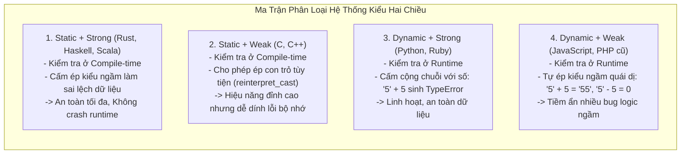

# 3.1. Type System Fundamentals (Nguyên lý Hệ thống Kiểu)

> [!IMPORTANT]
> **Nếu chỉ nhớ một điều...**
> Hệ thống kiểu (Type System) không phải là "gông cùm cú pháp" gây phiền toái, mà là một **Hệ Thống Chứng Minh Toán Học Tự Động (Automated Mathematical Proof System)**. Theo **Đẳng cấu Curry-Howard (Curry-Howard Isomorphism)**, một *Kiểu dữ liệu (Type)* tương đương với một *Mệnh đề Logic (Proposition)*, và một *Chương trình máy tính (Program)* chính là *Bản Chứng Minh Toán Học (Proof)* cho mệnh đề đó. Trình biên dịch kiểu tĩnh không chỉ kiểm tra cú pháp; nó thẩm định bản chứng minh để bảo đảm tiên đề kinh điển của Robin Milner: **"Well-typed programs cannot go wrong"** — loại bỏ hoàn toàn các lỗi tha hóa bộ nhớ và logic trước khi mã nguồn được phép triển khai lên Production!

---

## 1. Tư Duy Kiến Trúc & Mô Hình Trực Quan (Mental Model & Intuition)

### Ẩn Dụ Thực Tế: Hộ Chiếu Xuất Nhập Cảnh & Đầu Cắm Điện Đa Năng

Hãy liên tưởng hệ thống kiểu với các cơ chế kiểm định an toàn trong thế giới thực:
- **Static Typing (Cửa kiểm soát an ninh sân bay)**: Bạn muốn lên máy bay quốc tế, hải quan phải kiểm tra hộ chiếu, visa, quét hành lý qua máy X-quang ngay từ cửa vào (**Compile-time**). Nếu có sai sót, bạn bị chặn lại ngay từ mặt đất, không bao giờ có chuyện máy bay đang bay giữa đại dương mới phát hiện hành khách không có vé!
- **Dynamic Typing (Bảo vệ soát vé tại cửa rạp chiếu phim)**: Khách cứ đi lại tự do trong trung tâm thương mại. Chỉ đến khi thò tay mở cửa bước vào phòng chiếu (**Runtime**), bảo vệ mới chặn lại hỏi vé. Nếu mất vé, bạn bị đuổi ra ngoài ngay lập tức (`TypeError: undefined is not a function`).
- **Nominal vs Structural (Chứng minh thư vs Dấu vân tay)**:
  - *Nominal Typing (C/C++, Java)*: Cảnh sát đòi bạn phải xuất trình đúng chiếc thẻ nhựa ghi chữ "Hộ Chiếu Ngoại Giao" (tên kiểu phải khớp chính xác). Cho dù bạn có trình độ như đại sứ quán nhưng mang thẻ khác tên, bạn vẫn bị từ chối.
  - *Structural Typing (TypeScript, Go)*: Cửa tự động nhận diện sinh trắc học: Hễ cấu trúc cơ thể của bạn có đủ chiều cao, mống mắt, và dấu vân tay hợp lệ (hình dạng thuộc tính khớp), cửa tự động mở mà không cần quan tâm tên của bạn là gì.



---

## 2. Chi tiết từng Keyword

### 2.1. Type, Type Safety, Type Soundness và Type Completeness

- **Bản Chất Của Kiểu Dữ Liệu (What is a Type?)**:
  Về mặt vật lý bán dẫn, bộ nhớ RAM chỉ là một ma trận các tụ điện và bóng bán dẫn lưu trữ dãy byte nhị phân $0$ và $1$ thuần túy. Kiểu dữ liệu chính là **Bộ Siêu Dữ Liệu Ngữ Nghĩa (Semantic Metadata)** gán ý nghĩa thực thi cho dãy bit đó: Một từ nhớ 32-bit mang giá trị hexa `0x3F800000` có thể được diễn giải theo 3 cách hoàn toàn khác nhau:
  1. Số nguyên bù 2: $1{,}065{,}353{,}216$.
  2. Số thực dấu phẩy động IEEE-754: $1.0\text{f}$.
  3. Một địa chỉ con trỏ lệnh ảo (`void*`).
  Về mặt lý thuyết ngôn ngữ (PLT), một kiểu $T$ là một cặp bao gồm tập hợp giá trị hợp lệ $V$ và tập hợp các phép toán $O$ được định nghĩa:
  $$T = \langle V_T, \; O_T \rangle$$

- **Type Safety (An toàn kiểu)**:
  Một ngôn ngữ đạt tính an toàn kiểu khi nó ngăn chặn tuyệt đối bất kỳ thao tác phi lý nào vi phạm định nghĩa của kiểu dữ liệu. Ví dụ: Ngăn chặn việc thực hiện phép chia trên một chuỗi ký tự, hoặc ngăn việc ép một số nguyên ngẫu nhiên thành con trỏ đối tượng nhằm triệt tiêu các lỗi tha hóa bộ nhớ (**Memory Corruption**).

- **Type Soundness (Tính đúng đắn toán học)**:
  Giáo sư Andrew Wright và Matthias Felleisen (1994) đã thiết lập khung chứng minh kinh điển: Một hệ thống kiểu được gọi là **Sound** khi và chỉ khi thỏa mãn đồng thời hai định lý:
  $$\text{Type Soundness} \equiv \text{Tiến trình (Progress)} \land \text{Bảo toàn (Preservation)}$$
  1. *Định lý Tiến trình (Progress Theorem)*:
     Nếu một biểu thức $e$ hợp lệ về kiểu ($\vdash e : T$), thì $e$ hoặc đã là một giá trị cuối cùng ($e \in \text{Value}$), hoặc có thể thực hiện một bước chuyển trạng thái $e \to e'$ mà không bao giờ bị "kẹt" (Crash hoặc Undefined Behavior).
  2. *Định lý Bảo toàn (Preservation / Subject Reduction Theorem)*:
     Nếu $\vdash e : T$ và biểu thức biến đổi qua một bước thực thi $e \to e'$, thì biểu thức mới $e'$ vẫn duy trì đúng kiểu ban đầu: $\vdash e' : T$.
  *Ý nghĩa thực tiễn*: Trong Rust hoặc Haskell, tính Soundness bảo đảm chương trình một khi đã biên dịch thành công thì không bao giờ có thể bị lỗi `TypeError` lúc runtime. Trong khi đó, C++ (với `reinterpret_cast`) và TypeScript (với kiểu `any` và ép kiểu `as`) là các hệ thống **Unsound by Design** — chấp nhận rủi ro để đổi lấy tính thực dụng.

- **Đẳng Cấu Curry-Howard (Curry-Howard Isomorphism)**:
  Cầu nối toán học sâu sắc nhất giữa Khoa học Máy tính và Logic Toán:
  $$\text{Logic Mệnh Đề (Logic)} \iff \text{Hệ Thống Kiểu (Type System)}$$
  - Phép giao logic ($A \land B$) $\iff$ Kiểu tích Product Type (Struct / Tuple `(A, B)`).
  - Phép tuyển logic ($A \lor B$) $\iff$ Kiểu tổng Sum Type (Tagged Union / `Either<A, B>`).
  - Phép kéo theo ($A \implies B$) $\iff$ Kiểu hàm Function Type (`A -> B`).
  - Mệnh đề mâu thuẫn ($\bot$ - False) $\iff$ Kiểu rỗng Empty Type (`void` trong Haskell, `never` trong TypeScript, `!` trong Rust).

- **Thuật Toán Suy Luận Kiểu Hindley-Milner (HM Type Inference)**:
  Cho phép trình biên dịch (như trong Haskell, OCaml, Rust, C++ `auto`) tự động suy diễn kiểu chính xác nhất mà không cần lập trình viên phải khai báo tường minh. Thuật toán **Algorithm W** hoạt động qua hai giai đoạn:
  1. *Sinh Ràng Buộc (Constraint Generation)*: Quét cây cú pháp trừu tượng AST và gán cho mỗi biến một biến kiểu tượng trưng $\alpha, \beta, \gamma$.
  2. *Hợp Nhất (Unification)*: Sử dụng thuật toán Unification của Robinson để giải hệ phương trình ràng buộc kiểu, tìm nghiệm tổng quát nhất (**Principal Type**).

- **Type Completeness (Tính toàn vẹn / Đầy đủ của kiểu)**:
  Nguyên lý do Christopher Strachey đề xuất: Mọi kiểu dữ liệu trong ngôn ngữ đều phải bình đẳng về mặt quyền năng (**First-Class Citizens**): Có thể được gán vào biến, truyền làm tham số cho hàm, trả về từ hàm, và lưu trữ trong các cấu trúc dữ liệu tổng quát mà không bị đối xử phân biệt.

### 2.2. Static Typing vs Dynamic Typing, Strong Typing vs Weak Typing

- **Trục Thời Gian: Static Typing vs Dynamic Typing**:
  - *Static Typing (Kiểu tĩnh - C++, Rust, Java, Go)*: Ràng buộc kiểu được xác định và kiểm tra hoàn toàn tại **thời điểm biên dịch (Compile-time)**. Sau khi biên dịch ra mã máy, toàn bộ thông tin kiểu bị xóa bỏ (**Type Erasure** trong C++ templates/Java generics), không tốn RAM và CPU chu kỳ lúc chạy.
  - *Dynamic Typing (Kiểu động - Python, JavaScript, Ruby)*: Kiểu dữ liệu được gắn chặt với **giá trị trong bộ nhớ** tại thời điểm chạy (**Runtime**).
    - Cấu trúc vật lý của biến động: Mỗi đối tượng trong CPython đều phải mang theo một header `PyObject` gồm $16\text{ bytes}$ (`ob_refcnt` $8\text{ bytes}$ + `ob_type` $8\text{ bytes}$) chỉ để lưu trữ thông tin kiểu và quản lý bộ nhớ.
    - Một số nguyên `int` trong Python tốn tới $28\text{ bytes}$ RAM, so với chỉ $4\text{ bytes}$ của số nguyên nguyên thủy trong C/C++!

- **Cơ Chế Phân Phối Động: VTable vs Go itable vs CPython PyTypeObject**:
  1. *C++ Virtual Table (VTable)*: Mỗi class có hàm ảo sở hữu 1 bảng con trỏ hàm VTable tĩnh trong `.rodata`. Đối tượng chỉ tốn thêm 1 con trỏ `vptr` ($8\text{ bytes}$) trỏ tới bảng này. Lời gọi hàm ảo tốn đúng 1 bước giải tham chiếu con trỏ gián tiếp ($O(1)$).
  2. *Go Interface Table (itable)*: Go biểu diễn Interface bằng Fat Pointer $16\text{ bytes}$ gồm `(itab*, data*)`. Con trỏ `itab` lưu thông tin kiểu cụ thể và bảng con trỏ hàm ánh xạ từ struct sang interface methods. Bảng `itab` được sinh tự động và lưu vào cache lúc runtime.
  3. *CPython PyTypeObject*: Mọi thuộc tính của đối tượng được tra cứu thông qua một bảng băm Dictionary (`tp_dict`). Phép gọi hàm đòi hỏi tra cứu băm chuỗi ký tự, trừ khi được JIT / Inline Caches tối ưu hóa.

- **Trục Kỷ Luật: Strong Typing vs Weak Typing**:
  - *Strong Typing (Kiểu mạnh - Python, Rust)*: Ngôn ngữ tuyệt đối cấm việc tự ý biến đổi kiểu ngầm (**Implicit Type Coercion**). Trong Python, `"5" + 2` lập tức ném ngoại lệ `TypeError`.
  - *Weak Typing (Kiểu yếu - JavaScript, C)*: Ngôn ngữ âm thầm ép kiểu ngầm để cố gắng thực thi lệnh:
    - Trong JavaScript: `"5" + 2` trả về `"52"` (ép số thành chuỗi), nhưng `"5" - 2` lại trả về `3` (ép chuỗi thành số)!
    - Trong C: Cho phép hoán đổi tự do giữa con trỏ dữ liệu `void*` và con trỏ hàm, dễ dẫn đến lỗi thực thi mã độc tại các vùng nhớ bất hợp pháp.

### 2.3. Nominal Typing vs Structural Typing vs Duck Typing

- **1. Nominal Typing (Kiểu dựa trên Danh xưng / Khai báo Tên)**:
  - Phổ biến trong C++, Java, C#. Hai kiểu dữ liệu được coi là tương thích khi và chỉ khi chúng mang **cùng một tên gọi được khai báo tường minh**, hoặc có quan hệ kế thừa trực tiếp (`class Dog extends Animal`).
  ```cpp
  struct Latitude { double val; };
  struct Longitude { double val; };
  // Dù cùng lưu trữ 1 số thực 8-byte double, Latitude và Longitude không thể gán chéo cho nhau!
  ```
  Giúp bảo vệ mã nguồn tuyệt đối khỏi lỗi tráo đổi tọa độ kinh độ - vĩ độ ở cấp độ trình biên dịch.

- **2. Structural Typing (Kiểu dựa trên Cấu trúc / Hình dạng)**:
  - Phổ biến trong TypeScript, Go (Interfaces), OCaml. Hai kiểu dữ liệu được coi là tương đương nếu chúng có **cùng hình dạng cấu trúc thuộc tính và phương thức**, bất kể tên gọi là gì:
  ```typescript
  type Point2D = { x: number; y: number };
  type Vector2D = { x: number; y: number };
  let p: Point2D = { x: 10, y: 20 };
  let v: Vector2D = p; // Hợp lệ 100% vì cấu trúc {x, y} hoàn toàn tương thích!
  ```
  - Trong Go, Interface được biểu diễn dưới dạng Fat Pointer 2-word gồm `(itab*, data*)`. Con trỏ `itab` lưu trữ bảng chuyển dịch phương thức tương thích cấu trúc.

- **3. Duck Typing (Kiểu con vịt)**:
  - Phổ biến trong Python, Ruby, JavaScript. Bắt nguồn từ triết lý của James Whitcomb Riley: *"Nếu nó đi như con vịt và kêu như con vịt, thì nó là con vịt!"*.
  - Bộ máy thực thi không quan tâm tên kiểu hay cấu trúc định sẵn. Lúc runtime, chỉ cần đối tượng có phương thức được gọi (`hasattr(obj, 'quack')`), chương trình sẽ thực thi; nếu không có, phát sinh lỗi `AttributeError`.

---

## 3. Hiện Thực Hóa Mã Nguồn Dual-Engine

### 3.1. C++20: Zero-Cost Strong Types & Concepts Metaprogramming

Chương trình C++20 hiện thực mẫu thiết kế **Strong Types (Phantom Types)** kết hợp với **C++20 Concepts** nhằm thực thi kiểm tra hợp đồng kiểu tại thời điểm biên dịch với chi phí $0\text{ runtime overhead}$:

```cpp
#include <iostream>
#include <string>
#include <concepts>
#include <cstdint>

// 1. Mẫu thiết kế StrongType sử dụng Phantom Tag để ngăn chặn gán nhầm
template <typename T, typename ParameterTag>
class StrongType {
private:
    T value_;
public:
    explicit StrongType(const T& val) : value_(val) {}
    explicit StrongType(T&& val) : value_(std::move(val)) {}
    T& get() { return value_; }
    const T& get() const { return value_; }
};

// Khai báo các Tag danh xưng độc lập (Nominal Identifiers)
struct UserIdTag {};
struct OrderIdTag {};
struct MoneyUsdTag {};

using UserId = StrongType<uint64_t, UserIdTag>;
using OrderId = StrongType<uint64_t, OrderIdTag>;
using MoneyUSD = StrongType<double, MoneyUsdTag>;

// 2. C++20 Concept thực thi kiểm tra Structural Type Interface tại Compile-time
template <typename T>
concept Serializable = requires(T a) {
    { a.serialize() } -> std::same_as<std::string>;
};

struct UserRecord {
    std::string name;
    std::string serialize() const { return "UserRecord(name=" + name + ")"; }
};

struct IncompleteRecord {
    std::string name;
    // Thieu phuong thuc serialize()
};

// Hàm chỉ chấp nhận các kiểu thỏa mãn Concept Serializable
template <Serializable T>
void transmit_over_wire(const T& record) {
    std::cout << "[WIRE TRANSMIT]: " << record.serialize() << " -> Da gui qua Socket!\n";
}

// Hàm chuyển tiền an toàn tuyệt đối về kiểu
void transfer_funds(UserId sender, UserId receiver, MoneyUSD amount) {
    std::cout << "[GIAO DICH]: Chuyen $" << amount.get() 
              << " tu UserID:" << sender.get() 
              << " sang UserID:" << receiver.get() << " -> THANH CONG!\n";
}

int main() {
    UserId alice_id{1001};
    UserId bob_id{2002};
    OrderId order_id{99999};
    MoneyUSD payment{250.75};

    std::cout << "=== KIEM DINH AN TOAN KIEU TĨNH (NOMINAL STRONG TYPES) ===\n";
    // Lời gọi đúng chuẩn
    transfer_funds(alice_id, bob_id, payment);

    // Dòng lệnh sau nếu bỏ comment sẽ bị TRÌNH BIÊN DỊCH CHẶN LẬP TỨC:
    // transfer_funds(order_id, bob_id, payment); 
    // -> Lỗi biên dịch: Cannot convert OrderId to UserId!

    std::cout << "Kich thuoc UserId  : " << sizeof(alice_id) << " bytes (Bang uint64_t)\n";
    std::cout << "Kich thuoc MoneyUSD: " << sizeof(payment) << " bytes (Bang double)\n";

    std::cout << "\n=== KIEM DINH C++20 CONCEPTS (COMPILE-TIME STRUCTURAL CHECK) ===\n";
    UserRecord valid_user{"Alice Smith"};
    transmit_over_wire(valid_user); // Thoa man Serializable concept

    // IncompleteRecord invalid_user{"Bob"};
    // transmit_over_wire(invalid_user); // BI COMPILER CHAN NGAY LAP TUC!

    return 0;
}
```

### 3.2. Python 3.11+: Structural Typing vs Dynamic Duck Typing

Chương trình Python hiện thực và đối chiếu giữa **Structural Typing** (sử dụng `typing.Protocol` kiểm tra tĩnh) và **Dynamic Duck Typing** lúc runtime:

```python
#!/usr/bin/env python3
# -*- coding: utf-8 -*-
"""
Python Structural Typing (Protocol) vs Duck Typing Demo
"""
import sys
from typing import Protocol, runtime_checkable

# 1. Dinh nghia Structural Type bang Protocol (Go/TypeScript style)
@runtime_checkable
class Renderable(Protocol):
    def render(self) -> str:
        ...

# 2. Cac Class khong can ke thua tu Renderable (Structural Compatibility)
class HTMLWidget:
    def render(self) -> str:
        return "<div class='widget'>HTML Widget Content</div>"

class JSONDataPacket:
    def render(self) -> str:
        return '{"status": "ok", "payload": 42}'

class BrokenComponent:
    def execute(self) -> str:
        return "I don't have render method!"

def display_component(component: Renderable):
    """Ham chi chap nhan cac doi tuong co phuong thuc render()"""
    # Kiem tra an toan Structural o Runtime bang Protocol
    if not isinstance(component, Renderable):
        raise TypeError(f"[LOI KIEU]: Doi tuong {type(component).__name__} khong thoa man Protocol Renderable!")
    
    print(f"  [RENDER]: {component.render()}")

if __name__ == "__main__":
    print("=== TEST 1: STRUCTURAL TYPING THOA MAN ===")
    html = HTMLWidget()
    json_packet = JSONDataPacket()

    display_component(html)
    display_component(json_packet)

    print("\n=== TEST 2: VI PHAM STRUCTURAL CONTRACT ===")
    broken = BrokenComponent()
    try:
        display_component(broken)
    except TypeError as e:
        print(f"-> Chan dung thanh cong: {e}")

    print("\n=== TEST 3: SO SANH CHI PHI BO NHO CUA DYNAMIC TYPES (CPython) ===")
    primitive_int = 42
    print(f"  Kich thuoc PyObject int(42): {sys.getsizeof(primitive_int)} bytes (Tieu ton gap 7 lan C++ int 4-byte!)")
```

### 3.3. Realistic Terminal Output

```bash
=== KIEM DINH AN TOAN KIEU TĨNH (NOMINAL STRONG TYPES) ===
[GIAO DICH]: Chuyen $250.75 tu UserID:1001 sang UserID:2002 -> THANH CONG!
Kich thuoc UserId  : 8 bytes (Bang uint64_t)
Kich thuoc MoneyUSD: 8 bytes (Bang double)

=== KIEM DINH C++20 CONCEPTS (COMPILE-TIME STRUCTURAL CHECK) ===
[WIRE TRANSMIT]: UserRecord(name=Alice Smith) -> Da gui qua Socket!

=== TEST 1: STRUCTURAL TYPING THOA MAN ===
  [RENDER]: <div class='widget'>HTML Widget Content</div>
  [RENDER]: {"status": "ok", "payload": 42}

=== TEST 2: VI PHAM STRUCTURAL CONTRACT ===
-> Chan dung thanh cong: [LOI KIEU]: Doi tuong BrokenComponent khong thoa man Protocol Renderable!

=== TEST 3: SO SANH CHI PHI BO NHO CUA DYNAMIC TYPES (CPython) ===
  Kich thuoc PyObject int(42): 28 bytes (Tieu ton gap 7 lan C++ int 4-byte!)
```

---

## 4. Kỹ Thuật Hệ Thống & Cạm Bẫy Thực Tế (Systems Engineering & Pitfalls)

### 4.1. Cạm Bẫy Ảo Tưởng An Toàn Kiểu Trong TypeScript (`any` & `as` Casting)

- **Vấn đề**: Nhiều kỹ sư tin rằng viết TypeScript nghĩa là hệ thống an toàn kiểu $100\%$. Thực tế, TypeScript là một hệ thống **Unsound by Design**:
  ```typescript
  interface User { id: number; email: string; }
  const rawData: any = JSON.parse('{"id": "NOT_A_NUMBER"}');
  const user = rawData as User; // Ép kiểu giả vờ an toàn
  console.log(user.id.toFixed(2)); // CRASH LÚC RUNTIME: user.id.toFixed is not a function!
  ```
- **Monomorphization vs Type Erasure**:
  - *C++ / Rust (Monomorphization)*: Tạo ra mã máy riêng biệt cho từng kiểu cụ thể (`std::vector<int>` khác hoàn toàn `std::vector<double>`). Ưu điểm: Hiệu năng $100\%$ tối đa, CPU cache tối ưu. Nhược điểm: Phình to kích thước file nhị phân (**Code Bloat**).
  - *Java Generics (Type Erasure)*: Mọi generic object đều bị ép về `java.lang.Object` lúc biên dịch. Tiết kiệm kích thước nhị phân nhưng tốn thêm chi phí ép kiểu và cấp phát heap (**Boxing / Unboxing Overhead**).
- **Giải pháp Production**: Không bao giờ tin tưởng dữ liệu từ bên ngoài (HTTP Request, Database, Message Queue) qua việc ép kiểu `as`! Bắt buộc phải sử dụng các thư viện thẩm định Runtime Schema (**Zod / Valibot / Pydantic**) để xác thực dữ liệu tại biên giới hệ thống trước khi gán kiểu.

### 4.2. Diagnostic CLI Commands cho Hệ Thống Kiểu

```bash
# 1. Kiem tra tinh dung dan cua kieu trong du an TypeScript khong sinh ma JS
npx tsc --noEmit --strict

# 2. Kiem tra kieu tinh trong Python bang Mypy o muc do nghiem ngat nhat
mypy --strict --disallow-any-explicit application.py

# 3. Kiem tra thong tin kieu bi xoa bo (Type Erasure) trong ma may C++
nm -C ./bin_strong_types | grep "transfer_funds"

# 4. Kiem tra overhead Type Tag cua Python PyObject bang sys.getsizeof
python3 -c "import sys; print('Kich thuoc 1 so int trong Python:', sys.getsizeof(42), 'bytes')"
```

---

## 5. Bảng So Sánh & Quyết Định Kỹ Thuật (Decision Matrix)

| Hệ Thống Kiểu | Ngôn Ngữ Tiêu Biểu | Thời Điểm Bắt Lỗi | Hiệu Năng Runtime | Khả Năng Tái Cấu Trúc (Refactoring) |
| :--- | :--- | :--- | :--- | :--- |
| **Static + Nominal** | C++, Java, Rust, C# | Compile-Time | Tối đa ($0\text{ ns}$ Type Overhead) | Cực kỳ an toàn và tự động |
| **Static + Structural** | TypeScript, Go | Compile-Time | Cao (Sau khi biên dịch là thô) | Rất linh hoạt, dễ ghép nối thư viện |
| **Dynamic + Strong** | Python, Ruby | Runtime | Trung bình (Tốn Type Tag metadata) | Cần bộ Unit Test bao phủ cao |
| **Dynamic + Weak** | JavaScript, PHP cũ | Runtime | Thấp / Dễ sinh bug chuyển đổi | Rất nguy hiểm khi dự án phình to |
| **Gradual / Hybrid** | Python (Type Hints), TypeScript | Lai ghép | Phụ thuộc runtime engine | Cầu nối di chuyển mã nguồn kế thừa |
