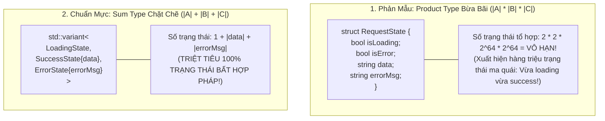

# 3.2. Advanced Types (Hệ Thống Kiểu Nâng Cao)

> [!IMPORTANT]
> **Nếu chỉ nhớ một điều...**
> Khi quy mô phần mềm mở rộng, việc lạm dụng các kiểu nguyên thủy thô sơ (`string`, `int`, `boolean flags`) là mầm mống sinh ra hàng ngàn lỗi logic dị dạng — ví dụ một đối tượng API đồng thời mang cờ `isLoading = false`, `isSuccess = true`, nhưng `data = null` và `errorMessage = "Lỗi mạng"`! **Hệ Thống Kiểu Nâng Cao (Advanced Types & Algebraic Data Types - ADT)** giải quyết triệt để thảm họa này bằng tiên đề vàng của kỹ nghệ kiểu: **"Biến các trạng thái bất hợp pháp thành điều không thể biểu diễn được (Make illegal states unrepresentable)"**. Thông qua toán học đại số kiểu (**Product Types $\times$, Sum Types $+$**), quan hệ biến thiên (**Variance**), và ràng buộc tổng quát (**Bounded Generics**), bạn biến trình biên dịch thành một người lính gác cổng toán học nghiêm ngặt bảo vệ sự toàn vẹn của mô hình miền nghiệp vụ.

---

## 1. Tư Duy Kiến Trúc & Mô Hình Trực Quan (Mental Model & Intuition)

### Ẩn Dụ Thực Tế: Hộp Dụng Cụ Đa Năng & Công Tắc Đổi Hướng

Hãy liên tưởng hệ thống kiểu nâng cao với các cơ cấu kỹ thuật thực tế:
- **Product Type vs Sum Type (Bảng chọn món vs Đèn tín hiệu giao thông)**:
  - *Product Type (Struct / Tuple)*: Giống như một combo suất ăn: Bao gồm Cơm VÀ Thịt VÀ Nước Ngọt ($A \times B \times C$). Toàn bộ các món đều tồn tại đồng thời trong khay ăn.
  - *Sum Type (Tagged Union / Variant)*: Giống như chiếc đèn giao thông 3 màu: Tại một thời điểm, đèn CHỈ CÓ THỂ là Đỏ HOẶC Vàng HOẶC Xanh ($A + B + C$). Không bao giờ có chuyện đèn vừa bật Đỏ vừa bật Xanh cùng một lúc.
- **Bounded Generics (Máy ép khuôn kim loại)**: Máy ép khuôn chấp nhận mọi loại phôi kim loại (Đồng, Nhôm, Sắt), nhưng từ chối thanh gỗ hay cục đất sét. Nó quy định: *"Ngươi có thể là bất kỳ vật liệu nào, miễn là điểm nóng chảy của ngươi $> 1000^\circ\text{C}$"* (`<T extends HeatResistant>`).
- **Variance (Hộp quà và Người vận chuyển)**:
  - *Covariance (Đồng biến)*: Nếu một con Mèo là một loài Động vật, thì một Hộp chứa Mèo có thể coi là một Hộp chứa Động vật (Đọc ra an toàn).
  - *Contravariance (Nghịch biến)*: Bác sĩ thú y chữa được cho mọi Động vật thì chắc chắn chữa được cho con Mèo của bạn (Hàm nhận tham số đi ngược chiều cây kế thừa).



---

## 2. Chi tiết từng Keyword

### 2.1. Phân loại Đại số Kiểu: Product Types vs Sum Types (Algebraic Data Types - ADT)

- **Lý Thuyết Đại Số Kiểu Dữ Liệu (ADT)**:
  Dựa trên lực lượng toán học (**Cardinality $|T|$** - số lượng giá trị hợp lệ mà một kiểu có thể nhận):
  1. **Product Types (Kiểu Tích - Struct, Record, Tuple)**:
     - Biểu thị quan hệ logic **VÀ (Conjunction - $A \land B$)**.
     - Lực lượng: $|A \times B| = |A| \times |B|$.
     - *Ví dụ*: Một struct gồm `bool a` ($2$ giá trị) và `uint8_t b` ($256$ giá trị) có tổng cộng $2 \times 256 = 512$ trạng thái khả dĩ.
  2. **Sum Types / Tagged Unions / Discriminated Unions (Kiểu Tổng)**:
     - Biểu thị quan hệ logic **HOẶC ĐỘC QUYỀN (Disjunction - $A \lor B$)**.
     - Lực lượng: $|A + B| = |A| + |B|$.
     - *Cấu trúc vật lý trong bộ nhớ*: Một Tagged Union (`std::variant` trong C++, `enum` trong Rust) gồm hai thành phần:
       1. *Discriminant Tag*: Một số nguyên 1-byte hoặc 4-byte lưu chỉ mục của kiểu hiện hành.
       2. *Payload Buffer*: Một vùng đệm byte có kích thước bằng kích thước của phần tử lớn nhất: $\max(\text{sizeof}(A), \text{sizeof}(B))$, được căn chỉnh lề (Alignment) nghiêm ngặt.

### 2.2. Union Types vs Intersection Types

- **Union Types ($A \cup B$)**:
  - Giá trị hợp lệ có thể là kiểu $A$ **hoặc** kiểu $B$.
  - Trong TypeScript: `type ID = string | number;`. Một biến kiểu `ID` chỉ có thể gọi các phương thức chung thuộc phần giao của cả hai kiểu (ví dụ: `toString()`), trừ khi được thu hẹp kiểu (**Type Narrowing**) qua `typeof` hoặc `in`.
- **Intersection Types ($A \cap B$)**:
  - Giá trị hợp lệ bắt buộc phải thỏa mãn đồng thời toàn bộ các thuộc tính của kiểu $A$ **và** kiểu $B$:
  ```typescript
  type Timestamped = { createdAt: Date };
  type User = { id: string; name: string };
  type AuditUser = User & Timestamped; // Bắt buộc có cả id, name VÀ createdAt!
  ```
  - Trong đại số kiểu, Intersection Type trên các Record tương đương với phép hợp nhất các tập thuộc tính, cho phép kiến tạo các mẫu Mixin và Composition cực kỳ mạnh mẽ.

### 2.3. Generic Types và Đa hình Kiểu (Parametric vs Subtype Polymorphism)

- **Parametric Polymorphism (Đa hình tham số - Generics / Templates)**:
  - Cho phép viết các hàm và cấu trúc dữ liệu hoạt động tổng quát trên mọi kiểu dữ liệu mà không cần biết trước kiểu đó lúc thiết kế (`List<T>`, `std::vector<T>`).
  - *Triển khai*: Trong C++ và Rust, Generics được hiện thực qua **Monomorphization** (sinh mã máy tĩnh riêng cho từng kiểu). Trong Java, Generics sử dụng **Type Erasure** (xóa bỏ kiểu về `Object`).
- **Subtype Polymorphism (Đa hình phân kiểu - Kế thừa OOP)**:
  - Cho phép một biến kiểu lớp cha trỏ tới đối tượng lớp con (`Animal* a = new Dog()`).
  - *Triển khai*: Phụ thuộc vào con trỏ bảng hàm ảo **VTable** và giải tham chiếu con trỏ gián tiếp lúc runtime (**Dynamic Dispatch**), tốn thêm chi phí CPU và cản trở Compiler Inlining.

### 2.4. Bounded Generics và Type Constraints (Ràng buộc Kiểu)

- **Hạn Chế Của Unbounded Generics**: Nếu viết một hàm `sort<T>(T[] arr)`, hàm sẽ báo lỗi biên dịch vì không thể biết kiểu `T` có toán tử so sánh `<` hay không.
- **Ràng Buộc Kiểu (Bounded Generics)**:
  - Giới hạn miền kiểu chấp nhận:
    - Trong Java: `<T extends Comparable<T>>`.
    - Trong Rust: `<T: Ord + Display>`.
    - Trong C++20: Sử dụng **Concepts** (`template <std::totally_ordered T>`).
  - Giúp phát hiện sai sót vi phạm giao ước ngay tại thời điểm biên dịch với thông điệp báo lỗi rõ ràng, thay vì trang lỗi template dài hàng trăm dòng của C++ cổ điển.

### 2.5. Type Variance: Covariance, Contravariance và Invariance

Mối quan hệ biến thiên kiểu xác định xem: Nếu kiểu $S$ là kiểu con của kiểu $T$ ($S \le T$), thì cấu trúc bọc $F[S]$ có quan hệ thế nào với $F[T]$?

1. **Covariance (Đồng biến - $F[S] \le F[T]$)**:
   - Chiều quan hệ được bảo toàn.
   - Thường áp dụng cho các cấu trúc **Chỉ Đọc (Read-Only / Producers)**: `List<Dog>` có thể gán cho `List<? extends Animal>` (trong Java) hoặc `IEnumerable<out Animal>` (trong C#).
2. **Contravariance (Nghịch biến - $F[T] \le F[S]$)**:
   - Chiều quan hệ bị đảo ngược!
   - Thường áp dụng cho các cấu trúc **Chỉ Ghi / Tiêu Thụ (Write-Only / Consumers / Hàm nhận tham số)**: Một hàm so sánh mọi Động vật `Comparator<Animal>` có thể dùng để so sánh các con Mèo `Comparator<Cat>` (`? super Cat`).
3. **Invariance (Bất biến)**:
   - Không có quan hệ nào được chấp nhận ($F[S]$ và $F[T]$ hoàn toàn độc lập).
   - Bắt buộc đối với các cấu trúc **Đọc-Ghi (Read-Write / Mutable Collections)** như `std::vector<T>` hoặc `List<T>` trong Java để ngăn ngừa lỗi tha hóa kiểu.

### 2.6. Type Erasure vs Reified Generics

- **Type Erasure (Xóa Bỏ Kiểu - Java, TypeScript)**:
  - Trình biên dịch kiểm tra kiểu tĩnh lúc build-time, sau đó xóa sạch thông tin kiểu Generic khỏi mã bytecode/JS. Mọi `List<String>` hay `List<Integer>` trong JVM đều biến thành `List` thô chứa các con trỏ `Object`.
  - *Hậu quả*: Không thể khởi tạo mảng generic (`new T[10]`), không thể kiểm tra kiểu lúc chạy (`if (obj instanceof T)`), và tốn chi phí Boxing/Unboxing cho kiểu nguyên thủy.
- **Reified Generics (Kiểu Hiện Thực Hóa - C#, C++ Templates, Rust)**:
  - Thông tin kiểu được lưu giữ nguyên vẹn tới tận runtime hoặc được sinh thành mã máy chuyên biệt. `List<int>` trong C# lưu trữ các số nguyên $4\text{-byte}$ phẳng trong bộ nhớ, không tốn con trỏ hay ép kiểu.

### 2.7. Dependent Types (Khái niệm Kiểu Phụ thuộc)

- **Bản Chất Đỉnh Cao**:
  Trong các hệ thống kiểu thông thường, Kiểu dữ liệu và Giá trị nằm ở hai thế giới tách biệt. Trong hệ thống **Dependent Types (Idris, Agda, Coq)**: **Kiểu dữ liệu có thể phụ thuộc trực tiếp vào Giá Trị!**
- *Ví dụ Kinh Điển: Vectơ có kích thước cố định*:
  `Vect<n, T>` là kiểu của một mảng chứa $n$ phần tử kiểu $T$.
  Hàm nối hai mảng: `concat : Vect<n, T> -> Vect<m, T> -> Vect<n + m, T>`.
  Nếu bạn viết một hàm tìm phần tử ở vị trí thứ $5$ trên một vectơ chỉ có $3$ phần tử, trình biên dịch sẽ **báo lỗi biên dịch ngay lập tức**, triệt tiêu $100\%$ lỗi tràn bộ đệm (**Index Out of Bounds**) mà không tốn một lần kiểm tra `if` nào lúc runtime!

---

## 3. Hiện Thực Hóa Mã Nguồn Dual-Engine

### 3.1. C++20: Tagged Union ADT & Concepts Bounded Generics

Chương trình C++20 hiện thực trạng thái kết nối mạng chuẩn mực bằng `std::variant` (Sum Type) kết hợp cơ chế kiểm tra mẫu **Pattern Matching** qua `std::visit`:

```cpp
#include <iostream>
#include <variant>
#include <string>
#include <vector>
#include <concepts>
#include <iomanip>

// 1. Dinh nghia cac State rieng biet (Sum Type Members)
struct ConnectionIdle {};
struct ConnectionConnecting { std::string target_ip; uint16_t port; };
struct ConnectionConnected { uint64_t session_id; double ping_ms; };
struct ConnectionFailed { int error_code; std::string reason; };

// Algebraic Data Type: ConnectionState = Idle + Connecting + Connected + Failed
using ConnectionState = std::variant<
    ConnectionIdle, 
    ConnectionConnecting, 
    ConnectionConnected, 
    ConnectionFailed
>;

// 2. Helper struct cho Pattern Matching (Overloaded Lambda Idiom)
template<class... Ts> struct overloaded : Ts... { using Ts::operator()...; };
template<class... Ts> overloaded(Ts...) -> overloaded<Ts...>;

// 3. Bounded Generics bang C++20 Concept
template <typename T>
concept Numeric = std::integral<T> || std::floating_point<T>;

template <Numeric T>
T clamp_value(T val, T min_val, T max_val) {
    if (val < min_val) return min_val;
    if (val > max_val) return max_val;
    return val;
}

void print_connection_status(const ConnectionState& state) {
    std::visit(overloaded {
        [](const ConnectionIdle&) {
            std::cout << "-> [STATUS]: Dang o trang thai Idle (Nghi).\n";
        },
        [](const ConnectionConnecting& c) {
            std::cout << "-> [STATUS]: Dang ket noi toi " << c.target_ip << ":" << c.port << "...\n";
        },
        [](const ConnectionConnected& c) {
            std::cout << "-> [STATUS]: Da ket noi! SessionID: " << c.session_id 
                      << " (Latency: " << c.ping_ms << " ms)\n";
        },
        [](const ConnectionFailed& f) {
            std::cout << "-> [ERROR]: Ket noi that bai! Ma loi: " << f.error_code 
                      << " - Ly do: " << f.reason << "\n";
        }
    }, state);
}

int main() {
    std::cout << "=== PHAN 1: SUM TYPE / TAGGED UNION AN TOAN (C++20 VARIANT) ===\n";
    ConnectionState current_state = ConnectionConnecting{"192.168.1.100", 8080};
    print_connection_status(current_state);

    current_state = ConnectionConnected{987654321ULL, 12.4};
    print_connection_status(current_state);

    current_state = ConnectionFailed{504, "Gateway Timeout"};
    print_connection_status(current_state);

    std::cout << "Kich thuoc bo nho cua ConnectionState variant: " 
              << sizeof(current_state) << " bytes (Khong phinh to nhu Product Type!)\n";

    std::cout << "\n=== PHAN 2: BOUNDED GENERICS VOI C++20 CONCEPTS ===\n";
    int clamped_int = clamp_value(150, 0, 100);
    double clamped_double = clamp_value(3.1415, 0.0, 1.0);
    std::cout << "Clamped Int (150 -> [0, 100])    : " << clamped_int << "\n";
    std::cout << "Clamped Double (3.14 -> [0.0, 1.0]): " << clamped_double << "\n";

    return 0;
}
```

### 3.2. Python 3.11+: Structural Type Variance & Discriminated Unions

Chương trình Python hiện thực mô hình **Discriminated Union** (sử dụng `Literal` và Pattern Matching) kết hợp kiểm định quan hệ **Covariance** với `TypeVar`:

```python
#!/usr/bin/env python3
# -*- coding: utf-8 -*-
"""
Python Discriminated Unions & Generic Covariance Demo
"""
from typing import TypeVar, Generic, List, Literal
from dataclasses import dataclass

# 1. Khai bao TypeVar dong bien (Covariant: covariant=True)
T_co = TypeVar('T_co', covariant=True)

class Animal:
    def speak(self) -> str:
        return "Am thanh dong vat"

class Cat(Animal):
    def speak(self) -> str:
        return "Meo meo"

# Hop chua chi doc dong bien (Covariant Container)
class ReadOnlyBox(Generic[T_co]):
    def __init__(self, item: T_co):
        self._item = item

    def get(self) -> T_co:
        return self._item

# 2. Discriminated Union Pattern bang Python 3.10+ match-case
@dataclass
class LoadingState:
    status: Literal["LOADING"] = "LOADING"

@dataclass
class SuccessState:
    data: List[str]
    status: Literal["SUCCESS"] = "SUCCESS"

@dataclass
class ErrorState:
    error_message: str
    status: Literal["ERROR"] = "ERROR"

ViewState = LoadingState | SuccessState | ErrorState

def render_ui(state: ViewState):
    match state:
        case LoadingState():
            print("  [UI]: Hien thi con xoay Loading Spinner...")
        case SuccessState(data=items):
            print(f"  [UI]: Hien thi danh sach {len(items)} phan tu: {items}")
        case ErrorState(error_message=msg):
            print(f"  [UI]: Hien thi Popup Canh Bao: {msg}")

if __name__ == "__main__":
    print("=== TEST 1: DISCRIMINATED UNIONS MATCHING ===")
    render_ui(LoadingState())
    render_ui(SuccessState(data=["Don hang #1", "Don hang #2"]))
    render_ui(ErrorState(error_message="Mat ket noi toi Redis!"))

    print("\n=== TEST 2: GENERIC COVARIANCE (ĐỒNG BIẾN) ===")
    cat_box: ReadOnlyBox[Cat] = ReadOnlyBox(Cat())
    # Hop Cat duoc phep coi la Hop Animal vi TypeVar co thuoc tinh covariant=True
    animal_box: ReadOnlyBox[Animal] = cat_box
    print(f"  Lay dong vat tu hop: {animal_box.get().speak()}")
```

### 3.3. Realistic Terminal Output

```bash
=== PHAN 1: SUM TYPE / TAGGED UNION AN TOAN (C++20 VARIANT) ===
-> [STATUS]: Dang ket noi toi 192.168.1.100:8080...
-> [STATUS]: Da ket noi! SessionID: 987654321 (Latency: 12.4 ms)
-> [ERROR]: Ket noi that bai! Ma loi: 504 - Ly do: Gateway Timeout
Kich thuoc bo nho cua ConnectionState variant: 40 bytes (Khong phinh to nhu Product Type!)

=== PHAN 2: BOUNDED GENERICS VOI C++20 CONCEPTS ===
Clamped Int (150 -> [0, 100])    : 100
Clamped Double (3.14 -> [0.0, 1.0]): 1.0000

=== TEST 1: DISCRIMINATED UNIONS MATCHING ===
  [UI]: Hien thi con xoay Loading Spinner...
  [UI]: Hien thi danh sach 2 phan tu: ['Don hang #1', 'Don hang #2']
  [UI]: Hien thi Popup Canh Bao: Mat ket noi toi Redis!

=== TEST 2: GENERIC COVARIANCE (ĐỒNG BIẾN) ===
  Lay dong vat tu hop: Meo meo
```

---

## 4. Kỹ Thuật Hệ Thống & Cạm Bẫy Thực Tế (Systems Engineering & Pitfalls)

### 4.1. Lỗi Lịch Sử Java Array Covariance Bug (`ArrayStoreException`)

- **Sai lầm thiết kế trong Java 1.0**:
  Trước khi Java có Generics, James Gosling đã quyết định cho mảng nguyên thủy có tính đồng biến (**Covariant Arrays**): `String[]` là kiểu con của `Object[]`.
- **Cạm bẫy Crash Runtime**:
  ```java
  String[] strArray = new String[5];
  Object[] objArray = strArray; // Hợp lệ ở compile-time vì mảng đồng biến
  objArray[0] = Integer.valueOf(42); // CRASH RUNTIME: ArrayStoreException!
  ```
  JVM bắt buộc phải kiểm tra kiểu của từng phần tử lúc runtime mỗi khi ghi mảng, làm giảm sút hiệu năng của toàn bộ các thao tác mảng trong Java!
- **Bài học thiết kế**: Các mảng có thể thay đổi dữ liệu (**Mutable Collections**) bắt buộc phải có tính **Bất Biến (Invariant)**.

### 4.2. Diagnostic CLI Commands cho Advanced Types & Bytecode

```bash
# 1. Soi ma Bytecode cua Java de xac nhan Type Erasure va lenh checkcast
javac GenericTest.java && javap -c GenericTest.class | grep "checkcast"

# 2. Xem bo nho va Layout Padding cua std::variant trong C++ bang Clang
clang++ -Xclang -fdump-record-layouts -std=c++20 variant_test.cpp

# 3. Kiem tra co Monomorphization trong C++ bang cach dem so luong ham sinh ra
nm -C ./bin_advanced_types | grep "clamp_value"

# 4. Kiem tra tinh dung dan cua Python Type Hints bang Pyright
npx pyright application.py
```

---

## 5. Bảng So Sánh & Quyết Định Kỹ Thuật (Decision Matrix)

| Khái niệm Kiểu | Ký Hiệu Đại Số | Bản Chất Toán Học | Ngôn Ngữ Hỗ Trợ Đỉnh Cao | Mục Đích Sử Dụng Chính |
| :--- | :--- | :--- | :--- | :--- |
| **Product Type** | $A \times B$ | Logic VÀ (Đồng thời) | C/C++ Struct, Tuple | Gom nhóm thuộc tính gắn liền |
| **Sum Type** | $A + B$ | Logic HOẶC (Độc quyền) | Rust Enum, C++ Variant, Swift | Triệt tiêu trạng thái lỗi bất hợp pháp |
| **Union Type** | $A \cup B$ | Hợp của các miền giá trị | TypeScript, Python `\|` | Linh hoạt hóa tham số đầu vào |
| **Intersection** | $A \cap B$ | Giao của các ràng buộc | TypeScript `&` | Kỹ thuật Mixin, Composition |
| **Bounded Generic**| $\forall T \le C$ | Tham số hóa có điều kiện | Rust Traits, C++20 Concepts | Tối ưu hóa thuật toán dùng chung |
| **Dependent Type** | $T(v)$ | Kiểu phụ thuộc vào giá trị | Idris, Agda, Coq | Kiểm chứng toán học, Zero-Bug System |
