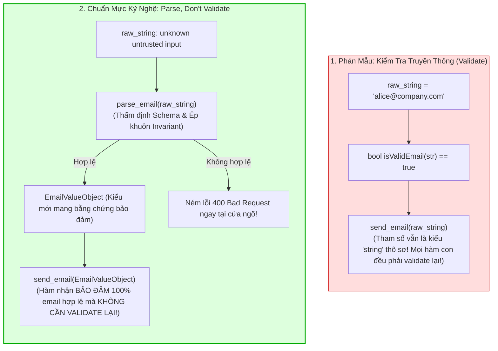

# 3.3. Type Systems in Backend Engineering (Hệ Thống Kiểu trong Kỹ Nghệ Backend)

> [!IMPORTANT]
> **Nếu chỉ nhớ một điều...**
> Khác biệt căn bản giữa một lập trình viên nghiệp dư và một Senior Backend Architect nằm ở cách họ đối xử với **Ranh giới Dữ liệu (Data Boundaries)**. Ở bên ngoài cổng Internet (HTTP Request, WebSockets, Kafka Message), dữ liệu luôn là một mớ nhị phân hỗn độn không đáng tin cậy (**Untrusted `unknown` bytes**). Nếu bạn lầm tưởng các Interface biên dịch (Compile-time Types) có thể bảo vệ được server lúc chạy, bạn đang tự sát — bởi khi biên dịch ra mã máy hoặc JavaScript, **mọi Interface đều bị xóa sạch (Type Erasure)**! Triết lý sống còn của Backend hiện đại là **"Parse, Don't Validate"**: dữ liệu thô từ Internet bắt buộc phải đi qua cánh cổng kiểm soát runtime (**Runtime Validation: Zod, Pydantic, Protobuf**) để "ép khuôn" thành các **Type-Safe Domain Value Objects** mang theo bằng chứng toán học trước khi được phép chạm vào cơ sở dữ liệu.

---

## 1. Tư Duy Kiến Trúc & Mô Hình Trực Quan (Mental Model & Intuition)

### Ẩn Dụ Thực Tế: Hải Quan Cửa Khẩu & Khu Vực Cách Ly Khử Trùng

Hãy liên tưởng dòng chảy dữ liệu trong hệ thống Backend với quy trình kiểm dịch xuất nhập cảnh:
- **Cổng Internet (Khu vực chưa được kiểm dịch)**: Hành khách và kiện hàng từ máy bay quốc tế bước xuống là đối tượng hoàn toàn không đáng tin cậy (Raw JSON / Byte Stream). Bạn không thể dán nhãn "Công Dân Hợp Pháp" chỉ dựa vào lời khai của họ.
- **Runtime Validation / Parser (Cổng quét an ninh & Máy soi X-Quang)**: Kiện hàng bắt buộc phải đi qua máy quét an ninh (Zod / Pydantic schema validation). Hễ phát hiện chất cấm hoặc sai lệch cấu trúc, lập tức trục xuất ngay tại cửa khẩu bằng mã HTTP `400 Bad Request` mà không cho phép đi sâu vào nội địa.
- **Domain Value Objects (Công dân được cấp thẻ bài xác thực)**: Một khi đã qua cổng quét, dữ liệu được "đúc khuôn" thành một **Domain Value Object** (ví dụ `EmailAddress` hoặc `Money`). Kể từ đây, bên trong lãnh thổ lõi (Core Business Logic), mọi hàm nghiệp vụ đều tuyệt đối tin tưởng đối tượng này mà không cần tốn công kiểm tra lại (`if isValid`) ở hàng trăm nơi khác nhau!



---

## 2. Chi tiết từng Keyword

### 2.1. Compile-Time Type Validation vs Runtime Type Validation

- **Compile-Time Type Validation (Thẩm Định Lúc Biên Dịch)**:
  - Do trình biên dịch thực hiện (TypeScript `tsc`, Rust `rustc`, C++ `g++`).
  - *Sứ mệnh*: Đảm bảo tính nhất quán nội bộ giữa các thành phần mã nguồn do lập trình viên viết ra (Static Code Contracts).
  - *Điểm mù chết người*: Hoàn toàn bất lực trước dữ liệu ngoại vi nạp vào lúc chạy (**I/O Boundaries**). Sau khi build ra mã máy hoặc JavaScript, toàn bộ các `interface` hay `type` đều bị xóa sạch (**Type Erasure**).
- **Runtime Type Validation (Thẩm Định Lúc Chạy)**:
  - Do các thư viện mã hóa schema thực hiện lúc runtime (**Pydantic trong Python, Zod trong TypeScript, Protobuf / FlatBuffers trong gRPC**).
  - *Cơ chế hoạt động*: Duyệt qua từng byte hoặc trường dữ liệu JSON nhận được từ socket mạng, kiểm tra kiểu dữ liệu thực tế, ép kiểu an toàn (Coercion), và kích hoạt các hàm xác thực logic (Regex, Boundary Range).
  - *Nguyên tắc vàng*: Mọi dữ liệu đi qua ranh giới I/O (Network, Disk, Database, Third-party Webhook) bắt buộc phải có Runtime Validation!

### 2.2. DTO Type Safety (Data Transfer Object)

- **Bản Chất Của DTO**:
  Là cấu trúc dữ liệu thuần túy (Anemic Data Structure) chỉ dùng để vận chuyển dữ liệu giữa Client và Server qua đường truyền mạng, không chứa bất kỳ logic nghiệp vụ nào.
- **Phân Biệt Request DTO và Response DTO**:
  - *Request DTO*: Được thiết kế để chấp nhận các kiểu dữ liệu lỏng lẻo từ Client (ví dụ `birthDate: string` theo chuẩn ISO 8601), thẩm định tính hợp lệ, và chuyển đổi sang các kiểu nghiệp vụ sâu.
  - *Response DTO*: Được lọc bỏ nghiêm ngặt các thông tin nhạy cảm (mật khẩu băm `password_hash`, token nội bộ, thông tin thẻ tín dụng) trước khi tuần tự hóa thành JSON trả về cho người dùng cuối.
- **Loại Bỏ Lỗ Hổng Mass Assignment**:
  Nếu truyền thẳng đối tượng Database Entity vào API Handler mà không qua DTO, kẻ tấn công có thể chèn thêm trường `{"isAdmin": true}` vào JSON payload để tự nâng quyền tài khoản! Sử dụng DTO Type Safety khóa chặt danh sách thuộc tính được phép cập nhật (**Strict Whitelisting**).

### 2.3. Domain Model Types vs Database Entity Mapping

- **Sự Xung Đột Giữa Hai Thế Giới**:
  1. *Database Entity (Thế giới Lưu trữ Dữ liệu)*: Được tối ưu hóa cho đại số quan hệ RDBMS (bảng phẳng, khóa ngoại `foreign_key_id`, kiểu dữ liệu cột SQL thô sơ `VARCHAR`, `BIGINT`, `TIMESTAMP`).
  2. *Domain Model (Thế giới Nghiệp vụ Cốt lõi)*: Được tối ưu hóa cho các quy tắc bất biến nghiệp vụ theo Domain-Driven Design (DDD). Sử dụng **Value Objects** (`Money { amount: BigDecimal, currency: Currency }`) và **Aggregates**.
- **Mẫu Thiết Kế Data Mapper Pattern**:
  Tuyệt đối không bao giờ để các Entity của ORM (như Hibernate `@Entity`, Prisma Model, SQLAlchemy) tràn ngập vào tầng Domain Logic! Sử dụng tầng **Mapper** chuyển đổi hai chiều:
  $$\text{Database Row (Entity)} \underset{\text{ToDomain()}}{\overset{\text{ToEntity()}}{\rightleftharpoons}} \text{Domain Model (Rich Logic)}$$
  Giúp hệ thống có thể thay đổi cơ sở dữ liệu từ PostgreSQL sang MongoDB mà không làm biến đổi bất kỳ dòng mã logic nghiệp vụ nào.

### 2.4. Serialization và Deserialization Types

- **Deserialization (Giải Tuần Tự Hóa: Bytes/JSON $\to$ In-Memory Objects)**:
  - Là mắt xích an ninh nguy hiểm nhất trong hệ thống Backend. Các lỗi deserialization trong Java (`ObjectInputStream`) hay Python (`pickle.loads`) cho phép hacker thực thi mã độc từ xa (**Remote Code Execution - RCE**) thông qua Gadget Chains.
  - *Quy chuẩn hiện đại*: Chỉ giải tuần tự hóa dữ liệu thô (JSON, Protobuf, Avro) thông qua các Schema định kiểu nghiêm ngặt, tuyệt đối cấm deserialize các đối tượng chứa con trỏ hàm hoặc logic thực thi.
- **Serialization (Tuần Tự Hóa: In-Memory Objects $\to$ Bytes/JSON)**:
  - Chi phí CPU của việc phân tích chuỗi ký tự JSON (`json.dumps` / `JSON.stringify`) chiếm tới $30 - 40\%$ tổng thời gian xử lý của các microservice.
  - Chuyển đổi sang **Binary Serialization (Protocol Buffers, FlatBuffers, Cap'n Proto)** giúp giảm dung lượng mạng tới $70\%$ và tăng tốc độ mã hóa lên gấp 10 lần nhờ cơ chế Zero-Copy.

### 2.5. Type-Safe API Design (Thiết kế API An Toàn Kiểu)

- **Thảm Họa Bất Đồng Bộ Kiểu Giữa Frontend và Backend (Schema Drift)**:
  Backend đổi tên trường từ `user_name` thành `username`, nhưng Frontend không biết và vẫn gọi `response.user_name`, dẫn đến lỗi hiển thị `undefined` trên giao diện người dùng.
- **Kỹ Nghệ End-to-End Type Safety Toàn Diện**:
  1. *RPC Schema-First (gRPC / Protocol Buffers)*: Định nghĩa hợp đồng API duy nhất trong tệp `.proto`. Công cụ `protoc` tự động sinh mã nguồn Type-Safe Stubs cho cả Backend (Go/Java/C++) và Frontend/Mobile (TypeScript/Swift/Kotlin).
  2. *tRPC (TypeScript Full-Stack)*: Chia sẻ trực tiếp Router Type Definitions từ Node.js Backend sang React/Next.js Client mà không cần bước build trung gian:
     Frontend gõ `trpc.user.getById.useQuery({ id: "123" })` lập tức nhận được Auto-complete và báo lỗi đỏ nếu truyền sai kiểu dữ liệu!
  3. *OpenAPI / Swagger Code Generation*: Tự động sinh Client SDK từ tài liệu OpenAPI chuẩn hóa.

---

## 3. Hiện Thực Hóa Mã Nguồn Dual-Engine

### 3.1. C++20: Type-Safe Value Object & DTO Serialization Pipeline

Chương trình C++20 hiện thực mẫu **Domain Value Object** với nguyên lý *"Parse, Don't Validate"* bảo vệ tính bất biến của kiểu tiền tệ, kết hợp DTO Mapper:

```cpp
#include <iostream>
#include <string>
#include <cstdint>
#include <stdexcept>
#include <iomanip>
#include <optional>

// 1. Domain Value Object: Money (Bat bien, tu bao ve Invariant)
class Money {
private:
    int64_t cents_; // Luu tien duoi dang so nguyen cents de tranh sai so so thuc
    std::string currency_;

    // Private constructor: Buoc phai khoi tao qua ham parse hop le!
    Money(int64_t cents, std::string currency) 
        : cents_(cents), currency_(std::move(currency)) {}

public:
    // Parse, Don't Validate Factory Method
    static std::optional<Money> parse(double amount, const std::string& currency) {
        if (amount < 0.0) return std::nullopt; // Khong chap nhan tien am
        if (currency != "USD" && currency != "VND" && currency != "EUR") return std::nullopt;

        int64_t total_cents = static_cast<int64_t>(amount * 100.0 + 0.5);
        return Money(total_cents, currency);
    }

    int64_t get_cents() const { return cents_; }
    double to_double() const { return static_cast<double>(cents_) / 100.0; }
    const std::string& get_currency() const { return currency_; }
};

// 2. Data Transfer Object (DTO) cho API Request
struct CreateOrderRequestDTO {
    std::string customer_id;
    double raw_amount;
    std::string raw_currency;
};

// 3. Application Service: Chi chap nhan Domain Value Object
void process_order_payment(const std::string& customer, const Money& valid_money) {
    std::cout << std::fixed << std::setprecision(2);
    std::cout << "[PAYMENT GATEWAY]: Xu ly thanh toan cho User: " << customer 
              << " voi so tien: " << valid_money.to_double() << " " << valid_money.get_currency() 
              << " (" << valid_money.get_cents() << " cents) -> HOP LE!\n";
}

int main() {
    std::cout << "=== HE THONG XU LY DTO VA PARSE DON'T VALIDATE TRONG C++20 ===\n";

    // Gia lap nhan 2 request DTO tu Client qua HTTP POST
    CreateOrderRequestDTO valid_dto{"CUST_001", 99.50, "USD"};
    CreateOrderRequestDTO malicious_dto{"CUST_002", -500.0, "BITCOIN"};

    // 1. Xu ly Valid Request
    auto parsed_money = Money::parse(valid_dto.raw_amount, valid_dto.raw_currency);
    if (parsed_money.has_value()) {
        process_order_payment(valid_dto.customer_id, parsed_money.value());
    } else {
        std::cout << "[400 BAD REQUEST]: DTO khong hop le cho " << valid_dto.customer_id << "\n";
    }

    // 2. Xu ly Malicious Request (Tien am hoac Currency bay ba)
    auto bad_parsed_money = Money::parse(malicious_dto.raw_amount, malicious_dto.raw_currency);
    if (bad_parsed_money.has_value()) {
        process_order_payment(malicious_dto.customer_id, bad_parsed_money.value());
    } else {
        std::cout << "[400 BAD REQUEST]: DTO bi tu choi boi Parser cho " << malicious_dto.customer_id 
                  << " (Tien am hoac don vi tien te khong hop le!)\n";
    }

    return 0;
}
```

### 3.2. Python 3.11+: Runtime Schema Parsing với Pydantic v2 Style

Chương trình Python mô phỏng quy trình thẩm định runtime schema, chuyển đổi từ DTO thô sang Domain Model và Entity Mapper:

```python
#!/usr/bin/env python3
# -*- coding: utf-8 -*-
"""
Backend Runtime Schema Enforcement & DTO Data Mapper Pattern
"""
import re
from typing import Dict, Any, Optional

class ValidationError(Exception):
    pass

class EmailAddress:
    """Domain Value Object: Mang bang chung bao dam email hop le 100%"""
    def __init__(self, email_str: str):
        regex = r"^[\w\.-]+@[\w\.-]+\.\w+$"
        if not re.match(regex, email_str):
            raise ValidationError(f"Email '{email_str}' khong dung dinh dang tieu chuan RFC!")
        self._value = email_str.lower().strip()

    @property
    def value(self) -> str:
        return self._value

    def __repr__(self) -> str:
        return f"EmailAddress({self._value})"

class UserRegistrationDTO:
    """Request DTO: Nhan du lieu tho tu HTTP JSON Payload"""
    def __init__(self, raw_data: Dict[str, Any]):
        if "email" not in raw_data or not isinstance(raw_data["email"], str):
            raise ValidationError("Truong 'email' la bat buoc va phai la kieu chuoi (String)!")
        if "age" not in raw_data or not isinstance(raw_data["age"], int) or raw_data["age"] < 18:
            raise ValidationError("Truong 'age' phai la so nguyen va nguoi dung phai >= 18 tuoi!")

        self.email = raw_data["email"]
        self.age = raw_data["age"]

class UserEntityMapper:
    """Mapper Pattern: Chuyen doi tu DTO sang Domain Model va Database Record"""
    @staticmethod
    def to_domain(dto: UserRegistrationDTO) -> Dict[str, Any]:
        # 'Parse, Don't Validate': Ep kieu sang Domain Value Object
        domain_email = EmailAddress(dto.email)
        return {
            "email": domain_email,
            "age": dto.age,
            "tier": "STANDARD" if dto.age < 60 else "SENIOR"
        }

    @staticmethod
    def to_database_row(domain_user: Dict[str, Any], user_id: int) -> Dict[str, Any]:
        # Chuyen doi sang dinh dang cot phang cua PostgreSQL
        return {
            "id": user_id,
            "email_col": domain_user["email"].value, # Lay chuoi tho
            "age_col": domain_user["age"],
            "tier_col": domain_user["tier"]
        }

if __name__ == "__main__":
    print("=== TEST 1: XU LY REQUEST DTO HOP LE ===")
    valid_payload = {"email": "Alex_Dev@Enterprise.COM", "age": 28}
    try:
        dto = UserRegistrationDTO(valid_payload)
        domain_user = UserEntityMapper.to_domain(dto)
        db_row = UserEntityMapper.to_database_row(domain_user, 101)
        print("  -> DTO parsed thanh cong!")
        print(f"  -> Domain Model tao ra: {domain_user}")
        print(f"  -> Database Row ghi vao Postgres: {db_row}")
    except ValidationError as e:
        print(f"  -> [LOI 400]: {e}")

    print("\n=== TEST 2: CHAN DUNG REQUEST DTO BAT HOP PHAP (MASS ATTACK / INVALID) ===")
    invalid_payload = {"email": "invalid_email_no_at_sign", "age": 14}
    try:
        dto = UserRegistrationDTO(invalid_payload)
        domain_user = UserEntityMapper.to_domain(dto)
    except ValidationError as e:
        print(f"  -> [LOI 400 BAD REQUEST]: {e}")
```

### 3.3. Realistic Terminal Output

```bash
=== HE THONG XU LY DTO VA PARSE DON'T VALIDATE TRONG C++20 ===
[PAYMENT GATEWAY]: Xu ly thanh toan cho User: CUST_001 voi so tien: 99.50 USD (9950 cents) -> HOP LE!
[400 BAD REQUEST]: DTO bi tu choi boi Parser cho CUST_002 (Tien am hoac don vi tien te khong hop le!)

=== TEST 1: XU LY REQUEST DTO HOP LE ===
  -> DTO parsed thanh cong!
  -> Domain Model tao ra: {'email': EmailAddress(alex_dev@enterprise.com), 'age': 28, 'tier': 'STANDARD'}
  -> Database Row ghi vao Postgres: {'id': 101, 'email_col': 'alex_dev@enterprise.com', 'age_col': 28, 'tier_col': 'STANDARD'}

=== TEST 2: CHAN DUNG REQUEST DTO BAT HOP PHAP (MASS ATTACK / INVALID) ===
  -> [LOI 400 BAD REQUEST]: Truong 'age' phai la so nguyen va nguoi dung phai >= 18 tuoi!
```

---

## 4. Kỹ Thuật Hệ Thống & Cạm Bẫy Thực Tế (Systems Engineering & Pitfalls)

### 4.1. Cạm Bẫy Primitive Obsession & Lỗ Hổng Bảo Mật Chuyển Nhầm Tiền

- **Hiện tượng**: Lập trình viên sử dụng các kiểu nguyên thủy thô (`long`, `double`, `string`) cho toàn bộ các thuộc tính thực thể:
  ```java
  public void transfer(long fromUserId, long toUserId, double amount) { ... }
  ```
- **Hậu quả**: Khi gọi hàm, lập trình viên vô tình tráo đổi vị trí đối số:
  `transfer(toUserId, fromUserId, amount)` $\implies$ Tiền bị trừ ngược từ người nhận sang người gửi! Trình biên dịch hoàn toàn bất lực vì cả hai tham số đều là kiểu `long`.
- **Giải pháp Production**: Bắt buộc bọc các mã định danh bằng **Strong Nominal Types** (`UserId`, `AccountId`, `Money`). Lỗi tráo đổi thứ tự tham số sẽ bị trình biên dịch bắt ngay lập tức.

### 4.2. Diagnostic CLI Commands cho Type Safety & Schemas

```bash
# 1. Kiem tra tinh dong nhat cua Protobuf Schema va phat hien Breaking Changes
buf breaking --against '.git#branch=main'

# 2. Sinh ma nguon TypeScript va Python tu Schema Protocol Buffers
protoc --proto_path=./proto --ts_out=./generated --python_out=./generated ./proto/service.proto

# 3. Kiem tra tinh hop le cua OpenAPI Specification Schema bang Spectral Linter
npx @stoplight/spectral-cli lint openapi.yaml

# 4. Kiem tra du lieu JSON Payload truc tiep tren Command Line bang jq
curl -s http://localhost:8080/api/v1/users/1 | jq 'if .email | test("^[^@]+@[^@]+$") then "VALID" else "INVALID" end'
```

---

## 5. Bảng So Sánh & Quyết Định Kỹ Thuật (Decision Matrix)

| Lớp Dữ Liệu | Mục Đích Tồn Tại | Kiểu Dữ Liệu Tiêu Biểu | Nơi Thẩm Định (Validation) | Mức Độ Tin Cậy |
| :--- | :--- | :--- | :--- | :--- |
| **Raw Network Wire** | Truyền tải qua Socket mạng | JSON String, Protobuf Bytes | Không thẩm định | $0\%$ (Hoàn toàn không tin cậy) |
| **Request DTO** | Hứng dữ liệu từ Controller | Lỏng lẻo (Strings, Numbers thô) | Runtime Schema (Zod, Pydantic) | Đã được kiểm tra cú pháp biên giới |
| **Domain Value Object**| Thao tác quy tắc cốt lõi | Bất biến (`Money`, `EmailAddress`) | Đảm bảo $100\%$ tính Invariant | Tuyệt đối tin cậy ($100\%$ an toàn) |
| **Database Entity** | Lưu trữ vật lý RDBMS/NoSQL | Ánh xạ cột SQL (`VARCHAR`, `BIGINT`)| Database Constraints (CHECK, FK) | Nhất quán dữ liệu lưu trữ bền vững |
| **Response DTO** | Trả dữ liệu về cho Client | Dữ liệu lọc bỏ nhạy cảm | Whitelist Filter | Bảo mật dữ liệu người dùng cuối |
