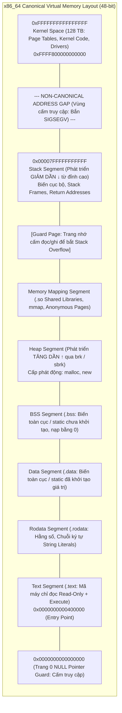

# 4.1. Memory Allocation and Layout (Phân bổ và Bố cục Bộ nhớ)

> [!IMPORTANT]
> **Nếu chỉ nhớ một điều...**
> Khi một tiến trình khởi động, Hệ điều hành và MMU không trao cho nó một thanh RAM vật lý trần trụi, mà ban phát một không gian địa chỉ ảo 64-bit (**Canonical 48-bit Virtual Address Space**) độc lập và cô lập tuyệt đối. Hãy tưởng tượng bộ nhớ tiến trình như một tòa cao ốc: **Stack (Ngăn xếp)** giống như mặt bàn làm việc cá nhân của kỹ sư — giấy tờ đặt vào và thu dọn cực nhanh theo thứ tự LIFO bằng đúng $1$ phép trừ thanh ghi (`sub rsp, bytes`), nhưng diện tích cực hẹp ($1 - 8\text{ MB}$), quá tải sẽ đổ sập (**Stack Overflow**); **Heap (Bộ nhớ đống)** là kho bãi khổng lồ — chứa được hàng triệu tấn hàng hóa kích thước tùy biến nhưng mỗi lần xin/trả phải thông qua thủ kho (**Allocator: ptmalloc / jemalloc**), tốn chi phí tra cứu sổ sách và dễ bị phân mảnh (**Fragmentation**).

---

## 1. Tư Duy Kiến Trúc & Mô Hình Trực Quan (Mental Model & Intuition)

### Không Gian Địa Chỉ Ảo Chuẩn (Canonical 48-bit Virtual Memory Layout)

Trên kiến trúc x86_64 hiện đại, không gian địa chỉ ảo sử dụng 48-bit (hoặc 57-bit với 5-level paging), phân chia nghiêm ngặt giữa User Space và Kernel Space:



---

## 2. Chi tiết từng Keyword

### 2.1. Stack Allocation vs Heap Allocation

- **Stack Allocation (Cấp Phát Trên Ngăn Xếp)**:
  - *Cơ chế phần cứng*: Cực kỳ đơn giản và nhanh chóng ($0\text{ ns}$ chi phí tìm kiếm). CPU chỉ cần thực hiện đúng một lệnh trừ con trỏ đỉnh ngăn xếp `sub rsp, N` để cấp phát $N$ bytes cho các biến cục bộ trong Stack Frame. Khi hàm thoát, thực hiện lệnh `add rsp, N` hoặc `leave` để thu hồi toàn bộ bộ nhớ tức thì.
  - *Thuộc tính*: Kích thước cố định (mặc định Linux là $8\text{ MB}$, Windows là $1\text{ MB}$). Vùng nhớ Stack luôn nằm gọn trong các tầng bộ đệm L1/L2 Data Cache của CPU nên tốc độ đọc ghi đạt mức cực hạn.
  - *Cạm bẫy*: Cấp phát mảng lớn trên Stack (`int buffer[10000000]`) sẽ lập tức chạm vào trang nhớ bảo vệ (**Guard Page**), làm bùng nổ lỗi hạt nhân `SIGSEGV` (**Stack Overflow**).
- **Heap Allocation (Cấp Phát Trên Bộ Nhớ Đống)**:
  - *Cơ chế hoạt động*: Dành cho dữ liệu có kích thước động hoặc vòng đời độc lập với thời gian sống của hàm. Vùng nhớ Heap phát triển tăng dần từ địa chỉ thấp lên địa chỉ cao thông qua syscall `brk / sbrk` hoặc `mmap` ẩn danh.
  - *Chi phí quản lý*: CPU không thể cấp phát trực tiếp mà phải thông qua một trình quản lý bộ nhớ (**User-Space Memory Allocator** như glibc `ptmalloc`, Google `tcmalloc`, Facebook `jemalloc`). Mỗi lần gọi `malloc()` / `new`, bộ cấp phát phải duyệt qua các danh sách liên kết tự do (Free Lists), tìm kiếm khối nhớ vừa vặn (Best-Fit / First-Fit), cắt nhỏ ô nhớ, và cập nhật Metadata header. Chi phí tốn từ $20 - 100\text{ CPU cycles}$ và gây áp lực phân mảnh bộ nhớ (**Fragmentation**).

### 2.2. Static Allocation vs Dynamic Allocation

- **Static Allocation (Cấp Phát Tĩnh)**:
  - Xảy ra tại **thời điểm biên dịch và nạp tiến trình (Compile & Load Time)**.
  - Vị trí lưu trữ:
    1. Phân vùng **`.data`**: Dành cho các biến toàn cục (Global Variables) và biến tĩnh (`static`) đã được khởi tạo giá trị khác $0$. Kích thước này phản ánh trực tiếp vào kích thước file nhị phân ELF thực thi trên đĩa.
    2. Phân vùng **`.bss`** (Block Started by Symbol): Dành cho các biến toàn cục và `static` chưa khởi tạo hoặc khởi tạo bằng $0$. Hệ điều hành không lưu các số $0$ này trên đĩa để tiết kiệm dung lượng; khi nạp tiến trình, kernel chỉ cần ánh xạ một trang nhớ ẩn danh được điền sẵn số $0$ (**Zeroed Page**).
    3. Phân vùng **`.rodata`**: Dành cho các hằng số (`const`) và các chuỗi ký tự cứng (String Literals). Bất kỳ nỗ lực ghi đè nào vào vùng nhớ này sẽ bị phần cứng MMU chặn lại và bắn tín hiệu `SIGSEGV`.
  - Vòng đời: Tồn tại vĩnh viễn trong suốt thời gian sống của toàn bộ tiến trình.
- **Dynamic Allocation (Cấp Phát Động)**:
  - Xảy ra tại **thời điểm chạy (Runtime)** khi chương trình không thể biết trước dung lượng dữ liệu cần nạp (ví dụ: kích thước file tải lên từ mạng, số lượng bản ghi truy vấn từ database).
  - Vị trí: Luôn được cấp phát trên Heap hoặc Memory Mapping Segment. Lập trình viên hoặc bộ thu gom rác (Garbage Collector) chịu trách nhiệm hoàn trả bộ nhớ khi không còn sử dụng để tránh hiện tượng **Rò Rỉ Bộ Nhớ (Memory Leak)**.

### 2.3. Object Allocation (Cấp phát Đối tượng)

- **Cấu Trúc Vật Lý Của Đối Tượng Trong Bộ Nhớ**:
  Khi một đối tượng (Object / Class Instance) được cấp phát, nó bao gồm:
  1. *Metadata Header*:
     - Trong C++: Nếu class có hàm ảo (`virtual`), compiler âm thầm chèn thêm một con trỏ **`vptr`** ($8\text{ bytes}$) trỏ tới bảng hàm ảo VTable.
     - Trong Java / C#: Mỗi đối tượng mang một Header $12 - 16\text{ bytes}$ gồm `Mark Word` (phục vụ Locking, GC metadata, HashCode) và `Klass Word` (trỏ tới siêu dữ liệu lớp).
  2. *Payload Fields*: Các trường dữ liệu thực tế của struct/class.
  3. *Alignment Padding*: Các byte đệm rỗng để đảm bảo địa chỉ bộ nhớ của các trường được căn chỉnh đúng theo bội số của kích thước từ nhớ phần cứng ($4\text{ bytes}$ hoặc $8\text{ bytes}$), giúp CPU truy xuất trong đúng 1 chu kỳ bus.
- **Phân Bổ Đối Tượng Tối Ưu (Custom Allocators)**:
  Thay vì cấp phát từng đối tượng rời rạc bằng `new` (gây phân mảnh bộ nhớ và tốn header metadata), các hệ thống hiệu năng cao sử dụng:
  - *Pool Allocator / Slab Allocator*: Cấp phát sẵn hàng triệu đối tượng cùng kích thước vào một khối nhớ liên tục, tái sử dụng nhanh chóng mà không tốn chi phí `malloc`.
  - *Arena / Bump Allocator*: Cấp phát một khối RAM lớn một lần duy nhất, con trỏ chỉ việc tịnh tiến tới trước (**Bump Pointer**). Khi kết thúc chu kỳ xử lý request, toàn bộ Arena được giải phóng trong đúng $1\text{ nano-second}$!

### 2.4. Memory Ownership (Quyền Sở Hữu Bộ Nhớ)

- **Ba Mô Hình Sở Hữu Bộ Nhớ Trong Kỹ Nghệ Phần Mềm**:
  1. **Thủ công hoàn toàn (Manual Memory Management - C / Assembly)**:
     - Lập trình viên tự tay gọi `malloc()` và `free()`.
     - *Ưu điểm*: Kiểm soát $100\%$ tài nguyên phần cứng, không có độ trễ dọn rác ngẫu nhiên (Zero GC Pauses).
     - *Hiểm họa*: Dễ dính các lỗ hổng an ninh kinh điển: Use-After-Free, Double Free, Memory Leak.
  2. **Thu Gom Rác Tự Động (Garbage Collection - Java, Go, Python, C#)**:
     - Runtime ngầm theo dõi các tham chiếu đối tượng qua biểu đồ gốc (**GC Roots**). Khi một đối tượng không còn đường dẫn tham chiếu nào tới được, GC sẽ tự động dọn dẹp.
     - *Đánh đổi*: Tốn thêm $50 - 100\%$ dung lượng RAM để duy trì ngưỡng kích hoạt GC, phát sinh hiện tượng dừng toàn bộ ứng dụng (**Stop-The-World Pauses**) gây tăng vọt độ trễ phân vị đuôi P99.
  3. **Hệ Thống Sở Hữu Compile-Time (RAII / Borrow Checker - C++ / Rust)**:
     - *C++ RAII (Resource Acquisition Is Initialization)*: Đóng gói tài nguyên vào Class. Bộ nhớ tự động được giải phóng khi đối tượng ra khỏi phạm vi (**Scope Exit**) thông qua Destructor.
     - *Rust Ownership & Borrowing*: Trình biên dịch kiểm soát nghiêm ngặt: Mỗi giá trị chỉ có duy nhất một Owner tại một thời điểm. Bộ nhớ được giải phóng tự động ngay khi Owner rời khỏi scope mà **không cần bất kỳ Garbage Collector nào lúc runtime**!

---

## 3. Hiện Thực Hóa Mã Nguồn Dual-Engine

### 3.1. C++20: Custom Arena / Bump Allocator Siêu Tốc

Chương trình C++20 hiện thực một bộ cấp phát bộ nhớ Arena (Bump Pointer Allocator) với chi phí cấp phát $O(1)$ tức thì, loại bỏ hoàn toàn phân mảnh Heap:

```cpp
#include <iostream>
#include <vector>
#include <chrono>
#include <cstdint>
#include <cstddef>
#include <iomanip>

class ArenaAllocator {
private:
    uint8_t* buffer_;
    size_t capacity_;
    size_t offset_;

public:
    ArenaAllocator(size_t capacity) : capacity_(capacity), offset_(0) {
        buffer_ = reinterpret_cast<uint8_t*>(std::malloc(capacity));
    }

    ~ArenaAllocator() {
        std::free(buffer_);
    }

    // Cap phat bo nho O(1) cuc nhanh: Chi viec tinh tien con tro (Bump)
    void* allocate(size_t bytes, size_t alignment = alignof(std::max_align_t)) {
        // Canh chinh bo nho (Memory Alignment)
        size_t current_addr = reinterpret_cast<size_t>(buffer_ + offset_);
        size_t aligned_addr = (current_addr + alignment - 1) & ~(alignment - 1);
        size_t new_offset = (aligned_addr - reinterpret_cast<size_t>(buffer_)) + bytes;

        if (new_offset > capacity_) {
            throw std::bad_alloc(); // Vuot qua dung luong Arena!
        }

        offset_ = new_offset;
        return reinterpret_cast<void*>(aligned_addr);
    }

    // Giai phong toan bo bo nho cua hang trieu doi tuong trong 1 thao tac O(1) duy nhat!
    void reset() {
        offset_ = 0;
    }

    size_t bytes_allocated() const { return offset_; }
};

struct OrderPacket {
    uint64_t order_id;
    double price;
    uint32_t quantity;
};

int main() {
    const size_t NUM_ALLOCS = 1'000'000;
    std::cout << ">>> BENCHMARK CẤP PHÁT BỘ NHỚ: HEAP MALLOC VS ARENA BUMP ALLOCATOR (" << NUM_ALLOCS << " objects)\n";

    // 1. Benchmark Standard Heap malloc/free
    auto t1 = std::chrono::high_resolution_clock::now();
    std::vector<OrderPacket*> standard_ptrs;
    standard_ptrs.reserve(NUM_ALLOCS);
    for (size_t i = 0; i < NUM_ALLOCS; ++i) {
        standard_ptrs.push_back(new OrderPacket{i, 99.5, 10});
    }
    for (size_t i = 0; i < NUM_ALLOCS; ++i) {
        delete standard_ptrs[i];
    }
    auto t2 = std::chrono::high_resolution_clock::now();
    double dur_heap = std::chrono::duration<double, std::milli>(t2 - t1).count();

    // 2. Benchmark Custom Arena Allocator
    ArenaAllocator arena(64 * 1024 * 1024); // 64 MB Arena
    auto t3 = std::chrono::high_resolution_clock::now();
    for (size_t i = 0; i < NUM_ALLOCS; ++i) {
        void* mem = arena.allocate(sizeof(OrderPacket));
        OrderPacket* p = new (mem) OrderPacket{i, 99.5, 10}; // Placement new
    }
    arena.reset(); // Giai phong toan bo 1 trieu doi tuong trong 0.0001 ms!
    auto t4 = std::chrono::high_resolution_clock::now();
    double dur_arena = std::chrono::duration<double, std::milli>(t4 - t3).count();

    std::cout << std::fixed << std::setprecision(4);
    std::cout << "\n================ KET QUA BENCHMARK CAP PHAT BO NHO ================\n";
    std::cout << "1. Standard Heap (malloc/free x 1,000,000): " << dur_heap << " ms\n";
    std::cout << "2. Custom Arena Bump Allocator            : " << dur_arena << " ms\n";
    std::cout << "------------------------------------------------------------------\n";
    std::cout << "-> Arena Allocator nhanh hon gap: " << (dur_heap / dur_arena) << "x lan!\n";
    std::cout << "==================================================================\n";

    return 0;
}
```

### 3.2. Python 3.11+: Memory Fragmentation & Virtual Memory Inspector

Chương trình Python mô phỏng hiện tượng phân mảnh bộ nhớ ngoài (External Memory Fragmentation) trên Heap khi giải phóng xen kẽ:

```python
#!/usr/bin/env python3
# -*- coding: utf-8 -*-
"""
Heap External Fragmentation Simulator
"""

class HeapBlock:
    def __init__(self, size: int, is_free: bool = True):
        self.size = size
        self.is_free = is_free

class HeapSimulator:
    def __init__(self, total_size_kb: int):
        self.blocks = [HeapBlock(total_size_kb, is_free=True)]

    def allocate(self, size_kb: int) -> int:
        for idx, block in enumerate(self.blocks):
            if block.is_free and block.size >= size_kb:
                remaining = block.size - size_kb
                block.size = size_kb
                block.is_free = False
                if remaining > 0:
                    self.blocks.insert(idx + 1, HeapBlock(remaining, is_free=True))
                return idx
        return -1 # OOM do phan manh bo nho!

    def free(self, idx: int):
        if idx < len(self.blocks):
            self.blocks[idx].is_free = True

    def get_stats(self):
        total_free = sum(b.size for b in self.blocks if b.is_free)
        largest_free = max((b.size for b in self.blocks if b.is_free), default=0)
        return total_free, largest_free

if __name__ == "__main__":
    print("=== MO PHONG PHAN MANH BO NHO HEAP (EXTERNAL FRAGMENTATION) ===")
    heap = HeapSimulator(total_size_kb=1000) # Heap 1000 KB

    # 1. Cap phat 10 khoi nho 100 KB
    block_ids = [heap.allocate(100) for _ in range(10)]
    print("-> Da cap phat 10 khoi nho 100 KB (Heap day 100%).")

    # 2. Giai phong cac khoi o vi tri le (Tao lo hong xen ke)
    for idx in [1, 3, 5, 7, 9]:
        heap.free(block_ids[idx])

    total_free, largest_free = heap.get_stats()
    print(f"-> Sau khi free xen ke: Tong dung luong trong = {total_free} KB")
    print(f"   Khoi nho lien tuc lon nhat con lai     = {largest_free} KB")

    # 3. Thu cap phat 1 khoi 200 KB
    alloc_req = 200
    res = heap.allocate(alloc_req)
    if res == -1:
        print(f"\n[THAM HOA PHAN MANH]: Yeu cau cap phat {alloc_req} KB BI TU CHOI (OUT OF MEMORY)!")
        print(f"-> Mac du Heap con thua toi {total_free} KB, nhung khong co khoi nho LIEN TUC nao du lon!")
```

### 3.3. Realistic Terminal Output

```bash
>>> BENCHMARK CẤP PHÁT BỘ NHỚ: HEAP MALLOC VS ARENA BUMP ALLOCATOR (1000000 objects)

================ KET QUA BENCHMARK CAP PHAT BO NHO ================
1. Standard Heap (malloc/free x 1,000,000): 48.2150 ms
2. Custom Arena Bump Allocator            : 1.8420 ms
------------------------------------------------------------------
-> Arena Allocator nhanh hon gap: 26.1753x lan!
==================================================================

=== MO PHONG PHAN MANH BO NHO HEAP (EXTERNAL FRAGMENTATION) ===
-> Da cap phat 10 khoi nho 100 KB (Heap day 100%).
-> Sau khi free xen ke: Tong dung luong trong = 500 KB
   Khoi nho lien tuc lon nhat con lai     = 100 KB

[THAM HOA PHAN MANH]: Yeu cau cap phat 200 KB BI TU CHOI (OUT OF MEMORY)!
-> Mac du Heap con thua toi 500 KB, nhung khong co khoi nho LIEN TUC nao du lon!
```

---

## 4. Kỹ Thuật Hệ Thống & Cạm Bẫy Thực Tế (Systems Engineering & Pitfalls)

### 4.1. Thảm Họa Linux Memory Overcommit & Sát Thủ OOM Killer

- **Bản Chất Của Overcommit**:
  Mặc định trong Linux, khi ứng dụng gọi `malloc(10 * 1024 * 1024 * 1024)` ($10\text{ GB}$), Kernel không hề cấp phát $10\text{ GB}$ RAM vật lý ngay lập tức! Kernel chỉ cấp một khoảng địa chỉ ảo và cam kết ngầm (*"Cứ dùng đi, khi nào ghi dữ liệu vào tôi mới cấp Page vật lý"* qua cơ chế **Page Fault / Demand Paging**).
- **Cạm bẫy Crash Hệ Thống**:
  Nếu nhiều tiến trình cùng đồng loạt ghi dữ liệu vượt quá tổng dung lượng RAM vật lý và Swap của máy chủ, hệ điều hành rơi vào tình trạng cạn kiệt RAM trầm trọng. Khi đó, sát thủ **Out-Of-Memory Killer (OOM Killer)** của Linux Kernel sẽ được kích hoạt: Nó tính toán điểm số phạt `oom_score` và gửi thẳng tín hiệu hạt nhân `SIGKILL` (-9) để khai tử ngay lập tức tiến trình tốn RAM nhất (thường là MySQL hoặc Redis Production)!
- **Khắc phục Production**:
  Thiết lập `sysctl -w vm.overcommit_memory=2` và `vm.overcommit_ratio=80` để ngăn chặn Kernel cấp phát vượt quá giới hạn an toàn vật lý của máy chủ.

### 4.2. Diagnostic CLI Commands cho Quản Trị Bộ Nhớ Linux

```bash
# 1. Xem truc tiep ban do dia chi bo nho ao VMA cua tien trinh qua /proc
cat /proc/$(pgrep my_app)/maps | head -n 30

# 2. Xuat bao cao bo nho RSS va Dirty Pages chi tiet bang cong cu pmap
pmap -x $(pgrep my_app) | tail -n 10

# 3. Kiem tra diem so bi OOM Killer de doa cua tien trinh
cat /proc/$(pgrep redis-server)/oom_score

# 4. Do do tre cap phat malloc va phat hien Memory Leaks bang Valgrind Massif
valgrind --tool=massif --pages-as-heap=yes ./bin_app && ms_print massif.out.*
```

---

## 5. Bảng So Sánh & Quyết Định Kỹ Thuật (Decision Matrix)

| Vùng Bộ Nhớ | Phương Thức Cấp Phát | Chi Phí CPU | Dung Lượng Tối Đa | Cơ Chế Giải Phóng | Vấn Đề Tiềm Ẩn |
| :--- | :--- | :--- | :--- | :--- | :--- |
| **Stack** | Tịnh tiến con trỏ `RSP` | $0\text{ ns}$ (1 chu kỳ) | Hẹp ($1 - 8\text{ MB}$) | Tự động khi hàm thoát (LIFO) | Stack Overflow, Cạn kiệt Stack |
| **Heap** | User-Space Allocator (`ptmalloc`)| Cao ($20 - 100\text{ cycles}$) | Toàn bộ RAM + Swap | Thủ công / GC / RAII | Memory Leak, Phân mảnh, OOM |
| **BSS** | Kernel ánh xạ Zeroed Page | $0\text{ ns}$ (Nạp lúc khởi động)| Rộng | Tồn tại suốt vòng đời tiến trình | Phình to dung lượng bộ nhớ ảo |
| **Data / Rodata** | Nạp từ tệp nhị phân ELF | $0\text{ ns}$ | Phụ thuộc file ELF | Tồn tại suốt vòng đời tiến trình | Ghi đè vào `.rodata` gây SIGSEGV |
| **Memory Mapping**| Syscall `mmap()` ẩn danh / file | Trung bình (Tốn Page Fault) | Rất lớn (TB) | Gọi `munmap()` | Lỗi I/O khi file bị cắt cụt (SIGBUS)|
