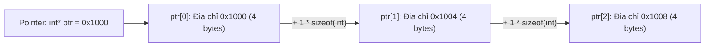

# 4.2. Pointers and Memory Safety (Con trỏ và An toàn Bộ nhớ)

> [!IMPORTANT]
> **Nếu chỉ nhớ một điều...**
> Con trỏ thô (**Raw Pointer**) là công cụ quyền lực nhất nhưng cũng là "cơn ác mộng sinh tử" tạo ra hơn **$70\%$ tổng số lỗ hổng bảo mật nghiêm trọng** trong lịch sử ngành công nghệ thông tin (thống kê chính thức từ Microsoft Security Response Center và Google Chromium). Hãy tưởng tượng con trỏ như một mảnh giấy ghi số phòng khách sạn: Nếu khách sạn đã thanh lý phòng đó cho một vị khách mới mà bạn vẫn cầm chìa khóa cũ xông vào, đó là **Use-After-Free (UAF)**; nếu bạn đập thủng tường sang phòng bên cạnh để lấy cắp đồ đạc, đó là **Buffer Overflow**; còn nếu bạn làm rơi mất chìa khóa khiến căn phòng bị khóa kín vĩnh viễn nhưng thẻ ngân hàng vẫn bị trừ tiền thuê mỗi ngày, đó là **Memory Leak**. Các hệ thống hiện đại giải quyết bài toán này bằng **Smart Pointers (C++ RAII)** và định luật bất biến **Aliasing XOR Mutability (Rust Borrow Checker)**.

---

## 1. Tư Duy Kiến Trúc & Mô Hình Trực Quan (Mental Model & Intuition)

### Bản Chất Vật Lý & Số Học Con Trỏ (Pointer Arithmetic)

Ở cấp độ bóng bán dẫn và thanh ghi CPU, **con trỏ bản chất là một số nguyên không dấu 64-bit** lưu địa chỉ tuyến tính của một byte trong không gian nhớ ảo:
- Trên kiến trúc 64-bit (x86_64, aarch64), mọi con trỏ đều chiếm đúng **8 bytes** trong RAM, bất kể nó trỏ tới kiểu dữ liệu gì (`char*`, `int64_t*`, hay một struct 10,000 bytes).
- **Phép toán Số học Con trỏ (Pointer Arithmetic)**: Phép cộng `ptr + i` không phải là cộng $i$ byte thô, mà là dịch chuyển đúng bằng kích thước kiểu dữ liệu mà nó trỏ tới:
  $$\text{Địa chỉ mới} = \text{Địa chỉ cũ} + (i \times \text{sizeof}(T))$$

Trên x86_64, CPU hỗ trợ chế độ đánh địa chỉ chỉ mục có tỷ lệ (**Scaled Index Addressing Mode**) thực thi phép tính này trong đúng 1 chu kỳ lệnh:
```assembly
mov eax, [rdi + rsi * 4]  ; Đọc mảng int32: base_addr (rdi) + index (rsi) * 4 bytes
```



---

## 2. Chi tiết từng Keyword

### 2.1. Pointer, Reference và Dereference

- **Pointer (Con trỏ)**:
  - Một biến độc lập chứa địa chỉ bộ nhớ của một biến khác.
  - Có thể thay đổi địa chỉ mà nó trỏ tới (Re-assignable) và có thể mang giá trị rỗng `nullptr`.
  - Hỗ trợ số học con trỏ (`ptr++`, `ptr + 5`).
- **Reference (Tham chiếu - C++ / Rust)**:
  - Về mặt cú pháp, tham chiếu là **Bí danh (Alias)** của một đối tượng đã tồn tại trong bộ nhớ.
  - *Đặc điểm*: Bắt buộc phải được khởi tạo ngay khi khai báo, không thể trỏ sang đối tượng khác (Immutable binding), và về mặt lý thuyết không thể mang giá trị null.
  - *Bản chất hợp ngữ*: Trình biên dịch hiện thực tham chiếu dưới dạng một con trỏ hằng (`T* const`) được tự động giải tham chiếu trong mọi thao tác.
- **Dereference (Toán tử Giải Tham Chiếu `*` hoặc `->`)**:
  - Yêu cầu CPU đọc hoặc ghi dữ liệu tại ô nhớ mà con trỏ đang lưu trữ:
    ```assembly
    mov rax, [rdi]  ; Nạp giá trị tại địa chỉ rdi vào thanh ghi rax
    ```
  - *Nguy cơ*: Nếu con trỏ trỏ tới địa chỉ bất hợp pháp (Trang 0 hoặc Kernel Space), bộ xử lý phần cứng MMU kích hoạt ngắt **Page Fault**, đẩy hệ điều hành phát tín hiệu `SIGSEGV` lập tức khai tử tiến trình.

### 2.2. Null Pointer vs Dangling Pointer

- **Null Pointer (Con trỏ Null)**:
  - Con trỏ được gán tường minh giá trị `0` (`nullptr` trong C++11, `NULL` trong C, `None` trong Python).
  - Về mặt vật lý, trang nhớ đầu tiên trong không gian địa chỉ ảo ($0\text{x00000000} - 0\text{x00000FFF}$, kích thước $4\text{ KB}$) được Kernel đánh dấu là **Unmapped / No-Access Page**. Bất kỳ thao tác giải tham chiếu con trỏ Null nào sẽ bị MMU chặn đứng ngay lập tức để bảo vệ hệ thống.
- **Dangling Pointer (Con trỏ Lơ Lửng / Con trỏ Rác)**:
  - Con trỏ vẫn lưu giữ một địa chỉ bộ nhớ hợp lệ trước đây, nhưng vùng nhớ đó **đã bị giải phóng** (`free()` / `delete`) hoặc Stack Frame chứa nó đã bị thu hồi.
  - *Tính chất nguy hiểm*: Con trỏ Dangling không trỏ tới `0x0`, nên các phép kiểm tra `if (ptr != nullptr)` hoàn toàn bị vô hiệu hóa!
  - Khi chương trình đọc/ghi qua Dangling Pointer: Dữ liệu có thể bị sai lệch ngẫu nhiên (**Silent Data Corruption**), hoặc trở thành mồi ngon cho hacker tấn công chiếm quyền điều khiển con trỏ lệnh `RIP`.

### 2.3. Các Lỗ Hổng Bộ Nhớ Kinh Điển (Classic Memory Bugs)

1. **Memory Leak (Rò Rỉ Bộ Nhớ)**:
   - Bộ nhớ được cấp phát trên Heap nhưng mọi con trỏ trỏ tới nó đều bị mất dấu mà không gọi `free()`. Vùng nhớ đó bị chiếm dụng vĩnh viễn, làm phình to bộ nhớ tiến trình (RSS) cho tới khi bị OOM Killer bắn hạ.
2. **Double Free (Giải Phóng Kép)**:
   - Gọi `free(ptr)` hai lần trên cùng một địa chỉ bộ nhớ. Thao tác này làm phá vỡ cấu trúc danh sách liên kết tự do (Free List / Fastbins) của Allocator (`ptmalloc`), cho phép kẻ tấn công thực hiện kỹ thuật **Fastbin Dup Exploit** để ghi đè các con trỏ quản lý heap nhằm thực thi mã độc tùy ý.
3. **Use-After-Free (UAF - Sử Dụng Sau Giải Phóng)**:
   - Tiến trình giải phóng một Object $A$ (ví dụ: một Socket connection), nhưng vẫn giữ lại con trỏ trỏ tới $A$. Sau đó, Allocator cấp phát vùng nhớ đó cho một Object $B$ mới (ví dụ: Auth Session chứa con trỏ hàm ảo VTable). Kẻ tấn công thông qua con trỏ $A$ cũ ghi đè lên dữ liệu của $B$, chiếm quyền điều khiển luồng thực thi chương trình!
4. **Buffer Overflow (Tràn Bộ Đệm)**:
   - Ghi dữ liệu vượt quá kích thước mảng được cấp phát trên Stack (**Stack Smashing**) hoặc Heap (**Heap Overflow**).
   - Kẻ tấn công ghi đè lên địa chỉ quay về (**Return Address `RIP`**) trên Stack để ép CPU nhảy vào shellcode độc hại.

### 2.4. Định Luật Bất Biến: Aliasing XOR Mutability

- **Cội Nguồn Của Mọi Lỗi Bộ Nhớ**:
  Mọi thảm họa về an toàn bộ nhớ và tương tranh dữ liệu (**Data Races**) đều bắt nguồn từ sự kết hợp chết người của hai yếu tố:
  1. **Aliasing**: Có nhiều con trỏ cùng trỏ tới một vùng nhớ đồng thời.
  2. **Mutability**: Vùng nhớ đó có thể bị thay đổi giá trị.
- **Quy Tắc Vàng Của Rust Borrow Checker**:
  Tại bất kỳ một thời điểm nào, đối với một vùng nhớ nhất định, bạn chỉ được phép chọn **MỘT TRONG HAI**:
  $$\text{Aliasing} \oplus \text{Mutability}$$
  - Hoặc có **nhiều tham chiếu chỉ đọc** (`&T` - Shared References).
  - Hoặc có **duy nhất một tham chiếu đọc-ghi độc quyền** (`&mut T` - Exclusive Mutable Reference).
  Triệt tiêu hoàn toàn $100\%$ lỗi Use-After-Free, Iterator Invalidation, và Data Race ngay tại thời điểm biên dịch!

---

## 3. Hiện Thực Hóa Mã Nguồn Dual-Engine

### 3.1. C++20: Xây Dựng Smart Pointer ScopedPtr Từ Đầu (RAII Implementation)

Mã nguồn C++20 tự xây dựng một Smart Pointer `ScopedPtr<T>` từ đầu, hiện thực triệt để quy tắc **Move Semantics (Cấm sao chép, chỉ chuyển giao quyền sở hữu)** để loại bỏ hoàn toàn rò rỉ bộ nhớ và Double Free:

```cpp
#include <iostream>
#include <utility>
#include <cstdint>

template <typename T>
class ScopedPtr {
private:
    T* ptr_;

public:
    // 1. Constructor: Nhan quyen so huu con tro tho
    explicit ScopedPtr(T* raw_ptr = nullptr) : ptr_(raw_ptr) {}

    // 2. Destructor: Tu dong giai phong bo nho khi ra khoi Scope (RAII)
    ~ScopedPtr() {
        if (ptr_) {
            delete ptr_;
            ptr_ = nullptr;
        }
    }

    // 3. CẤM SAO CHÉP (Cấm Copy Constructor & Copy Assignment de tranh Double Free)
    ScopedPtr(const ScopedPtr&) = delete;
    ScopedPtr& operator=(const ScopedPtr&) = delete;

    // 4. CHUYỂN GIAO SỞ HỮU (Move Constructor & Move Assignment)
    ScopedPtr(ScopedPtr&& other) noexcept : ptr_(other.ptr_) {
        other.ptr_ = nullptr; // Dat con tro cu ve nullptr
    }

    ScopedPtr& operator=(ScopedPtr&& other) noexcept {
        if (this != &other) {
            delete ptr_;          // Giai phong tai nguyen cu
            ptr_ = other.ptr_;    // Tiep quan con tro moi
            other.ptr_ = nullptr; // Triet tieu con tro cu
        }
        return *this;
    }

    // 5. Toan tu giai tham chieu
    T& operator*() const { return *ptr_; }
    T* operator->() const { return ptr_; }
    T* get() const { return ptr_; }
    explicit operator bool() const { return ptr_ != nullptr; }
};

struct DatabaseConnection {
    uint32_t conn_id;
    std::string db_name;

    DatabaseConnection(uint32_t id, std::string name) : conn_id(id), db_name(std::move(name)) {
        std::cout << "  [DB CONNECT]: Mo ket noi ID=" << conn_id << " toi " << db_name << "\n";
    }

    ~DatabaseConnection() {
        std::cout << "  [DB DISCONNECT]: Dong ket noi ID=" << conn_id << " -> Giai phong tai nguyen an toan!\n";
    }

    void execute_query(const std::string& sql) {
        std::cout << "  [QUERY]: (Conn " << conn_id << ") Thuc thi: " << sql << "\n";
    }
};

int main() {
    std::cout << "=== DEMO CUSTOM SMART POINTER (SCOPEDPTR RAII) ===\n";
    {
        // Cap phat doi tuong qua ScopedPtr
        ScopedPtr<DatabaseConnection> conn1(new DatabaseConnection(101, "Production_Postgres"));
        conn1->execute_query("SELECT * FROM users WHERE active = true;");

        // Chuyen giao quyen so huu sang conn2
        ScopedPtr<DatabaseConnection> conn2 = std::move(conn1);
        if (!conn1) {
            std::cout << "-> conn1 da tro thanh null sau khi Move (Khong the gay Use-After-Free)!\n";
        }

        conn2->execute_query("UPDATE users SET last_login = NOW();");
        std::cout << "-> Sap thoat khoi khoi lenh (Scope Exit)...\n";
    } // conn2 tu dong goi Destructor va delete tai nguyen o day!

    std::cout << "-> Da thoat khoi Scope an toan tuyet doi.\n";
    return 0;
}
```

### 3.2. Python 3.11+: Stack Buffer Overflow & Canary Detector Simulator

Chương trình Python mô phỏng cấu trúc Stack Frame, cơ chế tấn công tràn bộ đệm ghi đè Return Address, và kỹ thuật phòng thủ bằng **Stack Canary**:

```python
#!/usr/bin/env python3
# -*- coding: utf-8 -*-
"""
Stack Buffer Overflow & Stack Canary Defense Simulator
"""
import struct

CANARY_SECRET = 0xDEADBEEFCAFEBABE

class VirtualStackFrame:
    def __init__(self, buffer_size: int = 16):
        self.buffer_size = buffer_size
        self.buffer = bytearray(buffer_size)
        self.canary = CANARY_SECRET
        self.saved_rbp = 0x7FFFFFFFE000
        self.return_address = 0x0000000000401150 # Dia chi ham hop le

    def write_input(self, payload: bytes):
        """Ghi du lieu nguoi dung vao buffer tren Stack"""
        full_frame = bytearray()
        full_frame.extend(self.buffer)
        full_frame.extend(struct.pack("<Q", self.canary))
        full_frame.extend(struct.pack("<Q", self.saved_rbp))
        full_frame.extend(struct.pack("<Q", self.return_address))

        # Ghi de payload vao bo dem stack
        for i in range(min(len(payload), len(full_frame))):
            full_frame[i] = payload[i]

        # Doc lai trang thai sau khi ghi
        self.buffer = full_frame[:self.buffer_size]
        self.canary = struct.unpack("<Q", full_frame[self.buffer_size:self.buffer_size+8])[0]
        self.return_address = struct.unpack("<Q", full_frame[self.buffer_size+16:self.buffer_size+24])[0]

    def verify_and_return(self):
        """Kiem tra Stack Canary truoc khi thuc thi lenh RET"""
        print(f"  [CHECK]: Gia tri Canary hien tai: {hex(self.canary)}")
        if self.canary != CANARY_SECRET:
            print("  [ALERT ❌]: STACK SMASHING DETECTED! Canary bi ghi de tha hoa!")
            print("  -> Chuong trinh lap tuc abort() de ngan chan hacker cuop con tro RIP!")
            return False
        
        print(f"  [PASS  ✅]: Canary nguyen ven. Tra ve dia chi: {hex(self.return_address)}")
        return True

if __name__ == "__main__":
    print("=== TEST 1: GHI DU LIEU HOP LE (KHONG TRAN BO DEM) ===")
    frame1 = VirtualStackFrame(16)
    frame1.write_input(b"Hello_Safe_User")
    frame1.verify_and_return()

    print("\n=== TEST 2: TAN CONG TRAN BO DEM GHI DE RETURN ADDRESS ===")
    frame2 = VirtualStackFrame(16)
    # Payload 32 bytes: 16 bytes buffer + 8 bytes rác + 8 bytes địa chỉ hacker (0x00000000DEAD0000)
    malicious_payload = b"A" * 16 + b"CORRUPT!" + struct.pack("<Q", 0x00000000DEAD0000)
    frame2.write_input(malicious_payload)
    frame2.verify_and_return()
```

### 3.3. Realistic Terminal Output

```bash
=== DEMO CUSTOM SMART POINTER (SCOPEDPTR RAII) ===
  [DB CONNECT]: Mo ket noi ID=101 toi Production_Postgres
  [QUERY]: (Conn 101) Thuc thi: SELECT * FROM users WHERE active = true;
-> conn1 da tro thanh null sau khi Move (Khong the gay Use-After-Free)!
  [QUERY]: (Conn 101) Thuc thi: UPDATE users SET last_login = NOW();
-> Sap thoat khoi khoi lenh (Scope Exit)...
  [DB DISCONNECT]: Dong ket noi ID=101 -> Giai phong tai nguyen an toan!
-> Da thoat khoi Scope an toan tuyet doi.

=== TEST 1: GHI DU LIEU HOP LE (KHONG TRAN BO DEM) ===
  [CHECK]: Gia tri Canary hien tai: 0xdeadbeefcafebabe
  [PASS  ✅]: Canary nguyen ven. Tra ve dia chi: 0x401150

=== TEST 2: TAN CONG TRAN BO DEM GHI DE RETURN ADDRESS ===
  [CHECK]: Gia tri Canary hien tai: 0x2154505552524f43
  [ALERT ❌]: STACK SMASHING DETECTED! Canary bi ghi de tha hoa!
  -> Chuong trinh lap tuc abort() de ngan chan hacker cuop con tro RIP!
```

---

## 4. Kỹ Thuật Hệ Thống & Cạm Bẫy Thực Tế (Systems Engineering & Pitfalls)

### 4.1. Bốn Tuyến Phòng Thủ Chiều Sâu Của Hệ Điều Hành & Trình Biên Dịch

1. **Stack Canaries (`-fstack-protector-strong`)**:
   Trình biên dịch chèn một số ngẫu nhiên 8-byte giữa mảng cục bộ và Return Address. Trước khi `RET`, kiểm tra xem Canary có bị thay đổi không; nếu có, gọi ngay `__stack_chk_fail()` để dừng tiến trình.
2. **ASLR (Address Space Layout Randomization)**:
   Kernel ngẫu nhiên hóa địa chỉ nạp Stack, Heap, và Shared Libraries mỗi lần chương trình khởi chạy, khiến hacker không thể đoán trước địa chỉ cố định để nhảy mã độc.
3. **DEP / NX Bit (Data Execution Prevention / No-Execute)**:
   Phần cứng MMU đánh dấu phân vùng Stack và Heap là **Non-Executable (NX)**. Cho dù hacker có ghi được shellcode vào mảng dữ liệu, CPU sẽ từ chối thực thi và bắn tín hiệu `SIGSEGV`.
4. **AddressSanitizer (ASan - `-fsanitize=address`)**:
   Công cụ phát hiện lỗi bộ nhớ số một thế giới của Google. Chèn thêm các vùng nhớ bóng tối (**Shadow Memory**) bao quanh các mảng (1 byte Shadow Memory kiểm soát 8 bytes bộ nhớ ứng dụng) để phát hiện ngay lập tức lỗi Out-of-bounds và Use-After-Free trong quá trình CI/CD.

### 4.2. Diagnostic CLI Commands cho Phát Hiện Lỗi Bộ Nhớ

```bash
# 1. Bien dich voi AddressSanitizer de bat tat ca loi UAF, Buffer Overflow
clang++ -O1 -fsanitize=address -g pointer_test.cpp -o pointer_test
./pointer_test

# 2. Kiem tra Memory Leak bang Valgrind Memcheck
valgrind --leak-check=full --show-leak-kinds=all --track-origins=yes ./bin_app

# 3. Kiem tra xem file nhi phan da bat du cac che do bao ve an ninh chua
checksec --file=./bin_app

# 4. Bat core dump khi bi loi Segfault de kham nghiem tu thi bang GDB
ulimit -c unlimited
gdb ./bin_app core -ex "bt full" -ex "info registers"
```

---

## 5. Bảng So Sánh & Quyết Định Kỹ Thuật (Decision Matrix)

| Lỗ Hổng Bộ Nhớ | Nguyên Nhân Cốt Lõi | Mức Độ Nguy Hiểm | Cơ Chế Phòng Ngự Phần Cứng | Giải Pháp Mã Nguồn Hiện Đại |
| :--- | :--- | :--- | :--- | :--- |
| **Use-After-Free** | Giữ Dangling Pointer sau khi `free()` | Cực cao (RCE / Cướp VTable) | ASLR, Safe Allocators | `std::unique_ptr`, Rust Borrow Checker |
| **Buffer Overflow** | Ghi vượt quá giới hạn mảng | Cực cao (Ghi đè RIP) | Stack Canary, NX Bit | `std::span`, `std::array`, Safe Bounds Check |
| **Double Free** | Gọi `free()` 2 lần trên 1 con trỏ | Cao (Phá vỡ Heap Free List) | Heap Metadata Validation | Đặt `ptr = nullptr`, Triết lý RAII |
| **Memory Leak** | Mất dấu con trỏ Heap | Trung bình (Làm sập do OOM) | Giám sát RSS / OOM Killer | Smart Pointers, C++ RAII Destructors |
| **Null Dereference**| Giải tham chiếu địa chỉ `0x0` | Trung bình (Crash Denial of Service)| Trang 0 Guard Page | `std::optional`, Con trỏ Nullable Types |
