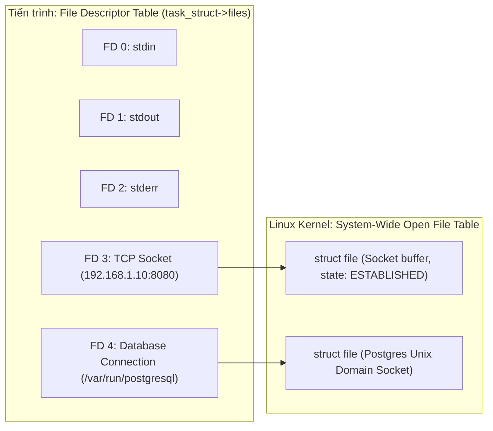

# 4.3. Resource Lifecycle and Management (Vòng đời và Quản lý Tài nguyên)

> [!IMPORTANT]
> **Nếu chỉ nhớ một điều...**
> Bộ nhớ RAM chỉ là một trong số rất nhiều loại tài nguyên của hệ thống máy tính. Hệ điều hành còn quản lý các tài nguyên ngoại vi khan hiếm và đắt đỏ hơn gấp bội: **File Descriptors, Network TCP Sockets, Database Connection Handles, POSIX Mutexes**. Nếu bạn ỷ lại vào Garbage Collector (Java, Python, Go) để đóng kết nối, hệ thống của bạn sẽ sụp đổ vì **Resource Exhaustion** — bởi GC chỉ thức tỉnh khi cạn kiệt dung lượng RAM (hàng Gigabytes), trong khi giới hạn **1024 File Descriptors (`ulimit -n`)** của hệ điều hành đã bị cạn kiệt chỉ sau vài giây! Triết lý tối thượng của kỹ nghệ phần mềm là **RAII (Resource Acquisition Is Initialization)**: Buộc vòng đời của tài nguyên OS phải sống chết theo một đối tượng cục bộ trên Stack — mở trong Constructor, giải phóng tức thì trong Destructor, bất chấp Exception hay lỗi logic.

---

## 1. Tư Duy Kiến Trúc & Mô Hình Trực Quan (Mental Model & Intuition)

### Toàn Cảnh Vòng Đời Tài Nguyên Hệ Điều Hành (OS Resource Lifecycles)

Trong nhân Linux Kernel, mọi tài nguyên I/O (File, Socket, Pipe, Timer, Event) đều được trừu tượng hóa thành một số nguyên không âm gọi là **File Descriptor (FD)**:
- Cấu trúc `task_struct` của mỗi tiến trình sở hữu một mảng **File Descriptor Table**:
  - `0`: `stdin` (Chuẩn đầu vào).
  - `1`: `stdout` (Chuẩn đầu ra).
  - `2`: `stderr` (Chuẩn báo lỗi).
  - `3..N`: Các files hoặc network sockets được mở động.
- Mỗi entry trong bảng FD trỏ tới một cấu trúc `struct file` toàn hệ thống, sau đó trỏ tới `struct inode` đại diện cho phần cứng hoặc socket mạng.



---

## 2. Chi tiết từng Keyword

### 2.1. RAII (Resource Acquisition Is Initialization) - Triết lý Vàng của C++

- **Bản Chất Cốt Lõi**:
  Bjarne Stroustrup đã phát minh ra thành ngữ RAII dựa trên nguyên lý: **Gắn chặt vòng đời của một tài nguyên hữu hạn với thời gian sống của một đối tượng trên Stack**:
  1. *Acquisition (Chiếm dụng)*: Tài nguyên (mở file, tạo socket, khóa mutex, cấp phát RAM) được thực hiện bên trong hàm khởi tạo (**Constructor**). Nếu khởi tạo thất bại, Constructor ném ngoại lệ và đối tượng không bao giờ được tạo ra.
  2. *Release (Giải phóng)*: Tài nguyên bắt buộc được thu hồi bên trong hàm hủy (**Destructor**).
- **Cơ Chế Stack Unwinding Khi Có Ngoại Lệ**:
  Khi một ngoại lệ (`throw`) bùng phát, CPU sẽ tháo dỡ các Stack Frame từ trong ra ngoài. Trình biên dịch bảo đảm $100\%$ rằng Destructor của toàn bộ các đối tượng cục bộ trên đường tháo dỡ **sẽ được gọi tự động và đầy đủ**. Không cần khối lệnh `finally` rườm rà, mã nguồn hoàn toàn miễn nhiễm với rò rỉ tài nguyên!

### 2.2. Smart Pointers (Con trỏ Thông minh trong C++11+)

- **1. `std::unique_ptr<T>` (Sở Hữu Độc Quyền - Zero-Cost Abstraction)**:
  - Chỉ có duy nhất một Owner sở hữu vùng nhớ tại một thời điểm.
  - Cấm sao chép (Copy deleted), chỉ hỗ trợ chuyển giao quyền sở hữu (**Move Semantics**).
  - Khi `unique_ptr` ra khỏi scope, nó tự động gọi `delete` trên con trỏ thô. Kích thước trong bộ nhớ bằng đúng con trỏ thô ($8\text{ bytes}$), hoàn toàn không tốn thêm bất kỳ byte RAM nào!
- **2. `std::shared_ptr<T>` (Đồng Sở Hữu Bằng Reference Counting)**:
  - Nhiều đối tượng cùng chia sẻ quyền sở hữu một tài nguyên chung.
  - Cấu trúc vật lý gồm $16\text{ bytes}$: Con trỏ tới đối tượng ($8\text{ bytes}$) + Con trỏ tới **Control Block** ($8\text{ bytes}$).
  - Control Block được cấp phát trên Heap, chứa hai bộ đếm nguyên tử:
    1. `Strong Reference Count`: Số lượng `shared_ptr` đang sống.
    2. `Weak Reference Count`: Số lượng `weak_ptr` đang quan sát.
  - Mỗi lần sao chép, bộ đếm tăng qua lệnh nguyên tử `lock xadd` (Thread-safe). Khi `Strong Count` chạm $0$, tài nguyên bị hủy ngay lập tức.
- **3. `std::weak_ptr<T>` (Tham Chiếu Yếu - Phá Vỡ Vòng Tròn Tham Chiếu)**:
  - Không làm tăng `Strong Reference Count`.
  - Được sử dụng để quan sát đối tượng mà không kiểm soát vòng đời của nó, giải quyết triệt để thảm họa rò rỉ bộ nhớ do **Vòng Lặp Tham Chiếu (Circular Dependency / Reference Cycle)** trong các cấu trúc đồ thị, cây, hoặc Observer Pattern.

### 2.3. Garbage Collection vs Reference Counting

- **Reference Counting (Đếm Tham Chiếu - Python, Swift, Objective-C, COM)**:
  - *Cơ chế*: Mỗi đối tượng mang một trường đếm số lượng tham chiếu đang trỏ vào nó (`ob_refcnt` trong CPython).
  - *Ưu điểm*: Thu hồi tài nguyên tức thì (**Deterministic Finalization**) ngay tại khoảnh khắc bộ đếm chạm $0$, không có độ trễ treo hệ thống.
  - *Nhược điểm*: Overhead cập nhật bộ đếm nguyên tử trên mọi phép gán biến; và **hoàn toàn bất lực trước chu trình tham chiếu chéo** ($A \to B \to A$), đòi hỏi phải có một bộ gom rác phụ trợ (Cycle Detector).
- **Tracing Garbage Collection (Truy Vết Đồ Thị - Java, Go, C#)**:
  - *Cơ chế*: Không đếm tham chiếu liên tục. Định kỳ, tiến trình GC tạm dừng ứng dụng (**Stop-The-World**), xuất phát từ các nút gốc (**GC Roots**: thanh ghi CPU, biến cục bộ trên Stack, biến tĩnh toàn cục) để duyệt đồ thị bộ nhớ qua thuật toán **Mark & Sweep / Generational GC**.
  - *Ưu điểm*: Dễ dàng thu gom toàn bộ các cụm đối tượng tham chiếu chéo nhau; thông lượng cấp phát cực nhanh.
  - *Cạm bẫy trong Backend*: Không thể dùng GC để đóng Network Sockets hay Database Handles vì thời điểm GC chạy là bất định (**Non-deterministic**)!

### 2.4. Socket và Connection Lifecycle trong Backend

- **Chi Phí Thiết Lập Kết Nối (Connection Overhead)**:
  Mỗi lần tạo một TCP / Database Connection mới:
  1. Bắt tay 3 bước TCP Handshake ($1.5\text{ RTT}$).
  2. Bắt tay mã hóa TLS 1.3 Handshake ($1\text{ RTT}$).
  3. Xác thực người dùng, giải mã mật khẩu, khởi tạo session trong Database Process ($10 - 50\text{ ms}$).
  Nếu tạo và đóng kết nối cho từng HTTP request, cơ sở dữ liệu sẽ sụp đổ do kiệt sức CPU!
- **Kiến Trúc Bể Kết Nối (Connection Pooling - HikariCP / pgBouncer)**:
  - Thay vì đóng kết nối khi xử lý xong, Client chỉ "trả" kết nối về cho Bể quản lý (Pool).
  - Khi cần truy vấn, Worker mượn một kết nối đang rảnh (`borrow()`), thực thi lệnh SQL, và hoàn trả lại (`release()`) trong thời gian $0\text{ ms}$.
  - Áp dụng triết lý RAII: Đối tượng mượn kết nối tự động hoàn trả kết nối vào Pool khi kết thúc scope hàm.

---

## 3. Hiện Thực Hóa Mã Nguồn Dual-Engine

### 3.1. C++20: File Descriptor Safe Wrapper Theo Chuẩn Rule of 5 (RAII)

Chương trình C++20 hiện thực lớp bọc File Descriptor của Linux Kernel tuân thủ nghiêm ngặt **Quy tắc 5 (Rule of Five)**, bảo đảm không bao giờ rò rỉ tài nguyên OS ngay cả khi có Exception:

```cpp
#include <iostream>
#include <string>
#include <stdexcept>
#include <unistd.h>
#include <fcntl.h>

class SafeFileDescriptor {
private:
    int fd_;

public:
    // 1. Constructor: Mo File va chiem dung tai nguyen
    explicit SafeFileDescriptor(const char* filepath, int flags, mode_t mode = 0644) {
        fd_ = ::open(filepath, flags, mode);
        if (fd_ < 0) {
            throw std::runtime_error("[LOI]: Khong the mo File Descriptor!");
        }
        std::cout << "  [FD ACQUIRED]: Da mo thanh cong FD=" << fd_ << "\n";
    }

    // 2. Destructor: Tu dong goi close() thu hoi tai nguyen Kernel (RAII)
    ~SafeFileDescriptor() {
        if (fd_ >= 0) {
            std::cout << "  [FD RELEASED]: Dong FD=" << fd_ << " tu dong trong Destructor!\n";
            ::close(fd_);
            fd_ = -1;
        }
    }

    // 3. CAM SAO CHEP (De tranh loi Double Close tai nguyen OS)
    SafeFileDescriptor(const SafeFileDescriptor&) = delete;
    SafeFileDescriptor& operator=(const SafeFileDescriptor&) = delete;

    // 4. HO TRO MOVE SEMANTICS (Chuyen giao quyen so huu FD)
    SafeFileDescriptor(SafeFileDescriptor&& other) noexcept : fd_(other.fd_) {
        other.fd_ = -1; // Huy quyen cua doi tuong cu
    }

    SafeFileDescriptor& operator=(SafeFileDescriptor&& other) noexcept {
        if (this != &other) {
            if (fd_ >= 0) ::close(fd_);
            fd_ = other.fd_;
            other.fd_ = -1;
        }
        return *this;
    }

    void write_data(const std::string& data) {
        if (fd_ < 0) throw std::logic_error("Truy cap tren FD khong hop le!");
        ssize_t bytes = ::write(fd_, data.c_str(), data.size());
        std::cout << "  [WRITE]: Da ghi " << bytes << " bytes vao FD=" << fd_ << "\n";
    }

    int get_raw_fd() const { return fd_; }
};

void simulate_business_logic() {
    std::cout << "\n--- Bat dau nghiep vu ghi file (Co the phat sinh Exception) ---\n";
    SafeFileDescriptor file("/tmp/raii_demo.txt", O_CREAT | O_WRONLY | O_TRUNC);
    file.write_data("Chung minh tinh dung dan cua RAII Stack Unwinding!\n");

    std::cout << "-> Co tinh nem ngoai le (Simulated Exception)...\n";
    throw std::runtime_error("Co loi he thong nghiem trong xay ra!");
}

int main() {
    std::cout << "=== DEMO C++20 RAII RESOURCE MANAGEMENT (RULE OF FIVE) ===\n";
    try {
        simulate_business_logic();
    } catch (const std::exception& e) {
        std::cout << "-> [CATCH EXCEPTION]: Da bat ngoai le: " << e.what() << "\n";
        std::cout << "-> Quan sat: Destructor van duoc goi 100% truoc khi vao khoi catch!\n";
    }
    return 0;
}
```

### 3.2. Python 3.11+: Connection Pool & Context Manager Simulator

Chương trình Python hiện thực mẫu thiết kế **Connection Pool** kết hợp **Context Manager (`__enter__` / `__exit__`)** mô phỏng cơ chế mượn và hoàn trả kết nối tự động:

```python
#!/usr/bin/env python3
# -*- coding: utf-8 -*-
"""
Database Connection Pool & Context Manager Simulator
"""
import time
from typing import List

class PooledConnection:
    def __init__(self, conn_id: int):
        self.conn_id = conn_id
        self.is_busy = False

    def execute_query(self, sql: str):
        print(f"    [QUERY]: (Conn #{self.conn_id}) -> Thuc thi SQL: '{sql}'")

class ConnectionPool:
    def __init__(self, max_size: int = 3):
        self.pool: List[PooledConnection] = [PooledConnection(i + 1) for i in range(max_size)]
        print(f"-> [POOL INIT]: Khoi tao Connection Pool voi {max_size} ket noi san sang.")

    def acquire(self) -> PooledConnection:
        for conn in self.pool:
            if not conn.is_busy:
                conn.is_busy = True
                print(f"  [ACQUIRE]: Muon ket noi #{conn.conn_id} tu Pool.")
                return conn
        raise RuntimeError("Cạn kiệt Connection Pool! Không có kết nối rảnh.")

    def release(self, conn: PooledConnection):
        conn.is_busy = False
        print(f"  [RELEASE]: Hoan tra ket noi #{conn.conn_id} ve Pool.")

class ConnectionScope:
    """Python RAII tuong duong Context Manager"""
    def __init__(self, pool: ConnectionPool):
        self.pool = pool
        self.conn = None

    def __enter__(self) -> PooledConnection:
        self.conn = self.pool.acquire()
        return self.conn

    def __exit__(self, exc_type, exc_val, exc_tb):
        if self.conn:
            self.pool.release(self.conn)
        if exc_type is not None:
            print(f"  [HANDLE ERROR]: Da bat loi '{exc_val}', nhung ket noi van duoc tra an toan!")
        return False

if __name__ == "__main__":
    db_pool = ConnectionPool(max_size=2)

    print("\n=== TEST 1: TRUY VAN HOP LE VOI CONTEXT MANAGER ===")
    with ConnectionScope(db_pool) as conn:
        conn.execute_query("SELECT * FROM products WHERE in_stock = true;")

    print("\n=== TEST 2: PHAT SINH EXCEPTION TRONG KHI DANG GIU KET NOI ===")
    try:
        with ConnectionScope(db_pool) as conn:
            conn.execute_query("UPDATE accounts SET balance = balance - 100;")
            raise ValueError("Loi ket noi thanh toan bi ngat dot ngot!")
    except ValueError:
        pass

    print("\n=== TEST 3: XAC MINH POOL KHONG BI LEAK SAU EXCEPTION ===")
    with ConnectionScope(db_pool) as conn:
        conn.execute_query("SELECT 1; -- Kiem tra ket noi van ranh roi!")
```

### 3.3. Realistic Terminal Output

```bash
=== DEMO C++20 RAII RESOURCE MANAGEMENT (RULE OF FIVE) ===

--- Bat dau nghiep vu ghi file (Co the phat sinh Exception) ---
  [FD ACQUIRED]: Da mo thanh cong FD=3
  [WRITE]: Da ghi 48 bytes vao FD=3
-> Co tinh nem ngoai le (Simulated Exception)...
  [FD RELEASED]: Dong FD=3 tu dong trong Destructor!
-> [CATCH EXCEPTION]: Da bat ngoai le: Co loi he thong nghiem trong xay ra!
-> Quan sat: Destructor van duoc goi 100% truoc khi vao khoi catch!

-> [POOL INIT]: Khoi tao Connection Pool voi 2 ket noi san sang.

=== TEST 1: TRUY VAN HOP LE VOI CONTEXT MANAGER ===
  [ACQUIRE]: Muon ket noi #1 tu Pool.
    [QUERY]: (Conn #1) -> Thuc thi SQL: 'SELECT * FROM products WHERE in_stock = true;'
  [RELEASE]: Hoan tra ket noi #1 ve Pool.

=== TEST 2: PHAT SINH EXCEPTION TRONG KHI DANG GIU KET NOI ===
  [ACQUIRE]: Muon ket noi #1 tu Pool.
    [QUERY]: (Conn #1) -> Thuc thi SQL: 'UPDATE accounts SET balance = balance - 100;'
  [RELEASE]: Hoan tra ket noi #1 ve Pool.
  [HANDLE ERROR]: Da bat loi 'Loi ket noi thanh toan bi ngat dot ngot!', nhung ket noi van duoc tra an toan!

=== TEST 3: XAC MINH POOL KHONG BI LEAK SAU EXCEPTION ===
  [ACQUIRE]: Muon ket noi #1 tu Pool.
    [QUERY]: (Conn #1) -> Thuc thi SQL: 'SELECT 1; -- Kiem tra ket noi van ranh roi!'
  [RELEASE]: Hoan tra ket noi #1 ve Pool.
```

---

## 4. Kỹ Thuật Hệ Thống & Cạm Bẫy Thực Tế (Systems Engineering & Pitfalls)

### 4.1. Thảm Họa Cạn Kiệt File Descriptors (Too Many Open Files - `EMFILE`)

- **Vấn đề Production**:
  Khi dịch vụ microservice chịu tải $50{,}000\text{ RPS}$, nếu code bị rò rỉ Socket do không gọi `close()` hoặc ỷ lại vào GC:
  1. Số lượng kết nối mở tăng vượt quá giới hạn **`nofile`** của hệ điều hành (mặc định Linux là $1024$).
  2. Lệnh syscall `accept()` hoặc `socket()` thất bại với mã lỗi hạt nhân **`EMFILE: Too many open files`**.
  3. Server lập tức từ chối phục vụ toàn bộ các kết nối mới, kể cả các cuộc kiểm tra sức khỏe (**Health Checks**) của Kubernetes / Load Balancer, dẫn đến cụm Pod bị khởi động lại hàng loạt (**CrashLoopBackOff**).
- **Khắc phục**:
  - Tăng giới hạn trong `/etc/security/limits.conf`: `* soft nofile 65536` và `* hard nofile 65536`.
  - Luôn bọc tài nguyên Socket bằng RAII hoặc khối `try-with-resources`.

### 4.2. Diagnostic CLI Commands cho Quản Trị Tài Nguyên Linux

```bash
# 1. Dem tong so File Descriptors ma tien trinh dang chiem dung
ls -l /proc/$(pgrep my_service)/fd | wc -l

# 2. Xem chi tiet tien trinh dang mo nhung files hoac network sockets nao
lsof -p $(pgrep my_service)

# 3. Thong ke so luong ket noi TCP dang ket o trang thai TIME_WAIT hoac CLOSE_WAIT
ss -tan state close-wait
netstat -ton | grep -c "TIME_WAIT"

# 4. Kiem tra gioi han Soft va Hard Limits cua tien trinh
cat /proc/$(pgrep my_service)/limits | grep "Max open files"
```

---

## 5. Bảng So Sánh & Quyết Định Kỹ Thuật (Decision Matrix)

| Cơ Chế Quản Lý | Ngôn Ngữ Tiêu Biểu | Cơ Chế Giải Phóng | Tính Xác Định Thời Gian | Nguy Cơ Thất Bát Tài Nguyên |
| :--- | :--- | :--- | :--- | :--- |
| **C++ RAII** | C++, Rust | Destructor khi ra khỏi Scope | Tuyệt đối ($0\text{ ns}$ Delay) | Hầu như không có nếu tuân thủ Rule of 5 |
| **Context Manager (`with`)** | Python | Hàm `__exit__` khi ra khỏi Scope | Tức thì khi thoát khối `with` | Bị leak nếu quên dùng từ khóa `with` |
| **Try-with-resources** | Java | Tự động gọi `AutoCloseable` | Tức thì khi thoát khối `try` | Bị leak nếu dùng `try-finally` thủ công |
| **Tracing GC Finalizer**| Java `finalize()` cũ | Khi GC thức tỉnh | Hoàn toàn bất định (Không biết trước) | Cực cao! Cạn kiệt File Descriptors |
| **Connection Pool** | Backend Microservices | Hoàn trả về hàng đợi rảnh | Tức thì khi xử lý xong request | Leak kết nối nếu quên release |
