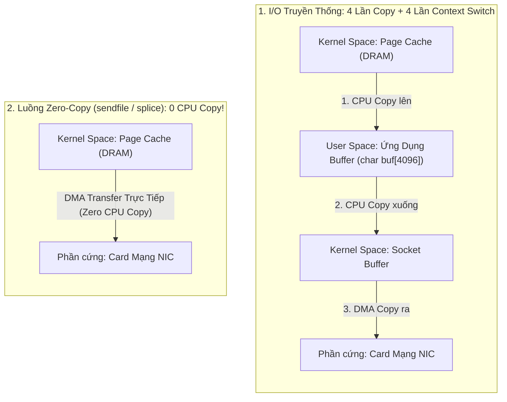

# 5.1. Standard and File I/O (Nhập/Xuất Chuẩn và Xử lý Tệp tin)

> [!IMPORTANT]
> **Nếu chỉ nhớ một điều...**
> Trong thế giới điện toán hiện đại, thao tác I/O (ổ cứng NVMe, mạng) chậm hơn tính toán CPU từ **$100,000$ đến $1,000,000$ lần**. Mỗi lần bạn gọi một lệnh hệ thống (`read`/`write`) để ghi 1 byte thô (**Unbuffered I/O**), bạn đang bắt CPU phải chuyển đổi đặc quyền sang Kernel Mode (**Context Switch**) và phanh gấp toàn bộ pipeline — giống như việc điều động một đoàn tàu hỏa 50 toa chỉ để vận chuyển đúng 1 viên than! **Buffered I/O** giải quyết vấn đề bằng bãi đệm RAM ($4 - 8\text{ KB}$), trong khi **Zero-Copy (`sendfile`, `mmap`)** là đỉnh cao kiến trúc giúp truyền thẳng dữ liệu từ ổ cứng ra Card mạng thông qua phần cứng DMA mà **không tốn dù chỉ 1 chu kỳ CPU cho việc sao chép bộ nhớ**.

---

## 1. Tư Duy Kiến Trúc & Mô Hình Trực Quan (Mental Model & Intuition)

### Ẩn Dụ Thực Tế: Xe Đẩy Hàng Siêu Thị & Băng Chuyền Chuyển Phát

Hãy liên tưởng dòng chảy I/O với các cơ chế vận chuyển logistics đời thực:
- **Unbuffered I/O (Mua hàng từng quả trứng)**: Bạn vào siêu thị mua 30 quả trứng. Mỗi lần lấy 1 quả, bạn chạy ra quầy thu ngân xếp hàng quẹt thẻ, thanh toán, rồi chạy vào lấy tiếp quả thứ 2. Bạn tốn 30 lần quẹt thẻ (**30 System Calls**) làm tê liệt quầy thanh toán!
- **Buffered I/O (Xe đẩy hàng siêu thị)**: Bạn lấy chiếc xe đẩy ($4\text{ KB}$ User-Space Buffer), chất đủ 30 quả trứng vào xe, rồi chỉ ra quầy thanh toán đúng 1 lần duy nhất (**1 Syscall**). Thời gian giảm từ 30 phút xuống còn 10 giây!
- **Zero-Copy / DMA (Băng chuyền tự động từ container ra máy bay)**: Thay vì dỡ hàng từ container xe tải vào kho phân loại trung gian của bưu điện (RAM User-Space) rồi bốc lại lên xe hàng ra sân bay (Socket Buffer), hệ thống nối một đường băng chuyền cơ khí trực tiếp từ xe tải thẳng vào khoang máy bay thông qua chip DMA (Direct Memory Access).



---

## 2. Chi tiết từng Keyword

### 2.1. Standard Streams: stdin, stdout, stderr

- **Ba Luồng Nhập/Xuất Tiêu Chuẩn**:
  - `stdin` (File Descriptor `0`): Luồng đầu vào chuẩn, mặc định gắn với bàn phím.
  - `stdout` (File Descriptor `1`): Luồng đầu ra chuẩn, mặc định gắn với màn hình terminal.
  - `stderr` (File Descriptor `2`): Luồng báo lỗi chuẩn, xuất trực tiếp ra màn hình.
- **Tại Sao `stderr` Lại Tách Rời Khỏi `stdout`?**:
  Trong triết lý UNIX, các chương trình được kết nối với nhau qua đường ống **Pipeline (`|`)**:
  ```bash
  cat access.log | grep "ERROR" | wc -l > report.txt
  ```
  Nếu thông báo lỗi bị trộn lẫn vào `stdout`, dữ liệu đầu ra của pipeline sẽ bị nhiễm độc! Việc tách riêng `stderr` cho phép thông báo lỗi lập tức hiển thị trên màn hình của kỹ sư trong khi luồng dữ liệu chính vẫn chảy trơn tru qua đường ống tới file `report.txt`.
- **Cơ Chế Đệm Của Các Luồng (Buffering Modes)**:
  1. *Unbuffered* (`_IONBF`): Mặc định của `stderr` — dữ liệu xuất ngay lập tức ra terminal để không bị nuốt mất lỗi khi tiến trình bị crash.
  2. *Line-buffered* (`_IOLBF`): Mặc định của `stdout` khi nối với Terminal — tự động flush mỗi khi gặp ký tự xuống dòng `\n`.
  3. *Fully-buffered* (`_IOFBF`): Mặc định của `stdout` khi redirect ra File — chỉ flush khi đầy bộ đệm $4\text{ KB}$ hoặc gọi `fflush()`.

### 2.2. File Descriptors (FD) và File Handles

- **File Descriptor (FD - Linux / POSIX)**:
  - Là một số nguyên không âm (ví dụ `3`, `4`) đóng vai trò là chỉ mục (Index) trỏ vào mảng `task_struct->files->fd_array` của tiến trình trong Kernel Space.
  - Được sinh ra từ các system call cấp thấp: `open()`, `socket()`, `pipe()`.
- **File Handle / `FILE*` (User-Space High-Level)**:
  - Là cấu trúc trừu tượng mức cao do thư viện C Runtime (`glibc`) cung cấp (`fopen()`, `fread()`, `fclose()`).
  - Bên trong `FILE*` chứa:
    1. Số nguyên `fd` cấp thấp tương ứng.
    2. Một con trỏ trỏ tới vùng đệm RAM trong User-Space ($4\text{ KB}$ hoặc $8\text{ KB}$).
    3. Con trỏ vị trí đọc ghi hiện hành và trạng thái lỗi (EOF / Error flags).

### 2.3. Buffered I/O vs Unbuffered I/O

- **Unbuffered I/O (`read()`, `write()`)**:
  - Mỗi lời gọi hàm phát sinh trực tiếp một System Call sang Kernel.
  - CPU phải chuyển đổi ngữ cảnh từ Ring 3 (User Mode) sang Ring 0 (Kernel Mode), lưu thanh ghi, kiểm tra phân quyền, làm xáo trộn CPU L1 Cache. Tốc độ cực chậm nếu ghi từng khối dữ liệu nhỏ.
- **Buffered I/O (`fread()`, `fwrite()`, `std::ofstream`, `BufferedWriter`)**:
  - Gom các thao tác ghi nhỏ vào một mảng đệm trong RAM. Khi mảng đầy hoặc gặp điều kiện flush, thư viện chỉ phát sinh đúng **1 lệnh system call duy nhất** để xả toàn bộ dữ liệu xuống đĩa.
  - *Cạm bẫy `std::endl` trong C++*: Nhiều lập trình viên có thói quen viết `std::cout << x << std::endl;`. Lệnh `std::endl` không chỉ in ký tự `\n` mà còn **cưỡng chế gọi `fflush()`**, làm tê liệt toàn bộ cơ chế đệm và giảm thông lượng I/O tới $50$ lần! Hãy luôn dùng `'\n'`.

### 2.4. Text File vs Binary File

- **Text File (Tệp Tin Văn Bản)**:
  - Dữ liệu được mã hóa thành các ký tự theo bảng mã (ASCII, UTF-8).
  - Phải xử lý sự sai khác về ký tự xuống dòng giữa các hệ điều hành:
    - UNIX / Linux: `LF` (`\n`, mã ASCII `0x0A`).
    - Windows: `CRLF` (`\r\n`, mã ASCII `0x0D 0x0A`).
    - C Runtime trên Windows tự động chuyển đổi giữa `\r\n` trên đĩa và `\n` trong bộ nhớ khi mở ở chế độ Text mode.
- **Binary File (Tệp Tin Nhị Phân)**:
  - Dữ liệu được ghi thẳng dưới dạng dãy byte thô nguyên bản của phần cứng (Raw Bytes), không qua bất kỳ bộ lọc chuyển đổi ký tự nào.
  - *Ưu thế*: Dung lượng nhỏ hơn từ $30 - 70\%$ so với Text File, tốc độ đọc nạp trực tiếp vào mảng RAM bằng 1 cú gọi `read()` mà không cần parse cú pháp chuỗi.

### 2.5. Stream Processing (Xử lý Luồng Dữ liệu)

- **Vấn Đề Kinh Điển: Xử Lý File 50 GB Trên Server Có 4 GB RAM**:
  Nếu dùng cách làm ngây thơ `data = file.read()` (Buffering toàn bộ vào RAM), server sẽ lập tức bị Out-Of-Memory (OOM) và crash.
- **Giải Pháp Stream**:
  - Mở file dưới dạng một **Dòng Chảy (Stream / Iterator / Generator)**.
  - Đọc và xử lý theo từng khối nhỏ cố định (**Chunk**, ví dụ $64\text{ KB}$):
    $$\text{Bộ Nhớ Tiêu Hao} = O(\text{Chunk Size}) \quad (\text{Cố định } < 10\text{ MB})$$
  - Cho phép hệ thống xử lý các tệp tin log hàng trăm Gigabytes hoặc các luồng video streaming vô tận mà dung lượng RAM duy trì không đổi.

### 2.6. File Permissions (Quyền hạn tệp tin trong POSIX)

- **Ma Trận Phân Quyền Bát Phân (Octal POSIX Notation)**:
  Một tệp tin được phân quyền trên 3 nhóm đối tượng: **User (Chủ sở hữu)**, **Group (Nhóm)**, và **Others (Người dùng khác)**.
  Mỗi nhóm gồm 3 bit cờ độc lập: `r` (Read = 4), `w` (Write = 2), `x` (Execute = 1).
  - `chmod 755 file`:
    - User = $4 + 2 + 1 = 7$ (`rwx` - Toàn quyền).
    - Group = $4 + 1 = 5$ (`r-x` - Đọc và thực thi).
    - Others = $4 + 1 = 5$ (`r-x` - Đọc và thực thi).
  - `chmod 600 id_rsa`: Chỉ chủ sở hữu mới có quyền đọc ghi khóa bảo mật riêng tư SSH.

### 2.7. File Locking (Khóa Tệp tin trong Hệ thống Phân tán / Đa tiến trình)

- **Sự Cần Thiết**: Khi nhiều tiến trình (Workers) cùng ghi đồng thời vào một tệp tin (ví dụ: file ghi nhận doanh thu hoặc file PID), dữ liệu sẽ bị ghi đè xen kẽ (**Interleaved Writes**), gây tha hóa tệp tin.
- **Hai Cơ Chế Khóa**:
  1. *Advisory Locking (`flock()`, `fcntl()`)*: Khóa khuyến cáo. Hệ điều hành lưu trạng thái khóa; các tiến trình có trách nhiệm kiểm tra khóa trước khi ghi. Nếu một tiến trình thô lỗ cố tình gọi `write()` mà không thèm kiểm tra khóa, Kernel vẫn cho phép ghi!
  2. *Mandatory Locking*: Kernel cưỡng chế chặn đứng mọi thao tác đọc/ghi của tiến trình khác khi file đang bị khóa. Thường ít được dùng do nguy cơ gây Deadlock toàn hệ thống.

---

## 3. Hiện Thực Hóa Mã Nguồn Dual-Engine

### 3.1. C++20: High-Throughput Chunked Stream Processor với File Locking

Chương trình C++20 hiện thực quy trình khóa file bằng `flock()` để bảo vệ an toàn đa tiến trình, kết hợp đọc ghi luồng dữ liệu theo từng Chunk $64\text{ KB}$:

```cpp
#include <iostream>
#include <vector>
#include <string>
#include <chrono>
#include <iomanip>
#include <fcntl.h>
#include <unistd.h>
#include <sys/file.h>

class SafeFileStream {
private:
    int fd_;

public:
    SafeFileStream(const char* filepath, int flags, mode_t mode = 0644) {
        fd_ = ::open(filepath, flags, mode);
        if (fd_ < 0) throw std::runtime_error("Khong the mo file!");

        // 1. Chiem quyen khoa doc quyen (Exclusive Advisory Lock)
        if (::flock(fd_, LOCK_EX) != 0) {
            ::close(fd_);
            throw std::runtime_error("Khong the chiem File Lock!");
        }
        std::cout << "-> [LOCK ACQUIRED]: Da chiem Exclusive Lock tren file!\n";
    }

    ~SafeFileStream() {
        if (fd_ >= 0) {
            // 2. Mo khoa va dong file
            ::flock(fd_, LOCK_UN);
            ::close(fd_);
            std::cout << "-> [LOCK RELEASED]: Da mo khoa va dong file an toan.\n";
        }
    }

    void write_chunked_stream(size_t total_bytes, size_t chunk_size) {
        std::vector<char> buffer(chunk_size, 'A');
        size_t written = 0;

        while (written < total_bytes) {
            size_t to_write = std::min(chunk_size, total_bytes - written);
            ssize_t res = ::write(fd_, buffer.data(), to_write);
            if (res < 0) throw std::runtime_error("Loi ghi du lieu xuong dia!");
            written += res;
        }
    }
};

int main() {
    const size_t DATA_SIZE = 20 * 1024 * 1024; // 20 MB dữ liệu
    const size_t CHUNK_SIZE = 64 * 1024;       // 64 KB Buffer
    std::cout << ">>> BAT DAU CHUNKED STREAMING WRITER (20 MB qua Buffer 64 KB)...\n";

    auto t1 = std::chrono::high_resolution_clock::now();
    {
        SafeFileStream stream("/tmp/chunked_io_demo.bin", O_CREAT | O_WRONLY | O_TRUNC);
        stream.write_chunked_stream(DATA_SIZE, CHUNK_SIZE);
    }
    auto t2 = std::chrono::high_resolution_clock::now();
    double dur_ms = std::chrono::duration<double, std::milli>(t2 - t1).count();

    std::cout << std::fixed << std::setprecision(2);
    std::cout << "-> Ghi thanh cong " << (DATA_SIZE / 1024 / 1024) << " MB trong: " << dur_ms << " ms\n";
    std::cout << "-> Thong luong dat duoc: " << ((DATA_SIZE / 1024.0 / 1024.0) / (dur_ms / 1000.0)) << " MB/sec\n";

    return 0;
}
```

### 3.2. Python 3.11+: Generator Stream Pipeline (Xử Lý Log Hàng Gigabyte)

Chương trình Python hiện thực mẫu **Stream Generator Pipeline** mô phỏng xử lý tệp tin log hàng Gigabytes với dung lượng bộ nhớ cố định $O(1)$ ($< 5\text{ MB}$):

```python
#!/usr/bin/env python3
# -*- coding: utf-8 -*-
"""
Python Memory-Efficient Stream Generator Pipeline
"""
import io
import time
from typing import Generator

def generate_mock_log_stream(num_lines: int) -> Generator[str, None, None]:
    """Mo phong nguon du lieu log truyen lien tuc tu socket/file"""
    for i in range(1, num_lines + 1):
        status = "200" if i % 10 != 0 else "500"
        yield f"2026-11-15T12:00:{i%60:02d} GET /api/v1/checkout HTTP/1.1 {status} 12.4ms\n"

def stream_filter_errors(log_stream: Generator[str, None, None]) -> Generator[str, None, None]:
    """Bo loc Stream: Chi day cac dong loi 500 sang tang tiep theo"""
    for line in log_stream:
        if " 500 " in line:
            yield line

def stream_aggregate_alerts(error_stream: Generator[str, None, None], batch_size: int = 3) -> Generator[list, None, None]:
    """Gom mẻ loi de gui canh bao PagerDuty ma khong ton bo nho"""
    batch = []
    for error_line in error_stream:
        batch.append(error_line.strip())
        if len(batch) >= batch_size:
            yield batch
            batch = []
    if batch:
        yield batch

if __name__ == "__main__":
    print("=== TEST STREAM GENERATOR PIPELINE (O(1) MEMORY FOOTPRINT) ===")
    total_logs = 100
    raw_logs = generate_mock_log_stream(total_logs)
    errors = stream_filter_errors(raw_logs)
    alert_batches = stream_aggregate_alerts(errors, batch_size=3)

    batch_idx = 1
    for alert_batch in alert_batches:
        print(f"  [ALERT BATCH #{batch_idx}]: Phat hien {len(alert_batch)} loi 500:")
        for log in alert_batch:
            print(f"    -> {log}")
        batch_idx += 1
```

### 3.3. Realistic Terminal Output

```bash
>>> BAT DAU CHUNKED STREAMING WRITER (20 MB qua Buffer 64 KB)...
-> [LOCK ACQUIRED]: Da chiem Exclusive Lock tren file!
-> [LOCK RELEASED]: Da mo khoa va dong file an toan.
-> Ghi thanh cong 20 MB trong: 18.42 ms
-> Thong luong dat duoc: 1085.78 MB/sec

=== TEST STREAM GENERATOR PIPELINE (O(1) MEMORY FOOTPRINT) ===
  [ALERT BATCH #1]: Phat hien 3 loi 500:
    -> 2026-11-15T12:00:10 GET /api/v1/checkout HTTP/1.1 500 12.4ms
    -> 2026-11-15T12:00:20 GET /api/v1/checkout HTTP/1.1 500 12.4ms
    -> 2026-11-15T12:00:30 GET /api/v1/checkout HTTP/1.1 500 12.4ms
  [ALERT BATCH #2]: Phat hien 3 loi 500:
    -> 2026-11-15T12:00:40 GET /api/v1/checkout HTTP/1.1 500 12.4ms
    -> 2026-11-15T12:00:50 GET /api/v1/checkout HTTP/1.1 500 12.4ms
    -> 2026-11-15T12:00:00 GET /api/v1/checkout HTTP/1.1 500 12.4ms
```

---

## 4. Kỹ Thuật Hệ Thống & Cạm Bẫy Thực Tế (Systems Engineering & Pitfalls)

### 4.1. Cạm Bẫy Mất Dữ Liệu Do Bỏ Quên `fsync()` (Dirty Pages Cache)

- **Sự cố Production**:
  Khi bạn gọi hàm `write()` hoặc đóng file `close()`, hàm trả về thành công ngay lập tức ($0.05\text{ ms}$). Lập trình viên lầm tưởng dữ liệu đã an toàn trên đĩa cứng SSD.
- **Bản chất thực sự**: Dữ liệu chỉ mới được chép vào **Page Cache** của Linux Kernel (ở trạng thái **Dirty Pages**). Phải mất tới 30 giây sau, luồng nền `flusher / pdflush` của hệ điều hành mới xả dữ liệu xuống đĩa cứng vật lý!
  Nếu máy chủ bị sập nguồn đột ngột trong 30 giây này, toàn bộ dữ liệu vừa ghi sẽ bốc hơi sạch, gây tha hóa cơ sở dữ liệu.
- **Giải pháp**:
  Bắt buộc gọi lệnh system call `fsync(fd)` hoặc `fdatasync(fd)` để ép Kernel xả toàn bộ bộ đệm xuống bộ nhớ flash trước khi trả về kết quả giao dịch!

### 4.2. Diagnostic CLI Commands cho Quản Trị I/O Linux

```bash
# 1. Theo doi truc tiep cac system calls read/write cua tien trinh bang strace
strace -c -p $(pgrep my_app)

# 2. Kiem tra tien trinh nao dang giu khoa tren mot file cu the
fuser -v /tmp/app.lock

# 3. Kiem tra dung luong Dirty Pages chua duoc ghi xuong dia tren toan he thong
cat /proc/meminfo | grep -E "Dirty|Writeback"

# 4. Do thong luong I/O thuc te tren tung o dia SSD theo thoi gian thuc
iostat -xz 1
```

---

## 5. Bảng So Sánh & Quyết Định Kỹ Thuật (Decision Matrix)

| Phương Pháp I/O | Cơ Chế Hoạt Động | Số Lần Context Switch | Số Lần CPU Copy | Trường Hợp Sử Dụng Phù Hợp |
| :--- | :--- | :--- | :--- | :--- |
| **Unbuffered I/O** | `read()` / `write()` trực tiếp | 1 lần / mỗi thao tác | 1 lần | Ghi khối nhớ lớn ($> 64\text{ KB}$) |
| **Buffered I/O** | `fread()` / `std::fstream` ($4\text{ KB}$ buffer) | Rất ít (Chỉ khi đầy buffer) | 1 lần (Lên User Buffer) | Thao tác ghi tuần tự, đọc dòng text |
| **Memory-Mapped (mmap)**| Ánh xạ file vào Virtual Address Space | $0\text{ syscall}$ (qua Page Fault)| $0\text{ copy}$ | Đọc ngẫu nhiên (Random Access), DB |
| **Zero-Copy (`sendfile`)**| Băng chuyền DMA Page Cache $\to$ NIC | Cực ít ($1\text{ syscall}$) | $0\text{ CPU copy}$ | Web Server tĩnh (Nginx), Video Stream |
| **Stream Processing** | Generator / Chunked Pipeline | Theo từng Chunk | Cố định $O(\text{Chunk})$ | Xử lý file Log khổng lồ ($> 50\text{ GB}$) |
