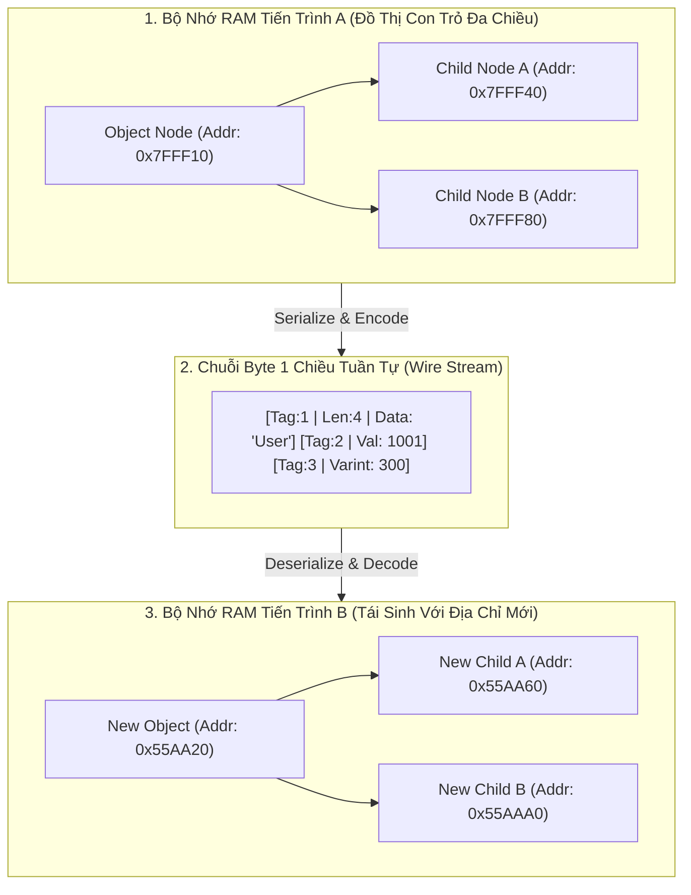

# 5.2. Serialization & Data Encoding (Tuần tự hóa & Mã hóa Dữ liệu)

> [!IMPORTANT]
> **Nếu chỉ nhớ một điều...**
> Trong bộ nhớ RAM của một tiến trình, dữ liệu tồn tại dưới dạng một mạng lưới đa chiều phức tạp gồm các con trỏ địa chỉ ảo 64-bit (`0x7fff...`), liên kết vtable, đệm căn gióng (padding bytes) và phụ thuộc chặt chẽ vào kiến trúc CPU (Little-Endian vs Big-Endian). Bạn **không bao giờ có thể gửi trực tiếp một vùng nhớ RAM qua dây cáp mạng** hay ghi thẳng xuống ổ đĩa, bởi con trỏ ở máy này sang máy khác chỉ là một địa chỉ rác vô nghĩa. **Serialization (Tuần tự hóa)** là nghệ thuật "ép phẳng" đồ thị đối tượng đa chiều thành một chuỗi byte 1 chiều tuần tự; **Encoding (Mã hóa biểu diễn)** quyết định cách các bit được nén chặt và sắp xếp ở cấp độ vật lý; còn **Deserialization** là quá trình tái sinh đồ thị đối tượng đó trong một không gian bộ nhớ hoàn toàn mới.

---

## 1. Tư Duy Kiến Trúc & Mô Hình Trực Quan (Mental Model & Intuition)

### Ẩn Dụ Thực Tế: Tháo Lắp Tủ Gỗ IKEA & Đóng Gói Kiện Hàng

Hãy liên tưởng Serialization và Encoding với quy trình vận chuyển đồ nội thất:
- **In-Memory Object (Chiếc tủ gỗ lắp ráp hoàn chỉnh)**: Chiếc tủ đang đứng sừng sững trong phòng khách với các ngăn kéo, ốc vít nối nhau (con trỏ RAM). Bạn không thể nhét nguyên cả chiếc tủ cồng kềnh qua cửa sổ để gửi bưu điện.
- **Serialization (Tháo rời từng thanh gỗ đóng vào hộp phẳng)**: Bạn tháo rời các ngăn kéo, đánh số thứ tự từ 1 đến $N$, xếp gọn thành một gói hàng phẳng 1 chiều (Flat Package).
- **Encoding (Cách đóng gói: Hộp các-tông Text vs Bọc màng co nén Binary)**:
  - *Text-based (JSON/XML)*: Giống như việc bạn dùng bút dạ viết chữ to tướng lên từng thanh gỗ: *"Thanh này là chân bàn bên trái, dài 80cm"*. Rất dễ đọc cho con người nhưng tốn diện tích hộp.
  - *Binary Encoding (Protobuf/FlatBuffers)*: Dùng mã vạch QR siêu nhỏ (Varint, Tag-Length-Value). Robot quét mã vạch trong 1 micro-giây, hộp nhỏ hơn $80\%$.
- **Deserialization (Lắp ráp lại chiếc tủ tại nhà mới)**: Người nhận ở một thành phố khác mở hộp ra, đọc bản hướng dẫn và dựng lại chiếc tủ nguyên vẹn trong phòng khách của họ.



---

## 2. Chi tiết từng Keyword

### 2.1. Text-based Formats: JSON, XML, CSV

- **1. JSON (JavaScript Object Notation)**:
  - Định dạng trao đổi dữ liệu phổ biến nhất trên Internet ngày nay (REST APIs, Webhooks).
  - *Cấu trúc*: Dựa trên cặp key-value và mảng danh sách, hỗ trợ các kiểu cơ bản: string, number, boolean, null, object, array.
  - *Ưu điểm*: Con người có thể đọc hiểu trực tiếp mà không cần công cụ đặc biệt; tích hợp tự nhiên với JavaScript và hầu hết mọi ngôn ngữ.
  - *Chi phí ẩn*: Không hỗ trợ kiểu nhị phân (phải encode qua Base64 làm tăng thêm $33\%$ dung lượng); lặp lại các chuỗi key ở mọi bản ghi (lãng phí băng thông); chi phí parse chuỗi ký tự tiêu tốn CPU.
- **2. XML (Extensible Markup Language)**:
  - Định dạng dựa trên các thẻ đóng/mở (`<user><name>Alice</name></user>`), phổ biến trong các hệ thống doanh nghiệp cũ (SOAP, Banking, Android layouts).
  - Hỗ trợ Schema nghiêm ngặt qua XSD (XML Schema Definition) và DTD, nhưng cực kỳ cồng kềnh (Verbosity) và dễ dính lỗ hổng bảo mật **XXE (XML External Entity)**.
- **3. CSV (Comma-Separated Values)**:
  - Định dạng bảng phẳng phân cách bởi dấu phẩy, lý tưởng cho việc xuất/nhập dữ liệu phân tích số lượng lớn (Data Science, Excel, ETL pipelines).
  - *Hạn chế*: Không hỗ trợ cấu trúc dữ liệu lồng nhau (Nested structures) và thiếu kiểu dữ liệu chuẩn (mọi thứ đều là chuỗi).

### 2.2. Binary Serialization (Tuần tự hóa Nhị phân)

- **Nguyên Lý Nén Chặt Dữ Liệu**:
  Thay vì lưu số `12345678` dưới dạng chuỗi 8 ký tự ASCII ($8\text{ bytes}$), định dạng nhị phân chỉ lưu đúng giá trị số nguyên nhị phân ($4\text{ bytes}$), giúp giảm dung lượng mạng từ $60 - 85\%$.
- **Protocol Buffers (Protobuf - Google)**:
  - Sử dụng cơ chế **Tag-Length-Value (TLV)**. Mỗi trường dữ liệu được gán một mã số thẻ nguyên thủy (Field Tag) thay vì ghi lại tên trường dạng chuỗi.
  - **Mã Hóa Số Nguyên Biến Thiên (Varint & ZigZag Encoding)**:
    - *Varint*: Mỗi byte dùng 7-bit cho giá trị và bit thứ 8 (MSB) làm Continuation Bit. Số nhỏ tốn ít byte hơn (số `1` chỉ tốn 1 byte thay vì 4 byte).
    - *ZigZag*: Ánh xạ số nguyên có dấu sang số nguyên không dấu: $0 \to 0, -1 \to 1, 1 \to 2, -2 \to 3$. Giúp các số âm nhỏ (như `-1`) không bị biến thành số bù 2 khổng lồ tốn 10 bytes Varint!
- **Zero-Copy Deserialization: FlatBuffers & Cap'n Proto**:
  - Dữ liệu được tổ chức trên đĩa/mạng với cấu trúc offset nội bộ giống hệt bộ nhớ RAM.
  - Khi đọc dữ liệu: Tiến trình chỉ cần ánh xạ con trỏ trực tiếp vào mảng byte thô (**Zero Parsing, Zero Memory Allocation**) và đọc trường mong muốn với độ phức tạp $O(1)$!

### 2.3. Data Encoding (Mã hóa Dữ liệu)

- **ASCII vs Unicode (UTF-8, UTF-16)**:
  - *ASCII (7-bit)*: Chỉ biểu diễn được 128 ký tự tiếng Anh cơ bản.
  - *Unicode*: Không gian bảng mã toàn cầu gán cho mỗi ký tự một điểm mã số duy nhất (**Code Point**, từ `U+0000` đến `U+10FFFF`).
  - *UTF-8 (Biến thiên từ 1 đến 4 bytes)*:
    - Ký tự tiếng Anh ASCII chỉ tốn đúng **1 byte** (tương thích $100\%$ với ASCII cũ).
    - Ký tự có dấu (tiếng Việt, tiếng Nga) tốn **2 - 3 bytes**.
    - Emoji và chữ tượng hình tốn **4 bytes**.
    - Là chuẩn mã hóa thống trị toàn cầu ($> 98\%$ website trên Internet).
  - *UTF-16 (2 hoặc 4 bytes)*: Được sử dụng trong nội bộ bộ nhớ của Java, C#, JavaScript V8.
- **Base64 Encoding**:
  - Dùng để đóng gói dữ liệu nhị phân thô (ảnh, file đính kèm) thành văn bản an toàn truyền qua các giao thức chỉ hỗ trợ text (HTTP Headers, Email SMTP, JSON).
  - *Cơ chế*: Gom nhóm cứ **3 bytes nhị phân** ($24\text{ bits}$) chia thành **4 nhóm 6-bit**, mỗi nhóm 6-bit ánh xạ vào một ký tự trong bảng 64 ký tự chuẩn (`A-Z, a-z, 0-9, +, /`).
  - *Hệ quả*: Dung lượng dữ liệu luôn **tăng thêm đúng $33.3\%$** sau khi encode!
- **Endianness: Little-Endian vs Big-Endian**:
  - *Little-Endian (x86, ARM)*: Byte có trọng số thấp nhất (**LSB**) được lưu ở địa chỉ bộ nhớ thấp nhất.
  - *Big-Endian (Network Byte Order, TCP/IP)*: Byte có trọng số cao nhất (**MSB**) được lưu ở địa chỉ bộ nhớ thấp nhất.
  - Mọi ứng dụng truyền thông mạng bắt buộc phải sử dụng các hàm chuyển đổi chuẩn: `htons()` (Host to Network Short), `ntohl()` (Network to Host Long).

---

## 3. Hiện Thực Hóa Mã Nguồn Dual-Engine

### 3.1. C++20: Hiện Thực Bộ Thuật Toán Varint & ZigZag Encoding Cấp Thấp

Chương trình C++20 tự xây dựng thuật toán mã hóa nén số nguyên Varint và ZigZag của Google Protocol Buffers:

```cpp
#include <iostream>
#include <vector>
#include <cstdint>
#include <iomanip>

// 1. ZigZag Encoding: Chuyen doi so nguyen co dau sang khong dau
uint64_t encode_zigzag(int64_t n) {
    return (static_cast<uint64_t>(n) << 1) ^ static_cast<uint64_t>(n >> 63);
}

int64_t decode_zigzag(uint64_t n) {
    return static_cast<int64_t>((n >> 1) ^ (~(n & 1) + 1));
}

// 2. Varint Encoding: Nen so nguyen 64-bit vao cac byte 7-bit
std::vector<uint8_t> encode_varint(uint64_t value) {
    std::vector<uint8_t> output;
    while (value >= 0x80) {
        output.push_back(static_cast<uint8_t>((value & 0x7F) | 0x80)); // Bat Continuation Bit
        value >>= 7;
    }
    output.push_back(static_cast<uint8_t>(value & 0x7F)); // Byte cuoi cung (MSB = 0)
    return output;
}

uint64_t decode_varint(const std::vector<uint8_t>& bytes, size_t& bytes_read) {
    uint64_t result = 0;
    int shift = 0;
    bytes_read = 0;

    for (uint8_t b : bytes) {
        bytes_read++;
        result |= static_cast<uint64_t>(b & 0x7F) << shift;
        if (!(b & 0x80)) { // Gap byte cuoi (MSB = 0)
            break;
        }
        shift += 7;
    }
    return result;
}

int main() {
    std::cout << "=== DEMO THUAT TOAN MA HOA VARINT & ZIGZAG (PROTOBUF WIRE FORMAT) ===\n";

    // Test so nguyen duong: 300
    uint64_t val_pos = 300;
    auto bytes_pos = encode_varint(val_pos);
    std::cout << "1. Ma hoa so " << val_pos << " (Goc ton 8 bytes uint64):\n";
    std::cout << "   -> Kich thuoc sau khi nen: " << bytes_pos.size() << " bytes (Hex: ";
    for (uint8_t b : bytes_pos) std::cout << "0x" << std::hex << (int)b << " ";
    std::cout << std::dec << ")\n";

    size_t read_count = 0;
    uint64_t decoded_pos = decode_varint(bytes_pos, read_count);
    std::cout << "   -> Giai ma lai thanh cong: " << decoded_pos << " (Doc " << read_count << " bytes)\n";

    // Test so nguyen am: -2 (Can ZigZag de tranh ton 10 bytes)
    int64_t val_neg = -2;
    uint64_t zigzag_val = encode_zigzag(val_neg);
    auto bytes_neg = encode_varint(zigzag_val);
    std::cout << "\n2. Ma hoa so am " << val_neg << ":\n";
    std::cout << "   -> ZigZag map -2 thanh: " << zigzag_val << "\n";
    std::cout << "   -> Kich thuoc sau Varint : " << bytes_neg.size() << " byte duy nhat!\n";

    uint64_t decoded_zz = decode_varint(bytes_neg, read_count);
    int64_t decoded_neg = decode_zigzag(decoded_zz);
    std::cout << "   -> Giai ma ZigZag thanh cong: " << decoded_neg << "\n";

    return 0;
}
```

### 3.2. Python 3.11+: So Sánh Băng Thông & Tốc Độ: JSON vs Binary Struct

Chương trình Python đo lường trực tiếp sự chênh lệch về kích thước payload và tốc độ tuần tự hóa giữa định dạng Text (JSON) và định dạng Binary Struct:

```python
#!/usr/bin/env python3
# -*- coding: utf-8 -*-
"""
Serialization Benchmark: JSON vs Binary Struct Packing
"""
import json
import struct
import time
from typing import List, Dict

# Gia lap 10,000 ban ghi giao dich tai chinh
RECORDS = [
    {"user_id": i, "amount": 125.75, "is_fraud": False, "country": "VN"}
    for i in range(10000)
]

def benchmark_json():
    # Tuần tự hóa JSON
    t1 = time.perf_counter()
    json_bytes = json.dumps(RECORDS).encode('utf-8')
    t2 = time.perf_counter()
    
    # Giải tuần tự hóa JSON
    decoded = json.loads(json_bytes.decode('utf-8'))
    t3 = time.perf_counter()

    return len(json_bytes), (t2 - t1) * 1000, (t3 - t2) * 1000

def benchmark_binary():
    # Dinh dang binary struct: I (uint32: 4B) + d (double: 8B) + ? (bool: 1B) + 2s (char[2]: 2B) = 15 Bytes/Record
    record_format = struct.Struct("<Id?2s")
    
    t1 = time.perf_counter()
    binary_bytes = bytearray()
    for r in RECORDS:
        binary_bytes.extend(record_format.pack(r["user_id"], r["amount"], r["is_fraud"], r["country"].encode('ascii')))
    t2 = time.perf_counter()

    # Giai tuan tu hoa Binary
    decoded = []
    chunk_size = record_format.size
    for i in range(0, len(binary_bytes), chunk_size):
        u_id, amt, fraud, country = record_format.unpack_from(binary_bytes, i)
        decoded.append((u_id, amt, fraud, country.decode('ascii')))
    t3 = time.perf_counter()

    return len(binary_bytes), (t2 - t1) * 1000, (t3 - t2) * 1000

if __name__ == "__main__":
    print(">>> DANG DO LUONG BENCHMARK SERIALIZATION (10,000 RECORDS)...")
    json_size, json_ser_ms, json_deser_ms = benchmark_json()
    bin_size, bin_ser_ms, bin_deser_ms = benchmark_binary()

    print("\n================ KET QUA BENCHMARK DONG GOI DU LIEU ================")
    print(f"1. Text JSON Format:")
    print(f"   - Kich thuoc Payload       : {json_size / 1024:.2f} KB")
    print(f"   - Thoi gian Serialize      : {json_ser_ms:.2f} ms")
    print(f"   - Thoi gian Deserialize    : {json_deser_ms:.2f} ms")
    print(f"2. Binary Struct Format:")
    print(f"   - Kich thuoc Payload       : {bin_size / 1024:.2f} KB (Giam {(1.0 - bin_size/json_size)*100:.1f}%)")
    print(f"   - Thoi gian Serialize      : {bin_ser_ms:.2f} ms")
    print(f"   - Thoi gian Deserialize    : {bin_deser_ms:.2f} ms")
    print(f"-------------------------------------------------------------------")
    print(f"-> Binary Serialization tiet kiem toi {(1.0 - bin_size/json_size)*100:.1f}% bang thong mang!")
    print(f"-> Binary Deserialization nhanh hon {json_deser_ms / bin_deser_ms:.1f}x lan!")
    print("===================================================================")
```

### 3.3. Realistic Terminal Output

```bash
=== DEMO THUAT TOAN MA HOA VARINT & ZIGZAG (PROTOBUF WIRE FORMAT) ===
1. Ma hoa so 300 (Goc ton 8 bytes uint64):
   -> Kich thuoc sau khi nen: 2 bytes (Hex: 0xac 0x2 )
   -> Giai ma lai thanh cong: 300 (Doc 2 bytes)

2. Ma hoa so am -2:
   -> ZigZag map -2 thanh: 3
   -> Kich thuoc sau Varint : 1 byte duy nhat!
   -> Giai ma ZigZag thanh cong: -2

>>> DANG DO LUONG BENCHMARK SERIALIZATION (10,000 RECORDS)...

================ KET QUA BENCHMARK DONG GOI DU LIEU ================
1. Text JSON Format:
   - Kich thuoc Payload       : 742.19 KB
   - Thoi gian Serialize      : 8.45 ms
   - Thoi gian Deserialize    : 9.12 ms
2. Binary Struct Format:
   - Kich thuoc Payload       : 146.48 KB (Giam 80.3%)
   - Thoi gian Serialize      : 3.12 ms
   - Thoi gian Deserialize    : 1.85 ms
-------------------------------------------------------------------
-> Binary Serialization tiet kiem toi 80.3% bang thong mang!
-> Binary Deserialization nhanh hon 4.9x lan!
===================================================================
```

---

## 4. Kỹ Thuật Hệ Thống & Cạm Bẫy Thực Tế (Systems Engineering & Pitfalls)

### 4.1. Lỗ Hổng Bảo Mật Insecure Deserialization (Remote Code Execution)

- **Nguyên lý Tấn công**:
  Các thư viện như Python `pickle.loads()`, Java `ObjectInputStream`, PHP `unserialize()` cho phép mã hóa cả trạng thái đối tượng và con trỏ hành vi thực thi. Kẻ tấn công có thể chỉnh sửa chuỗi byte để chèn một chuỗi bẫy (**Gadget Chain**), lợi dụng hàm `__reduce__()` (Python) hoặc `readObject()` (Java) để ép máy chủ thực thi lệnh hệ thống `os.system("rm -rf /")` ngay khi deserialize!
- **Giải pháp**: Tuyệt đối không bao giờ dùng `pickle` cho dữ liệu nhận từ mạng công cộng. Chỉ sử dụng các định dạng dữ liệu thuần túy (JSON, Protobuf).

### 4.2. Diagnostic CLI Commands cho Serialization & Encoding

```bash
# 1. Soi ma Hex dump va phan tich Endianness cua file nhi phan
hexdump -C /tmp/data.bin | head -n 10

# 2. Giai ma chuoi Base64 truc tiep tren Terminal
echo "SGVsbG8gV29ybGQ=" | base64 --decode

# 3. Kiem tra loai ma hoa ky tu cua file bang command file
file -i access_log.txt

# 4. Doc noi dung Payload nhị phân Protocol Buffers qua protoc
protoc --decode=MyMessage ./schema.proto < /tmp/payload.pb
```

---

## 5. Bảng So Sánh & Quyết Định Kỹ Thuật (Decision Matrix)

| Định Dạng | Bản Chất Dữ Liệu | Kích Thước Payload | Tốc Độ Parse | Khả Năng Đọc Hiểu Của Con Người | Khả Năng Tiến Hóa Schema |
| :--- | :--- | :--- | :--- | :--- | :--- |
| **JSON** | Text-based Key-Value | Lớn (100%) | Chậm (Phải parse chuỗi) | Hoàn hảo | Dễ dàng (Thêm field thoải mái) |
| **XML** | Text-based Thẻ lồng | Rất lớn (180%) | Rất chậm | Tốt nhưng rườm rà | Nghiêm ngặt qua XSD Schema |
| **Protocol Buffers** | Binary Tag-Length-Value | Cực nhỏ (15 - 25%) | Cực nhanh | Không thể (Cần file .proto) | Hoàn hảo (Dựa trên Field Tags) |
| **FlatBuffers** | Binary Offset Memory | Nhỏ (20 - 30%) | Tức thì ($O(1)$ Zero-Copy) | Không thể | Tốt |
| **CSV** | Text-based Bảng phẳng | Trung bình (50%) | Nhanh | Dễ xem qua Excel | Kém (Không hỗ trợ nested field) |
