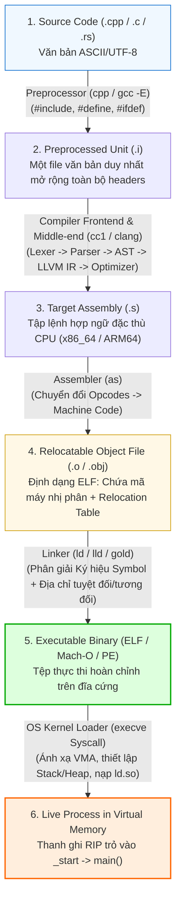

# 6.1. Compilation and Execution Pipeline (Quy trình Biên dịch và Thực thi)

> [!IMPORTANT]
> **Nếu chỉ nhớ một điều...**
> CPU không hề biết "C++", "Rust", "Go" hay "Hàm `main()`" là gì — nó chỉ là một cỗ máy vật lý thực thi mù quáng các luồng byte nhị phân 0 và 1 tại các chu kỳ xung nhịp. **Compilation Pipeline** là chuỗi chuyển hóa hạ tầng đa tầng: từ bản thảo ngôn ngữ cấp cao của con người, qua bộ tiền xử lý (**Preprocessor**), bộ phân tích từ vựng/cú pháp (**Lexer/Parser**), tối ưu hóa trên ngôn ngữ trung gian (**LLVM IR SSA Form**), chuyển thành hợp ngữ (**Assembler** ra Object File `.o`), chốt hạ việc gộp và phân giải địa chỉ ký hiệu (**Linker** ra file thực thi ELF), và cuối cùng được hệ điều hành nạp vào bộ nhớ ảo RAM (**OS Loader `execve`**) để kích hoạt chu kỳ Fetch-Decode-Execute bắt đầu từ địa chỉ `_start`.

---

## 1. Tư Duy Kiến Trúc & Mô Hình Trực Quan (Mental Model & Intuition)

### Toàn Cảnh Vòng Đời Chuyển Hóa Mã Nguồn (End-to-End Pipeline)

Mỗi giai đoạn trong chuỗi biên dịch sinh ra một dạng hiện vật (**Artifact**) trung gian riêng biệt:



---

## 2. Chi tiết từng Keyword

### 2.1. Source Code, Preprocessor và Compiler

- **Source Code**: Văn bản thô được viết bằng các ngôn ngữ bậc cao (C, C++, Rust). Con người có thể đọc hiểu nhưng CPU hoàn toàn mù tịt.
- **Preprocessor (Bộ Tiền Xử Lý - `gcc -E`)**:
  - Hoạt động thuần túy ở cấp độ xử lý chuỗi văn bản (String Manipulation) trước khi cú pháp thực sự được phân tích:
    1. *Sao chép Header (`#include <file>`)*: Mở file header và dán toàn bộ nội dung của file đó vào vị trí hiện tại.
    2. *Mở rộng Macro (`#define`)*: Thay thế các nhãn macro bằng chuỗi tương ứng.
    3. *Biên dịch có điều kiện (`#ifdef`, `#ifndef`, `#endif`)*: Lọc bỏ các khối code không phù hợp với cấu hình kiến trúc hoặc hệ điều hành.
    4. *Loại bỏ chú thích (Comments)*: Xóa toàn bộ các comment `//` và `/* ... */`.
  - Kết quả sinh ra tệp **Translation Unit (`.i`)** duy nhất có thể dài hàng chục ngàn dòng văn bản.
- **Compiler (Trình Biên Dịch - `cc1` / Clang)**:
  - Tiếp nhận Translation Unit và chuyển đổi sang tập lệnh hợp ngữ Assembly (`.s`) phù hợp với kiến trúc phần cứng đích (Target Architecture: x86-64, ARM64, RISC-V).

### 2.2. Các Tầng Biên Dịch Nội Bộ của Trình Biên Dịch (Compiler Internals)

Kiến trúc trình biên dịch hiện đại (như LLVM / GCC) được phân chia làm 3 tầng độc lập:
1. **Frontend (Tiền Tuyến - Lexer & Parser)**:
   - *Lexical Analysis (Lexer)*: Đọc chuỗi ký tự thô và nhóm lại thành các từ vị có nghĩa gọi là **Tokens** (Keywords `if`, Identifiers `counter`, Operators `+`, Literals `42`).
   - *Syntax & Semantic Analysis (Parser)*: Xây dựng cây cú pháp trừu tượng **AST (Abstract Syntax Tree)**, kiểm tra ngữ pháp BNF và thực thi phân tích kiểm tra kiểu tĩnh (**Type Checking**).
2. **Middle-End (Tối Ưu Hóa Trung Gian - LLVM IR & SSA Form)**:
   - Chuyển đổi AST sang dạng biểu diễn trung gian **Intermediate Representation (IR)** độc lập với phần cứng.
   - Áp dụng biểu diễn gán đơn tĩnh (**Static Single Assignment - SSA Form**): Mỗi biến chỉ được gán giá trị duy nhất một lần. Sử dụng hàm $\phi$ (Phi-node) tại các điểm giao luồng rẽ nhánh, giúp thuật toán tối ưu dễ dàng thực hiện:
     - *Dead Code Elimination (Xóa mã chết)*.
     - *Constant Folding & Propagation (Gộp hằng số)*.
     - *Loop Invariant Code Motion (Đẩy mã bất biến ra khỏi vòng lặp)*.
3. **Backend (Hậu Tuyến - Code Generator & Register Allocator)**:
   - *Instruction Selection*: Chọn tập lệnh máy máy tối ưu nhất cho chip đích.
   - *Register Allocation*: Bài toán tô màu đồ thị (**Graph Coloring Algorithm**) của Chaitin để phân bổ hàng trăm biến trừu tượng vào một số lượng hữu hạn các thanh ghi vật lý của CPU (ví dụ: 16 thanh ghi trên x86-64). Nếu thiếu thanh ghi, biến sẽ bị tràn xuống Stack (**Register Spilling**).

### 2.3. Assembler và Object Code

- **Assembler (`as` - Bộ Hợp Dịch)**:
  - Chuyển đổi các câu lệnh hợp ngữ dạng văn bản (`mov rax, [rdi]`) thành các mã máy nhị phân thô (**Opcodes**: ví dụ `48 8b 07`).
- **Relocatable Object File (`.o` / `.obj`)**:
  - Tệp nhị phân được cấu trúc theo chuẩn **ELF (Executable and Linkable Format)** trên Linux hoặc **PE** trên Windows.
  - Chứa các phân vùng bộ nhớ độc lập: `.text` (mã máy), `.data` (biến toàn cục), `.rodata` (hằng số), và `.bss`.
  - **Relocation Table (`.rela.text`)**: Vì Object File được biên dịch độc lập, nó chưa thể biết địa chỉ bộ nhớ tuyệt đối của các hàm nằm ở file `.o` khác (ví dụ: hàm `printf` nằm ở đâu?). Bảng Relocation lưu lại danh sách các vị trí cần được Linker vá lại địa chỉ sau này.

### 2.4. Linker: Static Linking vs Dynamic Linking

- **Sứ Mệnh Của Linker (`ld` / `lld` / `gold`)**:
  Gộp hàng chục file `.o` rời rạc và các thư viện thành một file thực thi duy nhất thông qua hai bước:
  1. *Symbol Resolution (Phân giải Ký hiệu)*: Khớp nối từng lời gọi hàm chưa xác định (Undefined Symbol `U`) với định nghĩa thực sự của nó (Defined Symbol `T`).
  2. *Relocation (Định vị lại Địa chỉ)*: Tính toán địa chỉ bộ nhớ ảo tuyệt đối cho toàn bộ các đoạn mã máy và biến toàn cục, vá lại các offset trong mã máy.
- **Static Linking (Liên Kết Tĩnh - `.a` / `.lib`)**:
  - Linker sao chép trực tiếp mã máy của thư viện từ file Archive (`.a`) vào thẳng tệp thực thi ELF cuối cùng.
  - *Ưu điểm*: File thực thi hoàn toàn độc lập, chạy được ngay trên mọi máy chủ mà không sợ thiếu thư viện phụ thuộc (**Zero Dependency Hell**).
  - *Nhược điểm*: Kích thước file nhị phân lớn; tốn RAM vì mỗi tiến trình nạp riêng một bản sao thư viện; muốn vá lỗi bảo mật bắt buộc phải recompile lại toàn bộ ứng dụng.
- **Dynamic Linking (Liên Kết Động - `.so` / `.dll`)**:
  - Linker chỉ ghi lại tên thư viện và các ký hiệu cần dùng vào bảng `.dynamic`. Mã máy của thư viện không nằm trong file thực thi.
  - *Cơ chế Lazy Binding qua GOT và PLT*:
    - **PLT (Procedure Linkage Table)**: Bảng liên kết thủ tục trong phân vùng code chỉ đọc.
    - **GOT (Global Offset Table)**: Bảng offset toàn cục nằm trong phân vùng dữ liệu có thể ghi.
    - Lần đầu tiên hàm được gọi: PLT nhảy vào Dynamic Linker (`ld.so`) để tra cứu địa chỉ thực của hàm trong RAM và ghi đè địa chỉ đó vào GOT. Các lần gọi tiếp theo sẽ nhảy thẳng qua GOT mà không tốn chi phí phân giải lại!

### 2.5. Loader (Bộ nạp của Hệ điều hành)

- **Quy Trình Khởi Tạo Tiến Trình Của Kernel**:
  Khi bạn gõ `./my_app` trên terminal:
  1. Shell gọi system call `fork()` để nhân bản tiến trình con.
  2. Tiến trình con gọi system call **`execve("/path/to/my_app", argv, envp)`**.
- **Các Bước Nạp Bộ Nhớ (OS Loader)**:
  1. Kernel đọc **ELF Header** và kiểm tra Magic Bytes (`0x7F 'E' 'L' 'F'`).
  2. Đọc các **Program Headers (`PT_LOAD`)** và gọi `mmap()` để ánh xạ các phân vùng `.text`, `.data`, `.rodata` vào không gian địa chỉ ảo 48-bit của tiến trình.
  3. Khởi tạo phân vùng **Stack** (nạp sẵn các đối số dòng lệnh `argv` và biến môi trường `envp`) và thiết lập con trỏ Heap `brk`.
  4. Nếu là file liên kết động: Kernel nạp trình liên kết động **`/lib64/ld-linux-x86-64.so.2`** vào bộ nhớ để tải các thư viện `.so`.
  5. Đặt thanh ghi con trỏ lệnh `RIP` trỏ thẳng vào **Entry Point (`_start`)** trong thư viện `crt1.o` (C Runtime Startup). Hàm `_start` thiết lập môi trường, gọi hàm khởi tạo tĩnh, và cuối cùng mới gọi hàm `main(argc, argv)` của bạn!

---

## 3. Hiện Thực Hóa Mã Nguồn Dual-Engine

### 3.1. C++20: Khám Nghiệm Ký Hiệu Mạnh / Yếu & Ranh Giới Liên Kết

Chương trình C++20 minh họa cơ chế phân giải ký hiệu mạnh (**Strong Symbol**) và ký hiệu yếu (**Weak Symbol** - `__attribute__((weak))`) được Linker sử dụng để hỗ trợ cắm ghi đè hàm (Hooking/Mocking):

```cpp
#include <iostream>
#include <string_view>

// 1. Ký hiệu Yếu (Weak Symbol): Có thể bị ghi đè bởi bất kỳ ký hiệu Mạnh nào cùng tên lúc Link
__attribute__((weak)) 
void platform_specific_init() {
    std::cout << "[DEFAULT WEAK HOOK]: Khoi tao nen tang mac dinh (Generic POSIX).\n";
}

// 2. Ký hiệu Mạnh (Strong Symbol): Định nghĩa hàm chính thức
void execute_application_logic() {
    std::cout << "  [APP CORE]: Dang thuc thi logic ung dung chinh tren CPU...\n";
}

int main() {
    std::cout << "=== DEMO PHAN GIAI KY HIEU LINKER (STRONG VS WEAK SYMBOLS) ===\n";
    // Linker se goi ham Weak neu khong co file .o nao khac dinh nghia ham Strong
    platform_specific_init();
    execute_application_logic();
    std::cout << "-> Chuong trinh thuc thi hoan tat an toan.\n";
    return 0;
}
```

### 3.2. Python 3.11+: Mini Compiler Frontend (Lexer $\to$ AST $\to$ 3-Address Code IR)

Chương trình Python hiện thực trọn vẹn tầng Frontend và Middle-end của trình biên dịch: Phân tích từ vựng (Lexer), dựng cây cú pháp (AST) bằng đệ quy, và sinh mã trung gian **Three-Address Code (TAC)**:

```python
#!/usr/bin/env python3
# -*- coding: utf-8 -*-
"""
Mini-Compiler Pipeline: Source -> Lexer -> AST -> Three-Address Code (IR)
"""
import re
from typing import List, Tuple

# 1. LEXER (PHÂN TÍCH TỪ VỰNG)
TOKEN_SPEC = [
    ('NUMBER',   r'\d+'),
    ('IDENT',    r'[A-Za-z_]\w*'),
    ('ASSIGN',   r'='),
    ('PLUS',     r'\+'),
    ('MINUS',    r'-'),
    ('MUL',      r'\*'),
    ('DIV',      r'/'),
    ('LPAREN',   r'\('),
    ('RPAREN',   r'\)'),
    ('SEMI',     r';'),
    ('SKIP',     r'[ \t\n]+'),
]

class Token:
    def __init__(self, type_: str, value: str):
        self.type = type_
        self.value = value
    def __repr__(self):
        return f"Token({self.type}, '{self.value}')"

def tokenize(source_code: str) -> List[Token]:
    tokens = []
    tok_regex = '|'.join(f'(?P<{name}>{pattern})' for name, pattern in TOKEN_SPEC)
    for mo in re.finditer(tok_regex, source_code):
        kind = mo.lastgroup
        val = mo.group()
        if kind != 'SKIP':
            tokens.append(Token(kind, val))
    return tokens

# 2. AST NODES
class ASTNode: pass

class BinOp(ASTNode):
    def __init__(self, left, op, right):
        self.left = left
        self.op = op
        self.right = right

class Num(ASTNode):
    def __init__(self, val): self.val = val

class Var(ASTNode):
    def __init__(self, name): self.name = name

# 3. THREE-ADDRESS CODE GENERATOR (LLVM IR STYLE)
class TACGenerator:
    def __init__(self):
        self.temp_count = 0
        self.instructions = []

    def new_temp(self) -> str:
        self.temp_count += 1
        return f"t{self.temp_count}"

    def generate(self, node: ASTNode) -> str:
        if isinstance(node, Num):
            return node.val
        if isinstance(node, Var):
            return node.name
        if isinstance(node, BinOp):
            t_left = self.generate(node.left)
            t_right = self.generate(node.right)
            t_out = self.new_temp()
            self.instructions.append(f"{t_out} = {t_left} {node.op} {t_right}")
            return t_out
        raise TypeError("Node khong hop le!")

if __name__ == "__main__":
    source = "x = (42 + y) * 10;"
    print(f">>> MA NGUON BAN DAU : {source}\n")

    # 1. Lexing
    tokens = tokenize(source)
    print("1. KET QUA PHAN TICH TU VUNG (LEXER TOKENS):")
    print("  ", tokens[:6], "...\n")

    # 2. Thu cong gia lap AST cho bieu thuc (42 + y) * 10
    ast = BinOp(
        left=BinOp(left=Num("42"), op="+", right=Var("y")),
        op="*",
        right=Num("10")
    )

    # 3. Code Generation sang SSA / Three-Address Code
    tac_gen = TACGenerator()
    final_res = tac_gen.generate(ast)
    tac_gen.instructions.append(f"x = {final_res}")

    print("2. MA TRUNG GIAN THREE-ADDRESS CODE (IR / SSA STYLE):")
    for instr in tac_gen.instructions:
        print(f"   {instr}")
```

### 3.3. Realistic Terminal Output

```bash
=== DEMO PHAN GIAI KY HIEU LINKER (STRONG VS WEAK SYMBOLS) ===
[DEFAULT WEAK HOOK]: Khoi tao nen tang mac dinh (Generic POSIX).
  [APP CORE]: Dang thuc thi logic ung dung chinh tren CPU...
-> Chuong trinh thuc thi hoan tat an toan.

>>> MA NGUON BAN DAU : x = (42 + y) * 10;

1. KET QUA PHAN TICH TU VUNG (LEXER TOKENS):
   [Token(IDENT, 'x'), Token(ASSIGN, '='), Token(LPAREN, '('), Token(NUMBER, '42'), Token(PLUS, '+'), Token(IDENT, 'y')] ...

2. MA TRUNG GIAN THREE-ADDRESS CODE (IR / SSA STYLE):
   t1 = 42 + y
   t2 = t1 * 10
   x = t2
```

---

## 4. Kỹ Thuật Hệ Thống & Cạm Bẫy Thực Tế (Systems Engineering & Pitfalls)

### 4.1. Lỗi Liên Kết Kinh Điển: Multiple Definition vs Undefined Reference

1. **Undefined reference to `foo()` (Linker Error LNK2019 / `ld` return 1)**:
   - *Nguyên nhân*: Bạn đã khai báo nguyên mẫu hàm trong header (`void foo();`), trình biên dịch Frontend chấp nhận; nhưng Linker không tìm thấy bất kỳ file `.o` nào chứa mã máy định nghĩa thực sự của hàm đó.
   - *Khắc phục*: Kiểm tra file `CMakeLists.txt` xem đã thêm file `.cpp` chứa định nghĩa vào danh sách build chưa.
2. **Multiple definition of `counter`**:
   - *Nguyên nhân*: Khởi tạo biến toàn cục `int counter = 0;` trực tiếp trong file header `.h`. Khi header được include vào $N$ file `.cpp` khác nhau, mỗi file `.o` đều sinh ra một Strong Symbol `counter`, khiến Linker xung đột!
   - *Khắc phục*: Dùng từ khóa `extern int counter;` trong header và chỉ định nghĩa biến trong đúng 1 file `.cpp`, hoặc dùng từ khóa `inline int counter = 0;` (C++17).

### 4.2. Diagnostic CLI Commands cho Khám Nghiệm File Nhị Phân Linux

```bash
# 1. Doc ELF Header (Kien truc chip, Entry point _start, kich thuoc header)
readelf -h ./my_app

# 2. Soi toan bo danh sach cac Sections (.text, .rodata, .data, .bss, .got, .plt)
readelf -S ./my_app

# 3. Liet ke toan bo Symbol Table va phan loai: T (Text/Code), U (Undefined), W (Weak)
nm -C ./my_app | grep -E " (T|U|W) " | head -n 20

# 4. Kiem tra danh sach cac thu vien lien ket dong (.so) ma chuong trinh phu thuoc
ldd ./my_app

# 5. Dich nguoc ma may nhị phan sang Hop ngu x86_64 Intel Assembler
objdump -d -M intel --no-show-raw-insn ./my_app | grep -A 20 "<main>:"
```

---

## 5. Bảng So Sánh & Quyết Định Kỹ Thuật (Decision Matrix)

| Giai Đoạn Pipeline | Đầu Vào (Input) | Đầu Ra (Output) | Công Cụ Chịu Trách Nhiệm | Lỗi Phổ Biến Thường Gặp |
| :--- | :--- | :--- | :--- | :--- |
| **Preprocessing** | Source Code `.cpp`, `.h` | Translation Unit `.i` | `cpp`, `gcc -E` | File not found (`#include`), Macro expansion bug |
| **Compilation** | Translation Unit `.i` | Hợp ngữ `.s` (Assembly)| `cc1`, `clang` | Syntax error, Type mismatch, Borrow check error |
| **Assembly** | Hợp ngữ `.s` | Object File `.o` (ELF) | `as` (GNU Assembler) | Invalid instruction opcode, Unsupported register |
| **Linking** | Danh sách `.o` & `.a`/`.so` | Executable Binary ELF | `ld`, `lld`, `gold` | Undefined reference, Multiple definition |
| **Loading** | Binary ELF trên đĩa | Tiến trình trong RAM | Linux Kernel `execve` | `SIGSEGV` (Bad entry), Missing `.so` dependency |
