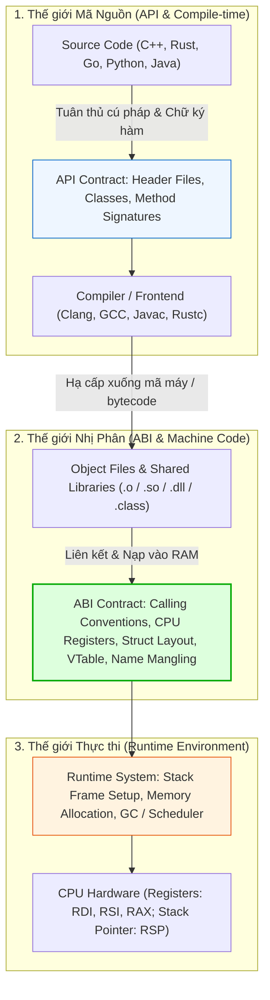
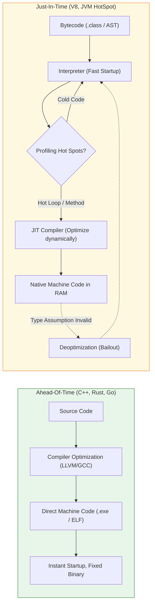
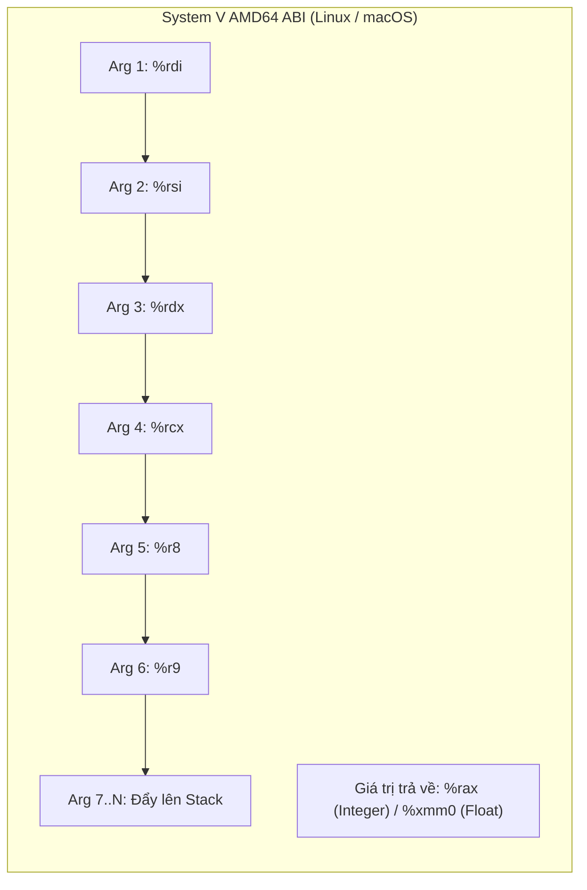

# 6.2. Runtime Environments and ABI (Môi trường Thực thi và Giao diện Nhị phân)

> [!IMPORTANT]
> **Nếu bạn chỉ được nhớ một điều duy nhất**: Nếu **API (Application Programming Interface)** là bản hợp đồng ngoại giao ký kết bằng văn bản tiếng người ở cấp độ mã nguồn (Source-level: tên hàm, danh sách tham số, kiểu dữ liệu), thì **ABI (Application Binary Interface)** là **nghi thức bắt tay vật lý sinh tử ở tầng mã máy nhị phân** giữa các tệp nhị phân đã biên dịch sẵn (`.o`, `.so`, `.dll`). ABI quy định khắt khe: tham số thứ nhất phải nạp vào thanh ghi `RDI` hay đẩy vào Stack? Ai là người dọn dẹp ngăn xếp (Caller hay Callee)? Bộ nhớ đệm căn gióng struct theo bội số mấy byte? Chỉ cần lệch 1 byte padding hoặc khác biệt quy ước gọi hàm, CPU sẽ đọc sai địa chỉ ô nhớ và làm sập toàn bộ tiến trình bằng tín hiệu `SIGSEGV` bí ẩn.

---

## 1. Kiến trúc Tổng quan & Mô hình Tư duy (Mental Model)

Mọi chương trình máy tính sau khi viết xong đều phải trải qua ranh giới từ "văn bản mã nguồn" sang "mã máy nhị phân", và từ "mã máy tĩnh" sang "tiến trình sống trên RAM". Quá trình này được phân tầng thành hai thế giới riêng biệt:



---

## 2. Chi tiết từng Keyword (Under-the-Hood Deep Dive)

### 2.1. Bytecode và Virtual Machine (Máy ảo phần mềm)

- **Bytecode là gì?**: Bytecode là tập hợp các chỉ thị mã máy trung gian (Intermediate Representation - IR) được thiết kế cho một bộ vi xử lý trừu tượng (Abstract Virtual Machine). Bytecode độc lập với kiến trúc phần x86 hay ARM vật lý.
- **Phân loại Kiến trúc Virtual Machine**:
  1. **Stack-based VM (JVM, Python bytecode, WebAssembly v1)**:
     - Mọi toán hạng được đẩy vào một ngăn xếp toán hạng (**Operand Stack**).
     - Phép cộng `a + b` được biên dịch thành: `iload_1`, `iload_2`, `iadd`, `istore_3`.
     - *Ưu điểm*: Bytecode cực kỳ gọn gàng (không cần mã hóa số hiệu thanh ghi), dễ viết trình biên dịch.
     - *Nhược điểm*: Số lượng lệnh thực thi lớn, tốn nhiều chu kỳ CPU để push/pop bộ nhớ ảo.
  2. **Register-based VM (LuaJIT, Android Dalvik/ART)**:
     - Sử dụng một tập thanh ghi ảo (Virtual Registers, ví dụ `R0`, `R1`, `R2`).
     - Phép cộng `a + b` thực hiện trong 1 lệnh duy nhất: `ADD R3, R1, R2`.
     - *Ưu điểm*: Giảm đáng kể số lượng chỉ thị thực thi, tốc độ diễn giải (Interpreter dispatch) nhanh hơn 20% - 35% so với Stack-based VM.
- **Cơ chế Dispatch Loop của Trình thông dịch (Interpreter Loop)**:
  - Trình thông dịch chạy một vòng lặp vô tận `while (true)` đọc opcode và rẽ nhánh.
  - Các kỹ thuật tối ưu hóa vòng lặp dispatch:
    - *Switch-based dispatch*: Dùng lệnh `switch(opcode)` chuẩn trong C/C++. Nhược điểm: Gây branch misprediction liên tục tại lệnh `switch`.
    - *Direct Threading*: Sử dụng bảng địa chỉ nhãn (labels-as-values trong GCC/Clang: `goto *dispatch_table[opcode]`), loại bỏ hoàn toàn chi phí kiểm tra nhánh của lệnh `switch`.

---

### 2.2. JIT Compilation vs AOT Compilation



- **AOT (Ahead-Of-Time Compilation)**:
  - Mã nguồn được biên dịch hoàn toàn thành mã máy nhị phân bản địa trước khi phân phối.
  - *Đặc điểm*: Khởi động ngay lập tức (Cold start = 0ms), tiêu thụ bộ nhớ RAM thấp và ổn định. Tuy nhiên, trình biên dịch phải thận trọng vì không biết trước dữ liệu đầu vào thực tế.
- **JIT (Just-In-Time Compilation)**:
  - Chương trình khởi động bằng cách thông dịch bytecode (để nạp nhanh), đồng thời bộ thu thập thông tin (**Profiler**) theo dõi mã nguồn để tìm ra các hàm chạy liên tục (**Hotspots**).
  - Khi một hàm vượt ngưỡng số lần gọi (Execution Counter Threshold), trình biên dịch JIT sẽ biên dịch hàm đó thẳng ra mã máy x86/ARM tối ưu hóa cao độ trong bộ nhớ RAM.
- **V8 Engine Pipeline (Bên trong Chrome & Node.js)**:
  1. **Ignition (Bytecode Interpreter)**: Chuyển Abstract Syntax Tree (AST) thành bytecode và thực thi ngay lập tức để giảm thời gian phản hồi trang web ban đầu.
  2. **Sparkplug (Baseline Compiler)**: Biên dịch nhanh bytecode thành mã máy thô không tối ưu, tăng tốc độ thực thi 2x - 3x mà không tốn tài nguyên phân tích.
  3. **TurboFan (Optimizing Compiler)**: Phân tích Profile dữ liệu kiểu (Type Feedback Vectors). Nếu phát hiện một hàm `add(a, b)` luôn luôn nhận số nguyên `int`, TurboFan sẽ tạo ra mã máy chuyên biệt dùng chỉ thị CPU `ADD`.
  4. **Deoptimization (Bailout)**: Nếu đột nhiên có lời gọi `add("hello", "world")`, giả định kiểu bị phá vỡ. TurboFan lập tức hủy mã máy tối ưu, khôi phục lại trạng thái thanh ghi và quay về chế độ thông dịch an toàn của Ignition.

---

### 2.3. Standard Library vs Runtime Library

Rất nhiều kỹ sư nhầm lẫn giữa thư viện chuẩn (Standard Library) và môi trường thực thi (Runtime Library):

| Đặc trưng | Standard Library (Thư viện Chuẩn) | Runtime Library (Môi trường Thực thi Hệ thống) |
| :--- | :--- | :--- |
| **Bản chất** | Tập hợp các hàm tiện ích, cấu trúc dữ liệu được chuẩn hóa theo ngôn ngữ (`std::vector`, `std::sort`, Python `math`, Go `strings`). | Đoạn mã nền tảng bắt buộc phải có để chương trình có thể chạy được trên hệ điều hành (`crt0.o`, GC engine, Goroutine scheduler, Stack unwinding). |
| **Tính phụ thuộc** | Tùy chọn (Optional): Chương trình C/C++ có thể biên dịch với cờ `-nostdlib` mà vẫn chạy bình thường. | Bắt buộc (Mandatory): Nếu không có runtime, chương trình không thể khởi tạo Stack, không thể gọi hàm `main()`. |
| **Khởi động** | Được gọi tường minh bởi lập trình viên khi có nhu cầu sử dụng. | Tự động chạy **trước khi** hàm `main()` được gọi (ví dụ: hàm `_start` trong file khởi tạo C Runtime). |
| **Trọng lượng** | Chiếm dung lượng tĩnh trong file nhị phân theo các hàm được liên kết. | Có thể siêu nhẹ (C CRT chỉ vài chục KB) hoặc rất nặng (Go Runtime ~2MB nhúng kèm, JVM ~100MB). |

- **Điểm khởi đầu thực sự: `_start` vs `main`**:
  - Khi bạn chạy file nhị phân ELF trên Linux, kernel không hề gọi hàm `main()`.
  - Kernel nạp nhị phân vào RAM, khởi tạo ngăn xếp chứa `argc`, `argv`, `envp`, rồi nhảy đến điểm vào mặc định là ký hiệu `_start` thuộc Runtime Library (`crt1.o`).
  - Hàm `_start` thiết lập bộ nhớ heap, khởi tạo biến toàn cục tĩnh, đăng ký các hàm dọn dẹp `atexit`, sau đó mới gọi hàm `main(argc, argv)`. Khi `main()` trả về, `_start` nhận giá trị trả về và gọi syscall `sys_exit` để chấm dứt tiến trình.

---

### 2.4. ABI (Application Binary Interface) vs API

#### Khái niệm Phân định
- **API (Application Programming Interface)**: Hợp đồng ở cấp độ mã nguồn. Quy định tên hàm, kiểu dữ liệu, interface. Nếu bạn thay đổi chữ ký hàm, trình biên dịch sẽ báo lỗi Compile-time Error.
- **ABI (Application Binary Interface)**: Hợp đồng ở cấp độ mã máy nhị phân. Quy định cách thức các module nhị phân tương tác vật lý với nhau trên thanh ghi CPU và bộ nhớ RAM.



#### Calling Conventions: System V AMD64 vs Microsoft x64
- **System V AMD64 (Linux, macOS, BSD)**:
  - 6 tham số số nguyên/con trỏ đầu tiên được truyền qua các thanh ghi: `RDI`, `RSI`, `RDX`, `RCX`, `R8`, `R9`.
  - Tham số thứ 7 trở đi mới phải đẩy lên Stack (chi phí truy cập bộ nhớ cao hơn).
  - Thanh ghi bảo toàn (**Callee-saved / Preserved**): `RBX`, `RSP`, `RBP`, `R12`, `R13`, `R14`, `R15`. Hàm được gọi muốn dùng các thanh ghi này bắt buộc phải `PUSH` lưu lại và `POP` khôi phục trước khi thoát.
  - Thanh ghi tạm thời (**Caller-saved / Scratch**): `RAX`, `RCX`, `RDX`, `RSI`, `RDI`, `R8`, `R9`, `R10`, `R11`.
  - **Quy tắc Căn gióng 16-byte Stack**: Con trỏ ngăn xếp `RSP` bắt buộc phải chia hết cho 16 trước khi thực hiện lệnh `CALL`. Điều này đảm bảo an toàn tuyệt đối cho các tập lệnh vector SIMD (SSE/AVX).
- **Microsoft x64 ABI (Windows)**:
  - Chỉ truyền 4 tham số qua thanh ghi: `RCX`, `RDX`, `R8`, `R9`.
  - Bắt buộc Caller phải dành sẵn **32 bytes Shadow Space (Home Space)** trên đỉnh Stack để Callee có thể ghi đè 4 thanh ghi này khi cần.
- **Name Mangling và C++ ABI Fragility**:
  - Do C++ hỗ trợ nạp chồng hàm (Function Overloading) và Namespace, trình biên dịch C++ mã hóa tên hàm và kiểu tham số thành ký hiệu nhị phân phức tạp (ví dụ: `process(double)` biến thành `_Z7processd`).
  - Mỗi trình biên dịch (GCC, Clang, MSVC) hoặc mỗi phiên bản thư viện chuẩn `libstdc++` có thể mangling khác nhau hoặc thay đổi bố cục class, dẫn đến lỗi xung đột nhị phân (ABI Incompatibility).
  - Từ khóa `extern "C"`: Ép trình biên dịch C++ tắt bỏ Name Mangling, giữ nguyên tên hàm nhị phân thô theo chuẩn **C ABI**.

---

### 2.5. FFI (Foreign Function Interface - Giao diện Hàm Ngoại ngữ)

- **FFI là gì?**: Cơ chế cho phép một chương trình viết bằng một ngôn ngữ lập trình (ví dụ: Python, JavaScript/Node.js, Rust, Go) gọi trực tiếp các hàm hoặc sử dụng các dịch vụ được viết bằng một ngôn ngữ khác (thông thường là C/C++) mà không cần qua tiến trình IPC.
- **Tại sao C ABI là "Lingua Franca" (Ngôn ngữ Trung gian Chung) của Thế giới Phần mềm?**:
  - Ngôn ngữ C không có Name Mangling, không có GC, không có biệt lệ ảo (virtual exception handling).
  - Bố cục Struct trong C hoàn toàn phẳng và có quy tắc căn gióng bộ nhớ tất định.
  - Mọi ngôn ngữ hiện đại (Python qua `ctypes`/`cffi`, Node.js qua `node-addon-api`, Rust qua `extern "C"`, Go qua `cgo`) đều hỗ trợ liên kết trực tiếp với chuẩn C ABI.
- **Chi phí Vật lý của FFI (Marshalling Overhead)**:
  - Khi gọi qua FFI, dữ liệu phải được chuyển đổi (**Data Marshalling**) giữa biểu diễn của ngôn ngữ cấp cao (ví dụ: Python `str` là đối tượng `PyASCIIObject` phức tạp) sang con trỏ `const char*` của C.
  - Cần chú ý cấp phát và giải phóng bộ nhớ để tránh Memory Leak hoặc use-after-free khi đối tượng bộ nhớ được chia sẻ giữa Garbage Collector và C allocator (`malloc`/`free`).

---

## 3. Dual-Engine Code Implementation

### Engine 1: C++20 — Khám nghiệm Căn gióng Struct Memory Padding & Gọi Hàm Assembly qua System V ABI

```cpp
#include <iostream>
#include <cstdint>
#include <cstddef>

// 1. Cấu trúc thiết kế cẩu thả: Bị phình to do Padding rác
struct BadLayout {
    uint8_t  a; // 1 byte
    // Padding: 7 bytes rác ở đây để 'b' căn gióng theo bội số của 8!
    uint64_t b; // 8 bytes
    uint8_t  c; // 1 byte
    // Padding: 7 bytes rác ở đuôi để toàn bộ struct là bội số của 8!
};

// 2. Cấu trúc tối ưu hóa sắp xếp trường (Sắp xếp theo thứ tự giảm dần kích thước)
struct OptimizedLayout {
    uint64_t b; // 8 bytes
    uint8_t  a; // 1 byte
    uint8_t  c; // 1 byte
    // Padding: Chỉ còn đúng 6 bytes ở đuôi
};

// Hàm tuân thủ nghiêm ngặt chuẩn C ABI (không Name Mangling)
extern "C" int64_t compute_sum_c_abi(int64_t x, int64_t y) {
    return x + y;
}

int main() {
    std::cout << "=== KHÁM NGHIỆM STRUCT MEMORY PADDING & C ABI (C++20) ===\n\n";

    std::cout << "[1] Phân tích Bộ nhớ Struct Alignment:\n";
    std::cout << "    BadLayout size:       " << sizeof(BadLayout) << " bytes (Lãng phí 14 bytes padding!)\n";
    std::cout << "    OptimizedLayout size: " << sizeof(OptimizedLayout) << " bytes (Tiết kiệm 8 bytes RAM!)\n";
    std::cout << "    Offset của trường 'b' trong BadLayout: " << offsetof(BadLayout, b) << " bytes\n\n";

    // 2. Gọi hàm compute_sum_c_abi thông qua Inline Assembly tuân thủ System V AMD64 ABI:
    // Tham số 1 nạp vào RDI, tham số 2 nạp vào RSI, kết quả nhận về tại RAX
    int64_t arg1 = 100;
    int64_t arg2 = 250;
    int64_t asm_result = 0;

#if defined(__x86_64__)
    asm (
        "movq %[x], %%rdi\n\t"  // Nạp arg1 vào thanh ghi %rdi
        "movq %[y], %%rsi\n\t"  // Nạp arg2 vào thanh ghi %rsi
        "call compute_sum_c_abi\n\t"
        "movq %%rax, %[res]\n\t" // Đọc giá trị trả về từ %rax
        : [res] "=r" (asm_result)
        : [x] "r" (arg1), [y] "r" (arg2)
        : "rdi", "rsi", "rax", "rcx", "rdx", "r8", "r9", "r10", "r11", "memory"
    );
#else
    asm_result = compute_sum_c_abi(arg1, arg2);
#endif

    std::cout << "[2] Gọi hàm trực tiếp qua System V Calling Convention (Inline ASM):\n";
    std::cout << "    Kết quả tính toán: " << arg1 << " + " << arg2 << " = " << asm_result << '\n';

    return 0;
}
```

```text
=== KHÁM NGHIỆM STRUCT MEMORY PADDING & C ABI (C++20) ===

[1] Phân tích Bộ nhớ Struct Alignment:
    BadLayout size:       24 bytes (Lãng phí 14 bytes padding!)
    OptimizedLayout size: 16 bytes (Tiết kiệm 8 bytes RAM!)
    Offset của trường 'b' trong BadLayout: 8 bytes

[2] Gọi hàm trực tiếp qua System V Calling Convention (Inline ASM):
    Kết quả tính toán: 100 + 250 = 350
```

---

### Engine 2: Python — Giao tiếp Trực tiếp với C ABI thông qua `ctypes` FFI

```python
#!/usr/bin/env python3
"""
Foreign Function Interface (FFI) Engine using Python's ctypes.
Directly interfaces with the OS C ABI (libc) and inspects struct binary packing.
"""
import ctypes
import ctypes.util

# 1. Định nghĩa cấu trúc dữ liệu theo đúng chuẩn C ABI trong RAM
class PointStruct(ctypes.Structure):
    _fields_ = [
        ("id", ctypes.c_uint8),    # 1 byte
        # C ABI tự động chèn 3 bytes padding tại đây để int32 căn gióng 4-byte!
        ("x",  ctypes.c_int32),    # 4 bytes
        ("y",  ctypes.c_int32),    # 4 bytes
    ]

def demonstrate_ffi_and_abi():
    print("=== DEMO PYTHON FFI VÀ GIAO DIỆN NHỊ PHÂN C ABI ===")

    # 1. Khám nghiệm kích thước bộ nhớ của C Struct từ phía Python
    pt = PointStruct(id=1, x=100, y=200)
    print(f"\n[1] Kích thước PointStruct theo C ABI: {ctypes.sizeof(pt)} bytes")
    print(f"    Offset của 'id': {PointStruct.id.offset} bytes")
    print(f"    Offset của 'x':  {PointStruct.x.offset} bytes (Bị dịch 4 bytes do padding)")
    print(f"    Offset của 'y':  {PointStruct.y.offset} bytes")

    # 2. Nạp thư viện C Runtime chuẩn (libc) của Hệ điều hành
    libc_path = ctypes.util.find_library("c")
    if not libc_path:
        libc_path = "libc.so.6"
    libc = ctypes.CDLL(libc_path)

    # 3. Cấu hình chữ ký hàm C ABI: int puts(const char *s);
    # System V AMD64 ABI: Tham số con trỏ s nạp vào RDI
    libc.puts.argtypes = [ctypes.c_char_p]
    libc.puts.restype = ctypes.c_int

    print("\n[2] Gọi hàm puts() trong libc.so trực tiếp từ Python qua C ABI:")
    message = b"-> [Native C puts() executed directly via Python FFI] Hello World!"
    libc.puts(message)

    # 4. Gọi hàm toán học C ABI: double sqrt(double x);
    libm_path = ctypes.util.find_library("m")
    if libm_path:
        libm = ctypes.CDLL(libm_path)
        # Calling convention: Double truyền vào XMM0, nhận về tại XMM0
        libm.sqrt.argtypes = [ctypes.c_double]
        libm.sqrt.restype = ctypes.c_double
        val = 144.0
        res = libm.sqrt(val)
        print(f"\n[3] Gọi hàm libm.sqrt({val}) qua XMM0 Floating Register: {res}")

if __name__ == "__main__":
    demonstrate_ffi_and_abi()
```

```text
=== DEMO PYTHON FFI VÀ GIAO DIỆN NHỊ PHÂN C ABI ===

[1] Kích thước PointStruct theo C ABI: 12 bytes
    Offset của 'id': 0 bytes
    Offset của 'x':  4 bytes (Bị dịch 4 bytes do padding)
    Offset của 'y':  8 bytes

[2] Gọi hàm puts() trong libc.so trực tiếp từ Python qua C ABI:
-> [Native C puts() executed directly via Python FFI] Hello World!

[3] Gọi hàm libm.sqrt(144.0) qua XMM0 Floating Register: 12.0
```

---

## 4. Systems Engineering & Production Pitfalls

### 4.1. Cơn Ác mộng "Gãy vỡ ABI" (The C++ ABI Fragility Problem)

Tại sao các hệ thống máy chủ enterprise cực kỳ sợ cập nhật thư viện chia sẻ C++ (`.so`)?
- Giả sử thư viện `libauth.so` v1.0 có lớp:
  ```cpp
  class UserSession {
  public:
      int user_id;       // Offset 0
      int role_id;       // Offset 4
  };
  ```
- Ứng dụng backend của bạn được biên dịch với header v1.0 $\implies$ Trình biên dịch hardcode câu lệnh máy: `MOV EAX, [RDI + 4]` để đọc `role_id`.
- Phiên bản v2.0 của `libauth.so` chèn thêm một trường private vào giữa:
  ```cpp
  class UserSession {
  private:
      bool is_authenticated; // 1 byte + 3 bytes padding
  public:
      int user_id;           // Bị đẩy lùi xuống Offset 4!
      int role_id;           // Bị đẩy lùi xuống Offset 8!
  };
  ```
- Nếu bạn cập nhật file `libauth.so` lên máy chủ mà **không biên dịch lại ứng dụng backend**: Khi chạy, ứng dụng vẫn đọc `[RDI + 4]`, đọc nhầm `user_id` thay vì `role_id` $\implies$ **Lỗ hổng leo thang đặc quyền nghiêm trọng hoặc Crash tiến trình ngay lập tức!**
- **Giải pháp**: Áp dụng triệt để thành ngữ **PIMPL (Pointer to Implementation)** hoặc Interface trừu tượng thuần túy để che giấu kích thước bộ nhớ của class bên trong thư viện chia sẻ.

---

### 4.2. Các Công cụ Khám nghiệm ABI & Struct Padding trên Linux

```bash
# 1. Soi chi tiết từng byte padding và lãng phí cacheline trong Struct C/C++
pahole -C BadLayout ./my_binary

# 2. Dịch ngược chuỗi tên hàm đã bị C++ Name Mangling sang chữ người đọc được
c++filt _Z7processd
# Kết quả xuất ra: process(double)

# 3. Kiểm tra các phiên bản ABI của thư viện chuẩn GNU C++ trên hệ thống
strings /usr/lib/x86_64-linux-gnu/libstdc++.so.6 | grep GLIBCXX_3.4

# 4. Kiểm tra symbol table và export functions của dynamic library
readelf -Ws /lib/x86_64-linux-gnu/libc.so.6 | grep " puts"
```

---

## 5. Bảng So sánh & Decision Matrix

| Khía cạnh Kỹ thuật | API (Source Contract) | ABI (Binary Contract) | FFI (Cross-Language Bridge) | Bytecode VM (Managed Runtime) | Native AOT (Direct Binary) |
| :--- | :--- | :--- | :--- | :--- | :--- |
| **Cấp độ Tồn tại** | Mã nguồn cấp cao (Header, IDL) | Mã máy nhị phân (Machine code) | Lớp chuyển đổi con trỏ & kiểu dữ liệu | Bytecode trung gian (IR) | Mã máy vật lý bản địa (x86/ARM) |
| **Thời điểm Ràng buộc** | Compile-time | Link-time & Run-time | Run-time invocation | Run-time interpreter / JIT | Compile & Link time |
| **Thành phần Chi phối** | Cú pháp, kiểu dữ liệu, hàm | Registers, Stack, Struct padding, Mangling | Data marshalling, C ABI signatures | Virtual registers, Operand stack, GC | Phần cứng CPU, MMU, OS Syscall |
| **Hậu quả khi Gãy vỡ** | Lỗi biên dịch (`Compiler Error`) | Lỗi nạp (`Linker Error`), Lỗi bộ nhớ (`SIGSEGV`) | Crash VM hoặc Memory Corruption | Trình thông dịch ném ngoại lệ | Tiến trình bị OS gửi tín hiệu hủy |
| **Tốc độ Thực thi** | Tùy thuộc code sinh ra | Cực đại (Zero-overhead CPU) | Có chi phí chuyển đổi (Marshalling) | Khởi động nhanh, tối ưu hóa qua JIT | Tốc độ tối đa ngay từ ms đầu tiên |
| **Tính Đa nền tảng** | Cần biên dịch lại cho từng OS | Phụ thuộc từng OS và kiến trúc CPU | Cầu nối dùng chung qua C ABI | "Write once, run anywhere" | Mỗi target CPU cần một bản build riêng |
