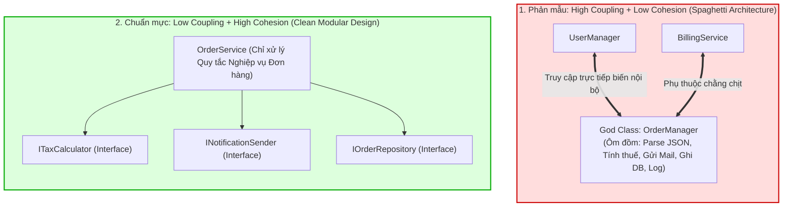
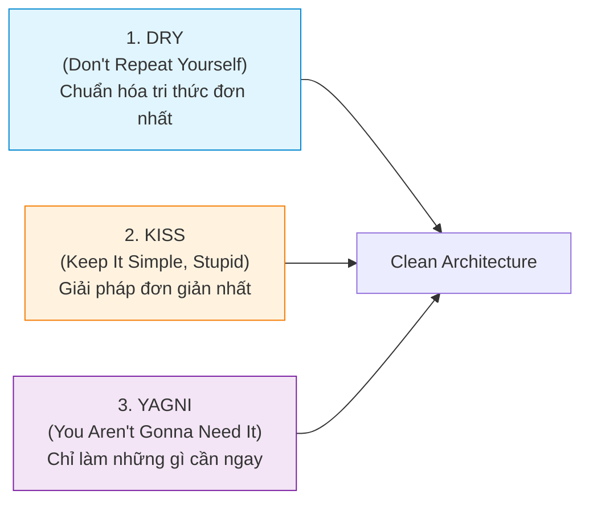
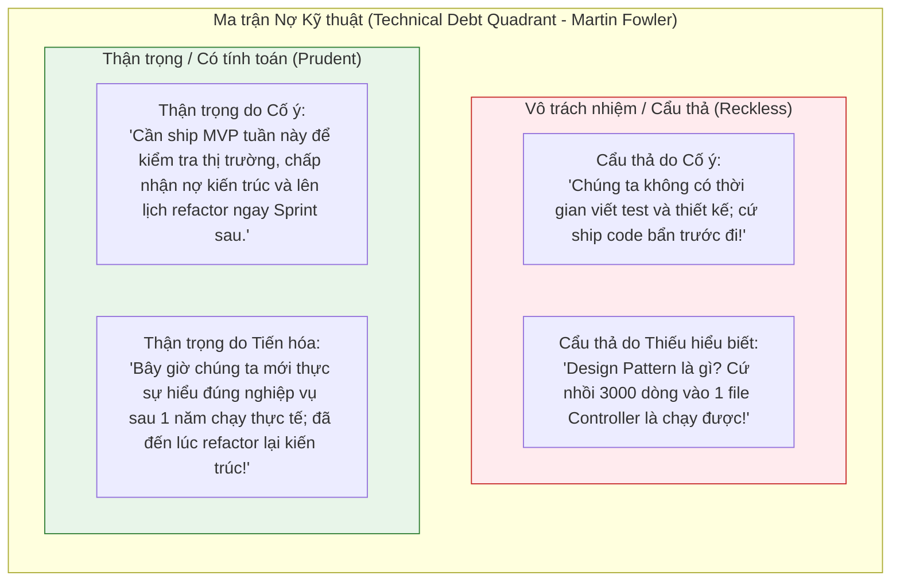

# 7.1. Design Principles and Clean Code (Nguyên lý Thiết kế và Mã nguồn Sạch)

> [!IMPORTANT]
> **Nếu bạn chỉ được nhớ một điều duy nhất**: Bất kỳ ai cũng có thể viết ra những dòng mã mà CPU có thể hiểu được (`Opcodes`), nhưng chỉ những kỹ sư chuyên nghiệp thực thụ mới có thể viết ra những dòng mã mà **con người có thể đọc, bảo trì và tiến hóa qua hàng thập kỷ**. Trong thực tế công nghiệp, kỹ sư phần mềm dành hơn **$80\%$ tổng thời lượng làm việc để đọc và giải mã mã nguồn cũ**, và chỉ chưa đầy $20\%$ thời gian thực sự gõ mã mới. **Clean Code** không phải là sự ám ảnh thẩm mỹ phù phiếm, mà là quy tắc sinh tồn kinh tế: ngăn chặn sự tích lũy của **Nợ Kỹ thuật (Technical Debt)** — thứ lãi suất độc hại có thể làm phá sản toàn bộ dự án phần mềm và khiến toàn bộ đội ngũ sợ hãi không dám đụng vào hệ thống!

---

## 1. Kiến trúc Tổng quan & Mô hình Tư duy (Mental Model)

Mã nguồn không sạch giống như một bãi rác tích tụ entropy: mỗi tính năng mới được nhồi nhét cẩu thả sẽ làm tăng độ phức tạp phi tuyến tính của toàn bộ hệ thống.



---

## 2. Chi tiết từng Keyword (Under-the-Hood Deep Dive)

### 2.1. Separation of Concerns (SoC - Phân tách Mối quan tâm)

- **Bản chất của SoC**: Phân rã một hệ thống phần mềm phức tạp thành các phần riêng biệt, trong đó mỗi phần đảm nhận giải quyết đúng một khía cạnh hoặc mối quan tâm cụ thể.
- **Phân tầng Kiến trúc Chuẩn mực**:
  - *Presentation Layer*: Giao tiếp với bên ngoài (HTTP Controllers, CLI, GraphQL Resolvers), chỉ làm nhiệm vụ parse request và format response.
  - *Application / Domain Layer*: Trọng tâm nghiệp vụ thuần túy (Entities, Use Cases, Domain Services), không chứa logic cơ sở dữ liệu hay thư viện bên ngoài.
  - *Infrastructure Layer*: Chi tiết công nghệ (Database Adapters, Message Broker, Cloud Storage, Third-party APIs).
- **Single Responsibility Principle (SRP)**:
  - Một module, lớp hoặc hàm chỉ nên có **một lý do duy nhất để thay đổi** (nghĩa là chỉ phục vụ một bên liên quan / một vai trò nghiệp vụ duy nhất).
- **Định lượng Thiếu Kết dính: LCOM (Lack of Cohesion in Methods)**:
  - Cho một lớp $C$ có $m$ phương thức $\{M_1, M_2, \dots, M_m\}$ và tập các trường biến thực thể $\{I_1, I_2, \dots, I_k\}$:
  - Đặt $P = \{(M_i, M_j) \mid I(M_i) \cap I(M_j) = \emptyset\}$ (Tập các cặp phương thức **không chia sẻ bất kỳ biến thực thể nào**).
  - Đặt $Q = \{(M_i, M_j) \mid I(M_i) \cap I(M_j) \ne \emptyset\}$ (Tập các cặp phương thức **có chia sẻ chung biến**).

$$\text{LCOM} = \begin{cases} |P| - |Q| & \text{nếu } |P| > |Q| \\ 0 & \text{ngược lại} \end{cases}$$

  - $\text{LCOM} = 0 \implies$ Tính kết dính cao (**High Cohesion**): Các hàm gắn bó chặt chẽ quanh cùng một tập dữ liệu nghiệp vụ.
  - $\text{LCOM} \gg 0 \implies$ Lớp bị ôm đồm quá nhiều việc (**God Class Anti-pattern**), cần phân tách ngay thành các lớp nhỏ độc lập!

---

### 2.2. Bộ ba Nguyên lý Kinh điển: DRY, KISS và YAGNI



#### 1. DRY (Don't Repeat Yourself)
- Được định nghĩa bởi Andrew Hunt & David Thomas trong cuốn *The Pragmatic Programmer*:
  > *"Every piece of knowledge must have a single, unambiguous, authoritative representation within a system."*
- **Trùng lặp Tri thức vs Trùng lặp Cú pháp Ngẫu nhiên (Accidental Duplication)**:
  - DRY nhắm vào việc không lặp lại **Quy tắc Nghiệp vụ (Business Knowledge)**.
  - Nếu hai đoạn code tình cờ có cú pháp giống nhau nhưng thuộc về hai ngữ cảnh nghiệp vụ khác biệt (ví dụ: công thức cộng điểm thưởng khách hàng và công thức tính phụ cấp nhân viên), việc cố tình gộp chúng lại sẽ tạo ra sự ràng buộc độc hại (**Accidental Coupling**). Khi một bên đổi quy tắc, bên kia sẽ bị lỗi dây chuyền!

#### 2. KISS (Keep It Simple, Stupid)
- Hệ thống hoạt động tốt nhất khi được giữ ở mức đơn giản nhất có thể, tránh xa sự phức tạp không cần thiết.
- **Kẻ thù của KISS: Over-engineering**: Sử dụng 5 Design Patterns (Factory, Strategy, Observer, Decorator, Adapter) chỉ để in ra một dòng chữ hoặc giải quyết một bài toán đơn giản.

#### 3. YAGNI (You Aren't Gonna Need It)
- Nguyên tắc cốt lõi của Extreme Programming (XP): **Đừng bao giờ xây dựng một tính năng chỉ vì bạn nghĩ "rồi sẽ có lúc cần đến nó"**.
- Mọi dòng code viết trước cho tương lai đều mang lại 3 tổn thất nặng nề:
  1. Tốn chi phí viết và kiểm thử ngay lúc này.
  2. Tăng gánh nặng bảo trì khi các yêu cầu khác thay đổi.
  3. Khi tương lai thực sự đến, yêu cầu thực tế thường khác 180 độ so với suy đoán ban đầu, dẫn đến việc vứt bỏ toàn bộ.

---

### 2.3. Coupling vs Cohesion (Mức độ Khớp nối và Tính Kết dính)

Mục tiêu tối thượng của thiết kế phần mềm là: **Cao tính kết dính (High Cohesion) và Thấp mức độ khớp nối (Low Coupling)**.

#### Cohesion (Tính kết dính nội tại)
- Đo lường mức độ các phần tử bên trong một module hoặc lớp liên kết chặt chẽ với nhau để thực hiện một mục đích chung duy nhất.
- *High Cohesion*: Một lớp `TaxCalculator` chỉ chứa các hàm tính thuế thu nhập, thuế VAT và đọc biểu thuế.
- *Low Cohesion (Code Smell)*: Một lớp `Utils` hoặc `Helper` chứa 200 hàm linh tinh: từ format ngày tháng, mã hóa MD5, kết nối cơ sở dữ liệu cho tới gọi API thanh toán.

#### Coupling (Mức độ phụ thuộc lẫn nhau)
- Đo lường mức độ phụ thuộc giữa các module khác nhau.
- *Tight Coupling (Khớp nối chặt)*: Lớp A gọi trực tiếp các biến private hoặc phụ thuộc vào kiểu cụ thể của Lớp B (`new ConcreteMySQLDatabase()`). Bất kỳ thay đổi nào trong B đều làm gãy A.
- *Loose Coupling (Khớp nối lỏng)*: Lớp A chỉ giao tiếp với một bản hợp đồng trừu tượng (`IDatabase`), dữ liệu phụ thuộc được truyền từ ngoài vào qua Dependency Injection.

#### Định luật Demeter (Law of Demeter - Nguyên tắc Ít Hiểu biết Nhất)
- Một phương thức $M$ của đối tượng $O$ chỉ được phép gọi các phương thức thuộc:
  1. Bản thân đối tượng $O$.
  2. Các tham số truyền vào hàm $M$.
  3. Bất kỳ đối tượng nào do chính $M$ tự khởi tạo trực tiếp.
  4. Các trường thực thể trực tiếp của $O$.
- **Phản mẫu "Đoàn tàu tai nạn" (Train Wreck Anti-pattern)**:
  ```java
  // VI PHẠM ĐỊNH LUẬT DEMETER: Xuyên thủng 4 tầng cấu trúc nội bộ của đối tượng
  order.getCustomer().getProfile().getAddress().getZipCode();

  // CHUẨN CLEAN CODE: Tell, Don't Ask
  order.getDeliveryZipCode();
  ```

---

### 2.4. Naming, Formatting và Code Comments

#### Naming Conventions (Quy tắc Đặt tên Thể hiện Ý định)
- **Intention-revealing Names**: Tên biến, hàm, lớp phải giải thích rõ ràng: Tại sao nó tồn tại? Nó làm gì? Nó được dùng như thế nào?
  - *Tồi*: `int d; // elapsed time in days`
  - *Tốt*: `int elapsed_time_in_days;` hoặc `int days_since_last_login;`
- **Tránh Disinformation (Gây hiểu lầm)**: Không đặt tên `user_list` nếu kiểu dữ liệu thực tế là một `std::set` hoặc `std::unordered_map`. Hãy dùng `users` hoặc `user_group`.
- **Nhất quán Ngôn ngữ Miền (Ubiquitous Language)**: Sử dụng cùng một thuật ngữ trong toàn bộ mã nguồn, tài liệu và giao tiếp nghiệp vụ (không dùng lẫn lộn `Customer`, `Client`, `Buyer`, `User` cho cùng một khái niệm).

#### Formatting (Định dạng Mã Nguồn)
- **Độ dài dòng (Line Length)**: Giới hạn 80 - 100 ký tự để dễ dàng hiển thị side-by-side khi so sánh Git Diff.
- **Mật độ Theo chiều dọc (Vertical Density)**: Các dòng code có mối liên hệ mật thiết phải nằm sát nhau; các khái niệm khác nhau phân tách bằng đúng 1 dòng trống.
- **Tự động hóa hoàn toàn**: Không lãng phí thời gian tranh cãi thụt lề hay dấu ngoặc trong Code Review. Sử dụng công cụ tự động trong CI/CD pipeline (`clang-format`, `ruff`, `prettier`, `gofmt`).

#### Code Comments: Viết thế nào cho đúng chuẩn Clean Code?
- **Nguyên tắc Vàng**: *"Code explains how, comments explain why."* (Mã nguồn giải thích CÁCH LÀM, chú thích giải thích TẠI SAO).
- **Good Comments**:
  - Giải thích lý do kinh doanh bí ẩn hoặc ràng buộc hệ thống kỳ lạ: `// Workaround: Safari iOS 15 có lỗi memory leak khi render SVG có drop-shadow`.
  - Cảnh báo hậu quả nghiêm trọng: `// WARNING: Không bao giờ được gọi hàm này khi chưa acquire mutex_lock`.
- **Bad Comments (Mùi mã nguồn)**:
  - Chú thích giải thích cú pháp hiển nhiên: `i++; // Tăng biến i lên 1`.
  - Zombie Code: Đoạn code cũ bị comment lại không ai dám xóa vì sợ "biết đâu sau này cần". Hãy dựa vào Git History và xóa sạch!

---

### 2.5. Refactoring và Technical Debt (Nợ Kỹ thuật)



#### Technical Debt (Nợ Kỹ thuật)
- Giống như nợ tài chính: Vay một khoản nợ nhỏ giúp bạn ra mắt sản phẩm nhanh hơn, nhưng bạn phải trả lãi suất hàng ngày bằng sự sụt giảm năng suất làm việc của toàn đội ngũ.
- Nếu không trả nợ gốc (Refactoring), lãi suất tích lũy sẽ đạt đến điểm đóng băng: mọi tính năng mới mất hàng tuần để hoàn thành và sinh ra hàng tá bug mới.

#### Refactoring (Tái cấu trúc mã nguồn)
- **Định nghĩa của Martin Fowler**: Quá trình thay đổi cấu trúc bên trong của phần mềm để làm cho nó dễ hiểu và rẻ hơn trong việc sửa đổi, mà **hoàn toàn không làm thay đổi hành vi quan sát được từ bên ngoài (Observable Behavior)**.
- **Tiền đề Sống còn của Refactoring**: Bắt buộc phải có một **Bộ Kiểm thử Tự động Toàn diện (Automated Test Suite)**. Nếu bạn sửa cấu trúc mà không có test bảo hiểm, đó không phải là refactoring — đó là hành vi mạo hiểm đùa với lửa!

---

## 3. Dual-Engine Code Implementation

### Engine 1: C++20 — Tái Cấu Trúc: Từ Monolithic God Function Sang Clean Decoupled Design

Chương trình minh họa sự biến đổi triệt để từ một hàm xử lý thanh toán hỗn tạp vi phạm mọi nguyên tắc sang một kiến trúc Clean Code chuẩn mực, áp dụng Dependency Inversion và Separation of Concerns.

```cpp
#include <iostream>
#include <string>
#include <memory>
#include <vector>
#include <stdexcept>

// ================= [TRƯỚC REFACTOR: MONOLITHIC CODE SMELL] =================
// Hàm ôm đồm: Validate, Query DB giả lập, Tính thuế, Gửi Mail, Log
void process_order_bad(int user_id, double amount, const std::string& email) {
    if (amount <= 0) { // Magic checks rải rác
        std::cerr << "Error: Invalid amount\n";
        return;
    }
    // Hardcode logic tính thuế
    double tax = amount * 0.1;
    double total = amount + tax;

    // Trực tiếp mở file log, format chuỗi, gửi socket mail... (Low Cohesion)
    std::cout << "[BAD] Writing to DB: User " << user_id << " billed $" << total << '\n';
    std::cout << "[BAD] Sending TCP packet to SMTP server for " << email << '\n';
}

// ================= [SAU REFACTOR: CLEAN ARCHITECTURE C++20] =================

// 1. Domain Entities
struct Order {
    int user_id;
    double amount;
    std::string email;
};

// 2. Interfaces (Inversion of Control)
class ITaxCalculator {
public:
    virtual ~ITaxCalculator() = default;
    virtual double calculate_tax(double amount) const = 0;
};

class INotificationService {
public:
    virtual ~INotificationService() = default;
    virtual void notify_customer(const std::string& email, double total) = 0;
};

class IOrderRepository {
public:
    virtual ~IOrderRepository() = default;
    virtual void save_order(int user_id, double total) = 0;
};

// 3. Concrete Implementations
class StandardVatCalculator : public ITaxCalculator {
public:
    double calculate_tax(double amount) const override {
        constexpr double VAT_RATE = 0.10; // Hằng số tường minh
        return amount * VAT_RATE;
    }
};

class ConsoleNotificationService : public INotificationService {
public:
    void notify_customer(const std::string& email, double total) override {
        std::cout << "  [Notification]: Đã gửi hóa đơn $" << total << " tới " << email << '\n';
    }
};

class InMemoryOrderRepository : public IOrderRepository {
public:
    void save_order(int user_id, double total) override {
        std::cout << "  [Database]: Lưu đơn hàng thành công cho User " << user_id 
                  << " (Tổng tiền: $" << total << ")\n";
    }
};

// 4. Core Business Service: Single Responsibility & Dependency Injection
class OrderProcessor {
private:
    const ITaxCalculator& tax_calc;
    INotificationService& notifier;
    IOrderRepository& repo;

public:
    OrderProcessor(const ITaxCalculator& tc, INotificationService& ns, IOrderRepository& or_repo)
        : tax_calc(tc), notifier(ns), repo(or_repo) {}

    void process(const Order& order) {
        if (order.amount <= 0.0) {
            throw std::invalid_argument("Giá trị đơn hàng phải lớn hơn 0");
        }

        double tax = tax_calc.calculate_tax(order.amount);
        double total = order.amount + tax;

        repo.save_order(order.user_id, total);
        notifier.notify_customer(order.email, total);
    }
};

int main() {
    std::cout << "=== THỬ NGHIỆM REFACTORING CLEAN ARCHITECTURE (C++20) ===\n\n";

    StandardVatCalculator tax_service;
    ConsoleNotificationService notification_service;
    InMemoryOrderRepository repo_service;

    OrderProcessor processor(tax_service, notification_service, repo_service);

    Order valid_order{1001, 250.0, "alice@company.com"};
    std::cout << "[Step]: Đang xử lý đơn hàng hợp lệ qua Clean Service:\n";
    processor.process(valid_order);

    return 0;
}
```

```text
=== THỬ NGHIỆM REFACTORING CLEAN ARCHITECTURE (C++20) ===

[Step]: Đang xử lý đơn hàng hợp lệ qua Clean Service:
  [Database]: Lưu đơn hàng thành công cho User 1001 (Tổng tiền: $275)
  [Notification]: Đã gửi hóa đơn $275 tới alice@company.com
```

---

### Engine 2: Python — Trình Phân Tích Mã Tĩnh (Static AST Code Quality Analyzer)

Mô phỏng một bộ Linter / Code Smell Detector: Quét cây cú pháp trừu tượng AST của mã nguồn Python để tự động phát hiện vi phạm độ phức tạp hàm (**Cyclomatic Complexity**), hàm quá dài và vi phạm Định luật Demeter (**Train Wreck Calls**).

```python
#!/usr/bin/env python3
"""
Static Code Quality & Smells Analyzer using Python's AST Module.
Detects Function Length, High Complexity, and Law of Demeter violations.
"""
import ast
from typing import List

SAMPLE_CODE_TO_INSPECT = """
def clean_function(x, y):
    return x + y

def messy_god_function(user, order, config, db, email_client):
    total = 0
    # Train Wreck: Vi phạm Định luật Demeter nghiêm trọng!
    zipcode = order.get_customer().get_profile().get_address().zipcode
    
    if user.is_active:
        if order.amount > 100:
            total = order.amount * 0.9
        elif order.amount > 50:
            total = order.amount * 0.95
        else:
            total = order.amount
    else:
        total = 0
    return total
"""

class CodeSmellDetector(ast.NodeVisitor):
    def __init__(self):
        self.smells: List[str] = []

    def visit_FunctionDef(self, node: ast.FunctionDef):
        # 1. Đo độ dài hàm (Lines of Code)
        func_len = (node.end_lineno - node.lineno) if (node.end_lineno and node.lineno) else 0
        if func_len > 10:
            self.smells.append(f"[Code Smell: Long Function] Hàm '{node.name}' dài {func_len} dòng (vượt quá 10 dòng)!")

        # 2. Đo Cyclomatic Complexity cơ bản (đếm số if, for, while, and, or)
        complexity = 1
        for subnode in ast.walk(node):
            if isinstance(subnode, (ast.If, ast.For, ast.While, ast.And, ast.Or)):
                complexity += 1
        if complexity > 3:
            self.smells.append(f"[Code Smell: High Complexity] Hàm '{node.name}' có Cyclomatic Complexity = {complexity} (Nguy cơ bug cao)!")

        # Tiếp tục duyệt sâu vào các câu lệnh trong hàm
        self.generic_visit(node)

    def visit_Attribute(self, node: ast.Attribute):
        # 3. Phát hiện vi phạm Law of Demeter (Đoán chuỗi truy cập lồng nhau: a.b.c.d)
        chain_depth = 0
        curr = node
        while isinstance(curr, ast.Attribute):
            chain_depth += 1
            curr = curr.value
            if isinstance(curr, ast.Call):
                curr = curr.func

        if chain_depth >= 3:
            self.smells.append(f"[Code Smell: Law of Demeter Violation] Phát hiện Train Wreck tại dòng {node.lineno} (Độ sâu liên kết: {chain_depth})!")

        self.generic_visit(node)

if __name__ == "__main__":
    print("=== TRÌNH PHÂN TÍCH CHẤT LƯỢNG MÃ NGUỒN STATIC AST ANALYZER ===\n")
    parsed_ast = ast.parse(SAMPLE_CODE_TO_INSPECT)
    detector = CodeSmellDetector()
    detector.visit(parsed_ast)

    if detector.smells:
        print(f"Phát hiện {len(detector.smells)} lỗi thiết kế mã nguồn (Code Smells):")
        for smell in detector.smells:
            print(f"  * {smell}")
    else:
        print("Mã nguồn sạch, đạt chuẩn 100%!")
```

```text
=== TRÌNH PHÂN TÍCH CHẤT LƯỢNG MÃ NGUỒN STATIC AST ANALYZER ===

Phát hiện 3 lỗi thiết kế mã nguồn (Code Smells):
  * [Code Smell: Long Function] Hàm 'messy_god_function' dài 15 dòng (vượt quá 10 dòng)!
  * [Code Smell: High Complexity] Hàm 'messy_god_function' có Cyclomatic Complexity = 5 (Nguy cơ bug cao)!
  * [Code Smell: Law of Demeter Violation] Phát hiện Train Wreck tại dòng 7 (Độ sâu liên kết: 4)!
```

---

## 4. Systems Engineering & Production Code Hygiene

### 4.1. Quy tắc Hướng đạo sinh (The Boy Scout Rule) trong CI/CD

> *"Luôn luôn để lại khu cắm trại sạch sẽ hơn lúc bạn vừa đặt chân đến."* — Robert C. Martin

- Trong mỗi Pull Request (PR), bên cạnh việc viết tính năng mới, kỹ sư được khuyến khích tái cấu trúc **ít nhất một hàm hoặc đổi tên 1 biến khó hiểu lân cận**.
- Sau 6 tháng, hàng triệu dòng mã nguồn cũ sẽ tự động sạch dần lên mà không cần phải xin ban giám đốc một kỳ hạn "Sprint Refactor" riêng biệt.

---

### 4.2. Khung Tự Động Hóa Chất Lượng Mã Nguồn (Automated Quality Gate)

```bash
# 1. Kiểm tra tĩnh phong cách mã và an toàn bộ nhớ (C++ Clang-Tidy)
clang-tidy -checks='readability-*,bugprone-*,modernize-*' src/*.cpp -- -Iinclude

# 2. Quét bảo mật và vi phạm thiết kế với SonarQube Scanner
sonar-scanner \
  -Dsonar.projectKey=order_service \
  -Dsonar.qualitygate.wait=true

# 3. Định dạng mã nguồn tự động không tranh cãi cá nhân
clang-format -i src/*.cpp
ruff check --fix ./python_backend/
```

---

## 5. Bảng So sánh & Decision Matrix

| Nguyên lý / Triết lý | Trọng tâm Bảo vệ | Nguy cơ Khi Áp dụng Cực đoan (Anti-pattern) | Dấu hiệu Cần Refactor Ngay |
| :--- | :--- | :--- | :--- |
| **DRY** | Loại bỏ trùng lặp tri thức nghiệp vụ | **Trừu tượng hóa quá sớm (Premature Abstraction)**: Gộp nhầm code khác domain | Sửa 1 bug ở module A làm module B gãy đổ bất ngờ |
| **KISS** | Tránh phức tạp hóa vấn đề | Viết code ngây thơ, thiếu bảo vệ biên và khả năng mở rộng | Hàm dài 500 dòng với 15 vòng lặp lồng nhau |
| **YAGNI** | Tiết kiệm chi phí kỹ thuật hiện tại | Thiếu tầm nhìn hạ tầng, kiến trúc cứng nhắc không thể cắm plugin | Viết sẵn hàng loạt class Factory/Adapter không ai gọi |
| **Single Responsibility** | Mỗi lớp chỉ có 1 lý do duy nhất để thay đổi | Chia vụn hệ thống thành hàng ngàn lớp chỉ có đúng 1 dòng code | Thay đổi định dạng báo cáo phải sửa chung file tính tiền |
| **Law of Demeter** | Giảm thiểu mức độ phụ thuộc chéo | Tạo ra quá nhiều hàm ủy quyền trung gian (Middle-man wrapper) | Xuất hiện các chuỗi gọi hàm dạng `a.getB().getC().getD()` |
| **Refactoring** | Tiến hóa kiến trúc, giảm nợ kỹ thuật | Refactor khi chưa có automated tests dẫn đến hồi quy lỗi | Kỹ sư sợ chạm vào mã nguồn cũ vì không ai dám chắc hệ thống sẽ chạy |
