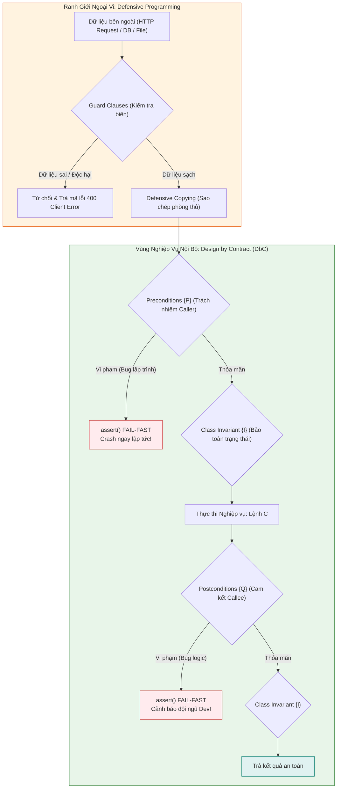
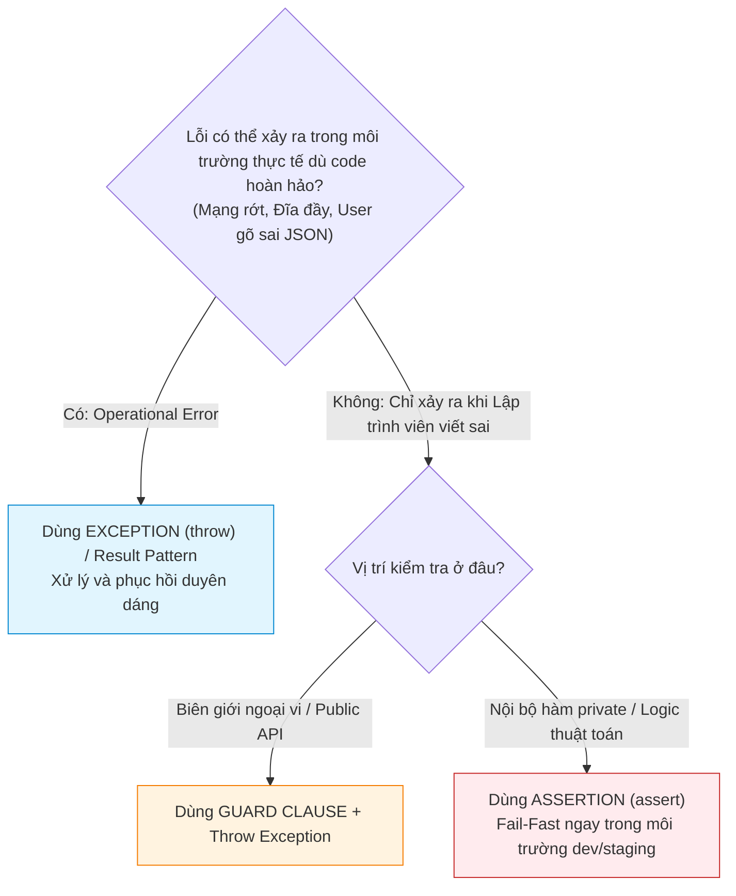

# 7.2. Contracts and Defensive Programming (Hợp đồng Thiết kế và Lập trình Phòng thủ)

> [!IMPORTANT]
> **Nếu bạn chỉ được nhớ một điều duy nhất**: Khác biệt sinh tử giữa phần mềm đồ chơi và hệ thống phân tán cấp ngân hàng nằm ở cách hệ thống bảo vệ sự toàn vẹn trạng thái. **Design by Contract (DbC)** nhìn nhận mối quan hệ giữa hàm gọi (**Caller**) và hàm thực thi (**Callee**) như một bản hợp đồng kinh tế bình đẳng dựa trên logic hình thức Hoare Triple: nếu bạn đáp ứng tiền đề (**Preconditions**), tôi bảo đảm kết quả (**Postconditions**); bất kỳ sự vi phạm nào bên trong hệ thống nội bộ đều được xem là một con **Bug lập trình** và phải kích hoạt cơ chế **Fail-Fast** tự hủy ngay lập tức (`assert`). Ngược lại, **Defensive Programming** đóng vai trò là trạm kiểm soát an ninh biên giới: tuyệt đối không bao giờ tin tưởng dữ liệu từ thế giới bên ngoài (mạng Internet, input người dùng, tệp tin), bắt buộc phải rà soát qua các chốt chặn (**Guard Clauses**) và sao chép phòng thủ (**Defensive Copying**) để ngăn chặn sự tha hóa dữ liệu lan truyền thầm lặng.

---

## 1. Kiến trúc Tổng quan & Mô hình Tư duy (Mental Model)

Khi một module phần mềm vận hành, nó phải đối mặt với hai mối nguy: lỗi lập trình nội bộ giữa các hàm tin cậy, và dữ liệu độc hại/không hợp lệ từ môi trường bên ngoài.



---

## 2. Chi tiết từng Keyword (Under-the-Hood Deep Dive)

### 2.1. Design by Contract (DbC - Thiết kế theo Hợp đồng)

Mô hình Design by Contract do Giáo sư Bertrand Meyer sáng tạo trong ngôn ngữ Eiffel dựa trên nền tảng toán học của **Bộ ba Hoare (Hoare Triple)** trong logic hình thức:

$$\{P\} \; C \; \{Q\}$$

Khi kết hợp với tính bất biến của trạng thái đối tượng hướng đối tượng:

$$\{P \land I\} \; C \; \{Q \land I\}$$

#### 1. Preconditions (Tiền điều kiện - $\{P\}$)
- **Trách nhiệm pháp lý**: Thuộc về **Bên gọi (Caller)**.
- **Ý nghĩa**: Caller có nghĩa vụ bảo đảm các tham số truyền vào và trạng thái môi trường phải thỏa mãn điều kiện $P$ trước khi gọi hàm.
- Nếu $P$ bị vi phạm: Hàm thực thi $C$ **không có nghĩa vụ phải chạy tiếp**. Hành vi vi phạm tiền điều kiện chứng minh rằng mã nguồn của bên gọi đang có bug!

#### 2. Postconditions (Hậu điều kiện - $\{Q\}$)
- **Trách nhiệm pháp lý**: Thuộc về **Bên thực thi (Callee)**.
- **Ý nghĩa**: Cam kết của hàm rằng sau khi thực thi xong khối lệnh $C$, trạng thái đầu ra và giá trị trả về phải thỏa mãn mệnh đề $Q$ (với giả định Caller đã thỏa mãn $P$).
- Nếu $Q$ bị vi phạm: Bản thân thuật toán trong hàm Callee đã bị sai sót logic nghiệp vụ!

#### 3. Class Invariants (Bất biến của Lớp - $\{I\}$)
- **Ý nghĩa**: Điều kiện chân lý tuyệt đối về trạng thái nội bộ của một đối tượng.
- Bất biến phải luôn luôn đúng:
  1. Sau khi Constructor hoàn tất khởi tạo.
  2. Trước khi bất kỳ phương thức công khai (`public method`) nào được thực thi.
  3. Sau khi phương thức công khai đó kết thúc và trả quyền điều khiển về cho Caller.
- *Ví dụ*: Trong một tài khoản ngân hàng, $\text{balance} \ge -\text{overdraft\_limit}$ luôn là Class Invariant.

---

### 2.2. Assertions (Khẳng định Mã nguồn)

#### Khái niệm Bản chất
- Assertion là một mệnh đề boolean được đặt trực tiếp vào mã nguồn để kiểm tra một giả định mà lập trình viên **tin chắc 100% phải luôn luôn đúng** tại điểm thực thi đó.
- Khác biệt cốt tử: **Assertion dùng để bắt lỗi của lập trình viên (Programmer Bugs)**, không dùng để xử lý ngoại lệ vận hành thông thường (Operational Errors như file not found, mạng chập chờn).

#### Runtime Assertions vs Static Assertions (Compile-time)
1. **Static Assertions (`static_assert` trong C++11, `assert` trong const eval)**:
   - Đánh giá biểu thức ngay trong giai đoạn biên dịch (**Compile-time**).
   - *Ưu điểm*: Chi phí thời gian chạy bằng 0 (Zero runtime cost). Nếu điều kiện sai, trình biên dịch từ chối sinh mã máy và dừng quá trình build ngay lập tức.
   - *Ứng dụng*: Kiểm tra kích thước kiểu dữ liệu phần cứng (`static_assert(sizeof(void*) == 8)`), kiểm tra ràng buộc template/concepts.
2. **Runtime Assertions (`assert(condition)` trong C/C++, `assert` trong Python/Java)**:
   - Đánh giá biểu thức khi chương trình đang chạy (**Run-time**).
   - Nếu điều kiện trả về `false`: Kích hoạt cơ chế dừng tiến trình khẩn cấp (`abort()` hoặc `AssertionError`), in ra chính xác tên tệp tin, dòng mã và biểu thức bị vi phạm.
   - **Cờ `-DNDEBUG` (No Debug)**: Trong môi trường Production, trình biên dịch C/C++ có thể tắt bỏ toàn bộ các câu lệnh `assert()` thông qua cờ `-DNDEBUG`, giúp giải phóng 100% chi phí CPU kiểm tra điều kiện.

#### Ma trận Phân định: Khi Nào Dùng Assertion vs Khi Nào Dùng Exception (`throw`)?



---

### 2.3. Defensive Programming vs Defensive Copying

#### Defensive Programming (Lập trình Phòng thủ)
- **Triết lý**: Luôn luôn giả định rằng:
  1. Người dùng sẽ nhập dữ liệu độc hại hoặc sai định dạng.
  2. Mạng Internet sẽ rớt gói tin hoặc ngắt kết nối giữa chừng.
  3. Hệ điều hành có thể trả về lỗi bất cứ lúc nào.
- **Kỹ thuật Guard Clauses (Mệnh đề Bảo vệ Thoát sớm - Early Exit)**:
  - Thay vì lồng ghép 5 tầng `if-else` (phản mẫu Arrow Anti-pattern), hãy kiểm tra các điều kiện tiên quyết ở đầu hàm và thoát ngay lập tức nếu không hợp lệ.
  ```cpp
  // CLEAN CODE: Phẳng hóa cấu trúc logic
  void process_payment(Account* acc, double amount) {
      if (!acc) return; // Guard clause 1
      if (amount <= 0.0) return; // Guard clause 2
      if (acc->get_balance() < amount) return; // Guard clause 3

      // Thực thi logic chính không bị thụt lề
      acc->debit(amount);
  }
  ```

#### Defensive Copying (Sao chép Phòng thủ)
- **Hiểm họa Rò rỉ Trạng thái (State Mutation Leak)**: Khi một lớp nhận vào một đối tượng khả biến (Mutable Reference) qua Constructor hoặc trả ra qua Getter, mã nguồn bên ngoài có thể âm thầm sửa đổi dữ liệu bên trong lưng bạn mà không kích hoạt bất kỳ hàm thẩm định nào.
- **Giải pháp**: Tạo một bản sao độc lập hoàn chỉnh (**Deep Copy / Defensive Copy**):
  - *Khi nạp vào*: Không gán trực tiếp con trỏ/tham chiếu, mà nhân bản dữ liệu vào vùng nhớ riêng của lớp.
  - *Khi trả ra*: Không trả về tham chiếu trực tiếp tới biến private, mà trả về bản sao hoặc giao diện chỉ đọc (**Read-only View / Immutability**).

---

## 3. Dual-Engine Code Implementation

### Engine 1: C++20 — Khung Quản Lý Tài Khoản Ngân Hàng Tuân Thủ Khắt Khe Hợp Đồng DbC

Chương trình minh họa cách hiện thực đầy đủ cả 3 mệnh đề hợp đồng: Precondition, Postcondition, Class Invariant, kết hợp cơ chế kiểm tra Compile-time bằng `static_assert` và Runtime Guard Clauses.

```cpp
#include <iostream>
#include <cassert>
#include <stdexcept>
#include <string>
#include <cstdint>

// 1. Kiểm tra Compile-time: Ràng buộc phần cứng 64-bit
static_assert(sizeof(void*) == 8, "Hệ thống ngân hàng bắt buộc chạy trên kiến trúc 64-bit!");

class BankLedgerAccount {
private:
    uint64_t account_id;
    int64_t balance_cents; // Sử dụng số nguyên (Cents) để triệt tiêu lỗi làm tròn Floating-point!

    // [CLASS INVARIANT]: Chân lý bất biến của lớp
    // Số dư không bao giờ được phép âm dưới hạn mức cho phép (>= 0)
    void assert_class_invariants() const {
        assert(balance_cents >= 0 && "INVARIANT VIOLATION: Số dư tài khoản bị âm!");
    }

public:
    explicit BankLedgerAccount(uint64_t id, int64_t initial_deposit_cents)
        : account_id(id), balance_cents(initial_deposit_cents) {
        
        // [PRECONDITION]: Tiền gửi ban đầu không được âm
        if (initial_deposit_cents < 0) {
            throw std::invalid_argument("Tiền gửi ban đầu phải >= 0");
        }
        
        assert_class_invariants();
        std::cout << "[Account Created] ID: " << account_id 
                  << " | Initial Balance: $" << (balance_cents / 100.0) << '\n';
    }

    void withdraw(int64_t amount_cents) {
        // [PRECONDITIONS]: Ràng buộc trách nhiệm của Caller (Guard Clauses)
        if (amount_cents <= 0) {
            throw std::invalid_argument("Số tiền rút phải lớn hơn 0");
        }
        if (amount_cents > balance_cents) {
            throw std::runtime_error("Giao dịch từ chối: Số dư khả dụng không đủ");
        }

        int64_t old_balance = balance_cents;

        // [EXECUTION]: Thực thi trừ tiền
        balance_cents -= amount_cents;

        // [POSTCONDITIONS]: Cam kết trách nhiệm của Callee
        assert(balance_cents == old_balance - amount_cents && 
               "POSTCONDITION VIOLATION: Số dư mới tính toán sai lệch so với tiền rút!");

        // [INVARIANT CHECK]: Kiểm tra tính toàn vẹn trạng thái sau cùng
        assert_class_invariants();

        std::cout << "  [Withdraw Success] Đã rút: $" << (amount_cents / 100.0) 
                  << " | Số dư mới: $" << (balance_cents / 100.0) << '\n';
    }

    int64_t get_balance() const { return balance_cents; }
};

int main() {
    std::cout << "=== THỬ NGHIỆM THIẾT KẾ THEO HỢP ĐỒNG (DbC) TRÊN C++20 ===\n\n";

    try {
        BankLedgerAccount acc(9981, 100'00); // Gửi 100.00 USD
        
        std::cout << "[Test 1]: Rút 30.00 USD hợp lệ:\n";
        acc.withdraw(30'00);

        std::cout << "\n[Test 2]: Rút 80.00 USD (Vượt quá số dư 70.00 USD):\n";
        acc.withdraw(80'00); // Sẽ kích hoạt Precondition Guard Clause

    } catch (const std::exception& e) {
        std::cerr << "  => [Chặn Thành Công]: Bắt được vi phạm tiền điều kiện: " << e.what() << '\n';
    }

    return 0;
}
```

```text
=== THỬ NGHIỆM THIẾT KẾ THEO HỢP ĐỒNG (DbC) TRÊN C++20 ===

[Account Created] ID: 9981 | Initial Balance: $100
[Test 1]: Rút 30.00 USD hợp lệ:
  [Withdraw Success] Đã rút: $30 | Số dư mới: $70

[Test 2]: Rút 80.00 USD (Vượt quá số dư 70.00 USD):
  => [Chặn Thành Công]: Bắt được vi phạm tiền điều kiện: Giao dịch từ chối: Số dư khả dụng không đủ
```

---

### Engine 2: Python — Hiện Thực Bộ Decorators Hợp Đồng (@precondition, @postcondition, @invariant)

Xây dựng một thư viện Design by Contract độc lập bằng Decorator trong Python: Tự động đánh giá tiền điều kiện, hậu điều kiện, bất biến và thực hiện sao chép phòng thủ (**Defensive Copying**) trên cấu trúc dữ liệu khả biến.

```python
#!/usr/bin/env python3
"""
Python Design by Contract (DbC) & Defensive Copying Framework.
Implements @precondition, @postcondition, and Class Invariant validation dynamically.
"""
import copy
from functools import wraps
from typing import Callable, Any

def precondition(predicate: Callable[..., bool], error_msg: str):
    """Decorator kiểm tra Tiền điều kiện trước khi hàm thực thi."""
    def decorator(func: Callable):
        @wraps(func)
        def wrapper(*args, **kwargs):
            if not predicate(*args, **kwargs):
                raise AssertionError(f"[PRECONDITION FAILED] tại hàm '{func.__name__}': {error_msg}")
            return func(*args, **kwargs)
        return wrapper
    return decorator

def postcondition(predicate: Callable[[Any], bool], error_msg: str):
    """Decorator kiểm tra Hậu điều kiện trên kết quả trả về."""
    def decorator(func: Callable):
        @wraps(func)
        def wrapper(*args, **kwargs):
            result = func(*args, **kwargs)
            if not predicate(result):
                raise AssertionError(f"[POSTCONDITION FAILED] tại hàm '{func.__name__}': {error_msg}")
            return result
        return wrapper
    return decorator


class SecureVault:
    def __init__(self, secrets: list):
        # DEFENSIVE COPYING KHI NHẬN VÀO:
        # Clone dữ liệu danh sách để ngăn bên ngoài sửa đổi dữ liệu gốc
        self._secrets = copy.deepcopy(secrets)

    def check_invariants(self):
        # INVARIANT: Kho bảo mật không bao giờ được chứa phần tử None
        assert None not in self._secrets, "[INVARIANT VIOLATED] Kho chứa giá trị rác None!"

    @precondition(lambda self, item: isinstance(item, str) and len(item) > 0, "Bí mật phải là chuỗi không rỗng")
    def add_secret(self, item: str):
        self._secrets.append(item)
        self.check_invariants()

    # DEFENSIVE COPYING KHI TRẢ RA:
    # Trả về bản sao độc lập, ngăn caller gọi vault.get_all().clear() làm mất sạch dữ liệu nội bộ
    @postcondition(lambda res: isinstance(res, list), "Kết quả phải là một List")
    def get_all_secrets(self) -> list:
        return copy.deepcopy(self._secrets)


if __name__ == "__main__":
    print("=== THỬ NGHIỆM PYTHON DESIGN BY CONTRACT VÀ DEFENSIVE COPYING ===\n")

    initial_keys = ["API_KEY_ALPHA", "JWT_SECRET_BETA"]
    vault = SecureVault(initial_keys)

    print("[1] Thử nghiệm Defensive Copying:")
    leaked_list = vault.get_all_secrets()
    leaked_list.append("FORGED_KEY_MALICIOUS") # Cố tình sửa đổi danh sách bên ngoài!
    
    # Kiểm tra xem danh sách bên trong Vault có bị ảnh hưởng không
    print(f"  Danh sách bên ngoài bị sửa: {leaked_list}")
    print(f"  Dữ liệu thật trong Vault:  {vault.get_all_secrets()} (Được bảo vệ 100%!)")

    print("\n[2] Thử nghiệm Precondition Contract Violation:")
    try:
        vault.add_secret("") # Truyền chuỗi rỗng -> Vi phạm hợp đồng!
    except AssertionError as e:
        print(f"  => Bắt được vi phạm hợp đồng: {e}")
```

```text
=== THỬ NGHIỆM PYTHON DESIGN BY CONTRACT VÀ DEFENSIVE COPYING ===

[1] Thử nghiệm Defensive Copying:
  Danh sách bên ngoài bị sửa: ['API_KEY_ALPHA', 'JWT_SECRET_BETA', 'FORGED_KEY_MALICIOUS']
  Dữ liệu thật trong Vault:  ['API_KEY_ALPHA', 'JWT_SECRET_BETA'] (Được bảo vệ 100%!)

[2] Thử nghiệm Precondition Contract Violation:
  => Bắt được vi phạm hợp đồng: [PRECONDITION FAILED] tại hàm 'add_secret': Bí mật phải là chuỗi không rỗng
```

---

## 4. Systems Engineering & Production Pitfalls

### 4.1. Phản Mẫu "Nuốt Sạch Lỗi" (Catch-All Exception Swallowing)

Một trong những sai lầm nguy hiểm nhất trong mã nguồn backend là bắt lỗi ngoại lệ mà không làm gì cả:
```python
# SAI LẦM NGHIÊM TRỌNG: XÓA SẠCH DẤU VẾT SỰ CỐ
try:
    process_payment(order)
except Exception:
    pass # Âm thầm nuốt lỗi, request vẫn trả về HTTP 200 OK!
```
- **Hậu quả**: Khách hàng không bị trừ tiền nhưng đơn hàng vẫn giao, hoặc khách hàng bị trừ tiền 2 lần mà không nhận được hàng. Không có bất kỳ dòng log nào được ghi lại, khiến hệ thống giám sát hoàn toàn bất lực.
- **Quy tắc Vàng**: Chỉ bắt Exception khi bạn **thực sự biết cách xử lý và phục hồi sau lỗi đó**; nếu không, hãy để ngoại lệ tiếp tục nổi lên các tầng cao hơn hoặc ghi Structured Log đầy đủ ngữ cảnh trước khi ném lại (`throw`).

---

### 4.2. Hiệu Năng: Chi Phí của Defensive Copying và Kỹ Thuật Bất Biến (Immutability)

Sao chép phòng thủ (`deep_copy`) trên các đối tượng lớn (như đồ thị JSON $10\text{ MB}$) sẽ làm cạn kiệt băng thông RAM và CPU cache:
- **Giải pháp Hiện đại**: Thay vì sao chép liên tục các đối tượng khả biến, hãy chuyển sang sử dụng **Cấu trúc Dữ liệu Bất biến (Immutable Data Structures)**:
  - C++: `std::string_view`, `std::span` (Chỉ đọc không sở hữu).
  - Java: `java.lang.Record`.
  - Rust: Ngữ nghĩa sở hữu tĩnh (Ownership & Borrowing) bảo đảm an toàn mà không tốn dù chỉ 1 byte RAM cho việc sao chép.

---

## 5. Bảng So sánh & Decision Matrix

| Tiêu chí | Design by Contract (DbC) | Defensive Programming | Defensive Copying | Fail-Fast Architecture |
| :--- | :--- | :--- | :--- | :--- |
| **Mục tiêu Chính** | Xác minh tính đúng đắn logic của mã nguồn | Bảo vệ hệ thống khỏi đầu vào độc hại/sai lệch | Ngăn chặn rò rỉ trạng thái khả biến từ bên ngoài | Dừng ngay tiến trình trước khi dữ liệu bị ô nhiễm |
| **Đối tượng Áp dụng** | Mã nguồn nội bộ giữa các module tin cậy | Ranh giới ngoại vi (Public API, User Input) | Nhận tham số vào Constructor / Trả ra qua Getter | Bất kỳ vi phạm Invariant nghiêm trọng nào |
| **Cơ chế Triển khai** | `assert()`, Hoare logic, Invariant checks | Guard Clauses, Data Sanitization, Early Exit | `clone()`, `deepcopy()`, Immutable Data Types | `panic()`, `abort()`, `std::terminate()` |
| **Hành vi khi có Lỗi** | Tự hủy ngay lập tức (Báo lỗi cho lập trình viên) | Từ chối request hợp lệ, trả về mã lỗi 400 | Tốn chi phí CPU/RAM sao chép đối tượng | Dừng tiến trình để bảo toàn cơ sở dữ liệu |
| **Môi trường Bật** | Chủ yếu trong Development / Testing (`NDEBUG`) | Bắt buộc 100% trên Production | Bắt buộc trên Production khi chia sẻ tham chiếu | Hoạt động cả ở Dev lẫn Production |
