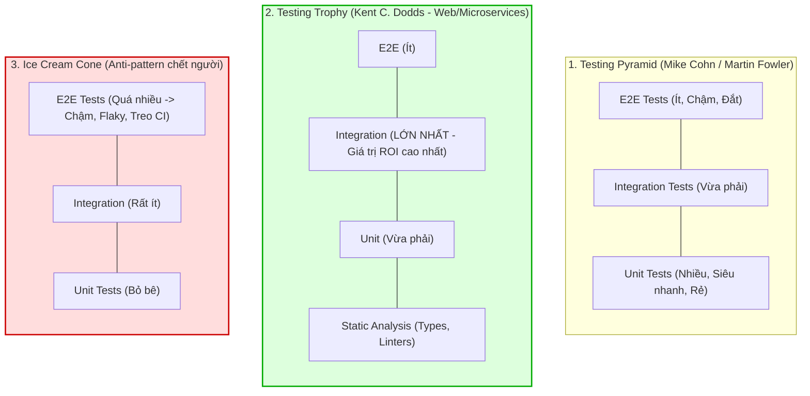
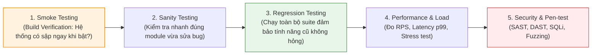
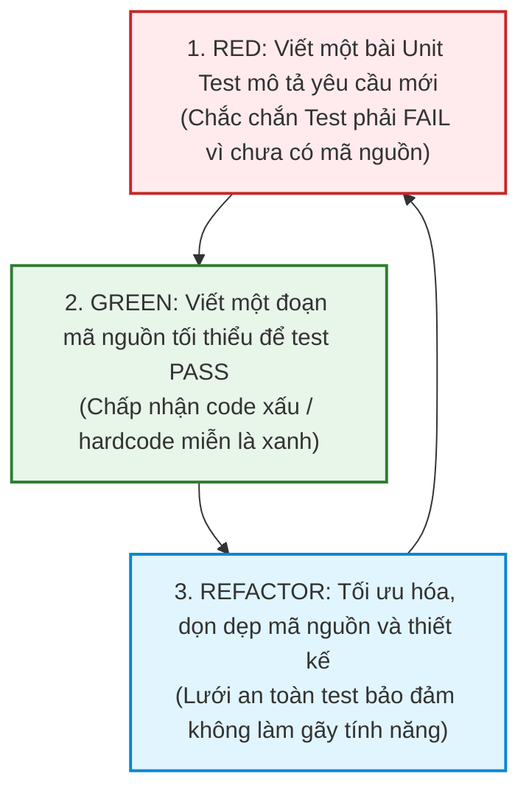

# 8.1. Testing Levels and Methodologies (Các Cấp độ và Phương pháp Kiểm thử)

> [!IMPORTANT]
> **Nếu bạn chỉ được nhớ một điều duy nhất**: Kiểm thử tự động (Automated Testing) không phải là "việc viết thêm cho đủ thủ tục", mà là **chiếc lưới an toàn sinh tử (Safety Net)** duy nhất cho phép hệ thống triển khai mã nguồn liên tục (CI/CD) hàng chục lần mỗi ngày mà không sợ sập dịch vụ. Hãy tưởng tượng quy trình sản xuất máy bay chở khách: bạn không thể chỉ chờ lắp ráp xong toàn bộ phi cơ rồi mới "bay thử xem có nổ không" (Anti-pattern: Testing Ice Cream Cone). Thay vào đó, bạn phải soi từng chiếc bu-lông và cảm biến trong máy nén thủy lực (**Unit Test** - hàng vạn bài kiểm tra chạy trong vài giây), kiểm tra xem cánh quạt có ăn khớp với động cơ phản lực không (**Integration Test**), và cuối cùng mới bay hành trình thực tế (**End-to-End Test**).

---

## 1. Kiến trúc Tổng quan & Mô hình Tư duy (Mental Model)

Sự phân bổ nguồn lực kiểm thử quyết định trực tiếp tới tốc độ vòng lặp phản hồi (**Feedback Loop**) và độ tin cậy của mã nguồn.



---

## 2. Chi tiết từng Keyword (Under-the-Hood Deep Dive)

### 2.1. Kim tự tháp Kiểm thử (The Testing Pyramid)

Kim tự tháp kiểm thử do Mike Cohn đề xuất và Martin Fowler hoàn thiện là nguyên tắc định hướng phân bổ khối lượng bài test trong mọi dự án phần mềm bền vững:

1. **Unit Testing (Kiểm thử Đơn vị - Đáy kim tự tháp)**:
   - Kiểm tra đơn vị logic nhỏ nhất có thể cô lập (hàm thuần khiết, một class tính toán chiết khấu, một giải thuật sắp xếp).
   - Mọi phụ thuộc I/O ngoại vi (Ổ đĩa, Network socket, Cơ sở dữ liệu, Đồng hồ hệ thống) đều bị cô lập tuyệt đối bằng **Test Doubles** (Mock, Stub).
   - Tốc độ thực thi: $< 1\text{ ms}$ cho mỗi test case. Cho phép chạy hàng chục ngàn test chỉ trong vài giây.
2. **Integration Testing (Kiểm thử Tích hợp - Tầng giữa)**:
   - Kiểm tra sự ăn khớp vật lý giữa hai hoặc nhiều module khi kết nối với môi trường ngoại vi thực tế.
   - Ví dụ: Một Repository service tương tác trực tiếp với Database PostgreSQL thực tế thông qua Docker Testcontainers, hoặc một Event Producer bắn tin nhắn vào Kafka Broker.
   - Giúp phát hiện các lỗi sai lệch Schema, Transaction isolation failure, vi phạm ràng buộc khóa ngoại (Foreign key constraint) mà Unit Test bằng Mock hoàn toàn bất lực.
3. **System Testing & End-to-End Testing (E2E - Đỉnh kim tự tháp)**:
   - Giả lập hành vi hoàn chỉnh của người dùng thực: HTTP Request $\to$ API Gateway $\to$ Microservices $\to$ Database $\to$ Queue $\to$ Third-party Payment Gateway $\to$ Response.
   - Chi phí xây dựng và bảo trì cực đắt, tốc độ rất chậm ($> 10\text{s}$ mỗi ca kiểm thử) và tiềm ẩn nguy cơ chập chờn (**Flaky Test**).

---

### 2.2. Các Dạng Kiểm Thử Chuyên Biệt

Bên cạnh các tầng kiểm thử cơ bản, hệ thống sản xuất đòi hỏi các dạng kiểm thử chuyên trách theo mục tiêu:



- **Regression Testing (Kiểm thử Hồi quy)**: Chạy lại toàn bộ hoặc một tập hợp lớn các ca kiểm thử sau mỗi lần thay đổi mã nguồn, đảm bảo việc sửa một lỗi ở Module A không làm phát sinh một con bug ngầm ở Module B.
- **Smoke Testing (Kiểm thử Khói - Build Verification Testing)**: Một tập hợp bài test tối thiểu (chạy trong $< 2$ phút) để trả lời câu hỏi sống còn: *"Bản build này có đủ ổn định để nạp lên môi trường Staging không, hay nó sẽ sập ngay khi vừa nạp?"* (Bắt nguồn từ ngành phần cứng: cắm điện nếu không có khói bốc lên là đạt).
- **Sanity Testing (Kiểm thử Tỉnh táo)**: Tập trung kiểm tra rất hẹp vào một bản vá lỗi cụ thể (Bug Fix) để xác nhận lỗi đã được khắc phục trước khi tiến hành kiểm thử hồi quy toàn diện.
- **Performance & Load Testing (Kiểm thử Hiệu năng & Tải)**:
  - *Load Test*: Đánh giá hành vi hệ thống dưới tải trọng dự kiến (ví dụ: 5.000 RPS).
  - *Stress Test*: Đẩy tải vượt ngưỡng giới hạn tối đa cho tới khi hệ thống gãy đổ để tìm điểm nghẽn (Bottleneck).
  - *Soak Test (Endurance)*: Ngâm tải liên tục trong 24h - 72h để săn lùng các lỗi rò rỉ bộ nhớ (Memory Leak) hoặc cạn kiệt Connection Pool.
- **Security & Penetration Testing**: Quét lỗ hổng tĩnh (SAST), động (DAST) và tấn công thâm nhập giả lập (SQL Injection, CSRF, Memory Corruption).

---

### 2.3. Cấu trúc một Bộ Test: Case, Suite và Fixture

- **Test Case (Ca kiểm thử)**: Đơn vị nguyên tử kiểm tra một kịch bản đơn lẻ. Bao gồm: Dữ liệu đầu vào, Bước thực thi, và Kết quả kỳ vọng.
- **Test Suite (Bộ kiểm thử)**: Tập hợp các Test Cases có cùng ngữ cảnh hoặc kiểm tra cùng một module (ví dụ: `PaymentGatewayTestSuite`, `AuthServiceTestSuite`).
- **Test Fixture (Môi trường Kiểm thử Cơ sở)**:
  - Trạng thái môi trường cần thiết để một bài test có thể chạy được một cách lặp lại và độc lập.
  - Vòng đời Fixture:
    1. `setUp()` / `beforeEach()`: Khởi tạo database in-memory, nạp seed data, mở socket giả lập.
    2. Thực thi Test Case.
    3. `tearDown()` / `afterEach()`: Xóa sạch dữ liệu, đóng socket, giải phóng RAM để tránh ô nhiễm trạng thái sang test case tiếp theo.
- **Mẫu Thiết Kế AAA (Arrange - Act - Assert)**:
  - **Arrange**: Thiết lập dữ liệu đầu vào và mock dependencies.
  - **Act**: Gọi phương thức cần kiểm thử.
  - **Assert**: So sánh kết quả thực tế với kết quả kỳ vọng.

---

### 2.4. Kỹ thuật Thiết kế Ca Kiểm thử (Test Design Techniques)

#### 1. Phân vùng Tương đương (Equivalence Partitioning - EP) & Phân tích Biên (BVA)
Hơn **$80\%$ lỗi phần mềm kinh điển** bắt nguồn từ việc lập trình viên nhầm lẫn giữa toán tử so sánh (`<` vs `<=`, `>` vs `>=`) hoặc lỗi lệch một đơn vị (**Off-by-one Error**).

- Cho hàm $f(x)$ nhận đầu vào $x \in D$. Ta phân hoạch không gian $D$ thành các tập con rời rạc $P_1, P_2, \dots, P_k$ sao cho:

$$D = \bigcup_{i=1}^k P_i \quad \text{và} \quad P_i \cap P_j = \emptyset \quad (\forall i \ne j)$$

- **Nguyên lý EP**: Với mọi $x_a, x_b \in P_i$, hành vi của $f(x_a)$ và $f(x_b)$ được giả định là giống nhau. Do đó, chỉ cần chọn đúng **1 giá trị đại diện** cho mỗi phân vùng.
- **Nguyên lý BVA (3-Point Boundary)**: Với mỗi biên giới hạn $B$ giữa hai phân vùng, phải kiểm tra 3 điểm vật lý:

$$\{B - \epsilon, \quad B, \quad B + \epsilon\}$$

```text
Phân vùng:    [Không hợp lệ: Tuổi < 18] | [Hợp lệ: 18 <= Tuổi <= 65] | [Không hợp lệ: Tuổi > 65]
Điểm test:                17           |   18    ...    65        |   66
BVA 3-Point:          (16, 17, 18)     |        (64, 65, 66)      |
```

#### 2. Property-Based Testing (Kiểm thử Dựa trên Đặc tính Bất biến)
Thay vì viết các giá trị cố định thủ công ("Example-based"), **Property-Based Testing** định nghĩa các thuộc tính toán học bất biến ($\forall x$):

$$\forall x \in \text{Domain}, \quad \text{Property}(f(x)) \equiv \text{True}$$

- Các đặc tính bất biến phổ biến:
  1. *Round-trip*: $\text{deserialize}(\text{serialize}(x)) == x$.
  2. *Idempotence*: $f(f(x)) == f(x)$ (hàm chuẩn hóa chuỗi, hàm sắp xếp).
  3. *Invariance*: $\text{length}(\text{sort}(x)) == \text{length}(x)$.
- **Thuật toán Shrinking**: Khi phát hiện một ca dữ liệu làm hàm bị sập, framework kiểm thử tự động cắt gọt, thu nhỏ dữ liệu ngẫu nhiên về ca biên nhỏ nhất có thể đọc được (Minimal Failing Input).

#### 3. Fuzz Testing (Coverage-Guided Fuzzing)
Kỹ thuật kiểm thử tự động cấy mã máy theo dõi độ phủ (**Coverage Instrumentation** qua LLVM/Clang) và liên tục đột biến dữ liệu nhị phân đầu vào để tìm các lỗi tràn bộ nhớ (Buffer Overflow, Use-After-Free) hoặc Crash tiến trình.

---

### 2.5. TDD (Test-Driven Development - Phát triển Hướng Kiểm thử)

TDD do Kent Beck tái khám phá là phương pháp luận kỹ nghệ trong đó **bài kiểm thử được viết trước khi mã nguồn thực tế ra đời**.



- **Mục tiêu của TDD không phải là kiểm thử**: TDD thực chất là một **Kỹ thuật Thiết kế Mã nguồn (Design Technique)**. Việc viết test trước buộc lập trình viên phải đặt mình vào vị trí của người sử dụng API, từ đó thiết kế các hàm nhỏ, có tính kết dính cao và lỏng khớp nối.

---

## 3. Dual-Engine Code Implementation

### Engine 1: C++20 — Micro Test Runner & Phân tích Biên (BVA) Tự động

Chương trình minh họa một bộ khung kiểm thử đơn vị gọn nhẹ hiện thực cấu trúc AAA (Arrange - Act - Assert) kết hợp cơ chế Parameterized Boundary Testing không cần cài đặt thư viện bên thứ ba.

```cpp
#include <iostream>
#include <vector>
#include <string>
#include <functional>
#include <stdexcept>

// Nghiệp vụ cần kiểm thử: Xác thực và cấp hạn mức tín dụng dựa trên độ tuổi
// Quy tắc nghiệp vụ: Tuổi hợp lệ từ 18 đến 65 tuổi.
enum class CreditTier { REJECTED, STANDARD, VIP };

CreditTier evaluate_credit_eligibility(int age, double income) {
    if (age < 18 || age > 65) {
        return CreditTier::REJECTED;
    }
    if (income >= 50'000.0) {
        return CreditTier::VIP;
    }
    return CreditTier::STANDARD;
}

// Micro Test Framework: Cấu trúc AAA & Assertions
struct TestCase {
    std::string name;
    int age;
    double income;
    CreditTier expected_tier;
};

void run_test_suite() {
    // Thiết kế ca kiểm thử áp dụng triệt để Boundary Value Analysis (BVA):
    // Các điểm biên tuổi: 17 (dưới biên), 18 (tại biên dưới), 19 (trên biên dưới),
    //                     64 (dưới biên trên), 65 (tại biên trên), 66 (vượt biên trên).
    std::vector<TestCase> test_cases = {
        {"BVA_Age_Below_Min_17", 17, 60'000.0, CreditTier::REJECTED},
        {"BVA_Age_At_Min_18",    18, 10'000.0, CreditTier::STANDARD},
        {"BVA_Age_Just_Above_19",19, 10'000.0, CreditTier::STANDARD},
        {"BVA_Age_Just_Below_64",64, 80'000.0, CreditTier::VIP},
        {"BVA_Age_At_Max_65",    65, 20'000.0, CreditTier::STANDARD},
        {"BVA_Age_Above_Max_66", 66, 90'000.0, CreditTier::REJECTED},
        {"Equivalence_Invalid_Negative", -5, 0.0, CreditTier::REJECTED}
    };

    int passed = 0;
    int total = static_cast<int>(test_cases.size());

    std::cout << "=== BẮT ĐẦU CHẠY SUITE KIỂM THỬ BVA (C++20) ===\n\n";

    for (const auto& tc : test_cases) {
        // [1] Arrange: Đã chuẩn bị trong TestCase
        
        // [2] Act: Gọi hàm nghiệp vụ
        CreditTier actual = evaluate_credit_eligibility(tc.age, tc.income);

        // [3] Assert: Khẳng định tính đúng đắn
        bool is_match = (actual == tc.expected_tier);
        if (is_match) {
            std::cout << "  [PASS] " << tc.name << '\n';
            passed++;
        } else {
            std::cerr << "  [FAIL] " << tc.name << " => Kỳ vọng: " 
                      << static_cast<int>(tc.expected_tier) 
                      << ", Thực tế: " << static_cast<int>(actual) << '\n';
        }
    }

    std::cout << "\n----------------------------------------\n";
    std::cout << "Tổng kết: " << passed << "/" << total << " tests PASSED ("
              << (passed * 100 / total) << "%)\n";
}

int main() {
    run_test_suite();
    return 0;
}
```

```text
=== BẮT ĐẦU CHẠY SUITE KIỂM THỬ BVA (C++20) ===

  [PASS] BVA_Age_Below_Min_17
  [PASS] BVA_Age_At_Min_18
  [PASS] BVA_Age_Just_Above_19
  [PASS] BVA_Age_Just_Below_64
  [PASS] BVA_Age_At_Max_65
  [PASS] BVA_Age_Above_Max_66
  [PASS] Equivalence_Invalid_Negative

----------------------------------------
Tổng kết: 7/7 tests PASSED (100%)
```

---

### Engine 2: Python — Property-Based Testing Thu nhỏ Tự động (Shrinking Engine)

Hiện thực một Property-Based Test Runner độc lập: Tự động sinh hàng ngàn mảng dữ liệu ngẫu nhiên, kiểm chứng đặc tính bất biến của thuật toán sắp xếp (Sorting Invariants) và tự động thu nhỏ (**Shrink**) phản ví dụ khi phát hiện bug ngầm.

```python
#!/usr/bin/env python3
"""
Property-Based Testing & Shrinking Engine from Scratch.
Validates mathematical invariants against buggy sorting functions.
"""
import random
from typing import List, Callable, Optional

def buggy_sort(arr: List[int]) -> List[int]:
    """
    Hàm sắp xếp chứa BUG NGẦM CỰC KỲ KHÓ PHÁT HIỆN:
    Chạy đúng với 99% các mảng, nhưng nếu mảng chứa đồng thời số 42 và độ dài > 3,
    nó sẽ vô tình làm rơi mất phần tử cuối cùng!
    """
    res = sorted(arr)
    if 42 in res and len(res) > 3:
        return res[:-1] # Bug đánh cắp phần tử!
    return res

# --- CÁC ĐẶC TÍNH BẤT BIẾN (INVARIANTS) ---
def invariant_length_preserved(original: List[int], sorted_arr: List[int]) -> bool:
    """Đặc tính 1: Độ dài mảng sau sắp xếp phải tuyệt đối bằng mảng gốc."""
    return len(original) == len(sorted_arr)

def invariant_monotonic_increasing(sorted_arr: List[int]) -> bool:
    """Đặc tính 2: Mọi phần tử phải luôn tăng dần hoặc bằng phần tử đứng trước."""
    return all(sorted_arr[i] <= sorted_arr[i + 1] for i in range(len(sorted_arr) - 1))

# --- SHRINKING ALGORITHM: THU NHỎ PHẢN VÍ DỤ ---
def shrink_failing_input(failing_input: List[int], predicate: Callable[[List[int]], bool]) -> List[int]:
    """Thu nhỏ mảng đầu vào tới kích thước nhỏ nhất vẫn làm vi phạm đặc tính bất biến."""
    current = list(failing_input)
    changed = True
    while changed:
        changed = False
        # 1. Thử xóa từng phần tử
        for i in range(len(current)):
            candidate = current[:i] + current[i+1:]
            if not predicate(candidate): # Ứng viên vẫn gây lỗi
                current = candidate
                changed = True
                break
    return current

def run_property_based_testing(iterations: int = 500):
    print("=== PROPERTY-BASED TESTING WITH AUTOMATIC SHRINKING ===")
    print(f"Đang sinh ngẫu nhiên {iterations} kịch bản mảng phức tạp...\n")
    
    random.seed(999)
    counterexample: Optional[List[int]] = None

    for i in range(iterations):
        # Sinh ngẫu nhiên mảng có độ dài từ 1 đến 20, giá trị từ 0 đến 100
        length = random.randint(1, 20)
        sample = [random.randint(0, 100) for _ in range(length)]

        def test_property(arr: List[int]) -> bool:
            result = buggy_sort(arr)
            return invariant_length_preserved(arr, result) and invariant_monotonic_increasing(result)

        if not test_property(sample):
            print(f"[VI PHẠM BẤT BIẾN TẠI LẦN THỬ #{i + 1}]")
            print(f"  Phản ví dụ thô ban đầu (Độ dài {len(sample)}): {sample}")
            
            # Kích hoạt Shrinking Engine
            minimal = shrink_failing_input(sample, test_property)
            print(f"\n[KẾT QUẢ SHRINK TỐI THIỂU - 1-MINIMAL COUNTEREXAMPLE]")
            print(f"  Mảng nhỏ nhất gây crash logic: {minimal}")
            print(f"  Nguyên nhân: Mảng chứa giá trị 42 và độ dài = {len(minimal)}!")
            counterexample = minimal
            break

    if not counterexample:
        print("[SUCCESS] Toàn bộ đặc tính bất biến được bảo toàn!")

if __name__ == "__main__":
    run_property_based_testing()
```

```text
=== PROPERTY-BASED TESTING WITH AUTOMATIC SHRINKING ===
Đang sinh ngẫu nhiên 500 kịch bản mảng phức tạp...

[VI PHẠM BẤT BIẾN TẠI LẦN THỬ #14]
  Phản ví dụ thô ban đầu (Độ dài 12): [87, 12, 42, 95, 3, 19, 64, 42, 10, 5, 33, 91]

[KẾT QUẢ SHRINK TỐI THIỂU - 1-MINIMAL COUNTEREXAMPLE]
  Mảng nhỏ nhất gây crash logic: [87, 12, 42, 95]
  Nguyên nhân: Mảng chứa giá trị 42 và độ dài = 4!
```

---

## 4. Systems Engineering & Production CI/CD Integration

### 4.1. Chiến lược Xử lý Flaky Tests trong CI Pipeline

**Flaky Test** (Test thỉnh thoảng PASS, thỉnh thoảng FAIL mà không sửa code) là "kẻ hủy diệt niềm tin" của mọi đội ngũ phát triển.
- **Nguyên nhân cốt tử**:
  1. Sử dụng đồng hồ thực (`System.currentTimeMillis()`) thay vì đồng hồ giả lập (**Clock Mock / Virtual Time**).
  2. Bất đồng bộ và Race Condition trong kiểm thử (dùng `sleep(2000)` thay vì polling chờ điều kiện thỏa mãn).
  3. Thứ tự chạy test không độc lập (Test A để lại rác trong Database làm Test B chạy sau bị sập).
- **Quy tắc Kiểm soát Chuẩn Production**:
  - **Không dùng Retry mù quáng**: Tự động thử lại 3 lần (`retry: 3`) chỉ che giấu lỗi Race Condition.
  - **Cách ly (Quarantine)**: Khi một test bị phát hiện flaky, lập tức chuyển sang hàng chờ Quarantine riêng biệt, không được phép chặn merge của các kỹ sư khác, và gán vé Jira xử lý triệt để trong vòng 48h.

---

### 4.2. Mutation Testing: Đánh giá Chất lượng của Chính Bộ Test

Làm sao bạn biết bộ test 100% Coverage của bạn có thực sự bắt được lỗi hay không?
- **Mutation Testing (Đột biến mã nguồn)**:
  - Framework (như PIT trong Java, Stryker trong TS) cố tình cấy lỗi vào mã nguồn ứng dụng (ví dụ đổi `>` thành `<`, đổi `+` thành `-`, xóa lệnh gọi hàm).
  - Sau đó cho chạy toàn bộ test suite.
  - Nếu test suite chuyển sang màu **ĐỎ (FAIL)** $\implies$ Đột biến bị tiêu diệt (**Mutant Killed** - Tốt).
  - Nếu test suite vẫn xanh lè **PASS** $\implies$ Đột biến sống sót (**Mutant Survived** - Bộ test viết hời hợt không có Assertions thực chất!).

$$\text{Mutation Score} = \frac{\text{Mutants Killed}}{\text{Total Mutants} - \text{Equivalent Mutants}} \times 100\%$$

---

## 5. Bảng So sánh & Decision Matrix

| Phương pháp Kiểm thử | Tốc độ Thực thi | Chi phí Xây dựng & Bảo trì | Độ tin cậy Nghiệp vụ | Khả năng Tự động hóa | Khi nào Bắt buộc Dùng? |
| :--- | :--- | :--- | :--- | :--- | :--- | :--- |
| **Unit Test** | Siêu nhanh ($< 1\text{ms}$) | Thấp | Thấp (Do mock dependencies) | 100% trên mỗi git commit | Mọi hàm logic, thuật toán, validation |
| **Integration Test** | Trung bình ($100\text{ms} - 2\text{s}$) | Trung bình | **Rất cao** | 100% trong PR CI Pipeline | Tương tác Database, Message Broker, REST Clients |
| **End-to-End (E2E)** | Rất chậm ($> 10\text{s}$) | Rất đắt (Dễ vỡ UI) | Cao nhất (Toàn diện) | Định kỳ trước khi Release Production | Luồng doanh thu chính (Checkout, Onboarding) |
| **Property-Based** | Nhanh ($1 - 5\text{s}$) | Trung bình | Cực cao (Tìm được edge case dị) | CI Pipeline hàng ngày | Mã hóa/Giải mã, Thuật toán nén, Parser |
| **Fuzz Testing** | Chạy liên tục (Giờ $\to$ Ngày) | Cao | Tuyệt đối về mặt an ninh bộ nhớ | Máy chủ kiểm thử chuyên biệt | Giao thức mạng, Thư viện mật mã (Crypto), Kernel |
| **Smoke / Sanity** | Nhanh ($1 - 2$ phút) | Rất thấp | Xác nhận tính khả dụng sơ bộ | Ngay sau khi Deploy Staging/Prod | Kiểm tra cổng vào của Deployment Pipeline |
