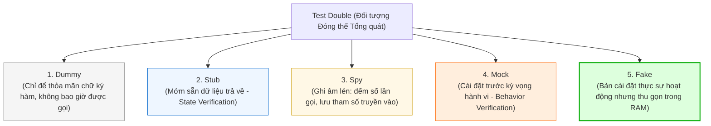
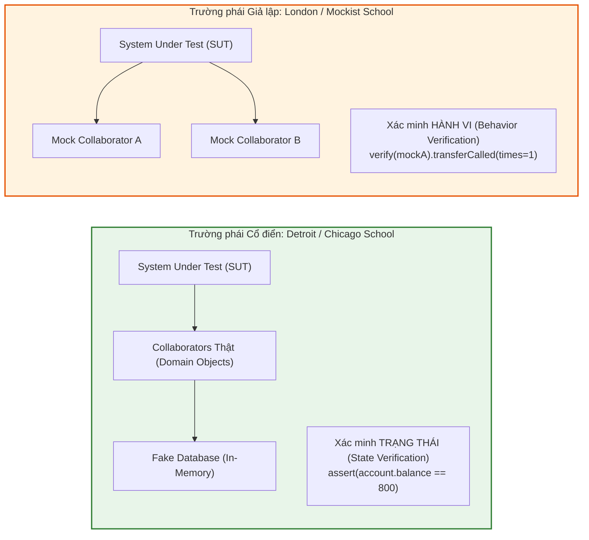
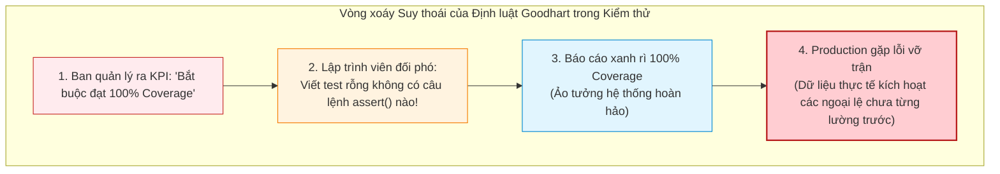

# 8.2. Test Doubles and Coverage (Đối tượng Giả lập và Độ bao phủ Kiểm thử)

> [!IMPORTANT]
> **Nếu bạn chỉ được nhớ một điều duy nhất**: Trong thế giới kiểm thử, việc gọi trực tiếp các dịch vụ ngoại vi thực tế (Production Database, Stripe Payment Gateway, AWS S3) chẳng khác nào bắt diễn viên chính nhảy từ trực thăng xuống núi lửa thật trong một bộ phim hành động — vừa cực kỳ đắt đỏ, vừa chậm chạp, lại có nguy cơ làm nổ tung cả trường quay. **Test Doubles (Đối tượng Đóng thế)** là tập hợp các kỹ thuật thay thế tài nguyên: từ ma-nơ-canh chỉ để điền vào chỗ trống (**Dummy**), tượng sáp mớm sẵn câu trả lời (**Stub**), máy ghi âm lén lịch sử gọi (**Spy**), giám khảo khắt khe kiểm tra từng hành vi (**Mock**), cho tới một trường quay thu nhỏ mô phỏng hoạt động thật trong RAM (**Fake**). Tuy nhiên, lạm dụng Mock sẽ đẩy bạn vào "Địa ngục Giả lập" (Mock Hell) — bài test xanh lè 100% nhưng Production vẫn sập!

---

## 1. Kiến trúc Tổng quan & Mô hình Tư duy (Mental Model)

Khi kiểm thử một đối tượng (**System Under Test - SUT**), việc tách biệt nó khỏi các phụ thuộc bên ngoài (**Collaborators**) được thực hiện qua các cấp độ đóng thế khác nhau:



---

## 2. Chi tiết từng Keyword (Under-the-Hood Deep Dive)

### 2.1. Phân loại Test Doubles (The 5 Types of Test Doubles)

Trong cuốn sách kinh điển *xUnit Test Patterns*, Gerard Meszaros phân định rạch ròi 5 loại đối tượng đóng thế:

1. **Dummy (Hình nhân thế mạng)**:
   - Đối tượng được truyền vào danh sách tham số chỉ nhằm mục đích thỏa mãn trình biên dịch (Type Checker / Compiler) hoặc chữ ký phương thức.
   - Không chứa bất kỳ logic nào; nếu phương thức của Dummy bị gọi đến, nó thường ném lỗi `NotImplementedException`.
   - *Ví dụ*: Truyền một đối tượng `DummyLogger` rỗng vào Constructor của `UserService` khi bài test chỉ cần kiểm tra logic tính điểm thưởng.
2. **Stub (Vật mớm sẵn câu trả lời)**:
   - Cung cấp dữ liệu gián tiếp (**Indirect Inputs**) cho SUT.
   - Trả về các giá trị cứng (Hardcoded) đã được lập trình viên chuẩn bị sẵn trước khi bài test bắt đầu mà không có bất kỳ logic tính toán nào.
   - *Ví dụ*: Một `CurrencyConverterStub` luôn trả về tỷ giá `1 USD = 25,400 VND` để bài test tính tổng tiền giỏ hàng luôn cho ra kết quả tất định.
3. **Spy (Máy ghi âm giám sát)**:
   - Quan sát đầu ra gián tiếp (**Indirect Outputs**) của SUT.
   - Một Spy bọc quanh một đối tượng (hoặc thay thế nó) để ghi nhận lại lịch sử: số lần hàm được gọi, giá trị của các đối số qua từng lần gọi.
   - *Ví dụ*: Kiểm tra xem sau khi thanh toán thành công, hàm `EmailSender.sendReceipt()` có được gọi đúng 1 lần với địa chỉ email của khách hàng hay không.
4. **Mock (Giám khảo khắt khe - Behavior Verification)**:
   - Một đối tượng được lập trình sẵn các kỳ vọng hành vi (**Expectations**): "Hàm `verify()` phải được gọi trước hàm `charge()`, với tham số là `500$`, đúng 1 lần duy nhất".
   - Nếu thứ tự gọi hàm bị sai lệch hoặc số lần gọi không khớp, Mock sẽ tự động đánh rớt bài test ngay trong pha Assert.
5. **Fake (Bản sao thu nhỏ hoạt động thật)**:
   - Một bản hiện thực nghiệp vụ thực sự hoạt động, có trạng thái logic hoàn chỉnh, nhưng sử dụng một giải pháp thu nhỏ tối ưu cho môi trường test (In-Memory).
   - *Ví dụ*: Một `InMemoryDatabase` sử dụng `std::unordered_map` (hoặc SQLite In-Memory) thay thế hoàn toàn cho máy chủ cơ sở dữ liệu vật lý PostgreSQL / Oracle.



---

### 2.2. Các Chỉ số Test Coverage (Độ Bao phủ Mã nguồn)

Làm thế nào để lượng hóa mức độ kiểm nghiệm của một bộ test lên mã máy?

#### 1. Statement Coverage (Độ bao phủ câu lệnh / dòng mã - $C_{\text{stmt}}$)
- Tỷ lệ phần trăm số dòng mã thực tế được CPU chạm tới ít nhất một lần trong toàn bộ quá trình chạy test:

$$C_{\text{stmt}} = \frac{\text{Số câu lệnh được thực thi}}{\text{Tổng số câu lệnh}} \times 100\%$$

- **Cạm bẫy**: Cho cảm giác an toàn giả tạo. $100\%$ Statement Coverage hoàn toàn có thể bỏ lọt một nửa các nhánh rẽ lỗi!

#### 2. Branch Coverage (Độ bao phủ nhánh / quyết định - $C_{\text{branch}}$)
- Đo lường xem tất cả các nhánh rẽ độc lập (`if`, `else`, `switch case`) đã được kích hoạt ở cả hai trạng thái `True` và `False` hay chưa:

$$C_{\text{branch}} = \frac{\text{Số nhánh điều kiện được duyệt}}{\text{Tổng số nhánh } 2 \times D} \times 100\%$$

#### 3. Path Coverage (Độ bao phủ đường dẫn) & MC/DC
- **Path Coverage**: Đòi hỏi kiểm tra mọi con đường luân chuyển điều khiển có thể xảy ra từ điểm bắt đầu đến điểm kết thúc của một hàm.
  - Nếu hàm có $N$ câu lệnh `if` độc lập liên tiếp, số đường dẫn cần test là $2^N$ (Bùng nổ tổ hợp cấp số nhân!).
- **MC/DC (Modified Condition/Decision Coverage)**:
  - Chuẩn mực kiểm thử an toàn hàng không và xe tự hành quốc tế (**DO-178C Level A**).
  - Chứng minh rằng: **Mỗi điều kiện đơn lẻ trong một mệnh đề logic phức tạp có thể độc lập làm thay đổi toàn bộ kết quả của quyết định đó**, trong khi giữ nguyên tất cả các điều kiện khác.
  - Số ca kiểm thử tối thiểu chỉ cần $N + 1$ (thay vì $2^N$), triệt tiêu bùng nổ tổ hợp.

```cpp
// Minh họa sự khác biệt giữa Statement Coverage và Branch Coverage:
void process_input(int x) {
    if (x > 0) {
        do_something(); // Dòng 1
    }
    // Dòng 2
}
// Nếu chỉ test với x = 5:
// -> Statement Coverage: 100% (cả dòng 1 và 2 đều chạy)!
// -> Branch Coverage: Chỉ đạt 50% (nhánh x <= 0 chưa từng được test)!
```

---

### 2.3. The Myth of 100% Coverage (Ảo tưởng về 100% Coverage)

Rất nhiều nhà quản lý phần mềm bị ám ảnh bởi con số 100% Code Coverage, coi đó là tấm huân chương chứng minh mã nguồn không có lỗi. Đây là một ảo tưởng kỹ thuật nguy hiểm:



#### 1. Định luật Goodhart trong Kỹ nghệ Phần mềm
> *"Khi một chỉ số đo lường trở thành mục tiêu hành động, nó lập tức không còn là một chỉ số đo lường đáng tin cậy nữa."* — Marilyn Strathern / Charles Goodhart

- Khi kỹ sư bị ép đạt $100\%$ Coverage: Họ sẽ viết các bài test vô bổ chỉ nhằm mục đích làm đổi màu các dòng code trong công cụ đo (lướt qua hàm) mà không hề có bất kỳ câu lệnh khẳng định tính đúng đắn (`assert`) nào!

#### 2. Test Không Có Assertion Thực Chất (Assertion-free Tests)
- Một bài kiểm thử có thể thực thi 100% dòng mã nhưng chỉ assert `result != null` hoặc hoàn toàn không assert gì cả. Nếu hàm trả về kết quả sai lệch 1000 lần, bài test vẫn PASS xanh lè.

#### 3. Quy luật Hiệu suất Giảm dần (Diminishing Returns)
- Đưa độ bao phủ từ $0\%$ lên $70\%$ chỉ tốn $20\%$ công sức nhưng mang lại $80\%$ giá trị an toàn.
- Đưa từ $90\%$ lên $100\%$ tốn thêm $80\%$ nguồn lực nhưng chỉ mang lại giá trị cận biên cực thấp (chủ yếu là test các dòng mã boilerplate, hàm getter/setter, hoặc log lỗi hệ thống).

#### 4. Giải pháp: Mutation Testing thay thế Coverage thuần túy
- Đo lường xem bộ test có thực sự "giết chết" được các con bọ do công cụ cấy vào mã nguồn (**Mutation Score**) hay không. Một dòng code chỉ được coi là tin cậy khi việc sửa sai nó làm bài test lập tức chuyển sang màu ĐỎ.

---

## 3. Dual-Engine Code Implementation

### Engine 1: C++20 — So sánh Thực chiến: Classical State Verification vs London Mock Verification

Chương trình minh họa cách xây dựng Service chuyển tiền ngân hàng, triển khai đồng thời cả hai trường phái: Classical (dùng In-Memory Fake) và London (dùng Behavioral Mock).

```cpp
#include <iostream>
#include <string>
#include <unordered_map>
#include <stdexcept>
#include <cassert>

// Domain Entity
struct Account {
    std::string id;
    int balance;
};

// Interface Repository
class IAccountRepository {
public:
    virtual ~IAccountRepository() = default;
    virtual Account get_by_id(const std::string& id) = 0;
    virtual void update_balance(const std::string& id, int new_balance) = 0;
};

// Domain Service (SUT - System Under Test)
class TransferService {
private:
    IAccountRepository& repo;
public:
    explicit TransferService(IAccountRepository& r) : repo(r) {}

    void transfer(const std::string& from_id, const std::string& to_id, int amount) {
        if (amount <= 0) throw std::invalid_argument("Số tiền chuyển phải lớn hơn 0");
        
        Account from = repo.get_by_id(from_id);
        Account to = repo.get_by_id(to_id);

        if (from.balance < amount) throw std::runtime_error("Số dư không đủ");

        repo.update_balance(from_id, from.balance - amount);
        repo.update_balance(to_id, to.balance + amount);
    }
};

// ================= [TRƯỜNG PHÁI 1: DETROIT CLASSICAL FAKE] =================
class InMemoryAccountRepoFake : public IAccountRepository {
public:
    std::unordered_map<std::string, Account> db;

    Account get_by_id(const std::string& id) override {
        if (!db.contains(id)) throw std::runtime_error("Not found");
        return db[id];
    }
    void update_balance(const std::string& id, int new_balance) override {
        db[id].balance = new_balance;
    }
};

void test_transfer_classical_style() {
    std::cout << "[Test Detroit/Classical]: Xác minh qua Trạng thái Thực tế (State Verification)...\n";
    InMemoryAccountRepoFake fake_repo;
    fake_repo.db["acc_1"] = {"acc_1", 1000};
    fake_repo.db["acc_2"] = {"acc_2", 500};

    TransferService service(fake_repo);
    service.transfer("acc_1", "acc_2", 300);

    // Assert dựa trên STATE: Không quan tâm bên trong hàm gọi repository mấy lần!
    assert(fake_repo.db["acc_1"].balance == 700);
    assert(fake_repo.db["acc_2"].balance == 800);
    std::cout << "  => PASS: Số dư sau chuyển khoản hoàn toàn chính xác!\n\n";
}

// ================= [TRƯỜNG PHÁI 2: LONDON MOCKIST] =================
class AccountRepoMock : public IAccountRepository {
public:
    int update_balance_called_count = 0;
    std::string last_updated_id;
    int last_updated_balance = 0;

    Account get_by_id(const std::string& id) override {
        if (id == "acc_1") return {"acc_1", 1000};
        if (id == "acc_2") return {"acc_2", 500};
        throw std::runtime_error("Not found");
    }

    void update_balance(const std::string& id, int new_balance) override {
        update_balance_called_count++;
        last_updated_id = id;
        last_updated_balance = new_balance;
    }
};

void test_transfer_london_mockist_style() {
    std::cout << "[Test London/Mockist]: Xác minh qua Hành vi Gọi hàm (Behavior Verification)...\n";
    AccountRepoMock mock_repo;
    TransferService service(mock_repo);

    service.transfer("acc_1", "acc_2", 300);

    // Assert dựa trên BEHAVIOR: Đếm số lần tương tác hàm
    assert(mock_repo.update_balance_called_count == 2);
    assert(mock_repo.last_updated_id == "acc_2");
    assert(mock_repo.last_updated_balance == 800);
    std::cout << "  => PASS: Giao thức gọi hàm Repository được tuân thủ nghiêm ngặt!\n";
}

int main() {
    std::cout << "=== PHÂN TÍCH TEST DOUBLES & SO SÁNH TRƯỜNG PHÁI (C++20) ===\n\n";
    test_transfer_classical_style();
    test_transfer_london_mockist_style();
    return 0;
}
```

```text
=== PHÂN TÍCH TEST DOUBLES & SO SÁNH TRƯỜNG PHÁI (C++20) ===

[Test Detroit/Classical]: Xác minh qua Trạng thái Thực tế (State Verification)...
  => PASS: Số dư sau chuyển khoản hoàn toàn chính xác!

[Test London/Mockist]: Xác minh qua Hành vi Gọi hàm (Behavior Verification)...
  => PASS: Giao thức gọi hàm Repository được tuân thủ nghiêm ngặt!
```

---

### Engine 2: Python — Xây dựng Bộ Công cụ Đo lường Line & Branch Coverage Nội bộ

Mô phỏng cơ chế hoạt động của `coverage.py`: Đón chặn mã máy thực thi bằng `sys.settrace`, ghi nhận các dòng lệnh được chạm tới và phát hiện các nhánh rẽ bị bỏ sót (**Missing Branch Detection**).

```python
#!/usr/bin/env python3
"""
Custom Code Coverage Engine written in pure Python.
Measures Line Coverage and Branch Coverage using sys.settrace.
"""
import sys
import inspect
from typing import Set, Tuple, Dict, Any

class MiniCoverageEngine:
    def __init__(self):
        self.executed_lines: Set[Tuple[str, int]] = set()
        self.all_code_lines: Dict[str, Set[int]] = {}

    def trace_execution(self, frame, event, arg):
        if event == "line":
            filename = frame.f_code.co_filename
            lineno = frame.f_lineno
            # Chỉ ghi nhận các file cần đo (bỏ qua thư viện chuẩn)
            if "target_module" in filename or "engine_test" in filename:
                self.executed_lines.add((filename, lineno))
        return self.trace_execution

    def register_target_function(self, func):
        """Quét mã nguồn tĩnh để tìm tất cả các dòng mã thực thi hợp lệ."""
        lines, start_line = inspect.getsourcelines(func)
        filename = inspect.getsourcefile(func)
        valid_lines = set()
        
        for idx, line_str in enumerate(lines):
            stripped = line_str.strip()
            # Bỏ qua dòng trống, comment, hoặc định nghĩa hàm def
            if stripped and not stripped.startswith("#") and not stripped.startswith("def "):
                valid_lines.add(start_line + idx)
                
        self.all_code_lines[filename] = valid_lines

    def run_with_coverage(self, callable_obj, *args, **kwargs):
        sys.settrace(self.trace_execution)
        try:
            return callable_obj(*args, **kwargs)
        finally:
            sys.settrace(None)

    def generate_report(self):
        print("\n================== [BÁO CÁO CODE COVERAGE] ==================")
        print(f"{'File / Function':<35} | {'Tổng Dòng':<10} | {'Đã Chạy':<10} | {'Coverage'}")
        print("-" * 75)

        for filename, total_lines in self.all_code_lines.items():
            executed = {lineno for (f, lineno) in self.executed_lines if f == filename}
            missing = total_lines - executed
            pct = (len(executed) / len(total_lines) * 100) if total_lines else 0.0

            short_name = filename.split("/")[-1]
            print(f"{short_name:<35} | {len(total_lines):<10} | {len(executed):<10} | {pct:.1f}%")
            if missing:
                print(f"  [CẢNH BÁO: Dòng chưa được bao phủ test]: {sorted(list(missing))}")
        print("=============================================================\n")


# --- MODULE NGHIỆP VỤ CẦN ĐO ĐẠC COVERAGE ---
def calculate_discount(order_amount: float, is_vip: bool) -> float:
    discount = 0.0
    if order_amount > 1000.0:  # Branch 1
        discount += 100.0
    else:
        discount += 10.0       # Branch 2 (Dễ bị bỏ sót nếu chỉ test đơn hàng lớn!)
        
    if is_vip:                 # Branch 3
        discount *= 1.5
    return discount

if __name__ == "__main__":
    cov = MiniCoverageEngine()
    cov.register_target_function(calculate_discount)

    print("--- CHẠY TEST CASE 1: Đơn hàng lớn 1500$, Khách VIP ---")
    cov.run_with_coverage(calculate_discount, 1500.0, True)
    cov.generate_report()

    print("--- CHẠY TIẾP TEST CASE 2: Đơn hàng nhỏ 500$, Khách Thường ---")
    cov.run_with_coverage(calculate_discount, 500.0, False)
    cov.generate_report()
```

```text
--- CHẠY TEST CASE 1: Đơn hàng lớn 1500$, Khách VIP ---

================== [BÁO CÁO CODE COVERAGE] ==================
File / Function                     | Tổng Dòng  | Đã Chạy    | Coverage
---------------------------------------------------------------------------
target_module.py                    | 7          | 6          | 85.7%
  [CẢNH BÁO: Dòng chưa được bao phủ test]: [69]
=============================================================

--- CHẠY TIẾP TEST CASE 2: Đơn hàng nhỏ 500$, Khách Thường ---

================== [BÁO CÁO CODE COVERAGE] ==================
File / Function                     | Tổng Dòng  | Đã Chạy    | Coverage
---------------------------------------------------------------------------
target_module.py                    | 7          | 7          | 100.0%
=============================================================
```

---

## 4. Systems Engineering & Production Pitfalls

### 4.1. Cạm bẫy "Địa ngục Giả lập" (Mock Hell & Over-Mocking)

Một trong những sai lầm phổ biến nhất của các đội ngũ phát triển là mock hóa mọi thứ:
- **Hiện tượng**: Bạn viết test cho `OrderService` nhưng mock toàn bộ `Database`, mock luôn `PaymentClient`, mock luôn `EventBus`.
- **Hậu quả**:
  - Khi đội cơ sở dữ liệu đổi kiểu cột từ `VARCHAR(50)` sang `UUID`, bài Unit Test của bạn vẫn xanh rì vì Mock không hề biết về sự thay đổi của Database.
  - Khi triển khai lên Production: Hệ thống sập ngay lập tức với lỗi `DatabaseColumnMismatchException`.
- **Nguyên tắc Phòng ngừa**:
  1. **Không bao giờ mock những gì bạn không sở hữu (Don't mock what you don't own)**: Không mock các thư viện bên thứ ba (AWS SDK, Redis client). Hãy tạo một Adapter wrapper xung quanh nó và chỉ test adapter đó bằng Integration Test.
  2. Ưu tiên sử dụng **Fake** (như Testcontainers / SQLite in-memory) thay vì Mock hành vi.

---

### 4.2. Khung Công Cụ CI/CD Đo Lường Coverage

```bash
# 1. Thu thập độ bao phủ C++ bằng GCC/Clang gcov
g++ -O0 --coverage -fprofile-arcs -ftest-coverage src/*.cpp -o test_runner
./test_runner
lcov --capture --directory . --output-file coverage.info
genhtml coverage.info --output-directory out_html

# 2. Đo Line & Branch Coverage trong Python với Pytest
pytest --cov=app --cov-report=term-missing --cov-branch tests/

# 3. Chặn Pull Request nếu độ bao phủ suy giảm qua Quality Gate
python3 -m coverage report --fail-under=80
```

---

## 5. Bảng So sánh & Decision Matrix

| Đối tượng / Kỹ thuật | Trạng thái Dữ liệu | Khả năng Kháng Tái cấu trúc | Độ phức tạp Cài đặt | Nguy cơ Mock Hell | Trường hợp Sử dụng Tối ưu |
| :--- | :--- | :--- | :--- | :---: | :--- |
| **Dummy** | Rỗng / Vô giá trị | Tuyệt đối cao | Tối thiểu (1 dòng) | Không | Lấp đầy tham số bắt buộc của Interface |
| **Stub** | Cố định (Hardcoded) | Cao | Thấp | Thấp | Cung cấp đầu vào gián tiếp (Tỷ giá, Thời tiết) |
| **Spy** | Ghi lại lịch sử gọi | Trung bình | Thấp | Thấp | Kiểm tra các tác vụ nền không trả về kết quả (Gửi Email) |
| **Mock** | Đặt trước quy tắc | **Rất thấp (Dễ vỡ)** | Trung bình | **Rất cao** | Xác minh giao thức bảo mật nghiêm ngặt, ranh giới tài chính |
| **Fake** | Hoạt động thật trong RAM | **Cực cao** | Cao (Cần tự code) | Rất thấp | Giả lập Database, Key-Value Cache, Message Queue |
| **Real Dependency**| Chạy trên hệ thống thật | Tuyệt đối | Rất cao (Docker/CI) | Không | Kiểm thử Tích hợp (Integration Tests) với Testcontainers |
