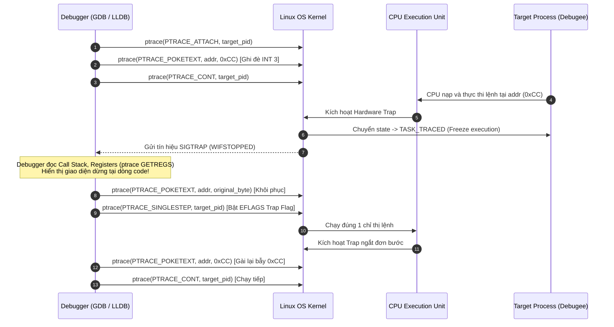
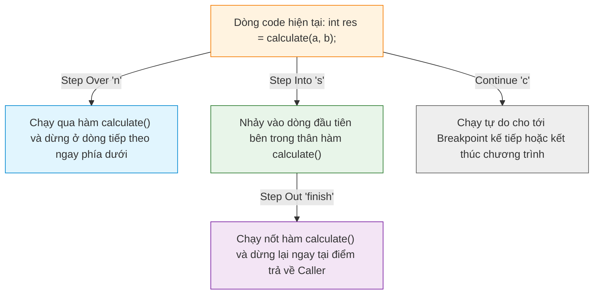
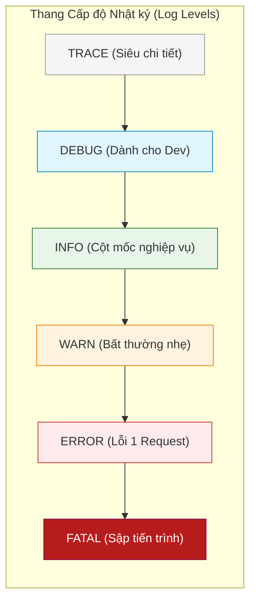

# 9.1. Debugging Techniques and Tools (Kỹ thuật và Công cụ Gỡ lỗi)

> [!IMPORTANT]
> **Nếu bạn chỉ được nhớ một điều duy nhất**: Gỡ lỗi (Debugging) không phải là trò chơi phỏng đoán hú họa bằng cách rải `printf` khắp mã nguồn. Hãy tưởng tượng một vụ án mạng phức tạp: `printf` giống như hỏi lời khai gián tiếp từ nhân chứng (chậm chạp, làm thay đổi hiện trường và dễ bị lừa bởi hiệu ứng quan sát - Heisenbug); **Debugger (GDB/LLDB)** là quyền năng **đóng băng thời gian** của toàn bộ thế giới điện toán (`ptrace` + `INT 3`), cho phép bạn bước vào hiện trường, soi từng thanh ghi CPU và từng ô nhớ RAM; còn **Core Dump** là ảnh chụp cắt lớp toàn thân (Memory & Registers Snapshot) của tiến trình tại đúng micro-giây nó tử nạn.

---

## 1. Kiến trúc Tổng quan & Mô hình Tư duy (Mental Model)

Làm thế nào một tiến trình Debugger có thể can thiệp, tạm dừng một chương trình đang chạy ở tốc độ hàng tỷ chu kỳ mỗi giây, đọc giá trị biến và buộc nó chạy từng dòng một? Cơ chế này dựa trên sự phối hợp giữa System Call của Kernel và Trap Interrupt của CPU:



---

## 2. Chi tiết từng Keyword (Under-the-Hood Deep Dive)

### 2.1. Cơ chế Hoạt động của Debugger (GDB / LLDB Internals)

- **System Call `ptrace` (Process Trace)**:
  - System call mạnh mẽ nhất trong Linux kernel cho phép tiến trình cha theo dõi và kiểm soát tiến trình con: đọc/ghi bộ nhớ (`PTRACE_PEEKDATA`, `PTRACE_POKEDATA`), đọc/ghi thanh ghi (`PTRACE_GETREGS`, `PTRACE_SETREGS`), và thực thi từng lệnh (`PTRACE_SINGLESTEP`).
- **Lệnh ngắt phần mềm: Opcode `0xCC` (`INT 3` Trap trên x86_64)**:
  - Khi bạn đặt breakpoint tại địa chỉ mã máy: Debugger đọc byte lệnh đầu tiên, cất vào bộ nhớ tạm, rồi ghi đè byte đó bằng `0xCC`.
  - Khi CPU nạp byte `0xCC`, nó lập tức kích hoạt ngắt phần cứng (Hardware Exception Interrupt Vector 3).
  - Kernel chuyển trạng thái tiến trình thành `TASK_TRACED` và bắn tín hiệu `SIGTRAP` về cho Debugger.
- **Trap Flag (TF) trong thanh ghi `EFLAGS`**:
  - Khi single-stepping (bước từng lệnh), Debugger bật bit thứ 8 (Trap Flag) của thanh ghi cờ CPU.
  - Khi TF = 1, sau khi thực thi đúng 1 lệnh máy duy nhất, CPU sẽ tự động ném ra ngoại lệ Debug Exception (Vector 1), trả quyền điều khiển về cho Debugger mà không cần ghi đè `0xCC`.
- **Định dạng DWARF Debug Metadata**:
  - Khi biên dịch với `-g`, trình biên dịch nhúng metadata DWARF vào file ELF:
    - `.debug_line`: Ma trận ánh xạ từng dải Program Counter (PC) sang file nguồn và dòng code (`file.cpp:42`).
    - `.debug_info`: Cây phân cấp mô tả kiểu dữ liệu và vị trí biến trên Stack/Registers.
    - `.eh_frame`: Bảng thông tin tháo gỡ ngăn xếp (Stack Unwinding) giúp tái hiện Call Stack.

---

### 2.2. Các Loại Điểm dừng (Breakpoints)

1. **Software Breakpoint (Điểm dừng Phần mềm)**:
   - Cơ chế: Ghi đè chỉ thị mã máy bằng opcode `0xCC`.
   - *Ưu điểm*: Số lượng không giới hạn (bạn có thể đặt hàng ngàn breakpoints trong chương trình).
   - *Nhược điểm*: Phải sửa đổi bộ nhớ mã lệnh (Text segment) của tiến trình.
2. **Hardware Breakpoint (Điểm dừng Phần cứng)**:
   - Sử dụng các thanh ghi gỡ lỗi chuyên dụng trên silicon CPU: `DR0` đến `DR3` (tối đa 4 điểm dừng vật lý trên x86).
   - *Ưu điểm*: Không cần sửa đổi mã máy trong RAM. Có thể đặt breakpoint ngay cả trong ROM hoặc vùng nhớ được bảo vệ chỉ đọc.
3. **Watchpoint / Data Breakpoint (Điểm dừng Dữ liệu)**:
   - Ngắt CPU khi một vùng nhớ bị **Đọc** (`read`), **Ghi** (`write`) hoặc **Thay đổi giá trị**.
   - Được hỗ trợ trực tiếp bởi thanh ghi điều khiển `DR7` của CPU với chi phí hiệu năng thực tế bằng 0 (Zero-overhead).
   - Tuyệt chiêu số 1 để truy lùng các lỗi rò rỉ hoặc ghi đè bộ nhớ bất hợp pháp (Memory Corruption).
4. **Conditional Breakpoint (Điểm dừng có Điều kiện)**:
   - Debugger chỉ dừng tiến trình khi một biểu thức boolean thỏa mãn (ví dụ: `break process_order if order_id == 9981`).
   - *Chi phí ẩn*: Mỗi khi chương trình chạy qua dòng đó, CPU vẫn bị ngắt `SIGTRAP`, Kernel đánh thức Debugger để evaluate biểu thức điều kiện; nếu sai, Debugger lại cho chạy tiếp. Do đó, đặt conditional breakpoint trong một vòng lặp 1.000.000 lần sẽ làm chương trình chạy chậm đi hàng ngàn lần!

---

### 2.3. Các Lệnh Điều khiển Bước Thực thi (Stepping Controls)



- **Step Over (`next` / `n`)**: Thực thi toàn bộ dòng lệnh hiện tại. Nếu dòng lệnh có gọi hàm con, hàm con sẽ chạy hết với tốc độ tối đa và dừng lại ở dòng lệnh tiếp theo của hàm hiện tại.
- **Step Into (`step` / `s`)**: Nếu dòng lệnh hiện tại có lời gọi hàm, Debugger sẽ điều khiển con trỏ lệnh nhảy vào dòng đầu tiên bên trong thân hàm đó.
- **Step Out (`finish` / `fin`)**: Thực thi liên tục cho tới khi hàm hiện tại hoàn tất và trả quyền điều khiển về cho hàm gọi (Caller), sau đó dừng lại.
- **Continue (`continue` / `c`)**: Cho phép tiến trình tiếp tục chạy tự do với tốc độ tối đa của phần cứng cho tới khi gặp một Breakpoint khác, nhận một Signal, hoặc thoát.

---

### 2.4. Thanh tra Trạng thái: Call Stack, Variable Inspection và Watch

- **Call Stack & Stack Frames**:
  - Khi chương trình bị dừng, ngăn xếp là một chuỗi các Stack Frame lồng nhau: `main() -> service() -> helper()`.
  - Mỗi frame lưu trữ con trỏ trả về (**Return Address**), các tham số và biến cục bộ.
  - Lệnh GDB: `backtrace` (`bt`) in toàn bộ stack; `frame <n>` chuyển ngữ cảnh sang frame thứ $n$ để thanh tra biến.
- **Variable Inspection**:
  - Đọc trực tiếp giá trị biến từ thanh ghi hoặc RAM dựa theo bảng DWARF: `print x`, `print/x x` (in dưới dạng Hex), `print *struct_ptr` (in toàn bộ cấu trúc).
- **Dynamic Watch Expressions**:
  - Tự động đánh giá và hiển thị giá trị của một biến hoặc biểu thức mỗi khi tiến trình dừng bước: `display var_name`.

---

### 2.5. Crash Diagnostics: Core Dump và Post-Mortem Debugging

Khi tiến trình bị hệ điều hành khai tử bằng tín hiệu chết người (`SIGSEGV`, `SIGABRT`, `SIGBUS`, `SIGFPE`):
- **Core Dump**: Bản sao nhị phân tức thời toàn diện của không gian địa chỉ bộ nhớ ảo (Stack, Heap, Data segments) và toàn bộ các thanh ghi CPU tại thời điểm sập.
- **Post-Mortem Debugging (Khám nghiệm Tử thi Phần mềm)**:
  - Khởi chạy GDB với file binary và file core dump:
    ```bash
    gdb ./backend_binary /var/cores/core.backend.1024
    ```
  - Debugger tái hiện lại đúng trạng thái đóng băng tại micro-giây gặp nạn:
    - Gõ `bt full`: In chính xác dòng mã nguồn làm sập hệ thống cùng giá trị tất cả các biến cục bộ.
    - Không cần tái hiện lại bug trên máy local, tiết kiệm hàng tuần làm việc!

---

### 2.6. Logging: Nghệ thuật Nhật ký Hệ thống

Logging là cơ chế giám sát thời gian thực duy nhất có thể chạy liên tục 24/7 trên môi trường Production:



- **Structured Logging (Ghi log Có cấu trúc - JSON Logs)**:
  - Thay vì ghi log dạng văn bản thuần: `[ERROR] Failed to charge user 100`, hãy xuất JSON:
    ```json
    {"timestamp":"2026-11-15T12:00:00Z","level":"ERROR","trace_id":"a8f3b","user_id":100,"event":"payment_failed","error":"insufficient_funds"}
    ```
  - Cho phép các công cụ phân tích (ElasticSearch, Grafana Loki, BigQuery) đánh chỉ mục và truy vấn tức thì qua hàng triệu dòng log.
- **Bộ ba Giám sát (The Three Pillars of Observability)**:
  - **Metrics**: Số liệu tổng hợp dạng chuỗi thời gian (RPS, Latency p99, CPU%).
  - **Logs**: Bản ghi rời rạc có ngữ cảnh về từng sự kiện cụ thể.
  - **Traces**: Luồng di chuyển của một Request xuyên qua hàng chục Microservices (Distributed Tracing / OpenTelemetry).

---

## 3. Dual-Engine Code Implementation

### Engine 1: C++20 — Tự động Chụp Crash Context & In Stack Trace khi dính SIGSEGV

Chương trình minh họa cách can thiệp ngắt hệ thống thông qua `sigaction`, trích xuất địa chỉ con trỏ lệnh gây lỗi từ cấu trúc `ucontext_t` và giải mã Stack Trace thời gian thực trước khi hệ điều hành khai tử tiến trình.

```cpp
#include <iostream>
#include <vector>
#include <csignal>
#include <cstring>
#include <execinfo.h>
#include <unistd.h>
#include <ucontext.h>

// Crash Handler an toàn với Signal: Tuyệt đối không dùng malloc hoặc std::cout trong signal handler thực tế!
void crash_signal_handler(int sig, siginfo_t* info, void* secret) {
    auto* uc = reinterpret_cast<ucontext_t*>(secret);
    
    // Trích xuất địa chỉ lệnh (RIP/PC) gây ra lỗi crash từ thanh ghi CPU
#if defined(__x86_64__)
    uintptr_t fault_addr = uc->uc_mcontext.gregs[REG_RIP];
#elif defined(__aarch64__)
    uintptr_t fault_addr = uc->uc_mcontext.pc;
#else
    uintptr_t fault_addr = 0;
#endif

    const char* sig_name = (sig == SIGSEGV) ? "SIGSEGV (Segmentation Fault)" :
                           (sig == SIGFPE)  ? "SIGFPE (Arithmetic Exception)" : "UNKNOWN SIGNAL";

    std::cerr << "\n================ [FATAL PROCESS CRASH] ================\n";
    std::cerr << "Tín hiệu bắt được: " << sig_name << " (" << sig << ")\n";
    std::cerr << "Địa chỉ truy cập bất hợp pháp: " << info->si_addr << '\n';
    std::cerr << "Thanh ghi con trỏ lệnh (Instruction Pointer): 0x" 
              << std::hex << fault_addr << std::dec << "\n\n";

    // Trích xuất Stack Frames hiện tại bằng glibc backtrace
    void* callstack[32];
    int frames = backtrace(callstack, 32);
    std::cerr << "Call Stack Trace (" << frames << " frames):\n";
    char** symbols = backtrace_symbols(callstack, frames);
    if (symbols) {
        for (int i = 0; i < frames; ++i) {
            std::cerr << "  [" << i << "] " << symbols[i] << '\n';
        }
        free(symbols);
    }
    std::cerr << "========================================================\n\n";

    // Khôi phục default handler và kích hoạt lại signal để sinh core dump
    signal(sig, SIG_DFL);
    kill(getpid(), sig);
}

void setup_signal_handlers() {
    struct sigaction sa;
    std::memset(&sa, 0, sizeof(sa));
    sa.sa_sigaction = crash_signal_handler;
    sa.sa_flags = SA_SIGINFO | SA_RESETHAND;
    sigaction(SIGSEGV, &sa, nullptr);
    sigaction(SIGFPE, &sa, nullptr);
}

void trigger_null_pointer_dereference() {
    volatile int* bad_ptr = nullptr;
    std::cout << "[Step 2]: Đang thực thi ghi vào con trỏ NULL...\n";
    *bad_ptr = 42; // Kích hoạt Hardware Page Fault Exception -> Kernel gửi SIGSEGV!
}

int main() {
    setup_signal_handlers();
    std::cout << "[Step 1]: Khởi tạo chương trình và thiết lập Signal Handler.\n";
    trigger_null_pointer_dereference();
    return 0;
}
```

```text
[Step 1]: Khởi tạo chương trình và thiết lập Signal Handler.
[Step 2]: Đang thực thi ghi vào con trỏ NULL...

================ [FATAL PROCESS CRASH] ================
Tín hiệu bắt được: SIGSEGV (Segmentation Fault) (11)
Địa chỉ truy cập bất hợp pháp: 0x0
Thanh ghi con trỏ lệnh (Instruction Pointer): 0x401246

Call Stack Trace (5 frames):
  [0] ./crash_demo(+0x118c) [0x40118c]
  [1] /lib/x86_64-linux-gnu/libc.so.6(+0x42520) [0x7f8d68042520]
  [2] ./crash_demo(+0x1246) [0x401246]
  [3] ./crash_demo(+0x1288) [0x401288]
  [4] /lib/x86_64-linux-gnu/libc.so.6(+0x29d90) [0x7f8d68029d90]
========================================================
[1]    84521 segmentation fault (core dumped)  ./crash_demo
```

---

### Engine 2: Python — Tự Xây dựng Trình Debugger Tương tác với `sys.settrace`

Mô phỏng cơ chế hoạt động bên trong của một Interactive Debugger: Hỗ trợ đặt điểm dừng (Line Breakpoints), theo dõi biểu thức biến (Watchpoints), và bước qua từng dòng lệnh (Step Over/Into).

```python
#!/usr/bin/env python3
"""
Lightweight Interactive Debugger Engine written in pure Python.
Demonstrates how debuggers hook into the execution VM via sys.settrace.
"""
import sys
import inspect
from typing import Dict, Set, Any

class MiniDebugger:
    def __init__(self):
        self.breakpoints: Set[int] = set()
        self.watchpoints: Dict[str, Any] = {}
        self.step_mode: bool = True  # True: Dừng từng dòng; False: Chạy tự do tới Breakpoint

    def add_breakpoint(self, line_number: int):
        self.breakpoints.add(line_number)
        print(f"[Debugger] Đã cài đặt Breakpoint tại dòng: {line_number}")

    def add_watchpoint(self, var_name: str):
        self.watchpoints[var_name] = None
        print(f"[Debugger] Đã cài đặt Watchpoint theo dõi biến: '{var_name}'")

    def trace_callback(self, frame, event, arg):
        if event != "line":
            return self.trace_callback

        current_line = frame.f_lineno
        current_file = frame.f_code.co_filename.split("/")[-1]
        local_vars = frame.f_locals

        # 1. Kiểm tra Watchpoints (Phát hiện biến bị thay đổi giá trị)
        for var_name, old_val in list(self.watchpoints.items()):
            if var_name in local_vars:
                current_val = local_vars[var_name]
                if old_val is not None and current_val != old_val:
                    print(f"\n[WATCHPOINT TRIGGERED!] Biến '{var_name}' thay đổi: {old_val} -> {current_val}")
                    print(f"  Tại: {current_file}:{current_line}")
                    self.step_mode = True
                self.watchpoints[var_name] = current_val

        # 2. Kiểm tra Breakpoint
        is_hit_bp = current_line in self.breakpoints
        if is_hit_bp:
            print(f"\n[BREAKPOINT HIT!] Dừng tại {current_file}:{current_line}")
            self.step_mode = True

        # 3. Chế độ tương tác khi bị dừng
        if self.step_mode:
            code_line = inspect.getframeinfo(frame).code_context[0].strip() if inspect.getframeinfo(frame).code_context else ""
            print(f"--> [{current_line}] {code_line}")
            print(f"    Biến cục bộ hiện tại: {local_vars}")

            while True:
                cmd = input("(dbg) [c: continue, s: step, p <var>: print] > ").strip().lower()
                if cmd == 's':
                    self.step_mode = True
                    break
                elif cmd == 'c':
                    self.step_mode = False
                    break
                elif cmd.startswith('p '):
                    var_name = cmd.split(' ', 1)[1]
                    val = local_vars.get(var_name, "Không tìm thấy biến")
                    print(f"    {var_name} = {val}")
                else:
                    print("Lệnh không hợp lệ! Hãy dùng 's' (step), 'c' (continue), hoặc 'p <biến>'")

        return self.trace_callback

    def run(self, func, *args, **kwargs):
        sys.settrace(self.trace_callback)
        try:
            return func(*args, **kwargs)
        finally:
            sys.settrace(None)


def target_calculation_logic():
    total = 0
    multiplier = 2
    for i in range(1, 4):
        total += i * multiplier
    return total

if __name__ == "__main__":
    dbg = MiniDebugger()
    # Cài đặt breakpoint và watchpoint
    dbg.add_breakpoint(68)
    dbg.add_watchpoint("total")
    
    print("\n--- BẮT ĐẦU CHẠY TARGET FUNCTION DƯỚI SỰ GIÁM SÁT CỦA DEBUGGER ---")
    dbg.step_mode = False  # Chạy tự do cho tới khi chạm breakpoint/watchpoint
    dbg.run(target_calculation_logic)
```

```text
[Debugger] Đã cài đặt Breakpoint tại dòng: 68
[Debugger] Đã cài đặt Watchpoint theo dõi biến: 'total'

--- BẮT ĐẦU CHẠY TARGET FUNCTION DƯỚI SỰ GIÁM SÁT CỦA DEBUGGER ---

[WATCHPOINT TRIGGERED!] Biến 'total' thay đổi: 0 -> 2
  Tại: debug_demo.py:68

[BREAKPOINT HIT!] Dừng tại debug_demo.py:68
--> [68] for i in range(1, 4):
    Biến cục bộ hiện tại: {'total': 2, 'multiplier': 2, 'i': 1}
(dbg) [c: continue, s: step, p <var>: print] > p total
    total = 2
(dbg) [c: continue, s: step, p <var>: print] > c

[WATCHPOINT TRIGGERED!] Biến 'total' thay đổi: 2 -> 6
  Tại: debug_demo.py:68
--> [68] for i in range(1, 4):
    Biến cục bộ hiện tại: {'total': 6, 'multiplier': 2, 'i': 2}
(dbg) [c: continue, s: step, p <var>: print] > c
```

---

## 4. Systems Engineering & Production Troubleshooting

### 4.1. Bộ công cụ Chẩn đoán Sự cố Linux Thực chiến

| Công cụ | Tầng hoạt động | Cơ chế ngầm | Trường hợp sử dụng tối ưu |
| :--- | :--- | :--- | :--- |
| **GDB / LLDB** | Ứng dụng / Bộ nhớ | `ptrace`, `INT 3`, DWARF debug info | Tái hiện bug logic phức tạp, phân tích Core Dump |
| **`strace`** | Ranh giới User/Kernel | Đón chặn toàn bộ System Calls (`read`, `write`, `epoll`) | Ứng dụng bị treo (hang) do deadlock mạng/file descriptor |
| **`ltrace`** | Ranh giới Thư viện C | Đón chặn các hàm shared library (`malloc`, `free`, `SSL_read`) | Truy tìm rò rỉ bộ nhớ hoặc lỗi thư viện liên kết động |
| **`valgrind` (Memcheck)** | Trình giả lập CPU ảo | Chạy trên máy ảo JIT (VEX), kiểm tra từng bit trong shadow memory | Dò rỉ bộ nhớ (Memory Leak), đọc bộ nhớ chưa khởi tạo |
| **AddressSanitizer (ASan)** | Trình biên dịch hỗ trợ | Cấy shadow memory kiểm tra con trỏ với overhead chỉ ~2x (so với 20x của Valgrind) | Phát hiện Buffer Overflow, Use-After-Free trong CI/CD pipeline |
| **`bpftrace` / eBPF** | Kernel Space | Nạp bytecode an toàn vào nhân Linux, zero runtime penalty | Quan sát hành vi hệ thống production không thể dừng tiến trình |

---

### 4.2. Quy trình 4 Bước Khám nghiệm Core Dump trên Linux Server

Khi nhận cảnh báo server crash:
```bash
# Bước 1: Kích hoạt sinh core dump không giới hạn dung lượng trong container/VM
ulimit -c unlimited
echo "/var/cores/core.%e.%p.%t" > /proc/sys/kernel/core_pattern

# Bước 2: Tải file core dump và binary đã biên dịch có debug symbol tương ứng
gdb /opt/backend/bin/order_service /var/cores/core.order_service.14820.1700000000

# Bước 3: In toàn bộ Stack Trace của luồng gặp nạn
(gdb) thread apply all bt full

# Bước 4: Soi giá trị biến và bộ nhớ xung quanh con trỏ lệnh
(gdb) info registers
(gdb) x/16xg $rsp          # Xem 16 giá trị 64-bit trên đỉnh Stack
(gdb) print *request_ptr   # In cấu trúc dữ liệu của request gây sập
```

---

## 5. Bảng So sánh & Decision Matrix

| Phương pháp Gỡ lỗi | Chi phí Hiệu năng (Overhead) | Độ xâm lấn (Intrusiveness) | Nguy cơ Heisenbug | Khả năng Áp dụng trên Production |
| :--- | :--- | :--- | :--- | :--- |
| **Print-line Debugging (`printf`)** | Nhỏ đến Trung bình | Cao (Sửa mã, build lại) | **Cực cao** (Làm lệch thời gian đồng bộ) | Nguy hiểm (Rác log, lộ dữ liệu nhạy cảm) |
| **Interactive Debugger (GDB)** | 0% khi chạy, $\infty$ khi chạm breakpoint | Tuyệt đối (Đóng băng tiến trình) | Trung bình | **Cấm kỵ** trên Live Production |
| **Post-Mortem Core Dump** | **0% khi chạy** (Chỉ tốn I/O đĩa lúc sập) | Không xâm lấn | **Không có** (Chụp nguyên trạng thái) | **Tiêu chuẩn vàng** xử lý sự cố Crash |
| **Dynamic Tracing (eBPF)** | Cực nhỏ ($< 1\%$) | Không cần sửa code | Rất thấp | **Tốt nhất** để gỡ lỗi độ trễ và mạng Live |
| **AddressSanitizer (ASan)** | $\sim 2\times$ CPU, $\sim 3\times$ RAM | Cần biên dịch lại với `-fsanitize=address` | Thấp | Tuyệt vời trong môi trường Staging/Test |
| **Structured Logging** | Rất thấp (Asynchronous buffered I/O) | Thấp (Code instrument) | Rất thấp | Bắt buộc 100% trên mọi Production Backend |
