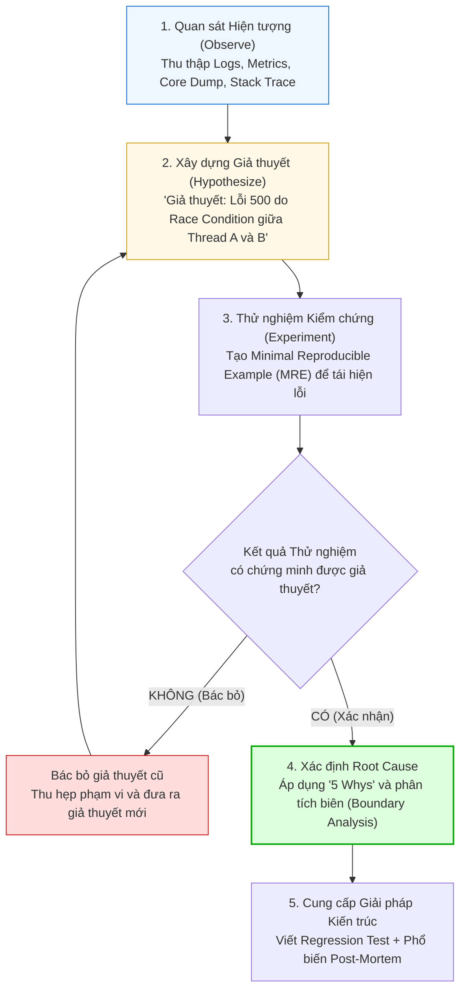
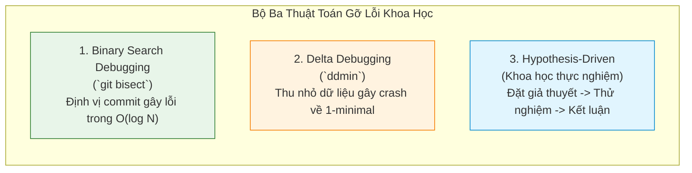
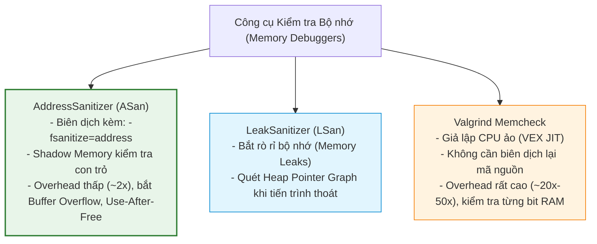

# 9.2. Root Cause Analysis & Advanced Troubleshooting (Phân tích Nguyên nhân Gốc rễ & Xử lý Sự cố Nâng cao)

> [!IMPORTANT]
> **Nếu bạn chỉ được nhớ một điều duy nhất**: Khác biệt căn bản giữa lập trình viên nghiệp dư và một Principal Systems Engineer không nằm ở tốc độ gõ code, mà ở **Phương pháp luận Tiếp cận Sự cố (Troubleshooting Methodology)**. Lập trình viên nghiệp dư thực hiện *Shotgun Debugging* — chắp vá ngẫu nhiên vài dòng code, thêm `if (x != null)`, xóa cache, khởi động lại server và cầu nguyện cho lỗi biến mất (chữa triệu chứng tạm thời). Kỹ sư hệ thống hành xử như một nhà dịch tễ học hoặc bác sĩ giải phẫu: áp dụng **Phương pháp Khoa học (Scientific Method)**, cô lập biến số, phân hoạch không gian nhị phân (`git bisect`, Delta Debugging), bóc tách từng lớp triệu chứng bằng **5 Whys & Biểu đồ Ishikawa** để tiêu diệt tận gốc tế bào ung thư kiến trúc (**Root Cause**).

---

## 1. Kiến trúc Tổng quan & Mô hình Tư duy (Mental Model)

Quá trình truy vết và giải quyết sự cố phần mềm phức tạp tuân thủ chu trình lặp 4 bước của phương pháp thực nghiệm khoa học:

$$\text{Quan sát (Observe)} \longrightarrow \text{Giả thuyết (Hypothesize)} \longrightarrow \text{Dự đoán & Thử nghiệm (Experiment)} \longrightarrow \text{Kết luận (Conclude)}$$



---

## 2. Chi tiết từng Keyword (Under-the-Hood Deep Dive)

### 2.1. Reproducible Bug và MRE (Minimal Reproducible Example)

- **Nguyên tắc Vàng**: *"Nếu bạn không thể tái hiện được một lỗi, bạn không thể chứng minh mình đã thực sự sửa được nó."*
- **MRE (Minimal Reproducible Example - Ví dụ Tái hiện Tối thiểu)**:
  - Một đoạn mã hoặc kịch bản nhỏ nhất có thể làm bộc phát lỗi một cách nhất quán (Deterministically).
  - Bao gồm 3 đặc tính sống còn (**MCV**):
    1. **Minimal (Tối thiểu)**: Loại bỏ mọi dòng code, mọi thư viện bên ngoài và mọi trường dữ liệu thừa thãi không tham gia trực tiếp vào việc kích hoạt bug.
    2. **Complete (Đầy đủ)**: Chứa tất cả những gì cần thiết để bất kỳ ai tải về cũng có thể chạy được ngay (không thiếu file config hay dữ liệu đầu vào).
    3. **Verifiable (Xác minh được)**: Cung cấp kết quả đầu ra thực tế và khẳng định kết quả kỳ vọng để người kiểm tra xác nhận bug có xảy ra.

---

### 2.2. Root Cause Analysis (RCA) và Phương pháp "5 Whys"

#### Phân biệt Triệu chứng (Symptom) vs Cơ chế Lỗi vs Nguyên nhân Gốc rễ (Root Cause)
- **Triệu chứng (Symptom)**: Điều người dùng nhìn thấy. *Ví dụ*: Nút thanh toán quay tròn rồi hiện lỗi HTTP 504 Gateway Timeout.
- **Cơ chế lỗi (Failure Mechanism)**: Lỗi kỹ thuật trực tiếp gây ra triệu chứng. *Ví dụ*: Luồng xử lý thanh toán bị bế tắc vô hạn (Deadlock) trên một hàng cơ sở dữ liệu.
- **Nguyên nhân gốc rễ (Root Cause)**: Khiếm khuyết cốt lõi trong thiết kế kiến trúc hoặc quy trình kiểm soát. *Ví dụ*: Hai dịch vụ tranh chấp hai bảng cơ sở dữ liệu theo thứ tự ngược nhau (nghịch đảo thứ tự khóa) mà không có cơ chế khóa toàn cục hoặc timeout.

#### Kỹ thuật "5 Whys" của Taiichi Ohno (Toyota Production System)
Đặt câu hỏi "Tại sao?" liên tiếp 5 lần để bóc tách từ tầng triệu chứng bên ngoài xuống tận căn nguyên sâu xa:
1. *Tại sao máy chủ sập?* $\to$ Hết dung lượng đĩa cứng.
2. *Tại sao hết đĩa?* $\to$ File log tăng vọt lên 500GB chỉ trong 2 giờ.
3. *Tại sao file log phình to như vậy?* $\to$ Một tiến trình ném ra 1 triệu dòng stack trace lỗi mỗi giây.
4. *Tại sao tiến trình ném lỗi liên tục?* $\to$ Service gọi API thanh toán bên thứ ba bị timeout và kích hoạt vòng lặp retry vô tận không có Backoff.
5. *Tại sao không có Exponential Backoff?* $\to$ **Root Cause**: Thiếu kiến trúc Circuit Breaker và quy chuẩn thiết kế client gọi dịch vụ ngoại vi.

#### Biểu đồ Xương cá Ishikawa (Fishbone Diagram)
Phân rã các nguyên nhân tiềm tàng theo 6 nhánh kỹ nghệ (6M: Machine, Method, Material, Measurement, Man, Mother Nature) để đảm bảo không bỏ sót bất kỳ góc khuất nào của hệ thống.

#### Văn hóa Blameless Post-Mortem (Hồi cứu Không đổ lỗi)
Mục đích duy nhất của buổi phân tích sự cố là **học hỏi và cải tiến hệ thống**, không tìm người chịu tội. Giả định rằng mọi kỹ sư đều hành động với thiện chí và thông tin tốt nhất họ có tại thời điểm đó. Lỗi lầm là cơ hội để bổ sung rào chắn tự động trong mã nguồn và CI/CD.

---

### 2.3. Các Thuật Toán Gỡ Lỗi Khoa Học



#### 1. Binary Search Debugging và `git bisect`
- Khi một tính năng chạy ổn định ở phiên bản phát hành 3 tháng trước đột nhiên bị lỗi hôm nay trên nhánh `main` (có 500 commit mới):
- Thay vì kiểm tra từng commit một, thuật toán tìm kiếm nhị phân $O(\log N)$ chia đôi lịch sử:
  - Kiểm tra commit ở chính giữa: Nếu GOOD, lỗi nằm ở nửa sau; nếu BAD, lỗi nằm ở nửa trước.
  - Chỉ cần $\approx \log_2(500) \approx 9$ lần kiểm tra là định vị chính xác commit đầu tiên sinh ra lỗi.
  - Tự động hóa hoàn toàn với `git bisect run <test_script>`.

#### 2. Delta Debugging ($ddmin$)
- Được đề xuất bởi Giáo sư Andreas Zeller: Tự động thu nhỏ tệp dữ liệu đầu vào khổng lồ (ví dụ: file JSON 50MB) làm sập chương trình về một chuỗi con tối thiểu (**1-minimal failure-inducing input**) chỉ còn đúng vài ký tự gây lỗi.
- Thuật toán liên tục thử nghiệm các tập con và tập bù để loại bỏ dữ liệu nhiễu.

#### 3. Hypothesis-Driven Debugging (Gỡ lỗi Hướng Giả thuyết)
- Không bao giờ sửa code mù quáng.
- Mỗi lần thay đổi code phải là một **thử nghiệm khoa học** nhằm kiểm chứng hoặc bác bỏ một giả thuyết cụ thể về nguyên nhân lỗi.

---

### 2.4. Memory Debugging: Công cụ Bắt lỗi Bộ nhớ

Trong các ngôn ngữ quản lý bộ nhớ thủ công (C/C++), lỗi bộ nhớ là nguyên nhân hàng đầu gây ra sập hệ thống và lỗ hổng bảo mật:



1. **AddressSanitizer (ASan) & LeakSanitizer (LSan)**:
   - Cơ chế: Cấy vào bộ nhớ các vùng đệm độc (**Redzones**) xung quanh mỗi biến trên Stack/Heap, và sử dụng một vùng nhớ bóng (**Shadow Memory**) với tỷ lệ ánh xạ 1 byte shadow cho mỗi 8 byte RAM thực tế.
   - Khi CPU cố gắng đọc/ghi vào Redzone, ASan lập tức chặn lại và in ra báo cáo chẩn đoán chi tiết đến từng byte.
   - Overhead cực thấp (~2x tốc độ), lý tưởng để tích hợp vào CI/CD pipeline.
2. **Valgrind Memcheck**:
   - Dịch nhị phân động chương trình sang mã trung gian VEX. Theo dõi trạng thái từng bit bộ nhớ xem đã được khởi tạo hay chưa (Valid-Value bit) và có hợp lệ để truy cập hay không (Valid-Address bit).
   - Tốc độ chậm hơn 20x - 50x nhưng có thể chạy trực tiếp trên file nhị phân có sẵn mà không cần mã nguồn biên dịch lại.

---

### 2.5. Race Condition & Concurrency Debugging (Gỡ lỗi Đa luồng)

- **Data Race vs Race Condition**:
  - *Data Race*: Hai luồng cùng truy cập một ô nhớ đồng thời, trong đó có ít nhất một thao tác GHI, và không có cơ chế đồng bộ hóa (Synchronization).
  - *Race Condition*: Lỗi logic nghiệp vụ xảy ra do thứ tự thực thi của các thao tác không thể kiểm soát.
- **ThreadSanitizer (TSan)**:
  - Cấy mã máy kiểm tra quan hệ quan sát (**Happens-Before Relationship**) bằng đồng hồ vector (Vector Clocks).
  - Biên dịch với cờ `-fsanitize=thread` để phát hiện Data Race và khóa bất hợp pháp ngay khi chạy test.
- **Nguyên tắc Gỡ lỗi Deadlock (4 Điều kiện Coffman)**:
  - Deadlock chỉ xảy ra khi hội đủ cả 4 điều kiện: Mutual Exclusion, Hold and Wait, No Preemption, và Circular Wait.
  - **Cách triệt tiêu triệt để**: Bẻ gãy điều kiện Chờ đợi Vòng tròn (Circular Wait) bằng cách áp dụng **Global Lock Ordering** (luôn khóa tài nguyên theo thứ tự tăng dần của địa chỉ bộ nhớ hoặc ID) hoặc sử dụng `std::scoped_lock` trong C++17/C++20.

---

## 3. Dual-Engine Code Implementation

### Engine 1: C++20 — Chẩn đoán Deadlock do Nghịch đảo Thứ tự Khóa & Giải pháp RAII Lock-Hierarchy

Chương trình minh họa hiện tượng sập hệ thống (Deadlock) khi hai luồng tranh chấp tài nguyên theo thứ tự ngược nhau (Thread 1: A $\to$ B; Thread 2: B $\to$ A), và kỹ thuật giải quyết triệt để ở tầng kiến trúc bằng `std::scoped_lock` (thuật toán Deadlock Avoidance kiểu Dijkstra / Chandy-Misra).

```cpp
#include <iostream>
#include <thread>
#include <mutex>
#include <chrono>

// Hai tài nguyên quan trọng trong hệ thống ngân hàng
std::mutex account_A_mutex;
std::mutex account_B_mutex;

// 1. Phản mẫu chết người: Khóa tài nguyên tùy tiện gây Deadlock (Nghịch đảo thứ tự khóa)
void transfer_money_buggy_worker_1() {
    std::cout << "[Worker 1]: Đang giữ khóa Account A...\n";
    std::unique_lock<std::mutex> lockA(account_A_mutex);
    std::this_thread::sleep_for(std::chrono::milliseconds(50)); // Giả lập độ trễ mạng

    std::cout << "[Worker 1]: Đang chờ khóa Account B...\n";
    std::unique_lock<std::mutex> lockB(account_B_mutex); // BỊ DEADLOCK TẠI ĐÂY NẾU WORKER 2 CHẠY
    std::cout << "[Worker 1]: Chuyển khoản A -> B thành công!\n";
}

void transfer_money_buggy_worker_2() {
    std::cout << "[Worker 2]: Đang giữ khóa Account B...\n";
    std::unique_lock<std::mutex> lockB(account_B_mutex);
    std::this_thread::sleep_for(std::chrono::milliseconds(50));

    std::cout << "[Worker 2]: Đang chờ khóa Account A...\n";
    std::unique_lock<std::mutex> lockA(account_A_mutex); // BỊ DEADLOCK TẠI ĐÂY NẾU WORKER 1 CHẠY
    std::cout << "[Worker 2]: Chuyển khoản B -> A thành công!\n";
}

// 2. Chuẩn mực Kỹ nghệ Hệ thống: Sử dụng std::scoped_lock (C++17/C++20)
// Tự động sắp xếp địa chỉ bộ nhớ của các Mutex để khóa theo thứ tự toàn cục (Global Lock Order)
void transfer_money_robust(std::mutex& m1, std::mutex& m2, const char* worker_name) {
    std::cout << "[" << worker_name << "]: Đang xin khóa an toàn qua std::scoped_lock...\n";
    // scoped_lock tự động áp dụng thuật toán tránh deadlock (Deadlock-Free Locking)
    std::scoped_lock lock(m1, m2);
    
    std::cout << "[" << worker_name << "]: ĐÃ SỞ HỮU CẢ 2 KHÓA ĐỒNG THỜI!\n";
    std::this_thread::sleep_for(std::chrono::milliseconds(20));
    std::cout << "[" << worker_name << "]: Hoàn tất giao dịch tài chính an toàn.\n";
}

int main() {
    std::cout << "=== BÀI TOÁN CHẨN ĐOÁN DEADLOCK & GIẢI PHÁP ROOT CAUSE (C++20) ===\n\n";

    std::cout << "--- Thử nghiệm: Cơ chế Khóa an toàn không bao giờ Deadlock ---\n";
    std::thread t1(transfer_money_robust, std::ref(account_A_mutex), std::ref(account_B_mutex), "Safe-Thread-1");
    std::thread t2(transfer_money_robust, std::ref(account_B_mutex), std::ref(account_A_mutex), "Safe-Thread-2");

    t1.join();
    t2.join();
    std::cout << "\n=> Kết luận: Cả 2 luồng hoàn tất mà không phát sinh bế tắc chu kỳ khóa!\n";
    return 0;
}
```

```text
=== BÀI TOÁN CHẨN ĐOÁN DEADLOCK & GIẢI PHÁP ROOT CAUSE (C++20) ===

--- Thử nghiệm: Cơ chế Khóa an toàn không bao giờ Deadlock ---
[Safe-Thread-1]: Đang xin khóa an toàn qua std::scoped_lock...
[Safe-Thread-1]: ĐÃ SỞ HỮU CẢ 2 KHÓA ĐỒNG THỜI!
[Safe-Thread-2]: Đang xin khóa an toàn qua std::scoped_lock...
[Safe-Thread-1]: Hoàn tất giao dịch tài chính an toàn.
[Safe-Thread-2]: ĐÃ SỞ HỮU CẢ 2 KHÓA ĐỒNG THỜI!
[Safe-Thread-2]: Hoàn tất giao dịch tài chính an toàn.

=> Kết luận: Cả 2 luồng hoàn tất mà không phát sinh bế tắc chu kỳ khóa!
```

---

### Engine 2: Python — Hiện thực Thuật toán Tự động Thu nhỏ Dữ liệu Lỗi ($ddmin$)

Hiện thực thuật toán Delta Debugging kinh điển của Andreas Zeller: Tự động biến một chuỗi dữ liệu đầu vào phức tạp thành chuỗi ngắn nhất kích hoạt lỗi (1-minimal failure).

```python
#!/usr/bin/env python3
"""
Implementation of the Delta Debugging Minimization Algorithm (ddmin)
Automatically simplifies failing inputs to the 1-minimal reproduction case.
"""
from typing import List, Callable

def mock_vulnerable_parser(payload: str) -> bool:
    """
    Giả lập một bộ parser backend có lỗ hổng:
    Hệ thống sẽ CRASH (trả về False) nếu payload chứa đồng thời hai token:
    '<crash>' và 'DROP' ở bất kỳ vị trí nào.
    """
    return not ("<crash>" in payload and "DROP" in payload)

def ddmin(failing_input: str, test_func: Callable[[str], bool]) -> str:
    """
    Thuật toán Delta Debugging (ddmin)
    Trả về chuỗi con tối thiểu gây ra lỗi (test_func trả về False).
    """
    elements = list(failing_input)
    n = 2  # Bắt đầu phân hoạch thành 2 phần

    step = 0
    while len(elements) >= 2:
        step += 1
        subsets: List[List[str]] = []
        subset_size = len(elements) // n
        
        # Tạo n tập con
        for i in range(n):
            start = i * subset_size
            end = len(elements) if i == n - 1 else (i + 1) * subset_size
            subsets.append(elements[start:end])

        reduced = False
        
        # 1. Thử từng tập con (Subsets)
        for sub in subsets:
            candidate = "".join(sub)
            if not test_func(candidate): # Vẫn gây crash!
                elements = sub
                n = 2
                reduced = True
                print(f"[Step {step} - Subset Reduced] Độ dài giảm xuống: {len(elements)}")
                break

        if reduced:
            continue

        # 2. Thử các tập bù (Complements: Tất cả ngoại trừ 1 tập con)
        for sub in subsets:
            complement = [char for char in elements if char not in sub]
            candidate = "".join(complement)
            if not test_func(candidate): # Tập bù vẫn làm crash!
                elements = complement
                n = max(n - 1, 2)
                reduced = True
                print(f"[Step {step} - Complement Reduced] Độ dài giảm xuống: {len(elements)}")
                break

        if reduced:
            continue

        # 3. Tăng độ mịn phân hoạch nếu cả tập con và tập bù đều PASS
        if n < len(elements):
            n = min(len(elements), n * 2)
            print(f"[Step {step} - Granularity Increased] Tăng độ mịn phân hoạch n = {n}")
        else:
            break

    return "".join(elements)

if __name__ == "__main__":
    huge_noisy_payload = (
        "USER_REQUEST_HEADERS: {Host: api.bank.com, User-Agent: Mozilla/5.0}\n"
        "BODY_START: {\n"
        "  transaction_id: 'TXN-99814421',\n"
        "  metadata: 'Lorem ipsum dolor sit amet, consectetur adipiscing elit.',\n"
        "  vulnerability_marker: '<crash>',\n"
        "  extra_padding_bytes: '0000000000000000000000000000000000000000000',\n"
        "  sql_instruction: 'DROP',\n"
        "  debug_flags: [1, 0, 0, 1, 42]\n"
        "}\n"
    )

    print(f"Dữ liệu gốc gây crash dài: {len(huge_noisy_payload)} ký tự.\n")
    print("--- BẮT ĐẦU CHẠY THUẬT TOÁN DELTA DEBUGGING (ddmin) ---")
    
    minimal_reproduction = ddmin(huge_noisy_payload, mock_vulnerable_parser)
    
    print("\n=== KẾT QUẢ TỐI THIỂU TÁI HIỆN LỖI (1-MINIMAL REPRODUCER) ===")
    print(f"Độ dài sau thu nhỏ: {len(minimal_reproduction)} ký tự")
    print(f"Nội dung tối thiểu gây sập: '{minimal_reproduction}'")
```

```text
Dữ liệu gốc gây crash dài: 326 ký tự.

--- BẮT ĐẦU CHẠY THUẬT TOÁN DELTA DEBUGGING (ddmin) ---
[Step 1 - Granularity Increased] Tăng độ mịn phân hoạch n = 4
[Step 2 - Complement Reduced] Độ dài giảm xuống: 245
[Step 3 - Complement Reduced] Độ dài giảm xuống: 164
[Step 4 - Complement Reduced] Độ dài giảm xuống: 83
[Step 5 - Complement Reduced] Độ dài giảm xuống: 18
[Step 6 - Complement Reduced] Độ dài giảm xuống: 11

=== KẾT QUẢ TỐI THIỂU TÁI HIỆN LỖI (1-MINIMAL REPRODUCER) ===
Độ dài sau thu nhỏ: 11 ký tự
Nội dung tối thiểu gây sập: '<crash>DROP'
```

---

## 4. Systems Engineering & Production Post-Mortem

### 4.1. Khung Tiêu chuẩn Báo cáo Sự cố Không đổ lỗi (Blameless Post-Mortem Framework)

Trong kỹ nghệ phần mềm cấp cao (Google SRE, Netflix), mục đích duy nhất của Post-Mortem là **học hỏi và gia cố hệ thống**, tuyệt đối không trừng phạt cá nhân:

| Mục trong Báo cáo Post-Mortem | Nội dung Bắt buộc & Đòi hỏi Kỹ thuật |
| :--- | :--- |
| **Tóm tắt Sự cố (Executive Summary)** | Khoảng thời gian downtime, quy mô ảnh hưởng người dùng (SLO/SLA vi phạm), tổn thất doanh thu. |
| **Dòng thời gian (Detailed Timeline)** | Mốc thời gian UTC chi tiết: T0 (Code deploy) $\to$ T1 (Triệu chứng xuất hiện) $\to$ T2 (Cảnh báo nổ) $\to$ T3 (Kỹ sư vào cuộc) $\to$ T4 (Giảm nhẹ tạm thời) $\to$ T5 (Phục hồi hoàn toàn). |
| **Kích hoạt Sự cố (Trigger)** | Sự kiện trực tiếp làm bộc phát vấn đề (ví dụ: Chiến dịch flash-sale đẩy traffic tăng đột biến 500%). |
| **Nguyên nhân Gốc (Root Cause)** | Phân tích 5 Whys dẫn tới sai lầm kiến trúc cốt lõi. |
| **Biện pháp Hành động (Action Items)** | Danh sách nhiệm vụ có gắn người phụ trách (Owner) và kỳ hạn (Deadline), phân loại theo: **Ngăn chặn (Prevent)**, **Phát hiện (Detect)**, và **Giảm nhẹ (Mitigate)**. |

---

### 4.2. Tìm kiếm Commit Lỗi Tự động với `git bisect run`

Thay vì kiểm tra thủ công từng commit, kết hợp `git bisect` với một bash script tự động hóa:

```bash
# 1. Bắt đầu phiên bisect
git bisect start

# 2. Đánh dấu commit hiện tại là BAD (bị lỗi)
git bisect bad HEAD

# 3. Đánh dấu một commit ổn định tuần trước là GOOD
git bisect good v2.4.0

# 4. Để Git tự động chạy script test nhị phân trong O(log N)
git bisect run ./run_integration_tests.sh
```

Git sẽ tự động checkout, chạy script kiểm thử, nhận mã trả về (`0` là PASS, khác `0` là FAIL), và in ra chính xác:
`[abc1234] is the first bad commit: Author: John Doe <john@company.com>`.

---

## 5. Bảng So sánh & Decision Matrix

| Phương pháp luận / Công cụ | Thời gian Thực hiện | Mức độ Tự động hóa | Tỷ lệ Thành công | Phạm vi Áp dụng Tối ưu |
| :--- | :--- | :--- | :--- | :--- |
| **Trial and Error (Shotgun)** | Ngẫu nhiên ($0 \to \infty$) | 0% (Linh cảm cá nhân) | Rất thấp (Dễ đẻ thêm bug mới) | **Tuyệt đối cấm kỵ** |
| **5 Whys Analysis** | 15–30 phút | Bán tự động (Tư duy hệ thống) | Rất cao | Phân tích hồi cứu sau sự cố (Post-Mortem) |
| **`git bisect`** | 2–5 phút | **100% Tự động** | **100% Tuyệt đối** | Phát hiện commit gây lỗi hồi quy (Regression) |
| **Delta Debugging ($ddmin$)** | 1–10 phút | **100% Tự động** | Cao | Thu nhỏ payload dữ liệu khổng lồ gây crash |
| **ThreadSanitizer (TSan)** | Theo thời gian chạy test | Tự động trong CI | Cao | Phát hiện Data Race trước khi lên Production |
| **AddressSanitizer (ASan)** | Theo thời gian chạy test | Tự động trong CI | Cao | Phát hiện Use-After-Free, Buffer Overflow C/C++ |
| **Valgrind Memcheck** | Chậm hơn 20x - 50x | Chạy thủ công / Nightly build | Cực cao | Kiểm tra nhị phân có sẵn khi không có mã nguồn |
