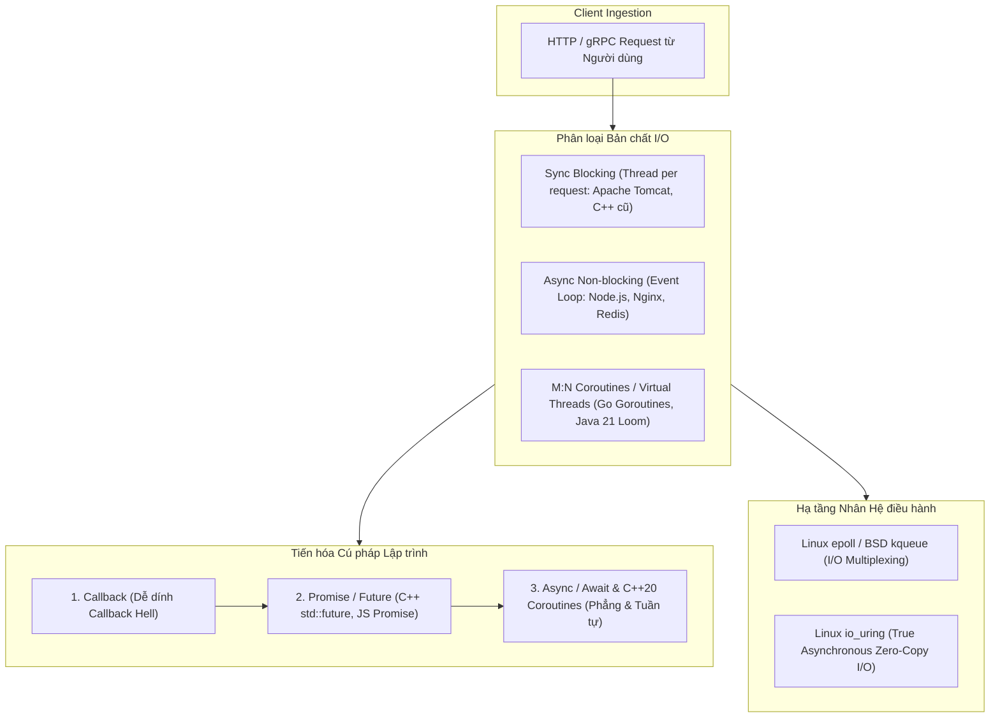
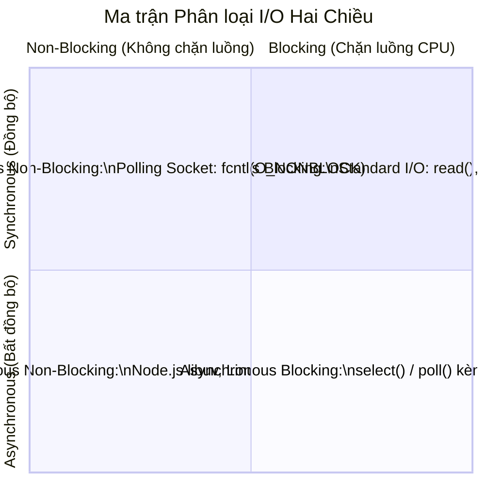
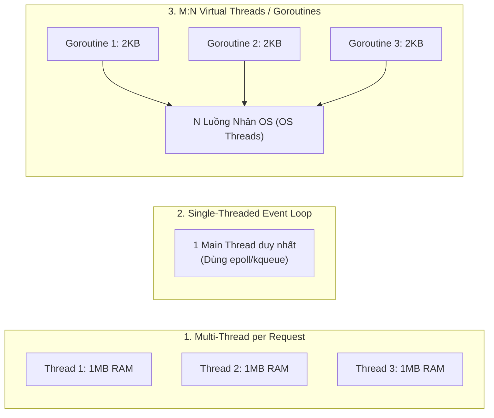

# 10.1. Async, Concurrency and Execution Models in Backend (Bất đồng bộ và Mô hình Thực thi Backend)

> [!IMPORTANT]
> **Mental Model & Trực giác cốt lõi**:
> Hãy tưởng tượng bạn là chủ một nhà hàng bận rộn phục vụ 1,000 thực khách cùng lúc:
> - **Mô hình Đồng bộ Chặn (Synchronous Blocking - Multi-Thread per request)**: Mỗi khi có 1 khách vào, bạn thuê hẳn 1 bồi bàn riêng đứng kè kè bên bàn. Khi khách gọi món, người bồi bàn cầm phiếu vào bếp và **đứng đơ người chờ đầu bếp nấu xong trong 15 phút** (I/O Wait), không làm bất cứ việc gì khác! Khi có 1,000 khách, bạn phải thuê 1,000 bồi bàn. Tiền lương (RAM - mỗi thread ngốn 1-8MB) và không gian chen lấn trong nhà hàng (CPU Context Switch) làm quán của bạn phá sản trước khi kịp bưng đĩa đồ ăn ra!
> - **Mô hình Bất đồng bộ Không chặn (Asynchronous Non-Blocking - Single-Thread Event Loop như Node.js/Nginx)**: Bạn chỉ thuê duy nhất **1 người bồi bàn siêu nhanh nhẹn**. Sau khi ghi phiếu gọi món bàn 1, bồi bàn ném phiếu vào bếp (**giao việc I/O cho Kernel epoll**) và lập tức chạy sang ghi order cho bàn 2, bàn 3, bàn 4 mà không chờ đợi 1 giây nào. Khi bếp chuông báo đĩa ăn của bàn 1 đã xong (**Event/Callback**), người bồi bàn quay lại bưng đĩa ra cho bàn 1. Một người duy nhất phục vụ trơn tru hàng ngàn bàn ăn mà không bao giờ bị nghẽn!
> - **Mô hình Luồng Xanh (M:N Virtual Threads / Goroutines trong Go & Java 21)**: Người bồi bàn có phân thân thuật ảo (Green Thread) siêu nhẹ (chỉ tốn vài KB bộ nhớ), viết code tuần tự tự nhiên nhưng runtime bên dưới tự động hoán đổi luồng mượt mà.
> **Nếu chỉ nhớ một điều**: *Hơn 95% thời gian xử lý request của máy chủ Backend là chờ đợi I/O (Database, Network, Disk). Bất đồng bộ sinh ra để giải phóng CPU khỏi trạng thái chờ chết chóc, cho phép 1 lõi CPU phục vụ đồng thời hàng chục ngàn kết nối mạng.*

---

## 1. Tổng quan Chuyên đề & Sơ đồ Tư duy (Async & Concurrency Architecture)



---

## 2. Chi tiết từng Keyword

### 2.1. Vòng đời Xử lý Yêu cầu (Request / Response Lifecycle)

Mọi yêu cầu trong kiến trúc Web và Microservices đều trải qua chu trình 5 bước nghiêm ngặt:
1. **Network Socket Ingestion**: Gói tin TCP chạm vào card mạng (NIC), được hệ điều hành nạp vào Ring Buffer, kích hoạt SoftIRQ đánh thức tiến trình Web Server đang lắng nghe trên cổng (ví dụ: Port 80/443).
2. **Middleware Pipeline**: Request đi qua chuỗi lọc toàn cục: Giải mã SSL/TLS $\to$ CORS Header $\to$ Rate Limiting $\to$ Xác thực Authentication (JWT/Session) $\to$ Body Parsing (JSON sang DTO).
3. **Routing & Controller**: Router khớp URL (`/api/v1/orders`) và chuyển DTO sang Controller tương ứng.
4. **Service & I/O Wait (Data Access Layer)**: Service thực thi nghiệp vụ, gọi truy vấn Database (PostgreSQL) hoặc gửi RPC sang dịch vụ thứ ba. **Đây là điểm nghẽn I/O chính nơi kỹ thuật Asynchronous phát huy tác dụng.**
5. **Response Serialization**: Đóng gói kết quả thành JSON payload, đính kèm HTTP Status Code (`200 OK`, `400 Bad Request`), đẩy vào socket gửi ngược lại cho Client.

---

### 2.2. Phân biệt: Synchronous vs Asynchronous, Blocking vs Non-Blocking

Hai cặp khái niệm này hoàn toàn độc lập với nhau và tạo thành một **Ma trận I/O 4 góc phần tư**:



| Khái niệm | Ý nghĩa Kỹ thuật Chi tiết |
| :--- | :--- |
| **Blocking (Chặn)** | Lời gọi hàm làm cho Thread hiện tại của CPU **ngừng hoạt động hoàn toàn (bị đưa vào trạng thái Task Sleep/Waiting)**. Thread không thể thực hiện bất kỳ lệnh nào khác cho đến khi dữ liệu I/O sẵn sàng hoặc hết timeout. |
| **Non-Blocking (Không chặn)**| Lời gọi hàm **trả về ngay lập tức**. Nếu dữ liệu chưa sẵn sàng, kernel trả về mã lỗi `EWOULDBLOCK` hoặc `EAGAIN`. Thread không bị ngủ và có thể tiếp tục làm việc khác. |
| **Synchronous (Đồng bộ)** | Phía gọi hàm (Caller) phải **chủ động chờ đợi hoặc định kỳ thăm dò (Polling)** xem kết quả đã hoàn thành hay chưa. Luồng điều khiển thuộc về Caller. |
| **Asynchronous (Bất đồng bộ)** | Caller khởi phát tác vụ rồi giao phó hoàn toàn cho hệ thống. Khi nào tác vụ hoàn tất, hệ thống sẽ **chủ động gửi tín hiệu thông báo ngược lại** cho Caller thông qua Callback, Signal hoặc Event. |

---

### 2.3. Sự Tiến Hóa của Mô hình Bất đồng bộ: Callback $\rightarrow$ Promise / Future $\rightarrow$ Async/Await & Coroutines

#### A. Kỷ nguyên 1: Callbacks & "Callback Hell"
- Cơ chế: Truyền một hàm thực thi (callback) vào hàm bất đồng bộ để gọi khi tác vụ I/O xong.
- Cạn bẫy: Khi cần gọi 4-5 tác vụ phụ thuộc nhau (Đọc file $\to$ Gọi API $\to$ Ghi DB), mã nguồn bị thụt lề sâu tạo thành hình tam giác quái ác (**"Pyramid of Doom"**). Cơ chế `try-catch` truyền thống hoàn toàn bị vô hiệu hóa vì callback chạy trên một Stack Frame khác!

#### B. Kỷ nguyên 2: Promises & Futures (C++ `std::future`, JS `Promise`)
- Cơ chế: Một đối tượng đại diện cho một kết quả **chưa biết ở hiện tại nhưng sẽ được trả về trong tương lai**.
- Ba trạng thái: `Pending` (Đang xử lý), `Fulfilled` (Thành công kèm dữ liệu), `Rejected` (Thất bại kèm mã lỗi).
- Cho phép làm phẳng mã nguồn bằng chuỗi `.then()` và gom toàn bộ xử lý lỗi về một hàm `.catch()`.

#### C. Kỷ nguyên 3: Async / Await & C++20 Coroutines
- Cơ chế: Cú pháp đường mật (Syntactic Sugar) xây dựng trên nền tảng Promise và cỗ máy trạng thái (State Machine):
  - Khi gặp từ khóa `await` (hoặc `co_await` trong C++20), hàm hiện tại tạm dừng (suspend) và nhường lại quyền kiểm soát luồng CPU cho Event Loop.
  - Khi I/O hoàn tất, hàm được đánh thức (resume) tiếp tục chạy dòng lệnh ngay bên dưới.
  - Cho phép viết mã bất đồng bộ nhưng đọc mượt mà, tuần tự và bắt lỗi bằng `try-catch` hệt như code đồng bộ thông thường.

---

### 2.4. Exception Propagation trong Xử lý Bất đồng bộ (UnhandledPromiseRejection)

Xử lý lỗi trong môi trường bất đồng bộ là nguyên nhân số 1 gây crash hệ thống âm thầm:
- **Hiện tượng `UnhandledPromiseRejection`**: Nếu một ngoại lệ bị ném ra bên trong một Promise hoặc hàm `async` mà không có khối `catch` chặn lại, ngoại lệ này không thể bay ngược lên Call Stack truyền thống (vì hàm gọi ban đầu đã kết thúc từ lâu!).
- Trong Node.js hiện đại, một `UnhandledPromiseRejection` chưa bắt sẽ kích hoạt sự kiện thoát tiến trình (`Process Exit Code 1`), làm sập toàn bộ Web Server!
- **Kỹ thuật Async Stack Trace**: Các trình biên dịch hiện đại phải duy trì một cây vết ngăn xếp ảo (Async Call Tree) để khi xảy ra lỗi ở tầng sâu, lập trình viên vẫn nhìn thấy được vết từ hàm gọi ban đầu thay vì một Stack Trace cụt lủn tại điểm callback.

---

### 2.5. So sánh Ba Mô hình Thực thi Đồng thời trong Backend



1. **Multi-Thread per Request (Java Tomcat cổ điển, C++ thread pool)**:
   - Mỗi request được phục vụ bởi 1 luồng hệ điều hành.
   - *Ưu điểm*: Tận dụng mọi lõi CPU; code tuần tự dễ hiểu.
   - *Nhược điểm*: Mỗi luồng tốn $1\text{MB} - 8\text{MB}$ Stack RAM. Khi lượng người dùng vượt quá 10,000 kết nối đồng thời $\implies$ Server sập vì cạn kiệt RAM và quá tải chi phí chuyển đổi ngữ cảnh (**Context Switch Overhead**).
2. **Single-Threaded Event Loop (Node.js, Redis, Nginx)**:
   - Duy nhất một luồng chính phục vụ toàn bộ yêu cầu, kết hợp I/O Multiplexing (`epoll`).
   - *Ưu điểm*: Cực kỳ tiết kiệm RAM, xử lý hàng trăm ngàn kết nối I/O nhàn rỗi (C10K Problem).
   - *Cạm bẫy chết người*: **CẤM TUYỆT ĐỐI các tác vụ nặng về CPU trên luồng chính** (như mã hóa ảnh, tính toán số học lớn, băm mật khẩu CPU-bound). Nếu luồng chính bị chiếm dụng $100\text{ ms}$, toàn bộ hàng chục ngàn người dùng khác sẽ bị "đóng băng" phản hồi!
3. **M:N Green Threads / Goroutines (Go, Erlang BEAM, Java 21 Virtual Threads - Project Loom)**:
   - Mô hình hoàn hảo kết hợp ưu điểm của cả hai: Runtime tạo ra hàng triệu "luồng ảo siêu nhẹ" (chỉ tốn $\approx 2\text{KB}$ RAM). Khi luồng ảo gặp thao tác I/O chặn, scheduler của runtime tự động tách nó ra và gắn luồng ảo khác vào luồng vật lý của CPU. Lập trình viên viết code đồng bộ tự nhiên mà hệ thống vẫn đạt hiệu năng của Event Loop.

---

## 3. Hiện thực Thực nghiệm: Dual-Engine Code Implementation

### 3.1. C++20: Cỗ Máy Trạng Thái Bất Đồng Bộ với Coroutines (`co_await` & `co_return`)

Chương trình minh họa cơ chế hoạt động tầng thấp của C++20 Coroutines: tạo ra một đối tượng tác vụ có thể tạm dừng (suspend) và khôi phục (resume) trên luồng nền.

```cpp
// Compilation: g++ -std=c++20 -O3 -Wall -pthread async_coroutine.cpp -o async_coroutine
#include <iostream>
#include <coroutine>
#include <thread>
#include <chrono>
#include <string>

// Kiểu trả về hỗ trợ Coroutine trong C++20
struct AsyncTask {
    struct promise_type {
        std::string result;
        AsyncTask get_return_object() {
            return AsyncTask{std::coroutine_handle<promise_type>::from_promise(*this)};
        }
        std::suspend_never initial_suspend() noexcept { return {}; }
        std::suspend_always final_suspend() noexcept { return {}; }
        void return_value(std::string val) { result = std::move(val); }
        void unhandled_exception() { std::terminate(); }
    };

    std::coroutine_handle<promise_type> handle;
    ~AsyncTask() { if (handle) handle.destroy(); }
};

// Cấu trúc mô phỏng I/O Awaitable giải phóng luồng chính
struct AsyncDbQuery {
    std::string query;
    bool await_ready() const noexcept { return false; } // Luôn tạm dừng để giả lập I/O
    void await_suspend(std::coroutine_handle<> h) {
        // Đẩy tác vụ I/O sang một Worker Thread ngầm
        std::thread([h, q = this->query]() {
            std::this_thread::sleep_for(std::chrono::milliseconds(200));
            h.resume(); // Khi I/O xong, đánh thức lại Coroutine!
        }).detach();
    }
    std::string await_resume() {
        return "{\"user\": \"John Doe\", \"status\": \"ACTIVE\"}";
    }
};

AsyncTask handle_user_request(int user_id) {
    std::cout << "[COROUTINE] Step 1: Request received on Thread " << std::this_thread::get_id() << "\n";
    std::cout << "[COROUTINE] Step 2: Firing Async DB Query & Suspending Coroutine...\n";
    
    // Tạm dừng coroutine tại đây, giải phóng CPU!
    std::string db_result = co_await AsyncDbQuery{"SELECT * FROM users WHERE id = " + std::to_string(user_id)};
    
    // Khi được resume, chạy tiếp trên thread ngầm mà không làm nghẽn luồng chính
    std::cout << "[COROUTINE] Step 3: Resumed execution on Thread " << std::this_thread::get_id() << "\n";
    std::cout << "[COROUTINE] Step 4: DB Data Received: " << db_result << "\n";
    co_return db_result;
}

int main() {
    std::cout << "================ C++20 ASYNC COROUTINE SIMULATOR ================\n";
    std::cout << "Main Thread ID: " << std::this_thread::get_id() << "\n\n";

    handle_user_request(42);

    // Luồng chính vẫn tự do làm các công việc khác trong khi I/O đang chạy ngầm!
    for (int i = 1; i <= 3; ++i) {
        std::cout << "[MAIN THREAD] Doing concurrent computation #" << i << "...\n";
        std::this_thread::sleep_for(std::chrono::milliseconds(80));
    }

    std::this_thread::sleep_for(std::chrono::milliseconds(100)); // Chờ worker hoàn tất
    std::cout << "=================================================================\n";
    return 0;
}
```

```text
================ C++20 ASYNC COROUTINE SIMULATOR ================
Main Thread ID: 0x104e1c580

[COROUTINE] Step 1: Request received on Thread 0x104e1c580
[COROUTINE] Step 2: Firing Async DB Query & Suspending Coroutine...
[MAIN THREAD] Doing concurrent computation #1...
[MAIN THREAD] Doing concurrent computation #2...
[COROUTINE] Step 3: Resumed execution on Thread 0x70000a6e8000
[COROUTINE] Step 4: DB Data Received: {"user": "John Doe", "status": "ACTIVE"}
[MAIN THREAD] Doing concurrent computation #3...
=================================================================
```

---

### 3.2. Python 3: Trình Giả Lập Event Loop & Scheduler Non-Blocking

Tự xây dựng một vòng lặp sự kiện (Event Loop) tối giản bằng Python, quản lý hàng đợi tác vụ sẵn sàng (Ready Queue) và tác vụ chờ hẹn giờ (Timer Queue) để giải thích cơ chế bên trong của `libuv` (Node.js) và `asyncio`.

```python
#!/usr/bin/env python3
"""
Mô phỏng Động học Vòng lặp Sự kiện (Single-Thread Event Loop Scheduler):
- Quản lý Task Queue và I/O Timers.
- Trực quan hóa cơ chế Non-Blocking nhường quyền điều khiển (Cooperative Multitasking).
"""

import time
import heapq
from collections import deque
from typing import Generator, Any

class MiniEventLoop:
    def __init__(self):
        self.ready_queue = deque()
        self.timers = []  # Min-heap cho các tác vụ hẹn giờ (timestamp, task)

    def call_soon(self, task: Generator):
        self.ready_queue.append(task)

    def call_later(self, delay_sec: float, task: Generator):
        deadline = time.time() + delay_sec
        heapq.heappush(self.timers, (deadline, task))

    def run_forever(self):
        print("[EVENT LOOP] Engine started. Processing asynchronous events...\n")
        while self.ready_queue or self.timers:
            now = time.time()

            # 1. Kiểm tra các Timer đã đến hạn
            while self.timers and self.timers[0][0] <= now:
                _, task = heapq.heappop(self.timers)
                self.ready_queue.append(task)

            # 2. Xử lý một tác vụ sẵn sàng trong Ready Queue
            if self.ready_queue:
                current_task = self.ready_queue.popleft()
                try:
                    # Chạy tác vụ cho tới điểm yield tiếp theo
                    action = next(current_task)
                    if isinstance(action, tuple) and action[0] == "SLEEP":
                        self.call_later(action[1], current_task)
                    else:
                        self.ready_queue.append(current_task)
                except StopIteration:
                    pass  # Tác vụ đã hoàn thành
            else:
                # Không có việc trong queue -> Sleep chính xác tới timer gần nhất để tránh ngốn 100% CPU
                if self.timers:
                    sleep_time = max(0.0, self.timers[0][0] - time.time())
                    time.sleep(sleep_time)

# Mô phỏng các tác vụ Backend xử lý song song trên 1 luồng
def async_http_handler(req_id: int) -> Generator:
    print(f"  [REQ #{req_id}] Ingested. Starting non-blocking DB fetch...")
    # Nhường quyền điều khiển lại cho Event Loop trong 0.15 giây (Giả lập I/O)
    yield ("SLEEP", 0.15)
    print(f"  [REQ #{req_id}] DB result arrived! Sending HTTP 200 OK Response.")

def main():
    loop = MiniEventLoop()
    # Kích hoạt đồng thời 3 requests tới server
    loop.call_soon(async_http_handler(1))
    loop.call_soon(async_http_handler(2))
    loop.call_soon(async_http_handler(3))
    
    loop.run_forever()
    print("\n[EVENT LOOP] All concurrent requests processed successfully.")

if __name__ == "__main__":
    main()
```

```text
[EVENT LOOP] Engine started. Processing asynchronous events...

  [REQ #1] Ingested. Starting non-blocking DB fetch...
  [REQ #2] Ingested. Starting non-blocking DB fetch...
  [REQ #3] Ingested. Starting non-blocking DB fetch...
  [REQ #1] DB result arrived! Sending HTTP 200 OK Response.
  [REQ #2] DB result arrived! Sending HTTP 200 OK Response.
  [REQ #3] DB result arrived! Sending HTTP 200 OK Response.

[EVENT LOOP] All concurrent requests processed successfully.
```

---

## 4. Vận hành Hệ thống & Chẩn đoán Thực tế (Production Diagnostics & Troubleshooting)

### 4.1. Chẩn đoán Độ trễ Vòng lặp Sự kiện (Event Loop Lag / Starvation)
Trong các hệ thống Single-Threaded Event Loop (Node.js), nếu một lập trình viên vô tình viết vòng lặp đồng bộ nặng (như `JSON.parse` một file 100MB), Event Loop sẽ bị nghẽn (Starved):

```javascript
// Thư viện đo Event Loop Lag trong Node.js (tương tự thư viện @clinic/doctor)
const { performance } = require('perf_hooks');

setInterval(() => {
    const start = performance.now();
    setImmediate(() => {
        const lag = performance.now() - start;
        if (lag > 50) { // Ngưỡng nguy hiểm: Lag > 50ms
            console.error(`[CRITICAL ALERT] Event Loop Lag: ${lag.toFixed(2)}ms! Luồng chính đang bị chặn!`);
        }
    });
}, 1000);
```

### 4.2. Chẩn đoán Cạn kiệt Luồng Mạng trên Linux Server (`ss` & `sysctl`)

```bash
# Kiểm tra số lượng kết nối đang ở trạng thái TIME_WAIT và CLOSE_WAIT
ss -s

# Tăng dung lượng hàng đợi kết nối TCP Backlog trên Linux Kernel
sudo sysctl -w net.core.somaxconn=65535
sudo sysctl -w net.ipv4.tcp_max_syn_backlog=65535

# Tối ưu hóa số lượng File Descriptors tối đa mà một tiến trình server được phép mở
ulimit -n 1048576
```

---

## 5. Bảng So sánh & Decision Matrix

| Tiêu chuẩn / Đặc tính | Multi-Thread (Thread-per-request) | Single-Thread Event Loop | M:N Virtual Threads (Goroutines) |
| :--- | :--- | :--- | :--- |
| **Tiêu tốn Bộ nhớ (RAM)** | Rất cao ($1\text{MB} - 8\text{MB}$/thread) | **Cực thấp** (Chỉ 1 Thread Stack) | **Rất thấp** ($\approx 2\text{KB}$/goroutine) |
| **Chi phí Context Switch** | Cao (Chuyển đổi Kernel Context) | **Không có** (Chuyển đổi trong User-space) | Rất thấp (User-space Runtime Scheduler) |
| **Khả năng Chịu tải C10K** | Kém (Sập server khi quá 10,000 threads)| **Xuất sắc** ($> 100,000$ kết nối I/O) | **Xuất sắc** ($> 1,000,000$ Goroutines) |
| **Xử lý Tác vụ Nặng CPU** | Rất tốt (Mỗi core gánh 1 thread) | **Cực kỳ tồi tệ** (Làm đóng băng cả server)| Rất tốt (Tự phân phối đa lõi) |
| **Độ Phức tạp Lập trình** | Cần bảo vệ Race Condition (Mutex) | Dễ (Không lo Race Condition bộ nhớ) | Dễ (Viết code tuần tự tự nhiên) |
| **Công nghệ Tiêu biểu** | Java Spring Boot (cũ), Apache HTTPD | Node.js, Nginx, Redis, Envoy | Go, Java 21 (Virtual Threads), Erlang |
