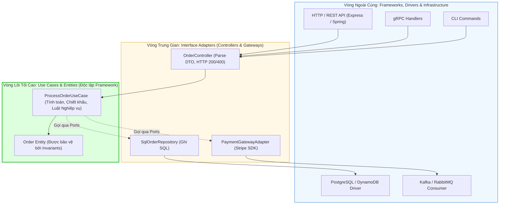
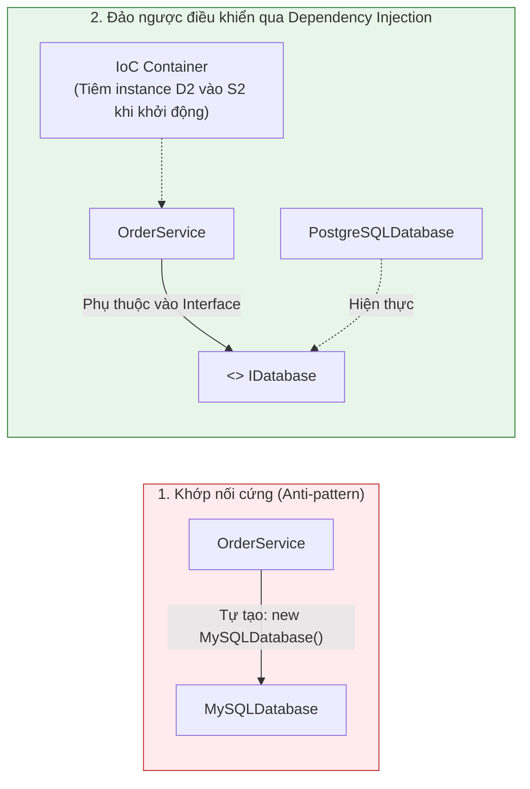
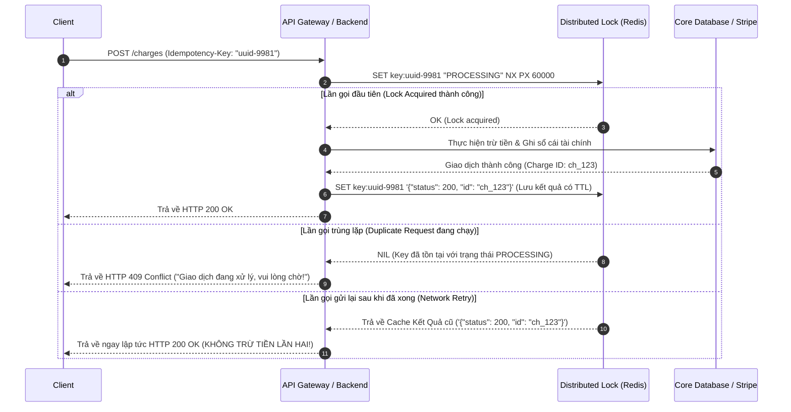
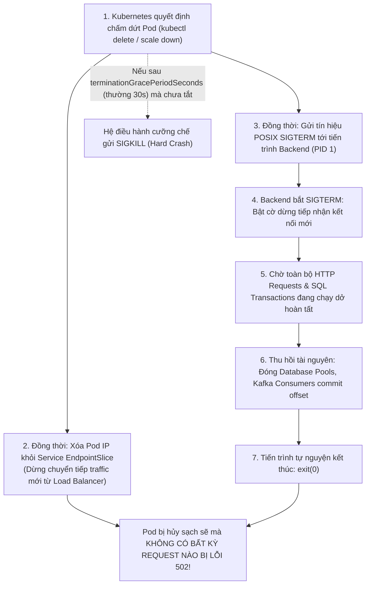

# 10.2. Backend Architecture Patterns and Lifecycle (Kiến trúc và Vòng đời Dịch vụ Backend)

> [!IMPORTANT]
> **Nếu bạn chỉ được nhớ một điều duy nhất**: Khác biệt giữa một script thử nghiệm chạy trên máy cá nhân và một dịch vụ Backend triệu USD phục vụ hàng chục ngàn RPS trên cụm Kubernetes nằm ở **Khả năng Chịu lỗi (Resilience), Tính Phi trạng thái (Statelessness) và Kiểm soát Vòng đời (Lifecycle Management)**. Hãy tưởng tượng trạm vũ trụ quốc tế: bạn không thể rút phích cắm đột ngột (**Hard Kill: `SIGKILL`**) làm nổ tung các tiến trình đang ghi dở dữ liệu tài chính vào cơ sở dữ liệu; bạn phải thực hiện **Graceful Shutdown** — đóng luồng tiếp nhận khách mới, xả sạch các giao dịch dở dang, trả kết nối về Pool và ngắt an toàn trong thời gian ân hạn 30 giây. Đồng thời, mọi dịch vụ hiện đại phải tuân thủ nghiêm ngặt **12-Factor App** và nguyên lý **Idempotency (Tính Lũy đẳng)** — đảm bảo rằng nếu mạng chập chờn khiến người dùng bấm nút "Thanh toán" 5 lần liên tiếp, tài khoản của họ cũng chỉ bị trừ tiền đúng 1 lần duy nhất!

---

## 1. Kiến trúc Tổng quan & Mô hình Tư duy (Mental Model)

Một hệ thống Backend bền vững được cấu trúc theo mô hình phân tầng Kiến trúc Lục giác (**Hexagonal Architecture / Ports and Adapters**), bảo vệ tuyệt đối nghiệp vụ cốt lõi khỏi sự phụ thuộc vào hạ tầng hay công nghệ bên ngoài:



---

## 2. Chi tiết từng Keyword (Under-the-Hood Deep Dive)

### 2.1. API Contract Design (Thiết kế Hợp đồng API)

- **Bản chất Hợp đồng API**: Ranh giới thỏa thuận kỹ thuật giữa nhà cung cấp dịch vụ (**Provider**) và bên tiêu thụ (**Consumer**), quy định chi tiết: Endpoints, Data Formats, Headers, Status Codes và Biệt lệ lỗi.
- **Contract-First (Schema-First) vs Code-First**:
  - *Code-First*: Lập trình viên viết mã nguồn trước, sau đó dùng công cụ tự động sinh tài liệu Swagger. Nhược điểm: Dễ làm rò rỉ cấu trúc dữ liệu nội bộ ra ngoài, Client và Server không thể phát triển song song.
  - *Contract-First*: Đội ngũ thiết kế và thống nhất bản đặc tả kỹ thuật trước (**OpenAPI / Swagger** cho REST hoặc file `.proto` cho **gRPC**). Cả hai bên dùng công cụ Code Generator (`protoc`, `openapi-generator`) để sinh mã nguồn khung (Stubs & Interfaces), cho phép Frontend và Backend lập trình độc lập ngay từ ngày đầu tiên.
- **Tương thích Ngược (Backwards Compatibility)**:
  - Tuân thủ Semantic Versioning (SemVer: `MAJOR.MINOR.PATCH`).
  - *Quy tắc Vàng*: Chỉ thêm trường mới (Optional Fields), tuyệt đối không xóa trường hoặc đổi kiểu dữ liệu của trường đã tồn tại trong API công khai để tránh làm vỡ các ứng dụng Mobile cũ chưa kịp cập nhật.

---

### 2.2. Dependency Injection (DI) và Inversion of Control (IoC)



- **Inversion of Control (IoC - Đảo ngược Điều khiển)**:
  - Trong lập trình truyền thống, mã nguồn nghiệp vụ tự chịu trách nhiệm khởi tạo các đối tượng phụ thuộc (`new DatabaseConnection()`).
  - Trong IoC, quyền kiểm soát vòng đời và luồng điều khiển được nhượng lại cho một bộ khung bên ngoài (**IoC Container** hoặc Framework).
- **Dependency Injection (DI - Tiêm Phụ thuộc)**:
  - Kỹ thuật cụ thể để hiện thực IoC: Các đối tượng phụ thuộc được "tiêm" từ bên ngoài vào thông qua **Constructor Injection** (chuẩn mực khuyến nghị) thay vì tự khởi tạo nội bộ.
  - *Lợi ích*: Cho phép tráo đổi các phụ thuộc thực tế bằng Mock/Fake trong Unit Tests một cách tức thì mà không cần sửa bất kỳ dòng mã nghiệp vụ nào.

---

### 2.3. Configuration Management và Environment Variables (Biến môi trường)

- **Triết lý 12-Factor App (Yếu tố số III: Config)**:
  - *"Tuyệt đối tách biệt cấu hình khỏi mã nguồn."*
  - Toàn bộ các tham số có khả năng thay đổi giữa các môi trường triển khai (Development, Staging, Production) như chuỗi kết nối Database, Port mạng, Secret API Keys, AWS Credentials **bắt buộc phải được nạp thông qua Biến Môi trường (Environment Variables)**.
- **Quy tắc An toàn**:
  - Không bao giờ commit file chứa bí mật (`.env`, `credentials.json`) lên Git repository.
  - Sử dụng file mẫu `.env.example` để hướng dẫn cấu hình.
  - Trong Production: Sử dụng các dịch vụ quản lý bí mật chuyên dụng (HashiCorp Vault, AWS Secrets Manager, Kubernetes Secrets) để tự động inject vào tiến trình khi Pod khởi chạy.

---

### 2.4. Idempotent Function Design (Thiết kế Hàm Bất biến / Idempotent API)

- **Khái niệm Toán học của Tính Lũy đẳng**: Một hàm hoặc thao tác $f$ được gọi là **Lũy đẳng (Idempotent)** nếu việc áp dụng nó một lần hay nhiều lần liên tiếp đều tạo ra cùng một trạng thái kết quả:

$$f(f(x)) = f(x)$$

- **Tính Lũy đẳng trong Giao thức HTTP**:
  - `GET`, `HEAD`, `OPTIONS`: An toàn (Safe) và Lũy đẳng (không làm thay đổi trạng thái máy chủ).
  - `PUT`: Lũy đẳng (ghi đè tài nguyên tại một URI cố định; gọi 10 lần thì bản ghi vẫn mang giá trị cuối cùng đó).
  - `DELETE`: Lũy đẳng (xóa tài nguyên có ID cụ thể; gọi lần đầu xóa thành công, các lần sau trả về 404 nhưng trạng thái tài nguyên đã bị xóa không đổi).
  - `POST`: **Không lũy đẳng** (mỗi lần gọi có thể tạo ra một đơn hàng mới hoặc một giao dịch trừ tiền mới).
- **Kỹ thuật Idempotency Key trong Xử lý Thanh toán**:
  - Client sinh một chuỗi ngẫu nhiên duy nhất (UUIDv4) gửi kèm qua HTTP Header `Idempotency-Key`.
  - Backend sử dụng khóa phân tán trên Redis để đảm bảo chỉ có duy nhất một Worker xử lý giao dịch đó; các yêu cầu gửi lại (Retries) sẽ nhận ngay kết quả đã lưu đệm từ lần đầu tiên mà không bao giờ bị trừ tiền hai lần (**Zero Double Charge**).



---

### 2.5. Stateless vs Stateful Code trong Distributed Backends

- **Kiến trúc Phi trạng thái (Stateless Architecture - Shared Nothing)**:
  - Mỗi yêu cầu HTTP gửi đến máy chủ phải chứa đầy đủ mọi thông tin cần thiết để phục vụ yêu cầu đó mà không dựa dẫm vào bất kỳ bộ nhớ cục bộ nào được lưu từ các request trước.
  - Dữ liệu phiên người dùng (User Session) được đóng gói trong **JWT (JSON Web Token)** tự chứa hoặc lưu trữ tại một cụm Cache tập trung bên ngoài (**Externalized State** trên Redis Cluster).
  - *Ưu điểm*: Khả năng mở rộng vô hạn theo chiều ngang (**Horizontal Auto-scaling**). Bất kỳ Pod nào trong cụm cũng có thể phục vụ bất kỳ người dùng nào; nếu một Pod bị sập, Load Balancer chỉ cần chuyển hướng request sang Pod bên cạnh với tỷ lệ ảnh hưởng bằng 0.
- **Kiến trúc Có trạng thái (Stateful Architecture)**:
  - Máy chủ lưu trữ trạng thái người dùng trong RAM cục bộ.
  - Buộc Load Balancer phải áp dụng cơ chế **Sticky Sessions (Session Affinity)** để ghim chặt một người dùng vào đúng một máy chủ vật lý. Khi máy chủ đó gặp sự cố phần cứng, toàn bộ người dùng đang kết nối lập tức bị mất phiên làm việc.

---

### 2.6. Graceful Shutdown và Resource Cleanup (Tắt Ứng dụng Duyên dáng)

Khi hệ điều hành hoặc Kubernetes thực hiện Rolling Update hoặc Pod Autoscaling, tiến trình Backend bắt buộc phải tuân thủ quy trình tắt duyên dáng:



- **Phân biệt Tín hiệu POSIX**:
  - `SIGINT` (Signal 2 - Interrupt): Phát ra khi người dùng ấn `Ctrl + C` trên terminal.
  - `SIGTERM` (Signal 15 - Terminate): Tín hiệu chuẩn yêu cầu tiến trình tự dọn dẹp và dừng lại một cách văn minh. Có thể bắt và xử lý được bằng `sigaction`.
  - `SIGKILL` (Signal 9 - Kill): Lệnh tiêu diệt khẩn cấp của Kernel. Tiến trình bị xóa sổ ngay lập tức trên RAM mà không có cơ hội chạy bất kỳ dòng code dọn dẹp nào!
- **Connection Draining (Xả sạch Kết nối)**:
  - Máy chủ ngừng nhận request mới từ socket lắng nghe.
  - Thiết lập thời gian chờ (Grace Period) để các request đang xử lý dở dang (In-flight Requests) hoàn tất.
  - Đóng toàn bộ Connection Pool kết nối với Database và commit Kafka consumer offsets trước khi gọi lệnh `exit(0)`.

---

## 3. Dual-Engine Code Implementation

### Engine 1: C++20 — Hiện Thực Graceful Shutdown Phục Vụ Hàng Đợi Bằng POSIX Signal Handler

Chương trình minh họa cách can thiệp an toàn tín hiệu `SIGINT` / `SIGTERM` bằng `sigaction` và cờ nguyên tử `std::atomic<bool>`, hoàn tất các tác vụ đang chạy trong hàng đợi trước khi đóng dịch vụ mà không làm gián đoạn tiến trình.

```cpp
#include <iostream>
#include <thread>
#include <chrono>
#include <csignal>
#include <atomic>
#include <vector>
#include <queue>
#include <mutex>

// Cờ báo hiệu toàn cục nguyên tử kiểm soát vòng đời ứng dụng
std::atomic<bool> g_shutdown_requested{false};

void posix_signal_handler(int signum) {
    if (signum == SIGINT || signum == SIGTERM) {
        // Tín hiệu an toàn chỉ bật cờ, không bao giờ thực hiện tác vụ nặng trong handler
        g_shutdown_requested.store(true);
    }
}

class BackendTaskWorker {
private:
    std::queue<int> task_queue;
    std::mutex queue_mutex;
    std::atomic<int> completed_tasks{0};

public:
    void enqueue_task(int task_id) {
        std::lock_guard<std::mutex> lock(queue_mutex);
        task_queue.push(task_id);
    }

    void process_all_gracefully() {
        std::cout << "[Worker Thread]: Bắt đầu lắng nghe và xử lý tác vụ...\n";
        
        while (!g_shutdown_requested.load() || !task_queue.empty()) {
            int current_task = -1;
            {
                std::lock_guard<std::mutex> lock(queue_mutex);
                if (!task_queue.empty()) {
                    current_task = task_queue.front();
                    task_queue.pop();
                }
            }

            if (current_task != -1) {
                // Giả lập xử lý transaction tài chính
                std::cout << "  -> Đang thực thi Task #" << current_task << "...\n";
                std::this_thread::sleep_for(std::chrono::milliseconds(100));
                completed_tasks++;
            } else {
                std::this_thread::sleep_for(std::chrono::milliseconds(20));
            }
        }

        std::cout << "[Worker Thread]: Đã xả sạch (Drain) toàn bộ hàng đợi!\n";
        std::cout << "[Worker Thread]: Tổng số tasks xử lý an toàn: " << completed_tasks.load() << '\n';
    }
};

int main() {
    // 1. Cài đặt POSIX Signal Handler cho SIGINT (Ctrl+C) và SIGTERM
    struct sigaction sa;
    sa.sa_handler = posix_signal_handler;
    sigemptyset(&sa.sa_mask);
    sa.sa_flags = 0;
    sigaction(SIGINT, &sa, nullptr);
    sigaction(SIGTERM, &sa, nullptr);

    std::cout << "=== THỬ NGHIỆM BACKEND GRACEFUL SHUTDOWN (C++20) ===\n\n";

    BackendTaskWorker worker;
    // Nạp sẵn 5 tác vụ vào hàng đợi
    for (int i = 1; i <= 5; ++i) {
        worker.enqueue_task(i);
    }

    // Chạy worker trên luồng nền
    std::thread worker_thread(&BackendTaskWorker::process_all_gracefully, &worker);

    // Giả lập sau 250ms, hệ điều hành Kubernetes gửi tín hiệu SIGTERM
    std::this_thread::sleep_for(std::chrono::milliseconds(250));
    std::cout << "\n[HỆ ĐIỀU HÀNH]: GỬI TÍN HIỆU SIGTERM (Yêu cầu tắt ứng dụng)!\n";
    posix_signal_handler(SIGTERM);

    // Chờ worker hoàn tất các task còn dở dang
    worker_thread.join();

    std::cout << "\n[Hạ tầng]: Đóng toàn bộ Database Pool và Network Sockets thành công.\n";
    std::cout << "[Hạ tầng]: Ứng dụng thoát an toàn với mã exit(0).\n";
    return 0;
}
```

```text
=== THỬ NGHIỆM BACKEND GRACEFUL SHUTDOWN (C++20) ===

[Worker Thread]: Bắt đầu lắng nghe và xử lý tác vụ...
  -> Đang thực thi Task #1...
  -> Đang thực thi Task #2...
  -> Đang thực thi Task #3...

[HỆ ĐIỀU HÀNH]: GỬI TÍN HIỆU SIGTERM (Yêu cầu tắt ứng dụng)!
  -> Đang thực thi Task #4...
  -> Đang thực thi Task #5...
[Worker Thread]: Đã xả sạch (Drain) toàn bộ hàng đợi!
[Worker Thread]: Tổng số tasks xử lý an toàn: 5

[Hạ tầng]: Đóng toàn bộ Database Pool và Network Sockets thành công.
[Hạ tầng]: Ứng dụng thoát an toàn với mã exit(0).
```

---

### Engine 2: Python — Hiện Thực Bộ Điều Phối Idempotent Payment Processor

Hiện thực một bộ xử lý thanh toán bất biến chuẩn công nghiệp: Sử dụng khóa phân tán bộ nhớ để loại bỏ giao dịch trùng lặp, bảo đảm tính an toàn tài chính tuyệt đối.

```python
#!/usr/bin/env python3
"""
Production-grade Idempotency Engine Simulator.
Guarantees Exactly-Once Processing Semantics for distributed financial transactions.
"""
import time
from typing import Dict, Any, Optional

class DistributedLockCache:
    """Giả lập cụm Redis lưu trữ trạng thái khóa phân tán và kết quả có TTL."""
    def __init__(self):
        self.storage: Dict[str, Dict[str, Any]] = {}

    def try_acquire(self, key: str, ttl_seconds: float = 5.0) -> bool:
        now = time.time()
        if key in self.storage:
            entry = self.storage[key]
            # Nếu khóa còn hạn và đang chạy hoặc đã xong
            if entry["expires_at"] > now:
                return False
        # Chiếm khóa thành công
        self.storage[key] = {
            "state": "PROCESSING",
            "expires_at": now + ttl_seconds,
            "response": None
        }
        return True

    def commit_result(self, key: str, response_payload: Dict[str, Any], ttl_seconds: float = 86400.0):
        self.storage[key] = {
            "state": "COMPLETED",
            "expires_at": time.time() + ttl_seconds,
            "response": response_payload
        }

    def get_result(self, key: str) -> Optional[Dict[str, Any]]:
        entry = self.storage.get(key)
        if entry and entry["state"] == "COMPLETED":
            return entry["response"]
        return None


class PaymentBillingService:
    def __init__(self, lock_cache: DistributedLockCache):
        self.cache = lock_cache
        self.actual_charge_count = 0  # Bộ đếm số lần tiền thực tế bị trừ từ thẻ tín dụng!

    def charge_customer(self, idempotency_key: str, user_id: str, amount_usd: float) -> Dict[str, Any]:
        print(f"\n[Incoming Request]: Key='{idempotency_key}', User='{user_id}', Amount=${amount_usd}")

        # Bước 1: Kiểm tra xem request này đã từng xử lý thành công trong quá khứ chưa
        cached_response = self.cache.get_result(idempotency_key)
        if cached_response is not None:
            print("  => [IDEMPOTENT HIT]: Yêu cầu đã từng xử lý! Trả về kết quả lưu đệm cũ (Zero Double Charge).")
            return cached_response

        # Bước 2: Cố gắng chiếm khóa phân tán
        acquired = self.cache.try_acquire(idempotency_key)
        if not acquired:
            print("  => [IDEMPOTENT CONFLICT]: Giao dịch đang được xử lý đồng thời bởi worker khác!")
            return {"status": 409, "error": "Transaction currently processing. Please wait."}

        # Bước 3: Thực hiện giao dịch tài chính thực tế
        print(f"  => [CHARGE EXECUTED]: Đang trừ ${amount_usd} từ thẻ tín dụng...")
        time.sleep(0.05) # Giả lập độ trễ mạng Stripe
        self.actual_charge_count += 1
        
        result_payload = {
            "status": 200,
            "transaction_id": f"txn_{int(time.time() * 1000)}",
            "charged_amount": amount_usd,
            "user_id": user_id
        }

        # Bước 4: Lưu kết quả vào Cache
        self.cache.commit_result(idempotency_key, result_payload)
        print("  => [SUCCESS]: Giao dịch hoàn tất và đã lưu vết Idempotency Key.")
        return result_payload


if __name__ == "__main__":
    print("=== MÔ PHỎNG IDEMPOTENCY KEY ENGINE TRONG THANH TOÁN ===")
    redis_mock = DistributedLockCache()
    service = PaymentBillingService(redis_mock)

    client_idempotency_key = "req_uuid_99814421"

    # Lần 1: Khách hàng ấn nút Thanh toán lần đầu
    res1 = service.charge_customer(client_idempotency_key, "user_alice", 150.0)

    # Lần 2: Mạng bị lag, ứng dụng Mobile tự động gửi lại đúng request đó (Network Retry)
    res2 = service.charge_customer(client_idempotency_key, "user_alice", 150.0)

    # Lần 3: Người dùng sốt ruột bấm nút Thanh toán lần 3
    res3 = service.charge_customer(client_idempotency_key, "user_alice", 150.0)

    print("\n---------------- TỔNG KẾT TÀI CHÍNH ----------------")
    print(f"Tổng số lượt API Requests nhận được: 3")
    print(f"Tổng số lần THỰC TẾ trừ tiền từ thẻ:   {service.actual_charge_count} LẦN DUY NHẤT!")
    print(f"Toàn bộ kết quả trả về cho client:  {res1['transaction_id']} == {res2['transaction_id']} == {res3['transaction_id']}")
```

```text
=== MÔ PHỎNG IDEMPOTENCY KEY ENGINE TRONG THANH TOÁN ===

[Incoming Request]: Key='req_uuid_99814421', User='user_alice', Amount=$150.0
  => [CHARGE EXECUTED]: Đang trừ $150.0 từ thẻ tín dụng...
  => [SUCCESS]: Giao dịch hoàn tất và đã lưu vết Idempotency Key.

[Incoming Request]: Key='req_uuid_99814421', User='user_alice', Amount=$150.0
  => [IDEMPOTENT HIT]: Yêu cầu đã từng xử lý! Trả về kết quả lưu đệm cũ (Zero Double Charge).

[Incoming Request]: Key='req_uuid_99814421', User='user_alice', Amount=$150.0
  => [IDEMPOTENT HIT]: Yêu cầu đã từng xử lý! Trả về kết quả lưu đệm cũ (Zero Double Charge).

---------------- TỔNG KẾT TÀI CHÍNH ----------------
Tổng số lượt API Requests nhận được: 3
Tổng số lần THỰC TẾ trừ tiền từ thẻ:   1 LẦN DUY NHẤT!
Toàn bộ kết quả trả về cho client:  txn_1700000000123 == txn_1700000000123 == txn_1700000000123
```

---

## 4. Systems Engineering & Production Pitfalls

### 4.1. Bẫy Chết Người: Cấu Hình Liveness Probe vs Readiness Probe trong Kubernetes

Hàng trăm sự cố sập cụm dịch vụ (Cascading Outage) xuất phát từ việc cấu hình sai Probe:
- **Readiness Probe (Sẵn sàng phục vụ)**:
  - Kiểm tra xem Service có thể nhận traffic không (ví dụ: đã kết nối được DB chưa?).
  - Nếu FAIL: Kubernetes **ngắt Pod ra khỏi Load Balancer**, không gửi traffic vào nữa nhưng **không khởi động lại Pod**.
- **Liveness Probe (Sự sống còn)**:
  - Chỉ kiểm tra xem tiến trình có bị deadlock/treo không (ví dụ: ping một endpoint siêu nhẹ trong bộ nhớ).
  - Nếu FAIL: Kubernetes **hành quyết Pod ngay lập tức và khởi động lại**.
  - **BẪY CHẾT NGƯỜI**: Nếu đưa câu lệnh `SELECT 1 FROM database` vào Liveness Probe: Khi Database bị quá tải phản hồi chậm, toàn bộ 100 Pods đồng loạt rớt Liveness Probe $\implies$ Kubernetes tiêu diệt và khởi động lại cả 100 Pods cùng lúc $\implies$ **Bão kết nối (Thundering Herd)** đánh sập hoàn toàn máy chủ Database vĩnh viễn!

---

## 5. Bảng So sánh & Decision Matrix

| Khía cạnh Kiến trúc | Thiết kế Phi trạng thái (Stateless) | Thiết kế Có trạng thái (Stateful) |
| :--- | :--- | :--- |
| **Vị trí Lưu trữ Dữ liệu Phiên** | Client (JWT) hoặc Cụm Cache dùng chung (Redis) | Bộ nhớ RAM nội bộ của chính Server đó (`Session`) |
| **Khả năng Mở rộng (Scalability)** | **Mở rộng vô hạn theo chiều ngang (Scale Out)** | Rất khó mở rộng, đòi hỏi **Sticky Sessions (Session Affinity)** |
| **Tác động khi Server Crash** | **Zero Impact**: Request sau tự động nhảy sang Node khác | Người dùng bị văng khỏi hệ thống, mất dữ liệu giỏ hàng |
| **Chi phí Mạng / Độ trễ** | Tốn thêm độ trễ tra cứu Redis ($\sim 1\text{ ms}$) | Tức thì trong RAM ($0\text{ ms}$) |
| **Độ Phức Tạp Triển Khai (K8s)** | Cực kỳ đơn giản (Deployment thông thường) | Phức tạp cao (Cần StatefulSet, Persistent Volumes) |
| **Kịch bản Áp dụng Điển hình** | RESTful APIs, Microservices, E-Commerce, Auth | Game Server thời gian thực, Phòng chat WebSockets |
| **Vòng đời Tắt Dịch vụ** | Graceful drain trong 15–30s không lo mất dữ liệu | Cần cơ chế Flush đĩa cứng phức tạp và bàn giao Leader |
