# 1.1. Basic Concepts and Characteristics (Khái niệm Nền tảng và Đặc tính của Hệ thống Phân tán)

## Tổng quan về Hệ thống Phân tán và Đặc tính Cốt lõi
Hệ thống phân tán (Distributed System) là một tập hợp các thực thể tính toán độc lập (Nodes), giao tiếp và phối hợp với nhau thông qua mạng truyền thông chung bằng cơ chế truyền thông điệp (Message Passing), nhằm mục đích giải quyết một bài toán tính toán quy mô lớn mà một máy tính đơn lẻ không thể đáp ứng.

Về mặt toán học và hình thức:
$$\mathcal{DS} = (\mathcal{N}, \mathcal{E}, \mathcal{M}, \mathcal{S}, \mathcal{T})$$
Trong đó:
- $\mathcal{N} = \{n_1, n_2, \dots, n_k\}$: Tập hợp các nút tính toán tự trị (Autonomous nodes), mỗi nút sở hữu bộ nhớ RAM, CPU và đồng hồ vật lý riêng biệt.
- $\mathcal{E} \subseteq \mathcal{N} \times \mathcal{N}$: Tập hợp các kênh truyền thông mạng (Network channels) có tính chất trễ không xác định và có xác suất mất mát gói tin.
- $\mathcal{M}$: Không gian các thông điệp truyền tải.
- $\mathcal{S} = S_1 \times S_2 \times \dots \times S_k$: Không gian trạng thái phân tán toàn cục.
- $\mathcal{T}$: Trật tự thời gian logic và quan hệ nhân quả (Causality).

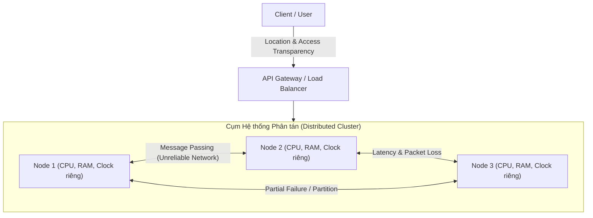

---

## 2. Chi tiết từng Keyword (Under-the-Hood Deep Dive)

---

### Phần 1: Basic Concepts (Các Khái niệm Cơ sở)

---

### 1. Distributed System & Distributed Computing (Hệ thống Phân tán và Tính toán Phân tán)

#### 1. Khái niệm bản chất (What & Why)
- **Distributed System**: Hệ thống gồm nhiều máy tính tự trị kết nối qua mạng, phối hợp vận hành sao cho người dùng cuối trải nghiệm hệ thống như một cỗ máy duy nhất (Single coherent system).
- **Distributed Computing**: Quá trình phân rã một bài toán tính toán lớn thành nhiều tác vụ con và giao cho các nút phân tán thực thi đồng thời, sau đó tổng hợp kết quả.
- **Lý do tồn tại**: Vượt qua giới hạn vật lý của máy tính đơn lẻ (Memory limit, CPU heat dissipation, Amdahl's Law) và loại bỏ rủi ro Single Point of Failure (SPOF).

#### 2. Cơ chế hoạt động sâu (Under the hood / Hardcore Internals)
- **Tầng Network Socket & Kernel Buffer**:
  - Không có bộ nhớ chia sẻ phần cứng (No Hardware Shared Memory).
  - Dữ liệu di chuyển từ User Space của Node A $\to$ Kernel Socket Buffer (`sk_buff`) $\to$ Card mạng NIC $\to$ Cáp quang / Switch mạng $\to$ NIC Node B $\to$ Kernel Buffer Node B $\to$ User Space Node B. Mỗi lần truyền qua mạng tiêu tốn từ $0.5\text{ms}$ (cùng Data Center) tới $150\text{ms}$ (xuyên lục địa), chậm hơn hàng triệu lần so với đọc RAM cục bộ ($60\text{ns}$).

#### 3. Sơ đồ minh họa
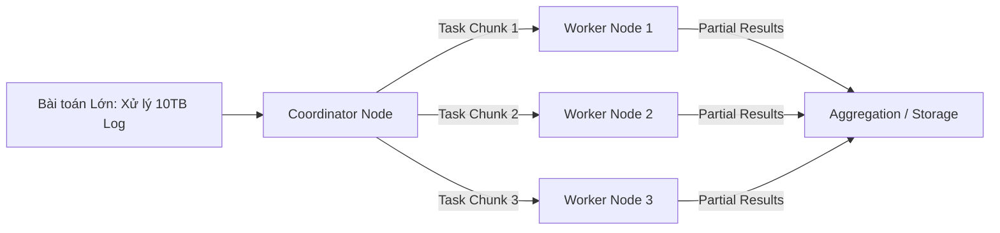

#### 4. Code ví dụ thực chiến (C++ Distributed Node Communication Stub)
```cpp
#include <iostream>
#include <string>
#include <vector>
#include <memory>

struct DistributedTask {
    uint64_t task_id;
    std::string payload;
};

class DistributedNode {
    std::string node_id_;
public:
    explicit DistributedNode(std::string id) : node_id_(std::move(id)) {}

    void execute_subtask(const DistributedTask& task) {
        // Mô phỏng tính toán phân tán cục bộ trên mỗi Node
        std::cout << "[Node " << node_id_ << "] Processing Task ID: " << task.task_id 
                  << " with Payload Size: " << task.payload.size() << " bytes\n";
    }
};

int main() {
    std::vector<std::unique_ptr<DistributedNode>> cluster;
    cluster.push_back(std::make_unique<DistributedNode>("node-ap-southeast-1a"));
    cluster.push_back(std::make_unique<DistributedNode>("node-ap-southeast-1b"));

    DistributedTask t1{1001, "SELECT * FROM orders_2026_01"};
    cluster[0]->execute_subtask(t1);
    return 0;
}
```

#### 5. Ưu / Nhược điểm, Pitfalls & Anti-patterns
- **Anti-pattern**: "Distributed Monolith" (Xây dựng hệ thống phân tán nhưng các services phụ thuộc lẫn nhau một cách chặt chẽ qua các cuộc gọi synchronous RPC, khiến độ trễ cộng dồn và một service sập kéo theo cả hệ thống sập).

#### 6. Ứng dụng thực tế trong Backend / Systems
- Apache Spark, Google MapReduce, Ray Framework: Nền tảng tính toán phân tán quy mô lớn cho Big Data và Machine Learning.

---

### 2. Distributed Architecture, Node, Process, and Service

#### 1. Khái niệm bản chất (What & Why)
- **Distributed Architecture**: Bản thiết kế tổng thể mô tả cách thức các thành phần phân tán được tổ chức, phân chia trách nhiệm và giao tiếp với nhau.
- **Distributed Node**: Máy chủ vật lý (Bare-metal) hoặc máy ảo (VM) độc lập với tài nguyên phần cứng riêng biệt.
- **Distributed Process**: Một tiến trình hệ điều hành (OS Process) đang chạy trên một Node cụ thể, sở hữu PID, virtual memory address space và các file descriptors riêng.
- **Distributed Service**: Một đơn vị chức năng nghiệp vụ độc lập (ví dụ: `PaymentService`, `AuthService`) có thể gồm hàng chục processes chạy song song trên nhiều nodes.

#### 2. Cơ chế hoạt động sâu (Under the hood / Hardcore Internals)
- **Ranh giới cô lập Linux Cgroups & Namespaces**:
  - Trên các container phân tán (Docker/Kubernetes), mỗi Distributed Process được cô lập bởi PID Namespace, Network Namespace, Mount Namespace và kiểm soát giới hạn tài nguyên thông qua Cgroups v2 (Memory limit, CPU shares).

#### 3. Sơ đồ minh họa
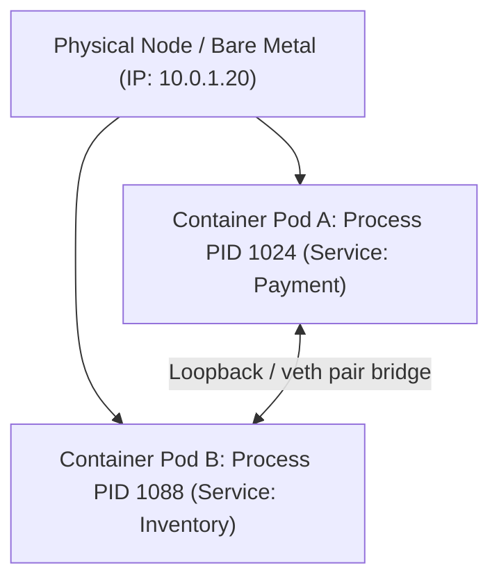

#### 4. Code ví dụ thực chiến (TypeScript Service Health Indicator)
```typescript
interface ServiceEndpoint {
    serviceName: string;
    nodeIp: string;
    port: number;
    status: 'UP' | 'DOWN';
}

class ServiceRegistry {
    private endpoints: Map<string, ServiceEndpoint[]> = new Map();

    public register(endpoint: ServiceEndpoint): void {
        const list = this.endpoints.get(endpoint.serviceName) || [];
        list.push(endpoint);
        this.endpoints.set(endpoint.serviceName, list);
        console.log(`Registered [${endpoint.serviceName}] on Node ${endpoint.nodeIp}:${endpoint.port}`);
    }

    public getHealthyNodes(serviceName: string): ServiceEndpoint[] {
        return (this.endpoints.get(serviceName) || []).filter(e => e.status === 'UP');
    }
}

const registry = new ServiceRegistry();
registry.register({ serviceName: "PaymentService", nodeIp: "10.0.2.1", port: 50051, status: 'UP' });
registry.register({ serviceName: "PaymentService", nodeIp: "10.0.2.2", port: 50051, status: 'DOWN' });
console.log("Healthy nodes:", registry.getHealthyNodes("PaymentService").length); // 1
```

#### 5. Ưu / Nhược điểm, Pitfalls & Anti-patterns
- **Pitfall**: Đặt quá nhiều Distributed Processes nặng trên cùng một Node vật lý dẫn đến tranh chấp tài nguyên (Resource Contention: CPU Throttling, Disk I/O Throttling).

#### 6. Ứng dụng thực tế trong Backend / Systems
- Kubernetes Architecture: Quản lý hàng triệu Distributed Processes thông qua mô hình Nodes, Pods, Services, và Kube-proxy.

---

### 3. Distributed Communication, Coordination, and State

#### 1. Khái niệm bản chất (What & Why)
- **Distributed Communication**: Quá trình trao đổi dữ liệu giữa các nút qua các giao thức mạng (gRPC, REST, Kafka, TCP/UDP).
- **Distributed Coordination**: Sự phối hợp nhịp nhàng giữa các nút độc lập để đảm bảo hành động chung thống nhất (Leader election, Distributed Locking, Barrier Synchronization).
- **Distributed State**: Toàn bộ trạng thái dữ liệu nghiệp vụ không nằm cố định tại một chỗ mà phân tán trên bộ nhớ RAM và đĩa cứng của nhiều nodes.

#### 2. Cơ chế hoạt động sâu (Under the hood / Hardcore Internals)
- **Quản lý Trạng thái Phân tán (State Coherence)**:
  - Để phối hợp trạng thái phân tán mà không có đồng hồ chung, hệ thống sử dụng thuật toán đồng thuận (Raft/Paxos) hoặc các giao thức Gossip protocol để truyền bá trạng thái (State propagation) theo chu kỳ tick $O(\log N)$.

#### 3. Sơ đồ minh họa
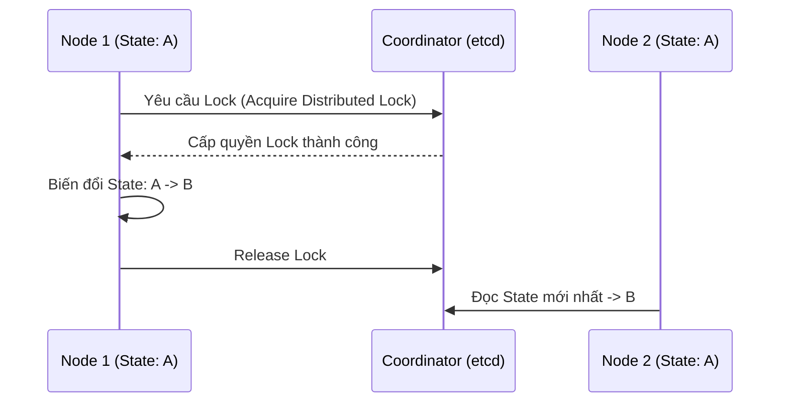

#### 4. Code ví dụ thực chiến (C++ Distributed State Mutex Simulator)
```cpp
#include <iostream>
#include <string>
#include <chrono>

struct DistributedState {
    uint64_t version{0};
    std::string value;
};

// Mô phỏng kiểm tra phiên bản trạng thái phân tán (Optimistic Concurrency Check)
bool try_update_state(DistributedState& current, uint64_t expected_ver, const std::string& new_val) {
    if (current.version != expected_ver) {
        std::cerr << "State Conflict: Expected version " << expected_ver 
                  << " but found " << current.version << "\n";
        return false;
    }
    current.value = new_val;
    current.version++;
    std::cout << "State successfully mutated to version " << current.version << "\n";
    return true;
}

int main() {
    DistributedState global_state{1, "INITIAL"};
    try_update_state(global_state, 1, "MUTATED_BY_NODE_A"); // Thành công
    try_update_state(global_state, 1, "MUTATED_BY_NODE_B"); // Thất bại (Conflict)
    return 0;
}
```

#### 5. Ưu / Nhược điểm, Pitfalls & Anti-patterns
- **Anti-pattern**: "Distributed Coordination Bottleneck" — Tập trung toàn bộ việc điều phối vào một nút điều khiển trung tâm duy nhất, biến nó thành điểm nghẽn cổ chai của toàn bộ cụm máy chủ.

#### 6. Ứng dụng thực tế trong Backend / Systems
- etcd / Apache ZooKeeper: Hệ thống quản lý Distributed State và Coordination chuẩn mực của ngành điện toán đám mây.

---

### 4. Distributed Resource, Execution, Workload, and Environment

#### 1. Khái niệm bản chất (What & Why)
- **Distributed Resource**: Tập hợp tài nguyên phần cứng tổng hợp (Tổng CPU Cores, Tổng dung lượng RAM, Tổng băng thông mạng, Ổ đĩa lưu trữ) được trừu tượng hóa thành một "Resource Pool" duy nhất.
- **Distributed Execution**: Luồng thực thi mã lệnh không bị giới hạn trên một máy tính mà phân tán qua các Remote Procedure Calls và luồng sự kiện.
- **Distributed Workload**: Khối lượng công việc (Requests, Transactions, Analytics Jobs) được phân bổ đều ra các worker nodes.
- **Distributed Environment**: Môi trường hạ tầng mạng không đồng nhất (On-premise, Hybrid Cloud, Multi-Cloud).

#### 2. Cơ chế hoạt động sâu (Under the hood / Hardcore Internals)
- **Resource Virtualization & Scheduling**:
  - Các bộ điều phối tài nguyên (Resource Schedulers như Kubernetes scheduler, Apache Mesos) liên tục tính toán ma trận dung lượng:
    $$\text{NodeScore} = w_1 \cdot \text{FreeMemory} + w_2 \cdot \text{FreeCPU} - w_3 \cdot \text{NetworkLatency}$$
    để phân bổ workload vào nút tối ưu nhất.

#### 3. Sơ đồ minh họa
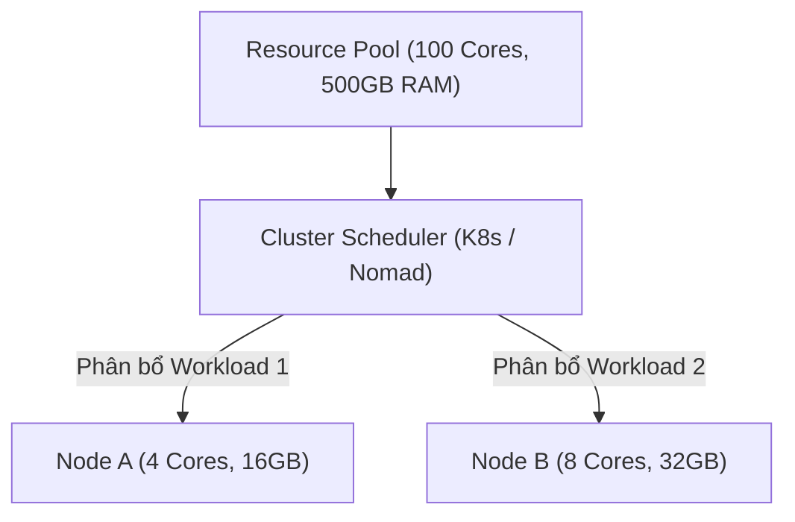

#### 4. Code ví dụ thực chiến (TypeScript Resource Allocation Estimator)
```typescript
interface NodeCapacity {
    nodeId: string;
    availableCpuMilli: number; // 1000 = 1 Core
    availableMemMb: number;
}

function scheduleWorkload(nodes: NodeCapacity[], cpuReq: number, memReq: number): string {
    for (const node of nodes) {
        if (node.availableCpuMilli >= cpuReq && node.availableMemMb >= memReq) {
            node.availableCpuMilli -= cpuReq;
            node.availableMemMb -= memReq;
            return `Scheduled on ${node.nodeId}`;
        }
    }
    throw new Error("INSUFFICIENT_CLUSTER_RESOURCES");
}

const cluster: NodeCapacity[] = [
    { nodeId: "node-1", availableCpuMilli: 500, availableMemMb: 1024 },
    { nodeId: "node-2", availableCpuMilli: 2000, availableMemMb: 4096 }
];
console.log(scheduleWorkload(cluster, 1000, 2048)); // Scheduled on node-2
```

#### 5. Ưu / Nhược điểm, Pitfalls & Anti-patterns
- **Pitfall**: "Noisy Neighbor Problem" — Một tác vụ chạy ngốn sạch toàn bộ I/O hoặc băng thông card mạng của nút vật lý làm tê liệt các tác vụ khác chạy chung trên nút đó.

#### 6. Ứng dụng thực tế trong Backend / Systems
- Apache Mesos & HashiCorp Nomad: Nền tảng điều phối cụm tài nguyên phân tán hàng đầu thế giới.

---

### 5. Networked System, Cluster, Grid, Cloud, and Edge Computing

#### 1. Khái niệm bản chất (What & Why)
- **Networked System**: Hệ thống cơ bản gồm các máy tính kết nối mạng truyền thông với nhau.
- **Cluster Computing**: Các máy tính có cấu hình phần cứng tương đồng (Homogeneous), đặt gần nhau trong cùng một Data Center, kết nối qua mạng nội bộ tốc độ cao (Infiniband, 100GbE) để chạy các tác vụ song song tập trung.
- **Grid Computing**: Mạng lưới các máy tính không đồng nhất (Heterogeneous), đặt rải rác ở nhiều tổ chức/địa lý khác nhau, chia sẻ tài nguyên cho các dự án nghiên cứu khoa học lớn (như SETI@home, CERN LHC).
- **Cloud Computing**: Mô hình cung cấp tài nguyên điện toán phân tán (IaaS, PaaS, SaaS) theo nhu cầu qua Internet với mô hình thanh toán theo lượng sử dụng (Pay-as-you-go).
- **Edge Computing**: Đưa việc tính toán và lưu trữ dữ liệu lại gần nơi dữ liệu được sinh ra nhất (Thiết bị IoT, Trạm phát sóng 5G base stations, CDN Edge Servers) để giảm thiểu độ trễ mạng và tiết kiệm băng thông trục chính.

#### 2. Cơ chế hoạt động sâu (Under the hood / Hardcore Internals)
- **So sánh Độ trễ (Latency Profile)**:
  - Cluster: $< 0.1\text{ms}$ (Local network, L2 switch).
  - Cloud: $5 - 50\text{ms}$ (Giữa các Availability Zones và Regions).
  - Edge: $< 5\text{ms}$ (Khoảng cách vật lý cực ngắn giữa client và PoP biên).
  - Grid: Hàng trăm milliseconds tới hàng giây (Mạng Internet công cộng không ổn định).

#### 3. Sơ đồ minh họa
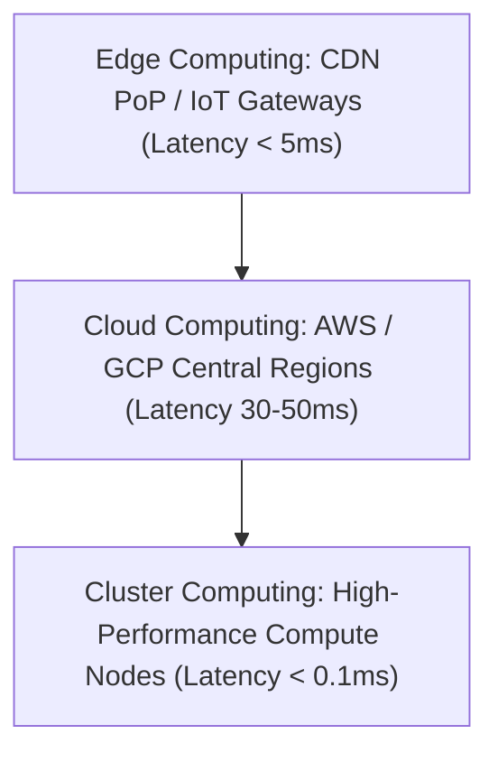

#### 4. Code ví dụ thực chiến (C++ Edge-Cloud Fallback Logic)
```cpp
#include <iostream>
#include <string>

struct ComputeRequest {
    std::string payload;
    bool requires_low_latency;
};

void route_request(const ComputeRequest& req) {
    if (req.requires_low_latency) {
        std::cout << "Routing to EDGE WORKER (Cloudflare Worker / V8 Isolate) for immediate response.\n";
    } else {
        std::cout << "Routing to CENTRAL CLOUD CLUSTER for heavy background processing.\n";
    }
}

int main() {
    route_request({"video_frame_detection", true});
    route_request({"monthly_financial_report", false});
    return 0;
}
```

#### 5. Ưu / Nhược điểm, Pitfalls & Anti-patterns
- **Pitfall**: Triển khai logic tính toán quá nặng nề trên Edge Devices có tài nguyên CPU/RAM và nguồn pin hạn chế.

#### 6. Ứng dụng thực tế trong Backend / Systems
- Cloudflare Workers & Fastly Compute@Edge: Chạy mã JavaScript/Wasm tại hơn 300 thành phố trên toàn cầu ngay tại biên mạng Internet.

---

### Phần 2: Distributed System Characteristics (Các Đặc tính Cốt lõi)

---

### 6. Resource Sharing and Concurrency (Chia sẻ Tài nguyên và Tính Đồng thời Phân tán)

#### 1. Khái niệm bản chất (What & Why)
- **Resource Sharing**: Khả năng chia sẻ tài nguyên phần cứng (Disk, CPU, GPU clusters) và phần mềm (Databases, Queues, Services) cho hàng triệu người dùng đồng thời trên toàn cầu.
- **Distributed Concurrency**: Sự diễn ra đồng thời của nhiều luồng thực thi trên nhiều máy tính vật lý khác nhau mà không có một bộ điều phối luồng CPU chung (No central thread scheduler).

#### 2. Cơ chế hoạt động sâu (Under the hood / Hardcore Internals)
- **Xung đột Ghi Đồng thời (Concurrent Write Anomaly)**:
  - Khi hai node cùng thực hiện thao tác Đọc-Sửa-Ghi (`Read-Modify-Write`) trên cùng một dữ liệu tại cùng một thời điểm:
    Node A: Đọc số dư = 100 $\to$ Trừ 20 $\to$ Ghi 80.
    Node B: Đọc số dư = 100 $\to$ Trừ 30 $\to$ Ghi 70.
  - Nếu không có cơ chế khóa phân tán hoặc CRDT, giá trị ghi cuối cùng sẽ ghi đè lên thao tác trước, làm mất 20$ của hệ thống (Lost Update Phenomenon).

#### 3. Sơ đồ minh họa
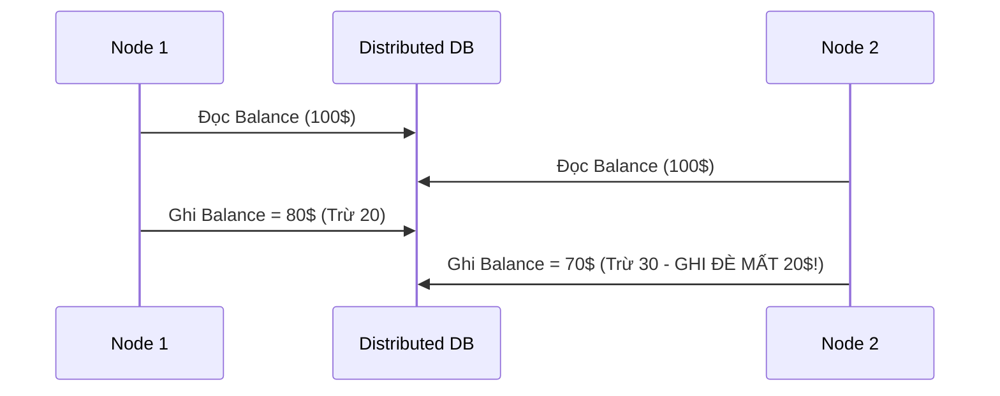

#### 4. Code ví dụ thực chiến (C++ Distributed Optimistic Concurrency Control with Versioning)
```cpp
#include <iostream>
#include <string>

struct VersionedRecord {
    int id;
    int balance;
    int version;
};

bool update_balance_occ(VersionedRecord& record, int delta, int read_version) {
    if (record.version != read_version) {
        std::cerr << "OCC Conflict: Record was modified by another node!\n";
        return false; // Cần retry lại từ đầu
    }
    record.balance += delta;
    record.version++;
    return true;
}

int main() {
    VersionedRecord account{101, 100, 1};
    int clientA_ver = account.version; // 1
    int clientB_ver = account.version; // 1

    std::cout << "Client A update: " << update_balance_occ(account, -20, clientA_ver) << "\n"; // Thành công (ver 2)
    std::cout << "Client B update: " << update_balance_occ(account, -30, clientB_ver) << "\n"; // Bị từ chối an toàn!
    return 0;
}
```

#### 5. Ưu / Nhược điểm, Pitfalls & Anti-patterns
- **Anti-pattern**: Sử dụng Distributed Pessimistic Lock bừa bãi cho mọi thao tác đọc/ghi, khiến thông lượng (Throughput) của hệ thống bị sụt giảm thảm hại do các node phải xếp hàng chờ đợi nhau.

#### 6. Ứng dụng thực tế trong Backend / Systems
- Redis Redlock / DynamoDB Conditional Writes: Giải quyết bài toán đồng thời phân tán trong các flash-sale e-commerce.

---

### 7. Scalability and Transparency (Khả năng Mở rộng và Tính Trong suốt)

#### 1. Khái niệm bản chất (What & Why)
- **Scalability (Khả năng Mở rộng)**: Khả năng của hệ thống tăng trưởng năng lực phục vụ (Throughput) khi bổ sung thêm tài nguyên phần cứng (Horizontal Scaling).
- **Transparency (Tính Trong suốt)**: Sự che giấu hoàn toàn tính chất phân tán phức tạp khỏi tầm nhìn của người dùng và lập trình viên ứng dụng.
- **8 Khía cạnh Trong suốt Chuẩn ISO/ODP**:
  1. **Access Transparency**: Truy cập tài nguyên cục bộ hay từ xa bằng cùng một cú pháp.
  2. **Location Transparency**: Người dùng không cần biết tài nguyên nằm ở IP nào.
  3. **Migration Transparency**: Tài nguyên có thể di chuyển sang node khác mà không làm gián đoạn truy cập.
  4. **Relocation Transparency**: Tài nguyên di chuyển ngay trong khi đang được sử dụng.
  5. **Replication Transparency**: Người dùng không biết dữ liệu đã được sao chép ra 5 bản sao khác nhau.
  6. **Concurrency Transparency**: Nhiều người dùng cùng thao tác mà không thấy xung đột.
  7. **Failure Transparency**: Một node sập được che giấu hoàn toàn, request tự động chuyển sang node khác.
  8. **Scaling Transparency**: Hệ thống mở rộng thêm 100 nodes mà giao diện sử dụng không thay đổi.

#### 2. Cơ chế hoạt động sâu (Under the hood / Hardcore Internals)
- **Tầng DNS, Load Balancer và Proxy**:
  - Location Transparency được hiện thực hóa thông qua tầng **Service Discovery (Consul / Kubernetes DNS)**: Mã ứng dụng gọi `http://payment-service/checkout` thay vì gọi IP cố định `10.244.3.12`.

#### 3. Sơ đồ minh họa
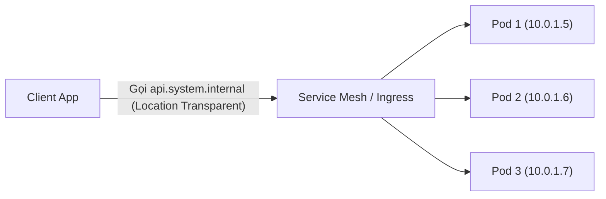

#### 4. Code ví dụ thực chiến (TypeScript Location Transparency Resolver)
```typescript
class LocationTransparentClient {
    private serviceDirectory: Record<string, string> = {
        "orders": "https://ord-sg-01.internal.cloud:8443",
        "payments": "https://pay-sg-02.internal.cloud:8443"
    };

    public async callService(serviceName: string, path: string): Promise<string> {
        const baseUrl = this.serviceDirectory[serviceName];
        if (!baseUrl) throw new Error(`Unknown service: ${serviceName}`);
        
        // Người gọi hoàn toàn không cần biết địa chỉ IP vật lý của service
        console.log(`Routing request transparently to: ${baseUrl}${path}`);
        return `Response from ${serviceName}`;
    }
}

const client = new LocationTransparentClient();
client.callService("payments", "/v1/charge");
```

#### 5. Ưu / Nhược điểm, Pitfalls & Anti-patterns
- **Cạm bẫy Leaky Transparency**: Cố gắng trừu tượng hóa cuộc gọi mạng từ xa giống hệt như một lời gọi hàm cục bộ trong bộ nhớ (như Java RMI), khiến lập trình viên quên mất rằng mạng có thể bị lag, timeout hoặc mất kết nối.

#### 6. Ứng dụng thực tế trong Backend / Systems
- Envoy Proxy / Istio Service Mesh: Cung cấp tính trong suốt toàn diện về Failure, Routing và Encryption cho các microservices.

---

### 8. Fault Tolerance, High Availability, and Reliability

#### 1. Khái niệm bản chất (What & Why)
- **Fault Tolerance (Khả năng Chịu lỗi)**: Năng lực của hệ thống tiếp tục hoạt động đúng đắn ngay cả khi một số thành phần con phần cứng hoặc phần mềm bị hư hại.
- **High Availability (HA - Tính Sẵn sàng Cao)**: Tỷ lệ thời gian mà hệ thống duy trì trạng thái hoạt động bình thường và có thể phục vụ request của người dùng, thường đo bằng "Số lượng số 9" (The Nines of Availability):
  - $99.9\%$ (Three Nines): Gián đoạn tối đa 8.76 giờ/năm.
  - $99.99\%$ (Four Nines): Gián đoạn tối đa 52.6 phút/năm.
  - $99.999\%$ (Five Nines): Gián đoạn tối đa 5.26 phút/năm.
- **Reliability (Độ Tin cậy)**: Xác suất hệ thống vận hành liên tục không xảy ra lỗi trong một khoảng thời gian xác định, đo bằng MTBF (Mean Time Between Failures).

#### 2. Cơ chế hoạt động sâu (Under the hood / Hardcore Internals)
- **Công thức Tính Độ sẵn sàng Hệ thống Độc lập**:
  - Hai thành phần nối tiếp (Serial): $A_{\text{total}} = A_1 \times A_2$ (Độ sẵn sàng giảm).
  - Hai thành phần song song dự phòng (Parallel Redundancy):
    $$A_{\text{total}} = 1 - (1 - A_1)(1 - A_2)$$
    Nếu mỗi node có $A = 99\%$ (0.99), chạy 2 nodes song song nâng độ sẵn sàng lên $1 - (0.01)^2 = 99.99\%$!

#### 3. Sơ đồ minh họa
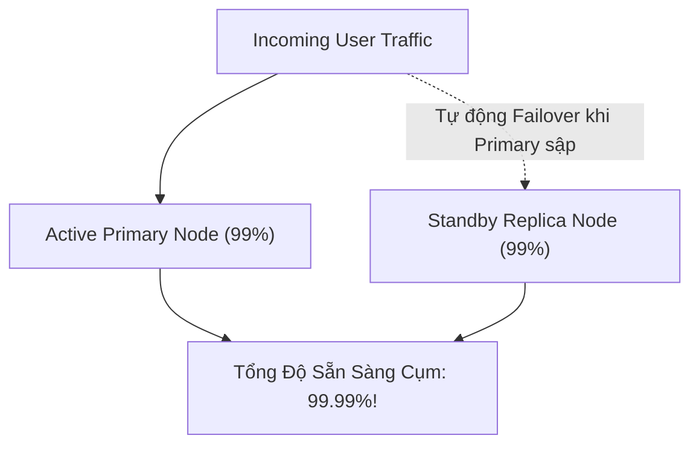

#### 4. Code ví dụ thực chiến (C++ Automatic Failover Circuit Breaker)
```cpp
#include <iostream>
#include <string>
#include <stdexcept>

class HighAvailabilityService {
    std::string primary_ip_{"10.0.1.10"};
    std::string standby_ip_{"10.0.1.11"};
    bool is_primary_alive_{true};

public:
    void trigger_primary_failure() { is_primary_alive_ = false; }

    std::string execute_request() {
        if (is_primary_alive_) {
            return "SUCCESS: Processed by PRIMARY (" + primary_ip_ + ")";
        } else {
            // Tự động chuyển mạch dự phòng (Failover)
            return "FAILOVER: Processed by STANDBY (" + standby_ip_ + ")";
        }
    }
};

int main() {
    HighAvailabilityService ha;
    std::cout << ha.execute_request() << "\n";
    ha.trigger_primary_failure(); // Sự cố sập Primary
    std::cout << ha.execute_request() << "\n"; // Vẫn phục vụ bình thường qua Standby
    return 0;
}
```

#### 5. Ưu / Nhược điểm, Pitfalls & Anti-patterns
- **Anti-pattern**: Thiết kế hệ thống HA nhưng có điểm nghẽn Single Point of Failure (SPOF) tiềm ẩn ở một thiết bị mạng Switch duy nhất hoặc một database dùng chung.

#### 6. Ứng dụng thực tế trong Backend / Systems
- Multi-AZ Deployments trên AWS (RDS Multi-AZ with automatic failover): Đảm bảo tính sẵn sàng cao cho dữ liệu quan trọng.

---

### 9. Consistency, Replication, and Distribution

#### 1. Khái niệm bản chất (What & Why)
- **Replication (Nhân bản)**: Việc lưu trữ cùng một dữ liệu trên nhiều nút vật lý khác nhau để tăng tính chịu lỗi và chia sẻ tải đọc dữ liệu.
- **Distribution (Phân phối)**: Việc chia nhỏ tập dữ liệu khổng lồ thành nhiều phân vùng (Partitions/Shards) và đặt trên các nodes khác nhau.
- **Consistency (Tính Nhất quán)**: Ràng buộc đảm bảo rằng các client đọc dữ liệu từ các bản sao khác nhau sẽ nhìn thấy cùng một giá trị dữ liệu chính xác theo các quy tắc toán học đã cam kết.

#### 2. Cơ chế hoạt động sâu (Under the hood / Hardcore Internals)
- **Replication Lag**:
  - Trong nhân bản bất đồng bộ (Asynchronous Replication), dữ liệu ghi vào Master Node được xác nhận thành công ngay lập tức trước khi gói tin mạng gửi tới Replica.
  - Khoảng thời gian trễ giữa Master và Replica (vài milliseconds đến vài chục giây khi mạng lag) tạo ra hiện tượng **Stale Reads** (Client đọc phải dữ liệu cũ).

#### 3. Sơ đồ minh họa
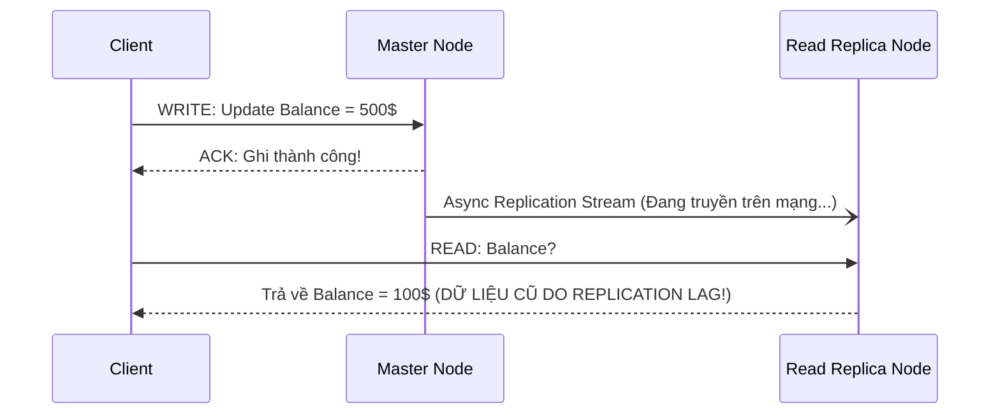

#### 4. Code ví dụ thực chiến (TypeScript Read-After-Write Consistency Routing)
```typescript
interface DataStore {
    write(key: string, val: string): number; // Trả về LSN (Log Sequence Number)
    readMaster(key: string): string;
    readReplica(key: string): { val: string; lsn: number };
}

class SmartConsistencyRouter {
    private lastUserWriteLsn: number = 0;

    constructor(private db: DataStore) {}

    public userWrite(key: string, val: string): void {
        this.lastUserWriteLsn = this.db.write(key, val);
    }

    public userRead(key: string): string {
        const replicaData = this.db.readReplica(key);
        // Nếu Replica chưa bắt kịp LSN của lần ghi gần nhất của chính User đó
        if (replicaData.lsn < this.lastUserWriteLsn) {
            console.log("Replica is stale! Routing read to MASTER for Consistency.");
            return this.db.readMaster(key);
        }
        return replicaData.val;
    }
}
```

#### 5. Ưu / Nhược điểm, Pitfalls & Anti-patterns
- **Pitfall**: Đọc dữ liệu từ bản sao (Read Replica) ngay sau khi ghi mà không có cơ chế "Read-Your-Writes Consistency", làm người dùng tưởng rằng thao tác của họ bị mất.

#### 6. Ứng dụng thực tế trong Backend / Systems
- MySQL Primary-Replica Replication & MongoDB Replica Sets: Mô hình lưu trữ phân tán chuẩn mực của các doanh nghiệp.

---

### 10. Heterogeneity, Openness, and Security

#### 1. Khái niệm bản chất (What & Why)
- **Heterogeneity (Tính Không đồng nhất)**: Hệ thống phân tán bao gồm nhiều phần cứng khác nhau (Intel x86, ARM64, Apple Silicon), hệ điều hành khác nhau (Linux, Windows, macOS), và ngôn ngữ lập trình khác nhau (C++, Go, Java, TypeScript).
- **Openness (Tính Mở)**: Mức độ mà hệ thống có thể mở rộng và tái tích hợp các dịch vụ mới thông qua các giao diện chuẩn hóa (Standardized Interfaces: POSIX, OpenAPI, gRPC IDL).
- **Security (Bảo mật Phân tán)**: Đảm bảo 3 trụ cột CIA (Confidentiality, Integrity, Availability) trên toàn bộ mạng lưới truyền thông không an toàn, áp dụng kiến trúc Zero Trust.

#### 2. Cơ chế hoạt động sâu (Under the hood / Hardcore Internals)
- **Vượt qua Tính Không đồng nhất qua Chuẩn hóa Nhị phân**:
  - Không thể truyền trực tiếp bộ nhớ struct C++ qua mạng sang máy khác vì khác biệt về Endianness (Big-endian vs Little-endian) và Compiler Padding.
  - Bắt buộc phải dùng chuẩn tuần tự hóa độc lập nền tảng như **Protocol Buffers** (Varints, Wire Types).

#### 3. Sơ đồ minh họa
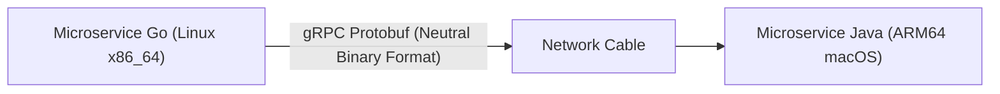

#### 4. Code ví dụ thực chiến (C++ Endian-Independent Byte Packing)
```cpp
#include <iostream>
#include <vector>
#include <cstdint>
#include <arpa/inet.h> // Hỗ trợ htonl, ntohl chuẩn POSIX

std::vector<uint8_t> serialize_uint32_network_order(uint32_t val) {
    // Chuyển đổi từ Host Byte Order (có thể là Little-Endian) sang Network Byte Order (Big-Endian)
    uint32_t network_val = htonl(val);
    const auto* ptr = reinterpret_cast<const uint8_t*>(&network_val);
    return std::vector<uint8_t>(ptr, ptr + sizeof(uint32_t));
}

int main() {
    auto bytes = serialize_uint32_network_order(0x12345678);
    std::cout << "Serialized Big-Endian Bytes: ";
    for (uint8_t b : bytes) std::cout << std::hex << (int)b << " ";
    std::cout << "\n"; // Luôn ra: 12 34 56 78 trên mọi kiến trúc CPU!
    return 0;
}
```

#### 5. Ưu / Nhược điểm, Pitfalls & Anti-patterns
- **Anti-pattern**: Giả định mạng nội bộ (Internal VPC) là an toàn và không mã hóa lưu lượng giữa các microservices (No mTLS), tạo cơ hội cho kẻ tấn công nội gián nghe lén toàn bộ dữ liệu.

#### 6. Ứng dụng thực tế trong Backend / Systems
- Mutual TLS (mTLS) với SPIFFE/SPIRE: Xác thực danh tính mã hóa tự động giữa các microservices trong hệ sinh thái Kubernetes.

---

### 11. Decentralization and Geographic Distribution

#### 1. Khái niệm bản chất (What & Why)
- **Decentralization (Phi tập trung)**: Thiết kế hệ thống không có bất kỳ một nút trung tâm kiểm soát duy nhất (No master/controller node). Mọi nút có vai trò tương đương nhau và quyết định dựa trên thuật toán đồng thuận phân tán.
- **Geographic Distribution (Phân tán Địa lý)**: Các máy chủ được đặt tại nhiều quốc gia, châu lục khác nhau nhằm đưa dữ liệu tới gần người dùng và phòng chống thảm họa thiên tai cấp vùng (Earthquakes, Floods).

#### 2. Cơ chế hoạt động sâu (Under the hood / Hardcore Internals)
- **Độ trễ Ánh sáng trong Cáp quang (Speed of Light in Fiber)**:
  - Tốc độ ánh sáng trong sợi thủy tinh cáp quang là $c_{\text{fiber}} \approx 200,000\text{ km/s}$.
  - Khoảng cách giữa San Francisco và Singapore $\approx 14,000\text{ km}$.
  - Thời gian RTT (Round Trip Time) tối thiểu tuyệt đối về mặt vật lý là:
    $$\text{RTT}_{\text{min}} = \frac{2 \times 14,000}{200,000} = 0.14\text{s} = 140\text{ms}$$
  - **Quy luật bất biến**: Không có bất kỳ phần mềm nào có thể chạy nhanh hơn tốc độ ánh sáng!

#### 3. Sơ đồ minh họa
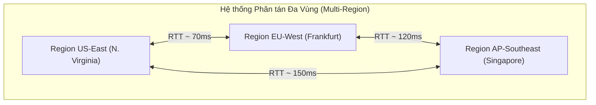

#### 4. Code ví dụ thực chiến (TypeScript Geo-DNS Routing Logic)
```typescript
interface ClientGeoLocation {
    country: string;
    latitude: number;
    longitude: number;
}

function routeToNearestRegion(client: ClientGeoLocation): string {
    if (client.country === 'VN' || client.country === 'SG') {
        return "https://ap-southeast-1.api.system.internal";
    } else if (client.country === 'DE' || client.country === 'FR') {
        return "https://eu-central-1.api.system.internal";
    }
    return "https://us-east-1.api.system.internal"; // Default fallback
}

console.log("Routing client from VN to:", routeToNearestRegion({ country: 'VN', latitude: 21.0, longitude: 105.8 }));
```

#### 5. Ưu / Nhược điểm, Pitfalls & Anti-patterns
- **Pitfall**: Thực hiện các giao dịch phân tán Two-Phase Commit (2PC) xuyên lục địa (Cross-region transactions), khiến thời gian khóa dữ liệu kéo dài hàng trăm milliseconds, làm sụp đổ thông lượng hệ thống.

#### 6. Ứng dụng thực tế trong Backend / Systems
- Mạng ngang hàng BitTorrent, Mạng Blockchain Ethereum/Bitcoin, và Mạng phân phối nội dung toàn cầu Cloudflare CDN.

---

### 12. Partial Failure, Independent Failure, and Network Dependency

#### 1. Khái niệm bản chất (What & Why)
- **Partial Failure**: Điểm phân biệt sống còn giữa máy tính đơn lẻ và hệ thống phân tán. Trên máy đơn lẻ, nếu phần cứng hỏng, toàn bộ chương trình dừng lại (Fail-stop). Trong hệ thống phân tán, một số máy bị hỏng, một số máy bị chậm, và một số máy vẫn chạy hoàn hảo.
- **Independent Failure**: Sự cố sập nguồn của Nút A không làm Nút B bị sập theo (các nút có ranh giới lỗi độc lập).
- **Network Dependency**: Toàn bộ hoạt động phối hợp phụ thuộc 100% vào mạng truyền thông — vốn là thành phần kém tin cậy nhất trong toàn bộ kiến trúc máy tính.

#### 2. Cơ chế hoạt động sâu (Under the hood / Hardcore Internals)
- **Nguyên lý Thiết kế Chống Lỗi (Design for Failure)**:
  - Xem lỗi phần cứng và rớt mạng là **trạng thái bình thường** của hệ thống (Normal state of affairs), chứ không phải là ngoại lệ hiếm gặp.
  - Áp dụng các mẫu thiết kế: **Heartbeats, Leases, Dead-man Switches, và Graceful Degradation**.

#### 3. Sơ đồ minh họa
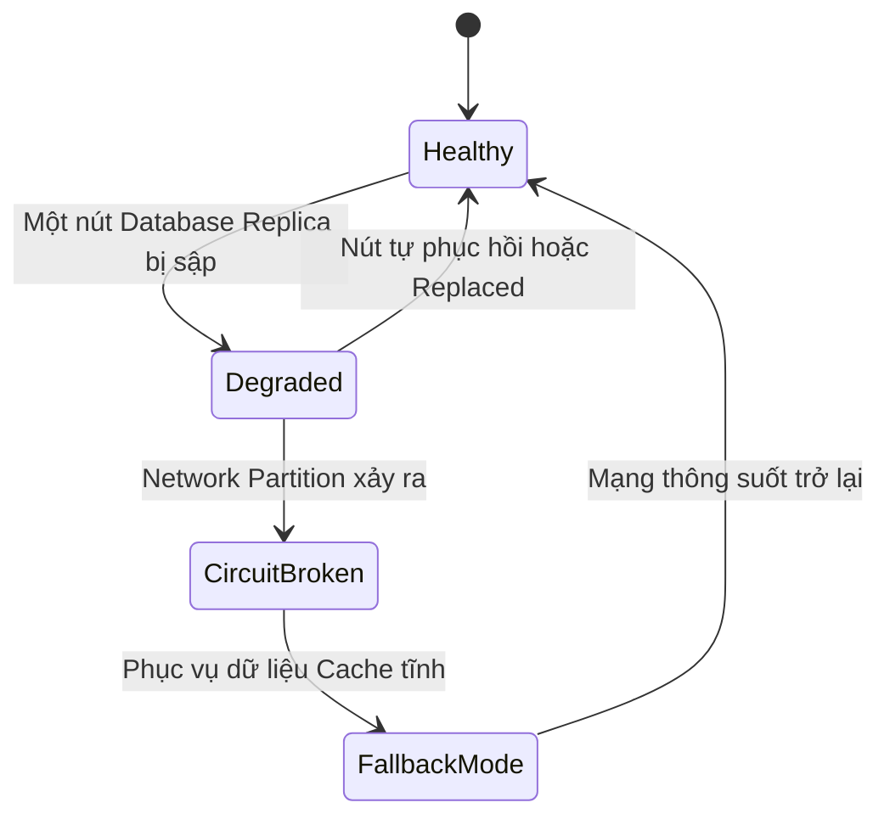

#### 4. Code ví dụ thực chiến (C++ Graceful Degradation Fallback)
```cpp
#include <iostream>
#include <string>
#include <optional>

class RecommendationEngine {
public:
    std::optional<std::string> call_remote_ai_model() {
        // Mô phỏng gọi remote microservice AI bị timeout / partial failure
        return std::nullopt; 
    }

    std::string get_recommendations_for_user() {
        auto ai_result = call_remote_ai_model();
        if (ai_result.has_value()) {
            return *ai_result;
        }

        // BẢO VỆ CHỊU LỖI: Graceful Degradation (Trả về danh sách tĩnh thay vì báo lỗi 500)
        return "FALLBACK_POPULAR_ITEMS: [ItemA, ItemB, ItemC]";
    }
};

int main() {
    RecommendationEngine engine;
    std::cout << "Result: " << engine.get_recommendations_for_user() << "\n";
    return 0;
}
```

#### 5. Ưu / Nhược điểm, Pitfalls & Anti-patterns
- **Anti-pattern**: "Fail-Silent Bug" — Một nút bị treo âm thầm không trả lời (Blackhole), nhưng các nút khác không có cơ chế Timeout khiến tất cả các luồng xử lý bị block vô hạn.

#### 6. Ứng dụng thực tế trong Backend / Systems
- Kiến trúc Chaos Engineering của Netflix (Chaos Monkey): Chủ động tự động bắn chết ngẫu nhiên các máy chủ production trong giờ làm việc để chứng minh hệ thống có khả năng tự phục hồi trước Partial Failures.
