# 1.2. Challenges and Architectures (Các Thách thức Cốt lõi và Kiến trúc Hệ thống Phân tán)

## Tổng quan về Thách thức và Các Mô hình Kiến trúc
Xây dựng một hệ thống phân tán đòi hỏi kỹ sư phần mềm phải từ bỏ hoàn toàn các giả định ngây thơ vốn chỉ đúng trong môi trường máy tính đơn lẻ. 

Peter Deutsch và James Gosling tại Sun Microsystems đã đúc kết **8 Ảo tưởng Kinh điển của Điện toán Phân tán (The 8 Fallacies of Distributed Computing)**:
1. Mạng luôn đáng tin cậy (The network is reliable).
2. Độ trễ mạng bằng 0 (Latency is zero).
3. Băng thông là vô hạn (Bandwidth is infinite).
4. Mạng luôn an toàn tuyệt đối (The network is secure).
5. Tô-pô mạng không bao giờ thay đổi (Topology doesn't change).
6. Chỉ có một người quản trị duy nhất (There is one administrator).
7. Chi phí truyền tải bằng 0 (Transport cost is zero).
8. Mạng lưới hoàn toàn đồng nhất (The network is homogeneous).

Để chế ngự những thách thức này, các kỹ sư hệ thống đã phát triển nhiều trường phái kiến trúc phân tán khác nhau, từ Client-Server truyền thống tới Peer-to-Peer, Microservices, Event-Driven, và Actor Model.

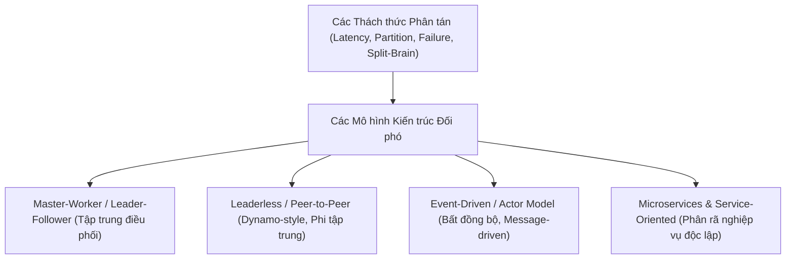

---

## 2. Chi tiết từng Keyword (Under-the-Hood Deep Dive)

---

### Phần 1: Distributed System Challenges (Các Thách thức Hệ thống)

---

### 1. Network Latency, Unreliability, Loss, Duplication, and Reordering

#### 1. Khái niệm bản chất (What & Why)
- **Network Latency**: Thời gian cần thiết để một gói tin di chuyển từ nguồn tới đích qua mạng vật lý.
- **Network Unreliability**: Kênh mạng không có sự bảo đảm vật lý: Dây cáp có thể bị đứt, bộ định tuyến (Router) có thể bị quá tải và xả bỏ gói tin.
- **Message Loss (Mất thông điệp)**: Gói tin biến mất hoàn toàn trên đường truyền do lỗi phần cứng hoặc hàng đợi Router bị tràn (Drop tail).
- **Message Duplication (Trùng lặp thông điệp)**: Bên gửi gửi lại (Retry) khi tưởng rằng gói tin bị mất, nhưng thực tế gói tin đầu tiên chỉ bị trễ, dẫn đến việc bên nhận nhận được 2 bản sao giống hệt nhau.
- **Message Reordering (Xáo trộn thứ tự)**: Các gói tin IP đi qua các tuyến đường (Routes) khác nhau trên Internet, dẫn đến việc gói tin gửi sau lại đến đích trước gói tin gửi trước.

#### 2. Cơ chế hoạt động sâu (Under the hood / Hardcore Internals)
- **Tầng TCP vs Application Layer**:
  - Giao thức TCP giải quyết mất mát và đảo thứ tự thông qua trường **Sequence Number**, **Acknowledgment (ACK)** và **Sliding Window Buffer** trong Kernel.
  - Tuy nhiên, ở tầng ứng dụng (Application Level / HTTP / RPC): Nếu TCP connection bị đứt và ứng dụng tự retry một HTTP POST request, nguy cơ **Message Duplication** xuất hiện trở lại ở tầng nghiệp vụ!

#### 3. Sơ đồ minh họa
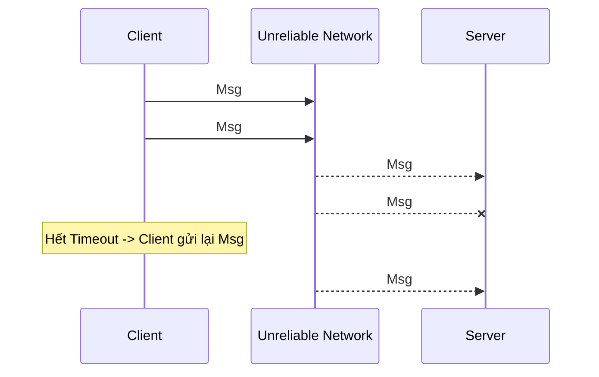

#### 4. Code ví dụ thực chiến (TypeScript Idempotent Message Deduplication Engine)
```typescript
class MessageDeduplicator {
    private processedMessageIds: Set<string> = new Set();

    public processMessage(messageId: string, payload: any): boolean {
        // Kiểm tra xem messageId đã từng được xử lý trong quá khứ chưa
        if (this.processedMessageIds.has(messageId)) {
            console.warn(`DUPLICATE DETECTED: Bỏ qua thông điệp trùng lặp [${messageId}]`);
            return false; // Bỏ qua an toàn (Idempotent)
        }

        // Xử lý nghiệp vụ...
        console.log(`Processing Message [${messageId}]:`, payload);
        this.processedMessageIds.add(messageId);
        return true;
    }
}

const dedup = new MessageDeduplicator();
dedup.processMessage("msg_uuid_001", { amount: 50 }); // Xử lý lần 1
dedup.processMessage("msg_uuid_001", { amount: 50 }); // Phát hiện trùng lặp!
```

#### 5. Ưu / Nhược điểm, Pitfalls & Anti-patterns
- **Anti-pattern**: Thực hiện các thao tác tài chính (Thanh toán, Trừ tiền) mà không có mã định danh `Idempotency-Key`, khiến việc mạng lag và tự động retry trừ tiền của khách hàng nhiều lần.

#### 6. Ứng dụng thực tế trong Backend / Systems
- Apache Kafka Consumers: Triển khai kiểm tra Offset và Transactional Producer để đạt ngữ nghĩa Exactly-Once Processing (EOP).

---

### 2. Network Partition and Split Brain (Phân mảnh Mạng và Thảm họa Hai Não)

#### 1. Khái niệm bản chất (What & Why)
- **Network Partition (Phân mảnh Mạng)**: Hiện tượng sự cố kết nối mạng chia tách một cụm phân tán thành hai hoặc nhiều phân vùng con cô lập, trong đó các nodes trong cùng một phân vùng có thể nói chuyện với nhau, nhưng không thể giao tiếp với các nodes ở phân vùng khác.
- **Split Brain (Thảm họa Hai Não)**: Hệ quả tai hại nhất của Network Partition: Cả hai phân vùng cô lập đều tự coi nhóm của mình là phần còn sống sót hợp pháp duy nhất, và **mỗi bên tự bầu ra một Leader riêng biệt**!
- **Hậu quả**: Hai Leaders cùng đồng thời chấp nhận các lệnh ghi dữ liệu trái ngược nhau từ các client khác nhau, dẫn đến việc dữ liệu bị phân kỳ không thể cứu vãn (Irreversible Data Corruption).

#### 2. Cơ chế hoạt động sâu (Under the hood / Hardcore Internals)
- **Giải pháp Triệt tiêu Split Brain bằng Quorum Majority**:
  - Một nhóm chỉ được phép bầu Leader và chấp nhận thao tác ghi nếu nó sở hữu **quá bán số lượng node của toàn bộ cụm ban đầu**:
    $$\text{Quorum} \ge \left\lfloor \frac{N}{2} \right\rfloor + 1$$
  - Vì tổng số node của hai phân vùng $N_1 + N_2 = N$, nên không thể có chuyện cả hai bên cùng đạt quá bán đồng thời! Một bên sẽ có $\ge \lfloor N/2 \rfloor + 1$ (hoạt động), và bên kia sẽ có $< \lfloor N/2 \rfloor + 1$ (tự động đóng băng).

#### 3. Sơ đồ minh họa
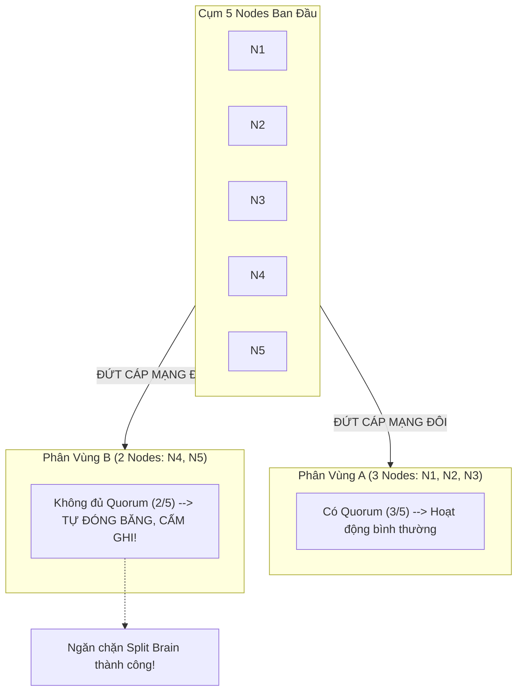

#### 4. Code ví dụ thực chiến (C++ Quorum Check for Split Brain Prevention)
```cpp
#include <iostream>

class QuorumSplitBrainGuard {
    int total_cluster_nodes_{5};

public:
    [[nodiscard]] bool can_accept_writes(int reachable_nodes) const noexcept {
        int majority = (total_cluster_nodes_ / 2) + 1; // 3 nodes
        return reachable_nodes >= majority;
    }
};

int main() {
    QuorumSplitBrainGuard guard;
    std::cout << "Partition A (3 nodes reachable): Can write? " 
              << (guard.can_accept_writes(3) ? "YES" : "NO") << "\n"; // YES
    std::cout << "Partition B (2 nodes reachable): Can write? " 
              << (guard.can_accept_writes(2) ? "YES" : "NO") << "\n"; // NO (Bảo vệ an toàn)
    return 0;
}
```

#### 5. Ưu / Nhược điểm, Pitfalls & Anti-patterns
- **Sai lầm cấu hình**: Triển khai cụm phân tán với số lượng chẵn (ví dụ cụm 2 nodes hoặc 4 nodes), khi mạng đứt đôi thành $2 - 2$, không bên nào có quá bán, khiến toàn bộ hệ thống bị tê liệt.

#### 6. Ứng dụng thực tế trong Backend / Systems
- Elasticsearch `discovery.zen.minimum_master_nodes`: Cấu hình kinh điển bắt buộc phải bằng $(N/2) + 1$ trong các phiên bản cũ để chống Split Brain khi đứt mạng.

---

### 3. Clock Drift, Clock Skew, and Data Inconsistency

#### 1. Khái niệm bản chất (What & Why)
- **Clock Drift**: Tốc độ chạy nhanh hơn hoặc chậm hơn của một đồng hồ phần cứng thạch anh so với đồng hồ chuẩn tham chiếu (thường trôi dạt vài microsecond mỗi giây).
- **Clock Skew**: Độ chênh lệch thời gian tuyệt đối giữa hai đồng hồ trên hai máy tính khác nhau tại cùng một thời điểm.
- **Data Inconsistency (Bất nhất Dữ liệu)**: Trạng thái mà các nút khác nhau lưu trữ các phiên bản dữ liệu mâu thuẫn nhau do xung đột cập nhật đồng thời hoặc độ trễ nhân bản.

#### 2. Cơ chế hoạt động sâu (Under the hood / Hardcore Internals)
- **Thảm họa của Last-Write-Wins (LWW) dựa trên Giờ vật lý**:
  - Node A có đồng hồ chạy nhanh hơn Node B là $100\text{ms}$.
  - Sự kiện $X$ xảy ra trên Node B lúc 12:00:00.000.
  - Sự kiện $Y$ xảy ra trên Node A sau đó 50ms (về mặt vật lý là xảy ra sau).
  - Nhưng do đồng hồ Node A nhanh hơn, nó gắn nhãn timestamp cho $Y$ là 12:00:00.150.
  - Nếu hệ thống dùng LWW để giải quyết xung đột, $Y$ sẽ đè bẹp $X$ một cách sai lệch!

#### 3. Sơ đồ minh họa
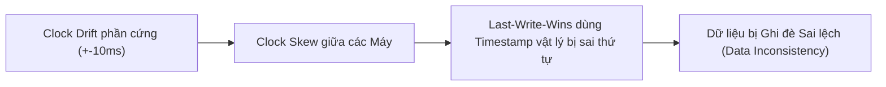

#### 4. Code ví dụ thực chiến (C++ Monotonic vs Wall Clock Comparison)
```cpp
#include <iostream>
#include <chrono>

void clock_characteristics_demo() {
    // 1. System Clock (Wall Clock): Có thể bị NTP chỉnh lùi lại phía sau bất ngờ!
    auto wall_time = std::chrono::system_clock::now();

    // 2. Steady Clock (Monotonic Clock): Cam kết KHÔNG BAO GIỜ CHẠY LÙI, chỉ tăng dần!
    auto mono_time = std::chrono::steady_clock::now();

    std::cout << "Luôn dùng std::chrono::steady_clock để đo Timeout và Elapsed time trong Distributed Systems!\n";
}

int main() {
    clock_characteristics_demo();
    return 0;
}
```

#### 5. Ưu / Nhược điểm, Pitfalls & Anti-patterns
- **Anti-pattern**: Sử dụng `system_clock` (Wall clock) để đo thời gian timeout của kết nối RPC, khi NTP đồng bộ giờ lùi lại 1 giây, timeout logic có thể bị treo thêm 1 giây bất thường.

#### 6. Ứng dụng thực tế trong Backend / Systems
- CockroachDB Hybrid Logical Clocks (HLC): Kết hợp đồng hồ vật lý với biến đếm logic Lamport để theo dõi thứ tự sự kiện mà không bị phụ thuộc hoàn toàn vào độ lệch đồng hồ NTP.

---

### 4. Cascading Failure, Retry Storm, and Thundering Herd

#### 1. Khái niệm bản chất (What & Why)
- **Cascading Failure (Sự cố Thác đổ)**: Một lỗi ban đầu tại một thành phần nhỏ lan truyền sang các thành phần khác theo hiệu ứng domino, cuối cùng làm sập toàn bộ hệ thống phân tán.
- **Retry Storm (Cơn bão Thử lại)**: Khi một service downstream bị chậm hoặc lỗi, hàng nghìn client cùng tự động retry đồng thời với tần suất dày đặc, làm lưu lượng truy cập tăng vọt gấp 10 lần, bóp nghẹt service đang hấp hối.
- **Thundering Herd**: Hiện tượng hàng nghìn worker/client cùng thức dậy đồng thời để tranh giành một tài nguyên duy nhất (ví dụ: cùng đọc Database khi một Cache key phổ biến hết hạn).

#### 2. Cơ chế hoạt động sâu (Under the hood / Hardcore Internals)
- **Công thức Exponential Backoff with Full Jitter của AWS**:
  $$\text{SleepTime} = \text{random}(0, \min(M, B \times 2^{\text{attempt}}))$$
  Thêm yếu tố ngẫu nhiên (Jitter) giúp phân tán đều các request retry dọc theo trục thời gian, phá vỡ hoàn toàn sự tập trung đỉnh sóng của Retry Storm!

#### 3. Sơ đồ minh họa
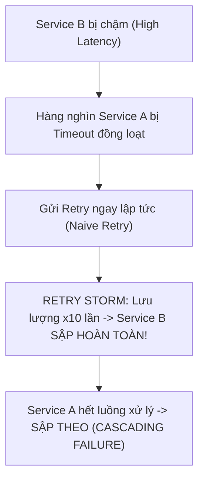

#### 4. Code ví dụ thực chiến (TypeScript Full Jitter Retry Strategy)
```typescript
async function fetchWithFullJitterRetry<T>(
    operation: () => Promise<T>, 
    maxAttempts: number = 4, 
    baseDelayMs: number = 100
): Promise<T> {
    for (let attempt = 0; attempt < maxAttempts; attempt++) {
        try {
            return await operation();
        } catch (err) {
            if (attempt === maxAttempts - 1) throw err;

            // Tính toán Exponential Backoff: base * 2^attempt
            const maxBackoff = baseDelayMs * Math.pow(2, attempt);
            // ÁP DỤNG FULL JITTER: Random từ 0 đến maxBackoff
            const sleepDuration = Math.random() * maxBackoff;

            console.warn(`Attempt ${attempt + 1} failed. Backing off for ${sleepDuration.toFixed(0)} ms...`);
            await new Promise(res => setTimeout(res, sleepDuration));
        }
    }
    throw new Error("UNREACHABLE");
}
```

#### 5. Ưu / Nhược điểm, Pitfalls & Anti-patterns
- **Anti-pattern**: Retry ở mọi tầng của kiến trúc Microservices (Mobile App retry 3 lần $\to$ API Gateway retry 3 lần $\to$ Service A retry 3 lần $\implies$ Service B hứng $3 \times 3 \times 3 = 27$ requests cho mỗi 1 click của người dùng!).

#### 6. Ứng dụng thực tế trong Backend / Systems
- Circuit Breaker Pattern (Envoy Outlier Detection) và Singleflight / Request Coalescing trong Go runtime.

---

### 5. Coordination Overhead and Distributed Deadlock

#### 1. Khái niệm bản chất (What & Why)
- **Coordination Overhead**: Lượng tài nguyên CPU, băng thông mạng và thời gian trễ tiêu tốn chỉ để các nút trao đổi, xin khóa, bầu cử và đạt đồng thuận, thay vì làm công việc xử lý dữ liệu thực tế.
- **Distributed Deadlock (Bế tắc Phân tán)**: Tình huống hai hoặc nhiều giao dịch phân tán trên các nút khác nhau cùng chờ đợi khóa tài nguyên lẫn nhau tạo thành một chu trình khóa vòng tròn qua mạng:
  - Giao dịch 1 trên Node A giữ Khóa X, chờ Khóa Y trên Node B.
  - Giao dịch 2 trên Node B giữ Khóa Y, chờ Khóa X trên Node A.

#### 2. Cơ chế hoạt động sâu (Under the hood / Hardcore Internals)
- **Thuật toán Phát hiện và Ngăn ngừa Deadlock Phân tán**:
  - **Wait-Die Scheme**: Giao dịch cũ hơn (Timestamp nhỏ hơn) được phép chờ giao dịch trẻ hơn. Giao dịch trẻ hơn cố tình xin khóa của giao dịch già hơn sẽ bị tự sát (Die) và rollback.
  - **Wound-Wait Scheme**: Giao dịch già hơn được quyền cướp khóa (Wound/Preempt) của giao dịch trẻ hơn.

#### 3. Sơ đồ minh họa
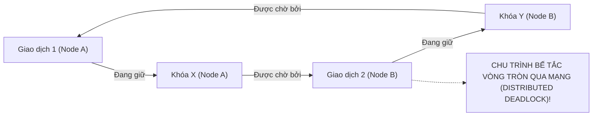

#### 4. Code ví dụ thực chiến (C++ Lock Timeout Deadlock Mitigation)
```cpp
#include <iostream>
#include <chrono>
#include <mutex>

class DistributedLockProxy {
public:
    // Ngăn chặn Deadlock bằng cách KHÔNG BAO GIỜ CHỜ KHÓA VÔ HẠN (Timed Lock)
    bool acquire_with_timeout(std::timed_mutex& mtx, int timeout_ms) {
        if (mtx.try_lock_for(std::chrono::milliseconds(timeout_ms))) {
            return true; // Lấy khóa thành công
        }
        std::cerr << "Lock Acquisition Timeout! Bỏ cuộc để phòng chống Distributed Deadlock.\n";
        return false;
    }
};

int main() {
    std::timed_mutex resource_mutex;
    DistributedLockProxy proxy;
    resource_mutex.lock(); // Giả lập tài nguyên đã bị nút khác chiếm giữ

    proxy.acquire_with_timeout(resource_mutex, 50); // Thử lấy trong 50ms rồi tự động fail-fast
    resource_mutex.unlock();
    return 0;
}
```

#### 5. Ưu / Nhược điểm, Pitfalls & Anti-patterns
- **Anti-pattern**: Mở rộng giao dịch phân tán (Distributed Locks) bao trùm qua các cuộc gọi API bên ngoài (Third-party Payment Gateway), khiến khóa bị giữ trong nhiều giây và gây nghẽn toàn bộ hệ thống.

#### 6. Ứng dụng thực tế trong Backend / Systems
- Google Spanner Lock Manager: Quản lý Wound-Wait Distributed Deadlock Prevention cho các giao dịch phân tán toàn cầu.

---

### Phần 2: Distributed System Architectures (Các Mô hình Kiến trúc Phân tán)

---

### 6. Client-Server and Multi-Tier Architecture

#### 1. Khái niệm bản chất (What & Why)
- **Client-Server**: Mô hình cơ bản nhất phân chia vai trò: Các Clients (Trình duyệt, Mobile App) gửi yêu cầu dịch vụ tới một Server tập trung; Server xử lý và trả về phản hồi.
- **Multi-Tier Architecture (Kiến trúc Đa tầng)**: Phân tách logic hệ thống thành các tầng độc lập:
  1. Presentation Tier (Giao diện người dùng / CDN).
  2. Application / Logic Tier (Web API Server / Microservices).
  3. Data Tier (Database Clusters / Caching).

#### 2. Cơ chế hoạt động sâu (Under the hood / Hardcore Internals)
- Tách biệt ranh giới bảo mật và khả năng scale độc lập: Tầng Application có thể scale ngang vô tận (Stateless) đằng sau Load Balancer mà không làm thay đổi tầng Presentation.

#### 3. Sơ đồ minh họa
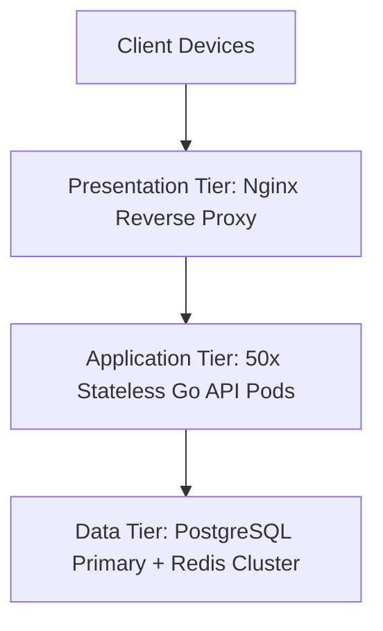

#### 4. Code ví dụ thực chiến (TypeScript Multi-Tier Controller Pattern)
```typescript
// Application Tier: Tách biệt hoàn toàn khỏi Database Tier
interface DatabaseTier {
    getUserBalance(id: string): Promise<number>;
}

class ApplicationTierService {
    constructor(private db: DatabaseTier) {}

    public async checkCreditEligibility(userId: string): Promise<boolean> {
        const balance = await this.db.getUserBalance(userId);
        return balance > 1000; // Logic nghiệp vụ tầng ứng dụng
    }
}
```

#### 5. Ưu / Nhược điểm, Pitfalls & Anti-patterns
- **Pitfall**: Đặt quá nhiều logic nghiệp vụ vào trong Stored Procedures của Database Tier, làm triệt tiêu khả năng scale của Application Tier.

#### 6. Ứng dụng thực tế trong Backend / Systems
- Kiến trúc 3 lớp kinh điển của các hệ thống doanh nghiệp (Spring Boot + PostgreSQL + React).

---

### 7. Peer-to-Peer (P2P) Architecture

#### 1. Khái niệm bản chất (What & Why)
- **Định nghĩa**: Mô hình kiến trúc phân tán phi tập trung hoàn toàn trong đó mỗi nút mạng (Peer) vừa đóng vai trò là Client (yêu cầu dữ liệu) vừa đóng vai trò là Server (cung cấp dữ liệu).
- **Nguyên lý Tự mở rộng**: Càng nhiều người tham gia mạng P2P, tổng dung lượng băng thông và năng lực tính toán của hệ thống càng tăng lên.

#### 2. Cơ chế hoạt động sâu (Under the hood / Hardcore Internals)
- **Bảng Băm Phân tán (Distributed Hash Table - DHT / Kademlia Protocol)**:
  - Dữ liệu được định tuyến dựa trên khoảng cách logic giữa mã băm của nội dung và mã băm của Node ID (phép toán XOR Metric trong Kademlia):
    $$d(x, y) = x \oplus y$$
  - Tìm kiếm bất kỳ tài nguyên nào trong mạng hàng triệu nodes chỉ tốn tối đa $\mathcal{O}(\log N)$ bước nhảy mạng (Hops).

#### 3. Sơ đồ minh họa
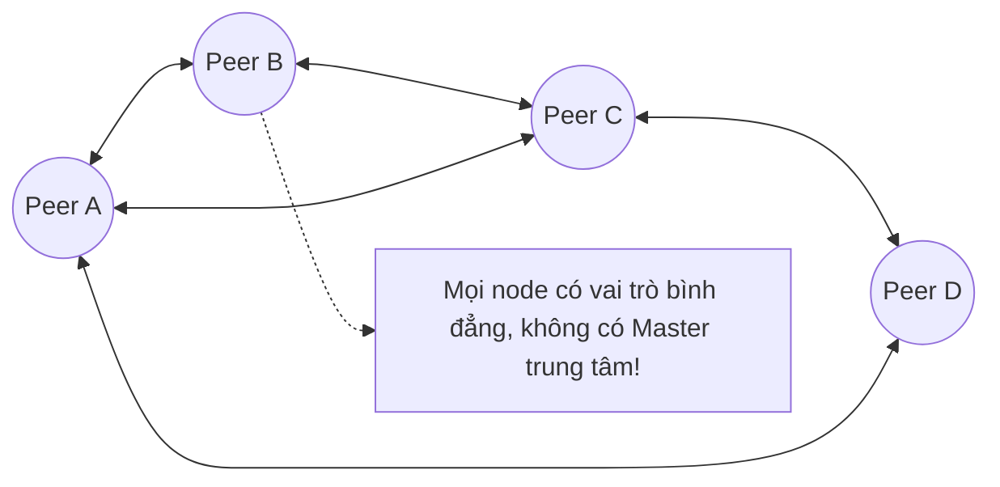

#### 4. Code ví dụ thực chiến (C++ XOR Metric Distance Calculation in Kademlia DHT)
```cpp
#include <iostream>
#include <cstdint>

// Đo khoảng cách logic giữa 2 Node ID trong mạng P2P Kademlia qua toán tử XOR
uint64_t kademlia_distance(uint64_t node_id_a, uint64_t node_id_b) {
    return node_id_a ^ node_id_b;
}

int main() {
    uint64_t my_node = 0b101100;
    uint64_t peer_1  = 0b101111; // XOR = 0b000011 = 3 (Gần hơn)
    uint64_t peer_2  = 0b010000; // XOR = 0b111100 = 60 (Xa hơn)

    std::cout << "Distance to Peer 1: " << kademlia_distance(my_node, peer_1) << "\n";
    std::cout << "Distance to Peer 2: " << kademlia_distance(my_node, peer_2) << "\n";
    return 0;
}
```

#### 5. Ưu / Nhược điểm, Pitfalls & Anti-patterns
- **Thách thức**: Hiện tượng Churn (các node tham gia và rời mạng liên tục bất ngờ) và lỗ hổng Sybil Attack (kẻ tấn công tạo ra hàng triệu node giả để thao túng mạng).

#### 6. Ứng dụng thực tế trong Backend / Systems
- Giao thức BitTorrent, Hệ thống tệp IPFS, và Mạng Blockchain Ethereum.

---

### 8. Master-Worker, Leader-Follower, and Primary-Replica Architectures

#### 1. Khái niệm bản chất (What & Why)
- **Master-Worker (Job Execution)**: Nút Master chịu trách nhiệm phân chia công việc, lập lịch và giám sát; các Worker chỉ nhận nhiệm vụ tính toán và báo cáo kết quả (ví dụ: Kubernetes Control Plane vs Worker Nodes).
- **Leader-Follower (Consensus & Protocol)**: Nút Leader được bầu chọn để quyết định thứ tự thực thi của các bản ghi log đồng thuận; các Follower sao chép thụ động theo lệnh của Leader (ví dụ: Raft).
- **Primary-Replica (Data Storage)**: Mọi thao tác ghi dữ liệu (Writes) bắt buộc phải đi vào nút Primary; các nút Replica nhận luồng sao chép để phục vụ các thao tác đọc (Reads).

#### 2. Cơ chế hoạt động sâu (Under the hood / Hardcore Internals)
- **Cơ chế Fencing Token chống Stale Leader**:
  - Khi Leader cũ bị mạng lag tưởng mình vẫn là Leader, nó có thể cố tình gửi lệnh ghi xuống storage.
  - Sử dụng **Fencing Token (Số thứ tự tăng đơn điệu)**: Storage chỉ chấp nhận lệnh ghi có Token cao hơn Token hiện tại; lệnh ghi từ Leader cũ mang Token cũ sẽ bị từ chối thẳng thừng.

#### 3. Sơ đồ minh họa
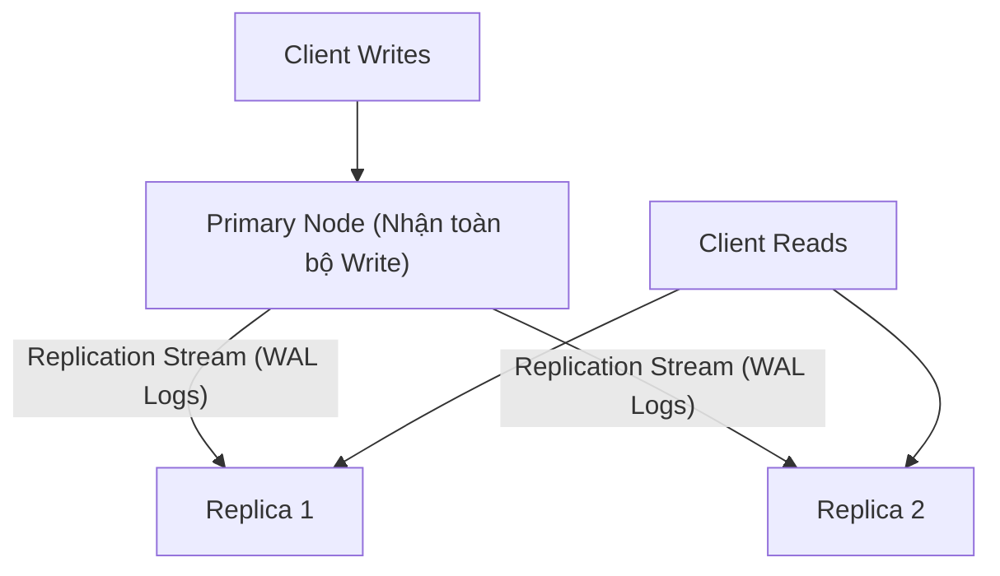

#### 4. Code ví dụ thực chiến (C++ Fencing Token Validation)
```cpp
#include <iostream>
#include <cstdint>

class StorageServerWithFencing {
    uint64_t highest_fencing_token_{0};

public:
    bool write_data(uint64_t token, const std::string& data) {
        if (token < highest_fencing_token_) {
            std::cerr << "REJECTED STALE LEADER: Token " << token 
                      << " is older than highest token " << highest_fencing_token_ << "!\n";
            return false;
        }
        highest_fencing_token_ = token;
        std::cout << "Write accepted with Fencing Token: " << token << " Data: " << data << "\n";
        return true;
    }
};

int main() {
    StorageServerWithFencing storage;
    storage.write_data(101, "Data from Leader A");
    storage.write_data(102, "Data from New Leader B");
    storage.write_data(101, "Zombie write from Stale Leader A"); // Bị chặn đứng!
    return 0;
}
```

#### 5. Ưu / Nhược điểm, Pitfalls & Anti-patterns
- **Điểm yếu**: Nút Primary/Leader là một nút thắt cổ chai về ghi dữ liệu (Write bottleneck) và tiềm ẩn nguy cơ gián đoạn dịch vụ khi Primary bị sập trong khoảng thời gian bầu chọn Primary mới (Failover window).

#### 6. Ứng dụng thực tế trong Backend / Systems
- PostgreSQL Streaming Replication, Redis Sentinel, Apache Kafka Partition Leaders.

---

### 9. Multi-Leader and Leaderless Architectures

#### 1. Khái niệm bản chất (What & Why)
- **Multi-Leader (Active-Active)**: Hệ thống cho phép nhiều nút cùng đóng vai trò là Leader tiếp nhận thao tác ghi đồng thời (thường áp dụng cho hệ thống triển khai đa trung tâm dữ liệu Multi-Datacenter).
- **Leaderless Architecture (Dynamo-Style)**: Triệt tiêu hoàn toàn khái niệm Leader. Client có thể gửi thao tác ghi tới **bất kỳ nút nào trong cụm** (hoặc gửi song song tới tất cả các nodes), sử dụng thuật toán **Quorum ($W + R > N$)** để đảm bảo tính nhất quán.

#### 2. Cơ chế hoạt động sâu (Under the hood / Hardcore Internals)
- **Thuật toán Quorum Đọc/Ghi ($W + R > N$)**:
  - Gọi $N$ là hệ số nhân bản (Replication Factor).
  - $W$ là số nút bắt buộc phải xác nhận ghi thành công (Write Quorum).
  - $R$ là số nút bắt buộc phải đọc dữ liệu về (Read Quorum).
  - Nếu $W + R > N$, theo nguyên lý chuồng bồ câu, tập hợp các nút đọc và tập hợp các nút ghi **chắc chắn phải giao nhau tại ít nhất 1 nút**. Nút giao nhau đó sẽ chứa dữ liệu phiên bản mới nhất!

#### 3. Sơ đồ minh họa
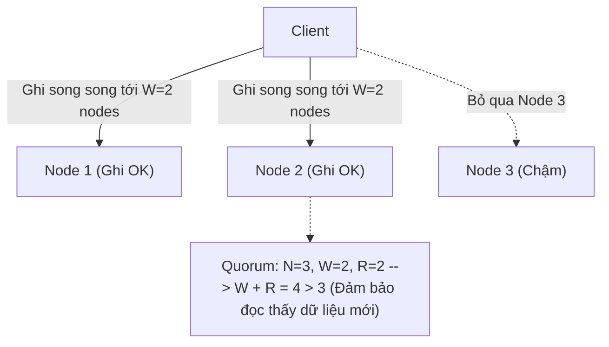

#### 4. Code ví dụ thực chiến (C++ Dynamo-Style Quorum Evaluation)
```cpp
#include <iostream>

struct QuorumConfig {
    int N; // Replication factor
    int W; // Write quorum
    int R; // Read quorum

    [[nodiscard]] bool is_strongly_consistent() const noexcept {
        return (W + R) > N;
    }
};

int main() {
    QuorumConfig cassandra_default{3, 2, 2}; // N=3, W=2, R=2
    std::cout << "Is W=2, R=2 on N=3 strictly consistent? " 
              << (cassandra_default.is_strongly_consistent() ? "YES" : "NO") << "\n"; // YES (2+2=4 > 3)
    return 0;
}
```

#### 5. Ưu / Nhược điểm, Pitfalls & Anti-patterns
- **Thách thức của Multi-Leader**: Xung đột ghi (Write Conflicts) xảy ra thường xuyên khi hai khách hàng cùng sửa đổi một dữ liệu tại hai Data Centers khác nhau, buộc phải sử dụng CRDT hoặc Version Vectors để hòa giải.

#### 6. Ứng dụng thực tế trong Backend / Systems
- Amazon DynamoDB, Apache Cassandra, Riak KV: Hiện thân chuẩn mực của kiến trúc Leaderless Quorum.

---

### 10. Service-Oriented (SOA) vs Microservices Architecture

#### 1. Khái niệm bản chất (What & Why)
- **Service-Oriented Architecture (SOA)**: Phong cách kiến trúc xuất hiện vào những năm 2000, tích hợp các ứng dụng doanh nghiệp lớn thông qua một trục truyền thông thông minh tập trung (**Enterprise Service Bus - ESB**) sử dụng các giao thức nặng nề (SOAP, XML, WSDL).
- **Microservices Architecture**: Sự tiến hóa hiện đại của SOA: Chia nhỏ ứng dụng thành các dịch vụ siêu nhỏ, độc lập, tập trung vào một năng lực nghiệp vụ duy nhất (Single Bounded Context).
- **Triết lý Microservices**: *"Smart endpoints, dumb pipes"* (Logic xử lý nằm tại các services, mạng truyền thông chỉ đóng vai trò truyền tải thô như HTTP REST, gRPC, Kafka).

#### 2. Cơ chế hoạt động sâu (Under the hood / Hardcore Internals)
- **Nguyên tắc "Database per Service"**:
  - Mỗi Microservice phải sở hữu cơ sở dữ liệu riêng biệt.
  - Tuyệt đối cấm hai service cùng truy cập trực tiếp vào cùng một schema database (Anti-pattern "Shared Database"), vì điều này phá vỡ tính đóng gói và ngăn cản việc deploy độc lập.

#### 3. Sơ đồ minh họa
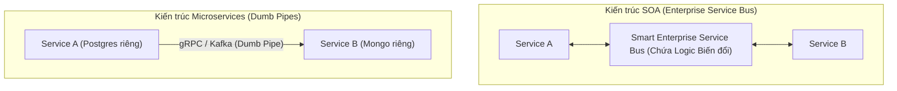

#### 4. Code ví dụ thực chiến (TypeScript Microservice Service Client)
```typescript
interface UserDto {
    id: string;
    email: string;
}

class UserMicroserviceClient {
    constructor(private baseUrl: string) {}

    public async getUserById(userId: string): Promise<UserDto> {
        // Giao tiếp qua HTTP REST nhẹ nhàng (Dumb pipe)
        const response = await fetch(`${this.baseUrl}/v1/users/${userId}`);
        if (!response.ok) throw new Error("USER_NOT_FOUND");
        return await response.json();
    }
}
```

#### 5. Ưu / Nhược điểm, Pitfalls & Anti-patterns
- **Cạm bẫy Microservices**: Chuyển sang Microservices quá sớm khi quy mô hệ thống và công ty còn nhỏ, biến độ phức tạp của code thành độ phức tạp của mạng và hạ tầng (Distributed Complexity).

#### 6. Ứng dụng thực tế trong Backend / Systems
- Netflix & Uber Architecture: Hàng nghìn microservices giao tiếp qua gRPC và Service Mesh phục vụ hàng trăm triệu người dùng.

---

### 11. Event-Driven, Serverless, and Actor Model Architectures

#### 1. Khái niệm bản chất (What & Why)
- **Event-Driven Architecture (EDA)**: Mô hình kiến trúc trong đó các dịch vụ phản ứng và giao tiếp với nhau bằng cách phát sinh (Publish) và lắng nghe (Consume) các sự kiện bất đồng bộ (Domain Events).
- **Serverless Distributed Architecture**: Ứng dụng được phân rã thành các hàm nhỏ (Functions-as-a-Service: AWS Lambda) chạy tự động kích hoạt bởi sự kiện, tự động scale từ 0 lên hàng chục nghìn thực thi và tắt đi khi không dùng.
- **Actor Model (Carl Hewitt, 1973)**: Mô hình tính toán phân tán trong đó **Actor** là đơn vị tính toán cơ sở. Mỗi Actor sở hữu một hộp thư (Mailbox), nhận message, biến đổi trạng thái nội bộ, tạo ra các Actor con và gửi message sang các Actor khác mà không cần khóa (Lock-free).

#### 2. Cơ chế hoạt động sâu (Under the hood / Hardcore Internals)
- **Actor Model Memory & Concurrency**:
  - Không có Data Races: Mỗi Actor chỉ xử lý tuần tự từng message một từ Mailbox của nó, loại bỏ hoàn toàn sự cần thiết của Mutex/Lock trong bộ nhớ.
  - Khả năng Chịu lỗi (Supervision Trees trong Erlang/OTP): Triết lý *"Let it crash"*: Nếu một Actor bị crash do lỗi, Actor cha của nó (Supervisor) sẽ tự động khởi động lại nó về trạng thái sạch ban đầu.

#### 3. Sơ đồ minh họa
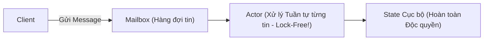

#### 4. Code ví dụ thực chiến (C++ Actor-Style Message Processing Loop)
```cpp
#include <iostream>
#include <queue>
#include <string>
#include <memory>

struct Message {
    std::string sender;
    std::string content;
};

class SimpleActor {
    std::string name_;
    std::queue<Message> mailbox_;
    int state_counter_{0};

public:
    explicit SimpleActor(std::string name) : name_(std::move(name)) {}

    void send(Message msg) {
        mailbox_.push(std::move(msg)); // Thêm vào Mailbox
    }

    void process_all_messages() {
        while (!mailbox_.empty()) {
            auto msg = mailbox_.front();
            mailbox_.pop();
            // Xử lý tuần tự không cần Lock!
            ++state_counter_;
            std::cout << "[" << name_ << "] Handled msg from " << msg.sender 
                      << ": " << msg.content << " (Internal State: " << state_counter_ << ")\n";
        }
    }
};

int main() {
    SimpleActor bank_account("AccountActor_101");
    bank_account.send({"ClientA", "DEPOSIT_50"});
    bank_account.send({"ClientB", "WITHDRAW_20"});
    bank_account.process_all_messages();
    return 0;
}
```

#### 5. Ưu / Nhược điểm, Pitfalls & Anti-patterns
- **Thách thức của EDA**: Khó truy vết luồng thực thi (Traceability) và khó debug khi có sự cố logic lan truyền qua hàng chục sự kiện bất đồng bộ nếu không có Distributed Tracing (OpenTelemetry).

#### 6. Ứng dụng thực tế trong Backend / Systems
- Hệ thống Tổng đài Viễn thông Ericsson (Erlang/OTP), Hệ thống Chat của Discord (sử dụng Elixir/Actor Model để phục vụ hàng chục triệu kết nối concurrent users).
