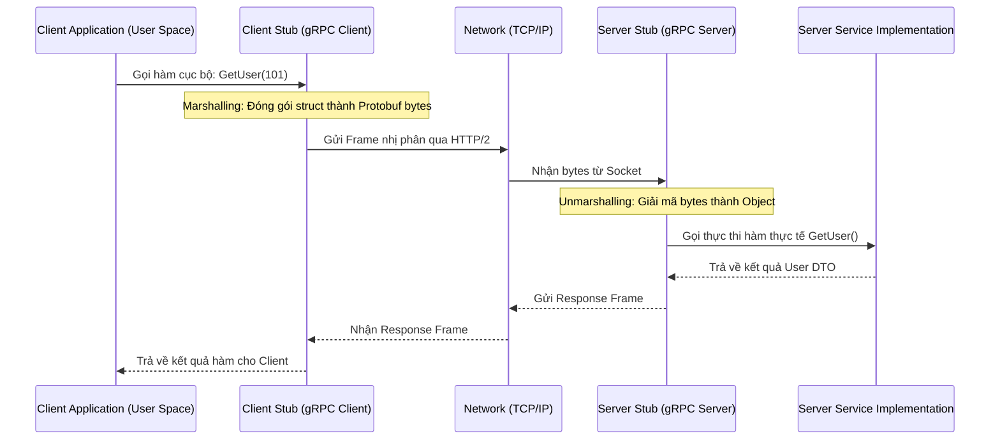
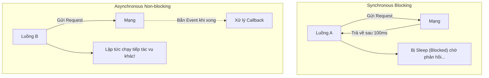
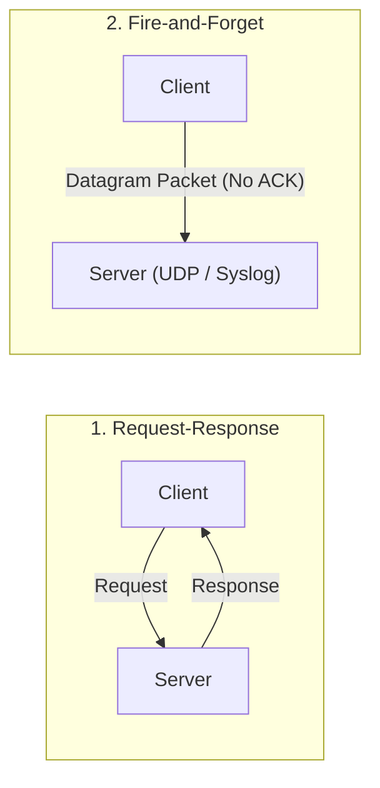
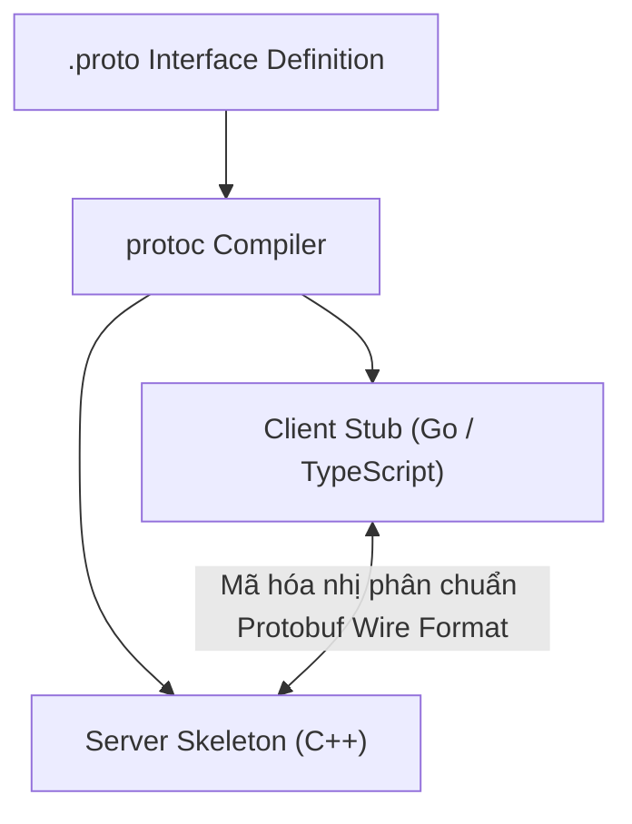
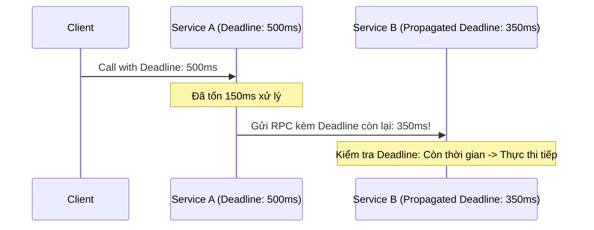
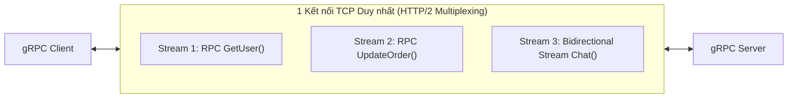
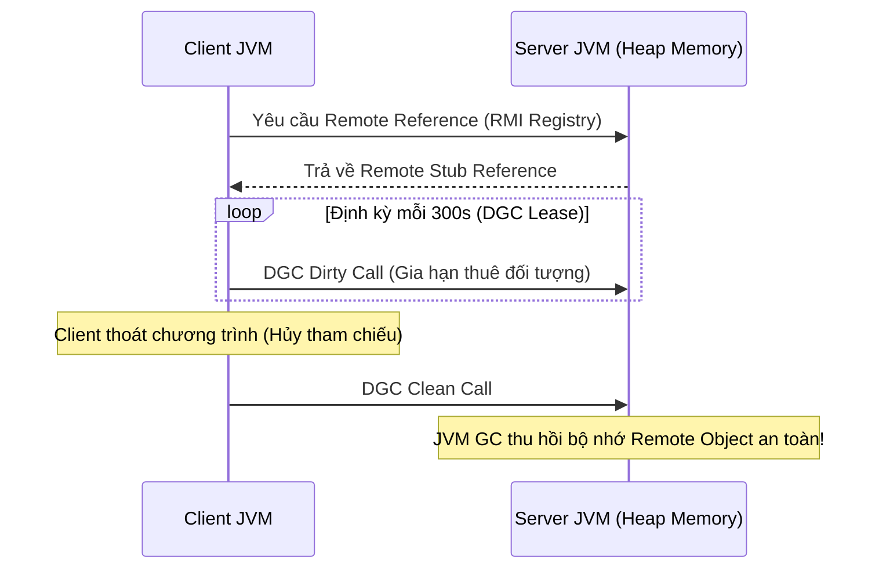

# 2.1. Communication Fundamentals, RPC, and RMI (Nền tảng Giao tiếp Phân tán, Lời gọi Thủ tục từ xa và Đối tượng từ xa)

## Tổng quan về Giao tiếp Phân tán
Trong hệ thống phân tán, các nút độc lập không chia sẻ không gian địa chỉ bộ nhớ vật lý. Mọi sự trao đổi thông tin, chia sẻ dữ liệu và phối hợp nghiệp vụ bắt buộc phải diễn ra thông qua **Truyền Thông điệp Mạng (Network Message Passing)**.

Sự tiến hóa của các mô hình giao tiếp phân tán:
$$\text{Raw Sockets (TCP/UDP)} \xrightarrow{\text{Message Framing \& Serialization}} \text{RPC (Remote Procedure Call)} \xrightarrow{\text{Object Abstraction}} \text{RMI} \xrightarrow{\text{Modern Standard}} \text{gRPC / Protocol Buffers}$$

Mô hình trừu tượng hóa cốt lõi của RPC:
$$\text{Client calls } \mathtt{foo(x, y)} \xrightarrow{\text{Marshalling}} \text{Gói tin Mạng} \xrightarrow{\text{Network}} \text{Unmarshalling} \xrightarrow{\text{Execution}} \text{Server executes } \mathtt{foo(x, y)}$$



---

## 2. Chi tiết từng Keyword (Under-the-Hood Deep Dive)

---

### Phần 1: Communication Fundamentals (Nền tảng Giao tiếp)

---

### 1. Message Passing, Remote Communication, and Network Framing

#### 1. Khái niệm bản chất (What & Why)
- **Message Passing**: Cơ chế mà hai hoặc nhiều tiến trình độc lập trao đổi các khối dữ liệu nhị phân (Messages) qua các kênh mạng mà không cần chia sẻ bộ nhớ.
- **Message Framing (Phân khung Thông điệp)**: Vì TCP là một **luồng byte liên tục không có ranh giới (Stream-oriented protocol)**, hệ thống không biết một message bắt đầu và kết thúc ở đâu. Message Framing là kỹ thuật phân tách luồng byte đó thành các message riêng biệt có ranh giới rõ ràng.
- **Ba phương pháp Phân khung kinh điển**:
  1. **Delimiter-based**: Phân tách bằng ký tự đặc biệt (ví dụ: `\n` trong HTTP/1.1 hoặc Redis RESP).
  2. **Fixed-size**: Mỗi message có độ dài cố định (ví dụ luôn là 256 bytes).
  3. **Length-prefixed (TLV - Type-Length-Value)**: Thêm một header 4 bytes ở đầu chỉ định kích thước chính xác của payload (Chuẩn dùng trong gRPC, TCP custom protocols).

#### 2. Cơ chế hoạt động sâu (Under the hood / Hardcore Internals)
- **TCP Byte Stream Splitting & Coalescing**:
  - Gói tin IP trên mạng có thể bị phân mảnh (Fragmentation) nếu vượt quá MTU (Maximum Transmission Unit $\approx 1500$ bytes).
  - Thuật toán Nagle's Algorithm (`TCP_NODELAY`) có thể gộp nhiều message nhỏ lại thành một gói tin TCP lớn.
  - Do đó, một lời gọi `read()` ở tầng Kernel có thể trả về một nửa message, hoặc trả về một lúc 3 messages lồng nhau! Bộ giải mã Framing bắt buộc phải duy trì một **Receive Ring Buffer** để tích lũy đủ số bytes theo trường Length mới được phép parse.

#### 3. Sơ đồ minh họa
```text
Cấu trúc Phân khung TLV (Length-Prefixed Framing):
+-----------------+------------------+-----------------------------------------+
| Magic (2 Bytes) | Length (4 Bytes) | Payload Data (Length Bytes - Protobuf)  |
|     0xCAFE      |   0x00000028     | [40 bytes nhị phân tuần tự hóa...]     |
+-----------------+------------------+-----------------------------------------+
```

#### 4. Code ví dụ thực chiến (C++ Length-Prefixed Frame Decoder)
```cpp
#include <iostream>
#include <vector>
#include <cstdint>
#include <cstring>
#include <arpa/inet.h>

class LengthPrefixedFrameDecoder {
    std::vector<uint8_t> buffer_;

public:
    void append_bytes(const uint8_t* data, std::size_t len) {
        buffer_.insert(buffer_.end(), data, data + len);
    }

    // Trích xuất các messages hoàn chỉnh từ luồng byte TCP
    std::vector<std::vector<uint8_t>> extract_complete_frames() {
        std::vector<std::vector<uint8_t>> frames;

        while (buffer_.size() >= sizeof(uint32_t)) {
            // Đọc 4 bytes độ dài (Length Header)
            uint32_t network_len;
            std::memcpy(&network_len, buffer_.data(), sizeof(uint32_t));
            uint32_t payload_len = ntohl(network_len);

            std::size_t total_frame_size = sizeof(uint32_t) + payload_len;
            if (buffer_.size() < total_frame_size) {
                // Chưa nhận đủ bytes của frame này -> Chờ packet tiếp theo!
                break;
            }

            // Trích xuất payload
            std::vector<uint8_t> payload(
                buffer_.begin() + sizeof(uint32_t),
                buffer_.begin() + total_frame_size
            );
            frames.push_back(std::move(payload));

            // Xóa frame đã xử lý khỏi bộ đệm
            buffer_.erase(buffer_.begin(), buffer_.begin() + total_frame_size);
        }
        return frames;
    }
};

int main() {
    LengthPrefixedFrameDecoder decoder;
    // Giả lập TCP gửi 1 frame 5 bytes ("HELLO") nhưng bị chia đôi làm 2 packets
    uint32_t len = htonl(5);
    uint8_t packet1[6]; // 4 bytes header + 2 bytes data ("HE")
    std::memcpy(packet1, &len, 4);
    packet1[4] = 'H'; packet1[5] = 'E';

    uint8_t packet2[3] = {'L', 'L', 'O'}; // 3 bytes còn lại

    decoder.append_bytes(packet1, 6);
    std::cout << "Frames extracted after packet 1: " << decoder.extract_complete_frames().size() << "\n"; // 0

    decoder.append_bytes(packet2, 3);
    auto frames = decoder.extract_complete_frames();
    std::cout << "Frames extracted after packet 2: " << frames.size() << " (Complete!)\n"; // 1
    return 0;
}
```

#### 5. Ưu / Nhược điểm, Pitfalls & Anti-patterns
- **Lỗ hổng bảo mật Frame Bomb**: Kẻ tấn công gửi header Length giả mạo cực lớn (ví dụ: `Length = 2GB`), khiến server cấp phát bộ nhớ RAM khổng lồ dẫn đến OOM Crash. Luôn phải giới hạn `MAX_FRAME_SIZE` (ví dụ tối đa 4MB).

#### 6. Ứng dụng thực tế trong Backend / Systems
- Netty Framework (Java) & Tokio (Rust): Sử dụng `LengthFieldBasedFrameDecoder` làm nền tảng xử lý gói tin cho mọi hệ thống phân tán.

---

### 2. Synchronous, Asynchronous, Blocking, and Non-blocking Communication

#### 1. Khái niệm bản chất (What & Why)
- **Synchronous (Đồng bộ)**: Tiến trình gửi yêu cầu phụ thuộc vào tiến trình nhận: Bên gửi phải chờ đợi kết quả xử lý của bên nhận trước khi tiếp tục.
- **Asynchronous (Bất đồng bộ)**: Bên gửi gửi thông điệp đi và tiếp tục làm công việc khác ngay lập tức mà không cần chờ kết quả (kết quả sẽ nhận lại sau qua Callback, Promise hoặc Event).
- **Blocking**: Luồng thực thi của tiến trình bị hệ điều hành đưa vào trạng thái Sleep (chờ I/O), nhường CPU cho tiến trình khác.
- **Non-blocking**: Lời gọi hàm I/O trả quyền điều khiển về ngay lập tức (trả về dữ liệu hoặc trả về mã lỗi `EWOULDBLOCK` nếu chưa có dữ liệu).

#### 2. Cơ chế hoạt động sâu (Under the hood / Hardcore Internals)
- **Tầng Kernel Context Switch Overhead**:
  - Mô hình Synchronous Blocking (Thread-per-request): Mỗi kết nối mạng cần 1 OS Thread. 10,000 kết nối ngốn $\approx 80\text{GB}$ RAM stack và tiêu tốn hàng triệu chu kỳ CPU chỉ để Kernel chuyển đổi ngữ cảnh (Context Switching).
  - Mô hình Asynchronous Non-blocking (Event-driven với `epoll` / `io_uring`): 1 luồng CPU duy nhất có thể phục vụ 100,000 kết nối đồng thời với lượng RAM cực nhỏ.

#### 3. Sơ đồ minh họa


#### 4. Code ví dụ thực chiến (TypeScript Async Non-blocking Request Pipeline)
```typescript
async function fetchRemoteServiceAsync(serviceUrl: string): Promise<string> {
    console.log("Gửi request bất đồng bộ... Luồng chính không hề bị chặn!");
    const response = await fetch(serviceUrl);
    return await response.text();
}

console.log("Bắt đầu gọi dịch vụ");
fetchRemoteServiceAsync("https://api.system.internal/ping")
    .then(data => console.log("Nhận kết quả async:", data))
    .catch(err => console.error("Lỗi:", err.message));
console.log("Tiếp tục thực thi các dòng mã tiếp theo ngay lập tức!");
```

#### 5. Ưu / Nhược điểm, Pitfalls & Anti-patterns
- **Anti-pattern**: Sử dụng synchronous blocking RPC bên trong một distributed transaction chuỗi ($A \to B \to C \to D$), khiến độ trễ tích lũy tăng theo cấp số nhân và xác suất lỗi bằng tổng xác suất lỗi của từng mắt xích.

#### 6. Ứng dụng thực tế trong Backend / Systems
- Node.js Libuv Event Loop & Go Runtime Concurrency: Hiện thực hóa giao tiếp bất đồng bộ phi khóa quy mô lớn.

---

### 3. Messaging Patterns: Request-Response, One-Way, and Fire-and-Forget

#### 1. Khái niệm bản chất (What & Why)
- **Request-Response (Hai chiều)**: Client gửi request và mong đợi nhận lại response tương ứng (RPC, HTTP GET/POST).
- **One-Way Messaging (Một chiều)**: Client gửi message nhưng không cần nhận dữ liệu trả về, chỉ cần xác nhận message đã tới nơi an toàn (Message Acknowledgment).
- **Fire-and-Forget (Bắn và Quên)**: Client gửi gói tin qua mạng (thường dùng UDP hoặc Async Queue) và hoàn toàn không quan tâm gói tin có tới đích hay không (không cần ACK, không cần Response).

#### 2. Cơ chế hoạt động sâu (Under the hood / Hardcore Internals)
- Fire-and-Forget đạt hiệu năng cao nhất vì loại bỏ hoàn toàn Round-Trip Time (RTT) và không cần duy trì bộ đệm trạng thái chờ phản hồi trong bộ nhớ RAM của Client.

#### 3. Sơ đồ minh họa


#### 4. Code ví dụ thực chiến (C++ Fire-and-Forget UDP Telemetry)
```cpp
#include <iostream>
#include <cstring>
#include <sys/socket.h>
#include <netinet/in.h>
#include <unistd.h>

void fire_and_forget_telemetry(const char* metric) {
    int sock = socket(AF_INET, SOCK_DGRAM, 0); // UDP Socket
    if (sock < 0) return;

    sockaddr_in dest{};
    dest.sin_family = AF_INET;
    dest.sin_port = htons(8125); // StatsD port
    dest.sin_addr.s_addr = htonl(INADDR_LOOPBACK);

    // Gửi đi và không chờ phản hồi (Fire and Forget)
    sendto(sock, metric, std::strlen(metric), 0, (struct sockaddr*)&dest, sizeof(dest));
    close(sock);
}

int main() {
    fire_and_forget_telemetry("api.requests.total:1|c");
    std::cout << "Metric dispatched without waiting for ACK.\n";
    return 0;
}
```

#### 5. Ưu / Nhược điểm, Pitfalls & Anti-patterns
- **Pitfall**: Sử dụng Fire-and-Forget cho các nghiệp vụ quan trọng (như lệnh trừ tiền ngân hàng hoặc lưu đơn hàng), dẫn đến việc gói tin bị mất trên mạng mà ứng dụng không hề hay biết.

#### 6. Ứng dụng thực tế trong Backend / Systems
- Thu thập Metrics và Distributed Tracing (StatsD, Jaeger UDP Agent): Sử dụng Fire-and-Forget để việc ghi log giám sát không làm chậm luồng xử lý chính của ứng dụng.

---

### Phần 2: Remote Procedure Call (RPC) & Modern Technologies

---

### 4. RPC Architecture: Stubs, Marshalling, and Unmarshalling

#### 1. Khái niệm bản chất (What & Why)
- **Remote Procedure Call (RPC - Bruce Jay Nelson, 1984)**: Cơ chế cho phép một chương trình máy tính gọi thực thi một hàm/thủ tục trên một máy tính khác từ xa mà cú pháp lập trình giống hệt như đang gọi một hàm cục bộ trong cùng một tiến trình.
- **Client Stub (Proxy)**: Khối mã nguồn đóng vai trò đại diện phía Client, chịu trách nhiệm đóng gói tham số hàm thành dữ liệu mạng.
- **Server Stub (Skeleton)**: Khối mã nguồn phía Server, chịu trách nhiệm nhận gói tin mạng, giải mã và gọi hàm thực tế.
- **Marshalling (Serialization)**: Quá trình chuyển đổi các tham số và cấu trúc dữ liệu phức tạp trong bộ nhớ thành định dạng chuỗi byte nhị phân để truyền qua dây cáp mạng.
- **Unmarshalling (Deserialization)**: Quá trình tái tạo lại cấu trúc dữ liệu nguyên bản từ chuỗi byte nhị phân nhận được từ mạng.

#### 2. Cơ chế hoạt động sâu (Under the hood / Hardcore Internals)
- **IDL (Interface Definition Language)**:
  - Để Client (viết bằng Python) có thể gọi RPC sang Server (viết bằng C++), hai bên phải thỏa thuận một bản hợp đồng hình thức qua file IDL (ví dụ `.proto` trong Protocol Buffers).
  - Trình biên dịch IDL (`protoc`) tự động sinh mã nguồn Stubs cho cả 2 ngôn ngữ, loại bỏ hoàn toàn việc viết mã đóng gói socket thủ công.

#### 3. Sơ đồ minh họa


#### 4. Code ví dụ thực chiến (TypeScript Mô phỏng Client Stub RPC)
```typescript
interface UserRPCRequest {
    userId: number;
}

interface UserRPCResponse {
    id: number;
    username: string;
}

// Client Stub: Che giấu chi tiết mạng đằng sau 1 hàm cục bộ
class UserServiceClientStub {
    constructor(private remoteUrl: string) {}

    public async getUser(req: UserRPCRequest): Promise<UserRPCResponse> {
        // 1. Marshalling
        const payload = JSON.stringify(req);

        // 2. Giao tiếp mạng qua HTTP/2
        const response = await fetch(`${this.remoteUrl}/UserService/GetUser`, {
            method: 'POST',
            body: payload,
            headers: { 'Content-Type': 'application/json' }
        });

        // 3. Unmarshalling
        if (!response.ok) throw new Error("RPC_CALL_FAILED");
        return (await response.json()) as UserRPCResponse;
    }
}

const client = new UserServiceClientStub("https://rpc.system.internal");
// Gọi hàm từ xa trông giống hệt gọi hàm cục bộ!
client.getUser({ userId: 101 }).then(user => console.log("User:", user.username));
```

#### 5. Ưu / Nhược điểm, Pitfalls & Anti-patterns
- **Ảo tưởng gọi hàm cục bộ**: Gọi hàm cục bộ mất vài nanoseconds và luôn thành công; gọi RPC mất vài milliseconds và có thể thất bại do mạng. Nếu không xử lý lỗi mạng, ứng dụng sẽ bị crash.

#### 6. Ứng dụng thực tế trong Backend / Systems
- Toàn bộ hạ tầng nội bộ của Google (Stubby / gRPC) và Facebook (Thrift): 100% giao tiếp giữa các microservices được thực hiện qua RPC.

---

### 5. RPC Lifecycle Controls: Timeout, Deadline, Cancellation, and Retries

#### 1. Khái niệm bản chất (What & Why)
- **RPC Timeout**: Khoảng thời gian tối đa mà Client sẵn sàng chờ đợi một phản hồi cho một cuộc gọi RPC đơn lẻ trước khi tự động hủy.
- **RPC Deadline**: Một mốc thời gian tuyệt đối trong tương lai (ví dụ: `2026-11-09 21:00:05.100`) mà toàn bộ chuỗi các cuộc gọi RPC liên hoàn phải hoàn tất.
- **Deadline Propagation (Lan truyền Deadline)**: Khi Service A gọi B, B gọi C, Deadline được truyền qua HTTP/2 Header (`grpc-timeout`). Nếu Service C nhận thấy Deadline đã trôi qua, nó **từ chối tính toán ngay lập tức**, tiết kiệm tài nguyên CPU cho toàn hệ thống!
- **RPC Cancellation**: Khả năng của Client chủ động gửi tín hiệu ngắt cuộc gọi RPC đang chạy dở trên Server khi người dùng đóng ứng dụng hoặc thoát trang.

#### 2. Cơ chế hoạt động sâu (Under the hood / Hardcore Internals)
- **Tầng HTTP/2 RST_STREAM Frame**:
  - Khi một RPC bị Timeout hoặc Cancelled, Client không đóng kết nối TCP (vì kết nối đang được chia sẻ bởi nhiều luồng qua multiplexing).
  - Client gửi một frame **`RST_STREAM`** với mã lỗi `CANCELLED`. Kernel/gRPC engine phía Server nhận được frame này sẽ lập tức hủy bỏ context của hàm (`context.Done()`) và dừng mọi câu truy vấn database đang chạy.

#### 3. Sơ đồ minh họa


#### 4. Code ví dụ thực chiến (C++ gRPC Client Context with Deadline)
```cpp
#include <iostream>
#include <chrono>

struct MockClientContext {
    std::chrono::system_clock::time_point deadline;

    void set_deadline_after_ms(int ms) {
        deadline = std::chrono::system_clock::now() + std::chrono::milliseconds(ms);
    }

    [[nodiscard]] bool is_expired() const {
        return std::chrono::system_clock::now() > deadline;
    }
};

int main() {
    MockClientContext context;
    context.set_deadline_after_ms(100); // Đặt Deadline 100ms

    std::cout << "RPC Dispatched. Is expired now? " << context.is_expired() << "\n"; // 0 (False)
    return 0;
}
```

#### 5. Ưu / Nhược điểm, Pitfalls & Anti-patterns
- **Anti-pattern**: Thực hiện retry một RPC không có tính lũy suy (Non-idempotent RPC: ví dụ API thanh toán `ChargeCreditCard`) khi gặp timeout, khiến khách hàng bị trừ tiền nhiều lần.

#### 6. Ứng dụng thực tế trong Backend / Systems
- Google gRPC & Go `context.Context`: Cơ chế chuẩn hóa bắt buộc phải có cho mọi production microservice.

---

### 6. gRPC, Protocol Buffers, and Alternative RPC Frameworks

#### 1. Khái niệm bản chất (What & Why)
- **gRPC (Google Remote Procedure Call)**: Framework RPC mã nguồn mở hiệu năng cao hiện đại bậc nhất, hoạt động trên nền tảng truyền tải **HTTP/2** và định dạng nhị phân **Protocol Buffers**.
- **Protocol Buffers (Protobuf)**: Cơ chế tuần tự hóa dữ liệu nhị phân độc lập ngôn ngữ và nền tảng của Google, cho kích thước gói tin nhỏ hơn từ 3-10 lần và tốc độ serialize/deserialize nhanh hơn từ 5-20 lần so với JSON/XML.
- **Các Frameworks thay thế**:
  - **Apache Thrift (Facebook)**: Hỗ trợ đa ngôn ngữ phong phú, có khả năng tùy biến protocol và transport tầng thấp.
  - **JSON-RPC / XML-RPC**: Sử dụng text format đơn giản, dễ debug nhưng hiệu năng kém.
  - **Connect RPC**: Chuẩn RPC hiện đại tương thích 100% với gRPC nhưng hỗ trợ chạy trực tiếp trên trình duyệt Web mà không cần gRPC-Web proxy.

#### 2. Cơ chế hoạt động sâu (Under the hood / Hardcore Internals)
- **Sức mạnh của HTTP/2 trong gRPC**:
  - **Multiplexing (Ghép kênh)**: Hàng nghìn cuộc gọi RPC đồng thời có thể chạy chung trên **1 kết nối TCP duy nhất** mà không bị tắc nghẽn Head-of-Line Blocking ở tầng ứng dụng.
  - **HPACK Header Compression**: Nén các HTTP Headers lặp lại, tiết kiệm băng thông mạng.
  - **Streaming RPC**: Hỗ trợ 4 kiểu gọi: Unary (1-1), Server Streaming (1-N), Client Streaming (N-1), và Bi-directional Streaming (Song công hai chiều thời gian thực).

#### 3. Sơ đồ minh họa


#### 4. Code ví dụ thực chiến (Protobuf IDL Definition)
```protobuf
syntax = "proto3";

package banking.v1;

// Định nghĩa hợp đồng RPC Interface
service PaymentService {
    rpc ProcessTransaction (PaymentRequest) returns (PaymentResponse);
}

message PaymentRequest {
    string idempotency_key = 1; // Field tag 1
    int64 amount_cents = 2;     // Varint encoding
    string currency = 3;
}

message PaymentResponse {
    enum Status {
        STATUS_UNSPECIFIED = 0;
        STATUS_SUCCESS = 1;
        STATUS_DECLINED = 2;
    }
    Status status = 1;
    string transaction_id = 2;
}
```

#### 5. Ưu / Nhược điểm, Pitfalls & Anti-patterns
- **Nhược điểm**: Khó đọc trực tiếp bằng mắt người (Human-unreadable binary) và cần công cụ chuyên dụng (như Postman gRPC hoặc `grpcurl`) để kiểm thử thay vì dùng `curl` đơn giản.

#### 6. Ứng dụng thực tế trong Backend / Systems
- Giao tiếp Service-to-Service trong Kubernetes, kết nối giữa Envoy Proxy và Control Plane (xDS API).

---

### Phần 3: Remote Method Invocation (RMI) & Distributed Objects

---

### 7. Remote Method Invocation (RMI) and Distributed Garbage Collection

#### 1. Khái niệm bản chất (What & Why)
- **Remote Method Invocation (RMI)**: Một mở rộng hướng đối tượng của mô hình RPC (tiêu biểu trong Java RMI). Thay vì chỉ gọi các thủ tục hàm độc lập, RMI cho phép một chương trình gọi trực tiếp một **phương thức trên một Đối tượng (Object Method)** đang cư trú trong bộ nhớ của một máy ảo từ xa.
- **Remote Object (Đối tượng Từ xa)**: Một object có các phương thức có thể được gọi từ một JVM khác.
- **Remote Reference**: Một con trỏ đại diện cục bộ trỏ tới đối tượng từ xa.
- **Distributed Garbage Collection (DGC)**: Cơ chế dọn rác bộ nhớ tự động xuyên qua mạng: Khi không còn bất kỳ client nào trên mạng giữ Remote Reference tới một Remote Object, bộ nhớ của object đó trên server mới được phép giải phóng.

#### 2. Cơ chế hoạt động sâu (Under the hood / Hardcore Internals)
- **Cơ chế DGC Lease (Thuê bao Giữ đối tượng)**:
  - Client định kỳ gửi các thông điệp "Lease Renewal" (Gia hạn thời gian thuê) tới Server để thông báo rằng nó vẫn đang giữ con trỏ đối tượng.
  - Nếu Client bị sập nguồn hoặc đứt mạng khiến hết thời gian Lease, Server DGC tự động giảm biến đếm tham chiếu (Reference Counter) và kích hoạt Java Virtual Machine GC dọn dẹp vùng nhớ Heap của đối tượng đó.

#### 3. Sơ đồ minh họa


#### 4. Code ví dụ thực chiến (Khái niệm Phân rã Đối tượng Từ xa trong C++)
```cpp
#include <iostream>
#include <memory>
#include <string>

// Giao diện Đối tượng Từ xa (Remote Interface)
class IRemoteBankAccount {
public:
    virtual ~IRemoteBankAccount() = default;
    virtual void deposit(int amount) = 0;
    virtual int get_balance() = 0;
};

// Cài đặt thực tế trên Server (Server Skeleton)
class BankAccountImpl : public IRemoteBankAccount {
    int balance_{0};
public:
    void deposit(int amount) override { balance_ += amount; }
    int get_balance() override { return balance_; }
};
```

#### 5. Ưu / Nhược điểm, Pitfalls & Anti-patterns
- **Lý do RMI bị thoái trào trong Điện toán Hiện đại**:
  - Gắn chặt vào một ngôn ngữ duy nhất (Java Coupling).
  - Lỗ hổng bảo mật chết người liên quan đến Java Deserialization Vulnerabilities (kẻ tấn công gửi bytecode độc hại qua RMI payload để chiếm quyền điều khiển server - RCE).
  - Rò rỉ bộ nhớ (Distributed Memory Leaks) khi các lease không được quản lý hoàn hảo.

#### 6. Ứng dụng thực tế trong Backend / Systems
- Các hệ thống Enterprise Java cũ (EJB - Enterprise JavaBeans), nay đã được thay thế hoàn toàn bởi gRPC, GraphQL và RESTful APIs.
